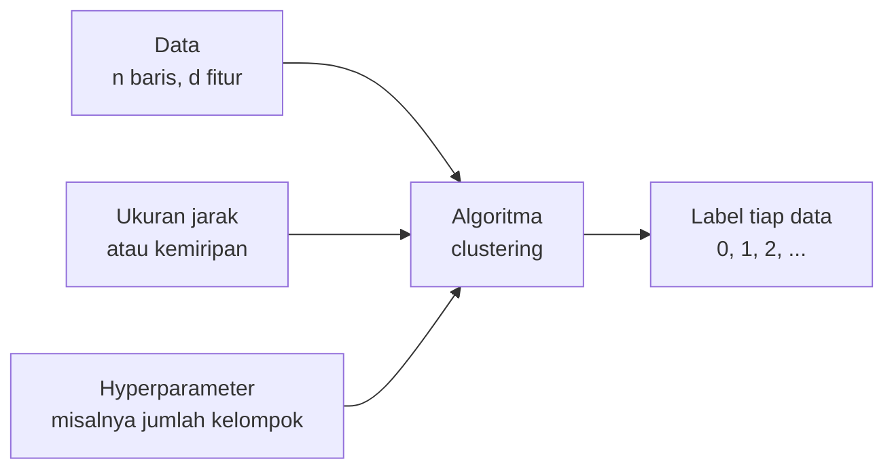
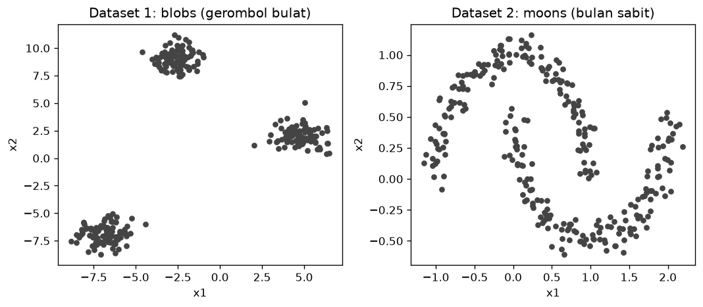
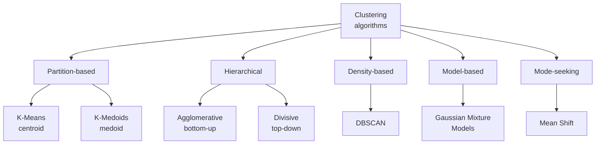
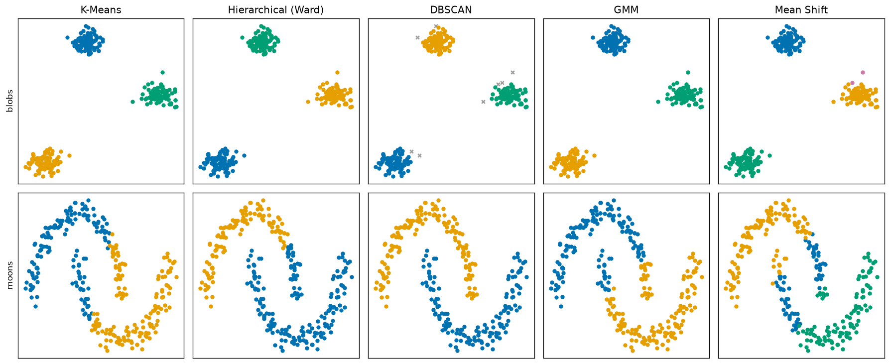
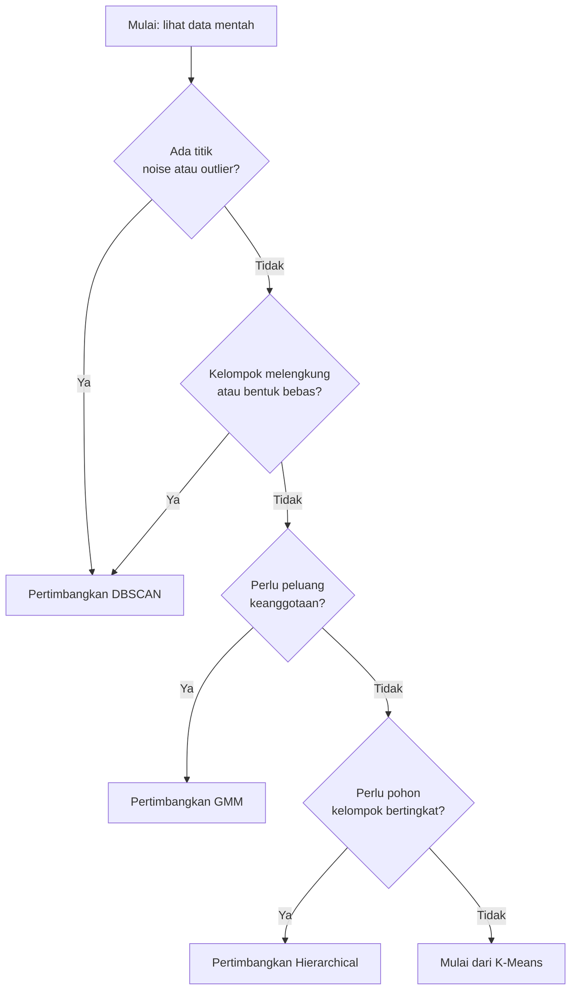

# Bab 1 — Introduction to Clustering Algorithms

## Learning Objectives

Setelah mempelajari bab ini, kamu mampu:

- [x] Menjelaskan apa itu *clustering algorithm* dan apa bedanya dengan *tujuan* clustering.
- [x] Menjelaskan mengapa ada banyak algoritma clustering, bukan satu yang terbaik untuk semua data.
- [x] Membedakan lima pendekatan: *partition-based*, *hierarchical*, *density-based*, *model-based*, dan *mode-seeking*.
- [x] Membedakan pendekatan berbasis *centroid* dan berbasis *medoid*.
- [x] Membedakan *hard clustering* dan *soft clustering*.
- [x] Menyebut enam faktor yang memengaruhi pemilihan algoritma.
- [x] Mengenali modul clustering di scikit-learn dan pola pemakaiannya (`fit`, `fit_predict`, `labels_`, `predict`).
- [x] Menjalankan lima algoritma pada dua dataset dan membaca perbedaan hasilnya.

## Introduction

Bayangkan kamu menata seratus buku di rak. Kamu bisa mengelompokkannya menurut **genre**, menurut **nama penulis**, menurut **warna sampul**, atau menurut **ukuran**. Semuanya masuk akal, tetapi hasilnya berbeda, karena setiap cara punya definisi "buku yang sejenis" sendiri.

Algoritma clustering mirip seperti itu. Di Level 3 kamu sudah belajar bahwa clustering adalah mengelompokkan data berdasarkan kemiripan, tanpa label. Namun "mirip" dan "satu kelompok" bisa didefinisikan dengan banyak cara:

- Satu kelompok adalah titik-titik yang **dekat dengan pusat yang sama**.
- Satu kelompok adalah titik-titik yang **bergabung bertahap** dari yang paling dekat.
- Satu kelompok adalah **daerah yang padat** dan dipisahkan oleh daerah yang jarang.
- Satu kelompok adalah data yang berasal dari **distribusi probabilitas yang sama**.

Setiap definisi melahirkan satu keluarga algoritma. Level 4 mempelajari lima di antaranya, satu bab untuk satu algoritma, lalu membandingkannya di bab terakhir.

| Bab | Algoritma | Ide singkat |
|---|---|---|
| 1 | Pengantar (bab ini) | Peta keluarga algoritma dan cara memakainya di scikit-learn |
| 2 | K-Means | Titik terdekat ke pusat kelompok |
| 3 | Hierarchical Clustering | Menggabungkan kelompok secara bertahap |
| 4 | DBSCAN | Daerah padat dipisahkan daerah jarang |
| 5 | Gaussian Mixture Models | Setiap kelompok adalah distribusi Gaussian |
| 6 | Mean Shift | Titik bergeser menuju puncak kepadatan |
| 7 | Perbandingan | Memilih algoritma menurut karakter data |

!!! note "Prasyarat"
    Bab ini memakai istilah dari [Level 3](../fundamental-clustering/index.md): *centroid* ([Bab 3](../fundamental-clustering/03-centroid-and-cluster-representation.md)), jarak ([Bab 5](../fundamental-clustering/05-distance-metrics.md)), dan alur kerja clustering ([Bab 7](../fundamental-clustering/07-clustering-workflow.md)). Kalau ada yang terasa asing, baca bab itu dulu.

## Fundamental Concepts

| Istilah | Arti |
|---|---|
| **Clustering algorithm** | Prosedur langkah demi langkah yang menerima data (dan beberapa pengaturan) lalu menghasilkan nomor kelompok untuk tiap data |
| **Estimator** | Istilah scikit-learn untuk objek yang bisa "belajar" dari data lewat `fit`. `KMeans(...)` adalah estimator |
| **Hyperparameter** | Pengaturan yang kamu tentukan **sebelum** algoritma berjalan, misalnya jumlah kelompok `n_clusters` |
| **Hard clustering** | Setiap data masuk tepat satu kelompok |
| **Soft clustering** | Setiap data punya **peluang** (probabilitas) untuk tiap kelompok |
| **Partition-based** | Membagi data langsung menjadi \( K \) kelompok. Contoh: K-Means |
| **Hierarchical** | Membangun hierarki kelompok, dari kelompok kecil ke besar atau sebaliknya |
| **Density-based** | Kelompok = daerah yang padat. Contoh: DBSCAN |
| **Model-based** | Menganggap data berasal dari model probabilitas. Contoh: Gaussian Mixture Models |
| **Mode-seeking** | Mencari "puncak" kepadatan data. Contoh: Mean Shift |
| **Centroid** | Titik pusat kelompok berupa **rata-rata** anggotanya (Level 3, Bab 3) |
| **Medoid** | Titik pusat kelompok berupa **salah satu data asli** |
| **Noise** | Titik yang tidak dimasukkan ke kelompok mana pun (hanya sebagian algoritma yang mengenalinya) |
| **Label** | Nomor kelompok hasil algoritma. Hanya penanda, bukan peringkat |

## Detailed Explanation

### Apa itu clustering algorithm?

**Tujuan** clustering sudah kamu kenal: menemukan kelompok alami pada data tanpa label. **Algoritma** clustering adalah *cara* mencapai tujuan itu. Satu tujuan bisa dikerjakan dengan banyak cara, seperti satu kota bisa dicapai lewat beberapa jalan.

Secara umum, setiap algoritma clustering melakukan hal berikut:



Tiga masukan memengaruhi hasil: **datanya**, **cara mengukur jarak**, dan **hyperparameter**. Mengubah salah satunya bisa mengubah hasil.

### Mengapa ada banyak algoritma clustering?

Karena **tidak ada satu definisi "kelompok" yang cocok untuk semua data**. Perhatikan dua dataset yang akan kita pakai di bab ini:



- Dataset kiri (*blobs*): tiga gerombol bulat dan terpisah jelas. Definisi "dekat dengan pusat yang sama" bekerja dengan baik.
- Dataset kanan (*moons*): dua bentuk melengkung yang saling mengait. Titik di ujung satu bulan sabit bisa **lebih jauh** dari pusat bulannya sendiri daripada dari pusat bulan lain. Definisi "dekat dengan pusat" tidak cocok. Definisi "daerah padat yang tersambung" lebih cocok.

Jadi algoritma yang berbeda dibuat untuk **struktur data yang berbeda**. Memilih algoritma berarti menebak struktur apa yang mungkin ada pada datamu, lalu menguji tebakan itu.

### Peta lima pendekatan



**1. Partition-based.** Data dibagi langsung menjadi \( K \) kelompok, dan \( K \) ditentukan di awal. Algoritma mencari pembagian yang membuat anggota tiap kelompok sedekat mungkin dengan wakil kelompoknya. **K-Means** (Bab 2) adalah contoh paling terkenal. Wakil kelompoknya adalah *centroid*.

**Centroid dan medoid.** Pada pendekatan *centroid-based*, wakil kelompok adalah rata-rata anggota, yang bisa jatuh di titik yang bukan data asli. Pada pendekatan *medoid-based* (misalnya *K-Medoids*), wakil kelompok harus salah satu data asli, yaitu data yang paling "di tengah". Medoid lebih tahan terhadap *outlier* dan bisa dipakai dengan ukuran jarak yang lebih bebas (Level 3, Bab 3 membandingkan keduanya). K-Medoids **tidak** ada di scikit-learn inti (tersedia di paket tambahan terpisah), sehingga tidak kita pakai di Level 4.

**2. Hierarchical.** Alih-alih satu pembagian, algoritma membangun **pohon kelompok**. *Agglomerative* (bottom-up) mulai dari setiap data sebagai kelompok sendiri, lalu menggabungkan dua kelompok terdekat berulang-ulang. *Divisive* (top-down) mulai dari satu kelompok besar, lalu memecahnya. Hasilnya digambar sebagai **dendrogram** (Bab 3).

**3. Density-based.** Kelompok adalah **daerah padat** yang dipisahkan daerah jarang. Bentuk kelompok bebas, dan titik di daerah jarang bisa ditandai sebagai *noise*. **DBSCAN** adalah contohnya (Bab 4).

**4. Model-based.** Data dianggap berasal dari campuran beberapa distribusi probabilitas, misalnya beberapa distribusi Gaussian. Algoritma memperkirakan parameter tiap distribusi. Hasilnya bersifat **soft**: tiap data punya peluang untuk tiap kelompok. **Gaussian Mixture Models** (Bab 5).

**5. Mode-seeking.** Bayangkan data sebagai peta ketinggian, dengan daerah padat sebagai puncak bukit. Tiap titik bergeser menanjak sampai ke puncak, dan titik yang sampai ke puncak yang sama menjadi satu kelompok. **Mean Shift** (Bab 6). Pendekatan ini sering dikelompokkan bersama density-based karena sama-sama memakai kepadatan. Di Level 4 kita pisahkan supaya ide "mencari puncak" lebih jelas.

!!! note "Pengelompokan ini adalah alat bantu belajar"
    Para ahli mengelompokkan algoritma dengan cara yang sedikit berbeda, dan beberapa algoritma bisa masuk dua keluarga. Anggap peta di atas sebagai cara mengingat ide utamanya, bukan aturan baku.

### Hard clustering dan soft clustering

| | Hard clustering | Soft clustering |
|---|---|---|
| Hasil per data | Satu nomor kelompok | Satu **daftar peluang**, satu per kelompok |
| Contoh | K-Means, hierarchical, DBSCAN, Mean Shift | Gaussian Mixture Models |
| Cocok jika | Batas kelompok tegas | Kelompok tumpang tindih dan kamu ingin tahu seberapa yakin |

Pada soft clustering kamu tetap bisa mendapat satu nomor kelompok, yaitu kelompok dengan peluang terbesar. Bedanya, kamu juga tahu **seberapa yakin** algoritma itu.

### Enam faktor pemilihan algoritma

| Faktor | Pertanyaan | Dampak |
|---|---|---|
| **Ukuran dataset** | Berapa banyak baris? | Algoritma yang harus menghitung jarak semua pasangan data menjadi lambat dan boros memori pada data besar. K-Means umumnya paling mudah diskalakan |
| **Jumlah fitur** | Berapa kolom? | Makin banyak fitur, jarak makin kurang informatif (Level 3, Bab 6). Semua algoritma berbasis jarak terdampak, terutama yang bergantung pada kepadatan |
| **Bentuk kelompok** | Bulat, memanjang, melengkung? | K-Means cocok untuk kelompok bulat dan kompak. DBSCAN dan hierarchical dengan linkage tertentu bisa mengikuti bentuk bebas. GMM menangani bentuk elips |
| **Kepadatan kelompok** | Apakah kepadatannya seragam? | DBSCAN memakai satu ukuran lingkungan untuk semua daerah, sehingga sulit jika kepadatan sangat beragam |
| **Noise dan outlier** | Adakah titik pencilan? | DBSCAN bisa menandai noise. K-Means memaksa semua titik masuk kelompok dan *outlier* bisa menarik centroid |
| **Ukuran jarak** | Jarak apa yang bermakna? | Sebagian algoritma terikat pada jarak Euclidean, sebagian mengizinkan jarak lain lewat parameter `metric` |

Tidak satu pun faktor ini berdiri sendiri. Bab 7 menyusunnya menjadi panduan keputusan.

### Modul clustering di scikit-learn

Scikit-learn menyediakan algoritma clustering di dua tempat:

- `sklearn.cluster`: `KMeans`, `MiniBatchKMeans`, `BisectingKMeans`, `AgglomerativeClustering`, `DBSCAN`, `OPTICS`, `HDBSCAN`, `MeanShift`, `Birch`, `SpectralClustering`, `AffinityPropagation`, dan lainnya.
- `sklearn.mixture`: `GaussianMixture` dan `BayesianGaussianMixture`.

Perhatikan bahwa **`GaussianMixture` ada di `sklearn.mixture`, bukan di `sklearn.cluster`**. Walaupun dipakai untuk clustering, ia adalah model probabilitas.

Kita hanya memakai lima: `KMeans`, `AgglomerativeClustering`, `DBSCAN`, `GaussianMixture`, dan `MeanShift`.

Semua estimator scikit-learn memakai pola yang mirip:

| Anggota | Fungsi |
|---|---|
| `model = Algoritma(...)` | Membuat objek dan menetapkan hyperparameter. Belum ada data yang diproses |
| `model.fit(X)` | Menjalankan algoritma pada data `X` |
| `model.fit_predict(X)` | `fit` lalu langsung mengembalikan label tiap data |
| `model.labels_` | Label hasil `fit` (tidak semua estimator punya, lihat bagian Output) |
| `model.predict(X_baru)` | Memberi label pada data **baru** (tidak semua estimator punya) |

Tanda garis bawah di akhir nama (`labels_`) adalah konvensi scikit-learn: atribut yang baru ada **setelah** `fit`.

### Algoritma yang dibahas di Level 4

| Algoritma | Keluarga | Hyperparameter utama | Mengenal noise? | Hard / soft |
|---|---|---|---|---|
| K-Means | Partition (centroid) | `n_clusters` | Tidak | Hard |
| Agglomerative Clustering | Hierarchical | `n_clusters` atau `distance_threshold`, `linkage` | Tidak | Hard |
| DBSCAN | Density-based | `eps`, `min_samples` | **Ya** (label `-1`) | Hard |
| Gaussian Mixture | Model-based | `n_components`, `covariance_type` | Tidak | **Soft** |
| Mean Shift | Mode-seeking | `bandwidth` | Tidak (kecuali diatur lewat `cluster_all`) | Hard |

Tabel ini adalah ringkasan. Setiap sel dijelaskan di bab masing-masing.

## Mathematical Foundation

Bab pengantar ini hanya memerlukan notasi umum. Rumus tiap algoritma dibahas di bab masing-masing. Di sini kita pasang kerangkanya.

### Hard clustering sebagai fungsi

Misalkan data adalah \( X = \{\mathbf{x}_1, \dots, \mathbf{x}_n\} \) dengan \( n \) observation, tiap \( \mathbf{x}_i \) punya \( d \) fitur. Algoritma **hard clustering** adalah fungsi yang memberi tiap data satu label:

$$
f(\mathbf{x}_i) = c_i \in \{0, 1, \dots, K-1\}
$$

Untuk algoritma yang mengenal noise seperti DBSCAN, label diperluas dengan nilai khusus \( -1 \):

$$
c_i \in \{-1, 0, 1, \dots, K-1\}
$$

Di sini \( c_i \) adalah label data ke-\( i \), dan \( -1 \) berarti "noise, bukan anggota kelompok mana pun". Konvensi ini yang dipakai scikit-learn.

### Soft clustering sebagai tabel peluang

Pada **soft clustering**, hasilnya adalah angka \( r_{ik} \), yaitu peluang data ke-\( i \) milik kelompok ke-\( k \):

$$
0 \le r_{ik} \le 1
\qquad \text{dan} \qquad
\sum_{k=1}^{K} r_{ik} = 1
$$

Penjelasan: setiap peluang berada di antara 0 dan 1, dan peluang satu data untuk semua kelompok **berjumlah 1**. Label hard diperoleh dengan memilih peluang terbesar:

$$
c_i = \arg\max_k \; r_{ik}
$$

**Contoh angka.** Satu data punya peluang \( (r_{i1}, r_{i2}, r_{i3}) = (0{,}70;\; 0{,}20;\; 0{,}10) \).

1. Jumlahnya \( 0{,}70 + 0{,}20 + 0{,}10 = 1 \), jadi sah.
2. Peluang terbesar adalah 0,70, yaitu kelompok pertama. Maka label hard-nya adalah kelompok pertama.
3. Informasi tambahannya: algoritma "70% yakin". Data dengan peluang \( (0{,}40;\; 0{,}35;\; 0{,}25) \) juga masuk kelompok pertama, tetapi dengan keyakinan jauh lebih rendah.

Hard clustering adalah kasus khusus: peluangnya hanya 0 atau 1, misalnya \( (1, 0, 0) \).

### Apa yang berbeda antar keluarga?

Perbedaannya ada pada **kriteria** yang dipakai untuk menyebut sesuatu sebagai kelompok. Tabel berikut hanya pratinjau. Semua simbolnya dijelaskan lengkap di bab masing-masing.

| Algoritma | Kriteria utama (pratinjau) | Bab |
|---|---|---|
| K-Means | Meminimalkan jumlah kuadrat jarak titik ke centroid kelompoknya: \( \sum_{k}\sum_{\mathbf{x}\in C_k}\lVert \mathbf{x}-\mu_k\rVert^2 \) | 2 |
| Hierarchical | Menggabungkan dua kelompok dengan jarak antar-kelompok (linkage) terkecil | 3 |
| DBSCAN | Titik inti memiliki cukup tetangga dalam radius \( \varepsilon \): \( \lvert N_\varepsilon(\mathbf{x})\rvert \ge \text{min\_samples} \) | 4 |
| GMM | Memaksimalkan peluang data di bawah campuran Gaussian: \( p(\mathbf{x})=\sum_k \pi_k\,\mathcal{N}(\mathbf{x}\mid\mu_k,\Sigma_k) \) | 5 |
| Mean Shift | Menggeser titik ke rata-rata tetangganya sampai berhenti di puncak kepadatan | 6 |

### Jarak: bahan dasar hampir semua algoritma

Hampir semua algoritma di atas memakai jarak. Ingat jarak Euclidean dari Level 3, Bab 5:

$$
d(\mathbf{a}, \mathbf{b}) = \sqrt{\sum_{j=1}^{d} (a_j - b_j)^2}
$$

**Contoh.** Titik \( \mathbf{a} = (1, 2) \) dan \( \mathbf{b} = (4, 6) \):

$$
d(\mathbf{a}, \mathbf{b}) = \sqrt{(1-4)^2 + (2-6)^2} = \sqrt{9 + 16} = \sqrt{25} = 5
$$

Jarak ini muncul di semua bab Level 4. Sebagai gambaran, DBSCAN akan memakai angka seperti ini: jika radius lingkungan \( \varepsilon = 4 \), kedua titik **bukan** tetangga (karena \( 5 > 4 \)); jika \( \varepsilon = 5 \), keduanya bertetangga (karena \( 5 \le 5 \)).

## Python Implementation

Kita kerjakan dalam delapan langkah. **Setiap potongan kode diikuti penjelasannya.** Skrip lengkapnya ada di `examples/level-4/01_introduction_to_clustering_algorithms.py`, dan versi notebook-nya di `notebooks/level-4/01-introduction-to-clustering-algorithms.ipynb`.

**Konteks masalah:** kita ingin tahu bagaimana lima algoritma berbeda memperlakukan data yang sama, dan apa yang sama dari cara memakainya.

**Dataset:** dua dataset sintetis dari scikit-learn, masing-masing 300 titik dengan dua fitur. Dataset sintetis dipilih karena kita bisa mengatur bentuknya dan menggambarnya dengan jelas di dua dimensi:

- `make_blobs`: tiga gerombol bulat dan terpisah. Contoh paling "ramah" bagi algoritma berbasis centroid.
- `make_moons`: dua bulan sabit yang saling mengait. Contoh bentuk non-linear yang menantang algoritma berbasis centroid.

**Pustaka:** NumPy, pandas, Matplotlib, scikit-learn.

!!! note "Label asli tidak dipakai"
    `make_blobs` dan `make_moons` juga menghasilkan label asli (kelompok yang dipakai saat data dibangkitkan). Pada bab ini label itu **dibuang** (diberi nama `_`), karena clustering adalah *unsupervised*. Kita juga tidak menghitung skor yang membandingkannya dengan hasil algoritma. Penilaian formal adalah materi Level 5.

### Langkah 1 — Siapkan alat

```python
--8<-- "level-4/01_introduction_to_clustering_algorithms.py:setup"
```

**Penjelasan:**

- `import numpy as np` memanggil *NumPy*, pustaka untuk array angka. `np` hanya nama singkat.
- `import pandas as pd` memanggil pandas untuk tabel. `import matplotlib.pyplot as plt` memanggil Matplotlib untuk grafik.
- `from sklearn.datasets import make_blobs, make_moons` mengambil dua pembangkit data sintetis.
- Tanda kurung pada `from sklearn.cluster import ( ... )` membolehkan kita menulis daftar impor di banyak baris. Kita mengambil empat algoritma dan satu fungsi bantu, `estimate_bandwidth`, yang dipakai Mean Shift.
- `GaussianMixture` diambil dari **`sklearn.mixture`**, bukan `sklearn.cluster`, seperti dijelaskan sebelumnya.

### Langkah 2 — Buat dua dataset

```python
--8<-- "level-4/01_introduction_to_clustering_algorithms.py:data"
```

**Penjelasan:**

- `make_blobs(n_samples=300, centers=3, cluster_std=0.8, random_state=42)` membangkitkan 300 titik di sekitar 3 pusat. `cluster_std=0.8` mengatur sebaran tiap gerombol (makin kecil makin rapat). `random_state=42` mengunci acakan supaya hasilnya sama setiap kali dijalankan.
- Fungsi ini mengembalikan **dua** hal: data dan label asli. Penulisan `X_blobs, _ = ...` menyimpan data ke `X_blobs` dan membuang label ke `_`. Nama `_` adalah kebiasaan Python untuk "nilai ini tidak dipakai".
- `make_moons(n_samples=300, noise=0.07, ...)` membangkitkan dua bulan sabit. `noise=0.07` menambahkan sedikit goyangan acak supaya titik tidak persis di satu garis lengkung.
- `X_blobs.shape` bernilai `(300, 2)`: 300 baris (titik) dan 2 kolom (fitur).
- `pd.DataFrame(X_blobs, columns=["x1", "x2"]).head().round(3)` membungkus array menjadi tabel hanya untuk dicetak: nama kolom `x1` dan `x2`, lima baris pertama, dibulatkan tiga desimal.

### Langkah 3 — Lihat kedua dataset

```python
--8<-- "level-4/01_introduction_to_clustering_algorithms.py:plotdata"
```

**Penjelasan:**

- `plt.subplots(1, 2, figsize=(9, 4))` membuat satu baris berisi dua bidang gambar. `axes` adalah daftar kedua bidang itu.
- Daftar berisi tiga-serangkai `(ax, X, judul)` memungkinkan kita menggambar kedua dataset dengan satu perulangan `for`, tanpa menulis kode yang sama dua kali.
- `X[:, 0]` berarti "semua baris, kolom pertama" (nilai `x1`), dan `X[:, 1]` kolom kedua (`x2`). Keduanya menjadi sumbu x dan y.
- `plt.tight_layout()` merapikan jarak antar-bidang supaya judul dan label tidak bertabrakan.

Hasilnya adalah gambar dua dataset di bagian Detailed Explanation. **Selalu lihat data mentah dulu** sebelum memilih algoritma.

### Langkah 4 — Buat lima algoritma lewat satu fungsi

```python
--8<-- "level-4/01_introduction_to_clustering_algorithms.py:models"
```

**Penjelasan:**

- `def build_models(n_clusters, eps, bandwidth):` mendefinisikan fungsi yang menerima tiga pengaturan dan mengembalikan **kamus** (`dict`) berisi lima algoritma. Fungsi dipakai supaya kita bisa membuat ulang kelima algoritma dengan pengaturan berbeda untuk dataset kedua.
- `KMeans(n_clusters=n_clusters, n_init=10, random_state=42)`: K-Means dengan jumlah kelompok yang diminta. `n_init=10` berarti algoritma dijalankan 10 kali dari awal yang berbeda lalu diambil hasil terbaik, dan `random_state=42` mengunci acakannya. Detailnya di Bab 2.
- `AgglomerativeClustering(n_clusters=n_clusters, linkage="ward")`: hierarchical bottom-up. `linkage="ward"` adalah cara mengukur jarak antar kelompok (Bab 3).
- `DBSCAN(eps=eps, min_samples=5)`: `eps` adalah radius lingkungan, dan `min_samples=5` adalah jumlah tetangga minimum agar sebuah titik dianggap padat (Bab 4). DBSCAN **tidak** meminta jumlah kelompok.
- `GaussianMixture(n_components=n_clusters, random_state=42)`: `n_components` adalah jumlah distribusi Gaussian, yang di sini kita samakan dengan jumlah kelompok (Bab 5).
- `MeanShift(bandwidth=bandwidth)`: `bandwidth` adalah lebar lingkungan untuk mencari puncak kepadatan (Bab 6). Mean Shift juga **tidak** meminta jumlah kelompok.

Perhatikan: kelima objek dibuat dengan cara yang sama, yaitu `NamaAlgoritma(pengaturan)`. Hanya pengaturannya yang berbeda.

### Langkah 5 — Jalankan semua algoritma pada data blobs

```python
--8<-- "level-4/01_introduction_to_clustering_algorithms.py:fit"
```

**Penjelasan:**

- `estimate_bandwidth(X_blobs, quantile=0.2, random_state=42)` adalah fungsi bantu scikit-learn yang **memperkirakan** `bandwidth` dari jarak antar-titik. `quantile=0.2` berarti memakai jarak yang mewakili sekitar 20% tetangga terdekat. Kita bahas di Bab 6. Di sini kita pakai saja sebagai nilai awal.
- `build_models(n_clusters=3, eps=0.7, bandwidth=bw_blobs)` membuat kelima algoritma. Kita memilih 3 kelompok karena dari gambar terlihat tiga gerombol.
- `for name, model in models.items():` mengulang tiap pasangan (nama, objek) pada kamus.
- `model.fit_predict(X_blobs)` menjalankan algoritma dan mengembalikan **array label**, satu angka per titik (panjangnya 300).
- `np.unique(labels, return_counts=True)` mengembalikan label-label yang muncul dan berapa kali masing-masing muncul. `.tolist()` mengubah array menjadi daftar biasa supaya dicetak rapi.
- `{name:<20}` pada f-string berarti "tulis `name` rata kiri dalam lebar 20 karakter", supaya kolomnya sejajar.

### Langkah 6 — Bandingkan kemampuan tiap objek

```python
--8<-- "level-4/01_introduction_to_clustering_algorithms.py:table"
```

**Penjelasan:**

- `hasattr(model, "labels_")` menjawab `True` atau `False`: apakah objek `model` **punya** anggota bernama `labels_`. Kita tidak memanggil fungsinya, hanya memeriksa keberadaannya.
- `hasattr(model, "cluster_centers_") or hasattr(model, "means_")` memeriksa apakah ada pusat kelompok. K-Means dan Mean Shift menyimpannya sebagai `cluster_centers_`, sedangkan GMM sebagai `means_`.
- Tiap algoritma menghasilkan satu kamus kecil, yang dikumpulkan di daftar `rows`. `pd.DataFrame(rows)` mengubah daftar kamus menjadi tabel, dan `.to_string(index=False)` mencetaknya tanpa nomor baris.

### Langkah 7 — Jalankan lima algoritma pada dua dataset

```python
--8<-- "level-4/01_introduction_to_clustering_algorithms.py:grid"
```

**Penjelasan:**

- `settings` adalah kamus yang menyimpan data dan pengaturan untuk tiap dataset. Untuk blobs kita meminta 3 kelompok dan `eps=0.7`. Untuk moons kita meminta 2 kelompok dan `eps=0.2`.
- Perulangan `for data_name, cfg in settings.items():` di luar, dan `for algo_name, model in models.items():` di dalam, menjalankan **semua kombinasi** (2 dataset × 5 algoritma = 10 percobaan).
- `results[(data_name, algo_name)] = ...` menyimpan label tiap percobaan. Kuncinya berupa pasangan (*tuple*), misalnya `("moons", "DBSCAN")`.
- `set(labels) - {-1}` mengambil label unik lalu **membuang** `-1` (noise). `len(...)` menghitung sisanya, yaitu jumlah kelompok sebenarnya.
- `np.sum(labels == -1)` menghitung berapa elemen yang bernilai `-1`. Ekspresi `labels == -1` menghasilkan array `True/False`, dan `True` dihitung sebagai 1.

!!! warning "Pengaturan dipilih dengan melihat data"
    Nilai `eps=0.7`, `eps=0.2`, dan jumlah kelompok di atas dipilih setelah melihat gambar kedua dataset. Itu wajar untuk belajar. Pada data nyata dengan banyak fitur, kamu tidak bisa "melihat" kelompoknya. Menilai pengaturan yang baik tanpa melihat gambar adalah topik Level 5.

### Langkah 8 — Gambar hasilnya

```python
--8<-- "level-4/01_introduction_to_clustering_algorithms.py:plotgrid"
```

**Penjelasan:**

- `palette` adalah daftar warna yang dibedakan dengan baik, termasuk untuk pembaca buta warna. `palette[k % len(palette)]` memakai operator sisa-bagi `%` agar nomor kelompok yang besar tetap mendapat warna (kembali ke awal daftar).
- `plt.subplots(2, 5, ...)` membuat 2 baris (dataset) × 5 kolom (algoritma).
- `for k in sorted(set(labels)):` menggambar satu kelompok per putaran. `mask = labels == k` memilih titik milik kelompok `k`, dan `X[mask, 0]` mengambil `x1` titik-titik itu.
- Label `-1` (noise) digambar **abu-abu dengan tanda x**, supaya terlihat berbeda dari kelompok sungguhan.
- `ax.set_xticks([])` dan `ax.set_yticks([])` menyembunyikan angka sumbu supaya gambar tidak ramai. Yang penting di sini adalah **bentuk** pengelompokan.
- `axes[row, 0].set_ylabel(data_name)` menulis nama dataset di sisi kiri tiap baris.

## Code Explanation

Ringkasan alur skrip:

| Bagian | Peran |
|---|---|
| `make_blobs`, `make_moons` | Membangkitkan data sintetis dengan seed tetap |
| `build_models` | Menyatukan lima algoritma dalam satu kamus |
| `fit_predict` | Satu perintah yang sama untuk kelima algoritma |
| `np.unique(..., return_counts=True)` | Menghitung ukuran tiap kelompok |
| `hasattr` | Memeriksa kemampuan tiap objek tanpa memanggilnya |
| Perulangan dua tingkat | Menjalankan semua kombinasi dataset × algoritma |
| `set(labels) - {-1}` | Menghitung kelompok tanpa menghitung noise |

Pelajaran terpenting dari kode ini: **cara memakai** kelima algoritma hampir identik (`buat objek → fit_predict → baca label`). Yang membedakan adalah *pengaturan* dan *cara berpikir* di balik algoritmanya.

## How to Run

Dari folder utama proyek (setelah mengaktifkan lingkungan virtual):

```powershell
pip install -r requirements-notebooks.txt
python examples/level-4/01_introduction_to_clustering_algorithms.py
```

Skrip mencetak output ke terminal dan menyimpan dua gambar ke `docs/assets/level-4/`. Untuk versi interaktif:

```powershell
jupyter notebook notebooks/level-4/01-introduction-to-clustering-algorithms.ipynb
```

Output di bawah berasal dari eksekusi nyata dengan Python 3.14, NumPy 2.5.2, scikit-learn 1.9.0, dan Matplotlib 3.11.1.

## Expected Output

```text
--8<-- "level-4/outputs/01.txt"
```

Gambar yang dihasilkan (baris atas dataset blobs, baris bawah dataset moons):



### Interpretasi output

**1. Pada dataset blobs**, K-Means, Hierarchical (Ward), dan GMM memberi tiga kelompok dengan 100 anggota masing-masing. Ketiganya sepakat karena gerombolnya bulat dan terpisah jelas. Ukuran 100 kebetulan sama dengan jumlah titik per pusat yang dipakai pembangkit data, tetapi kita tidak memakai label asli itu untuk menilai apa pun.

**2. DBSCAN pada blobs** menemukan 3 kelompok dan **8 titik noise** (label `-1`, tanda x abu-abu). Titik-titik itu berada di tepi gerombol yang lebih jarang. Dengan `eps=0.7` dan `min_samples=5`, titik di tepi tidak punya cukup tetangga. Ini contoh bahwa hasil DBSCAN bergantung pada `eps` dan `min_samples`. Kamu akan bermain dengan keduanya di Bab 4.

**3. Mean Shift pada blobs** menemukan **4** kelompok, tiga besar dan satu kelompok kecil berisi 2 titik (merah muda, di bagian atas gerombol kanan). Kita tidak meminta jumlah kelompok. Algoritma menentukannya sendiri dari `bandwidth`, dan bandwidth yang kurang besar membuat dua titik di tepi membentuk puncak kecil tersendiri. Bab 6 membahas pemilihan bandwidth.

**4. Pada dataset moons**, K-Means, Hierarchical (Ward), dan GMM membelah data **tanpa mengikuti bentuk bulan sabit**: tiap bulan terpotong dan sebagian ujungnya bergabung dengan bulan lain. Ini terjadi karena ketiganya mencari kelompok yang kompak di sekitar pusat atau elips, sedangkan bentuk bulan sabit tidak kompak. Hanya **DBSCAN** yang menghasilkan dua kelompok yang secara visual mengikuti dua bulan sabit. Mean Shift menghasilkan tiga kelompok.

**5. Tabel kemampuan objek:**

| Pengamatan | Artinya |
|---|---|
| `Hierarchical (Ward)` dan `DBSCAN` **tidak punya** `predict()` | Keduanya hanya bisa memberi label pada data yang kamu `fit`. Data baru tidak bisa langsung dilabeli |
| `GMM` **tidak punya** `labels_` tetapi punya `predict()` | Label GMM diturunkan dari peluang, dihitung dengan `predict` atau `fit_predict` |
| Hanya `GMM` punya `predict_proba()` | Hanya GMM yang memberi **peluang** keanggotaan, yaitu soft clustering |
| `K-Means`, `GMM`, `Mean Shift` punya pusat | Ketiganya punya "wakil" kelompok. Hierarchical dan DBSCAN tidak |

!!! tip "Kesimpulan penting dari satu gambar"
    Tidak ada algoritma yang menang di kedua baris. Hasil terbaik pada blobs tidak menjamin hasil terbaik pada moons. Inilah alasan Level 4 mempelajari beberapa algoritma, dan alasan Bab 7 menyusun panduan memilihnya.

## Practical Examples

Contoh berikut menunjukkan bagaimana karakter masalah mengarah ke pilihan algoritma. Ini panduan awal, bukan aturan mutlak.

| Situasi | Algoritma yang patut dicoba | Alasan |
|---|---|---|
| Segmentasi pelanggan Mall Customers (Level 3, Bab 7): kelompok kira-kira bulat, data cukup besar | K-Means | Sederhana, cepat, hasilnya mudah dijelaskan lewat centroid |
| Menyusun taksonomi spesies atau hubungan antar-gen | Hierarchical | Hasilnya berupa pohon (dendrogram) yang menunjukkan kedekatan bertingkat |
| Titik lokasi GPS dengan beberapa tempat ramai dan titik tersesat | DBSCAN | Mengikuti bentuk bebas dan menandai titik tersesat sebagai noise |
| Pelanggan dengan beberapa peran yang tumpang tindih; kamu ingin peluang tiap kelompok | GMM | Memberi probabilitas keanggotaan |
| Menyegmentasi gambar berdasarkan warna tanpa menentukan jumlah segmen di awal | Mean Shift | Jumlah kelompok mengikuti puncak kepadatan |

Pertanyaan yang membantumu memulai:



Diagram ini sengaja disederhanakan. Pada data nyata beberapa jawaban bisa "ya" sekaligus, dan kamu perlu mencoba lebih dari satu algoritma. Bab 7 mengembangkannya.

## Hands-on Exercises

1. Ubah `n_clusters` K-Means pada dataset blobs menjadi 4. Berapa ukuran keempat kelompoknya? Apa yang terjadi pada salah satu gerombol asli?
2. Ubah `eps` DBSCAN pada dataset blobs menjadi 1.0, lalu 0.4. Berapa jumlah kelompok dan jumlah noise pada tiap nilai?
3. Ubah `eps` DBSCAN pada dataset moons menjadi 0.05, lalu 0.5. Apa yang terjadi?
4. Ubah `quantile` pada `estimate_bandwidth` blobs menjadi 0.1, 0.3, dan 0.5. Berapa jumlah kelompok Mean Shift pada tiap nilai?
5. Latih `GaussianMixture(n_components=2, random_state=42)` pada `X_moons`, lalu panggil `predict_proba(X_moons)`. Berapa banyak titik yang peluang tertingginya di bawah 0,9? Apa artinya?
6. Mengapa `DBSCAN` tidak punya `predict`? Apa yang harus kamu lakukan jika ingin melabeli titik baru dengan K-Means?

??? question "Jawaban"
    Hasil nomor 1 sampai 5 berasal dari eksekusi nyata dengan seed yang sama.

    1. Ukuran keempat kelompok: **49, 100, 100, 51**. Dua gerombol asli tetap utuh (100 titik), sedangkan satu gerombol **dibelah dua** (49 dan 51) karena K-Means dipaksa membuat 4 kelompok.
    2. Dengan `eps=1.0`: 3 kelompok dan **2** titik noise (ukuran 99, 100, 99). Dengan `eps=0.4`: **5** kelompok dan **52** titik noise (ukuran 78, 79, 81, 5, 5). `eps` yang terlalu kecil membuat banyak titik dianggap noise dan gerombol terpecah menjadi kelompok-kelompok kecil.
    3. Dengan `eps=0.05`: DBSCAN menemukan 3 kelompok kecil (5, 8, dan 5 anggota) dan **282** titik noise, karena radius terlalu kecil untuk menyambung titik. Dengan `eps=0.5`: hanya **1** kelompok berisi 300 titik, karena radius yang besar menyambung kedua bulan sabit menjadi satu.
    4. `quantile=0.1` memberi bandwidth 0,989 dan **4** kelompok (99, 100, 100, 1). `quantile=0.3` memberi bandwidth 2,215 dan **3** kelompok (masing-masing 100). `quantile=0.5` memberi bandwidth 11,723 dan hanya **1** kelompok (300). Bandwidth yang terlalu besar menyatukan semuanya.
    5. **37** titik punya peluang tertinggi di bawah 0,9 (peluang terendahnya 0,519). Artinya GMM kurang yakin pada titik-titik itu, yaitu titik yang berada di daerah antara kedua kelompok yang dibentuk GMM. Informasi ini tidak tersedia pada K-Means.
    6. DBSCAN menentukan kelompok dari **kepadatan seluruh data yang di-fit**. Titik baru tidak punya aturan penempatan yang jelas dan bisa mengubah kepadatan. Dengan K-Means, setelah `fit` kamu bisa memanggil `model.predict(X_baru)`, yang menempatkan tiap titik baru ke centroid terdekat.

## Troubleshooting

| Masalah | Penyebab | Solusi |
|---|---|---|
| `ImportError: cannot import name 'GaussianMixture' from 'sklearn.cluster'` | `GaussianMixture` ada di modul lain | Tulis `from sklearn.mixture import GaussianMixture` |
| `AttributeError: 'DBSCAN' object has no attribute 'predict'` | DBSCAN dan `AgglomerativeClustering` tidak punya `predict` | Pakai `fit_predict(X)` atau baca `labels_` setelah `fit` |
| `AttributeError: 'GaussianMixture' object has no attribute 'labels_'` | GMM tidak menyimpan `labels_` | Pakai `fit_predict(X)` atau `predict(X)` |
| `ValueError: manhattan was provided as metric. Ward can only work with euclidean distances` | `linkage="ward"` hanya mendukung jarak Euclidean | Pakai `metric="euclidean"`, atau pilih linkage lain (Bab 3) |
| Mean Shift menghasilkan 1 kelompok atau terlalu banyak kelompok | `bandwidth` terlalu besar atau terlalu kecil | Coba beberapa nilai `quantile` pada `estimate_bandwidth` (Bab 6) |
| DBSCAN menandai hampir semua titik sebagai `-1` | `eps` terlalu kecil atau `min_samples` terlalu besar | Naikkan `eps` atau turunkan `min_samples` (Bab 4) |
| Nomor kelompok berbeda dari output di bab | Versi scikit-learn atau `random_state` lain | Bandingkan **ukuran** dan bentuk kelompok, bukan nomornya. Nomor boleh tertukar |
| `FileNotFoundError` saat menjalankan skrip | Skrip diubah sehingga tidak berjalan dari folder utama proyek | Jalankan dari folder utama, atau gunakan notebook yang berpindah folder otomatis |

## Summary

- **Algoritma clustering** adalah cara menemukan kelompok. Tujuannya sama, tetapi definisi "kelompok" berbeda-beda sehingga ada banyak algoritma.
- Lima pendekatan di Level 4: **partition-based** (K-Means), **hierarchical**, **density-based** (DBSCAN), **model-based** (GMM), dan **mode-seeking** (Mean Shift).
- **Centroid** adalah rata-rata anggota kelompok, sedangkan **medoid** adalah salah satu data asli.
- **Hard clustering** memberi satu label per data. **Soft clustering** memberi peluang per kelompok, dengan jumlah peluang 1.
- Enam faktor pemilihan algoritma: ukuran dataset, jumlah fitur, bentuk kelompok, kepadatan, noise dan outlier, serta ukuran jarak.
- Di scikit-learn, algoritma ada di `sklearn.cluster` dan `sklearn.mixture`. Pola pakainya mirip: buat objek, `fit` atau `fit_predict`, lalu baca label.
- Tidak semua objek punya `labels_`, `predict`, atau `predict_proba`. DBSCAN menandai noise dengan label `-1`.
- Pada eksperimen kita, K-Means, Ward, dan GMM cocok untuk blobs tetapi memotong moons, sedangkan DBSCAN mengikuti bentuk moons. Tidak ada algoritma yang unggul di semua data.

**Bab berikutnya:** Bab 2 membahas **K-Means** secara mendalam: langkah algoritmanya, fungsi objektif, inisialisasi centroid, dan implementasi dari nol dengan NumPy.

## References

- Scikit-learn documentation: [*Clustering*](https://scikit-learn.org/stable/modules/clustering.html), termasuk tabel perbandingan metode dan parameter.
- Scikit-learn documentation: [*Gaussian mixture models*](https://scikit-learn.org/stable/modules/mixture.html).
- Scikit-learn documentation: [`make_blobs`](https://scikit-learn.org/stable/modules/generated/sklearn.datasets.make_blobs.html) dan [`make_moons`](https://scikit-learn.org/stable/modules/generated/sklearn.datasets.make_moons.html).
- Jain, A. K., Murty, M. N., & Flynn, P. J. (1999). Data clustering: a review. *ACM Computing Surveys*, 31(3), 264–323.
- Xu, R., & Wunsch, D. (2005). Survey of clustering algorithms. *IEEE Transactions on Neural Networks*, 16(3), 645–678.
- Hastie, T., Tibshirani, R., & Friedman, J. (2009). *The Elements of Statistical Learning* (2nd ed.), Bab 14: Unsupervised Learning. Springer.
