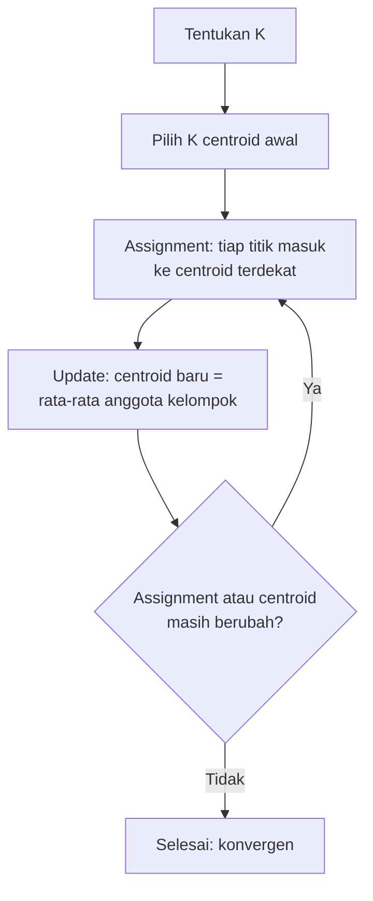
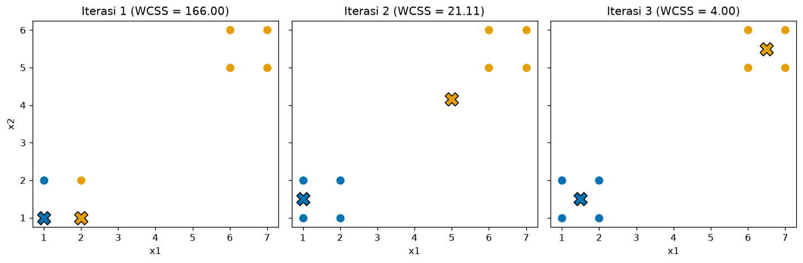
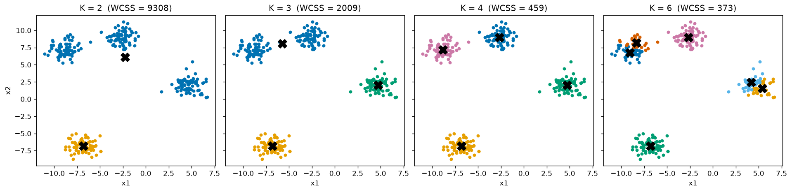
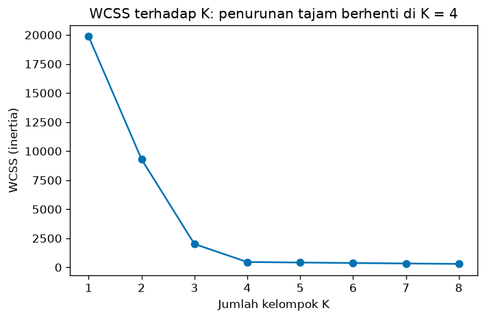
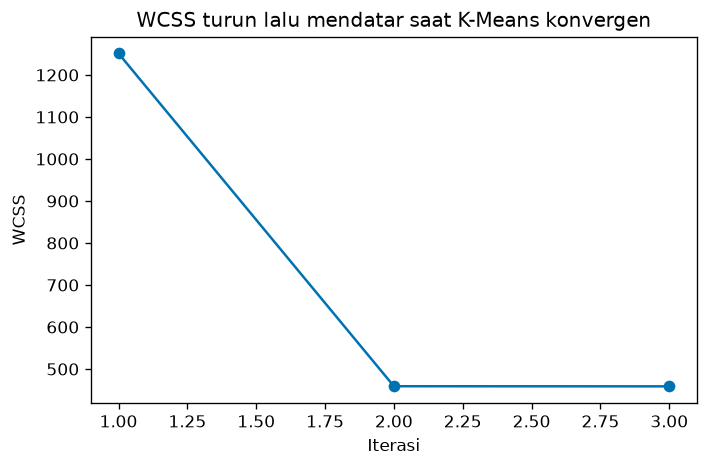
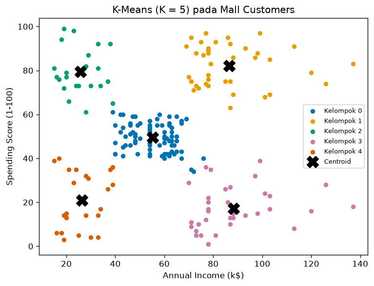

# Bab 2 — K-Means Clustering

## Learning Objectives

Setelah mempelajari bab ini, kamu mampu:

- [x] Menjelaskan cara kerja K-Means dengan bahasamu sendiri.
- [x] Menyebut asumsi dan karakteristik K-Means.
- [x] Menjalankan dua langkah inti, *assignment* dan *update*, secara manual pada data kecil.
- [x] Menjelaskan fungsi objektif K-Means (*WCSS*) dan mengapa algoritma ini pasti berhenti.
- [x] Membedakan inisialisasi *random* dan *k-means++*, serta mengerti fungsi `n_init`.
- [x] Memilih nilai K dengan bantuan grafik *elbow* (tanpa evaluasi formal).
- [x] Menulis K-Means dari nol dengan NumPy, lalu membandingkannya dengan `KMeans` scikit-learn.
- [x] Mengatur parameter `n_clusters`, `init`, `n_init`, `max_iter`, `tol`, dan `random_state`.
- [x] Menerapkan K-Means pada Mall Customers dan memberi label pada pelanggan baru.
- [x] Mengenali keterbatasan dan kesalahan umum K-Means.

## Introduction

Bayangkan sebuah kota akan membuka **tiga posko layanan** dan ingin tiap rumah dilayani posko yang terdekat. Kamu mulai dengan menaruh tiga posko di tempat sembarang. Lalu kamu mengulang dua hal:

1. **Setiap rumah memilih posko terdekat.**
2. **Setiap posko pindah ke titik tengah rumah-rumah yang memilihnya.**

Setelah beberapa putaran, posko berhenti berpindah. Rumah-rumah yang dilayani satu posko membentuk satu kelompok. Itulah **K-Means**: algoritma clustering paling terkenal, dengan *K* sebagai jumlah kelompok (posko) yang kamu tentukan sendiri.

Di Level 3, kamu sudah memakai K-Means sebagai "kotak hitam" pada Mall Customers. Bab ini membuka kotaknya. Kita akan melihat apa yang terjadi di dalam, menulisnya sendiri dengan NumPy, lalu memakai versi scikit-learn.

!!! note "Prasyarat"
    Bab ini memakai konsep dari Level 3: [centroid sebagai rata-rata](../fundamental-clustering/03-centroid-and-cluster-representation.md), [jarak Euclidean](../fundamental-clustering/05-distance-metrics.md), dan [alur kerja clustering](../fundamental-clustering/07-clustering-workflow.md). Penyamaan skala dibahas di [Level 2, Bab 10](../data-exploration-and-preprocessing/10-feature-scaling.md).

## Fundamental Concepts

| Istilah | Arti |
|---|---|
| **K** | Jumlah kelompok. **Kamu** yang menentukan sebelum algoritma berjalan |
| **Centroid** | Titik pusat kelompok, yaitu rata-rata semua anggotanya |
| **Assignment step** | Langkah memasukkan tiap titik ke kelompok dengan centroid terdekat |
| **Update step** | Langkah menghitung ulang centroid sebagai rata-rata anggota kelompok |
| **Iterasi** | Satu putaran assignment lalu update |
| **Konvergen** | Kondisi ketika assignment dan centroid tidak berubah lagi |
| **WCSS** | *Within-Cluster Sum of Squares*: jumlah kuadrat jarak setiap titik ke centroid kelompoknya. Di scikit-learn disebut `inertia_` |
| **Inisialisasi** | Cara memilih centroid awal. Pilihan: *random* atau *k-means++* |
| **Local minimum** | Hasil akhir yang "cukup baik" tetapi bukan yang terbaik, karena algoritma terjebak pada titik awal yang kurang beruntung |
| **Lloyd's algorithm** | Nama resmi prosedur dua langkah di atas. Inilah yang dijalankan `KMeans` secara bawaan |

## Detailed Explanation

### Karakteristik dan asumsi K-Means

K-Means bekerja baik jika data memenuhi kira-kira hal berikut:

1. **Kelompok berbentuk bulat dan kompak** (*convex*). K-Means mengukur jarak ke satu titik pusat, sehingga kelompok yang dibayangkan adalah "gumpalan" di sekitar pusat.
2. **Ukuran kelompok tidak terlalu berbeda.** Batas antar-kelompok adalah garis lurus yang berada di tengah dua centroid.
3. **Sebaran kelompok kira-kira sama.** Tidak ada kelompok yang jauh lebih longgar daripada yang lain.
4. **Fitur berskala sebanding.** Jarak Euclidean peka terhadap skala (Level 2, Bab 10).
5. **Jumlah kelompok K diketahui atau bisa diperkirakan.**

Ciri lainnya: setiap titik masuk **tepat satu** kelompok (*hard clustering*) dan tidak ada konsep *noise*. Setiap kelompok punya centroid, yang membuatnya mudah dijelaskan: "kelompok ini adalah pelanggan tipikal dengan pendapatan 55 dan skor belanja 49".

### Algoritma K-Means langkah demi langkah



Dalam bahasa biasa:

1. **Tentukan K**, misalnya 2.
2. **Pilih K centroid awal.** Bisa dari K titik data yang dipilih acak, atau dengan cara yang lebih cerdas (k-means++).
3. **Assignment.** Hitung jarak tiap titik ke setiap centroid. Titik masuk ke kelompok dengan centroid terdekat.
4. **Update.** Hitung rata-rata anggota tiap kelompok. Rata-rata itu menjadi centroid baru.
5. **Ulangi langkah 3 dan 4** sampai tidak ada perubahan (atau sampai batas iterasi tercapai).

### Contoh hitungan manual pada 8 titik

Delapan titik berada di dua gerombol: empat di kiri bawah dan empat di kanan atas.

| Titik | A | B | C | D | E | F | G | H |
|---|---|---|---|---|---|---|---|---|
| \( (x_1, x_2) \) | (1, 1) | (2, 1) | (1, 2) | (2, 2) | (6, 5) | (7, 5) | (6, 6) | (7, 6) |

Kita pilih \( K = 2 \) dan **sengaja memilih centroid awal yang buruk**: \( \mu_1 = (1, 1) \) dan \( \mu_2 = (2, 1) \), keduanya di gerombol kiri. Lihat apakah algoritma bisa pulih.

**Iterasi 1, assignment.** Ambil titik D \( (2, 2) \):

- Jarak ke \( \mu_1 \): \( \sqrt{(2-1)^2 + (2-1)^2} = \sqrt{2} \approx 1{,}414 \).
- Jarak ke \( \mu_2 \): \( \sqrt{(2-2)^2 + (2-1)^2} = 1 \).
- Lebih dekat ke \( \mu_2 \), jadi D masuk kelompok 2.

Ambil titik E \( (6, 5) \): jarak ke \( \mu_1 \) adalah \( \sqrt{41} \approx 6{,}403 \) dan ke \( \mu_2 \) adalah \( \sqrt{32} \approx 5{,}657 \), jadi E masuk kelompok 2. Dengan cara yang sama, hasilnya: kelompok 1 berisi A dan C, kelompok 2 berisi B, D, E, F, G, H.

**Iterasi 1, update.**

- \( \mu_1 \) = rata-rata A dan C = \( \left(\frac{1+1}{2}, \frac{1+2}{2}\right) = (1, 1{,}5) \).
- \( \mu_2 \) = rata-rata B, D, E, F, G, H. Untuk \( x_1 \): \( \frac{2+2+6+7+6+7}{6} = \frac{30}{6} = 5 \). Untuk \( x_2 \): \( \frac{1+2+5+5+6+6}{6} = \frac{25}{6} \approx 4{,}167 \). Jadi \( \mu_2 \approx (5; 4{,}167) \).

**Iterasi 2.** Dengan centroid baru, B dan D lebih dekat ke \( \mu_1 \) (jarak \( \approx 1{,}118 \)) daripada ke \( \mu_2 \) (jarak \( \approx 4{,}4 \)). Kelompok 1 kini A, B, C, D, dan kelompok 2 E, F, G, H. Centroid baru: \( (1{,}5; 1{,}5) \) dan \( (6{,}5; 5{,}5) \).

**Iterasi 3.** Assignment tidak berubah dan centroid tidak bergeser. **Konvergen.**

Kita cocokkan dengan kode di bagian Python Implementation: output eksekusi nyata menunjukkan label, centroid, dan WCSS yang sama dengan hitungan di atas.

### Memilih jumlah kelompok K

K-Means **tidak** menemukan K sendiri. Cara yang sederhana untuk memperkirakan K adalah **metode elbow** (siku):

1. Jalankan K-Means untuk beberapa nilai K, misalnya 1 sampai 8.
2. Catat WCSS tiap K.
3. Gambar WCSS terhadap K, lalu cari titik tempat penurunan **tiba-tiba melandai**, seperti siku lengan.

WCSS selalu turun ketika K naik. Jika \( K = n \) (setiap titik jadi kelompok sendiri), WCSS bernilai 0. Karena itu kamu **tidak boleh memilih K dengan WCSS terkecil**. Kamu mencari titik tempat tambahan kelompok tidak lagi memberi penurunan yang berarti.

!!! warning "Elbow hanyalah petunjuk"
    Pada banyak data siku tidak terlihat jelas. Jumlah kelompok sebaiknya dipilih bersama pemahaman domain dan beberapa petunjuk lain. Cara menilai kualitas hasil secara formal, misalnya *silhouette*, dibahas di Level 5. Di bab ini kita hanya memakai elbow untuk memberi gambaran.

### Inisialisasi centroid

Hasil akhir K-Means bisa bergantung pada centroid awal. Ada dua cara utama.

**Random initialization (`init="random"`).** Pilih K titik data secara acak sebagai centroid awal. Sederhana, tetapi kadang memilih titik awal yang berdekatan sehingga algoritma terjebak di hasil yang buruk.

**K-Means++ (`init="k-means++"`, bawaan).** Memilih centroid awal yang **tersebar**:

1. Pilih satu titik data secara acak sebagai centroid pertama.
2. Untuk tiap titik, hitung \( D(x)^2 \): kuadrat jarak ke centroid terdekat yang sudah dipilih.
3. Pilih centroid berikutnya secara acak, dengan **peluang sebanding dengan \( D(x)^2 \)**. Titik yang jauh dari semua centroid lebih mungkin terpilih.
4. Ulangi sampai ada K centroid.

Hasilnya, centroid awal jarang menumpuk di satu gerombol.

**Fungsi `n_init`.** Karena awal yang buruk bisa menjebak algoritma, scikit-learn menjalankan seluruh K-Means sebanyak `n_init` kali dari awal yang berbeda, lalu **mengambil hasil dengan WCSS terkecil**. Ini cara murah untuk mengurangi risiko local minimum.

### Konvergensi dan local minimum

K-Means **pasti berhenti**. Alasannya (penjelasan lengkap di Mathematical Foundation): tiap langkah assignment dan update **tidak pernah menaikkan** WCSS, WCSS tidak bisa negatif, dan jumlah cara membagi data terbatas. Jadi algoritma tidak berputar tanpa henti.

Namun yang dicapai adalah **local minimum**, belum tentu **global minimum** (WCSS terkecil dari semua kemungkinan). Titik awal berbeda bisa berujung pada hasil akhir berbeda. Itu alasan `n_init` dan `random_state` penting.

### Parameter penting di scikit-learn

| Parameter | Bawaan | Arti |
|---|---|---|
| `n_clusters` | 8 | Jumlah kelompok \( K \). **Selalu atur sendiri** |
| `init` | `"k-means++"` | Cara memilih centroid awal: `"k-means++"` atau `"random"` |
| `n_init` | `"auto"` | Berapa kali algoritma diulang dari awal berbeda. `"auto"` berarti 1 untuk `k-means++` dan 10 untuk `random`. Pada contoh kita tulis `10` agar eksplisit |
| `max_iter` | 300 | Batas jumlah iterasi untuk **satu** kali jalan |
| `tol` | 0,0001 | Toleransi pergeseran centroid. Jika pergeserannya lebih kecil, algoritma dianggap konvergen |
| `random_state` | `None` | Seed acak. **Atur** (misalnya 42) agar hasil bisa diulang |

Algoritma juga berhenti lebih awal jika label tidak berubah antara dua iterasi. Atribut yang tersedia setelah `fit`:

| Atribut | Isi |
|---|---|
| `labels_` | Label tiap titik data |
| `cluster_centers_` | Koordinat centroid, bentuk (K, jumlah fitur) |
| `inertia_` | WCSS hasil akhir |
| `n_iter_` | Jumlah iterasi pada jalan terbaik |

Method yang berguna: `predict(X_baru)` untuk memberi label pada data baru, dan `transform(X)` untuk jarak tiap data ke tiap centroid.

### Kelebihan dan keterbatasan

| Kelebihan | Keterbatasan |
|---|---|
| Sederhana dan mudah dijelaskan | Harus menentukan K di awal |
| Cepat dan bisa diskalakan ke data besar | Hasil bergantung pada centroid awal (local minimum) |
| Hasilnya ringkas: tiap kelompok punya centroid | Mengasumsikan kelompok bulat dan berukuran mirip |
| Bisa memberi label pada data baru lewat `predict` | Peka terhadap *outlier* karena centroid adalah rata-rata |
| Banyak dipakai dan didukung luas | Peka terhadap skala fitur; tidak mengenal noise |

!!! tip "Kapan K-Means cocok?"
    Pilih K-Means sebagai percobaan pertama ketika kelompok kira-kira bulat, datanya besar, dan kamu butuh hasil yang mudah dijelaskan, misalnya segmentasi pelanggan. Jika bentuk kelompok melengkung atau banyak noise, pertimbangkan DBSCAN (Bab 4).

## Mathematical Foundation

### Fungsi objektif: WCSS

Misalkan kita punya \( n \) titik \( \mathbf{x}_1, \dots, \mathbf{x}_n \) dan \( K \) kelompok \( C_1, \dots, C_K \) dengan centroid \( \mu_1, \dots, \mu_K \). K-Means berusaha meminimalkan:

$$
J = \sum_{k=1}^{K} \sum_{\mathbf{x}_i \in C_k} \lVert \mathbf{x}_i - \mu_k \rVert^2
$$

Penjelasan simbol:

- \( J \): nilai fungsi objektif, yaitu **WCSS** (*within-cluster sum of squares*). Makin kecil, makin kompak kelompok-kelompoknya.
- \( \sum_{k=1}^{K} \): jumlahkan untuk setiap kelompok dari 1 sampai K.
- \( \sum_{\mathbf{x}_i \in C_k} \): jumlahkan untuk setiap titik \( \mathbf{x}_i \) yang menjadi anggota kelompok \( C_k \).
- \( \mu_k \): centroid kelompok \( C_k \). Ia adalah vektor dengan jumlah elemen yang sama dengan jumlah fitur.
- \( \lVert \mathbf{x}_i - \mu_k \rVert^2 \): **kuadrat jarak Euclidean** antara titik dan centroid-nya.

Arti rumusnya: "jumlahkan seberapa jauh (dalam kuadrat) tiap titik dari pusat kelompoknya". Kelompok yang rapat memberi \( J \) kecil.

**Contoh angka.** Pada iterasi 3 contoh manual, centroid kelompok 1 adalah \( (1{,}5; 1{,}5) \) dan anggotanya A, B, C, D. Kuadrat jarak tiap titik ke centroid-nya adalah \( 0{,}5 \) (misalnya untuk A: \( (1-1{,}5)^2 + (1-1{,}5)^2 = 0{,}25 + 0{,}25 = 0{,}5 \)). Jadi kontribusi kelompok 1 adalah \( 4 \times 0{,}5 = 2 \). Kelompok 2 dengan centroid \( (6{,}5; 5{,}5) \) juga menyumbang 2. Total \( J = 2 + 2 = 4 \), sama dengan output kode.

### Langkah assignment

Dengan centroid tetap, label tiap titik dipilih dengan:

$$
c_i = \arg\min_{k} \lVert \mathbf{x}_i - \mu_k \rVert^2
$$

\( \arg\min_k \) berarti "nilai \( k \) yang membuat ekspresi paling kecil". Jadi \( c_i \) adalah nomor centroid terdekat dari \( \mathbf{x}_i \). Mengurutkan jarak biasa dan jarak kuadrat memberi hasil sama, sehingga akar kuadrat tidak perlu dihitung.

Langkah ini **tidak mungkin menaikkan** \( J \): jika sebuah titik pindah ke centroid yang lebih dekat, kontribusinya hanya mengecil.

### Langkah update

Dengan label tetap, centroid baru adalah rata-rata anggota:

$$
\mu_k = \frac{1}{\lvert C_k \rvert} \sum_{\mathbf{x}_i \in C_k} \mathbf{x}_i
$$

dengan \( \lvert C_k \rvert \) adalah jumlah anggota kelompok \( C_k \).

**Mengapa rata-rata?** Karena rata-rata adalah titik yang meminimalkan jumlah kuadrat jarak. Ambil contoh satu dimensi dengan tiga titik 1, 2, dan 6 (rata-ratanya \( 3 \)) dan hitung \( J(m) = (1-m)^2 + (2-m)^2 + (6-m)^2 \):

| Posisi pusat \( m \) | Perhitungan | \( J(m) \) |
|---|---|---|
| 2 | \( 1 + 0 + 16 \) | 17 |
| **3 (rata-rata)** | \( 4 + 1 + 9 \) | **14** |
| 4 | \( 9 + 4 + 4 \) | 17 |

Pusat di rata-rata memberi nilai paling kecil. Secara umum, turunan \( J \) terhadap \( \mu_k \) adalah \( -2\sum (\mathbf{x}_i - \mu_k) \). Menyamakannya dengan nol menghasilkan tepat rumus rata-rata di atas.

Jadi langkah update juga **tidak mungkin menaikkan** \( J \).

### Mengapa K-Means berhenti

Gabungkan tiga fakta:

1. Assignment tidak menaikkan \( J \).
2. Update tidak menaikkan \( J \).
3. \( J \ge 0 \), dan jumlah cara membagi \( n \) titik ke \( K \) kelompok terbatas.

Karena \( J \) turun terus (atau tetap) dan terbatas di bawah, algoritma tidak bisa berputar selamanya dan akhirnya berhenti. Pada output nyata kita, WCSS tiap iterasi memang tidak pernah naik. Yang dijamin adalah **local minimum**, bukan global minimum.

### Peluang pada k-means++

Peluang titik \( \mathbf{x} \) dipilih sebagai centroid berikutnya adalah:

$$
P(\mathbf{x}) = \frac{D(\mathbf{x})^2}{\sum_{\mathbf{x}'} D(\mathbf{x}')^2}
$$

dengan \( D(\mathbf{x}) \) jarak \( \mathbf{x} \) ke centroid terdekat yang sudah dipilih. **Contoh:** tiga titik dengan \( D^2 = 1,\ 4,\ 5 \). Penyebutnya \( 1 + 4 + 5 = 10 \), sehingga peluangnya \( 0{,}1;\ 0{,}4;\ 0{,}5 \). Titik yang paling jauh (\( D^2 = 5 \)) paling mungkin terpilih.

### Kompleksitas

Satu iterasi menghitung jarak \( n \) titik ke \( K \) centroid pada \( d \) fitur, sehingga biaya satu iterasi sebanding dengan \( n \cdot K \cdot d \). Ini linear terhadap jumlah data, yang membuat K-Means cocok untuk data besar.

## Python Implementation

Kita kerjakan dalam beberapa bagian. **Setiap potongan kode diikuti penjelasannya.** Skrip lengkapnya ada di `examples/level-4/02_k_means_clustering.py`, dan versi notebook-nya di `notebooks/level-4/02-k-means-clustering.ipynb`.

**Konteks masalah:** menemukan kelompok dengan K-Means, memahami tiap langkahnya, lalu menerapkannya pada data pelanggan.

**Dataset:**

- `X_tiny`: 8 titik buatan tangan, untuk menelusuri algoritma langkah demi langkah.
- `make_blobs` dengan 4 pusat: data sintetis dengan gerombol bulat, cocok dengan asumsi K-Means.
- Mall Customers (`data/mall_customers.csv`): 200 pelanggan dari Level 2 dan 3, untuk contoh tabular nyata.

**Pustaka:** NumPy, pandas, Matplotlib, scikit-learn.

### Bagian A — Siapkan alat

```python
--8<-- "level-4/02_k_means_clustering.py:setup"
```

**Penjelasan:** `KMeans` adalah algoritmanya. `make_blobs` membangkitkan data sintetis. `StandardScaler` menyamakan skala fitur, dipakai pada Mall Customers.

### Bagian B — Data kecil untuk ditelusuri

```python
--8<-- "level-4/02_k_means_clustering.py:tiny"
```

**Penjelasan:**

- `np.array([...], dtype=float)` membuat array 8 baris × 2 kolom. `dtype=float` memastikan angkanya desimal sehingga rata-rata (misalnya 4,167) tidak terpotong.
- Penulisan `[1, 1], [2, 1], ...` di beberapa baris hanya untuk keterbacaan. Komentar menunjukkan gerombolnya.
- `initial_centroids` adalah centroid awal yang **sengaja buruk**: keduanya di gerombol kiri, sama seperti hitungan manual.

### Bagian C — K-Means dari nol

```python
--8<-- "level-4/02_k_means_clustering.py:scratch"
```

**Penjelasan baris demi baris:**

- `def kmeans_scratch(X, initial_centroids, max_iter=100, tol=1e-6):` membuat fungsi dengan data, centroid awal, batas iterasi, dan toleransi.
- `centroids = initial_centroids.copy()` menyalin centroid awal supaya array aslinya tidak berubah. `k = len(centroids)` adalah jumlah kelompok.
- `history = []` menyimpan catatan tiap iterasi supaya bisa kita lihat dan gambar.
- `for iteration in range(1, max_iter + 1):` mengulang paling banyak `max_iter` kali.
- **Assignment:**
    - `X[:, None, :]` mengubah bentuk `(n, d)` menjadi `(n, 1, d)`, dan `centroids[None, :, :]` mengubah `(k, d)` menjadi `(1, k, d)`. Saat dikurangkan, NumPy memasangkan **setiap titik dengan setiap centroid** (*broadcasting*), menghasilkan array `(n, k, d)` berisi selisih koordinat.
    - `np.linalg.norm(..., axis=2)` menghitung panjang tiap selisih sepanjang sumbu fitur, yaitu jarak Euclidean. Hasilnya matriks jarak `(n, k)`.
    - `.argmin(axis=1)` memilih, untuk tiap baris (titik), nomor kolom (centroid) dengan jarak terkecil. Itulah `labels`.
- `wcss = ((X - centroids[labels]) ** 2).sum()`: `centroids[labels]` membuat array `(n, d)` berisi centroid milik tiap titik. Selisihnya dikuadratkan dan dijumlahkan, persis rumus \( J \).
- **Update:** daftar komprehensi menghitung `X[labels == j].mean(axis=0)`, yaitu rata-rata baris-baris yang berlabel `j`. `np.any(labels == j)` menjaga kasus **kelompok kosong**: jika tidak ada anggota, centroid dibiarkan di tempat lama (tanpa ini, rata-rata himpunan kosong menghasilkan `nan`).
- `shift = ...max()` adalah pergeseran terbesar antara centroid lama dan baru.
- `history.append({...})` mencatat iterasi, label, centroid yang dipakai, WCSS, dan pergeseran.
- `centroids = new_centroids` memperbarui centroid untuk putaran berikutnya.
- `if shift <= tol: break` menghentikan perulangan jika centroid sudah tidak bergerak.
- `return labels, centroids, history` mengembalikan hasil.

!!! note "Versi sederhana"
    Fungsi ini sengaja disederhanakan. Ia tidak memilih centroid awal sendiri, tidak mengulang dari beberapa awal, dan ukuran `tol`-nya berbeda dengan scikit-learn (yang relatif terhadap sebaran data). Tujuannya agar langkah inti terlihat jelas.

### Bagian D — Menelusuri 8 titik

```python
--8<-- "level-4/02_k_means_clustering.py:trace"
```

**Penjelasan:** kita memanggil fungsi dan mencetak catatan tiap iterasi. `round(3).tolist()` membulatkan centroid lalu mengubahnya menjadi daftar biasa. `f"{...:.3f}"` mencetak angka dengan tiga desimal.

```python
--8<-- "level-4/02_k_means_clustering.py:plotiter"
```

**Penjelasan:** satu panel gambar untuk tiap iterasi. Titik diwarnai menurut labelnya, dan tanda `X` adalah centroid. `zip(axes, hist_tiny)` memasangkan tiap panel dengan satu catatan iterasi. `sharex=True, sharey=True` membuat semua panel berskala sama supaya perpindahan centroid mudah dibandingkan.

### Bagian E — K-Means scikit-learn pada data blobs

```python
--8<-- "level-4/02_k_means_clustering.py:blobs"
```

**Penjelasan:**

- `make_blobs(n_samples=300, centers=4, cluster_std=0.9, random_state=42)` membuat 300 titik di sekitar 4 pusat. Label asli dibuang (`_`).
- `KMeans(...)` menulis keenam parameter penting secara eksplisit.
- `fit_predict(X)` menjalankan algoritma dan mengembalikan label.
- `np.bincount(labels_sk)` menghitung berapa titik tiap label (0, 1, 2, 3).
- `kmeans.cluster_centers_` adalah koordinat centroid, `kmeans.inertia_` adalah WCSS, dan `kmeans.n_iter_` jumlah iterasi pada jalan terbaik.

### Bagian F — Membandingkan versi buatan sendiri dan scikit-learn

```python
--8<-- "level-4/02_k_means_clustering.py:compare"
```

**Penjelasan:**

- `np.random.default_rng(42)` membuat pembangkit acak dengan seed. `rng.choice(len(X), size=4, replace=False)` memilih 4 nomor baris **berbeda** secara acak, dan `X[...]` mengambil titiknya sebagai centroid awal.
- Nomor kelompok bisa tertukar antara dua versi, jadi centroid diurutkan dulu dengan `np.lexsort` (urut menurut `x1`, lalu `x2`). Lalu kita ambil selisih terbesar antar centroid.

### Bagian G — Pengaruh jumlah kelompok K dan elbow

```python
--8<-- "level-4/02_k_means_clustering.py:kvalues"
```

**Penjelasan:** satu perulangan menjalankan K-Means dengan K = 2, 3, 4, dan 6. `palette[j % len(palette)]` memilih warna untuk kelompok `j`. Tanda `X` hitam adalah centroid, dan judul tiap panel memuat WCSS.

```python
--8<-- "level-4/02_k_means_clustering.py:elbow"
```

**Penjelasan:** daftar komprehensi menjalankan K-Means untuk K = 1 sampai 8 dan hanya menyimpan `inertia_`. Lalu kita cetak dan gambar WCSS terhadap K.

### Bagian H — Inisialisasi: random vs k-means++

```python
--8<-- "level-4/02_k_means_clustering.py:init"
```

**Penjelasan:**

- `X5` adalah data lima gerombol yang cukup berdekatan, sengaja lebih menantang.
- Untuk tiap `init`, kita menjalankan K-Means **20 kali** dengan seed 0 sampai 19. `n_init=1` penting: tiap jalan hanya dari satu awal, supaya kita melihat pengaruh awal yang apa adanya.
- `np.isclose(inertias, min(inertias), rtol=1e-6)` menandai jalan yang WCSS-nya (hampir) sama dengan yang terbaik, lalu `np.sum` menghitungnya.
- Hasil dikumpulkan ke tabel pandas.

```python
--8<-- "level-4/02_k_means_clustering.py:plusplus"
```

**Penjelasan k-means++ buatan sendiri:**

- `centers = [X[rng.integers(len(X))]]` memilih satu titik acak sebagai centroid pertama.
- Dalam perulangan, `((X - c) ** 2).sum(axis=1)` menghitung kuadrat jarak semua titik ke satu centroid `c`. `np.min([...], axis=0)` mengambil yang terkecil untuk tiap titik, yaitu \( D(\mathbf{x})^2 \).
- `probs = d2 / d2.sum()` mengubahnya menjadi peluang yang berjumlah 1.
- `rng.choice(len(X), p=probs)` memilih satu nomor baris sesuai peluang itu. Titik yang jauh lebih mungkin terpilih.
- Centroid dari fungsi ini lalu dipakai oleh `kmeans_scratch` sebagai awal.

### Bagian I — Konvergensi

```python
--8<-- "level-4/02_k_means_clustering.py:converge"
```

**Penjelasan:** kita menjalankan K-Means dengan `max_iter` = 1, 2, 3, dan 300 (`init="random"`, `n_init=1`, `random_state=0`) dan mencetak `n_iter_` dan WCSS. Lalu kita ambil WCSS tiap iterasi dari versi buatan sendiri dan memeriksa apakah **tidak pernah naik**. `zip(a, a[1:])` memasangkan tiap nilai dengan nilai sesudahnya. `1e-9` adalah toleransi untuk galat pembulatan.

```python
--8<-- "level-4/02_k_means_clustering.py:plotconv"
```

**Penjelasan:** grafik garis WCSS terhadap iterasi. `marker="o"` menandai tiap iterasi dengan lingkaran.

### Bagian J — K-Means pada Mall Customers

```python
--8<-- "level-4/02_k_means_clustering.py:mall"
```

**Penjelasan:**

- `StandardScaler().fit_transform(...)` mengubah tiap fitur menjadi rata-rata 0 dan simpangan baku 1. `fit_transform` mempelajari rata-rata dan simpangan baku, lalu langsung menerapkannya.
- `KMeans(n_clusters=5, ...)` dilatih pada data yang sudah diskalakan. Kita memilih K = 5 sesuai hasil Level 3, Bab 7.
- Centroid dari model berada dalam **satuan terskala**, sulit dibaca. `scaler.inverse_transform(...)` mengembalikannya ke satuan asli (ribu dolar dan skor).

```python
--8<-- "level-4/02_k_means_clustering.py:newpoint"
```

**Penjelasan:**

- `scaler.transform(new_customers)` memakai rata-rata dan simpangan baku **dari data latih**. Jangan memanggil `fit_transform` lagi pada data baru, karena itu mengubah skalanya.
- `km_mall.predict(...)` memberi label pada tiap pelanggan baru, dan `km_mall.transform(...)` memberi jarak (satuan terskala) ke kelima centroid.

```python
--8<-- "level-4/02_k_means_clustering.py:mistake"
```

**Penjelasan:** kita sengaja mengalikan pendapatan dengan 1000 (seolah satuannya dolar, bukan ribu dolar) dan **tidak** menyamakan skala. Lalu kita bandingkan ukuran kelompok dengan hasil yang diskalakan. `sorted(...)` mengurutkan ukuran supaya perbandingan tidak terganggu nomor kelompok.

```python
--8<-- "level-4/02_k_means_clustering.py:plotmall"
```

**Penjelasan:** scatter plot dengan satu warna per kelompok dan `X` hitam untuk centroid (dalam satuan asli). `ax.legend(fontsize=8)` menampilkan keterangan warna.

## Code Explanation

| Bagian kode | Peran |
|---|---|
| `X[:, None, :] - centroids[None, :, :]` | Memasangkan tiap titik dengan tiap centroid lewat broadcasting |
| `np.linalg.norm(..., axis=2)` | Jarak Euclidean, hasilnya matriks `(n, K)` |
| `.argmin(axis=1)` | Langkah **assignment**: centroid terdekat per titik |
| `X[labels == j].mean(axis=0)` | Langkah **update**: rata-rata anggota kelompok `j` |
| `((X - centroids[labels]) ** 2).sum()` | Fungsi objektif **WCSS** |
| `KMeans(n_init=10, random_state=42)` | Mengulang dari 10 awal berbeda dengan seed tetap |
| `scaler.transform` (bukan `fit_transform`) | Memakai skala data latih untuk data baru |

## How to Run

Dari folder utama proyek (setelah mengaktifkan lingkungan virtual):

```powershell
pip install -r requirements-notebooks.txt
python examples/level-4/02_k_means_clustering.py
```

Skrip mencetak output ke terminal dan menyimpan lima gambar ke `docs/assets/level-4/`. Notebook interaktifnya:

```powershell
jupyter notebook notebooks/level-4/02-k-means-clustering.ipynb
```

Output di bawah berasal dari eksekusi nyata dengan Python 3.14, NumPy 2.5.2, pandas 3.0.5, scikit-learn 1.9.0, dan Matplotlib 3.11.1.

## Expected Output

```text
--8<-- "level-4/outputs/02.txt"
```

Gambar yang dihasilkan:











### Interpretasi output

**1. Data kecil (8 titik).** Algoritma konvergen dalam **3 iterasi** meski centroid awalnya buruk. WCSS turun dari **166,000** ke **21,111** lalu **4,000**, dan pergeseran centroid pada iterasi ketiga adalah **0**. Centroid akhirnya \( (1{,}5; 1{,}5) \) dan \( (6{,}5; 5{,}5) \), sama dengan hitungan manual. Pada gambar, centroid biru hanya bergeser sedikit, sedangkan centroid oranye **berpindah jauh** dari gerombol kiri ke gerombol kanan.

!!! note "Cara membaca gambar iterasi"
    Pada tiap panel, centroid yang digambar adalah centroid yang **dipakai untuk assignment** di iterasi itu (sebelum update). Posisi hasil update muncul di panel berikutnya.

**2. K-Means scikit-learn pada blobs.** Keempat kelompok berukuran 75, WCSS \( = 458{,}754 \), dan `n_iter_` \( = 3 \). Versi buatan sendiri menghasilkan WCSS yang sama (**458,754**) dan **selisih centroid 0,0** terhadap scikit-learn. Jadi fungsi sederhana kita memang mengerjakan algoritma yang sama. (Kedua versi bertemu pada hasil yang sama karena awalnya cukup baik pada data yang jelas ini. Pada data sulit hasil bisa berbeda, seperti terlihat di bawah.)

**3. Pengaruh K.** Pada \( K = 2 \) dan \( K = 3 \), gerombol-gerombol asli **digabung** (pada \( K = 3 \), dua gerombol kiri atas terwakili satu centroid di tengah-tengahnya, yang tidak berimpit dengan titik data mana pun). Pada \( K = 6 \), dua gerombol **terbelah** menjadi dua. Hanya \( K = 4 \) sesuai dengan empat gerombol yang terlihat pada data.

**4. Elbow.** WCSS turun dari 19861,3 (K = 1) ke 9308,0, lalu 2009,2, lalu **458,8** (K = 4). Dari K = 4 ke 5 penurunannya hanya sekitar 43,6, dan selanjutnya sekitar 36 sampai 42 per langkah. Siku ada di **K = 4**. Perhatikan bahwa WCSS tetap turun sampai K = 8, tetapi turunnya sudah kecil dan tidak berarti.

**5. Inisialisasi.**

| | `random` | `k-means++` |
|---|---|---|
| WCSS terkecil | 1203,17 | 1203,17 |
| WCSS terbesar | **2389,51** | 1203,22 |
| Rata-rata iterasi | 8,45 | 3,45 |
| Jalan (dari 20) yang mencapai WCSS terbaik | 2 | 10 |

Dari 20 jalan, `random` pernah berakhir di WCSS **2389,51**, hampir dua kali lipat hasil terbaik, itulah local minimum yang buruk. `k-means++` tidak pernah lebih buruk dari 1203,22, dan lebih cepat konvergen. Pada `k-means++`, 10 jalan lainnya selisihnya hanya sekitar 0,05 dari yang terbaik. Versi k-means++ buatan sendiri juga mencapai WCSS **1203,17**, setelah 6 iterasi.

**6. Konvergensi.** Dengan `max_iter=1`, algoritma berhenti setelah 1 iterasi dengan WCSS **3174,80**, yaitu belum konvergen. Dengan `max_iter=2` WCSS sudah 459,03, dan dengan 3 sampai 300 hasilnya 458,75. Pada versi buatan sendiri, WCSS tiap iterasi adalah 1251,2, 459,0, 458,8, **tidak pernah naik**, sesuai pembuktian di Mathematical Foundation.

!!! warning "Tidak ada peringatan bila `max_iter` terlalu kecil"
    Pada eksekusi di atas, scikit-learn tidak mencetak peringatan walau `max_iter=1` menghentikan algoritma sebelum konvergen. Periksa sendiri `n_iter_` dan jangan memakai `max_iter` yang terlalu kecil. Nilai bawaan 300 hampir selalu cukup.

**7. Mall Customers.** Ukuran kelompok 81, 39, 22, 35, 23, sama dengan hasil Level 3. Centroid dalam satuan asli (pendapatan, skor belanja): kelompok 0 \( (55{,}3;\ 49{,}5) \), kelompok 1 \( (86{,}5;\ 82{,}1) \), kelompok 2 \( (25{,}7;\ 79{,}4) \), kelompok 3 \( (88{,}2;\ 17{,}1) \), kelompok 4 \( (26{,}3;\ 20{,}9) \). Pelanggan baru dengan pendapatan 30 dan skor 80 masuk **kelompok 2** (jaraknya hanya 0,16 satuan terskala dari centroid itu), dan pelanggan dengan pendapatan 90 dan skor 15 masuk **kelompok 3**.

**8. Kesalahan lupa skala.** Dengan pendapatan dalam dolar (dikali 1000) tanpa penyamaan skala, ukuran kelompok menjadi 20, 32, 42, 50, 56, berbeda dari 22, 23, 35, 39, 81. Simpangan baku pendapatan menjadi sekitar 26.265, sedangkan skor belanja sekitar 25,8. Jarak praktis ditentukan oleh pendapatan saja. Rentang pendapatan kelima kelompok itu memang tidak saling tumpang tindih (misalnya 15–30, 33–50, 54–69, 70–93, 97–137), yaitu potongan berdasarkan pendapatan, sedangkan skor belanja diabaikan.

## Practical Examples

**Segmentasi pelanggan.** Hasil K-Means pada Mall Customers (K = 5) dibaca lewat centroid-nya: pelanggan dengan pendapatan dan belanja tinggi (kelompok 1), pendapatan tinggi tetapi belanja rendah (kelompok 3), dan seterusnya. Tim pemasaran bisa menyusun promosi per kelompok.

**Kompresi warna gambar.** Setiap piksel adalah titik dengan tiga fitur (merah, hijau, biru). K-Means dengan K = 16 menghasilkan 16 centroid, lalu tiap piksel diganti warna centroid-nya. Gambar menjadi hanya 16 warna.

**Mengelompokkan dokumen.** Teks diubah menjadi vektor angka, lalu K-Means mengelompokkan dokumen yang topiknya mirip.

**Memberi label pada data baru.** Setelah dilatih, `predict` bisa menempatkan pelanggan baru ke kelompok yang ada, misalnya untuk menentukan promosi saat mereka mendaftar. Ini keunggulan K-Means dibanding hierarchical dan DBSCAN yang tidak punya `predict`.

!!! tip "Hubungan dengan bab lain"
    Level 3, Bab 7 memakai K-Means sebagai alat bantu. Bab 3 membahas hierarchical clustering yang tidak butuh K di awal (K dipilih setelah melihat dendrogram), dan Bab 5 membahas GMM yang bisa dipandang sebagai versi probabilistik K-Means.

## Hands-on Exercises

1. Pada data 8 titik, ganti centroid awal menjadi \( (1, 1) \) dan \( (1, 2) \). Berapa iterasi sampai konvergen? Berapa WCSS tiap iterasi dan centroid akhirnya?
2. Jalankan K-Means pada Mall Customers (terskala) dengan K = 3, 4, dan 6. Berapa ukuran kelompok dan WCSS-nya? Bandingkan dengan K = 5.
3. **Hitung manual:** data satu dimensi 1, 2, 6, 7, 8 dengan K = 2 dan centroid awal 1 dan 2. Tulis label, centroid baru, dan WCSS pada tiap iterasi sampai konvergen. Lalu cocokkan dengan `kmeans_scratch`.
4. Pada eksperimen `init`, jalankan `random` dengan `n_init=10` (bukan 1) untuk 20 seed. Apa WCSS terbesarnya sekarang? Coba juga `n_init=3`.
5. Jalankan K-Means dengan \( K = 8 \) pada 8 titik di `X_tiny`. Berapa WCSS-nya? Mengapa ini membuktikan bahwa WCSS terkecil bukan cara memilih K?
6. Pelanggan baru berpendapatan 60 dan skor belanja 50. Masuk kelompok berapa pada model Mall Customers? (ingat menyamakan skala dengan `scaler` yang sama)
7. Jelaskan mengapa K-Means butuh penyamaan skala fitur.

??? question "Jawaban"
    Hasil nomor 1 sampai 6 berasal dari eksekusi nyata.

    1. Konvergen dalam **3 iterasi**. WCSS tiap iterasi: **174,000**, **21,556**, dan **4,000**. Centroid akhir tetap \( (1{,}5; 1{,}5) \) dan \( (6{,}5; 5{,}5) \). Awal yang buruk tidak mengubah hasil akhir pada data sederhana ini.
    2. \( K = 3 \): ukuran **38, 39, 123**, WCSS **157,70**. \( K = 4 \): ukuran **23, 38, 100, 39**, WCSS **108,92**. \( K = 5 \): WCSS **65,57**. \( K = 6 \): ukuran **81, 35, 10, 23, 22, 29**, WCSS **55,06**. Penurunan dari K = 3 ke 4 sekitar 48,8, dari 4 ke 5 sekitar 43,4, dan dari 5 ke 6 hanya sekitar 10,5. Penurunan melandai setelah \( K = 5 \), sejalan dengan pilihan K = 5.
    3. Iterasi 1: centroid \( (1, 2) \), label \( [0, 1, 1, 1, 1] \), WCSS \( = 0 + 0 + 16 + 25 + 36 = 77 \). Centroid baru: \( 1 \) dan \( \frac{2+6+7+8}{4} = 5{,}75 \). Iterasi 2: label \( [0, 0, 1, 1, 1] \), WCSS \( = 0 + 1 + 0{,}0625 + 1{,}5625 + 5{,}0625 = 7{,}6875 \) (output: 7,688). Centroid baru: \( 1{,}5 \) dan \( \frac{6+7+8}{3} = 7 \). Iterasi 3: label tidak berubah, WCSS \( = 0{,}25 + 0{,}25 + 1 + 0 + 1 = 2{,}5 \), konvergen. Hasil `kmeans_scratch` identik.
    4. Dengan `n_init=10`, WCSS terbesar dari 20 seed menjadi **1203,22** (terkecil 1203,17), jadi tidak ada lagi hasil yang buruk. Dengan `n_init=3`, WCSS terbesarnya masih **2314,14**: tiga kali percobaan belum cukup untuk beberapa seed. Makin banyak `n_init`, makin kecil risiko terjebak.
    5. WCSS-nya **0,0**, karena tiap titik menjadi kelompok sendiri dan jaraknya ke centroid-nya nol. Artinya WCSS selalu turun saat K naik dan mencapai nilai terkecil pada \( K = n \), yang tidak berguna. Kita mencari titik tempat penurunan melandai (elbow), bukan nilai WCSS terendah.
    6. Masuk **kelompok 0**, kelompok tengah dengan pendapatan dan belanja menengah (centroid sekitar 55,3 dan 49,5).
    7. K-Means bergantung pada jarak Euclidean. Fitur berskala besar (misalnya pendapatan dalam dolar) mendominasi jarak, sehingga fitur berskala kecil nyaris diabaikan. Seperti terlihat pada Interpretasi no. 8, ukuran kelompok berubah dan pembagian hampir hanya mengikuti pendapatan.

## Troubleshooting

### Masalah teknis

| Masalah | Penyebab | Solusi |
|---|---|---|
| Hasil berubah tiap dijalankan | `random_state` tidak diatur | Tulis `random_state=42` |
| Nomor kelompok berbeda dari tabel di bab | Versi scikit-learn atau seed berbeda | Bandingkan ukuran dan centroid, bukan nomornya |
| `nan` pada centroid di kode buatan sendiri | Ada kelompok kosong, rata-rata himpunan kosong tidak terdefinisi | Pertahankan centroid lama untuk kelompok kosong (seperti di `kmeans_scratch`) |
| `ValueError: n_samples=3 should be >= n_clusters=5` | K lebih besar dari jumlah data | Turunkan `n_clusters` |
| `KeyError` pada nama kolom | Salah ketik nama fitur | Salin dari `df.columns` |
| Peringatan terkait `n_init` pada versi lama | Nilai bawaan `n_init` berbeda antar versi | Tulis `n_init=10` secara eksplisit |

### Kesalahan umum

1. **Lupa menyamakan skala.** Fitur berskala besar mendominasi (lihat Interpretasi no. 8). Skalakan dulu, kecuali semua fitur memang satu satuan.
2. **Memilih K dengan WCSS terkecil.** WCSS selalu turun saat K naik. Cari siku, dan padukan dengan pemahaman domain.
3. **Percaya pada satu kali jalan.** Titik awal buruk bisa menghasilkan local minimum. Pakai `k-means++` dengan `n_init` yang cukup.
4. **Memakai K-Means pada kelompok melengkung atau bertingkat.** Hasilnya memotong bentuk data (lihat Bab 1, dataset moons). Pertimbangkan algoritma lain.
5. **Mengabaikan outlier.** Satu titik pencilan menarik centroid. Tangani outlier lebih dulu (Level 2, Bab 7).
6. **Memanggil `fit_transform` pada data baru.** Pakai `transform` dengan scaler yang sama.
7. **Membaca nomor kelompok sebagai peringkat.** Nomor hanya penanda.
8. **Menyimpulkan kelompok "benar" hanya karena gambarnya terlihat rapi.** Hasil K-Means selalu terlihat membagi data, bahkan pada data tanpa kelompok alami. Penilaian formal menjadi topik Level 5.

## Summary

- **K-Means** membagi data menjadi \( K \) kelompok dengan dua langkah berulang: **assignment** (titik ke centroid terdekat) dan **update** (centroid = rata-rata anggota).
- Fungsi objektifnya **WCSS**: jumlah kuadrat jarak titik ke centroid kelompoknya. Assignment dan update tidak pernah menaikkan WCSS, sehingga algoritma pasti berhenti di **local minimum**.
- Rata-rata adalah titik yang meminimalkan jumlah kuadrat jarak, itulah alasan langkah update memakai rata-rata.
- **k-means++** memilih centroid awal yang tersebar sehingga hasilnya lebih stabil dan lebih cepat konvergen daripada `random`. `n_init` mengulang algoritma dan memilih WCSS terkecil.
- K dipilih dengan bantuan **elbow** dan pemahaman domain, bukan dengan WCSS terkecil.
- Kode buatan sendiri dengan NumPy (broadcasting, `argmin`, `mean`) menghasilkan centroid dan WCSS yang sama dengan `KMeans`.
- Pada Mall Customers dengan K = 5: kelompok berukuran 81, 39, 22, 35, 23, dan `predict` bisa melabeli pelanggan baru.
- Kesalahan umum: lupa skala, memilih K dengan WCSS terkecil, mengandalkan satu kali jalan, dan memakai K-Means pada kelompok non-bulat.

**Bab berikutnya:** Bab 3 membahas **Hierarchical Clustering**: pendekatan bertahap yang membangun pohon kelompok (dendrogram) dan tidak mengharuskan K ditentukan di awal.

## References

- Lloyd, S. (1982). Least squares quantization in PCM. *IEEE Transactions on Information Theory*, 28(2), 129–137.
- MacQueen, J. (1967). Some methods for classification and analysis of multivariate observations. *Proceedings of the 5th Berkeley Symposium on Mathematical Statistics and Probability*, 1, 281–297.
- Arthur, D., & Vassilvitskii, S. (2007). k-means++: the advantages of careful seeding. *Proceedings of the 18th ACM-SIAM Symposium on Discrete Algorithms*, 1027–1035.
- Scikit-learn documentation: [*K-means*](https://scikit-learn.org/stable/modules/clustering.html#k-means) dan [`KMeans`](https://scikit-learn.org/stable/modules/generated/sklearn.cluster.KMeans.html).
- NumPy documentation: [*Broadcasting*](https://numpy.org/doc/stable/user/basics.broadcasting.html).
- Hastie, T., Tibshirani, R., & Friedman, J. (2009). *The Elements of Statistical Learning* (2nd ed.), Bab 14.3.6: K-means. Springer.
