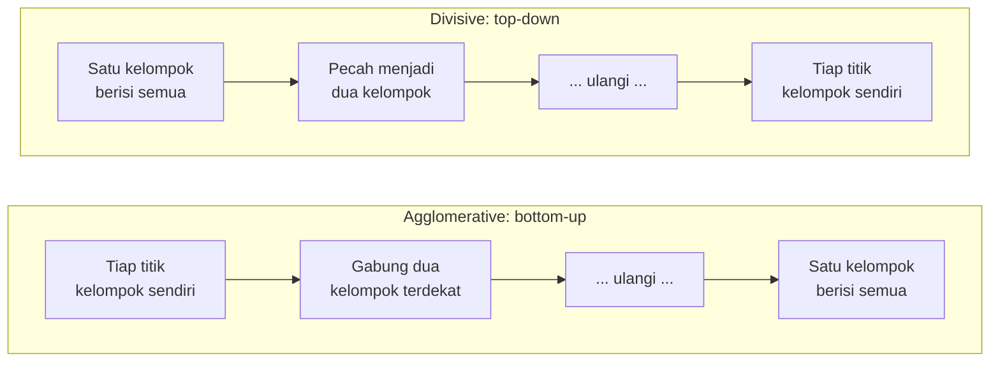
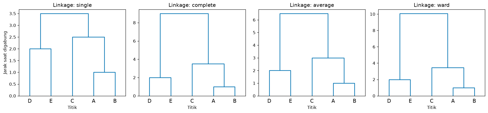
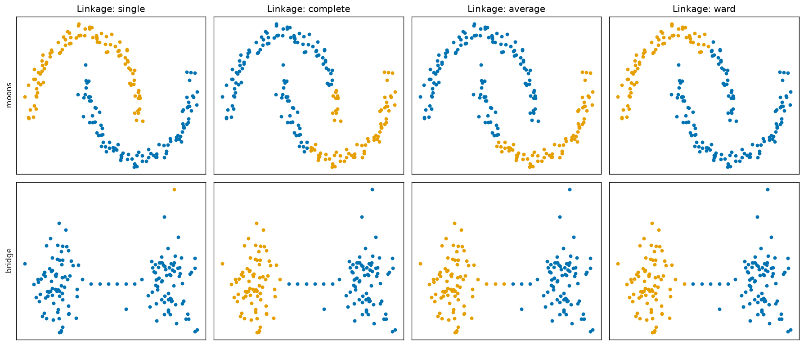
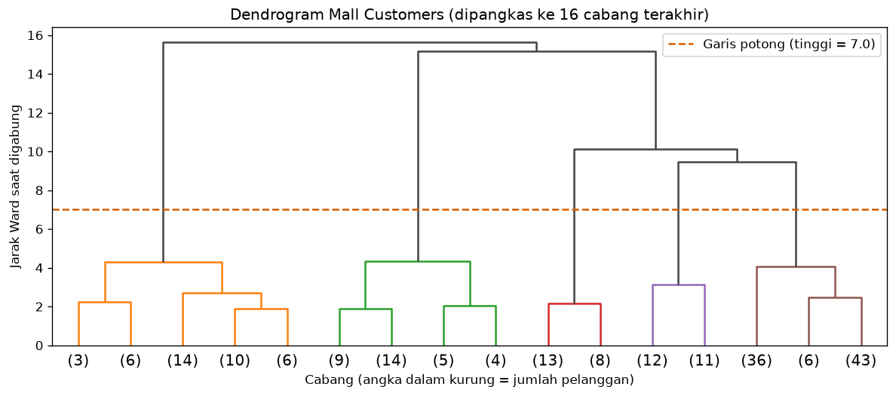
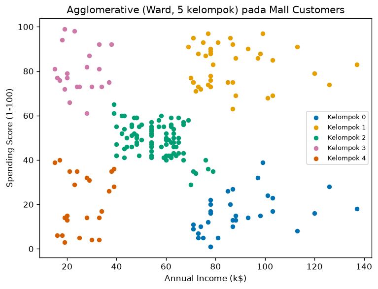

# Bab 3 — Hierarchical Clustering

## Learning Objectives

Setelah mempelajari bab ini, kamu mampu:

- [x] Menjelaskan ide *hierarchical clustering* dan perbedaannya dengan K-Means.
- [x] Membedakan pendekatan *agglomerative* (bottom-up) dan *divisive* (top-down).
- [x] Membaca *dendrogram* dan menentukan jumlah kelompok dengan memotongnya.
- [x] Menjelaskan empat metode *linkage*: single, complete, average, dan Ward, lengkap dengan rumusnya.
- [x] Menghitung matriks jarak dan langkah penggabungan secara manual pada data kecil.
- [x] Memakai `AgglomerativeClustering` dengan parameter `n_clusters`, `linkage`, `metric`, dan `distance_threshold`.
- [x] Membuat dan menafsirkan dendrogram dengan SciPy.
- [x] Menjelaskan mengapa metode linkage menghasilkan bentuk kelompok yang berbeda.
- [x] Mengenali biaya komputasi dan keterbatasan hierarchical clustering.

## Introduction

Bayangkan kamu menyusun silsilah keluarga. Dua saudara kandung digabung dulu menjadi satu keluarga kecil. Keluarga kecil itu lalu digabung dengan keluarga lain menjadi keluarga besar, dan seterusnya sampai semua orang masuk satu pohon keluarga. Kamu bisa "memotong" pohon itu di tingkat mana pun: tingkat keluarga inti, keluarga besar, atau seluruh marga.

**Hierarchical clustering** bekerja seperti itu. Berbeda dengan K-Means ([Bab 2](02-k-means-clustering.md)) yang langsung menghasilkan **satu pembagian** dengan K ditentukan di awal, hierarchical clustering menghasilkan **seluruh pohon penggabungan**. Setelah pohon jadi, kamu memilih berapa kelompok yang kamu mau dengan memotong pohon di tinggi tertentu. Pohon itu digambar sebagai **dendrogram**.

!!! note "Prasyarat"
    Bab ini memakai [jarak dan matriks jarak](../fundamental-clustering/05-distance-metrics.md) dari Level 3. Ringkasan perbedaan dengan K-Means ada di [Bab 2](02-k-means-clustering.md).

## Fundamental Concepts

| Istilah | Arti |
|---|---|
| **Hierarchical clustering** | Clustering yang menghasilkan hierarki (pohon) kelompok, bukan satu pembagian tunggal |
| **Agglomerative** | Pendekatan *bottom-up*: mulai dari tiap titik sebagai kelompok sendiri, lalu menggabungkan dua kelompok terdekat berulang kali |
| **Divisive** | Pendekatan *top-down*: mulai dari satu kelompok berisi semua titik, lalu memecahnya berulang kali |
| **Dendrogram** | Diagram pohon yang menunjukkan urutan dan jarak tiap penggabungan |
| **Distance matrix** | Tabel jarak antar semua pasangan titik |
| **Linkage** | Aturan menghitung **jarak antar dua kelompok** (bukan antar dua titik) |
| **Single / Complete / Average / Ward** | Empat jenis linkage yang kita pelajari |
| **Merge height** | Jarak antar dua kelompok pada saat keduanya digabung. Menjadi tinggi cabang di dendrogram |
| **Cut (potongan)** | Garis horizontal pada dendrogram. Jumlah garis vertikal yang dipotongnya adalah jumlah kelompok |
| **Linkage matrix** | Tabel `(n - 1)` baris yang mencatat tiap penggabungan. Dipakai SciPy untuk menggambar dendrogram |

## Detailed Explanation

### Dua pendekatan: agglomerative dan divisive



**Agglomerative** adalah pendekatan yang paling umum dan satu-satunya yang disediakan scikit-learn lewat `AgglomerativeClustering`.

**Divisive** dibahas di sini **hanya secara konseptual**. Scikit-learn **tidak** menyediakan estimator divisive clustering umum. Alasan divisive jarang dipakai: memecah satu kelompok berisi \( n \) titik menjadi dua bagian punya \( 2^{n-1} - 1 \) kemungkinan. Untuk \( n = 5 \) ada 15 kemungkinan, tetapi untuk \( n = 30 \) sudah ada **536.870.911**. Algoritma divisive praktis memakai heuristik (misalnya DIANA, atau pemecahan berulang dengan K-Means) untuk menghindari pemeriksaan semua kemungkinan.

!!! note "Soal `BisectingKMeans`"
    Scikit-learn memang memiliki `BisectingKMeans` yang bekerja top-down dengan membelah kelompok memakai K-Means. Namun itu varian K-Means, bukan divisive clustering umum, dan tidak kita bahas. Di Level 4 kita memakai agglomerative untuk praktik dan menjelaskan divisive sebagai konsep.

### Algoritma agglomerative langkah demi langkah

1. **Mulai**: tiap dari \( n \) titik adalah satu kelompok. Ada \( n \) kelompok.
2. **Hitung** jarak antar semua pasangan kelompok (memakai aturan linkage).
3. **Gabung** dua kelompok dengan jarak terkecil menjadi satu. Catat jarak penggabungannya (*merge height*). Jumlah kelompok berkurang satu.
4. **Ulangi** langkah 2 dan 3 sampai tinggal satu kelompok. Total ada \( n - 1 \) penggabungan.
5. **Potong** pohon di tinggi yang kamu pilih untuk mendapat jumlah kelompok yang diinginkan.

Perhatikan bahwa K-Means tidak dijalankan berulang-ulang untuk tiap K. Pohonnya dibangun **sekali**, lalu K bisa dipilih belakangan.

### Contoh manual: lima titik pada satu garis

Lima titik dengan satu fitur: A = 0, B = 1, C = 3,5, D = 7, E = 9.

**Langkah 0: matriks jarak.** Jarak antar dua titik pada satu dimensi adalah selisih mutlaknya:

| | A | B | C | D | E |
|---|---|---|---|---|---|
| **A** | 0 | 1 | 3,5 | 7 | 9 |
| **B** | 1 | 0 | 2,5 | 6 | 8 |
| **C** | 3,5 | 2,5 | 0 | 3,5 | 5,5 |
| **D** | 7 | 6 | 3,5 | 0 | 2 |
| **E** | 9 | 8 | 5,5 | 2 | 0 |

**Penggabungan 1.** Jarak terkecil adalah A–B = 1. Gabung menjadi {A, B} pada tinggi 1. (Untuk dua titik tunggal, keempat linkage memberi jarak yang sama.)

**Penggabungan 2.** Di antara jarak yang tersisa, D–E = 2 terkecil. Gabung menjadi {D, E} pada tinggi 2.

**Penggabungan 3.** Kini ada tiga kelompok: {A, B}, {C}, {D, E}. Di sini linkage **mulai berpengaruh**, karena kita harus mengukur jarak antar kelompok yang berisi lebih dari satu titik. Jarak {A, B} ke C:

- *single*: yang **terkecil** dari pasangan titik: \( \min(3{,}5;\ 2{,}5) = 2{,}5 \).
- *complete*: yang **terbesar**: \( \max(3{,}5;\ 2{,}5) = 3{,}5 \).
- *average*: **rata-rata**: \( \frac{3{,}5 + 2{,}5}{2} = 3{,}0 \).

Jarak C ke {D, E} lebih besar pada semua linkage, jadi yang digabung adalah {A, B} dengan C, pada tinggi 2,5 (single), 3,5 (complete), atau 3,0 (average).

**Penggabungan 4.** Terakhir {A, B, C} digabung dengan {D, E}. Keenam pasangan jaraknya adalah 7, 9, 6, 8, 3,5, 5,5:

- *single*: \( \min = 3{,}5 \) (pasangan C–D).
- *complete*: \( \max = 9 \) (pasangan A–E).
- *average*: \( \frac{7 + 9 + 6 + 8 + 3{,}5 + 5{,}5}{6} = \frac{39}{6} = 6{,}5 \).

Hasil ini cocok dengan output kode di bagian Python Implementation. Kelompok dan urutan penggabungannya sama pada ketiga linkage, tetapi **tingginya berbeda**, dan itu terlihat pada dendrogram.

### Membaca dendrogram

Cara membaca (lihat gambar dendrogram di bagian Expected Output):

1. **Tiap daun di bawah adalah satu titik.** Sumbu vertikal adalah **jarak saat penggabungan**.
2. **Garis horizontal** menunjukkan dua cabang yang digabung. **Tingginya** adalah jarak penggabungan.
3. **Urutan kiri-kanan daun tidak bermakna.** Cabang boleh ditukar posisinya tanpa mengubah arti. Yang bermakna hanya siapa bergabung dengan siapa, dan pada tinggi berapa.
4. **Potong** dengan garis horizontal. Jumlah garis vertikal yang dipotong adalah jumlah kelompok.
5. **Celah vertikal yang panjang** (tinggi penggabungan yang melompat jauh) menandakan dua kelompok yang jauh terpisah. Memotong di dalam celah itu adalah pilihan yang alami.

### Metode linkage

Setelah kelompok berisi lebih dari satu titik, kita perlu aturan untuk "jarak antar dua kelompok". Itulah **linkage**. Misalkan dua kelompok \( A \) dan \( B \):

| Linkage | Jarak antar kelompok | Intuisi | Kecenderungan |
|---|---|---|---|
| **Single** | Jarak antara **pasangan titik terdekat** (satu dari A, satu dari B) | "Cukup satu jembatan" | Bisa mengikuti bentuk memanjang, tetapi rentan terhadap *chaining* (kelompok tersambung lewat rantai titik) dan noise |
| **Complete** | Jarak antara **pasangan titik terjauh** | "Semua anggota harus berdekatan" | Menghasilkan kelompok kompak, tetapi peka terhadap outlier |
| **Average** | **Rata-rata** jarak semua pasangan titik | Kompromi single dan complete | Cukup seimbang |
| **Ward** | Kenaikan WCSS saat dua kelompok digabung | "Gabung yang paling sedikit merusak kekompakan" | Menghasilkan kelompok bulat berukuran mirip, seperti K-Means. Hanya untuk jarak Euclidean |

### Parameter `AgglomerativeClustering`

| Parameter | Bawaan | Arti |
|---|---|---|
| `n_clusters` | 2 | Jumlah kelompok akhir. Harus `None` jika memakai `distance_threshold` |
| `linkage` | `"ward"` | `"ward"`, `"complete"`, `"average"`, atau `"single"` |
| `metric` | `"euclidean"` | Ukuran jarak antar titik, misalnya `"manhattan"` atau `"cosine"`. `"ward"` hanya mendukung `"euclidean"` |
| `distance_threshold` | `None` | Ambang jarak: kelompok **tidak digabung** bila jaraknya sudah sebesar atau di atas ambang. Jika diisi, `n_clusters` harus `None` |
| `compute_distances` | `False` | Jika `True`, jarak penggabungan disimpan di `distances_` (berguna untuk dendrogram), dengan biaya memori tambahan |

Atribut setelah `fit`:

| Atribut | Isi |
|---|---|
| `labels_` | Label tiap titik |
| `n_clusters_` | Jumlah kelompok akhir |
| `n_leaves_` | Jumlah daun pohon (sama dengan jumlah titik) |
| `children_` | Pasangan yang digabung pada tiap langkah. Nomor `< n` adalah titik asli, nomor `≥ n` adalah kelompok hasil penggabungan sebelumnya |
| `distances_` | Jarak (tinggi) tiap penggabungan, ada jika `distance_threshold` diisi atau `compute_distances=True` |

!!! note "`metric`, bukan `affinity`"
    Pada tutorial lama kamu mungkin menemukan parameter `affinity`. Parameter itu sudah diganti dengan `metric` pada scikit-learn versi baru.

!!! note "Scikit-learn tidak menggambar dendrogram"
    `AgglomerativeClustering` menghasilkan label, bukan gambar. Untuk dendrogram kita memakai `linkage` dan `dendrogram` dari **SciPy** (`scipy.cluster.hierarchy`), yang sudah terpasang bersama scikit-learn. Inilah satu-satunya alasan SciPy dipakai di Level 4.

### Pertimbangan komputasi

Agar bisa memilih pasangan terdekat, algoritma harus mengetahui jarak antar pasangan titik. Untuk \( n \) titik ada \( \frac{n(n-1)}{2} \) pasangan. Memori yang dibutuhkan tumbuh **kuadratik** terhadap \( n \), dan waktu komputasi umumnya juga minimal kuadratik. Dengan 100.000 titik dan angka `float64` (8 byte), matriks jaraknya sendiri mencapai puluhan gigabyte (lihat output). Karena itu hierarchical clustering cocok untuk data **ribuan** titik, bukan jutaan.

### Kelebihan dan keterbatasan

| Kelebihan | Keterbatasan |
|---|---|
| Tidak perlu menentukan K di awal | Mahal untuk data besar (memori dan waktu kuadratik) |
| Dendrogram memberi gambaran struktur bertingkat | Penggabungan **tidak bisa dibatalkan**: keputusan awal yang buruk terbawa sampai akhir |
| Bisa mengikuti bentuk non-bulat (single linkage) | Hasil sangat bergantung pada pilihan linkage |
| Hasilnya deterministik (tanpa `random_state`) | Peka terhadap outlier dan noise (terutama single dan complete) |
| Bisa memakai berbagai ukuran jarak (kecuali Ward) | Tidak punya `predict` untuk data baru |

## Mathematical Foundation

### Jarak antar kelompok (linkage)

Untuk dua kelompok \( A \) dan \( B \), dengan \( d(a, b) \) jarak antara titik \( a \in A \) dan \( b \in B \):

$$
d_{\text{single}}(A, B) = \min_{a \in A,\ b \in B} d(a, b)
\qquad
d_{\text{complete}}(A, B) = \max_{a \in A,\ b \in B} d(a, b)
$$

$$
d_{\text{average}}(A, B) = \frac{1}{\lvert A \rvert \, \lvert B \rvert} \sum_{a \in A} \sum_{b \in B} d(a, b)
$$

Penjelasan simbol:

- \( \lvert A \rvert \) dan \( \lvert B \rvert \): jumlah anggota kelompok \( A \) dan \( B \).
- \( \min \) dan \( \max \): nilai terkecil dan terbesar dari semua pasangan \( (a, b) \).
- \( \sum_{a \in A} \sum_{b \in B} \): jumlahkan jarak **semua** pasangan, satu titik dari tiap kelompok. Pembaginya adalah jumlah pasangan \( \lvert A \rvert \lvert B \rvert \), sehingga hasilnya rata-rata.

**Contoh angka** (dari contoh manual): \( A = \{A, B, C\} \) dan \( B = \{D, E\} \) punya \( 3 \times 2 = 6 \) pasangan dengan jarak 7; 9; 6; 8; 3,5; 5,5. Maka single = 3,5, complete = 9, dan average \( = 39 / 6 = 6{,}5 \).

### Linkage Ward

Ward memilih penggabungan yang **paling sedikit menaikkan WCSS** ([Bab 2](02-k-means-clustering.md)). Kenaikan itu dihitung dengan:

$$
\Delta(A, B) = \frac{\lvert A \rvert \, \lvert B \rvert}{\lvert A \rvert + \lvert B \rvert} \; \lVert \mu_A - \mu_B \rVert^2
$$

dengan \( \mu_A \) dan \( \mu_B \) centroid (rata-rata) kelompok \( A \) dan \( B \), dan \( \lVert \cdot \rVert \) jarak Euclidean. Ada dua hal yang dihukum: **jarak antar centroid** (makin jauh makin mahal) dan **ukuran kelompok** (menggabungkan kelompok besar lebih mahal).

**Contoh angka.** Gabung \( \{A, B\} \) (rata-rata 0,5) dengan \( \{C\} \) (rata-rata 3,5):

$$
\Delta = \frac{2 \times 1}{2 + 1} \times (3{,}5 - 0{,}5)^2 = \frac{2}{3} \times 9 = 6
$$

Periksa dengan definisi WCSS: sebelum digabung, WCSS \( \{A, B\} \) adalah \( 0{,}25 + 0{,}25 = 0{,}5 \) dan C sendirian 0. Sesudah digabung, rata-rata \( \{A, B, C\} \) adalah \( 1{,}5 \) dan WCSS \( = 2{,}25 + 0{,}25 + 4 = 6{,}5 \). Kenaikannya \( 6{,}5 - 0{,}5 = 6 \), sama dengan rumus.

**Catatan tentang tinggi di dendrogram.** SciPy menggambar penggabungan Ward pada tinggi \( \sqrt{2\,\Delta} \). Pada contoh di atas, tingginya \( \sqrt{2 \times 6} = \sqrt{12} \approx 3{,}464 \), sesuai output. Untuk dua titik tunggal, \( \Delta = d^2 / 2 \), sehingga tingginya sama dengan jarak biasa antar dua titik itu.

Untuk penggabungan terakhir, \( \{A, B, C\} \) (rata-rata 1,5) dengan \( \{D, E\} \) (rata-rata 8):

$$
\Delta = \frac{3 \times 2}{3 + 2} \times (8 - 1{,}5)^2 = 1{,}2 \times 42{,}25 = 50{,}7
\qquad
\text{tinggi} = \sqrt{2 \times 50{,}7} \approx 10{,}07
$$

### Mengapa single linkage bisa "merantai"

Pada single linkage, dua kelompok dianggap dekat jika **satu pasangan** titiknya dekat. Jika ada titik-titik di antara dua kelompok yang membentuk "jembatan" dengan jarak antar titik kecil, kedua kelompok akan tersambung rantai itu dan tergabung, walau sebagian besar anggotanya berjauhan. Itulah *chaining effect*. Contohnya muncul pada bagian Expected Output.

### Kompleksitas

Matriks jarak berukuran \( n \times n \) sehingga memori sebanding dengan \( n^2 \). Implementasi umum memerlukan waktu minimal sebanding \( n^2 \) dan, untuk beberapa linkage, bisa mencapai \( n^2 \log n \) atau lebih, bergantung pada algoritma yang dipakai. Intinya: biaya naik cepat bersama jumlah data.

## Python Implementation

Skrip lengkapnya ada di `examples/level-4/03_hierarchical_clustering.py`, dan versi notebook-nya di `notebooks/level-4/03-hierarchical-clustering.ipynb`.

**Konteks masalah:** memahami bagaimana pohon penggabungan dibangun, bagaimana linkage memengaruhi hasil, dan bagaimana memotong dendrogram.

**Dataset:**

- `X_line`: lima titik satu dimensi untuk hitungan manual.
- `make_blobs` (150 titik, 3 gerombol): untuk `AgglomerativeClustering` dasar.
- `make_moons` (200 titik) dan data "dua gerombol dengan jembatan": untuk membandingkan linkage pada bentuk berbeda.
- Mall Customers (200 pelanggan, terskala): contoh tabular nyata.

**Pustaka:** NumPy, pandas, Matplotlib, scikit-learn, dan SciPy (untuk dendrogram).

### Bagian A — Siapkan alat

```python
--8<-- "level-4/03_hierarchical_clustering.py:setup"
```

**Penjelasan:** `AgglomerativeClustering` adalah algoritma dari scikit-learn. `linkage`, `dendrogram`, dan `fcluster` dari SciPy masing-masing membangun pohon, menggambarnya, dan memotongnya. `pdist` dan `squareform` menghitung matriks jarak.

### Bagian B — Lima titik dan matriks jarak

```python
--8<-- "level-4/03_hierarchical_clustering.py:tiny"
```

```text title="Output"
--8<-- "level-4/outputs/03/tiny.txt"
```

**Penjelasan:**

- `X_line` adalah array `(5, 1)`: lima baris, satu kolom. Kita beri nama A sampai E.
- `pdist(X_line)` menghitung jarak semua pasangan dan mengembalikannya sebagai daftar pendek (hanya separuh segitiga, tanpa diagonal). `squareform(...)` mengubah daftar itu menjadi **matriks persegi** simetris 5 × 5.
- `pd.DataFrame(..., index=names, columns=names)` memberi nama baris dan kolom supaya mudah dibaca. Hasilnya sama dengan tabel manual.

### Bagian C — Matriks linkage

```python
--8<-- "level-4/03_hierarchical_clustering.py:linkmat"
```

```text title="Output"
--8<-- "level-4/outputs/03/linkmat.txt"
```

**Penjelasan:**

- `linkage(X_line, method=method)` membangun pohon dan mengembalikan **matriks linkage** dengan `n - 1 = 4` baris. Tiap baris adalah satu penggabungan, dengan empat kolom: nomor kelompok pertama, nomor kelompok kedua, **jarak penggabungan (tinggi)**, dan ukuran kelompok hasil.
- **Penomoran:** nomor `0` sampai `4` adalah titik A sampai E. Kelompok baru diberi nomor berikutnya: penggabungan pertama menghasilkan nomor `5`, yang kedua nomor `6`, dan seterusnya. Jadi baris `[2, 5, 2.5, 3]` berarti "gabungkan titik 2 (C) dengan kelompok 5 ({A, B}) pada tinggi 2,5, menghasilkan kelompok berukuran 3".
- Perulangan `for` menjalankan empat linkage dan mencetak tiap matriks dalam tabel pandas.

```python
--8<-- "level-4/03_hierarchical_clustering.py:wardcheck"
```

```text title="Output"
--8<-- "level-4/outputs/03/wardcheck.txt"
```

**Penjelasan:** kita menghitung sendiri tinggi penggabungan Ward terakhir dengan rumus \( \sqrt{2 \cdot n_A n_B / (n_A + n_B)} \cdot \lVert \mu_A - \mu_B \rVert \). `A.mean(axis=0)` adalah rata-rata kolom (centroid), dan `np.linalg.norm(...)` menghitung jarak antar centroid. Hasilnya harus sama dengan baris terakhir matriks linkage Ward.

### Bagian D — Dendrogram kecil

```python
--8<-- "level-4/03_hierarchical_clustering.py:plottiny"
```



**Penjelasan:**

- `dendrogram(Z, labels=names, ax=ax, ...)` menggambar pohon dari matriks linkage `Z` pada bidang `ax`. `labels` memberi nama daun.
- `color_threshold=0` mematikan pewarnaan otomatis per cabang, dan `above_threshold_color` menentukan satu warna untuk semua cabang. Dengan begitu gambarnya sederhana.
- Perulangan menggambar satu panel untuk tiap linkage. Sumbu vertikal tiap panel berbeda skala karena tinggi penggabungannya berbeda.

### Bagian E — `AgglomerativeClustering` pada data blobs

```python
--8<-- "level-4/03_hierarchical_clustering.py:blobs"
```

```text title="Output"
--8<-- "level-4/outputs/03/blobs.txt"
```

**Penjelasan:**

- `AgglomerativeClustering(n_clusters=3, linkage="ward", compute_distances=True)` membuat model. `compute_distances=True` menyimpan jarak penggabungan di `distances_`.
- `fit_predict(X)` membangun pohon lalu memotongnya menjadi 3 kelompok.
- `agg.children_[:3]` menampilkan tiga penggabungan pertama. Tiap baris adalah sepasang nomor. Nomor di bawah 150 adalah titik asli (data punya 150 titik), sedangkan nomor 150 ke atas merujuk kelompok hasil penggabungan sebelumnya.
- `agg.distances_` adalah tinggi tiap penggabungan, dari yang paling rendah. Kita mencetak tiga yang pertama dan dua yang terakhir.

```python
--8<-- "level-4/03_hierarchical_clustering.py:threshold"
```

```text title="Output"
--8<-- "level-4/outputs/03/threshold.txt"
```

**Penjelasan:** alih-alih menyebut jumlah kelompok, kita memberi **ambang jarak**. `n_clusters=None` wajib saat memakai `distance_threshold`. Penggabungan hanya dilakukan jika jaraknya di bawah ambang. Jumlah kelompok yang dihasilkan terbaca dari `n_clusters_`.

### Bagian F — Linkage pada bentuk data yang berbeda

```python
--8<-- "level-4/03_hierarchical_clustering.py:shapes"
```

```text title="Output"
--8<-- "level-4/outputs/03/shapes.txt"
```

**Penjelasan:**

- `make_moons(n_samples=200, noise=0.06, ...)` adalah dua bulan sabit.
- Data kedua kita rakit sendiri. `make_blobs(..., centers=[[-3, 0], [3, 0]], ...)` membuat dua gerombol di kiri dan kanan. `np.linspace(-1.2, 1.2, 6)` menghasilkan enam bilangan sama jarak dari −1,2 sampai 1,2, dan `np.column_stack([..., np.zeros(6)])` menjadikannya enam titik `(x, 0)` yang membentang di antara kedua gerombol: **jembatan**. `np.vstack` menumpuk data gerombol dan jembatan.
- Perulangan dua tingkat menjalankan 4 linkage × 2 dataset, lalu mencetak ukuran kelompok.

```python
--8<-- "level-4/03_hierarchical_clustering.py:plotshapes"
```



**Penjelasan:** grid 2 baris × 4 kolom. Setiap titik diwarnai menurut kelompok hasil linkage tersebut. Sumbu disembunyikan agar yang terlihat hanya bentuk pengelompokan.

### Bagian G — Dendrogram Mall Customers

```python
--8<-- "level-4/03_hierarchical_clustering.py:mall"
```

```text title="Output"
--8<-- "level-4/outputs/03/mall.txt"
```

**Penjelasan:**

- Dua fitur (pendapatan dan skor belanja) diskalakan dengan `StandardScaler`, seperti pada Bab 2.
- `linkage(X_mall, method="ward")` membangun pohon dengan Ward. Bentuknya `(199, 4)`: 200 titik berarti 199 penggabungan.
- `Z_mall[-5:, 2]` mengambil kolom ketiga (tinggi) dari lima baris terakhir, yaitu lima penggabungan paling tinggi.

```python
--8<-- "level-4/03_hierarchical_clustering.py:plotmall"
```



**Penjelasan:**

- Dendrogram untuk 200 titik terlalu padat, jadi `truncate_mode="lastp"` dan `p=16` memangkasnya menjadi **16 cabang terakhir**. Angka dalam kurung adalah jumlah pelanggan di cabang itu (`show_leaf_counts=True`).
- `color_threshold=cut_height` mewarnai cabang di bawah garis potong secara berbeda, dan `ax.axhline(...)` menggambar garis potongnya.

```python
--8<-- "level-4/03_hierarchical_clustering.py:cut"
```

```text title="Output"
--8<-- "level-4/outputs/03/cut.txt"
```

**Penjelasan:**

- `fcluster(Z_mall, t=height, criterion="distance")` memotong pohon pada tinggi `height` dan mengembalikan label tiap titik. `len(set(...))` menghitung jumlah kelompoknya.
- `AgglomerativeClustering(n_clusters=5, ...)` menghasilkan lima kelompok untuk dibaca profil rata-ratanya dengan `groupby`.

### Bagian H — Parameter `metric` dan biaya memori

```python
--8<-- "level-4/03_hierarchical_clustering.py:metric"
```

```text title="Output"
--8<-- "level-4/outputs/03/metric.txt"
```

**Penjelasan:** kita menjalankan linkage `average` dengan tiga ukuran jarak (`euclidean`, `manhattan`, `cosine`) dan membandingkan ukuran kelompok. Hanya `ward` yang dibatasi pada Euclidean, `average` bebas.

```python
--8<-- "level-4/03_hierarchical_clustering.py:memory"
```

```text title="Output"
--8<-- "level-4/outputs/03/memory.txt"
```

**Penjelasan:** perhitungan murni: jumlah pasangan \( n(n-1)/2 \), dikali 8 byte per angka `float64`, dibagi \( 1024^3 \) untuk mendapat gibibyte. `//` adalah pembagian bulat dan `{n:>16,}` memformat angka rata kanan dengan pemisah ribuan. Ini **perkiraan matriks jarak**, bukan pengukuran memori nyata.

```python
--8<-- "level-4/03_hierarchical_clustering.py:plotresult"
```



**Penjelasan:** scatter plot Mall Customers dengan lima kelompok hasil Ward.

## Code Explanation

| Bagian kode | Peran |
|---|---|
| `squareform(pdist(X))` | Matriks jarak persegi dari data |
| `linkage(X, method=...)` | Membangun pohon, menghasilkan matriks linkage `(n-1, 4)` |
| `dendrogram(Z, ...)` | Menggambar pohon |
| `fcluster(Z, t, criterion="distance")` | Memotong pohon pada tinggi tertentu |
| `AgglomerativeClustering(...)` | Versi scikit-learn: langsung menghasilkan label |
| `distance_threshold` | Memotong berdasarkan ambang jarak, bukan jumlah kelompok |
| `compute_distances=True` | Menyimpan tinggi penggabungan di `distances_` |

## How to Run

Dari folder utama proyek (setelah mengaktifkan lingkungan virtual):

```powershell
pip install -r requirements-notebooks.txt
python examples/level-4/03_hierarchical_clustering.py
```

Skrip mencetak output ke terminal dan menyimpan empat gambar ke `docs/assets/level-4/`. Notebook interaktifnya:

```powershell
jupyter notebook notebooks/level-4/03-hierarchical-clustering.ipynb
```

Semua output pada bab ini berasal dari eksekusi nyata dengan Python 3.14, NumPy 2.5.2, pandas 3.0.5, scikit-learn 1.9.0, SciPy 1.18.1, dan Matplotlib 3.11.1.

## Expected Output

Output setiap langkah ditampilkan langsung di bawah kodenya pada bagian [Python Implementation](#python-implementation).

Gambar yang dihasilkan:


### Interpretasi output

**1. Matriks jarak dan linkage kecil.** Matriks jarak sama dengan tabel manual. Pada matriks linkage, baris pertama \( [0, 1, 1{,}0, 2] \) menggabungkan A dan B pada tinggi 1, dan baris kedua \( [3, 4, 2{,}0, 2] \) menggabungkan D dan E pada tinggi 2. Baris ketiga dan keempat **berbeda tingginya antar linkage**:

| Linkage | Tinggi penggabungan 3 ({A,B} + C) | Tinggi penggabungan 4 (terakhir) |
|---|---|---|
| single | 2,5 | 3,5 |
| complete | 3,5 | 9,0 |
| average | 3,0 | 6,5 |
| ward | 3,464 | 10,070 |

Semuanya sama dengan hitungan manual. Tinggi Ward terakhir dari rumus adalah **10,070**, sama dengan output matriks linkage.

**2. Dendrogram kecil.** Urutan penggabungan sama pada keempat panel (A–B, lalu D–E, lalu C, lalu semuanya), tetapi sumbu vertikalnya berbeda: tinggi akhir 3,5 pada single dan 10,07 pada Ward. Single linkage menghasilkan pohon yang paling "rendah" karena hanya memakai jarak terdekat, sedangkan complete dan Ward menghasilkan pohon yang tinggi.

**3. `AgglomerativeClustering` pada blobs.** Tiga kelompok berukuran 50, 50, 50, dengan `n_leaves_ = 150`. Baris `children_` seperti `[24, 52]` berarti titik nomor 24 dan 52 digabung. Tinggi penggabungan naik dari 0,01 untuk pasangan terdekat sampai **70,406** dan **119,406** untuk dua penggabungan terakhir. Lompatan besar di dua penggabungan terakhir menandakan ada tiga gerombol yang terpisah jauh.

**4. `distance_threshold`.** Ambang 1 menghasilkan 39 kelompok, ambang 3 menghasilkan 13, dan ambang 8 maupun 30 menghasilkan 3. Makin kecil ambang, makin sedikit penggabungan yang diizinkan sehingga makin banyak kelompok. Kelompok bertahan di angka 3 untuk rentang ambang yang lebar (dari 8 sampai 30), tanda struktur tiga gerombol yang jelas.

**5. Linkage pada bentuk berbeda.**

| Dataset | single | complete | average | ward |
|---|---|---|---|---|
| moons | 100, 100 | 121, 79 | 127, 73 | 132, 68 |
| bridge | **155, 1** | 81, 75 | 78, 78 | 80, 76 |

- **Moons:** hanya **single linkage** menghasilkan dua kelompok yang mengikuti kedua bulan sabit (masing-masing 100 titik). Complete, average, dan Ward memotong bulan sabit menjadi bagian yang kompak, mirip K-Means. Single linkage berhasil karena titik-titik pada satu bulan sabit saling berantai dengan jarak antar-titik kecil.
- **Bridge:** kebalikannya. **Single linkage gagal**: ia memisahkan **satu titik** dan menyatukan sisanya (155 dan 1), karena enam titik jembatan merantai kedua gerombol. Complete, average, dan Ward membagi dua gerombol bulat dengan ukuran hampir sama.

Jadi tidak ada linkage yang unggul di semua data: single cocok untuk bentuk memanjang yang bersih tetapi rapuh terhadap jembatan atau noise, sedangkan Ward cocok untuk gerombol bulat.

**6. Dendrogram Mall Customers.** Lima penggabungan paling tinggi ada pada 4,35, 9,45, 10,14, 15,19, dan 15,62. Dari 4,35 tinggi penggabungan melompat ke 9,45. Garis potong di tinggi 7 memotong **5 cabang**. Pada tabel pemotongan: tinggi 3 menghasilkan 9 kelompok, tinggi 5 dan 7 menghasilkan **5 kelompok**, tinggi 10 menghasilkan 4, dan tinggi 20 menghasilkan 1. Pemotongan di antara tinggi 4,35 dan 9,45 selalu menghasilkan 5 kelompok, tanda celah vertikal yang cukup panjang.

**7. Lima kelompok Ward pada Mall Customers.** Ukurannya (diurutkan) 21, 23, 32, 39, 85. Profil rata-rata: \( (89{,}4;\ 15{,}6) \), \( (86{,}5;\ 82{,}1) \), \( (55{,}8;\ 49{,}1) \), \( (25{,}1;\ 80{,}0) \), \( (26{,}3;\ 20{,}9) \) untuk (pendapatan, skor belanja). Pola lima kelompok ini mirip hasil K-Means di Bab 2 (22, 23, 35, 39, 81), tetapi tidak identik, karena kedua algoritma memakai kriteria berbeda.

**8. `metric` pada linkage average.** Ukuran kelompok berubah menurut jarak yang dipakai: euclidean memberi \( [3, 21, 36, 38, 102] \), manhattan \( [20, 23, 38, 39, 80] \), dan cosine \( [11, 43, 47, 48, 51] \). Pilihan jarak memengaruhi hasil. (Cosine mengukur sudut dari titik asal. Pada data yang sudah dipusatkan itu belum tentu bermakna, jadi pakai jarak ini hanya jika masuk akal untuk datamu.)

**9. Biaya memori matriks jarak.** Untuk 200 titik: 19.900 pasangan, sekitar 0,0001 GiB. Untuk 10.000 titik: sekitar 50 juta pasangan, 0,3725 GiB. Untuk 100.000 titik: hampir 5 miliar pasangan, sekitar **37,25 GiB**. Data naik 10 kali lipat, memori naik sekitar 100 kali. Inilah alasan hierarchical clustering tidak dipakai untuk data sangat besar.

## Practical Examples

**Taksonomi dan biologi.** Mengelompokkan spesies atau gen berdasarkan kemiripan, dengan dendrogram sebagai "pohon kekerabatan". Peneliti membaca struktur bertingkatnya, bukan hanya satu pembagian.

**Segmentasi pelanggan yang fleksibel.** Dendrogram Mall Customers memberi pilihan: potong di tinggi 7 untuk 5 segmen utama, atau di tinggi 3 untuk 9 segmen yang lebih rinci. Tim pemasaran memilih tingkat detail yang sesuai.

**Pengelompokan dokumen atau produk.** Item yang mirip digabung bertahap sehingga menghasilkan kategori dan subkategori alami.

**Mengikuti bentuk memanjang.** Single linkage pada data bulan sabit (seperti di atas), asalkan data bersih dari noise.

!!! tip "Memilih linkage"
    Mulailah dengan **Ward** jika kamu mengharapkan kelompok bulat dan berukuran mirip dengan jarak Euclidean. Coba **average** sebagai alternatif yang seimbang. Pakai **single** hanya jika bentuknya memanjang dan datanya bersih. Pakai **complete** jika kamu ingin kelompok yang kompak dan tidak ada outlier ekstrem.

## Hands-on Exercises

1. **Hitung manual:** empat titik satu dimensi 0, 2, 5, 11. Tuliskan matriks jaraknya, lalu hitung tinggi tiap penggabungan untuk linkage single, complete, dan average. Cocokkan dengan `linkage`.
2. Pada data blobs, jalankan `AgglomerativeClustering` dengan `n_clusters=2` dan `n_clusters=4`. Berapa ukuran kelompoknya?
3. Pada data blobs, pakai `distance_threshold=60`, `100`, dan `130`. Berapa `n_clusters_` tiap ambang? Kaitkan dengan dua tinggi penggabungan terakhir (70,406 dan 119,406).
4. Naikkan `noise` pada `make_moons` dari 0,06 menjadi 0,2. Bagaimana hasil single linkage dan Ward dengan `n_clusters=2`?
5. Pada Mall Customers (terskala), jalankan Ward dengan 3, 4, dan 6 kelompok. Berapa ukuran kelompoknya? Coba juga single linkage dan complete linkage dengan 5 kelompok.
6. Hitung perkiraan memori matriks jarak untuk 20.000 titik (`float64`).
7. Berapa banyak cara memecah 30 titik menjadi dua kelompok tak-kosong? Apa artinya bagi divisive clustering?
8. Jelaskan perbedaan cara menentukan jumlah kelompok pada K-Means dan hierarchical clustering.

??? question "Jawaban"
    Hasil nomor 1 sampai 6 berasal dari eksekusi nyata.

    1. Jarak: 0–2 = 2, 0–5 = 5, 0–11 = 11, 2–5 = 3, 2–11 = 9, 5–11 = 6. Penggabungan pertama selalu 0 dan 2 pada tinggi 2. *Single*: {0,2}–5 = min(5, 3) = 3, lalu terakhir dengan 11 = min(11, 9, 6) = 6, jadi tinggi **2, 3, 6**. *Complete*: {0,2}–5 = max(5, 3) = 5 (lebih kecil dari 5–11 = 6, jadi digabung dulu), lalu terakhir max(11, 9, 6) = 11, jadi tinggi **2, 5, 11**. *Average*: {0,2}–5 = (5+3)/2 = 4, lalu terakhir (11+9+6)/3 = 26/3 ≈ 8,667, jadi tinggi **2, 4, 8,667**. Hasil `linkage` identik. (Untuk Ward, tingginya 2; 4,619; 10,614.)
    2. `n_clusters=2`: ukuran **100 dan 50** (dua gerombol digabung). `n_clusters=4`: ukuran **50, 28, 50, 22** (satu gerombol terbelah).
    3. Ambang 60: **3** kelompok (penggabungan di 70,406 dan 119,406 tidak dilakukan karena keduanya di atas 60). Ambang 100: **2** kelompok (penggabungan di 70,406 dilakukan, yang 119,406 tidak). Ambang 130: **1** kelompok (semua penggabungan di bawah 130 dilakukan).
    4. Pada `noise=0.2`, single linkage menghasilkan ukuran **195 dan 5**: noise memutus rantai dan satu kelompok kecil terpisah, sehingga bentuk bulan sabit tidak lagi terpisah dengan baik. Ward menghasilkan **116 dan 84**. (Pada `noise=0.06`: single 100, 100; Ward 132, 68.) Single linkage hanya bagus pada data yang bersih.
    5. Ward dengan 3 kelompok: **32, 39, 129**. Dengan 4 kelompok: **21, 32, 39, 108**. Dengan 6 kelompok: **9, 21, 23, 23, 39, 85**. Single linkage dengan 5 kelompok: **1, 1, 1, 2, 195**, yaitu hampir semua titik di satu kelompok dan sisanya titik tunggal (chaining). Complete dengan 5 kelompok: **21, 23, 38, 39, 79**.
    6. \( 20.000 \times 19.999 / 2 = 199.990.000 \) pasangan, \( \times 8 \) byte \( \approx 1{,}49 \) GiB.
    7. \( 2^{29} - 1 = 536.870.911 \) cara. Memeriksa semua kemungkinan tidak praktis bahkan untuk 30 titik, sehingga algoritma divisive memakai heuristik.
    8. Pada K-Means, K harus dipilih **sebelum** menjalankan algoritma (dan diulang untuk tiap K). Pada hierarchical clustering, pohon dibangun **sekali**, lalu jumlah kelompok dipilih **sesudahnya** dengan memotong dendrogram atau menetapkan `distance_threshold`.

## Troubleshooting

### Masalah teknis

| Masalah | Penyebab | Solusi |
|---|---|---|
| `ValueError: manhattan was provided as metric. Ward can only work with euclidean distances` | `linkage="ward"` hanya mendukung jarak Euclidean | Pakai `metric="euclidean"` atau pilih linkage lain (average, complete, single) |
| `ValueError: Exactly one of n_clusters and distance_threshold has to be set, and the other needs to be None` | Keduanya diisi, atau keduanya `None` | Isi salah satu saja, yang lain `None` |
| `TypeError: ... unexpected keyword argument 'affinity'` | `affinity` sudah diganti `metric` | Ganti `affinity=` dengan `metric=` |
| `MemoryError` atau komputer menjadi lambat | Jumlah data terlalu besar untuk matriks jarak | Kurangi data (sampel), atau pakai algoritma yang lebih skalabel seperti K-Means |
| `AttributeError: ... has no attribute 'distances_'` | `distance_threshold` tidak diisi dan `compute_distances` bernilai `False` | Set `compute_distances=True` |
| `AttributeError: 'AgglomerativeClustering' object has no attribute 'predict'` | Estimator ini tidak punya `predict` | Pakai `fit_predict`, atau latih classifier terpisah pada hasilnya |
| Dendrogram terlalu padat | Terlalu banyak titik | Pakai `truncate_mode="lastp"` dengan `p` kecil |
| Label berbeda antara `fcluster` dan `AgglomerativeClustering` | Penomoran berbeda (`fcluster` mulai dari 1) | Bandingkan ukuran dan keanggotaan kelompok, bukan nomornya |

### Kesalahan umum

1. **Menganggap urutan daun dendrogram bermakna.** Hanya struktur penggabungan dan tinggi yang bermakna, bukan posisi kiri-kanan.
2. **Memotong dendrogram sembarangan.** Cari celah vertikal yang panjang, dan padukan dengan pemahaman domain.
3. **Memilih linkage tanpa memikirkan bentuk data.** Single merantai, Ward cenderung bulat. Coba beberapa linkage.
4. **Memakai Ward dengan jarak selain Euclidean.** Tidak didukung dan secara matematis tidak sah.
5. **Lupa menyamakan skala.** Seperti K-Means, hierarchical clustering peka terhadap skala fitur.
6. **Menjalankan pada data sangat besar.** Memori dan waktu naik kuadratik.
7. **Mengira scikit-learn menyediakan divisive clustering.** Yang tersedia hanya agglomerative.
8. **Menafsirkan tinggi Ward sebagai jarak biasa.** Tinggi Ward di SciPy adalah \( \sqrt{2\Delta} \), bukan jarak antar centroid.

## Summary

- **Hierarchical clustering** menghasilkan pohon penggabungan (dendrogram), dan jumlah kelompok dipilih **sesudahnya** dengan memotong pohon.
- **Agglomerative** (bottom-up) menggabungkan dua kelompok terdekat berulang sebanyak \( n - 1 \) kali. **Divisive** (top-down) hanya dibahas secara konseptual karena scikit-learn tidak menyediakannya.
- **Linkage** adalah aturan jarak antar kelompok: **single** (terdekat), **complete** (terjauh), **average** (rata-rata), dan **Ward** (kenaikan WCSS, tinggi di SciPy \( \sqrt{2\Delta} \)).
- Dendrogram dibaca dari tinggi penggabungan. Urutan kiri-kanan tidak bermakna, dan celah vertikal panjang menandai tempat memotong.
- Pada Mall Customers, dendrogram Ward memberi 5 kelompok pada tinggi potong 5 sampai 7.
- Linkage menentukan bentuk hasil: single mengikuti bulan sabit tetapi gagal pada data berjembatan (155 dan 1), sedangkan Ward cocok untuk gerombol bulat.
- Biaya memori naik kuadratik: 100.000 titik butuh sekitar 37,25 GiB hanya untuk matriks jaraknya.
- Parameter penting: `n_clusters`, `linkage`, `metric`, dan `distance_threshold`. Estimator ini tidak punya `predict`.

**Bab berikutnya:** Bab 4 membahas **DBSCAN**, algoritma berbasis kepadatan yang bisa menemukan kelompok berbentuk bebas dan menandai titik noise dengan label `-1`.

## References

- Scikit-learn documentation: [*Hierarchical clustering*](https://scikit-learn.org/stable/modules/clustering.html#hierarchical-clustering) dan [`AgglomerativeClustering`](https://scikit-learn.org/stable/modules/generated/sklearn.cluster.AgglomerativeClustering.html).
- SciPy documentation: [`scipy.cluster.hierarchy.linkage`](https://docs.scipy.org/doc/scipy/reference/generated/scipy.cluster.hierarchy.linkage.html) dan [`dendrogram`](https://docs.scipy.org/doc/scipy/reference/generated/scipy.cluster.hierarchy.dendrogram.html).
- Ward, J. H. (1963). Hierarchical grouping to optimize an objective function. *Journal of the American Statistical Association*, 58(301), 236–244.
- Kaufman, L., & Rousseeuw, P. J. (1990). *Finding Groups in Data: An Introduction to Cluster Analysis*. Wiley. (Memuat DIANA, algoritma divisive.)
- Murtagh, F., & Contreras, P. (2012). Algorithms for hierarchical clustering: an overview. *WIREs Data Mining and Knowledge Discovery*, 2(1), 86–97.
- Hastie, T., Tibshirani, R., & Friedman, J. (2009). *The Elements of Statistical Learning* (2nd ed.), Bab 14.3.12: Hierarchical clustering. Springer.
