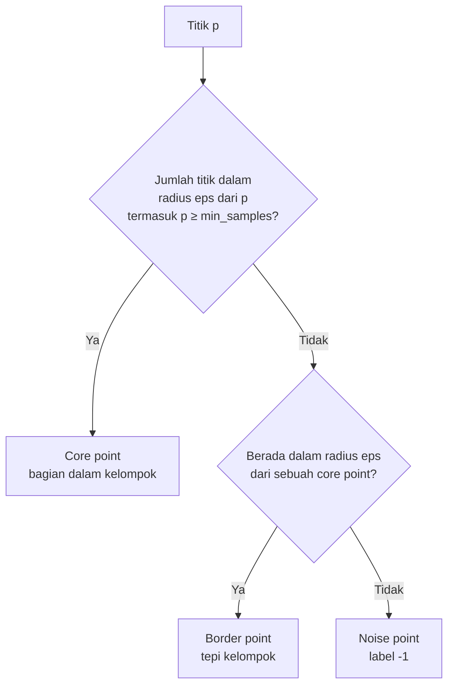
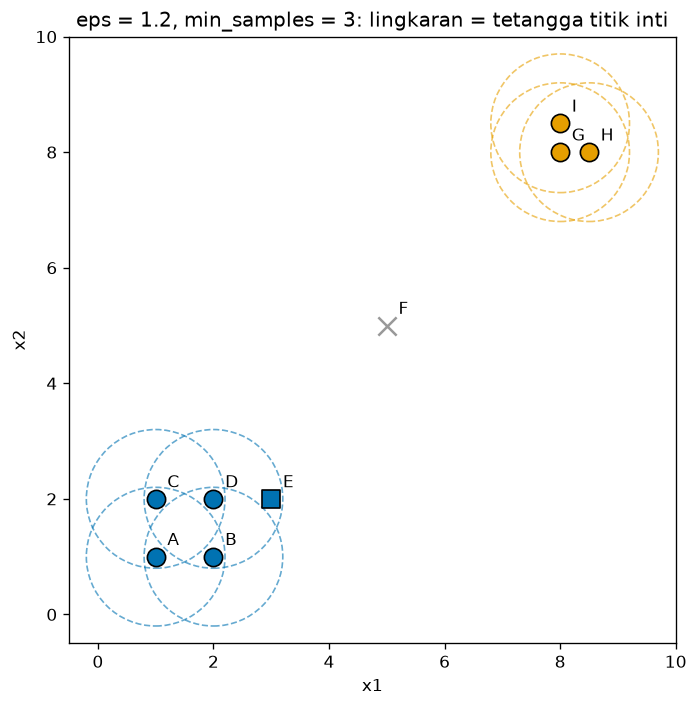
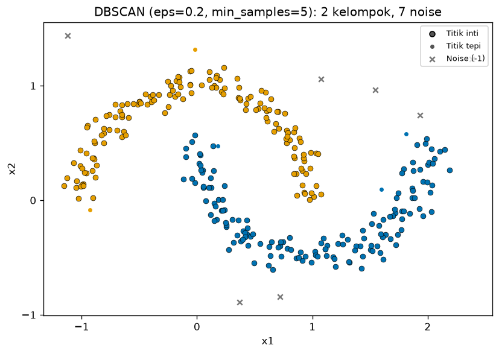
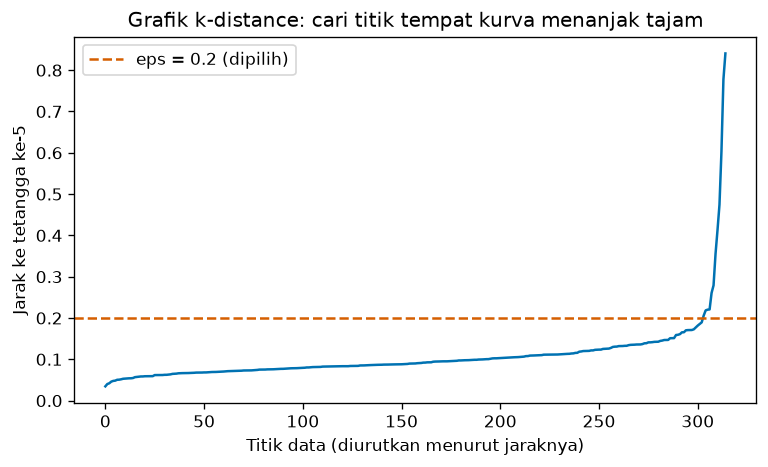
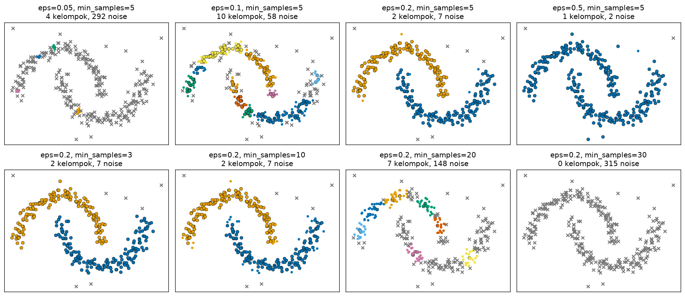
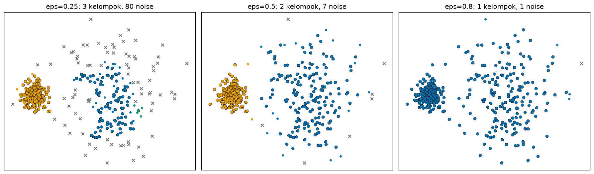
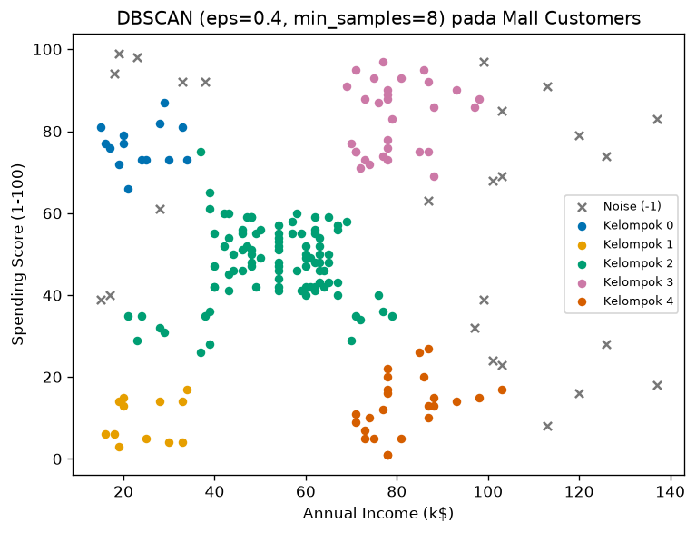

# Bab 4 — DBSCAN Clustering

## Learning Objectives

Setelah mempelajari bab ini, kamu mampu:

- [x] Menjelaskan ide *density-based clustering* dan mengapa ia berguna.
- [x] Membedakan *core point*, *border point*, dan *noise point*.
- [x] Menjelaskan arti `eps` dan `min_samples`, termasuk bahwa `min_samples` menghitung titik itu sendiri.
- [x] Menjelaskan *density reachability* dan *density connectivity*.
- [x] Menjalankan DBSCAN langkah demi langkah pada data kecil secara manual.
- [x] Memakai `DBSCAN` di scikit-learn dan membaca `labels_` (dengan label `-1` untuk noise) dan `core_sample_indices_`.
- [x] Memilih `eps` dengan bantuan grafik *k-distance*.
- [x] Menjelaskan pengaruh `eps`, `min_samples`, `metric`, `algorithm`, dan `leaf_size`.
- [x] Mengenali keterbatasan DBSCAN pada data dengan kepadatan berbeda.

## Introduction

Bayangkan kamu melihat peta malam hari dari udara. Kota-kota tampak sebagai **titik-titik cahaya yang rapat**, dipisahkan oleh daerah gelap yang jarang penduduknya. Satu-dua lampu yang menyendiri di tengah hutan jelas bukan bagian dari kota mana pun. Cara kita mengenali kota di sini bukan dengan mencari "pusat kota", melainkan dengan melihat **di mana titik-titik rapat**.

Itulah ide **DBSCAN** (*Density-Based Spatial Clustering of Applications with Noise*):

- **Kelompok adalah daerah yang rapat**, dipisahkan oleh daerah yang jarang.
- **Titik di daerah jarang adalah noise**, bukan anggota kelompok mana pun.
- **Bentuk kelompok bebas** (melengkung, memanjang), dan jumlah kelompok **tidak** ditentukan di awal.

Bab 1 sudah menunjukkan hasil awalnya: pada data bulan sabit, DBSCAN mengikuti bentuk data, sedangkan K-Means memotongnya. Bab ini menjelaskan mengapa.

!!! note "Prasyarat"
    Bab ini memakai jarak Euclidean dan matriks jarak ([Level 3, Bab 5](../fundamental-clustering/05-distance-metrics.md)), konsep kepadatan ([Level 3, Bab 2](../fundamental-clustering/02-understanding-clusters.md)), dan penyamaan skala ([Level 2, Bab 10](../data-exploration-and-preprocessing/10-feature-scaling.md)). Perbandingan dengan [K-Means](02-k-means-clustering.md) dan [hierarchical](03-hierarchical-clustering.md) muncul beberapa kali.

## Fundamental Concepts

| Istilah | Arti |
|---|---|
| **Density-based clustering** | Clustering yang mendefinisikan kelompok sebagai daerah padat |
| **Epsilon (`eps`, \( \varepsilon \))** | Radius lingkungan di sekitar sebuah titik |
| **Neighborhood** | Semua titik yang berjarak paling jauh `eps` dari sebuah titik, **termasuk titik itu sendiri** |
| **Minimum samples (`min_samples`)** | Jumlah minimum titik dalam sebuah lingkungan (termasuk titik itu sendiri) agar daerah itu dianggap padat |
| **Core point** | Titik yang lingkungannya berisi sedikitnya `min_samples` titik. "Jantung" kelompok |
| **Border point** | Bukan core, tetapi berada dalam lingkungan sebuah core point. "Tepi" kelompok |
| **Noise point** | Bukan core dan bukan border. Diberi label `-1` |
| **Directly density-reachable** | Titik \( q \) ada di lingkungan core point \( p \) |
| **Density-reachable** | \( q \) bisa dicapai dari \( p \) lewat rantai core point yang saling bertetangga |
| **Density-connected** | Dua titik yang sama-sama bisa dicapai dari satu titik lain |
| **Cluster** | Himpunan titik yang saling density-connected |

## Detailed Explanation

### Mengapa pendekatan berbasis kepadatan berguna?

K-Means ([Bab 2](02-k-means-clustering.md)) membayangkan kelompok sebagai gumpalan bulat di sekitar pusat. Banyak data nyata tidak seperti itu:

- **Bentuk bebas.** Jalur pergerakan, sungai, atau bulan sabit.
- **Ada noise.** Pencilan yang tidak termasuk kelompok mana pun.
- **Jumlah kelompok tidak diketahui.**

DBSCAN menangani ketiganya: kelompok tumbuh mengikuti titik-titik yang saling berdekatan, noise tersaring otomatis, dan jumlah kelompok adalah hasil, bukan masukan.

### Tiga jenis titik

Pilih dua angka: `eps` dan `min_samples`. Untuk tiap titik \( p \), hitung berapa titik ada dalam radius `eps`:



- **Core point:** daerah di sekitarnya padat.
- **Border point:** dirinya sendiri tidak padat, tetapi menempel pada daerah padat. Ia ikut kelompok core point tetangganya.
- **Noise point:** menyendiri, tidak padat dan tidak dekat daerah padat.

### Algoritma DBSCAN langkah demi langkah

1. Untuk setiap titik, **hitung lingkungannya** (semua titik dalam radius `eps`).
2. **Tandai core point**: titik yang lingkungannya berisi sedikitnya `min_samples` titik.
3. **Ambil satu core point yang belum punya kelompok.** Buat kelompok baru untuknya.
4. **Perluas kelompok**: masukkan semua tetangganya. Untuk setiap tetangga yang juga core point, masukkan tetangga-tetangganya juga, dan seterusnya. Tetangga yang bukan core point (border) dimasukkan tetapi **tidak** memperluas lebih jauh.
5. **Ulangi** langkah 3 dan 4 sampai semua core point sudah punya kelompok.
6. **Titik yang tidak masuk kelompok mana pun adalah noise** (label `-1`).

Kelompok bisa tumbuh panjang atau melengkung karena perluasan mengikuti rantai titik padat, bukan jarak ke pusat.

### Contoh manual pada 9 titik

Sembilan titik dan parameter \( \varepsilon = 1{,}2 \), `min_samples = 3`:

| Titik | A | B | C | D | E | F | G | H | I |
|---|---|---|---|---|---|---|---|---|---|
| \( (x_1, x_2) \) | (1, 1) | (2, 1) | (1, 2) | (2, 2) | (3, 2) | (5, 5) | (8, 8) | (8,5; 8) | (8; 8,5) |

**Langkah 1: lingkungan tiap titik.** Hitung jarak Euclidean dan ambil titik dengan jarak \( \le 1{,}2 \):

- A: ke B jaraknya 1, ke C 1, ke D \( \sqrt{2} \approx 1{,}414 \) (terlalu jauh). Lingkungan \( \{A, B, C\} \) → 3 titik.
- B: ke A 1, ke D 1, ke C 1,414, ke E \( \sqrt{2} \approx 1{,}414 \). Lingkungan \( \{A, B, D\} \) → 3 titik.
- C: lingkungan \( \{A, C, D\} \) → 3 titik.
- D: ke B 1, ke C 1, ke E 1. Lingkungan \( \{B, C, D, E\} \) → 4 titik.
- E: hanya D yang dekat (jarak 1). Lingkungan \( \{D, E\} \) → 2 titik.
- F (5, 5): tidak ada titik lain dalam radius. Lingkungan \( \{F\} \) → 1 titik.
- G, H, I: jarak G–H = 0,5, G–I = 0,5, H–I \( \approx 0{,}707 \). Masing-masing punya lingkungan \( \{G, H, I\} \) → 3 titik.

**Langkah 2: core point.** Titik dengan sedikitnya 3 titik di lingkungannya: **A, B, C, D, G, H, I**. E hanya punya 2, jadi bukan core.

**Langkah 3 dan 4: perluasan.** Mulai dari A (core), buat kelompok 0. Tetangga A: B, C. Keduanya core, jadi tetangga B (D) dan C (D) ikut masuk. D adalah core, jadi tetangganya E ikut masuk. E bukan core, jadi perluasan berhenti di E. Kelompok 0 = \( \{A, B, C, D, E\} \). Lalu core berikutnya yang belum punya kelompok adalah G. Kelompok 1 = \( \{G, H, I\} \).

**Langkah 6: noise.** F tidak masuk kelompok mana pun, jadi F adalah **noise**.

**Jenis titik:** core = A, B, C, D, G, H, I; **border = E** (bukan core, tetapi berada dalam radius core D); **noise = F**. Hasil ini sama dengan output kode di bawah.

### Density reachability dan connectivity dengan contoh

Pada contoh di atas, E bisa "dicapai" dari A lewat rantai \( A \to B \to D \to E \): jarak tiap langkah 1, dan A, B, D semuanya core. Namun **hubungannya tidak simetris**: E dicapai dari D (karena D core), tetapi D tidak "dicapai dari E" dalam arti yang sama karena E bukan core. Meski begitu, A dan E **density-connected**, karena keduanya bisa dicapai dari titik yang sama (A sendiri). Definisi formal ada di Mathematical Foundation.

### Intuisi geometris: ambang kepadatan

Lingkungan berbentuk lingkaran berjari-jari \( \varepsilon \) di dua dimensi, luasnya \( \pi\varepsilon^2 \). Jadi `min_samples` titik dalam lingkaran itu berarti kepadatan minimal sekitar:

$$
\text{kepadatan minimal} \approx \frac{\text{min\_samples}}{\pi \varepsilon^2}
$$

Pada contoh manual: \( \frac{3}{\pi \times 1{,}2^2} \approx 0{,}663 \) titik per satuan luas. Daerah yang kepadatannya di bawah ambang itu tidak membentuk core point.

### Parameter penting di scikit-learn

| Parameter | Bawaan | Arti |
|---|---|---|
| `eps` | 0,5 | Radius lingkungan |
| `min_samples` | 5 | Jumlah minimum titik (termasuk titik itu sendiri) dalam lingkungan agar sebuah titik menjadi core |
| `metric` | `"euclidean"` | Ukuran jarak, misalnya `"manhattan"`. Bisa juga `"precomputed"` bila kamu memberi matriks jarak sendiri |
| `algorithm` | `"auto"` | Cara mencari tetangga: `"auto"`, `"ball_tree"`, `"kd_tree"`, atau `"brute"`. Memengaruhi **kecepatan dan memori**, bukan hasil |
| `leaf_size` | 30 | Ukuran daun pada pohon pencarian (`ball_tree` atau `kd_tree`). Juga hanya memengaruhi kecepatan dan memori |

Atribut setelah `fit`:

| Atribut | Isi |
|---|---|
| `labels_` | Label tiap titik. **Noise diberi label `-1`**, kelompok bernomor `0, 1, 2, ...` |
| `core_sample_indices_` | Nomor baris semua core point |

!!! warning "Label `-1` bukan sebuah kelompok"
    Di scikit-learn, DBSCAN memberi **`-1`** pada noise. Jangan menghitung `-1` sebagai kelompok. Jumlah kelompok adalah `len(set(labels) - {-1})`. Pada kode di bab ini, noise juga digambar dengan tanda `x` abu-abu.

!!! note "Border point bisa bergantung urutan data"
    Jika sebuah border point berada dalam jangkauan dua kelompok sekaligus, ia diberikan ke kelompok yang ditemukan lebih dulu. Jadi mengubah urutan baris data bisa menukar kelompok sebuah border point. Core point dan noise tidak terpengaruh.

### Memilih `eps` dengan grafik k-distance

Sebuah titik adalah core jika **kelompok `min_samples` tetangga terdekatnya (termasuk dirinya) semuanya berada dalam radius `eps`**. Artinya, titik itu core jika **jarak ke tetangga ke-`min_samples`-nya \( \le \varepsilon \)**. Dari sini lahir cara memilih `eps`:

1. Pilih `min_samples` (misalnya \( k \)).
2. Untuk tiap titik, hitung **jarak ke tetangga ke-\( k \)** (*k-distance*, dengan titik itu sendiri dihitung sebagai tetangga pertama).
3. Urutkan nilainya dari kecil ke besar dan gambar.
4. Cari titik tempat kurva **mulai menanjak tajam** ("siku"). Titik di sebelah kiri siku berada di daerah padat, dan titik di sebelah kanannya cenderung noise. Nilai k-distance di siku itu adalah kandidat `eps`.

Ini hanya petunjuk, bukan aturan. Seperti elbow pada K-Means, siku kadang tidak jelas.

### Memilih `min_samples`

Aturan praktis yang sering dipakai: `min_samples` sekurang-kurangnya **jumlah fitur + 1**, dan dinaikkan untuk data yang besar atau berisik. Nilai kecil (misalnya 3) membuat DBSCAN longgar: banyak core point dan lebih sedikit noise. Nilai besar membuat DBSCAN ketat: hanya daerah yang benar-benar padat menjadi kelompok.

### Kepadatan yang berbeda

DBSCAN memakai **satu pasang `eps` dan `min_samples` untuk seluruh data**. Jika satu kelompok rapat dan yang lain renggang, tidak ada satu `eps` yang cocok untuk keduanya:

- `eps` kecil (cocok untuk kelompok rapat): kelompok renggang pecah dan banyak titiknya menjadi noise.
- `eps` besar (cocok untuk kelompok renggang): kelompok rapat dan kelompok-kelompok yang berdekatan menyatu.

Algoritma turunan seperti **OPTICS** dan **HDBSCAN** (keduanya ada di `sklearn.cluster`) dirancang untuk kepadatan beragam, tetapi di luar cakupan bab ini.

### Kelebihan dan keterbatasan

| Kelebihan | Keterbatasan |
|---|---|
| Tidak perlu menentukan jumlah kelompok | Hasil sangat peka terhadap `eps` dan `min_samples` |
| Bisa menemukan kelompok berbentuk bebas | Sulit untuk kelompok dengan kepadatan berbeda |
| Mengenali noise (label `-1`) | `eps` bergantung pada skala fitur, jadi **wajib diskalakan** |
| Hasilnya hampir deterministik (tanpa `random_state`) | Pada dimensi tinggi, konsep "kepadatan" kurang bermakna (Level 3, Bab 6) |
| Satu pasang parameter yang bisa dipahami secara geometris | Tidak punya `predict` untuk data baru |

## Mathematical Foundation

Misalkan data \( X = \{\mathbf{x}_1, \dots, \mathbf{x}_n\} \), jarak \( d(\cdot, \cdot) \), radius \( \varepsilon \), dan ambang \( \text{MinPts} \) (yaitu `min_samples`).

### Lingkungan dan core point

$$
N_\varepsilon(\mathbf{p}) = \{ \mathbf{q} \in X : d(\mathbf{p}, \mathbf{q}) \le \varepsilon \}
$$

\( N_\varepsilon(\mathbf{p}) \) adalah himpunan semua titik yang berjarak paling jauh \( \varepsilon \) dari \( \mathbf{p} \). **Titik \( \mathbf{p} \) sendiri termasuk**, karena \( d(\mathbf{p}, \mathbf{p}) = 0 \le \varepsilon \).

$$
\mathbf{p} \text{ adalah core point} \iff \lvert N_\varepsilon(\mathbf{p}) \rvert \ge \text{MinPts}
$$

\( \lvert N_\varepsilon(\mathbf{p}) \rvert \) adalah jumlah titik dalam lingkungan. **Contoh angka:** pada contoh manual, \( N_{1{,}2}(D) = \{B, C, D, E\} \) sehingga \( \lvert N \rvert = 4 \ge 3 \) dan D adalah core. \( N_{1{,}2}(E) = \{D, E\} \) sehingga \( \lvert N \rvert = 2 < 3 \) dan E bukan core.

### Reachability dan connectivity

- **Directly density-reachable:** \( \mathbf{q} \) directly density-reachable dari \( \mathbf{p} \) jika \( \mathbf{q} \in N_\varepsilon(\mathbf{p}) \) **dan** \( \mathbf{p} \) adalah core point.
- **Density-reachable:** \( \mathbf{q} \) density-reachable dari \( \mathbf{p} \) jika ada rantai \( \mathbf{p} = \mathbf{p}_1, \mathbf{p}_2, \dots, \mathbf{p}_m = \mathbf{q} \) dengan setiap \( \mathbf{p}_{i+1} \) directly density-reachable dari \( \mathbf{p}_i \).
- **Density-connected:** \( \mathbf{p} \) dan \( \mathbf{q} \) density-connected jika ada titik \( \mathbf{o} \) yang dari situ **keduanya** density-reachable.

Reachability **tidak simetris** (karena border point tidak bisa menjadi titik tengah rantai), sedangkan connectivity **simetris**.

**Cluster** dalam DBSCAN adalah himpunan maksimal titik yang saling density-connected. **Noise** adalah titik yang tidak termasuk cluster mana pun.

**Contoh angka (rantai):** \( A \to B \to D \to E \). Jarak A–B = 1, B–D = 1, D–E = 1, semuanya \( \le 1{,}2 \). A, B, D adalah core, jadi tiap langkah sah dan E density-reachable dari A.

### Core point dan k-distance

Misalkan \( d_k(\mathbf{p}) \) adalah jarak dari \( \mathbf{p} \) ke tetangga terdekat ke-\( k \) (dengan \( \mathbf{p} \) sendiri dihitung sebagai tetangga pertama). Maka:

$$
\mathbf{p} \text{ adalah core point} \iff d_{k}(\mathbf{p}) \le \varepsilon
\quad \text{dengan } k = \text{MinPts}
$$

Alasannya: lingkungan berisi sedikitnya \( k \) titik tepat ketika titik ke-\( k \) terdekat masih berada dalam radius \( \varepsilon \). Inilah dasar grafik k-distance.

### Ambang kepadatan

Pada dua dimensi, luas lingkungan adalah \( \pi \varepsilon^2 \) sehingga kepadatan minimalnya \( \text{MinPts} / (\pi \varepsilon^2) \). Dengan \( \varepsilon = 0{,}2 \) dan \( \text{MinPts} = 5 \) (parameter yang kita pakai pada data bulan sabit):

$$
\frac{5}{\pi \times 0{,}2^2} = \frac{5}{0{,}1257} \approx 39{,}8 \text{ titik per satuan luas}
$$

### Kompleksitas

Pekerjaan utama DBSCAN adalah mencari tetangga tiap titik. Dengan struktur pencarian ruang (`kd_tree` atau `ball_tree`) pada data berdimensi rendah, rata-rata biayanya mendekati \( n \log n \). Kasus terburuknya mendekati \( n^2 \) (misalnya `brute`, atau `eps` yang sangat besar sehingga tiap titik punya hampir semua titik sebagai tetangga). Memori juga bergantung pada rata-rata jumlah tetangga: `eps` yang terlalu besar bisa membuat memori membengkak.

## Python Implementation

Skrip lengkapnya ada di `examples/level-4/04_dbscan_clustering.py`, dan versi notebook-nya di `notebooks/level-4/04-dbscan-clustering.ipynb`.

**Konteks masalah:** menemukan kelompok berbentuk bebas dan noise, serta memahami pengaruh `eps` dan `min_samples`.

**Dataset:**

- 9 titik buatan tangan untuk hitungan manual.
- **Bulan sabit dengan noise:** `make_moons` (300 titik) ditambah 15 titik acak sebagai noise. Cocok karena bentuknya non-konveks dan ada noise, kelemahan K-Means dan kekuatan DBSCAN.
- **Dua gerombol dengan kepadatan berbeda:** `make_blobs` dengan satu gerombol rapat dan satu renggang, untuk menunjukkan keterbatasan DBSCAN.
- **Mall Customers** (200 pelanggan, terskala): contoh tabular nyata.

**Pustaka:** NumPy, pandas, Matplotlib, scikit-learn.

### Bagian A — Siapkan alat

```python
--8<-- "level-4/04_dbscan_clustering.py:setup"
```

**Penjelasan:** `DBSCAN` adalah algoritmanya. `NearestNeighbors` dipakai untuk grafik k-distance. `Circle` dari Matplotlib menggambar lingkaran `eps`. `StandardScaler` menyamakan skala fitur Mall Customers.

### Bagian B — Sembilan titik dan klasifikasi manual

```python
--8<-- "level-4/04_dbscan_clustering.py:tiny"
```

**Penjelasan:** `names = list("ABCDEFGHI")` membuat daftar huruf ["A", ..., "I"]. `P` adalah array 9 baris × 2 kolom berisi koordinat. `eps` dan `min_samples` menyimpan parameter yang kita pakai.

```python
--8<-- "level-4/04_dbscan_clustering.py:classify"
```

**Penjelasan baris demi baris:**

- `P[:, None, :] - P[None, :, :]` memasangkan setiap titik dengan setiap titik lain (*broadcasting*, seperti di Bab 2). `np.linalg.norm(..., axis=2)` menghitung jaraknya, menghasilkan **matriks jarak** `(9, 9)`.
- `is_neighbor = dist <= eps` menghasilkan matriks `True/False`: apakah titik `j` berada dalam radius `eps` dari titik `i`. Diagonalnya `True` karena jarak titik ke dirinya nol, sehingga titik itu **menghitung dirinya sendiri**.
- `n_neighbors = is_neighbor.sum(axis=1)` menjumlahkan `True` per baris: ukuran lingkungan tiap titik.
- `is_core = n_neighbors >= min_samples` menandai core point.
- `is_border`: `(is_neighbor & is_core[None, :])` bernilai `True` pada pasangan (titik `i`, titik `j`) ketika `j` bertetangga dengan `i` **dan** `j` core. `.any(axis=1)` bertanya: adakah core point di antara tetangga titik `i`? Dikombinasikan dengan `~is_core` (bukan core), hasilnya adalah titik tepi.
- `is_noise = ~is_core & ~is_border`: bukan core dan bukan tepi. Tanda `~` adalah "bukan" untuk array boolean.
- Perulangan terakhir mencetak tipe tiap titik dan daftar tetangganya. `np.where(is_neighbor[i])[0]` mengambil nomor kolom yang `True`.

```python
--8<-- "level-4/04_dbscan_clustering.py:dbtiny"
```

**Penjelasan:** `DBSCAN(eps=eps, min_samples=min_samples).fit(P)` menjalankan algoritma sungguhan. `labels_` adalah label tiap titik, dan `core_sample_indices_` adalah nomor core point. Baris terakhir memeriksa apakah core point dari scikit-learn sama dengan hitungan manual kita (`np.array_equal`).

```python
--8<-- "level-4/04_dbscan_clustering.py:plottiny"
```

**Penjelasan:** `palette` adalah daftar warna. Untuk tiap titik: core digambar sebagai **lingkaran** dengan **lingkaran putus-putus** `eps` di sekelilingnya (`Circle(..., fill=False, linestyle="--")`), border sebagai **persegi**, noise sebagai **tanda x** abu-abu. `ax.annotate(name, ...)` menulis nama titik di dekatnya, dan `ax.set_aspect("equal")` memastikan lingkaran tampak bulat.

### Bagian C — Bulan sabit dengan noise

```python
--8<-- "level-4/04_dbscan_clustering.py:moons"
```

**Penjelasan:** `make_moons(...)` membuat dua bulan sabit. `rng.uniform(low=[-1.5, -1.0], high=[2.5, 1.5], size=(15, 2))` mengambil 15 titik acak merata dalam sebuah persegi panjang, yang kita anggap noise. `np.vstack([...])` menumpuk kedua kumpulan data menjadi `X` berisi 315 titik.

```python
--8<-- "level-4/04_dbscan_clustering.py:fitmoons"
```

**Penjelasan:**

- `DBSCAN(eps=0.2, min_samples=5)` dan `fit_predict(X)` menjalankan algoritma.
- `set(labels) - {-1}` membuang label noise sebelum menghitung kelompok. `np.sum(labels == -1)` menghitung noise.
- `np.bincount(labels[labels >= 0])` menghitung ukuran tiap kelompok **tanpa** noise: `labels >= 0` memilih label yang bukan `-1`.
- `core_mask[db.core_sample_indices_] = True` membuat array boolean yang `True` pada core point. Lalu `border_mask` adalah titik yang berkelompok tetapi bukan core, dan `noise_mask` adalah titik berlabel `-1`.

```python
--8<-- "level-4/04_dbscan_clustering.py:helper"
```

**Penjelasan:** fungsi bantu `plot_dbscan` menggambar hasil: untuk tiap kelompok, core point sebagai bulatan besar bertepi hitam, border point sebagai bulatan kecil, dan noise sebagai `x` abu-abu. Fungsi ini dipakai berulang di gambar-gambar berikutnya supaya kita tidak menulis kode yang sama berkali-kali.

```python
--8<-- "level-4/04_dbscan_clustering.py:plotmoons"
```

**Penjelasan:** memanggil `plot_dbscan` dan menambahkan legenda. `ax.scatter([], [], ...)` menggambar "titik kosong" yang hanya dipakai untuk membuat entri legenda.

### Bagian D — Memilih `eps` dengan k-distance

```python
--8<-- "level-4/04_dbscan_clustering.py:kdist"
```

**Penjelasan:**

- `NearestNeighbors(n_neighbors=k).fit(X)` menyiapkan pencari tetangga terdekat.
- `nn.kneighbors(X)` mengembalikan jarak dan nomor tetangga terdekat tiap titik. **Kolom pertama adalah titik itu sendiri (jarak 0)**, sesuai aturan DBSCAN bahwa titik menghitung dirinya.
- `distances[:, -1]` mengambil kolom terakhir: jarak ke tetangga ke-5. `np.sort(...)` mengurutkannya dari kecil ke besar.
- `np.percentile(k_distance, q)` mencetak nilai pada persentil tertentu, supaya kita melihat di mana kurva mulai menanjak.

```python
--8<-- "level-4/04_dbscan_clustering.py:plotkdist"
```

**Penjelasan:** garis biru adalah k-distance terurut. Garis putus-putus oranye menandai `eps = 0.2` yang kita pilih.

### Bagian E — Pengaruh `eps` dan `min_samples`

```python
--8<-- "level-4/04_dbscan_clustering.py:params"
```

**Penjelasan:** fungsi `run_dbscan` menjalankan DBSCAN dan mengembalikan label serta penanda core. Dua perulangan mengubah `eps` (dengan `min_samples=5` tetap) lalu `min_samples` (dengan `eps=0.2` tetap), dan mengumpulkan jumlah kelompok dan noise ke dalam tabel pandas. Mengubah **satu parameter pada satu waktu** adalah cara yang jelas untuk melihat pengaruhnya.

```python
--8<-- "level-4/04_dbscan_clustering.py:plotparams"
```

**Penjelasan:** grid 2 × 4: baris atas memvariasikan `eps`, baris bawah memvariasikan `min_samples`. `axes[0]` dan `axes[1]` adalah baris pertama dan kedua.

### Bagian F — Kepadatan berbeda

```python
--8<-- "level-4/04_dbscan_clustering.py:density"
```

**Penjelasan:** `make_blobs(n_samples=[200, 200], centers=[[0, 0], [3, 0]], cluster_std=[0.25, 0.9])` membuat dua gerombol dengan sebaran berbeda: satu rapat (`std=0.25`) dan satu renggang (`std=0.9`). Kita mencoba tiga nilai `eps` dan mencetak jumlah kelompok, ukurannya, dan noise.

### Bagian G — `metric`, `algorithm`, dan `leaf_size`

```python
--8<-- "level-4/04_dbscan_clustering.py:options"
```

**Penjelasan:** kita membandingkan label dari tiap `algorithm` (dan `leaf_size=10`) dengan label bawaan memakai `np.array_equal`. Lalu kita membandingkan `metric="euclidean"` dengan `"manhattan"`.

### Bagian H — Mall Customers

```python
--8<-- "level-4/04_dbscan_clustering.py:mall"
```

**Penjelasan:** fitur diskalakan, lalu `DBSCAN(eps=0.4, min_samples=8)` dijalankan. `df["Cluster"].value_counts().sort_index()` menghitung jumlah per label (termasuk `-1`), dan `groupby(...).mean()` memberi profil rata-rata tiap kelompok. Karena rata-rata dihitung dari data **asli** (bukan terskala), angkanya mudah dibaca.

```python
--8<-- "level-4/04_dbscan_clustering.py:gridmall"
```

**Penjelasan:** kita menjalankan DBSCAN untuk 4 nilai `eps` × 3 nilai `min_samples`. Tiap hasil disimpan sebagai teks "jumlah kelompok, jumlah noise". `pd.Series(grid).unstack()` mengubah kamus dengan kunci ganda menjadi tabel dua dimensi.

```python
--8<-- "level-4/04_dbscan_clustering.py:scale"
```

**Penjelasan:** kesalahan umum: memakai `eps=0.3` pada data yang belum diskalakan. `.values` mengambil array mentah dari tabel.

```python
--8<-- "level-4/04_dbscan_clustering.py:plotmall"
```

**Penjelasan:** scatter plot dengan satu warna per kelompok dan `x` abu-abu untuk noise.

## Code Explanation

| Bagian kode | Peran |
|---|---|
| `dist <= eps` | Matriks lingkungan: siapa bertetangga dengan siapa |
| `is_neighbor.sum(axis=1) >= min_samples` | Menandai core point |
| `(is_neighbor & is_core[None, :]).any(axis=1)` | Menandai titik yang menempel pada core (border) |
| `DBSCAN(eps, min_samples).fit_predict(X)` | Algoritma sungguhan, noise berlabel `-1` |
| `core_sample_indices_` | Nomor baris core point |
| `set(labels) - {-1}` | Jumlah kelompok tanpa menghitung noise |
| `NearestNeighbors(...).kneighbors(X)` | Jarak ke tetangga terdekat untuk grafik k-distance |

## How to Run

Dari folder utama proyek (setelah mengaktifkan lingkungan virtual):

```powershell
pip install -r requirements-notebooks.txt
python examples/level-4/04_dbscan_clustering.py
```

Skrip mencetak output ke terminal dan menyimpan enam gambar ke `docs/assets/level-4/`. Notebook interaktifnya:

```powershell
jupyter notebook notebooks/level-4/04-dbscan-clustering.ipynb
```

Output di bawah berasal dari eksekusi nyata dengan Python 3.14, NumPy 2.5.2, pandas 3.0.5, scikit-learn 1.9.0, dan Matplotlib 3.11.1.

## Expected Output

```text
--8<-- "level-4/outputs/04.txt"
```

Gambar yang dihasilkan:













### Interpretasi output

**1. Sembilan titik.** Klasifikasi manual cocok dengan hitungan kita: core = A, B, C, D, G, H, I, **border = E** (lingkungannya hanya \( \{D, E\} \), 2 titik), dan **noise = F**. `labels_` adalah \( [0, 0, 0, 0, 0, -1, 1, 1, 1] \), jadi E ikut kelompok 0 walau bukan core, dan F berlabel `-1`. `core_sample_indices_` adalah \( [0, 1, 2, 3, 6, 7, 8] \) dan pemeriksaan `np.array_equal` menjawab `True`. Pada gambar, tiap titik core dikelilingi lingkaran `eps`, E berbentuk persegi, dan F berupa `x`.

**2. Bulan sabit dengan noise.** DBSCAN menemukan **2 kelompok** (ukuran 155 dan 153) dan **7 noise**. Dari 315 titik: **303 core, 5 border, 7 noise**. Dari 15 titik acak yang kita tambahkan, hanya sebagian ditandai noise. Sisanya kebetulan jatuh cukup dekat ke bulan sabit sehingga ikut tergabung ke kelompok. Pada gambar, kedua bulan sabit terpisah dengan benar tanpa terpotong, berbeda dengan K-Means dan Ward di Bab 1.

**3. Grafik k-distance.** Nilai jarak ke tetangga ke-5 (diurutkan): median sekitar 0,090, persentil ke-90 sekitar 0,146, persentil ke-95 sekitar 0,174, lalu naik ke 0,274 pada persentil ke-98 dan 0,841 pada titik terjauh. Kurva menanjak tajam setelah persentil ke-95. `eps = 0.2` terletak tepat di awal tanjakan itu: cukup besar untuk mencakup hampir semua titik padat, dan cukup kecil untuk menyisihkan titik yang menyendiri.

**4. Pengaruh `eps` (dengan `min_samples=5`).**

| `eps` | Kelompok | Noise | Gambaran |
|---|---|---|---|
| 0,05 | 4 | 292 | Terlalu kecil: hampir semua titik menjadi noise |
| 0,10 | 10 | 58 | Bulan sabit terpecah menjadi banyak potongan |
| 0,15 | 2 | 11 | Mulai tepat |
| **0,20** | **2** | **7** | Tepat |
| 0,30 | 2 | 5 | Masih tepat, noise makin sedikit |
| 0,50 | 1 | 2 | Terlalu besar: kedua bulan sabit **menyatu** menjadi satu kelompok |

`eps` terlalu kecil menghasilkan terlalu banyak noise dan kelompok yang terpecah, sedangkan `eps` terlalu besar menyatukan kelompok yang seharusnya terpisah. Ada rentang yang cukup lebar (sekitar 0,15 sampai 0,3) yang memberi hasil yang sama baiknya.

**5. Pengaruh `min_samples` (dengan `eps=0.2`).**

| `min_samples` | Kelompok | Noise |
|---|---|---|
| 3 | 2 | 7 |
| 5 | 2 | 7 |
| 10 | 2 | 7 |
| 20 | 7 | 148 |
| 30 | 0 | 315 |

Pada 3 sampai 10 hasilnya stabil. Pada 20, hampir separuh titik menjadi noise dan kelompok terpecah. Pada 30, **semua titik menjadi noise** (0 kelompok), karena tidak ada lingkungan radius 0,2 yang memuat 30 titik. Pada `eps` yang sama, kepadatan di data ini tidak mencapai ambang setinggi itu.

**6. Kepadatan berbeda.** Pada eps 0,25, gerombol rapat ditemukan, tetapi gerombol renggang **hancur**: 80 titik menjadi noise dan sisanya terpecah (ukuran kelompok 116, 199, 5). Pada eps 0,5, hasilnya paling baik: 2 kelompok (190 dan 203) dengan 7 noise. Pada eps 0,8, kedua gerombol **menyatu** menjadi satu kelompok berisi 399 titik. Pada contoh ini ada rentang `eps` yang bekerja (sekitar 0,5), tetapi sempit. Jika kepadatan kedua gerombol makin berbeda atau jaraknya makin dekat, rentang itu bisa hilang sama sekali.

**7. `metric`, `algorithm`, `leaf_size`.** Keempat nilai `algorithm` (dengan `leaf_size=10`) menghasilkan label yang **sama persis** dengan bawaan, jadi parameter itu hanya memengaruhi kecepatan dan memori. `metric="manhattan"` memberi 2 kelompok dan **10 noise** (dibanding 7 pada Euclidean), karena jarak Manhattan selalu sama atau lebih besar daripada Euclidean sehingga lingkungan berisi lebih sedikit titik.

**8. Mall Customers.** DBSCAN (`eps=0.4`, `min_samples=8`) menemukan **5 kelompok** dan **25 noise**. Ukuran kelompok: 14, 12, 95, 30, 24. Profil rata-rata (pendapatan, skor belanja): kelompok 0 \( (23{,}6;\ 76{,}4) \), kelompok 1 \( (24{,}6;\ 9{,}6) \), kelompok 2 \( (53{,}3;\ 47{,}8) \), kelompok 3 \( (79{,}5;\ 83{,}1) \), kelompok 4 \( (81{,}9;\ 13{,}0) \). Noise (rata-rata \( (83{,}0;\ 60{,}5) \)) adalah pelanggan berpendapatan tinggi yang tersebar jarang. Pada gambar, DBSCAN menyisihkan pelanggan di daerah renggang dan hanya mengambil inti yang padat, berbeda dari K-Means yang memberi tempat bagi semua titik.

**9. Sensitivitas pada Mall Customers.**

| `eps` | `min_samples=4` | `min_samples=5` | `min_samples=8` |
|---|---|---|---|
| 0,2 | 5 kel, 73 noise | 7 kel, 77 noise | 2 kel, 116 noise |
| 0,3 | 8 kel, 23 noise | 7 kel, 35 noise | 5 kel, 72 noise |
| 0,4 | 3 kel, 14 noise | 4 kel, 15 noise | 5 kel, 25 noise |
| 0,5 | 2 kel, 8 noise | 2 kel, 8 noise | 2 kel, 15 noise |

Jumlah kelompok dan noise berubah banyak tergantung parameter. Tidak ada satu kombinasi yang jelas "benar" tanpa pemahaman domain, dan pada `eps=0.5` kelompok-kelompok menyatu menjadi hanya dua.

**10. Lupa skala.** Dengan `eps=0.3` pada data yang belum diskalakan, hasilnya **0 kelompok dan 200 noise dari 200 titik**. Satuan fitur adalah ribuan dolar dan skor 1 sampai 100, sehingga jarak antar-pelanggan jauh lebih besar dari 0,3 dan tidak ada yang bertetangga. Nilai `eps` hanya bermakna jika fitur sudah diskalakan.

## Practical Examples

**Pengelompokan data lokasi (geospasial).** Titik koordinat dari GPS: tempat ramai menjadi kelompok berbentuk bebas, sedangkan titik tersesat menjadi noise. Inilah asal nama DBSCAN ("Spatial").

**Deteksi anomali sederhana.** Titik berlabel `-1` bisa dianggap kandidat anomali, misalnya transaksi dengan pola yang tidak biasa. Setiap kandidat tetap harus diperiksa manusia, karena noise bergantung pada parameter.

**Membersihkan data sebelum algoritma lain.** Noise dari DBSCAN bisa dibuang, lalu sisanya dikelompokkan dengan K-Means.

**Segmentasi dengan inti yang jelas.** Pada Mall Customers, DBSCAN menyisihkan pelanggan "perbatasan" sehingga profil tiap kelompok lebih tegas.

!!! tip "Kapan memilih DBSCAN?"
    Pilih DBSCAN jika bentuk kelompok tidak bulat, ada noise, jumlah kelompok tidak diketahui, dan kepadatan kelompok kira-kira seragam. Hindari jika kepadatan sangat beragam atau jumlah fitur sangat banyak.

## Hands-on Exercises

1. Pada 9 titik, ubah `eps` menjadi 0,9 dengan `min_samples=3`. Titik mana yang menjadi core, border, dan noise?
2. Pada 9 titik, ubah `min_samples` menjadi 2 (dengan `eps=1.2`), lalu menjadi 4. Apa yang berubah pada core point dan `labels_`?
3. **Hitung manual:** titik satu dimensi 0, 0,5, 1, 5, 5,4, 9 dengan `eps = 1` dan `min_samples = 2`. Tentukan lingkungan, core point, kelompok, dan noise. Cocokkan dengan DBSCAN.
4. Pada data bulan sabit dengan noise, coba `eps = 0.12` dan `0.25` (`min_samples=5`). Berapa kelompok dan noise?
5. Dari tabel sensitivitas Mall Customers, kombinasi mana yang menghasilkan tepat 5 kelompok? Bandingkan jumlah noisenya.
6. Hitung ambang kepadatan minimal untuk `eps=0.2` dan `min_samples=5`.
7. DBSCAN tidak punya `predict`. Usulkan aturan sederhana untuk melabeli titik baru, dan jelaskan keterbatasannya.
8. Jelaskan mengapa data harus diskalakan sebelum DBSCAN.

??? question "Jawaban"
    Hasil nomor 1 sampai 5 berasal dari eksekusi nyata.

    1. Dengan `eps=0.9`, hanya **G, H, I** yang core (jarak antar mereka 0,5 sampai 0,707, di bawah 0,9). Titik A sampai E kehilangan tetangga: jarak A–B = 1 sudah di atas 0,9, sehingga masing-masing hanya punya dirinya sendiri. Akibatnya **A sampai F semuanya noise**, dan hanya satu kelompok (G, H, I) yang terbentuk. `labels_` \( = [-1, -1, -1, -1, -1, -1, 0, 0, 0] \).
    2. Dengan `min_samples=2`: core bertambah menjadi A, B, C, D, **E**, G, H, I (E kini punya 2 titik di lingkungannya). Label tetap \( [0, 0, 0, 0, 0, -1, 1, 1, 1] \), jadi E tetap di kelompok 0 tetapi sekarang sebagai core, dan F tetap noise. Dengan `min_samples=4`: hanya **D** yang core (lingkungan 4 titik). B, C, dan E menjadi border (dalam radius D), sedangkan **A menjadi noise**, karena jarak A ke D adalah 1,414 > 1,2 dan A bukan core. G, H, I juga menjadi noise. `labels_` \( = [-1, 0, 0, 0, 0, -1, -1, -1, -1] \). Nilai `min_samples` yang lebih besar bisa membuat gerombol menghilang.
    3. Lingkungan (jarak \( \le 1 \)): 0 → \( \{0, 0{,}5, 1\} \); 0,5 → \( \{0, 0{,}5, 1\} \); 1 → \( \{0, 0{,}5, 1\} \); 5 → \( \{5, 5{,}4\} \); 5,4 → \( \{5, 5{,}4\} \); 9 → \( \{9\} \). Dengan `min_samples=2`, core adalah semua titik kecuali 9. Kelompok 0 = \( \{0, 0{,}5, 1\} \), kelompok 1 = \( \{5, 5{,}4\} \), dan 9 adalah noise. DBSCAN menghasilkan `labels_` \( [0, 0, 0, 1, 1, -1] \), cocok.
    4. `eps=0.12`: **4 kelompok dan 24 noise** (bulan sabit terpecah dan lebih banyak noise). `eps=0.25`: **2 kelompok dan 5 noise**.
    5. Tepat 5 kelompok: (`eps=0.2`, `min_samples=4`) dengan 73 noise, (`eps=0.3`, `min_samples=8`) dengan 72 noise, dan (`eps=0.4`, `min_samples=8`) dengan **25 noise**. Kombinasi terakhir menyisihkan paling sedikit titik.
    6. \( 5 / (\pi \times 0{,}2^2) = 5 / 0{,}1257 \approx 39{,}8 \) titik per satuan luas.
    7. Salah satu aturan: cari **core point terdekat** dari titik baru. Jika jaraknya \( \le \varepsilon \), beri label kelompok core point itu, selain itu beri label noise (`-1`). Keterbatasannya: ini aturan yang kita buat sendiri (bukan bawaan scikit-learn), titik baru tidak mengubah model, dan kelompok bisa saja berubah bila model dilatih ulang dengan data tambahan.
    8. DBSCAN memakai jarak mentah dan `eps` bergantung pada satuan fitur. Seperti terlihat pada Interpretasi no. 10, tanpa skala `eps=0.3` membuat semua titik menjadi noise. Fitur berskala besar juga mendominasi jarak.

## Troubleshooting

### Masalah teknis

| Masalah | Penyebab | Solusi |
|---|---|---|
| Hampir semua titik berlabel `-1` | `eps` terlalu kecil, `min_samples` terlalu besar, atau data belum diskalakan | Skalakan data, naikkan `eps`, atau turunkan `min_samples`. Gunakan grafik k-distance |
| Hanya satu kelompok besar | `eps` terlalu besar | Turunkan `eps` |
| `AttributeError: 'DBSCAN' object has no attribute 'predict'` | DBSCAN tidak punya `predict` | Pakai `fit_predict`, atau `labels_` setelah `fit` |
| Jumlah kelompok terhitung satu lebih banyak | `-1` ikut terhitung | Hitung `len(set(labels) - {-1})` |
| `np.bincount` memberi error pada label `-1` | `bincount` tidak menerima bilangan negatif | Saring dulu: `labels[labels >= 0]` |
| `MemoryError` pada data besar | `eps` terlalu besar sehingga tiap titik punya banyak tetangga | Kecilkan `eps`, kurangi data, atau pilih `algorithm` berbasis pohon |
| Hasil berbeda saat baris data diacak | Border point bergantung urutan data | Itu normal. Core point dan noise tetap sama |
| Warna kelompok tidak sama dengan gambar di bab | Nomor label berbeda pada versi lain | Bandingkan ukuran dan bentuk kelompok, bukan nomornya |

### Kesalahan umum

1. **Menghitung `-1` sebagai kelompok.** `-1` adalah noise.
2. **Memakai `eps` pada data yang belum diskalakan.** Lihat Interpretasi no. 10.
3. **Mencoba nilai bawaan `eps=0.5` tanpa melihat data.** Nilai itu hanya cocok jika skala datamu kebetulan sesuai. Gunakan k-distance.
4. **Menyetel `eps` dan `min_samples` bersamaan tanpa sistem.** Ubah satu parameter per percobaan.
5. **Berharap satu `eps` cocok untuk kepadatan yang berbeda.** Lihat Interpretasi no. 6.
6. **Menganggap noise adalah "kesalahan data".** Noise adalah titik yang tidak masuk daerah padat menurut parameter yang kamu pilih. Mengubah parameter mengubah noise.
7. **Memakai DBSCAN pada data berdimensi sangat tinggi.** Jarak kehilangan makna (Level 3, Bab 6), sehingga kepadatan sulit didefinisikan.
8. **Mengira hasil DBSCAN pasti "benar" karena bentuknya terlihat bagus.** Seperti algoritma lain, penilaian formal ada di Level 5.

## Summary

- **DBSCAN** mendefinisikan kelompok sebagai daerah padat yang dipisahkan daerah jarang, menemukan bentuk bebas, dan menyisihkan **noise**.
- Dua parameter utama: **`eps`** (radius lingkungan) dan **`min_samples`** (jumlah minimum titik, **termasuk titik itu sendiri**).
- Titik dibagi tiga: **core** (lingkungan padat), **border** (menempel pada core), dan **noise** (label **`-1`** di scikit-learn).
- Kelompok tumbuh lewat **density-reachability**, dan dua titik berada dalam satu kelompok jika **density-connected**.
- Sebuah titik adalah core jika jarak ke tetangga ke-`min_samples`-nya \( \le \varepsilon \). Inilah dasar **grafik k-distance** untuk memilih `eps`.
- `eps` terlalu kecil menghasilkan banyak noise dan kelompok terpecah, sedangkan `eps` terlalu besar menyatukan kelompok. Pada bulan sabit, `eps` 0,15 sampai 0,3 bekerja baik.
- `algorithm` dan `leaf_size` hanya memengaruhi kecepatan dan memori, sedangkan `metric` memengaruhi hasil.
- Keterbatasan: peka terhadap parameter dan skala, kesulitan pada kepadatan berbeda, tidak punya `predict`.

**Bab berikutnya:** Bab 5 membahas **Gaussian Mixture Models (GMM)**: pendekatan berbasis model probabilitas yang memberi **peluang keanggotaan** (soft clustering) untuk tiap titik.

## References

- Ester, M., Kriegel, H.-P., Sander, J., & Xu, X. (1996). A density-based algorithm for discovering clusters in large spatial databases with noise. *Proceedings of the 2nd International Conference on Knowledge Discovery and Data Mining (KDD-96)*, 226–231.
- Schubert, E., Sander, J., Ester, M., Kriegel, H.-P., & Xu, X. (2017). DBSCAN revisited, revisited: why and how you should (still) use DBSCAN. *ACM Transactions on Database Systems*, 42(3), 19.
- Scikit-learn documentation: [*DBSCAN*](https://scikit-learn.org/stable/modules/clustering.html#dbscan) dan [`DBSCAN`](https://scikit-learn.org/stable/modules/generated/sklearn.cluster.DBSCAN.html).
- Scikit-learn documentation: [`NearestNeighbors`](https://scikit-learn.org/stable/modules/generated/sklearn.neighbors.NearestNeighbors.html).
- Ankerst, M., Breunig, M. M., Kriegel, H.-P., & Sander, J. (1999). OPTICS: ordering points to identify the clustering structure. *ACM SIGMOD Record*, 28(2), 49–60.
