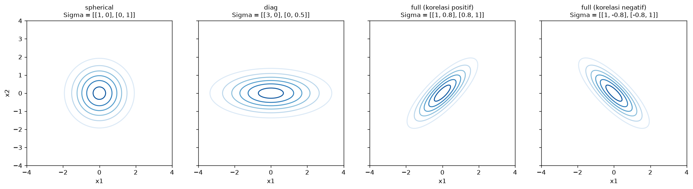
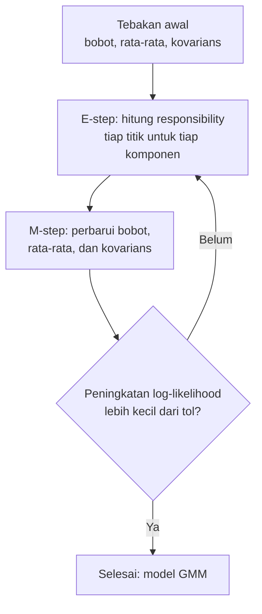
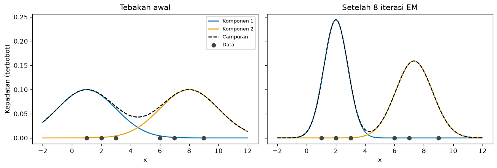
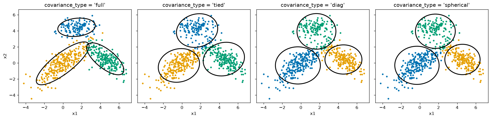
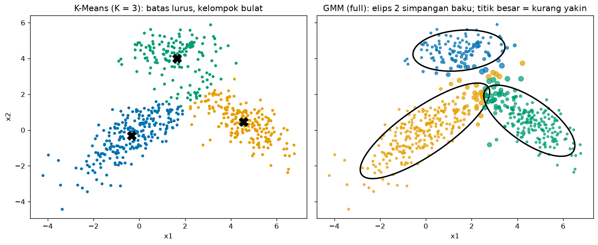
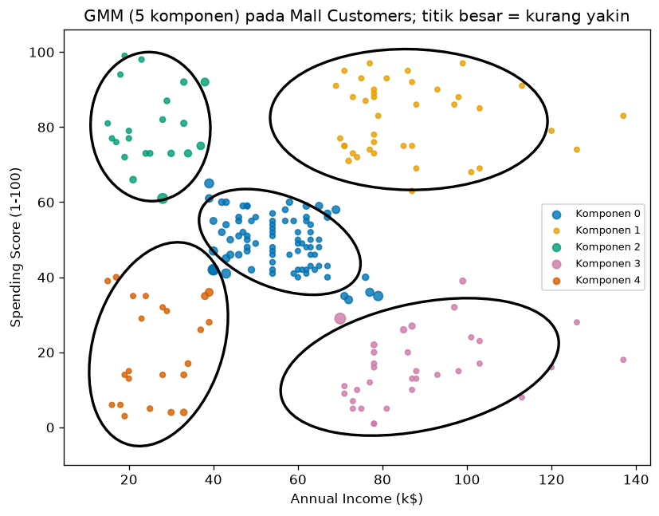

# Bab 5 — Gaussian Mixture Models (GMM)

## Learning Objectives

Setelah mempelajari bab ini, kamu mampu:

- [x] Menjelaskan ide *model-based clustering* dan *Gaussian Mixture Model* (GMM).
- [x] Menjelaskan distribusi Gaussian satu dimensi dan multivariat, termasuk peran rata-rata dan matriks kovarians.
- [x] Membedakan *hard clustering* dan *soft clustering*, serta membaca peluang keanggotaan (*responsibilities*).
- [x] Menjelaskan algoritma *Expectation-Maximization* (EM): E-step dan M-step.
- [x] Menghitung satu iterasi EM secara manual pada data kecil.
- [x] Membedakan empat tipe kovarians: `full`, `tied`, `diag`, dan `spherical`.
- [x] Memakai `GaussianMixture` dengan parameter `n_components`, `covariance_type`, `max_iter`, `tol`, `reg_covar`, dan `random_state`.
- [x] Menjelaskan bahwa label GMM diturunkan dari peluang komponen.
- [x] Membedakan GMM dari K-Means secara konseptual dan matematis.
- [x] Menggambar komponen Gaussian dan membaca ketidakpastian keanggotaan.

## Introduction

Bayangkan sebuah toko menjual sepatu, dan kamu mengukur panjang kaki semua pembeli. Histogramnya berpuncak dua: satu puncak untuk pembeli dewasa perempuan, satu lagi untuk pembeli dewasa laki-laki. Kamu tidak diberi tahu siapa termasuk golongan mana. Tetapi kamu bisa membayangkan bahwa data ini **dihasilkan oleh dua kelompok**, masing-masing dengan sebaran berbentuk lonceng. Pembeli yang panjang kakinya berada di tengah-tengah dua lonceng itu tidak jelas masuk yang mana: mungkin 60% dari kelompok pertama dan 40% dari yang kedua.

Itulah ide **Gaussian Mixture Model (GMM)**:

- Data dianggap berasal dari **campuran beberapa distribusi Gaussian** (lonceng), satu per kelompok.
- Algoritma memperkirakan **parameter** tiap lonceng: letaknya (rata-rata), lebar dan bentuknya (kovarians), dan seberapa besar porsinya (bobot).
- Hasilnya **soft clustering**: tiap titik mendapat **peluang** untuk tiap kelompok, bukan hanya satu nomor.

GMM adalah **model probabilitas**. Pendekatannya disebut **model-based clustering**: kita mengasumsikan sebuah model tentang bagaimana data dibangkitkan, lalu mencocokkan model itu ke data. Label kelompok yang kita lihat hanyalah turunan dari peluang model.

!!! note "Prasyarat"
    Bab ini memakai [centroid sebagai rata-rata](../fundamental-clustering/03-centroid-and-cluster-representation.md) (Level 3), [K-Means](02-k-means-clustering.md) (Bab 2), dan sedikit ide peluang dan matriks. Bab ini lebih banyak berisi rumus daripada bab lain. Semuanya dijelaskan bertahap dengan angka.

## Fundamental Concepts

| Istilah | Arti |
|---|---|
| **Gaussian (normal) distribution** | Distribusi berbentuk lonceng, ditentukan oleh rata-rata dan sebaran |
| **Mixture model** | Model yang menggabungkan beberapa distribusi sederhana menjadi satu |
| **Component** | Satu distribusi Gaussian di dalam campuran. Satu komponen ≈ satu kelompok |
| **Mean \( \mu_k \)** | Pusat komponen \( k \) |
| **Covariance \( \Sigma_k \)** | Matriks yang menentukan lebar, bentuk, dan kemiringan komponen \( k \) |
| **Weight (mixing coefficient) \( \pi_k \)** | Porsi komponen \( k \) dalam campuran. Semua bobot berjumlah 1 |
| **Responsibility \( r_{ik} \)** | Peluang bahwa titik \( i \) dibangkitkan oleh komponen \( k \). Inilah peluang keanggotaan |
| **Hard clustering** | Setiap titik masuk satu kelompok |
| **Soft clustering** | Setiap titik punya peluang untuk setiap kelompok |
| **Likelihood** | Seberapa besar peluang data yang kita amati, menurut parameter model |
| **EM (Expectation-Maximization)** | Algoritma yang bergantian menghitung responsibilities (E-step) dan memperbarui parameter (M-step) |
| **`covariance_type`** | Pilihan bentuk matriks kovarians: `full`, `tied`, `diag`, `spherical` |

## Detailed Explanation

### Distribusi Gaussian satu dimensi

Distribusi Gaussian satu dimensi ditentukan oleh dua angka: **rata-rata** \( \mu \) (letak puncak) dan **varians** \( \sigma^2 \) (seberapa lebar). Makin besar varians, makin lebar dan pendek loncengnya. Kurva ini adalah **kepadatan peluang**: tinggi kurva menunjukkan seberapa mungkin nilai di sekitar titik itu muncul.

### Distribusi Gaussian multivariat

Pada data dengan beberapa fitur, rata-rata menjadi **vektor** \( \mu \) (satu angka per fitur) dan varians menjadi **matriks kovarians** \( \Sigma \). Matriks ini menyimpan dua hal:

- **Diagonal**: varians tiap fitur (seberapa lebar sebaran ke arah fitur itu).
- **Di luar diagonal**: kovarians antar-fitur (apakah dua fitur cenderung naik bersama atau berlawanan). Inilah yang **memiringkan** elips.

Pada dua dimensi, garis kontur sebuah Gaussian berbentuk **elips**. Bentuk elipsnya ditentukan oleh \( \Sigma \):



- **Spherical**: lingkaran (varians sama ke semua arah).
- **Diag**: elips sejajar sumbu (varians tiap fitur berbeda, tanpa kemiringan).
- **Full**: elips yang boleh **miring** (ada korelasi antar-fitur).

### Campuran Gaussian

Satu Gaussian hanya bisa menggambarkan satu gerombol. Campuran Gaussian menjumlahkan \( K \) Gaussian, masing-masing dibobot dengan porsinya. Cara membayangkannya sebagai proses pembangkitan data:

1. Pilih sebuah komponen \( k \) secara acak, dengan peluang \( \pi_k \) (komponen besar lebih sering terpilih).
2. Ambil satu titik dari Gaussian komponen itu.
3. Ulangi sebanyak \( n \) kali.

Tugas GMM adalah **membalik proses itu**: dari titik-titik yang kita lihat, tebak \( \pi_k \), \( \mu_k \), dan \( \Sigma_k \) yang paling mungkin menghasilkannya. Kita tidak tahu titik mana berasal dari komponen mana. Itulah yang membuat soal ini menarik, dan itulah yang dikerjakan EM.

### Soft clustering: peluang keanggotaan

Setelah parameter diketahui, untuk tiap titik kita bisa menghitung **peluang tiap komponen "bertanggung jawab" atas titik itu**, yaitu *responsibility* \( r_{ik} \). Titik di dekat pusat sebuah komponen hampir pasti milik komponen itu (peluang mendekati 1). Titik di antara dua komponen memiliki peluang terbagi, misalnya 0,5 dan 0,5.

**Label** yang kamu dapat dari `predict` hanyalah komponen dengan peluang terbesar. Jadi label GMM **diturunkan dari peluang**. Peluangnya adalah informasi aslinya.

### Algoritma EM, secara intuitif

Masalahnya seperti ayam dan telur:

- Jika kita **tahu** titik mana milik komponen mana, menghitung rata-rata dan kovarians tiap komponen mudah.
- Jika kita **tahu** parameter tiap komponen, menghitung peluang keanggotaan tiap titik mudah.

Kita tidak tahu keduanya. **EM** memecahkannya dengan bergantian:

1. **Mulai** dengan tebakan parameter (di scikit-learn, bawaannya dari hasil K-Means).
2. **E-step (Expectation):** dengan parameter saat ini, hitung responsibility tiap titik terhadap tiap komponen.
3. **M-step (Maximization):** dengan responsibility itu sebagai "keanggotaan sebagian", hitung ulang bobot, rata-rata, dan kovarians tiap komponen.
4. **Ulangi** langkah 2 dan 3 sampai peningkatan *log-likelihood* sangat kecil (di bawah `tol`) atau iterasi mencapai `max_iter`.



Perbandingan dengan K-Means ([Bab 2](02-k-means-clustering.md)): langkah *assignment* K-Means mirip E-step, dan langkah *update* mirip M-step. Bedanya, K-Means memasukkan titik ke **satu** kelompok (keanggotaan 0 atau 1), sedangkan EM memberi keanggotaan **sebagian** (peluang).

### Contoh manual satu iterasi EM (satu dimensi)

Enam titik: \( x = 1, 2, 3, 6, 7, 9 \). Kita tebak dua komponen: \( \mu_1 = 1 \), \( \mu_2 = 8 \), varians \( \sigma_1^2 = \sigma_2^2 = 4 \), dan bobot \( \pi_1 = \pi_2 = 0{,}5 \).

**E-step untuk titik \( x = 3 \).** Hitung kepadatan Gaussian tiap komponen:

- \( \mathcal{N}(3 \mid 1, 4) = \frac{1}{\sqrt{2\pi \cdot 4}} \exp\left(-\frac{(3-1)^2}{2 \cdot 4}\right) = 0{,}19947 \times e^{-0{,}5} \approx 0{,}12099 \)
- \( \mathcal{N}(3 \mid 8, 4) = 0{,}19947 \times \exp\left(-\frac{25}{8}\right) \approx 0{,}00876 \)

Kalikan dengan bobot (keduanya 0,5), lalu normalkan:

$$
r_{31} = \frac{0{,}5 \times 0{,}12099}{0{,}5 \times 0{,}12099 + 0{,}5 \times 0{,}00876} = \frac{0{,}12099}{0{,}12975} \approx 0{,}9325
\qquad
r_{32} \approx 0{,}0675
$$

Titik \( x = 3 \) "milik" komponen 1 dengan peluang sekitar 93,25% dan komponen 2 sekitar 6,75%. Dengan cara yang sama kita hitung semua titik (tabelnya ada pada output langkah terkait di bagian Python Implementation).

**M-step.** Dengan semua responsibility, hitung ulang parameter. Misalnya total tanggung jawab komponen 1 adalah \( N_1 = \sum_i r_{i1} \approx 2{,}998 \), sehingga:

- Bobot baru: \( \pi_1 = N_1 / 6 \approx 0{,}4997 \).
- Rata-rata baru: rata-rata titik yang **dibobot** oleh \( r_{i1} \). Hasilnya \( \mu_1 \approx 2{,}090 \), jauh lebih tepat daripada tebakan awal 1.
- Varians baru: rata-rata kuadrat selisih yang dibobot. Hasilnya \( \sigma_1^2 \approx 1{,}106 \), turun dari tebakan awal 4.

Setelah beberapa iterasi, parameter stabil. Seluruh perhitungan ini dilakukan kode di bagian Python Implementation.

### Tipe kovarians (`covariance_type`)

Matriks kovarians adalah bagian paling "mahal" dari GMM, karena jumlah parameternya tumbuh cepat dengan jumlah fitur. Scikit-learn menyediakan empat pilihan:

| Tipe | Arti | Bentuk elips | Bentuk `covariances_` | Jumlah parameter kovarians* |
|---|---|---|---|---|
| `full` | Tiap komponen punya matriks kovarians sendiri, bebas | Elips bebas, boleh miring, tiap komponen berbeda | `(K, d, d)` | \( K \cdot d(d+1)/2 \) |
| `tied` | **Semua** komponen berbagi satu matriks kovarians bebas | Elips bebas, tetapi **sama** untuk semua komponen | `(d, d)` | \( d(d+1)/2 \) |
| `diag` | Tiap komponen punya kovarians diagonal | Elips sejajar sumbu, tiap komponen berbeda | `(K, d)` | \( K \cdot d \) |
| `spherical` | Tiap komponen punya satu angka varians | Lingkaran, ukuran tiap komponen berbeda | `(K,)` | \( K \) |

\* \( K \) adalah jumlah komponen dan \( d \) jumlah fitur.

`full` paling fleksibel tetapi butuh paling banyak parameter. Makin sedikit parameter (misalnya `spherical`), makin kaku modelnya, tetapi makin stabil pada data yang sedikit. Pada \( K=3 \) dan \( d=2 \): `full` memakai 9 parameter kovarians, `tied` 3, `diag` 6, dan `spherical` 3.

### Parameter `GaussianMixture`

| Parameter | Bawaan | Arti |
|---|---|---|
| `n_components` | 1 | Jumlah komponen Gaussian (\( K \)). **Atur sendiri** |
| `covariance_type` | `"full"` | `"full"`, `"tied"`, `"diag"`, atau `"spherical"` |
| `max_iter` | 100 | Batas iterasi EM untuk satu kali jalan |
| `tol` | 0,001 | Ambang konvergensi: EM berhenti bila peningkatan rata-rata log-likelihood per titik di bawah nilai ini |
| `reg_covar` | \( 10^{-6} \) | Angka kecil yang ditambahkan ke diagonal kovarians agar matriks tidak "ambruk" (singular) |
| `n_init` | 1 | Jumlah inisialisasi berbeda. Hasil terbaik dipakai |
| `init_params` | `"kmeans"` | Cara membuat tebakan awal: `"kmeans"`, `"k-means++"`, `"random"`, atau `"random_from_data"` |
| `random_state` | `None` | Seed acak. **Atur** agar hasil bisa diulang |

Atribut setelah `fit`:

| Atribut | Isi |
|---|---|
| `weights_` | Bobot \( \pi_k \), bentuk `(K,)` |
| `means_` | Rata-rata \( \mu_k \), bentuk `(K, d)` |
| `covariances_` | Kovarians, bentuk bergantung `covariance_type` |
| `converged_` | `True` jika EM konvergen sebelum `max_iter` |
| `n_iter_` | Jumlah iterasi EM pada jalan terbaik |

Method penting:

| Method | Hasil |
|---|---|
| `predict(X)` | Label = komponen dengan peluang terbesar |
| `predict_proba(X)` | Matriks peluang `(n, K)`, tiap baris berjumlah 1 |
| `score(X)` | Rata-rata log-likelihood per titik |

!!! warning "GMM tidak punya `labels_`"
    Berbeda dengan `KMeans`, objek `GaussianMixture` **tidak** punya atribut `labels_`. Gunakan `predict(X)` atau `fit_predict(X)`. Ini konsisten dengan bab 1: label GMM adalah turunan dari peluang.

!!! note "Soal memilih jumlah komponen"
    Skor yang selalu naik saat \( K \) bertambah (seperti `score`) tidak bisa dipakai memilih \( K \). Cara menilai dan memilih \( K \) secara formal (misalnya dengan BIC dan AIC) dibahas di Level 5.

### Membedakan GMM dari K-Means

| | K-Means | GMM |
|---|---|---|
| Jenis | Algoritma geometris (jarak ke centroid) | **Model probabilitas** (campuran Gaussian) |
| Keanggotaan | **Hard** (0 atau 1) | **Soft** (peluang) |
| Bentuk kelompok | Bulat, ukuran mirip | **Elips** berbagai ukuran dan kemiringan (dengan `full`) |
| Ukuran kelompok | Tidak dimodelkan | Dimodelkan lewat **bobot** \( \pi_k \) |
| Yang dioptimalkan | Jumlah kuadrat jarak (WCSS) | **Log-likelihood** data |
| Langkah inti | Assignment dan update | **E-step** dan **M-step** |
| Batas antar-kelompok | Garis lurus | Garis lengkung (kuadratik) untuk `full` |
| Banyak parameter | Hanya \( K \) centroid | Bobot, rata-rata, kovarians |

K-Means bisa dipandang sebagai **kasus pembatas** dari GMM: jika semua komponen berkovarians bulat dan sama, dan variansnya menuju nol, responsibilities menjadi 0 atau 1 dan E-step menjadi assignment K-Means (lihat Bishop, 2006, Bab 9.3.2). Jadi GMM adalah generalisasi: lebih fleksibel, tetapi lebih banyak parameter.

### Kelebihan dan keterbatasan

| Kelebihan | Keterbatasan |
|---|---|
| Memberi peluang keanggotaan (soft clustering) | Harus menentukan \( K \) di awal |
| Mampu menangani kelompok elips dengan ukuran dan kemiringan berbeda | Mengasumsikan tiap kelompok **berbentuk Gaussian**. Bentuk lain (misalnya bulan sabit) tidak cocok |
| Memodelkan ukuran kelompok lewat bobot | Hasil bergantung inisialisasi (local optimum) |
| Punya `predict` dan `predict_proba` untuk data baru | Butuh banyak parameter pada dimensi tinggi (kovarians `full`) |
| Bisa membangkitkan data baru dari model (`sample`) | Bisa gagal bila sebuah komponen "ambruk" pada satu titik (singular) |
| Dasar matematikanya jelas | Lebih lambat daripada K-Means |

## Mathematical Foundation

### Gaussian satu dimensi

$$
\mathcal{N}(x \mid \mu, \sigma^2) = \frac{1}{\sqrt{2\pi\sigma^2}} \exp\left( -\frac{(x-\mu)^2}{2\sigma^2} \right)
$$

Penjelasan simbol: \( x \) adalah nilai yang diamati, \( \mu \) rata-rata, dan \( \sigma^2 \) varians. Pecahan di depan membuat luas di bawah kurva sama dengan 1. Bagian \( \exp(\cdot) \) turun cepat saat \( x \) menjauhi \( \mu \): selisih \( (x-\mu)^2 \) dibagi \( 2\sigma^2 \).

**Contoh angka.** Untuk \( x = 3 \), \( \mu = 1 \), \( \sigma^2 = 4 \): \( \frac{1}{\sqrt{8\pi}} \approx 0{,}19947 \) dan \( \exp(-4/8) = e^{-0{,}5} \approx 0{,}60653 \), jadi \( \mathcal{N} \approx 0{,}12099 \), sama dengan output kode.

### Gaussian multivariat

Untuk \( d \) fitur, dengan vektor titik \( \mathbf{x} \), vektor rata-rata \( \mu \), dan matriks kovarians \( \Sigma \):

$$
\mathcal{N}(\mathbf{x} \mid \mu, \Sigma) = \frac{1}{\sqrt{(2\pi)^d \, \lvert \Sigma \rvert}} \exp\left( -\frac{1}{2} (\mathbf{x}-\mu)^{\top} \Sigma^{-1} (\mathbf{x}-\mu) \right)
$$

Penjelasan:

- \( \lvert \Sigma \rvert \) adalah determinan \( \Sigma \) (ukuran "volume" sebaran). \( \Sigma^{-1} \) adalah invers matriks.
- \( (\mathbf{x}-\mu)^{\top} \Sigma^{-1} (\mathbf{x}-\mu) \) adalah **jarak Mahalanobis kuadrat**: jarak dari titik ke pusat yang memperhitungkan lebar dan kemiringan sebaran. Arah yang sebarannya lebar "dimaafkan", dan arah yang sempit "dihukum".

**Contoh 1** (\( \Sigma = I \), selisih \( (1, 1) \)): determinan 1, jarak Mahalanobis kuadrat \( = 1 + 1 = 2 \), jadi \( \mathcal{N} = \frac{1}{2\pi} e^{-1} \approx 0{,}15915 \times 0{,}36788 \approx 0{,}05855 \), sama dengan output kode.

**Contoh 2** (\( \Sigma = \mathrm{diag}(4, 1) \), selisih \( (2, 1) \)): \( \Sigma^{-1} = \mathrm{diag}(\tfrac{1}{4}, 1) \), maka jarak Mahalanobis kuadrat \( = \frac{2^2}{4} + \frac{1^2}{1} = 1 + 1 = 2 \). Selisih 2 pada fitur yang variansnya 4 dianggap sama "jauh" dengan selisih 1 pada fitur yang variansnya 1.

### Model campuran

Kepadatan sebuah titik di bawah campuran \( K \) komponen:

$$
p(\mathbf{x}) = \sum_{k=1}^{K} \pi_k \, \mathcal{N}(\mathbf{x} \mid \mu_k, \Sigma_k)
\qquad \text{dengan} \qquad
\pi_k \ge 0, \quad \sum_{k=1}^{K} \pi_k = 1
$$

Tiap komponen menyumbang kepadatan Gaussiannya dikali bobot \( \pi_k \). Bobot berjumlah 1 supaya \( p(\mathbf{x}) \) tetap kepadatan peluang yang sah.

### Responsibility (E-step)

$$
r_{ik} = \frac{\pi_k \, \mathcal{N}(\mathbf{x}_i \mid \mu_k, \Sigma_k)}{\sum_{j=1}^{K} \pi_j \, \mathcal{N}(\mathbf{x}_i \mid \mu_j, \Sigma_j)}
$$

Pembilang adalah "sumbangan" komponen \( k \) pada titik \( \mathbf{x}_i \), dan penyebut adalah sumbangan semua komponen. Pembagian ini membuat \( \sum_k r_{ik} = 1 \). Ini adalah **aturan Bayes**: peluang komponen \( k \) setelah melihat titik \( \mathbf{x}_i \).

**Label** yang dihasilkan: \( c_i = \arg\max_k r_{ik} \).

**Contoh angka.** Pada titik \( x = 3 \): sumbangan komponen 1 \( = 0{,}5 \times 0{,}12099 = 0{,}06050 \) dan komponen 2 \( = 0{,}5 \times 0{,}00876 = 0{,}00438 \). Jumlahnya \( 0{,}06487 \), sehingga \( r_{31} = 0{,}06050 / 0{,}06487 \approx 0{,}9325 \), cocok dengan tabel di output.

### Pembaruan parameter (M-step)

Dengan responsibility tetap, parameter baru adalah rata-rata terbobot:

$$
N_k = \sum_{i=1}^{n} r_{ik}
\qquad
\pi_k = \frac{N_k}{n}
\qquad
\mu_k = \frac{1}{N_k} \sum_{i=1}^{n} r_{ik}\, \mathbf{x}_i
$$

$$
\Sigma_k = \frac{1}{N_k} \sum_{i=1}^{n} r_{ik}\, (\mathbf{x}_i - \mu_k)(\mathbf{x}_i - \mu_k)^{\top}
$$

- \( N_k \): "jumlah efektif" titik milik komponen \( k \), yaitu jumlah responsibility-nya.
- \( \pi_k = N_k / n \): bobot adalah porsi titik yang menjadi tanggung jawab komponen \( k \).
- \( \mu_k \): rata-rata semua titik, tetapi titik yang lebih "dimiliki" komponen \( k \) berpengaruh lebih besar. Bandingkan dengan update centroid K-Means ([Bab 2](02-k-means-clustering.md)): sama, hanya keanggotaannya sebagian, bukan 0 atau 1.
- \( \Sigma_k \): sebaran terbobot di sekitar \( \mu_k \).

### Fungsi tujuan: log-likelihood

EM berusaha memaksimalkan **log-likelihood** data:

$$
\ell(\theta) = \sum_{i=1}^{n} \log \left( \sum_{k=1}^{K} \pi_k \, \mathcal{N}(\mathbf{x}_i \mid \mu_k, \Sigma_k) \right)
$$

dengan \( \theta \) adalah seluruh parameter (\( \pi_k, \mu_k, \Sigma_k \)). Nilai ini makin besar (kurang negatif) bila model makin cocok dengan data. Setiap putaran EM (E-step lalu M-step) **tidak pernah menurunkan** \( \ell \). Pada contoh 1 dimensi kita, log-likelihood naik dari \( -15{,}0389 \) menjadi \( -12{,}9475 \), lalu \( -12{,}7250 \), dan akhirnya menetap di \( -12{,}7235 \). Seperti K-Means, EM hanya menjamin mencapai **optimum lokal**, bukan global, sehingga `n_init` dan `random_state` penting.

### Kompleksitas

Satu iterasi EM menghitung kepadatan tiap titik untuk tiap komponen. Untuk `full`, biayanya kira-kira sebanding dengan \( n \cdot K \cdot d^2 \) (ditambah invers matriks \( d \times d \) untuk tiap komponen), sedangkan untuk `diag` dan `spherical` kira-kira \( n \cdot K \cdot d \). Jadi `full` menjadi mahal bila \( d \) besar.

## Python Implementation

Skrip lengkapnya ada di `examples/level-4/05_gaussian_mixture_models.py`, dan versi notebook-nya di `notebooks/level-4/05-gaussian-mixture-models.ipynb`.

**Konteks masalah:** memahami Gaussian dan EM, lalu memakai `GaussianMixture` untuk memperoleh label dan peluang keanggotaan.

**Dataset:**

- 6 titik satu dimensi untuk EM manual.
- **Data dua dimensi yang kita bangkitkan sendiri** dari tiga Gaussian dengan parameter yang kita tentukan (elips miring, ukuran berbeda, tumpang tindih sebagian). Ini cocok untuk GMM karena sesuai dengan asumsinya, dan karena **kita tahu parameter sebenarnya**, kita bisa memeriksa apakah GMM menemukannya kembali.
- Mall Customers (200 pelanggan, terskala).

**Pustaka:** NumPy, pandas, Matplotlib, scikit-learn.

### Bagian A — Siapkan alat

```python
--8<-- "level-4/05_gaussian_mixture_models.py:setup"
```

**Penjelasan:** `GaussianMixture` dari `sklearn.mixture` adalah algoritmanya. `Ellipse` dari Matplotlib untuk menggambar elips komponen. `ConvergenceWarning` dan modul `warnings` dipakai untuk mengatur peringatan. `KMeans` dipakai sebagai pembanding.

### Bagian B — Gaussian satu dimensi dan multivariat

```python
--8<-- "level-4/05_gaussian_mixture_models.py:gauss1d"
```

```text title="Output"
--8<-- "level-4/outputs/05/gauss1d.txt"
```

**Penjelasan:** fungsi `normal_pdf` adalah rumus Gaussian satu dimensi: `np.exp(...)` untuk bagian eksponen, dan `np.sqrt(2 * np.pi * var)` untuk penyebut. Kita menghitung dua nilai yang sama dengan contoh manual: \( \mathcal{N}(3 \mid 1, 4) \approx 0{,}121 \) dan \( \mathcal{N}(3 \mid 8, 4) \approx 0{,}00876 \).

```python
--8<-- "level-4/05_gaussian_mixture_models.py:gauss2d"
```

```text title="Output"
--8<-- "level-4/outputs/05/gauss2d.txt"
```

**Penjelasan:**

- `mvn_pdf(X, mean, cov)` menghitung kepadatan Gaussian multivariat untuk banyak titik sekaligus.
- `diff = X - mean` adalah selisih tiap titik dari pusat. `np.linalg.inv(cov)` adalah invers kovarians.
- `np.einsum("ij,jk,ik->i", diff, inv_cov, diff)` menghitung \( (\mathbf{x}-\mu)^\top \Sigma^{-1} (\mathbf{x}-\mu) \) untuk setiap baris. Tulisan `"ij,jk,ik->i"` berarti: kalikan `diff` (indeks `i, j`), `inv_cov` (indeks `j, k`), dan `diff` lagi (indeks `i, k`), lalu jumlahkan indeks `j` dan `k`, tersisa satu angka per baris `i`.
- `np.linalg.det(cov)` adalah determinan. `norm_const` adalah pecahan di depan rumus.
- Dua contoh di bawahnya mengecek hasil dengan contoh manual: \( 0{,}05855 \) dan jarak Mahalanobis kuadrat \( 2{,}0 \).

```python
--8<-- "level-4/05_gaussian_mixture_models.py:plotcov"
```


**Penjelasan:** `np.meshgrid` membuat kisi titik di bidang dari \(-4\) sampai \(4\). `grid` meratakannya menjadi daftar titik `(40000, 2)`. Untuk tiap bentuk kovarians kita hitung kepadatan di semua titik kisi, lalu `ax.contour(...)` menggambar garis kontur. `ax.set_aspect("equal")` membuat skala x dan y sama supaya lingkaran tampak bulat.

### Bagian C — Algoritma EM dari nol (satu dimensi)

```python
--8<-- "level-4/05_gaussian_mixture_models.py:em1d"
```

```text title="Output"
--8<-- "level-4/outputs/05/em1d.txt"
```

**Penjelasan baris demi baris:**

- `x` adalah enam titik. `means`, `variances`, `weights` adalah tebakan awal untuk dua komponen. `initial_params` menyimpan salinannya (`.copy()`), karena nanti array aslinya diperbarui.
- `x[:, None]` mengubah `x` dari bentuk `(6,)` menjadi `(6, 1)`. Dengan `means` berbentuk `(2,)`, *broadcasting* menghasilkan matriks `(6, 2)`: kepadatan tiap titik untuk tiap komponen.
- **E-step:**
    - `weighted_density = weights * normal_pdf(...)` mengalikan kepadatan dengan bobot komponen (\( \pi_k \mathcal{N}(\cdot) \)).
    - `log_likelihood = np.log(weighted_density.sum(axis=1)).sum()` menjumlahkan sumbangan semua komponen per titik, mengambil logaritma, lalu menjumlahkan semua titik.
    - `responsibilities = weighted_density / weighted_density.sum(axis=1, keepdims=True)` membagi tiap baris dengan jumlah barisnya. `keepdims=True` mempertahankan bentuk `(6, 1)` agar pembagian bisa dilakukan baris demi baris.
- **M-step:**
    - `n_k = responsibilities.sum(axis=0)` adalah \( N_k \), jumlah responsibility tiap komponen.
    - `weights = n_k / len(x)`.
    - `means = (responsibilities * x[:, None]).sum(axis=0) / n_k` adalah rata-rata terbobot.
    - `variances = (responsibilities * (x[:, None] - means) ** 2).sum(axis=0) / n_k` adalah varians terbobot, memakai rata-rata yang **baru**.
- `print(...)` menampilkan log-likelihood dan parameter tiap iterasi. Pada iterasi pertama kita juga mencetak tabel responsibility.

```python
--8<-- "level-4/05_gaussian_mixture_models.py:plotem"
```



**Penjelasan:** dua panel: tebakan awal dan hasil setelah 8 iterasi. Tiap komponen digambar sebagai kurva terbobot (`w[k] * normal_pdf(...)`), dan garis putus-putus hitam adalah **campurannya** (jumlah kedua kurva). Titik-titik data digambar di sumbu bawah.

```python
--8<-- "level-4/05_gaussian_mixture_models.py:emsk"
```

```text title="Output"
--8<-- "level-4/outputs/05/emsk.txt"
```

**Penjelasan:** kita menjalankan `GaussianMixture` scikit-learn dengan tebakan awal yang sama (`means_init`, `weights_init`, `precisions_init`; presisi adalah 1/varians \( = 1/4 = 0{,}25 \)) dan `tol` sangat kecil supaya konvergen penuh, lalu membandingkan hasilnya dengan EM buatan sendiri. `gm_1d.score(x[:, None]) * len(x)` mengubah rata-rata log-likelihood per titik menjadi total.

### Bagian D — Data dua dimensi berbentuk elips

```python
--8<-- "level-4/05_gaussian_mixture_models.py:data2d"
```

```text title="Output"
--8<-- "level-4/outputs/05/data2d.txt"
```

**Penjelasan:** `true_components` mendaftar tiga komponen yang kita pakai membangkitkan data: jumlah titik, rata-rata, dan matriks kovarians. `rng.multivariate_normal(mean, cov, size=n)` mengambil `n` titik dari Gaussian dengan parameter itu. `np.vstack` menumpuk ketiganya menjadi `X` berisi 600 titik. Komentar pada tiap baris menjelaskan bentuk elipsnya.

```python
--8<-- "level-4/05_gaussian_mixture_models.py:helpers"
```

**Penjelasan:**

- `full_covariances(gmm)` mengubah `covariances_` dari tipe apa pun (bentuk `(K,)`, `(K, d)`, `(d, d)`, atau `(K, d, d)`) menjadi matriks penuh `(K, d, d)`, supaya satu fungsi gambar bisa dipakai untuk semuanya. `np.diag(c)` membuat matriks diagonal, dan `np.eye(d) * c` membuat matriks identitas dikali varians.
- `draw_ellipse` menggambar elips pada \( n \) simpangan baku. `np.linalg.eigh(cov)` menguraikan kovarians menjadi **nilai eigen** (varians sepanjang sumbu utama elips) dan **vektor eigen** (arah sumbu utama). Panjang sumbu adalah `2 * n_std * sqrt(nilai eigen)`, dan sudut kemiringan dihitung dari vektor eigen terbesar dengan `np.arctan2`.

### Bagian E — GMM scikit-learn

```python
--8<-- "level-4/05_gaussian_mixture_models.py:fit"
```

```text title="Output"
--8<-- "level-4/outputs/05/fit.txt"
```

**Penjelasan:**

- `GaussianMixture(n_components=3, covariance_type="full", ...)` mengatur parameter yang dibahas. `n_init=5` menjalankan EM dari 5 awal berbeda dan mengambil yang terbaik.
- `gmm.fit(X)` menjalankan EM. Setelahnya kita membaca `converged_`, `n_iter_`, `weights_`, bentuk `means_` dan `covariances_`, dan `score(X)`.
- `np.argsort(gmm.means_[:, 0])` mengurutkan komponen menurut `x1`. Nomor komponen GMM sembarang, jadi kita urutkan sebelum membandingkannya dengan parameter sebenarnya.

```python
--8<-- "level-4/05_gaussian_mixture_models.py:proba"
```

```text title="Output"
--8<-- "level-4/outputs/05/proba.txt"
```

**Penjelasan:**

- `gmm.predict(X)` memberi label, `gmm.predict_proba(X)` memberi matriks peluang `(600, 3)`.
- `proba[:5].sum(axis=1)` membuktikan tiap baris berjumlah 1.
- `np.array_equal(labels_gmm, proba.argmax(axis=1))` membuktikan label sama dengan komponen berpeluang terbesar. Inilah arti "label GMM diturunkan dari peluang".
- `confidence = proba.max(axis=1)` adalah peluang tertinggi tiap titik, yaitu seberapa yakin model. Kita menghitung berapa titik yang keyakinannya di bawah 0,9 dan 0,6.

```python
--8<-- "level-4/05_gaussian_mixture_models.py:manual"
```

```text title="Output"
--8<-- "level-4/outputs/05/manual.txt"
```

**Penjelasan:** kita menghitung responsibility sendiri dengan rumus E-step memakai `mvn_pdf` dan parameter hasil `gmm`. Perulangan `[... for k in range(3)]` membuat satu kolom per komponen, `np.column_stack` menyatukannya, dan pembagian dengan jumlah baris menormalkan. Lalu kita ambil selisih terbesar dengan `predict_proba`.

```python
--8<-- "level-4/05_gaussian_mixture_models.py:iterations"
```

```text title="Output"
--8<-- "level-4/outputs/05/iterations.txt"
```

**Penjelasan:** kita menjalankan GMM dengan `max_iter` = 1, 2, 3, 5, 10, 20, 50 dan `tol=1e-8` (sangat ketat, agar tidak berhenti dini). `warnings.catch_warnings()` dan `simplefilter("ignore", ...)` menyembunyikan `ConvergenceWarning` yang wajar muncul ketika `max_iter` terlalu kecil. Kita mencetak `n_iter_`, `converged_`, dan log-likelihood tiap kali.

### Bagian F — Empat tipe kovarians

```python
--8<-- "level-4/05_gaussian_mixture_models.py:covtypes"
```

```text title="Output"
--8<-- "level-4/outputs/05/covtypes.txt"
```

**Penjelasan:** `param_formula` menghitung jumlah parameter kovarians dengan rumus pada tabel. Perulangan melatih satu model untuk tiap `covariance_type`, dan mencetak bentuk `covariances_` serta ukuran komponen. `//` adalah pembagian bulat.

```python
--8<-- "level-4/05_gaussian_mixture_models.py:plotcov2"
```



**Penjelasan:** empat panel, satu per tipe kovarians. Tiap panel menggambar titik berwarna menurut komponen dan elips hitam sebagai kontur 2 simpangan baku tiap komponen. `full_covariances(model)[j]` mengambil matriks penuh komponen `j`.

### Bagian G — K-Means dibanding GMM

```python
--8<-- "level-4/05_gaussian_mixture_models.py:plotcmp"
```

```text title="Output"
--8<-- "level-4/outputs/05/plotcmp.txt"
```



**Penjelasan:** panel kiri adalah K-Means dengan centroid (`X` hitam). Panel kanan adalah GMM `full` dengan elips. Ukuran titik pada panel kanan: `10 + 60 * (1 - confidence) ** 0.5`, jadi titik dengan keyakinan rendah digambar **lebih besar**. Pangkat 0,5 (akar) memperjelas perbedaan di antara titik-titik yang cukup yakin.

### Bagian H — Mall Customers

```python
--8<-- "level-4/05_gaussian_mixture_models.py:mall"
```

```text title="Output"
--8<-- "level-4/outputs/05/mall.txt"
```

**Penjelasan:**

- Fitur diskalakan dengan `StandardScaler`, lalu `GaussianMixture(n_components=5, ...)` dilatih.
- `df["Cluster"]` adalah label, dan `df["Confidence"]` adalah peluang tertinggi tiap pelanggan.
- `scaler.inverse_transform(gmm_mall.means_)` mengubah rata-rata komponen ke satuan asli.
- `df["Confidence"].nsmallest(3).index` mengambil tiga pelanggan dengan keyakinan terendah, dan kita mencetak peluang lengkapnya.

```python
--8<-- "level-4/05_gaussian_mixture_models.py:newpoint"
```

```text title="Output"
--8<-- "level-4/outputs/05/newpoint.txt"
```

**Penjelasan:** `scaler.transform(...)` (bukan `fit_transform`) menyamakan skala pelanggan baru, lalu `predict_proba` dan `predict` memberi peluang dan label.

```python
--8<-- "level-4/05_gaussian_mixture_models.py:plotmall"
```



**Penjelasan:** scatter plot dengan ukuran titik menurut ketidakyakinan, plus elips komponen. Kovarians diubah ke satuan asli: jika data diskalakan dengan `scale_` (simpangan baku), maka kovarians asli \( = \Sigma \cdot (s_i s_j) \), ditulis `gmm_mall.covariances_[j] * np.outer(scaler.scale_, scaler.scale_)`. Rata-rata dikembalikan dengan `inverse_transform`.

## Code Explanation

| Bagian kode | Peran |
|---|---|
| `normal_pdf`, `mvn_pdf` | Rumus kepadatan Gaussian |
| `weights * normal_pdf(...)` lalu dinormalkan | **E-step**: responsibility |
| rata-rata dan varians terbobot | **M-step**: pembaruan parameter |
| `np.log(...sum...).sum()` | Log-likelihood |
| `GaussianMixture(...).fit(X)` | EM sungguhan |
| `predict_proba(X)` | Peluang keanggotaan (soft clustering) |
| `predict(X)` = `argmax(predict_proba(X))` | Label (hard) turunan peluang |
| `covariance_type` | Bentuk matriks kovarians |
| `np.linalg.eigh` | Sumbu dan kemiringan elips |

## How to Run

Dari folder utama proyek (setelah mengaktifkan lingkungan virtual):

```powershell
pip install -r requirements-notebooks.txt
python examples/level-4/05_gaussian_mixture_models.py
```

Skrip mencetak output ke terminal dan menyimpan lima gambar ke `docs/assets/level-4/`. Notebook interaktifnya:

```powershell
jupyter notebook notebooks/level-4/05-gaussian-mixture-models.ipynb
```

Semua output pada bab ini berasal dari eksekusi nyata dengan Python 3.14, NumPy 2.5.2, pandas 3.0.5, scikit-learn 1.9.0, dan Matplotlib 3.11.1.

## Expected Output

Output setiap langkah ditampilkan langsung di bawah kodenya pada bagian [Python Implementation](#python-implementation).

Gambar yang dihasilkan:


### Interpretasi output

**1. Contoh angka Gaussian.** \( \mathcal{N}(3 \mid 1, 4) = 0{,}12099 \) dan \( \mathcal{N}(3 \mid 8, 4) = 0{,}00876 \), sama dengan hitungan manual. Untuk dua dimensi, kepadatan dengan \( \Sigma = I \) pada selisih \( (1, 1) \) adalah **0,05855**, dan jarak Mahalanobis kuadrat pada contoh \( \mathrm{diag}(4, 1) \) adalah **2,0**.

**2. EM satu dimensi.** Tabel responsibility pada iterasi 1 untuk titik \( x = 3 \) adalah \( (0{,}9325;\ 0{,}0675) \), sama dengan hitungan manual. Titik 1 dan 2 hampir sepenuhnya milik komponen 1 (0,9978 dan 0,9876), titik 7 dan 9 milik komponen 2 (0,9876 dan 0,9996), dan titik 3 dan 6 berada di perbatasan sehingga peluangnya paling terbagi. Parameter berubah dari tebakan awal (rata-rata 1 dan 8, varians 4 dan 4) menjadi, setelah iterasi pertama, rata-rata 2,0899 dan 7,2403 serta varians 1,1061 dan 2,0747. **Log-likelihood** naik dari \( -15{,}0389 \) ke \( -12{,}9475 \), \( -12{,}7250 \), lalu \( -12{,}7235 \) dan tidak berubah lagi dalam empat desimal. Setelah 8 iterasi: rata-rata \( (1{,}9988;\ 7{,}328) \), varians \( (0{,}6664;\ 1{,}5771) \), bobot \( (0{,}4994;\ 0{,}5006) \).

**3. Dibandingkan dengan scikit-learn.** Dengan tebakan awal yang sama, scikit-learn menghasilkan rata-rata \( (1{,}9988;\ 7{,}328) \), varians \( (0{,}6664;\ 1{,}5771) \), bobot \( (0{,}4994;\ 0{,}5006) \), dan total log-likelihood \( -12{,}7235 \). **Semuanya sama dengan EM buatan sendiri** sampai empat desimal.

**4. GMM pada data dua dimensi.** GMM konvergen dalam 7 iterasi. Dibandingkan dengan parameter yang kita pakai untuk membangkitkan data (diurutkan menurut `x1`):

| | Bobot sebenarnya | Bobot GMM | Rata-rata sebenarnya | Rata-rata GMM |
|---|---|---|---|---|
| Komponen A | 0,45 | 0,442 | (0, 0) | (−0,04; −0,04) |
| Komponen B | 0,20 | 0,201 | (1,5; 4,5) | (1,45; 4,44) |
| Komponen C | 0,35 | 0,357 | (4,5; 0,5) | (4,52; 0,52) |

GMM menemukan kembali bobot dan rata-rata dengan selisih kecil. (Pemeriksaan ini hanya mungkin karena kita sendiri yang membangkitkan datanya. Pada data nyata tidak ada parameter sebenarnya untuk dibandingkan.) Rata-rata log-likelihood per titik adalah \( -3{,}63 \).

**5. Peluang keanggotaan.** Tiap baris `predict_proba` berjumlah 1, dan `label = argmax(peluang)` benar untuk **semua** titik (`True`). Titik nomor 2 punya peluang \( (0;\ 0{,}147;\ 0{,}853) \): GMM memilih komponen ketiga dengan keyakinan 85,3%. Sebanyak **51 dari 600** titik punya peluang tertinggi di bawah 0,9, dan **19** di bawah 0,6. Itulah titik di daerah tumpang tindih. Informasi seperti ini tidak tersedia pada K-Means. Perhitungan responsibility manual dengan rumus E-step berbeda dari `predict_proba` hanya sekitar \( 10^{-15} \), yaitu galat pembulatan.

**6. Iterasi EM.** Log-likelihood rata-rata per titik naik terus: \( -3{,}6633 \) (1 iterasi), \( -3{,}6477 \), \( -3{,}6376 \), \( -3{,}6309 \) (5 iterasi), \( -3{,}6298 \) (10 iterasi), \( -3{,}6297 \) (20 iterasi). Dengan `tol=1e-8`, EM konvergen pada **27** iterasi (`max_iter=50` cukup). Pada `max_iter` kecil, `converged_` bernilai `False`. Peningkatan terbesar terjadi pada iterasi-iterasi awal, lalu melambat.

**7. Empat tipe kovarians.** Bentuk `covariances_`: `full` `(3, 2, 2)`, `tied` `(2, 2)`, `diag` `(3, 2)`, `spherical` `(3,)`. Jumlah parameter kovarians: 9, 3, 6, 3, cocok dengan rumus. Ukuran komponen berbeda antar tipe:

| Tipe | Ukuran komponen |
|---|---|
| `full` | 122, 264, 214 |
| `tied` | 147, 237, 216 |
| `diag` | 237, 211, 152 |
| `spherical` | 240, 208, 152 |

Pada gambar, `full` menghasilkan elips miring yang mengikuti bentuk kelompok, `tied` memaksa ketiganya berbentuk sama, `diag` hanya boleh sejajar sumbu, dan `spherical` hanya lingkaran. Hanya `full` yang cocok dengan bentuk data kita (elips miring berbeda-beda). Ukuran komponen `full` (122, 214, 264 setelah diurutkan) paling mendekati jumlah titik sebenarnya per komponen (120, 210, 270).

**8. K-Means dibanding GMM.** Ukuran K-Means: 235, 211, 154. Ukuran GMM `full`: 122, 264, 214 (setelah diurutkan 122, 214, 264). Jumlah titik sebenarnya adalah 120, 210, 270. K-Means memotong elips miring besar dengan garis lurus dan membagi titik hampir merata, sedangkan GMM mengikuti ukuran dan kemiringan tiap elips. Pada gambar kanan, titik besar (kurang yakin) berkumpul di daerah tumpang tindih antara elips-elips.

**9. Mall Customers.** GMM konvergen dalam 5 iterasi dengan ukuran komponen 84, 39, 21, 33, 23 dan bobot 0,413, 0,197, 0,104, 0,166, 0,121. Pusat dalam satuan asli (pendapatan, skor belanja): \( (55{,}7;\ 49{,}4) \), \( (86{,}2;\ 82{,}0) \), \( (25{,}1;\ 80{,}1) \), \( (88{,}8;\ 16{,}1) \), \( (27{,}0;\ 22{,}2) \). Hasilnya mirip dengan K-Means di Bab 2 karena kelompok-kelompok ini cukup bulat. Sebanyak **8 dari 200** pelanggan punya peluang tertinggi di bawah 0,9. Tiga pelanggan paling tidak pasti: pelanggan 125 punya peluang 0,497 untuk komponen 0 dan 0,503 untuk komponen 3 (hampir 50:50), sedangkan pelanggan 49 dan 50 masing-masing 0,611 untuk komponen 0 dan 0,388 untuk komponen 4. Pelanggan baru (pendapatan 60, skor 50) mendapat peluang 1,0 untuk komponen 0.

## Practical Examples

**Segmentasi pelanggan dengan keyakinan.** Pelanggan dengan peluang tertinggi rendah (misalnya pelanggan 125 di atas) adalah "pelanggan perbatasan". Pemasaran bisa menganggap mereka bisa merespons promosi dua segmen sekaligus, atau menunda keputusan sampai ada data tambahan.

**Peran yang tumpang tindih.** Seorang pengguna bisa bertingkah seperti beberapa tipe. Peluang membantu menangkap itu, dibanding label tunggal.

**Data berbentuk elips.** Pengukuran fisik (tinggi dan berat badan) sering membentuk elips miring karena kedua fitur berkorelasi. `covariance_type="full"` menangkap kemiringan itu, sedangkan K-Means tidak.

**Segmentasi gambar dan suara.** GMM populer untuk memodelkan distribusi warna piksel atau fitur suara.

**Membangkitkan data (`sample`).** Karena GMM adalah model probabilitas, `gmm.sample(n)` bisa membangkitkan data baru yang mirip dengan data asli. (Tidak kita praktikkan di bab ini.)

!!! tip "Kapan memilih GMM?"
    Pilih GMM jika kelompok kira-kira berbentuk elips (atau bulat) dengan ukuran berbeda, kamu butuh peluang keanggotaan, dan datanya tidak terlalu berdimensi tinggi. Hindari jika bentuk kelompok non-Gaussian (misalnya bulan sabit, lihat Bab 4).

## Hands-on Exercises

1. Hitung \( \mathcal{N}(2 \mid 0, 1) \) secara manual. Cocokkan dengan `normal_pdf`.
2. **Hitung manual satu E-step:** dua komponen satu dimensi dengan \( \pi = (0{,}5;\ 0{,}5) \), \( \mu = (0, 4) \), \( \sigma^2 = (1, 1) \). Berapa responsibility titik \( x = 1 \)?
3. Latih `GaussianMixture` pada data dua dimensi dengan \( K = 2 \), 3, dan 4 (`n_init=5`, `random_state=42`). Berapa ukuran komponen, log-likelihood per titik, dan jumlah titik dengan peluang tertinggi di bawah 0,9?
4. Hitung jumlah parameter kovarians untuk \( K = 4 \) dan \( d = 3 \) pada keempat `covariance_type`.
5. Bandingkan ukuran kelompok K-Means dan GMM (`full`) dengan jumlah titik sebenarnya (270, 120, 210). Mana yang lebih dekat?
6. Pelanggan 125 memiliki peluang 0,497 dan 0,503. Apa artinya? Bagaimana kamu memperlakukannya dalam keputusan bisnis?
7. Mengapa peluang tiap baris `predict_proba` selalu berjumlah 1?
8. Mengapa kita tidak boleh memilih \( K \) hanya dari log-likelihood tertinggi?
9. Sebutkan dua perbedaan GMM dan K-Means yang paling penting, satu secara konseptual dan satu secara matematis.

??? question "Jawaban"
    Hasil nomor 1 sampai 3 dan 5 berasal dari eksekusi nyata.

    1. \( \mathcal{N}(2 \mid 0, 1) = \frac{1}{\sqrt{2\pi}} e^{-2} \approx 0{,}39894 \times 0{,}13534 \approx \) **0,05399**.
    2. \( \mathcal{N}(1 \mid 0, 1) = 0{,}39894\, e^{-0{,}5} \approx 0{,}24197 \) dan \( \mathcal{N}(1 \mid 4, 1) = 0{,}39894\, e^{-4{,}5} \approx 0{,}00443 \). Karena bobot sama (0,5), bobot saling membatalkan: \( r_1 = \frac{0{,}24197}{0{,}24197 + 0{,}00443} \approx \) **0,9820** dan \( r_2 \approx \) **0,0180**. Hasil kode: 0,98201 dan 0,01799.
    3. \( K = 2 \): ukuran **359, 241**, log-likelihood **−3,8302**, **31** titik di bawah 0,9. \( K = 3 \): ukuran **122, 264, 214**, log-likelihood **−3,6300**, **51** titik. \( K = 4 \): ukuran **136, 218, 124, 122**, log-likelihood **−3,6280**, **235** titik. Log-likelihood naik besar dari \( K = 2 \) ke 3, lalu hampir tidak naik dari 3 ke 4 (hanya 0,002), sementara ketidakpastian melonjak. Itu petunjuk bahwa \( K = 3 \) cukup. (Cara formal memilih \( K \): Level 5.)
    4. `full`: \( 4 \times 3 \times 4 / 2 = \) **24**. `tied`: \( 3 \times 4 / 2 = \) **6**. `diag`: \( 4 \times 3 = \) **12**. `spherical`: **4**.
    5. K-Means (235, 211, 154) menjadi (154, 211, 235) setelah diurutkan, GMM (122, 214, 264) setelah diurutkan, dan sebenarnya (120, 210, 270). **GMM jauh lebih dekat**: selisihnya hanya 2, 4, dan 6 titik, sedangkan K-Means meleset 34, 1, dan 35 titik. K-Means membagi data hampir merata karena mengasumsikan kelompok bulat berukuran mirip.
    6. Algoritma sama-sama ragu: peluang 49,7% untuk komponen 0 dan 50,3% untuk komponen 3. Label dari `predict` (komponen 3, karena peluangnya sedikit lebih besar) tidak boleh dianggap pasti. Dalam keputusan bisnis, pelanggan ini bisa diperlakukan sebagai "perbatasan": diberi penawaran yang relevan bagi kedua segmen, atau ditinjau manual.
    7. Karena responsibility dinormalkan: tiap peluang dibagi dengan jumlah sumbangan semua komponen (rumus E-step), sehingga jumlah semuanya pasti 1.
    8. Log-likelihood hampir selalu naik (atau tetap) saat komponen ditambah, karena model yang lebih fleksibel lebih mudah mencocokkan data, termasuk noise. Pada ekstrem, setiap titik dapat diberi satu komponen sendiri. Karena itu kita butuh kriteria yang memperhitungkan jumlah parameter (BIC dan AIC, Level 5) dan pemahaman domain.
    9. Konseptual: GMM adalah **model probabilitas dengan keanggotaan soft** (peluang), sedangkan K-Means adalah algoritma geometris dengan keanggotaan hard. Matematis: K-Means meminimalkan **jumlah kuadrat jarak (WCSS)**, sedangkan GMM memaksimalkan **log-likelihood** dengan EM, dan memperkirakan bobot, rata-rata, serta kovarians.

## Troubleshooting

### Masalah teknis

| Masalah | Penyebab | Solusi |
|---|---|---|
| `AttributeError: 'GaussianMixture' object has no attribute 'labels_'` | GMM tidak punya `labels_` | Pakai `predict(X)` atau `fit_predict(X)` |
| `ImportError: cannot import name 'GaussianMixture' from 'sklearn.cluster'` | Lokasi modul salah | `from sklearn.mixture import GaussianMixture` |
| `ValueError: Fitting the mixture model failed because some components have ill-defined empirical covariance ...` | Sebuah komponen "ambruk" pada sedikit titik atau titik yang identik, sehingga kovarians singular | Kurangi `n_components`, naikkan `reg_covar`, skalakan data, atau hapus data duplikat |
| `ValueError: Expected n_samples >= n_components but got ...` | Komponen lebih banyak dari data | Turunkan `n_components` |
| `ConvergenceWarning: Best performing initialization did not converge. Try different init parameters, or increase max_iter, tol, or check for degenerate data.` | EM belum konvergen dalam `max_iter` | Naikkan `max_iter` atau `tol`, naikkan `n_init`, atau periksa data |
| `InvalidParameterError: The 'covariance_type' parameter ... must be a str among {'tied', 'spherical', 'diag', 'full'}` | Salah ketik `covariance_type` | Pakai salah satu dari empat nilai |
| Hasil berubah tiap dijalankan | `random_state` tidak diatur | Atur `random_state=42` dan `n_init` yang cukup |
| Peluang hampir selalu 0 atau 1 | Kelompok terpisah jelas, atau varians komponen sangat kecil | Itu normal bila kelompok terpisah jelas. Periksa skala dan `reg_covar` |
| Label berbeda dari tabel di bab | Nomor komponen sembarang | Bandingkan bobot dan rata-rata, bukan nomor komponen |

### Kesalahan umum

1. **Mengira GMM sama dengan K-Means.** GMM adalah model probabilitas dengan keanggotaan soft, dan bisa memodelkan elips.
2. **Hanya memakai `predict` dan mengabaikan `predict_proba`.** Peluang adalah kelebihan utama GMM.
3. **Memakai `full` pada data kecil berdimensi tinggi.** Parameter kovarians terlalu banyak, risiko overfitting dan matriks singular.
4. **Memilih \( K \) dari log-likelihood tertinggi.** Log-likelihood selalu naik saat \( K \) naik (Level 5 membahas BIC dan AIC).
5. **Lupa menyamakan skala.** Fitur berskala besar mendominasi kovarians dan inisialisasi K-Means yang menjadi tebakan awal.
6. **Mengabaikan `n_init` dan `random_state`.** EM hanya menjamin optimum lokal.
7. **Memakai GMM pada data non-Gaussian.** Bentuk seperti bulan sabit tidak cocok dengan asumsi Gaussian.
8. **Menyimpulkan model "benar" karena elipsnya terlihat bagus.** Gambar hanya memperlihatkan kecocokan visual. Penilaian formal ada di Level 5.

## Summary

- **GMM** adalah **model probabilitas** yang menganggap data berasal dari campuran Gaussian. Ia adalah contoh **model-based clustering**.
- Tiap komponen punya bobot \( \pi_k \), rata-rata \( \mu_k \), dan kovarians \( \Sigma_k \). Matriks kovarians menentukan bentuk, ukuran, dan kemiringan elips.
- Keanggotaan bersifat **soft**: **responsibility** \( r_{ik} \) adalah peluang titik \( i \) berasal dari komponen \( k \), dan tiap baris berjumlah 1. **Label** (`predict`) adalah komponen dengan peluang terbesar.
- **EM** bergantian antara **E-step** (hitung responsibility) dan **M-step** (perbarui bobot, rata-rata, kovarians). Log-likelihood tidak pernah turun, dan hasilnya optimum lokal.
- Empat `covariance_type`: `full` (paling fleksibel), `tied`, `diag`, `spherical` (paling kaku). Jumlah parameter kovarians: \( K\,d(d+1)/2 \), \( d(d+1)/2 \), \( K\,d \), dan \( K \).
- Pada eksperimen, GMM menemukan kembali bobot dan rata-rata data sintetis, dan EM buatan sendiri sama dengan scikit-learn sampai empat desimal.
- Dibanding K-Means: GMM soft vs hard, elips vs bulat, log-likelihood vs WCSS. Pada data elips tumpang tindih, ukuran GMM jauh lebih dekat ke ukuran sebenarnya.
- GMM tidak punya `labels_`. Kelemahannya: butuh \( K \), mengasumsikan bentuk Gaussian, dan peka terhadap inisialisasi.

**Bab berikutnya:** Bab 6 membahas **Mean Shift**: algoritma yang mencari puncak kepadatan data dan tidak meminta jumlah kelompok di awal.

## References

- Dempster, A. P., Laird, N. M., & Rubin, D. B. (1977). Maximum likelihood from incomplete data via the EM algorithm. *Journal of the Royal Statistical Society: Series B*, 39(1), 1–38.
- Bishop, C. M. (2006). *Pattern Recognition and Machine Learning*. Springer. Bab 9: Mixture Models and EM (termasuk 9.3.2: hubungan dengan K-means).
- Scikit-learn documentation: [*Gaussian mixture models*](https://scikit-learn.org/stable/modules/mixture.html) dan [`GaussianMixture`](https://scikit-learn.org/stable/modules/generated/sklearn.mixture.GaussianMixture.html).
- Murphy, K. P. (2012). *Machine Learning: A Probabilistic Perspective*. MIT Press. Bab 11: Mixture models and the EM algorithm.
- Hastie, T., Tibshirani, R., & Friedman, J. (2009). *The Elements of Statistical Learning* (2nd ed.), Bab 8.5: The EM algorithm, dan Bab 14.3.7: Gaussian mixtures as soft K-means clustering. Springer.
