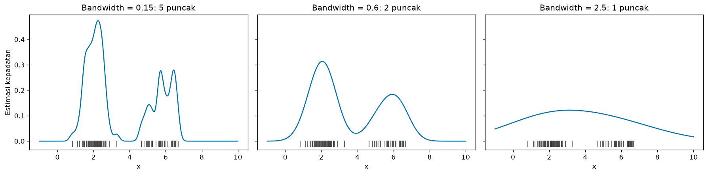
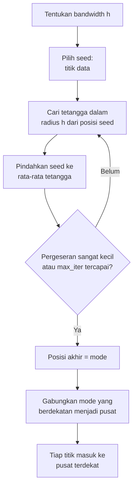
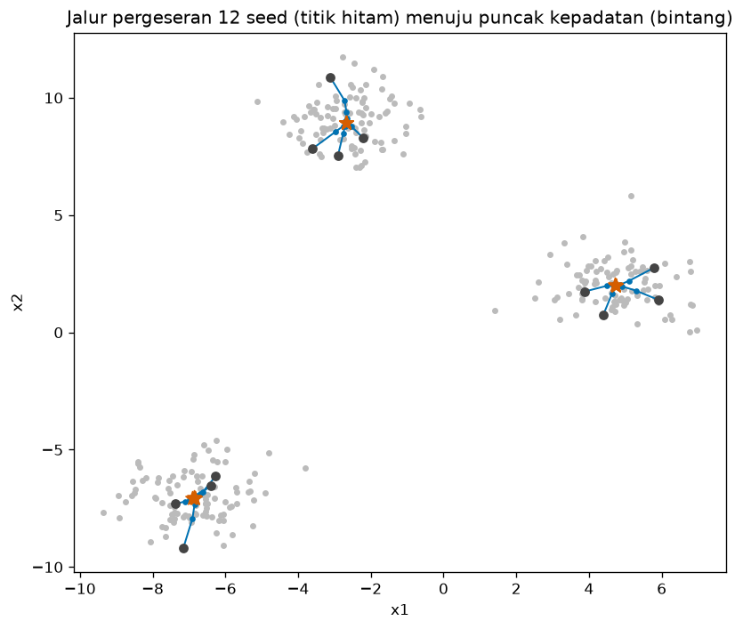
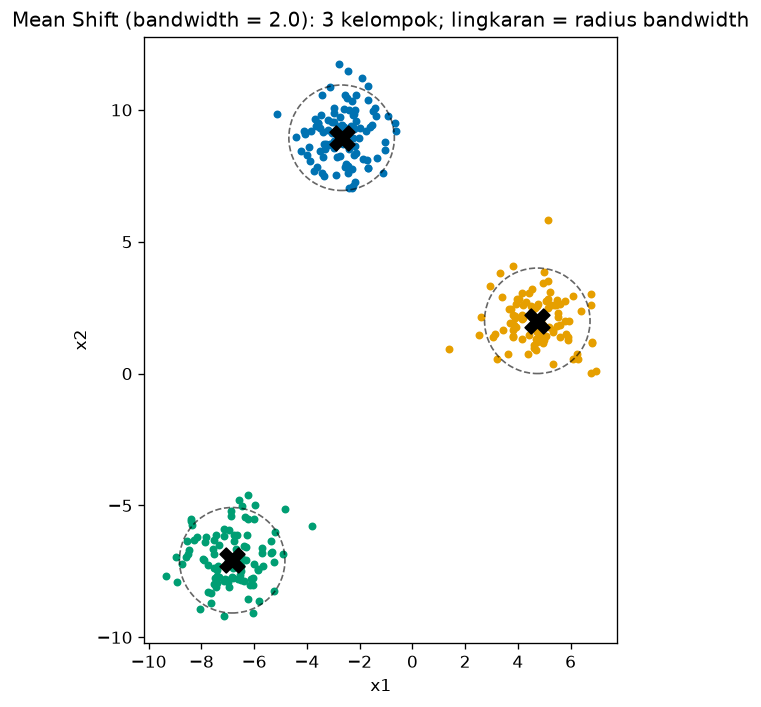
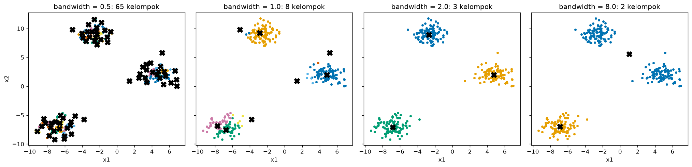
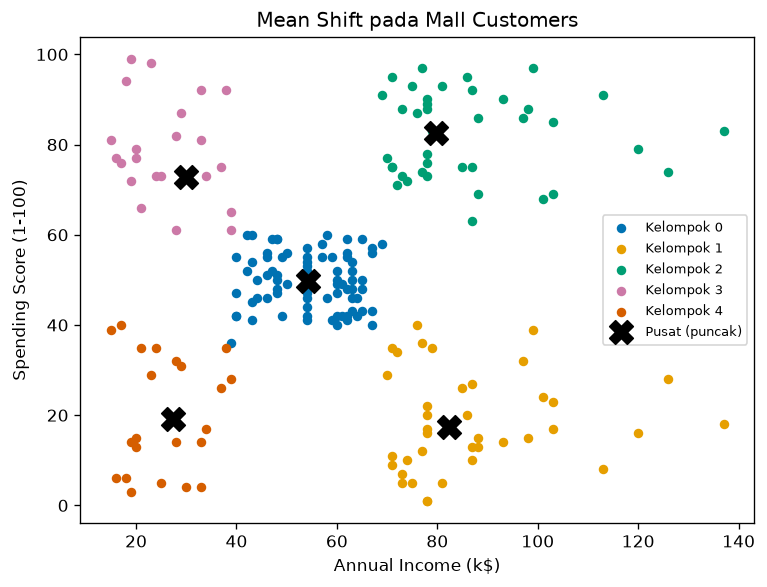

# Bab 6 — Mean Shift Clustering

## Learning Objectives

Setelah mempelajari bab ini, kamu mampu:

- [x] Menjelaskan ide *Mean Shift*: titik bergeser menuju puncak kepadatan.
- [x] Menjelaskan *Kernel Density Estimation* (KDE), *kernel*, dan *bandwidth*.
- [x] Menghitung *mean shift vector* secara manual.
- [x] Menjelaskan mengapa Mean Shift tidak meminta jumlah kelompok, tetapi meminta bandwidth.
- [x] Menulis Mean Shift sederhana dengan NumPy dan membandingkannya dengan `MeanShift` scikit-learn.
- [x] Memakai parameter `bandwidth`, `seeds`, `bin_seeding`, `min_bin_freq`, `cluster_all`, dan `max_iter`.
- [x] Memperkirakan bandwidth dengan `estimate_bandwidth` dan memahami cara kerjanya.
- [x] Menggambar pusat kelompok dan jalur pergeseran.
- [x] Mengenali keterbatasan dan biaya komputasi Mean Shift.

## Introduction

Bayangkan kamu berdiri di sebuah lapangan yang penuh kerumunan orang, dengan mata tertutup. Kamu ingin menemukan **tempat terpadat**. Caranya sederhana: rasakan orang-orang di sekitarmu dalam jarak satu lengan, lalu **melangkahlah ke arah pusat kerumunan kecil itu**. Ulangi sampai kamu tidak perlu melangkah lagi. Kamu sudah sampai di puncak keramaian. Orang-orang lain yang memulai dari tempat berbeda tetapi berakhir di puncak yang sama berada di **satu kelompok**.

Itulah **Mean Shift**:

- Bayangkan data sebagai peta **ketinggian kepadatan**: daerah padat adalah bukit.
- Setiap titik **menanjak** ke puncak bukit terdekat dengan terus berpindah ke **rata-rata tetangganya**.
- Titik yang berakhir di puncak yang sama menjadi satu kelompok. **Jumlah puncak** menentukan jumlah kelompok.

Berbeda dengan K-Means ([Bab 2](02-k-means-clustering.md)), kamu **tidak** menyebut jumlah kelompok. Sebagai gantinya kamu menyebut seberapa jauh "satu lengan", yaitu **bandwidth**. Pilihan bandwidth menentukan hasil, dan itu tema utama bab ini.

!!! note "Prasyarat"
    Bab ini memakai konsep kepadatan ([Level 3, Bab 2](../fundamental-clustering/02-understanding-clusters.md)), centroid sebagai rata-rata ([Level 3, Bab 3](../fundamental-clustering/03-centroid-and-cluster-representation.md)), dan jarak Euclidean. Pembahasan kepadatan di [DBSCAN](04-dbscan-clustering.md) (Bab 4) membantu, karena Mean Shift juga berbasis kepadatan.

## Fundamental Concepts

| Istilah | Arti |
|---|---|
| **Mean Shift** | Algoritma clustering yang menggeser titik menuju puncak kepadatan data |
| **Density estimation** | Memperkirakan seberapa padat data di tiap lokasi |
| **Kernel Density Estimation (KDE)** | Cara memperkirakan kepadatan dengan memasang "gundukan" (kernel) di tiap titik data, lalu menjumlahkannya |
| **Kernel** | Fungsi bentuk gundukan, misalnya Gaussian (lonceng) atau *flat* (rata) |
| **Bandwidth \( h \)** | Lebar kernel: seberapa jauh sebuah titik "memengaruhi" sekitarnya. Pada flat kernel, ini radius lingkungan |
| **Mean shift vector** | Selisih antara rata-rata tetangga dan posisi saat ini. Menunjuk ke arah kepadatan makin tinggi |
| **Mode** | Puncak kepadatan. Titik tempat pergeseran berhenti. Menjadi pusat kelompok |
| **Seed** | Titik awal yang digeser. Biasanya setiap titik data |
| **Basin of attraction** | Himpunan titik yang akhirnya menuju puncak yang sama |
| **Bin seeding** | Cara mempercepat: memakai seed dari kisi (grid) alih-alih semua titik |
| **Orphan** | Titik yang tidak berada dalam radius bandwidth dari pusat mana pun |

## Detailed Explanation

### Intuisi: kepadatan sebagai bukit

Pada Bab 4 kita melihat DBSCAN memandang kelompok sebagai daerah padat. Mean Shift juga berbasis kepadatan, tetapi cara kerjanya berbeda: ia tidak memberi label "core" atau "noise", tetapi **mencari puncak-puncak kepadatan**, lalu mengelompokkan titik berdasarkan puncak mana yang mereka capai.

### Kernel Density Estimation (KDE)

Bagaimana memperkirakan kepadatan dari sekumpulan titik? Idenya: **pasang satu gundukan kecil di atas setiap titik data, lalu jumlahkan semuanya**. Di daerah banyak titik, gundukan bertumpuk menjadi bukit tinggi. Di daerah jarang, kurvanya rendah.

Bentuk gundukan itu disebut **kernel**, dan lebarnya adalah **bandwidth**. Bandwidth berperan seperti lebar jendela:

- **Bandwidth kecil**: gundukan sempit, kurva bergerigi dengan **banyak puncak** (mengikuti kebisingan data).
- **Bandwidth sedang**: kurva halus dengan puncak yang sesuai gerombol.
- **Bandwidth besar**: gundukan lebar, semuanya menyatu menjadi **satu puncak**.

Ini terlihat jelas pada gambar berikut (data satu dimensi berisi dua gerombol, dengan kernel Gaussian):



### Jenis kernel

| Kernel | Bentuk | Catatan |
|---|---|---|
| **Gaussian** | Lonceng halus, pengaruh menurun perlahan dengan jarak | Dipakai pada ilustrasi KDE di atas |
| **Flat** | Datar: semua titik dalam radius \( h \) berbobot sama, di luar radius berbobot nol | **Dipakai oleh `MeanShift` scikit-learn** |

Dengan flat kernel, "rata-rata terbobot" menjadi sekadar **rata-rata biasa** dari titik-titik di dalam lingkaran radius \( h \). Itu membuat algoritmanya sederhana, dan itulah yang kita implementasikan.

### Mean shift vector

Misalkan posisi saat ini adalah \( x \). Kumpulkan semua titik data dalam radius \( h \) dari \( x \) (**tetangga**). Hitung rata-ratanya. **Mean shift vector** adalah selisih rata-rata itu dengan \( x \):

- jika rata-rata tetangga berada di kanan \( x \), vektornya menunjuk ke kanan (kepadatan makin tinggi di kanan),
- jika \( x \) sudah di puncak, rata-rata tetangga berimpit dengan \( x \) dan vektornya nol.

### Algoritma Mean Shift langkah demi langkah

1. **Pilih bandwidth** \( h \).
2. **Pilih seed**: biasanya setiap titik data (atau sebagian saja, lihat `bin_seeding`).
3. Untuk **setiap seed**, ulangi:
    1. Cari semua titik data dalam radius \( h \) dari posisi saat ini.
    2. Hitung rata-ratanya, lalu **pindahkan posisi ke rata-rata itu**.
    3. Berhenti jika pergeserannya sangat kecil.
4. Posisi akhir tiap seed adalah **mode** (puncak kepadatan).
5. **Gabungkan mode yang berdekatan** (jarak kurang dari sama dengan \( h \)) menjadi satu pusat. Pusat yang tersisa adalah **pusat kelompok**.
6. **Beri label**: tiap titik masuk ke kelompok dengan pusat terdekat.



### Contoh manual satu dimensi

Tujuh titik: \( 1, 2, 3, 4, 10, 11, 12 \). Bandwidth \( h = 3 \) (flat kernel).

**Seed mulai dari 5:**

1. Titik dalam radius 3 dari 5 (yaitu antara 2 dan 8): \( \{2, 3, 4\} \). Rata-ratanya \( 3 \). Vektor pergeseran \( = 3 - 5 = -2 \). Posisi baru 3.
2. Titik dalam radius 3 dari 3 (antara 0 dan 6): \( \{1, 2, 3, 4\} \). Rata-ratanya \( 2{,}5 \). Pergeseran \( = -0{,}5 \). Posisi baru 2,5.
3. Titik dalam radius 3 dari 2,5 (antara \(-0{,}5\) dan \(5{,}5\)): masih \( \{1, 2, 3, 4\} \), rata-ratanya \( 2{,}5 \). Pergeseran \( 0 \). **Berhenti di puncak 2,5.**

**Seed mulai dari 10:** tetangganya \( \{10, 11, 12\} \), rata-ratanya 11. Dari 11 tetangganya tetap \( \{10, 11, 12\} \), jadi **berhenti di puncak 11.**

Dua puncak (2,5 dan 11) berarti **dua kelompok**: \( \{1, 2, 3, 4\} \) dan \( \{10, 11, 12\} \). Kita tidak pernah menyebut "2 kelompok". Itu hasil dari data dan bandwidth. Hasil ini sama dengan output kode.

### Memilih bandwidth

Bandwidth adalah **satu-satunya parameter penting**, dan ia menggantikan peran \( K \):

- **Terlalu kecil**: banyak puncak kecil, **terlalu banyak kelompok** (bahkan tiap titik bisa menjadi kelompok sendiri).
- **Terlalu besar**: gerombol-gerombol yang berbeda **menyatu**.
- **Tepat**: puncak sesuai gerombol.

Cara memperkirakannya di scikit-learn: **`estimate_bandwidth(X, quantile=q)`**. Fungsi ini menghitung, untuk tiap titik, jarak ke tetangga ke-\( k \) (dengan \( k = \lfloor q \cdot n \rfloor \)), lalu **merata-ratakan** jarak itu. Makin besar `quantile`, makin besar bandwidth. Nilai `quantile=0,5` kira-kira memakai median jarak antar-titik. Kita akan memverifikasi rumus ini dengan kode.

!!! warning "Hasil `estimate_bandwidth` hanyalah titik awal"
    Perkiraan ini bergantung pada `quantile`, yang juga harus dipilih. Tidak ada jaminan hasilnya tepat. Kita akan melihat contoh bahwa bandwidth hasil estimasi menghasilkan satu kelompok kecil tambahan. Selalu coba beberapa nilai dan lihat hasilnya.

### Parameter `MeanShift`

| Parameter | Bawaan | Arti |
|---|---|---|
| `bandwidth` | `None` | Radius flat kernel. Jika `None`, scikit-learn memperkirakannya sendiri dengan `estimate_bandwidth` (bisa lambat pada data besar) |
| `seeds` | `None` | Titik awal yang kamu tentukan sendiri. Jika `None`, dipakai `bin_seeding` |
| `bin_seeding` | `False` | Jika `True`, seed diambil dari **kisi** (ukuran sel = bandwidth), bukan semua titik. Jauh lebih cepat |
| `min_bin_freq` | 1 | Dengan `bin_seeding=True`: hanya sel yang berisi sedikitnya sekian titik yang dipakai sebagai seed. Menyaring daerah jarang |
| `cluster_all` | `True` | Jika `True`, semua titik diberi kelompok (titik "yatim" diberikan ke pusat terdekat). Jika `False`, titik yang berjarak lebih dari bandwidth dari semua pusat diberi label **`-1`** |
| `max_iter` | 300 | Batas iterasi pergeseran untuk satu seed |

Atribut setelah `fit`:

| Atribut | Isi |
|---|---|
| `cluster_centers_` | Koordinat pusat (puncak), bentuk `(jumlah kelompok, jumlah fitur)` |
| `labels_` | Label tiap titik |
| `n_iter_` | Jumlah iterasi terbanyak yang dibutuhkan oleh seed mana pun |

`MeanShift` punya `predict(X_baru)`, yang menempatkan titik baru ke pusat terdekat.

!!! note "Jumlah kelompok bukan parameter, tetapi hasil"
    Mean Shift **tidak** meminta jumlah kelompok di awal seperti K-Means. Tetapi itu tidak berarti ia tanpa parameter: bandwidth sama menentukannya. Mengganti "tebak K" dengan "tebak bandwidth" tidak otomatis lebih mudah.

### Keterbatasan: bentuk kelompok

Karena Mean Shift mencari puncak kepadatan dengan satu bandwidth bulat, ia cocok untuk kelompok yang **membentuk satu "bukit"**. Pada bentuk seperti bulan sabit, satu kelompok berisi banyak "gundukan" kecil sehingga terpecah menjadi beberapa puncak (kita lihat contoh pada Expected Output). Mean Shift **tidak cocok untuk setiap data**.

### Pertimbangan komputasi

Tiap seed harus mencari tetangga berulang kali, dan jika semua titik adalah seed, biaya naik cepat bersama jumlah data. Dokumentasi scikit-learn menyebut `MeanShift` **tidak skalabel terhadap jumlah sampel**. Cara meredakan: `bin_seeding=True` (jauh lebih sedikit seed) dengan `min_bin_freq` yang cukup. Pada contoh kita, 310 titik hanya menghasilkan 12 seed dengan binning.

### Kelebihan dan keterbatasan

| Kelebihan | Keterbatasan |
|---|---|
| Tidak perlu menyebut jumlah kelompok | **Sangat bergantung pada bandwidth** |
| Bentuk kelompok tidak diasumsikan bulat secara global (mengikuti puncak kepadatan) | Satu bandwidth untuk seluruh data: sulit jika kepadatan beragam |
| Pusat kelompok adalah puncak kepadatan (mudah ditafsirkan) | Lambat dan tidak skalabel pada data besar |
| Punya `predict` untuk data baru | Tidak mengenali noise secara alami: pencilan bisa membentuk kelompok sendiri |
| Hasil bersifat deterministik (tanpa `random_state` pada flat kernel dan seed data) | Tidak cocok untuk bentuk non-konveks seperti bulan sabit |

## Mathematical Foundation

### Kernel Density Estimation

Dari \( n \) titik \( \mathbf{x}_1, \dots, \mathbf{x}_n \) pada \( d \) dimensi, estimasi kepadatan di titik \( \mathbf{x} \):

$$
\hat{f}(\mathbf{x}) = \frac{1}{n h^d} \sum_{i=1}^{n} K\!\left( \frac{\mathbf{x} - \mathbf{x}_i}{h} \right)
$$

Penjelasan simbol:

- \( h \): bandwidth. \( K(\cdot) \): fungsi kernel.
- \( \frac{\mathbf{x}-\mathbf{x}_i}{h} \): jarak \( \mathbf{x} \) dari titik data \( \mathbf{x}_i \), dinyatakan dalam satuan bandwidth.
- \( \sum_i K(\cdot) \): jumlahkan gundukan dari semua titik data.
- \( \frac{1}{n h^d} \): normalisasi agar luas total di bawah kurva sama dengan 1.

**Kernel Gaussian dan flat:**

$$
K_{\text{Gauss}}(\mathbf{u}) = \frac{1}{(2\pi)^{d/2}} \exp\!\left( -\frac{\lVert \mathbf{u} \rVert^2}{2} \right)
\qquad
K_{\text{flat}}(\mathbf{u}) =
\begin{cases} 1 & \text{jika } \lVert \mathbf{u} \rVert \le 1 \\ 0 & \text{lainnya} \end{cases}
$$

Kernel Gaussian menurun halus dengan jarak. Kernel flat bernilai 1 untuk titik dalam jarak \( h \) dari pusat dan 0 di luar.

**Contoh angka (satu dimensi, kernel Gaussian).** Dua titik data 0 dan 2, bandwidth \( h = 1 \), dihitung di \( x = 1 \): \( u = (1-0)/1 = 1 \) dan \( u = (1-2)/1 = -1 \). \( K_{\text{Gauss}}(\pm 1) = \frac{1}{\sqrt{2\pi}} e^{-0{,}5} \approx 0{,}3989 \times 0{,}6065 \approx 0{,}2420 \). Maka \( \hat{f}(1) = \frac{1}{2 \cdot 1} (0{,}2420 + 0{,}2420) \approx 0{,}2420 \).

### Mean shift vector

Dengan kernel flat, misalkan \( N_h(\mathbf{x}) = \{ \mathbf{x}_i : \lVert \mathbf{x}_i - \mathbf{x} \rVert \le h \} \) adalah tetangga dalam radius \( h \). **Mean shift vector**:

$$
\mathbf{m}(\mathbf{x}) = \frac{1}{\lvert N_h(\mathbf{x}) \rvert} \sum_{\mathbf{x}_i \in N_h(\mathbf{x})} \mathbf{x}_i \; - \; \mathbf{x}
$$

Suku pertama adalah rata-rata tetangga dan suku kedua posisi saat ini. Jadi \( \mathbf{m}(\mathbf{x}) \) adalah panjang dan arah perpindahan dari \( \mathbf{x} \) menuju rata-rata tetangganya. Dengan kernel yang bergantung pada jarak, ia dapat ditulis sebagai rata-rata terbobot. Hasil penting (Comaniciu & Meer, 2002): mean shift vector **menunjuk ke arah kenaikan tercuram dari kepadatan** \( \hat{f} \) (sebanding dengan gradiennya). Jadi bergerak mengikuti vektor ini sama dengan **menanjak ke puncak kepadatan**.

**Pembaruan:** \( \mathbf{x} \leftarrow \mathbf{x} + \mathbf{m}(\mathbf{x}) \), yang sama dengan \( \mathbf{x} \leftarrow \) rata-rata tetangga. Berhenti jika \( \lVert \mathbf{m}(\mathbf{x}) \rVert \) sangat kecil (pada scikit-learn kira-kira \( 10^{-3} h \)).

**Contoh angka** (dari contoh manual): seed di \( x = 5 \), \( h = 3 \). Tetangga \( \{2, 3, 4\} \), rata-rata 3, maka \( m = 3 - 5 = -2 \). Di \( x = 3 \): tetangga \( \{1, 2, 3, 4\} \), rata-rata 2,5, maka \( m = -0{,}5 \). Di \( x = 2{,}5 \): rata-rata 2,5, maka \( m = 0 \). Titik tetap, yaitu puncak.

### Estimasi bandwidth

`estimate_bandwidth(X, quantile=q)` menghitung:

$$
h = \frac{1}{n} \sum_{i=1}^{n} d_k(\mathbf{x}_i)
\qquad \text{dengan } k = \lfloor q \cdot n \rfloor
$$

dengan \( d_k(\mathbf{x}_i) \) jarak dari \( \mathbf{x}_i \) ke tetangga terdekat ke-\( k \) (titik itu sendiri dihitung sebagai tetangga pertama). Untuk \( n = 300 \) dan \( q = 0{,}2 \), \( k = 60 \).

### Konvergensi

Dengan kernel yang memenuhi syarat tertentu (termasuk Gaussian dan flat), barisan posisi \( \mathbf{x} \) menuju titik tempat \( \mathbf{m}(\mathbf{x}) = 0 \), yaitu titik stasioner dari kepadatan, biasanya puncak lokal. Jadi setiap seed berakhir di satu mode.

## Python Implementation

Skrip lengkapnya ada di `examples/level-4/06_mean_shift_clustering.py`, dan versi notebook-nya di `notebooks/level-4/06-mean-shift-clustering.ipynb`.

**Konteks masalah:** menemukan kelompok lewat puncak kepadatan, dan memahami peran bandwidth.

**Dataset:**

- Data satu dimensi dari dua Gaussian: untuk KDE.
- 7 titik satu dimensi untuk pergeseran manual.
- `make_blobs` (300 titik, 3 gerombol, `cluster_std=1.0`): data utama, cocok karena tiap gerombol berbentuk satu "bukit" kepadatan.
- `make_moons`: untuk menunjukkan keterbatasan.
- Mall Customers (200 pelanggan, terskala).

**Pustaka:** NumPy, pandas, Matplotlib, scikit-learn.

### Bagian A — Siapkan alat

```python
--8<-- "level-4/06_mean_shift_clustering.py:setup"
```

**Penjelasan:** `MeanShift` adalah algoritmanya. `estimate_bandwidth` memperkirakan bandwidth, dan `get_bin_seeds` menghasilkan seed dari kisi (dipakai untuk menghitung jumlah seed). `NearestNeighbors` dipakai untuk memverifikasi rumus bandwidth.

### Bagian B — KDE satu dimensi

```python
--8<-- "level-4/06_mean_shift_clustering.py:kde"
```

```text title="Output"
--8<-- "level-4/outputs/06/kde.txt"
```

**Penjelasan:**

- `gaussian_kde_1d(grid, data, bandwidth)` menghitung KDE dengan kernel Gaussian di setiap titik `grid`.
- `(grid[:, None] - data[None, :]) / bandwidth` membuat matriks selisih ternormalisasi antara tiap titik kisi dan tiap titik data (*broadcasting*), bentuk `(jumlah grid, jumlah data)`. Ini adalah \( u \) pada rumus.
- `np.exp(-0.5 * u**2) / np.sqrt(2 * np.pi)` adalah kernel Gaussian baku. `kernel.sum(axis=1)` menjumlahkan gundukan dari semua titik data, lalu dibagi `len(data) * bandwidth`, yaitu \( n h \) pada dimensi 1.
- `count_modes` menghitung puncak: titik yang lebih tinggi dari kedua tetangganya (`density[1:-1] > density[:-2]` dan `> density[2:]`).
- `rng.normal(2.0, 0.6, 60)` mengambil 60 titik dari Gaussian berpusat di 2 dengan simpangan 0,6, dan `rng.normal(6.0, 0.8, 40)` mengambil 40 titik berpusat di 6. `np.concatenate` menggabungkannya.
- Kita menghitung jumlah puncak untuk tiga bandwidth.

```python
--8<-- "level-4/06_mean_shift_clustering.py:plotkde"
```


**Penjelasan:** tiga panel, satu per bandwidth. `ax.plot(data_1d, ..., "|")` menggambar tiap titik data sebagai garis tegak kecil (*rug plot*) di bawah kurva.

### Bagian C — Pergeseran manual satu dimensi

```python
--8<-- "level-4/06_mean_shift_clustering.py:tiny"
```

```text title="Output"
--8<-- "level-4/outputs/06/tiny.txt"
```

**Penjelasan:**

- `np.abs(x_tiny - position) <= h_tiny` menghasilkan array `True/False`: apakah tiap titik dalam radius `h_tiny`. `x_tiny[...]` mengambil titik-titik yang `True`: itulah tetangga.
- `neighbors.mean()` adalah rata-rata tetangga, dan `shift` adalah vektor mean shift.
- Perulangan berhenti jika pergeseran hampir nol. Dua seed (5 dan 10) dijalankan, dan tiap langkah dicetak.

### Bagian D — Mean Shift dari nol

```python
--8<-- "level-4/06_mean_shift_clustering.py:scratch"
```

**Penjelasan baris demi baris:**

- `shift_seed(X, seed, bandwidth, ...)` menggeser satu seed. `position = seed.copy()` menyalin supaya data asli tidak berubah, dan `path` menyimpan semua posisi.
- Dalam perulangan: `distances = np.linalg.norm(X - position, axis=1)` menghitung jarak semua titik ke posisi saat ini. `X[distances <= bandwidth]` mengambil tetangga. `neighbors.mean(axis=0)` adalah rata-rata tiap kolom, yaitu posisi baru.
- `moved` adalah panjang vektor mean shift. Jika `moved <= tol * bandwidth`, kita berhenti (sama dengan kriteria scikit-learn, kira-kira \( 10^{-3} h \)).
- `mean_shift_scratch(X, bandwidth)`:
    - Perulangan `for seed in X` menjalankan `shift_seed` dari **setiap titik data**. Kita menyimpan posisi akhir (`modes`) dan jumlah tetangga di puncak (`counts`).
    - **Menggabungkan mode yang berdekatan:** `np.lexsort((..., -counts))` mengurutkan mode dari yang paling banyak tetangganya. Lalu perulangan menyimpan sebuah mode hanya jika jaraknya ke semua pusat yang sudah disimpan **lebih dari** `bandwidth`. Mode yang berdekatan dengan pusat yang sudah ada dibuang, jadi tiap puncak diwakili satu pusat.
    - `np.linalg.norm(X[:, None, :] - centers[None, :, :], axis=2).argmin(axis=1)` memberi label: pusat terdekat untuk tiap titik (sama seperti langkah assignment K-Means).

### Bagian E — Data blobs dan estimasi bandwidth

```python
--8<-- "level-4/06_mean_shift_clustering.py:blobs"
```

```text title="Output"
--8<-- "level-4/outputs/06/blobs.txt"
```

**Penjelasan:**

- `estimate_bandwidth(X, quantile=0.2, random_state=42)` adalah perkiraan scikit-learn.
- Kita memverifikasi rumusnya: `k = int(len(X) * quantile)` adalah \( \lfloor q n \rfloor \) \( = 60 \). `NearestNeighbors(n_neighbors=k).fit(X).kneighbors(X)` mengembalikan jarak ke 60 tetangga terdekat tiap titik (kolom pertama adalah dirinya sendiri). `dist_to_kth[:, -1]` mengambil kolom terakhir (tetangga ke-60), dan `.mean()` merata-ratakannya.

```python
--8<-- "level-4/06_mean_shift_clustering.py:paths"
```

```text title="Output"
--8<-- "level-4/outputs/06/paths.txt"
```

**Penjelasan:** kita memilih 12 seed acak (`rng.choice(..., replace=False)`), menjalankan `shift_seed` dengan bandwidth 2,0, dan mencetak jumlah langkah, titik awal, dan puncak tiap seed.

```python
--8<-- "level-4/06_mean_shift_clustering.py:plotpaths"
```



**Penjelasan:** titik abu-abu adalah data. Untuk tiap seed, garis biru menunjukkan jalur pergeseran, titik hitam adalah titik awal, dan bintang oranye adalah puncak. `ax.plot(..., "-o")` menggambar garis dengan penanda bulat di setiap langkah.

### Bagian F — `MeanShift` scikit-learn

```python
--8<-- "level-4/06_mean_shift_clustering.py:fit"
```

```text title="Output"
--8<-- "level-4/outputs/06/fit.txt"
```

**Penjelasan:**

- `MeanShift(bandwidth=2.0, bin_seeding=False)` membuat model. `bin_seeding=False` berarti semua titik data menjadi seed, sama dengan versi buatan sendiri.
- `fit_predict(X)` menjalankan algoritma. `len(ms.cluster_centers_)` adalah jumlah kelompok. `np.bincount(labels)` menghitung ukuran tiap kelompok.
- Kita juga menjalankan model dengan bandwidth dari `estimate_bandwidth` (1,861) untuk membandingkan.

```python
--8<-- "level-4/06_mean_shift_clustering.py:compare"
```

```text title="Output"
--8<-- "level-4/outputs/06/compare.txt"
```

**Penjelasan:** kita mengurutkan pusat kedua versi dengan `np.lexsort` supaya nomor kelompok tidak mengganggu, lalu membandingkan ukuran kelompok dan selisih terbesar antar pusat.

```python
--8<-- "level-4/06_mean_shift_clustering.py:plotcenters"
```



**Penjelasan:** untuk tiap kelompok kita menggambar titiknya, pusatnya (`X` hitam), dan lingkaran radius bandwidth di sekitar pusat (`plt.Circle(...)`). Lingkaran ini adalah "lengan" yang dipakai tiap seed untuk mencari tetangga.

### Bagian G — Pengaruh bandwidth

```python
--8<-- "level-4/06_mean_shift_clustering.py:sweep"
```

```text title="Output"
--8<-- "level-4/outputs/06/sweep.txt"
```

**Penjelasan:** kita menjalankan `MeanShift` dengan 7 nilai bandwidth dan mencatat jumlah kelompok dan ukuran terbesar. `sorted(..., reverse=True)[:5]` mengurutkan dari terbesar dan mengambil lima pertama (supaya tabel tidak terlalu panjang pada bandwidth kecil yang menghasilkan puluhan kelompok).

```python
--8<-- "level-4/06_mean_shift_clustering.py:plotsweep"
```



**Penjelasan:** empat panel dengan bandwidth 0,5; 1,0; 2,0; dan 8,0. `X` hitam adalah pusat.

### Bagian H — Seed, `min_bin_freq`, dan `cluster_all`

```python
--8<-- "level-4/06_mean_shift_clustering.py:options"
```

```text title="Output"
--8<-- "level-4/outputs/06/options.txt"
```

**Penjelasan:**

- Kita menambahkan 10 titik acak (`uniform(-12, 12, ...)`) sebagai pencilan.
- `get_bin_seeds(X_out, bw, min_bin_freq=5)` menghasilkan seed dari kisi dan kita mencetak jumlahnya dibanding jumlah titik.
- Tiga konfigurasi dijalankan: semua titik sebagai seed, `bin_seeding=True` dengan `min_bin_freq=5`, dan tambahan `cluster_all=False`. Kita mencetak jumlah pusat, jumlah titik berlabel `-1`, dan ukuran kelompok (tanpa `-1`).

### Bagian I — Keterbatasan: bulan sabit

```python
--8<-- "level-4/06_mean_shift_clustering.py:moons"
```

```text title="Output"
--8<-- "level-4/outputs/06/moons.txt"
```

**Penjelasan:** Mean Shift dengan bandwidth hasil `estimate_bandwidth` pada data bulan sabit.

### Bagian J — Mall Customers

```python
--8<-- "level-4/06_mean_shift_clustering.py:mall"
```

```text title="Output"
--8<-- "level-4/outputs/06/mall.txt"
```

**Penjelasan:** fitur diskalakan dengan `StandardScaler`. Kita mencoba empat nilai `quantile` pada `estimate_bandwidth` dan mencatat jumlah kelompok. Lalu kita memilih `quantile=0.15` dan membaca pusatnya dalam satuan asli dengan `scaler.inverse_transform`.

```python
--8<-- "level-4/06_mean_shift_clustering.py:newpoint"
```

```text title="Output"
--8<-- "level-4/outputs/06/newpoint.txt"
```

**Penjelasan:** `scaler.transform` menyamakan skala tiga pelanggan baru, dan `ms_mall.predict` menempatkan masing-masing ke pusat terdekat.

```python
--8<-- "level-4/06_mean_shift_clustering.py:plotmall"
```



**Penjelasan:** scatter plot dengan satu warna per kelompok dan `X` hitam untuk pusat (puncak), dalam satuan asli.

## Code Explanation

| Bagian kode | Peran |
|---|---|
| `gaussian_kde_1d` | KDE: jumlah gundukan Gaussian di tiap titik data |
| `x_tiny[np.abs(x_tiny - position) <= h]` | Mencari tetangga dalam radius bandwidth (flat kernel) |
| `neighbors.mean(axis=0)` | Posisi baru: rata-rata tetangga |
| `moved <= tol * bandwidth` | Kriteria berhenti |
| Penggabungan mode berdekatan | Mengubah mode menjadi pusat kelompok |
| `argmin` pada jarak ke pusat | Pemberian label |
| `MeanShift(bandwidth=...)` | Algoritma sungguhan |
| `estimate_bandwidth` | Perkiraan bandwidth dari jarak ke tetangga ke-\( k \) |

## How to Run

Dari folder utama proyek (setelah mengaktifkan lingkungan virtual):

```powershell
pip install -r requirements-notebooks.txt
python examples/level-4/06_mean_shift_clustering.py
```

Skrip mencetak output ke terminal dan menyimpan lima gambar ke `docs/assets/level-4/`. Notebook interaktifnya:

```powershell
jupyter notebook notebooks/level-4/06-mean-shift-clustering.ipynb
```

Semua output pada bab ini berasal dari eksekusi nyata dengan Python 3.14, NumPy 2.5.2, pandas 3.0.5, scikit-learn 1.9.0, dan Matplotlib 3.11.1.

## Expected Output

Output setiap langkah ditampilkan langsung di bawah kodenya pada bagian [Python Implementation](#python-implementation).

Gambar yang dihasilkan:


### Interpretasi output

**1. KDE dan bandwidth.** Pada data satu dimensi berisi dua gerombol, bandwidth 0,15 menghasilkan **5 puncak** (kurva mengikuti kebisingan data), bandwidth 0,6 menghasilkan **2 puncak** (sesuai dua gerombol), dan bandwidth 2,5 menghasilkan **1 puncak** (kedua gerombol menyatu). Jumlah puncak menentukan jumlah kelompok pada Mean Shift.

**2. Pergeseran manual.** Dari seed 5: langkah 1 tetangga \( [2, 3, 4] \), rata-rata 3,0, pergeseran \( -2{,}00 \). Langkah 2 tetangga \( [1, 2, 3, 4] \), rata-rata 2,5, pergeseran \( -0{,}50 \). Langkah 3 pergeseran 0, **berhenti di 2,5**. Dari seed 10: rata-rata 11,0, lalu pergeseran 0, **berhenti di 11,0**. Sama dengan hitungan manual.

**3. Estimasi bandwidth.** `estimate_bandwidth(quantile=0.2)` \( = 1{,}8612 \) dan hitungan manual (rata-rata jarak ke tetangga ke-60) \( = 1{,}8612 \). **Sama**, jadi rumusnya benar.

**4. Jalur pergeseran.** Dua belas seed acak berakhir di tiga puncak: sekitar \( (-2{,}68;\ 8{,}94) \), \( (4{,}74;\ 2{,}00) \), dan \( (-6{,}9;\ -7{,}06) \). Setiap seed membutuhkan 4 sampai 7 langkah. Pada gambar, semua jalur dari satu gerombol bertemu di bintang yang sama, walau titik awalnya berbeda. Itulah *basin of attraction*.

**5. Mean Shift pada blobs.** Dengan bandwidth 2,0: **3 kelompok** berukuran 100, 100, 100. Pusatnya \( (-2{,}685;\ 8{,}945) \), \( (4{,}736;\ 2{,}003) \), dan \( (-6{,}834;\ -7{,}077) \). `n_iter_` adalah 7. Dengan bandwidth hasil estimasi (1,861): **4 kelompok** berukuran 100, 98, 100, 2. Dua titik di tepi sebuah gerombol membentuk puncak kecil sendiri karena bandwidth sedikit terlalu kecil. Ini contoh bahwa `estimate_bandwidth` hanyalah titik awal, bukan jawaban.

**6. Versi buatan sendiri.** Menghasilkan **3 kelompok** berukuran 100, 100, 100, sama dengan scikit-learn. Selisih terbesar antar pusat hanya **0,0366**, perbedaan kecil akibat urutan penggabungan dan kriteria berhenti yang sedikit berbeda.
**7. Pengaruh bandwidth.**

| Bandwidth | Kelompok | Ukuran terbesar |
|---|---|---|
| 0,5 | **65** | 18, 17, 16, 14, 12 |
| 1,0 | 8 | 97, 93, 56, 38, 6 |
| 1,5 | 4 | 100, 100, 98, 2 |
| **2,0** | **3** | 100, 100, 100 |
| 3,0 | 3 | 100, 100, 100 |
| 5,0 | 3 | 100, 100, 100 |
| 8,0 | **2** | 200, 100 |

Bandwidth terlalu kecil memecah data menjadi puluhan kelompok, dan terlalu besar (8,0) menggabungkan dua gerombol. Rentang 2,0 sampai 5,0 stabil di tiga kelompok: rentang bandwidth yang cukup lebar bekerja pada data ini karena gerombolnya terpisah jelas.

**8. Seed, `min_bin_freq`, `cluster_all`.** Dari 310 titik (300 + 10 pencilan), `bin_seeding=True` dengan `min_bin_freq=5` hanya memakai **12 seed**, jauh lebih sedikit daripada 310.

| Konfigurasi | Pusat | Label `-1` | Ukuran |
|---|---|---|---|
| semua titik sebagai seed | **9** | 0 | 101, 100, 102, 2, 1, 1, 1, 1, 1 |
| `bin_seeding=True`, `min_bin_freq=5` | 3 | 0 | 101, 102, 107 |
| + `cluster_all=False` | 3 | **19** | 98, 97, 96 |

Saat semua titik menjadi seed, **tiap pencilan membentuk kelompok sendiri** (kelompok berukuran 1 atau 2). Dengan `min_bin_freq=5`, daerah jarang tidak dijadikan seed sehingga pencilan tidak menjadi pusat. Dengan `cluster_all=True` (bawaan), pencilan lalu diberikan ke pusat terdekat (kelompok membesar menjadi 101, 102, 107). Dengan `cluster_all=False`, **19 titik** (pencilan dan titik di tepi gerombol yang berjarak lebih dari bandwidth dari pusat) diberi label `-1`.

!!! warning "`-1` pada Mean Shift bukan noise sebenarnya"
    Label `-1` hasil `cluster_all=False` hanya berarti "berjarak lebih dari bandwidth dari semua pusat". Ia juga menangkap titik tepi gerombol, bukan hanya pencilan, sehingga berbeda dari noise DBSCAN.

**9. Bulan sabit.** Dengan bandwidth 0,668, Mean Shift menghasilkan **3 kelompok** (ukuran 70, 122, 108), bukan dua. Bulan sabit bukan satu "bukit" kepadatan sehingga terpotong, sama seperti pada Bab 1. Mean Shift tidak cocok untuk setiap data.

**10. Mall Customers.** Jumlah kelompok sangat bergantung pada `quantile`:

| `quantile` | Bandwidth | Kelompok | Ukuran |
|---|---|---|---|
| 0,10 | 0,649 | 7 | 79, 34, 31, 23, 23, 5, 5 |
| **0,15** | **0,858** | **5** | 78, 38, 39, 23, 22 |
| 0,20 | 1,047 | 3 | 121, 41, 38 |
| 0,30 | 1,255 | 1 | 200 |

Dengan `quantile=0.15` kita mendapat 5 kelompok dengan pusat (pendapatan, skor belanja): \( (54{,}2;\ 49{,}7) \), \( (82{,}3;\ 17{,}5) \), \( (79{,}8;\ 82{,}5) \), \( (29{,}9;\ 72{,}9) \), \( (27{,}3;\ 19{,}1) \). Strukturnya mirip hasil K-Means (Bab 2), tetapi pada `quantile` 0,3 semua pelanggan menyatu menjadi satu kelompok. Pelanggan baru (30, 80), (60, 50), dan (90, 15) masing-masing diberi label 3, 0, dan 1.

## Practical Examples

**Segmentasi gambar berdasarkan warna.** Tiap piksel adalah titik (merah, hijau, biru). Mean Shift menemukan puncak warna dominan tanpa kita menebak jumlah segmen. Bandwidth menentukan seberapa halus segmentasinya.

**Pelacakan objek.** Mean Shift dipakai untuk melacak objek pada video: jendela pencarian digeser ke puncak distribusi warna objek di tiap frame.

**Menemukan "titik panas".** Pada data lokasi (kejadian, pelanggan), puncak kepadatan menunjukkan pusat aktivitas.

**Segmentasi pelanggan eksploratif.** Pada Mall Customers, Mean Shift membantu melihat berapa puncak kepadatan yang ada, sebagai pembanding K-Means.

!!! tip "Kapan memilih Mean Shift?"
    Pilih Mean Shift jika kamu menduga kelompok adalah "bukit" kepadatan yang jelas, datanya tidak terlalu besar (ribuan titik), dan kamu ingin pusat kelompok yang berupa puncak kepadatan. Hindari untuk data besar, bentuk non-konveks, atau kepadatan yang sangat beragam.

## Hands-on Exercises

1. **Hitung manual:** pada data \( 1, 2, 3, 4, 10, 11, 12 \) dengan \( h = 3 \), mulai dari seed 8. Ke mana seed ini berakhir?
2. Dari tabel pengaruh bandwidth, pada rentang berapa jumlah kelompok stabil di 3? Mengapa bandwidth 8,0 memberi 2 kelompok?
3. Jalankan `estimate_bandwidth` dengan `quantile=0.1` dan `0.3` pada data blobs, lalu `MeanShift`. Berapa bandwidth, jumlah kelompok, dan ukurannya?
4. Dengan data blobs ditambah pencilan dan `bw=2.5`, hitung jumlah seed dari `get_bin_seeds` untuk `min_bin_freq` = 1, 5, dan 20.
5. Dari tabel Mall Customers, berapa `quantile` yang menghasilkan tepat 5 kelompok? Apa yang terjadi pada `quantile` yang lebih besar dan lebih kecil?
6. Jelaskan perbedaan label `-1` pada DBSCAN dan pada `MeanShift(cluster_all=False)`.
7. Mengapa Mean Shift "tidak butuh jumlah kelompok" tetapi tetap bukan algoritma tanpa parameter?
8. Mengapa `bin_seeding=True` mempercepat Mean Shift? Apa risikonya?

??? question "Jawaban"
    Hasil nomor 1, 3, dan 4 berasal dari eksekusi nyata, dan nomor 2 dan 5 dibaca dari tabel output.

    1. Dari 8: tetangga dalam radius 3 adalah \( \{10, 11\} \) (jarak 2 dan 3; titik 4 berjarak 4 sehingga tidak masuk), rata-rata **10,5**. Dari 10,5: tetangga \( \{10, 11, 12\} \), rata-rata **11**. Dari 11: tetangga sama, pergeseran 0. Seed **berakhir di puncak 11**, bergabung dengan kelompok \( \{10, 11, 12\} \).
    2. Stabil di 3 kelompok pada bandwidth **2,0, 3,0, dan 5,0** (pada contoh yang diuji). Pada 8,0 bandwidth lebih besar dari jarak antara dua gerombol sehingga keduanya menyatu: ukuran 200 dan 100.
    3. `quantile=0.1`: bandwidth **1,236**, **4 kelompok** (ukuran 99, 100, 100, 1). `quantile=0.3`: bandwidth **2,768**, **3 kelompok** (100, 100, 100). Bandwidth yang lebih kecil memunculkan kelompok tambahan berisi satu titik.
    4. `min_bin_freq=1`: **29** seed. `min_bin_freq=5`: **12** seed. `min_bin_freq=20`: **4** seed. Makin tinggi ambang, makin sedikit seed (hanya daerah padat). Namun ambang yang terlalu tinggi bisa menghilangkan seed di kelompok kecil.
    5. Tepat 5 kelompok pada `quantile=0.15` (bandwidth 0,858). Lebih kecil (0,10) memberi 7 kelompok, dengan dua kelompok kecil berisi 5 pelanggan. Lebih besar (0,20) memberi 3 kelompok, dan 0,30 memberi 1 kelompok.
    6. Pada **DBSCAN**, `-1` adalah noise: titik di daerah jarang yang bukan core maupun border. Pada **`MeanShift(cluster_all=False)`**, `-1` berarti titik berjarak lebih dari bandwidth dari semua pusat. Itu bisa berupa pencilan, tetapi juga titik di tepi gerombol yang normal. Tidak ada konsep core, border, atau noise pada Mean Shift.
    7. Jumlah kelompok adalah hasil dari bandwidth. Bandwidth (dan juga `quantile` bila memakai `estimate_bandwidth`) tetap harus dipilih dan sangat memengaruhi hasil.
    8. Alih-alih menjalankan pergeseran dari semua titik, hanya dari titik-titik yang mewakili sel kisi (dalam contoh, 12 dari 310). Risikonya: seed bisa terlewat di kelompok kecil atau daerah jarang (terutama dengan `min_bin_freq` tinggi), dan hasil bisa sedikit berbeda dari memakai semua titik.

## Troubleshooting

### Masalah teknis

| Masalah | Penyebab | Solusi |
|---|---|---|
| Terlalu banyak kelompok (puluhan) | `bandwidth` terlalu kecil | Naikkan `bandwidth` atau `quantile` pada `estimate_bandwidth` |
| Hanya satu kelompok | `bandwidth` terlalu besar | Turunkan `bandwidth` |
| Beberapa kelompok kecil berisi 1 sampai 2 titik | Pencilan atau tepi gerombol menjadi puncak sendiri | Naikkan `bandwidth`, pakai `bin_seeding=True` dengan `min_bin_freq` > 1, atau buang pencilan lebih dulu |
| Sangat lambat | Semua titik dipakai sebagai seed pada data besar | `bin_seeding=True`, kurangi data, atau pilih algoritma lain |
| `estimate_bandwidth` lambat | Data besar | Isi parameter `n_samples` pada `estimate_bandwidth` untuk memakai sampel saja |
| Nomor kelompok berbeda dari tabel | Urutan pusat bisa berbeda | Bandingkan ukuran dan pusat, bukan nomornya |
| `MeanShift` berlabel `-1` | `cluster_all=False` | Itu perilaku yang diharapkan. Pakai `cluster_all=True` agar semua titik punya kelompok |
| Hasil buruk pada bulan sabit | Bentuk non-konveks bukan satu "bukit" | Pertimbangkan DBSCAN (Bab 4) |
| Hasil tidak cocok setelah fitur tidak diskalakan | Bandwidth satu nilai untuk semua fitur | Skalakan fitur dulu |

### Kesalahan umum

1. **Menganggap Mean Shift tanpa parameter.** Bandwidth sangat menentukan.
2. **Memakai nilai `estimate_bandwidth` tanpa mengeceknya.** Cobalah beberapa `quantile`.
3. **Lupa menyamakan skala.** Bandwidth tunggal berlaku untuk semua fitur sehingga fitur berskala besar mendominasi.
4. **Memakai Mean Shift pada data besar tanpa `bin_seeding`.** Biayanya cepat membengkak.
5. **Mengira label `-1` adalah noise sungguhan.** Pada `cluster_all=False`, `-1` berarti "jauh dari semua pusat".
6. **Mengabaikan pencilan.** Pencilan bisa menjadi kelompok sendiri.
7. **Mengharapkan bentuk kelompok bebas seperti DBSCAN.** Mean Shift mencari puncak kepadatan, dan satu kelompok melengkung bisa pecah.
8. **Menyimpulkan hasil benar hanya karena jumlah kelompoknya "masuk akal".** Penilaian formal ada di Level 5.

## Summary

- **Mean Shift** menggeser setiap titik ke **rata-rata tetangganya** sampai berhenti di **puncak kepadatan** (mode). Titik yang menuju puncak yang sama menjadi satu kelompok.
- **Kernel Density Estimation** memperkirakan kepadatan dengan menjumlahkan gundukan (kernel) di tiap titik. **Bandwidth** adalah lebar gundukan: kecil menghasilkan banyak puncak, besar menyatukan semuanya.
- `MeanShift` scikit-learn memakai **flat kernel**. **Mean shift vector** \( \mathbf{m}(\mathbf{x}) \) = rata-rata tetangga \( - \mathbf{x} \), dan menunjuk ke arah kepadatan makin tinggi.
- Mean Shift **tidak meminta jumlah kelompok**, tetapi sangat bergantung pada **bandwidth**. `estimate_bandwidth` memperkirakannya dengan merata-ratakan jarak ke tetangga ke-\( k \), dan hasilnya hanya titik awal.
- Parameter penting: `bandwidth`, `seeds`, `bin_seeding` (mempercepat), `min_bin_freq` (menyaring seed di daerah jarang), `cluster_all` (label `-1` untuk titik jauh dari pusat), dan `max_iter`.
- Pada blobs: bandwidth 2,0 sampai 5,0 memberi 3 kelompok, 0,5 memberi 65, dan 8,0 memberi 2. Bandwidth hasil estimasi (1,861) memberi satu kelompok kecil tambahan.
- Pencilan bisa menjadi kelompok sendiri jika semua titik dijadikan seed. Mean Shift tidak cocok untuk bulan sabit (3 kelompok) dan tidak skalabel pada data besar.

**Bab berikutnya:** Bab 7 membandingkan kelima algoritma (K-Means, hierarchical, DBSCAN, GMM, dan Mean Shift) pada dataset yang sama, lalu menyusun panduan memilih algoritma.

## References

- Comaniciu, D., & Meer, P. (2002). Mean shift: a robust approach toward feature space analysis. *IEEE Transactions on Pattern Analysis and Machine Intelligence*, 24(5), 603–619.
- Fukunaga, K., & Hostetler, L. D. (1975). The estimation of the gradient of a density function, with applications in pattern recognition. *IEEE Transactions on Information Theory*, 21(1), 32–40.
- Cheng, Y. (1995). Mean shift, mode seeking, and clustering. *IEEE Transactions on Pattern Analysis and Machine Intelligence*, 17(8), 790–799.
- Scikit-learn documentation: [*Mean Shift*](https://scikit-learn.org/stable/modules/clustering.html#mean-shift), [`MeanShift`](https://scikit-learn.org/stable/modules/generated/sklearn.cluster.MeanShift.html), dan [`estimate_bandwidth`](https://scikit-learn.org/stable/modules/generated/sklearn.cluster.estimate_bandwidth.html).
- Silverman, B. W. (1986). *Density Estimation for Statistics and Data Analysis*. Chapman & Hall.
