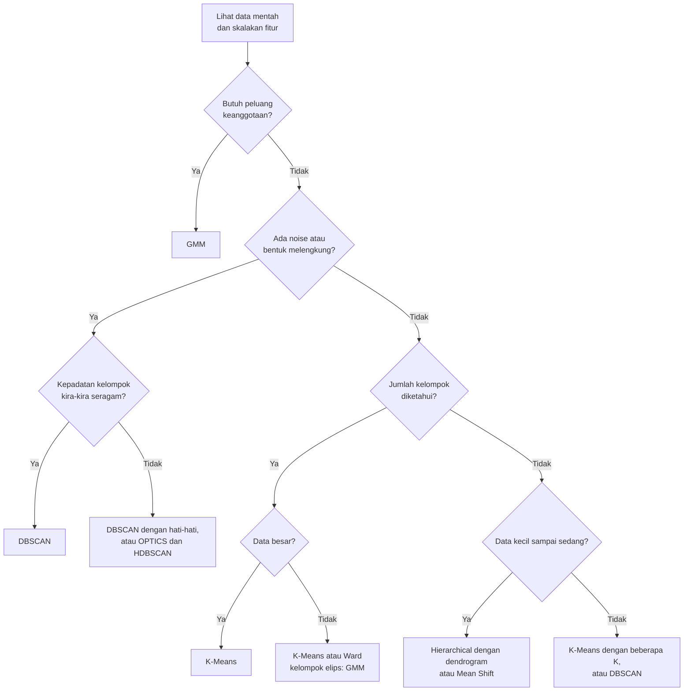
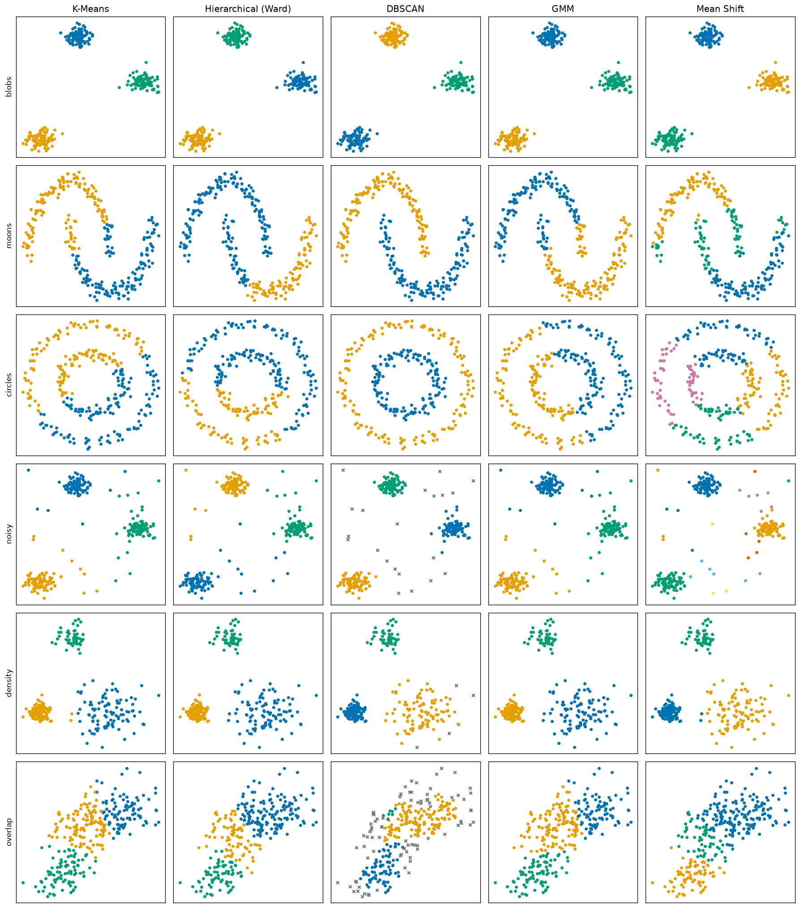
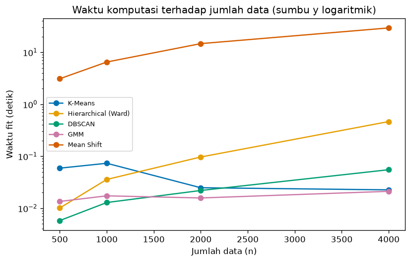
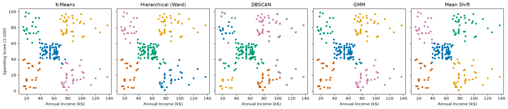

# Bab 7 — Comparison of Clustering Algorithms

## Learning Objectives

Setelah mempelajari bab ini, kamu mampu:

- [x] Menjelaskan mengapa algoritma clustering perlu dibandingkan, dan apa yang **tidak** bisa dinilai dari satu gambar.
- [x] Meninjau ulang prinsip kerja K-Means, Hierarchical, DBSCAN, GMM, dan Mean Shift.
- [x] Membandingkan asumsi, bentuk kelompok, penanganan kepadatan dan noise, serta kebutuhan parameter tiap algoritma.
- [x] Membandingkan kompleksitas dan skalabilitas secara konseptual dan lewat pengukuran sederhana.
- [x] Membedakan hard clustering dan soft clustering pada kelima algoritma.
- [x] Menjalankan eksperimen yang adil: satu dataset, kelima algoritma, hasil dibaca secara visual.
- [x] Menyusun dan memakai panduan keputusan memilih algoritma.
- [x] Mengenali kesalahpahaman umum tentang perbandingan algoritma.
- [x] Menyiapkan hasil eksperimen untuk evaluasi formal di Level 5.

## Introduction

Setelah lima bab, kamu sudah mengenal lima alat. Pertanyaan berikutnya yang paling praktis: **alat mana yang kupakai untuk dataku?** Tidak ada jawaban satu kalimat. Jawabannya bergantung pada bentuk kelompok, ada tidaknya noise, kepadatan, ukuran data, dan apa yang kamu butuhkan dari hasilnya (peluang? pohon? pusat kelompok?).

Bab ini mengumpulkan semuanya. Kita menjalankan **kelima algoritma pada enam dataset** yang masing-masing dirancang untuk menonjolkan satu situasi: gerombol bersih, bentuk melengkung, noise, kepadatan berbeda, dan tumpang tindih. Hasilnya dibaca lewat gambar dan tabel, lalu kita susun **panduan keputusan**.

!!! warning "Bab ini perbandingan, bukan evaluasi"
    Kita membandingkan **perilaku** algoritma: bentuk yang ditemukan, noise yang ditandai, jumlah kelompok, kecepatan. Kita **tidak** menghitung skor kualitas apa pun. Pertanyaan "hasil mana yang lebih baik secara terukur?" adalah materi **Level 5** (Clustering Evaluation). Di sini, penilaian "terlihat sesuai bentuk data" bersifat visual dan hanya mungkin karena datanya sintetis dan kita tahu strukturnya.

!!! note "Prasyarat"
    Bab 1 sampai 6 Level 4: [Bab 1](01-introduction-to-clustering-algorithms.md), [K-Means](02-k-means-clustering.md), [Hierarchical](03-hierarchical-clustering.md), [DBSCAN](04-dbscan-clustering.md), [GMM](05-gaussian-mixture-models.md), dan [Mean Shift](06-mean-shift-clustering.md).

## Fundamental Concepts

| Istilah | Arti |
|---|---|
| **Perbandingan yang adil** | Semua algoritma dijalankan pada data yang sama, dengan skala yang sama, dan pengaturan yang dijelaskan secara terbuka |
| **Asumsi (*assumption*)** | Hal yang dianggap benar oleh sebuah algoritma tentang data, misalnya "kelompok berbentuk bulat" |
| **Convex cluster** | Kelompok "gumpalan": garis lurus antara dua anggotanya tetap berada di dalam kelompok |
| **Hard / soft clustering** | Satu label per titik / peluang untuk tiap kelompok |
| **Skalabilitas** | Bagaimana biaya (waktu, memori) naik saat jumlah data naik |
| **Hyperparameter** | Pengaturan yang kamu tentukan sebelum algoritma berjalan (K, `eps`, `bandwidth`, dan seterusnya) |
| **Decision guide** | Panduan langkah yang menuntun pemilihan algoritma dari karakter data dan kebutuhan |

## Detailed Explanation

### Mengapa membandingkan algoritma?

Tiga alasan:

1. **Tidak ada algoritma terbaik untuk semua data.** Seperti yang kita lihat sejak Bab 1: tiap algoritma mengasumsikan definisi "kelompok" tertentu, dan definisi itu cocok untuk sebagian data saja.
2. **Hasil sering tidak bisa dibandingkan hanya lewat jumlah kelompok atau ukuran kelompok.** Dua algoritma bisa menghasilkan kelompok berukuran sama (misalnya 150 dan 150) tetapi memotong data dengan cara yang sangat berbeda. Kita perlu melihatnya.
3. **Perbandingan menunjukkan apa yang algoritma andalkan.** Dengan memahami mengapa sebuah algoritma gagal pada suatu dataset, kamu belajar mengenali kapan hal serupa mengancam datamu sendiri.

### Tinjauan singkat lima algoritma

| Algoritma | Ide dalam satu kalimat | Pengaturan utama | Hasil |
|---|---|---|---|
| **K-Means** (Bab 2) | Titik masuk ke centroid terdekat, centroid = rata-rata anggota, diulang | `n_clusters` | Label + centroid |
| **Hierarchical** (Bab 3) | Gabungkan dua kelompok terdekat berulang membentuk pohon, lalu potong | `n_clusters` atau `distance_threshold`, `linkage` | Label (dan dendrogram) |
| **DBSCAN** (Bab 4) | Kelompok = daerah padat yang tersambung, titik di daerah jarang = noise | `eps`, `min_samples` | Label (noise = `-1`) |
| **GMM** (Bab 5) | Data berasal dari campuran Gaussian, diperkirakan dengan EM | `n_components`, `covariance_type` | Peluang + label |
| **Mean Shift** (Bab 6) | Titik menanjak ke puncak kepadatan | `bandwidth` | Label + pusat (puncak) |

### Perbandingan asumsi dan bentuk kelompok

| Algoritma | Asumsi utama | Bentuk kelompok yang cocok |
|---|---|---|
| K-Means | Kelompok bulat, kompak, ukuran dan sebaran mirip | Bulat (convex) |
| Hierarchical (Ward) | Kelompok kompak, mirip K-Means (meminimalkan kenaikan WCSS) | Bulat |
| Hierarchical (single) | Kelompok tersambung rantai titik berdekatan | Bebas, memanjang (jika bersih dari noise) |
| DBSCAN | Kelompok = daerah padat dengan kepadatan kira-kira seragam | **Bebas** (melengkung, memanjang) |
| GMM | Tiap kelompok berdistribusi Gaussian | **Elips** (ukuran dan kemiringan bebas dengan `full`) |
| Mean Shift | Tiap kelompok membentuk satu "bukit" kepadatan | Bulat atau elips yang satu puncak |

### Perbandingan penanganan kepadatan dan noise

| Algoritma | Kepadatan beragam | Noise dan pencilan |
|---|---|---|
| K-Means | Cukup baik jika kelompok bulat, tetapi ukuran dianggap mirip | **Tidak** mengenal noise. Semua titik dipaksa masuk kelompok, dan pencilan menarik centroid |
| Hierarchical | Bergantung linkage | Single peka (chaining). Ward dan complete juga ikut terpengaruh pencilan |
| DBSCAN | **Lemah**: satu `eps` untuk seluruh data | **Kuat**: noise berlabel `-1` |
| GMM | Cukup baik: tiap komponen punya kovarians dan bobot sendiri | Tidak mengenal noise. Pencilan memengaruhi kovarians |
| Mean Shift | Lemah: satu `bandwidth` untuk seluruh data | Tidak mengenal noise. Pencilan bisa membentuk kelompok sendiri |

### Perbandingan kebutuhan parameter

| Algoritma | Perlu menyebut jumlah kelompok? | Parameter utama dan kepekaannya |
|---|---|---|
| K-Means | **Ya** (`n_clusters`) | K. Juga `n_init` dan `random_state` untuk stabilitas |
| Hierarchical | Tidak di awal (pilih sesudah melihat dendrogram), atau pakai `distance_threshold` | `linkage` sangat menentukan |
| DBSCAN | **Tidak** | `eps` sangat peka, `min_samples` kurang peka. Wajib skala yang sama |
| GMM | **Ya** (`n_components`) | `covariance_type` (jumlah parameter), `n_init` |
| Mean Shift | **Tidak** | `bandwidth` sangat peka |

!!! note "Mengganti satu tebakan dengan tebakan lain"
    DBSCAN dan Mean Shift tidak meminta jumlah kelompok, tetapi meminta `eps` atau `bandwidth`. Kamu tetap harus memilih angka yang menentukan hasilnya. Hierarchical memindahkan keputusan ke "di mana memotong dendrogram".

### Perbandingan kompleksitas dan skalabilitas (konseptual)

Notasi: \( n \) jumlah data, \( K \) jumlah kelompok, \( d \) jumlah fitur.

| Algoritma | Biaya utama | Skalabilitas terhadap \( n \) |
|---|---|---|
| K-Means | Satu iterasi sebanding \( n K d \) | **Sangat baik** |
| Hierarchical | Matriks jarak \( n \times n \): memori dan waktu minimal sekitar \( n^2 \) | Buruk untuk \( n \) besar |
| DBSCAN | Pencarian tetangga: mendekati \( n \log n \) dengan struktur pencarian (dimensi rendah), kasus terburuk mendekati \( n^2 \) | Baik, asal `eps` tidak terlalu besar |
| GMM | Satu iterasi EM sekitar \( n K d^2 \) untuk `full` | Sedang. Mahal bila \( d \) besar |
| Mean Shift | Pencarian tetangga dari **setiap seed** secara berulang | **Buruk**, kecuali memakai `bin_seeding` |

Angka-angka ini adalah gambaran. Pengukuran nyata pada mesin kita ada pada output langkah terkait di bagian Python Implementation, dibahas di Expected Output.

### Hard clustering dan soft clustering

| Algoritma | Jenis | `predict_proba`? |
|---|---|---|
| K-Means | Hard | Tidak |
| Hierarchical | Hard | Tidak |
| DBSCAN | Hard (plus noise) | Tidak |
| **GMM** | **Soft** | **Ya** |
| Mean Shift | Hard | Tidak |

Hanya GMM yang memberi tahu **seberapa yakin** ia pada suatu label. Jika kamu butuh itu (misalnya untuk mengenali pelanggan "perbatasan"), GMM adalah pilihan utamanya. Untuk algoritma lain, keyakinan harus dinilai dengan cara lain (Level 5 dan 6).

### Panduan memilih algoritma

Mulailah dari pertanyaan tentang datamu:



Panduan ini sengaja disederhanakan. Selalu **coba lebih dari satu algoritma** dan lihat hasilnya. Kita akan menuliskannya sebagai fungsi kode di bagian Python Implementation.

### Kesalahpahaman umum

1. **"Ada algoritma terbaik."** Tidak. Lihat grid perbandingan: tidak ada kolom yang unggul di semua baris.
2. **"K-Means cocok untuk semua data."** Pada bulan sabit dan lingkaran bersarang ia memotong data.
3. **"DBSCAN tidak butuh parameter."** Ia butuh `eps` dan `min_samples`, dan `eps` sangat menentukan.
4. **"Mean Shift menemukan K otomatis jadi lebih objektif."** Jumlah kelompok mengikuti `bandwidth` yang kamu pilih.
5. **"Kelompok berukuran sama berarti hasilnya sama."** Pada moons, K-Means menghasilkan 150 dan 150 seperti DBSCAN, tetapi potongannya berbeda. Ukuran saja tidak cukup.
6. **"Dendrogram menentukan K secara objektif."** Ia memberi petunjuk, dan pemotongan tetap keputusan kita.
7. **"GMM sama dengan K-Means."** GMM adalah model probabilitas yang menghasilkan peluang dan memodelkan elips.
8. **"Hasil yang gambarnya rapi pasti benar."** Gambar yang rapi tidak sama dengan hasil yang bermakna. Penilaian formal: Level 5.
9. **"Noise adalah kesalahan data."** Noise DBSCAN adalah titik di daerah jarang menurut parameter yang dipilih.
10. **"Makin banyak kelompok makin baik."** Banyak kelompok bisa berarti pecah, bukan terperinci.

## Mathematical Foundation

Bab ini tidak memperkenalkan rumus baru. Berikut **ringkasan kriteria** tiap algoritma supaya perbedaannya terlihat dalam satu tempat. Semua simbol dijelaskan pada bab masing-masing.

| Algoritma | Yang diukur atau dioptimalkan | Rumus inti |
|---|---|---|
| K-Means | Jumlah kuadrat jarak titik ke centroid-nya (WCSS) | \( J = \sum_{k=1}^{K} \sum_{\mathbf{x}_i \in C_k} \lVert \mathbf{x}_i - \mu_k \rVert^2 \) |
| Ward | Kenaikan WCSS saat dua kelompok digabung | \( \Delta(A,B) = \frac{\lvert A \rvert \lvert B \rvert}{\lvert A \rvert + \lvert B \rvert} \lVert \mu_A - \mu_B \rVert^2 \) |
| Single, complete, average | Jarak antar kelompok: minimum, maksimum, rata-rata jarak antar pasangan | \( \min,\ \max,\ \text{rata-rata}\ d(a, b) \) |
| DBSCAN | Kepadatan lokal: titik adalah core jika lingkungan radius \( \varepsilon \) memuat sedikitnya MinPts titik | \( \lvert N_\varepsilon(\mathbf{p}) \rvert \ge \text{MinPts} \) |
| GMM | Log-likelihood data di bawah campuran Gaussian | \( \ell = \sum_i \log \sum_k \pi_k \mathcal{N}(\mathbf{x}_i \mid \mu_k, \Sigma_k) \) |
| Mean Shift | Posisi titik stasioner dari estimasi kepadatan | \( \mathbf{m}(\mathbf{x}) = \text{rata-rata tetangga} - \mathbf{x} = 0 \) |

### Hubungan antar algoritma

- **K-Means dan Ward** sama-sama berbasis WCSS. K-Means meminimalkannya dengan langkah assignment dan update, dan Ward menggabungkan kelompok yang paling sedikit menaikkannya. Itu sebabnya hasil keduanya sering mirip pada gerombol bulat (grid blobs: keduanya sama).
- **K-Means dan GMM**: K-Means adalah kasus pembatas GMM dengan kovarians bulat yang sama dan varians menuju nol (Bab 5). GMM menggeneralisasi dengan peluang, bobot, dan kovarians bebas.
- **DBSCAN dan Mean Shift** sama-sama berbasis kepadatan, tetapi DBSCAN menyambung titik padat yang berdekatan (bentuk bebas), sedangkan Mean Shift mencari puncak kepadatan (satu kelompok = satu bukit).

### Jumlah parameter sebagai ukuran fleksibilitas

Makin fleksibel sebuah model, makin banyak parameter yang harus diperkirakan dari data. Contoh pada \( K = 3 \) dan \( d = 2 \):

- K-Means: \( K d = 6 \) (koordinat centroid).
- GMM `full`: bobot \( K - 1 = 2 \), rata-rata \( K d = 6 \), kovarians \( K \cdot d(d+1)/2 = 9 \), total **17**.
- GMM `spherical`: bobot 2, rata-rata 6, kovarians \( K = 3 \), total **11**.

Model yang lebih fleksibel (GMM `full`) dapat menyesuaikan diri dengan bentuk data yang lebih beragam, tetapi lebih berisiko pada data yang sedikit atau berdimensi tinggi.

### Pertumbuhan biaya

Jika biaya naik sebanding \( n^2 \), mengalikan data dengan 4 mengalikan biaya dengan \( 4^2 = 16 \). Jika sebanding \( n \), biaya naik 4 kali. Kita akan membandingkan angka ini dengan rasio waktu yang kita ukur.

## Python Implementation

Skrip lengkapnya ada di `examples/level-4/07_comparison_of_clustering_algorithms.py`, dan versi notebook-nya di `notebooks/level-4/07-comparison-of-clustering-algorithms.ipynb`.

**Konteks masalah:** menjalankan kelima algoritma pada data yang sama, melihat perbedaannya, mengukur kecepatan, lalu menyusun panduan pemilihan.

**Dataset** (semua sintetis dengan `random_state=42`, 300 titik, diskalakan dengan `StandardScaler`):

| Dataset | Sifat yang ditonjolkan | Mengapa cocok |
|---|---|---|
| `blobs` | Tiga gerombol bulat dan terpisah | Kasus "mudah" yang cocok untuk semua algoritma |
| `moons` | Dua bulan sabit | Bentuk non-konveks |
| `circles` | Dua lingkaran bersarang | Bentuk non-konveks yang lebih ekstrem |
| `noisy` | Tiga gerombol + 30 titik acak | Noise dan pencilan |
| `density` | Tiga gerombol dengan kepadatan berbeda (rapat, renggang, sedang) | Kepadatan beragam |
| `overlap` | Tiga elips miring yang saling tumpang tindih | Batas kelompok yang tidak tegas |

Ditambah **Mall Customers** sebagai contoh tabular nyata.

**Pustaka:** NumPy, pandas, Matplotlib, scikit-learn.

### Bagian A — Siapkan alat

```python
--8<-- "level-4/07_comparison_of_clustering_algorithms.py:setup"
```

**Penjelasan:** `time` dipakai untuk mengukur waktu. Kelima algoritma diimpor dari `sklearn.cluster` dan `sklearn.mixture`, dan tiga pembangkit data dari `sklearn.datasets`.

### Bagian B — Enam dataset

```python
--8<-- "level-4/07_comparison_of_clustering_algorithms.py:datasets"
```

```text title="Output"
--8<-- "level-4/outputs/07/datasets.txt"
```

**Penjelasan:**

- `blobs_core` (270 titik) dan `noise_points` (30 titik acak dari persegi panjang yang sedikit lebih luas dari data) dipakai untuk dataset `noisy`. `np.vstack` menumpuknya menjadi 300 titik.
- `overlap_raw` adalah tiga gerombol yang berdekatan (`cluster_std=1.1`). `@ np.array([[1.0, 0.6], [0.0, 0.8]])` adalah perkalian matriks yang **memiringkan dan meregangkan** data menjadi elips tumpang tindih.
- `make_circles(..., factor=0.5)` membuat dua lingkaran, yang dalam berjari-jari setengah yang luar. `[0]` mengambil data saja (label asli dibuang, karena ini clustering).
- Kamus komprehensi `{name: StandardScaler().fit_transform(X) for ...}` menskalakan tiap dataset. Skala yang sama untuk semua dataset penting supaya `eps` dan `bandwidth` bermakna.

### Bagian C — Pengaturan tiap algoritma

```python
--8<-- "level-4/07_comparison_of_clustering_algorithms.py:recipe"
```

```text title="Output"
--8<-- "level-4/outputs/07/recipe.txt"
```

**Penjelasan:**

- `n_clusters` menyebut jumlah kelompok untuk K-Means, Ward, dan GMM. Kita tahu angkanya karena datanya buatan. Pada data nyata, angka ini adalah tebakan.
- `eps_values` adalah `eps` DBSCAN per dataset (dengan `min_samples=5`), dipilih setelah melihat datanya. Ini mirip dengan memilih K: DBSCAN pun memerlukan penyetelan.
- `build_models(name, X)` membuat kelima algoritma untuk satu dataset. Bandwidth Mean Shift dihitung otomatis dengan `estimate_bandwidth(quantile=0.2)`, **sama untuk semua dataset**, tanpa disetel per dataset. Dengan begitu kita melihat bagaimana ia berperilaku dengan pengaturan standar.
- `settings` mencetak semua pengaturan dalam satu tabel supaya perbandingannya transparan.

!!! note "Kesetaraan tidak sempurna"
    Perbandingan ini tidak sepenuhnya setara: K-Means, Ward, dan GMM diberi K yang benar, DBSCAN disetel `eps`-nya per dataset, dan Mean Shift memakai satu aturan tetap. Itulah kenyataan memakai algoritma yang berbeda. Hasil yang kita lihat adalah **perilaku pada pengaturan yang masuk akal**, bukan peringkat.

### Bagian D — Menjalankan semua kombinasi

```python
--8<-- "level-4/07_comparison_of_clustering_algorithms.py:run"
```

**Penjelasan:** perulangan dua tingkat menjalankan 6 dataset × 5 algoritma = 30 percobaan. `model.fit_predict(X)` mengembalikan label, yang kita simpan dalam kamus dengan kunci `(nama dataset, nama algoritma)`.

```python
--8<-- "level-4/07_comparison_of_clustering_algorithms.py:summary"
```

```text title="Output"
--8<-- "level-4/outputs/07/summary.txt"
```

**Penjelasan:** untuk tiap kombinasi kita menghitung jumlah kelompok (`set(labels) - {-1}`, tanpa menghitung noise) dan jumlah noise (`np.sum(labels == -1)`), lalu menyusunnya menjadi tabel. f-string `f"{n_found} kel" + (...)` menambahkan teks noise hanya jika ada.

```python
--8<-- "level-4/07_comparison_of_clustering_algorithms.py:plotgrid"
```



**Penjelasan:** grid 6 baris (dataset) × 5 kolom (algoritma). Tiap panel mewarnai titik menurut label. Noise DBSCAN digambar sebagai `x` abu-abu. `axes[row, 0].set_ylabel(name)` memberi nama dataset di sisi kiri, dan `ax.set_title(algo)` memberi nama algoritma di baris pertama.

### Bagian E — Kemampuan objek dan soft clustering

```python
--8<-- "level-4/07_comparison_of_clustering_algorithms.py:capabilities"
```

```text title="Output"
--8<-- "level-4/outputs/07/capabilities.txt"
```

**Penjelasan:** kita melatih kelima model pada dataset `blobs` (`model.fit(X)` mengembalikan model itu sendiri) dan memakai `hasattr` untuk memeriksa apakah tiap objek punya `labels_`, `predict`, `predict_proba`, dan pusat kelompok.

```python
--8<-- "level-4/07_comparison_of_clustering_algorithms.py:soft"
```

```text title="Output"
--8<-- "level-4/outputs/07/soft.txt"
```

**Penjelasan:** GMM `full` dilatih pada dataset `overlap`. `predict_proba` memberi peluang, dan `confidence = proba_ov.max(axis=1)` adalah peluang tertinggi tiap titik. Kita menghitung berapa titik yang keyakinannya di bawah 0,9 dan di bawah 0,6.

### Bagian F — Skalabilitas

```python
--8<-- "level-4/07_comparison_of_clustering_algorithms.py:scalability"
```

```text title="Output"
--8<-- "level-4/outputs/07/scalability.txt"
```

**Penjelasan:**

- `best_time(make_model, X, repeats)` membuat model baru, mengukur waktu `fit` dengan `time.perf_counter()` (jam presisi tinggi), mengulang beberapa kali, dan mengambil **waktu tercepat**. Waktu tercepat mengurangi gangguan proses lain di komputer.
- `factories` adalah kamus pembuat model (`lambda: ...` menunda pembuatannya) beserta jumlah ulangan. Mean Shift hanya diulang sekali karena lambat.
- **Pemanasan:** sebelum mengukur, tiap algoritma dijalankan sekali pada data kecil supaya biaya sekali-jalan (pemuatan awal, dan sebagainya) tidak ikut terhitung.
- Perulangan mengukur waktu untuk \( n = 500, 1000, 2000, 4000 \). `make_blobs(n_samples=n, ...)` membuat data tiap ukuran.
- Tabel pandas mencetak semua waktu, dan `table.loc[4000] / table.loc[1000]` menghitung rasio waktu ketika data naik 4 kali lipat.

!!! warning "Waktu bergantung mesin"
    Angka waktu berbeda di tiap komputer dan tiap eksekusi. Yang penting adalah **polanya**, bukan angka mutlaknya. Untuk waktu yang sangat kecil (sepersekian detik), hasilnya juga rawan gangguan.

```python
--8<-- "level-4/07_comparison_of_clustering_algorithms.py:plotscal"
```



**Penjelasan:** garis per algoritma. `ax.set_yscale("log")` memakai sumbu waktu logaritmik supaya algoritma cepat dan lambat terlihat dalam satu gambar.

### Bagian G — Mall Customers

```python
--8<-- "level-4/07_comparison_of_clustering_algorithms.py:mall"
```

```text title="Output"
--8<-- "level-4/outputs/07/mall.txt"
```

**Penjelasan:** fitur Mall Customers diskalakan, lalu kelima algoritma dijalankan dengan pengaturan dari bab masing-masing (K = 5; DBSCAN `eps=0.4`, `min_samples=8`; Mean Shift `quantile=0.15`). Kita mencetak jumlah kelompok, ukuran (tanpa noise), dan jumlah noise.

```python
--8<-- "level-4/07_comparison_of_clustering_algorithms.py:crosstab"
```

```text title="Output"
--8<-- "level-4/outputs/07/crosstab.txt"
```

**Penjelasan:** `pd.crosstab(a, b)` membuat **tabel silang**: berapa pelanggan yang diberi label `i` oleh K-Means **dan** label `j` oleh GMM. Karena nomor label sembarang, kita membaca pola (sel berisi angka besar) bukan nomornya. Tabel ini hanya menghitung, bukan skor kualitas.

```python
--8<-- "level-4/07_comparison_of_clustering_algorithms.py:plotmall"
```



**Penjelasan:** lima panel berdampingan, satu per algoritma, dengan sumbu bersama (`sharex=True, sharey=True`) supaya mudah dibandingkan.

### Bagian H — Panduan keputusan sebagai kode

```python
--8<-- "level-4/07_comparison_of_clustering_algorithms.py:guide"
```

**Penjelasan:**

- `suggest_algorithms(...)` menerima ciri data (jumlah data, apakah K diketahui, bentuk kelompok, ada noise, butuh peluang, kepadatan beragam) dan mengembalikan daftar saran beserta alasannya.
- `large = n_samples > 10_000` adalah ambang **ilustrasi** (garis bawah pada angka hanyalah pemisah ribuan agar mudah dibaca). Ambang sebenarnya bergantung pada mesin dan data.
- Tiap `if` menerjemahkan satu aturan dari diagram keputusan. `suggestions.append((nama, alasan))` menambahkan saran.
- Fungsi ini sengaja sederhana dan transparan. Ia **bukan** pengganti percobaan, tetapi titik awal.

```python
--8<-- "level-4/07_comparison_of_clustering_algorithms.py:guidetest"
```

```text title="Output"
--8<-- "level-4/outputs/07/guidetest.txt"
```

**Penjelasan:** empat profil data diberi nama dengan kamus, lalu `suggest_algorithms(**profile)` dipanggil (`**` membongkar kamus menjadi argumen bernama). Hasilnya dicetak per profil.

## Code Explanation

| Bagian kode | Peran |
|---|---|
| `StandardScaler().fit_transform(X)` untuk tiap dataset | Skala sama agar `eps` dan `bandwidth` bermakna |
| `build_models(name, X)` | Satu tempat untuk pengaturan semua algoritma |
| `results[(dataset, algoritma)]` | Menyimpan 30 hasil untuk dibandingkan |
| `set(labels) - {-1}` | Jumlah kelompok tanpa menghitung noise |
| `hasattr(model, ...)` | Membandingkan kemampuan objek |
| `time.perf_counter()` dan `min(times)` | Mengukur waktu secara wajar |
| `pd.crosstab(a, b)` | Tabel silang dua pelabelan |
| `suggest_algorithms(...)` | Panduan keputusan berbasis aturan |

## How to Run

Dari folder utama proyek (setelah mengaktifkan lingkungan virtual):

```powershell
pip install -r requirements-notebooks.txt
python examples/level-4/07_comparison_of_clustering_algorithms.py
```

Skrip membutuhkan **sekitar satu menit** karena Mean Shift pada bagian skalabilitas lambat. Ia mencetak output ke terminal dan menyimpan tiga gambar ke `docs/assets/level-4/`. Notebook interaktifnya:

```powershell
jupyter notebook notebooks/level-4/07-comparison-of-clustering-algorithms.ipynb
```

Semua output pada bab ini berasal dari eksekusi nyata dengan Python 3.14, NumPy 2.5.2, pandas 3.0.5, scikit-learn 1.9.0, dan Matplotlib 3.11.1. **Angka waktu pada bagian skalabilitas akan berbeda di mesinmu.**

## Expected Output

Output setiap langkah ditampilkan langsung di bawah kodenya pada bagian [Python Implementation](#python-implementation).

Gambar yang dihasilkan:


### Interpretasi output

**1. Pengaturan.** Tabel pengaturan menunjukkan `eps` DBSCAN 0,2 sampai 0,4, dan bandwidth Mean Shift 0,266 (blobs) sampai 1,038 (circles), diturunkan dari satu aturan (`quantile=0.2`). Perhatikan bahwa bandwidth otomatis sangat berbeda antar dataset.

**2. Ringkasan jumlah kelompok.**

| Dataset | K-Means | Ward | DBSCAN | GMM | Mean Shift |
|---|---|---|---|---|---|
| blobs | 3 | 3 | 3 | 3 | 3 |
| moons | 2 | 2 | 2 | 2 | **3** |
| circles | 2 | 2 | 2 | 2 | **4** |
| noisy | 3 | 3 | 3 + 21 noise | 3 | **16** |
| density | 3 | 3 | 3 + 5 noise | 3 | 3 |
| overlap | 3 | 3 | 3 + **80** noise | 3 | 3 |

Dari tabel ini saja, K-Means, Ward, dan GMM tampak "benar" di hampir semua baris, padahal mereka diberi K yang benar. **Jumlah kelompok tidak cukup**: gambar mengungkap apa yang sebenarnya terjadi.

**3. Grid perbandingan visual.** Beberapa temuan utama dari gambar:

- **blobs**: kelima algoritma menghasilkan tiga kelompok yang sama. Pada data "ramah" ini semuanya cocok.
- **moons dan circles**: hanya **DBSCAN** yang memisahkan bentuk melengkung dengan benar. K-Means, Ward, dan GMM memotong data dengan batas yang memotong bulan sabit dan lingkaran, walau ukuran kelompoknya kebetulan hampir sama (K-Means dan GMM pada circles: 151 dan 149). Mean Shift memecahnya menjadi 3 dan 4 kelompok. (Pada Bab 3, single linkage juga berhasil pada moons dan circles. Lihat latihan.)
- **noisy**: K-Means, Ward, dan GMM **memaksa pencilan masuk kelompok** (tiap titik acak tetap diberi label). DBSCAN menandai **21 titik sebagai noise** dan menyisakan tiga gerombol bersih. Mean Shift menemukan **16 kelompok** karena banyak pencilan membentuk puncak sendiri.
- **density**: K-Means, Ward, GMM, dan Mean Shift menangani tiga gerombol dengan kepadatan berbeda dengan baik. DBSCAN dengan `eps=0.4` juga menemukan tiga kelompok dengan 5 noise, tetapi hanya pada `eps` yang cocok: di Bab 4 kita melihat rentang `eps` yang bekerja bisa sempit.
- **overlap**: tidak ada algoritma yang "menemukan" batas yang tegas, karena memang tidak ada. K-Means, Ward, GMM, dan Mean Shift membagi elips-elips dengan garis batas yang berbeda-beda. DBSCAN dengan `eps=0.2` menandai **80 titik sebagai noise**, yaitu banyak titik di daerah tumpang tindih yang kepadatannya tidak cukup untuk memisahkan kelompok.

**4. Tabel kemampuan objek.**

| Algoritma | `labels_` | `predict` | `predict_proba` | Pusat |
|---|---|---|---|---|
| K-Means | Ya | Ya | Tidak | Ya |
| Hierarchical | Ya | Tidak | Tidak | Tidak |
| DBSCAN | Ya | Tidak | Tidak | Tidak |
| GMM | **Tidak** | Ya | **Ya** | Ya |
| Mean Shift | Ya | Ya | Tidak | Ya |

Hanya GMM yang punya `predict_proba`. Hierarchical dan DBSCAN tidak bisa melabeli data baru secara langsung.

**5. Soft clustering pada `overlap`.** Titik pertama punya peluang \( (0{,}000;\ 0{,}009;\ 0{,}991) \) (yakin), sedangkan titik ketiga \( (0{,}157;\ 0{,}843;\ 0{,}000) \) (cukup yakin, label 1 dengan keyakinan 84,3%). Dari 300 titik, **131** punya peluang tertinggi di bawah 0,9 dan **24** di bawah 0,6. Pada data tumpang tindih, sebagian besar titik tidak sepenuhnya pasti, dan informasi itu tidak tersedia pada algoritma lain.

**6. Skalabilitas.** Waktu `fit` pada mesin kita (satu kali eksekusi):

| n | K-Means | Ward | DBSCAN | GMM | Mean Shift |
|---|---|---|---|---|---|
| 500 | 0,059 | 0,010 | 0,006 | 0,014 | 3,102 |
| 1000 | 0,073 | 0,036 | 0,013 | 0,017 | 6,504 |
| 2000 | 0,025 | 0,097 | 0,022 | 0,016 | 14,698 |
| 4000 | 0,023 | 0,465 | 0,055 | 0,021 | 29,456 |

Rasio waktu saat data naik 4 kali (dari 1000 ke 4000): Ward **12,9**, DBSCAN 4,2, GMM 1,2, Mean Shift 4,5, dan K-Means 0,3.

- **Ward**: rasio 12,9 mendekati 16 (yaitu \( 4^2 \)), sesuai pertumbuhan kuadratik yang diperkirakan.
- **Mean Shift**: dengan semua titik sebagai seed, ia **jauh paling lambat**: sekitar 29 detik pada 4000 titik, sedangkan algoritma lain di bawah setengah detik. Rasio 4,5 menunjukkan pertumbuhan yang tidak jauh dari linear pada rentang ini, tetapi level mutlaknya sudah tinggi. Dokumentasi scikit-learn menyebut Mean Shift tidak skalabel terhadap jumlah sampel.
- **K-Means, GMM, DBSCAN**: waktunya sangat kecil (sepersekian detik) sehingga **rasionya tidak bermakna**. Waktu K-Means pada \( n = 500 \) dan 1000 justru lebih tinggi daripada pada 2000 dan 4000, tanda bahwa pada skala sekecil ini gangguan sistem lebih dominan daripada pertumbuhan algoritma. Kita hanya bisa menyimpulkan bahwa ketiganya jauh lebih cepat daripada Ward dan Mean Shift pada rentang ini.

!!! note "Jangan simpulkan terlalu jauh dari pengukuran sekecil ini"
    Satu eksekusi pada satu mesin dengan data sintetis kecil hanya memberi gambaran kasar. Untuk kesimpulan skalabilitas yang kuat, ukuran data harus jauh lebih besar dan pengukuran diulang. Kita memakainya untuk melihat tren besar: Mean Shift dan Ward tumbuh jauh lebih cepat dan jauh lebih mahal daripada yang lain.

**7. Mall Customers.**

| Algoritma | Kelompok | Ukuran | Noise |
|---|---|---|---|
| K-Means | 5 | 81, 39, 35, 23, 22 | 0 |
| Hierarchical (Ward) | 5 | 85, 39, 32, 23, 21 | 0 |
| DBSCAN | 5 | 95, 30, 24, 14, 12 | **25** |
| GMM | 5 | 84, 39, 33, 23, 21 | 0 |
| Mean Shift | 5 | 78, 39, 38, 23, 22 | 0 |

Kelima algoritma menemukan lima kelompok pada data ini, karena gerombol Mall Customers cukup bulat dan terpisah. Ukuran kelompok K-Means, Ward, GMM, dan Mean Shift sangat mirip. DBSCAN berbeda karena menyisihkan 25 pelanggan sebagai noise.

**8. Tabel silang K-Means dan GMM.** Hampir semua pelanggan jatuh di satu sel per baris: 81, 39, 21, 33, dan 23. Hanya **3 pelanggan** yang berbeda: 1 pelanggan dari K-Means kelompok 2 diberi label GMM 0, dan 2 pelanggan dari K-Means kelompok 3 diberi label GMM 0. Pada data ini kedua algoritma hampir sepakat, tetapi itu tidak berlaku bagi dataset `moons` atau `overlap`.

**9. Panduan keputusan.** Fungsi `suggest_algorithms` memberi saran:

| Profil | Saran |
|---|---|
| Pelanggan, 200 baris, kelompok bulat, K kira-kira 5 | K-Means; Hierarchical (Ward) |
| Titik GPS 50.000 baris, bentuk bebas, ada titik tersesat | DBSCAN; catatan: hindari Hierarchical dan Mean Shift tanpa `bin_seeding` |
| Pengukuran elips tumpang tindih, butuh peluang | GMM (dan `covariance_type='full'`); juga K-Means dan Ward |
| Data eksplorasi 800 baris, K tidak diketahui, bulat | Hierarchical (Ward); Mean Shift |

Saran ini masuk akal dan konsisten dengan pengalaman kita di bab-bab sebelumnya, tetapi tetaplah titik awal, bukan keputusan akhir.

## Practical Examples

**Memilih untuk proyek segmentasi pelanggan.** Datanya kecil, kelompok kira-kira bulat, dan butuh hasil yang mudah dijelaskan. Mulai dari K-Means, bandingkan dengan Ward (dendrogram) dan GMM (jika ingin peluang), lalu periksa apakah kelompoknya stabil.

**Data lokasi dengan titik tersesat.** DBSCAN. Pilih `eps` dengan grafik k-distance dan skalakan koordinat dengan hati-hati.

**Data dengan ketidakpastian penting.** GMM, lalu manfaatkan `predict_proba` untuk menyisihkan kasus perbatasan untuk ditinjau manual.

**Data eksplorasi tanpa tahu jumlah kelompok.** Pakai dendrogram, beberapa nilai K, dan Mean Shift atau DBSCAN sebagai pembanding. Kesepakatan antar-algoritma (seperti pada Mall Customers) memberi sedikit kepercayaan, dan ketidaksepakatan adalah sinyal untuk memeriksa data lebih lanjut.

!!! tip "Cara bekerja yang disarankan"
    1. Lihat dan skalakan data. 2. Pilih dua atau tiga algoritma sesuai panduan. 3. Jalankan dengan beberapa pengaturan. 4. Bandingkan secara visual dan dengan tabel silang. 5. Simpan pengaturan dan hasilnya untuk evaluasi formal di Level 5.

## Hands-on Exercises

1. Pada dataset `overlap`, jalankan DBSCAN dengan `eps` = 0,15, 0,3, dan 0,4. Berapa kelompok dan noise-nya?
2. Ganti Ward dengan **single linkage** pada dataset `moons`, `circles`, `noisy`, dan `overlap`. Bagaimana ukuran kelompoknya? Apa kaitannya dengan Bab 3?
3. Pada dataset `noisy`, jalankan Mean Shift dengan `quantile` = 0,3 dan 0,4. Berapa kelompoknya?
4. Pada dataset `circles`, latih GMM dengan 3 komponen. Berapa ukuran komponennya? Mengapa ukuran yang hampir sama (101, 100, 99) tidak menandakan hasil yang benar?
5. Dari tabel kemampuan objek, algoritma mana yang bisa melabeli pelanggan baru tanpa dilatih ulang? Mana yang tidak?
6. Bandingkan rasio waktu Ward dengan pertumbuhan kuadratik. Apa yang kamu simpulkan?
7. Jalankan `suggest_algorithms` untuk data 100.000 baris, K diketahui, kelompok bulat, tanpa noise, tanpa kebutuhan peluang. Apa sarannya?
8. Sebutkan satu dataset dan satu algoritma yang **gagal**, lalu jelaskan mengapa berdasarkan asumsi algoritma itu.
9. Mengapa hasil perbandingan di bab ini belum cukup untuk menyatakan algoritma mana yang "terbaik" pada data nyata?

??? question "Jawaban"
    Hasil nomor 1 sampai 4 dan 7 berasal dari eksekusi nyata.

    1. `eps=0.15`: **11 kelompok** dan **180 noise** (terlalu kecil). `eps=0.2`: 3 kelompok dan 80 noise (pengaturan bab ini). `eps=0.3`: **1 kelompok** dan 20 noise (menyatu). `eps=0.4`: **1 kelompok** dan 9 noise. Pada data tumpang tindih, DBSCAN hampir tidak punya `eps` yang memisahkan tiga elips: kalau kecil banyak noise, kalau besar semuanya menyatu.
    2. `moons`: **150, 150** dan `circles`: **150, 150**. Single linkage mengikuti bentuk melengkung karena menyambung titik-titik terdekat (Bab 3). Namun `noisy`: **298, 1, 1** dan `overlap`: **297, 2, 1**. Pada data bernoise atau tumpang tindih, single linkage "merantai" lewat titik-titik di antara kelompok, sehingga hampir semua titik masuk satu kelompok.
    3. `quantile=0.3`: bandwidth 0,548 dan **11 kelompok** (ukuran 94, 92, 91, 6, 4, 4, ...). `quantile=0.4`: bandwidth 1,927 dan **1 kelompok** (300). Menaikkan bandwidth mengurangi kelompok-kelompok kecil dari pencilan, tetapi bandwidth yang terlalu besar menyatukan semuanya. Tidak ada nilai yang menyelesaikan masalah pencilan tanpa mengorbankan struktur lain.
    4. GMM dengan 3 komponen menghasilkan ukuran **101, 100, 99**. Ukuran yang hampir sama hanyalah akibat pembelahan data menjadi tiga bagian yang seimbang, bukan bukti bahwa data punya tiga kelompok. Datanya sebenarnya dua lingkaran. Ukuran saja tidak mengatakan apakah bentuknya benar. Penilaian formal: Level 5.
    5. **Bisa** (`predict`): K-Means, GMM, Mean Shift. **Tidak bisa**: Hierarchical (`AgglomerativeClustering`) dan DBSCAN.
    6. Data naik 4 kali, biaya kuadratik naik \( 4^2 = 16 \) kali. Rasio terukur Ward adalah **12,9**, dekat dengan 16, jadi konsisten dengan pertumbuhan kuadratik. (Rasio tidak persis 16 karena ada biaya tetap dan gangguan pengukuran.)
    7. Saran: **K-Means** dan satu catatan bahwa untuk data besar sebaiknya menghindari Hierarchical dan Mean Shift tanpa `bin_seeding` (karena `large = True` untuk 100.000 baris, Ward dihilangkan dari daftar).
    8. Contoh: **K-Means pada `moons`**. K-Means mengasumsikan kelompok bulat dan kompak di sekitar centroid, sedangkan bulan sabit melengkung dan non-konveks, sehingga batas lurus di tengah kedua centroid memotong bulan sabit. Contoh lain: **Mean Shift pada `noisy`** (16 kelompok) karena tiap pencilan bisa menjadi puncak kecil, atau **DBSCAN pada `overlap`** (80 noise) karena kepadatan di daerah tumpang tindih terlalu rendah untuk satu `eps`.
    9. Karena (a) datanya sintetis dan kita tahu strukturnya sehingga bisa menilai secara visual, sedangkan data nyata tidak punya "jawaban benar", (b) pengaturan tiap algoritma tidak setara (K diberikan, `eps` disetel), (c) kita hanya menilai dengan mata dan jumlah kelompok, bukan ukuran yang terukur dan dapat dibandingkan, dan (d) hasil bergantung pada seed dan pengaturan. Evaluasi yang terukur dan metode validasi dibahas di Level 5.

## Troubleshooting

### Masalah teknis

| Masalah | Penyebab | Solusi |
|---|---|---|
| Skrip berjalan sangat lama | Bagian skalabilitas menjalankan Mean Shift pada hingga 4000 titik | Kurangi daftar `sizes`, atau keluarkan Mean Shift dari `factories` |
| Waktu pada mesinmu berbeda dari bab | Spesifikasi mesin berbeda | Wajar. Perhatikan pola pertumbuhan, bukan angka |
| Rasio waktu bernilai aneh (misalnya < 1) | Waktu terlalu kecil sehingga gangguan sistem dominan | Gunakan data lebih besar dan ulangi pengukuran |
| Jumlah kelompok berbeda dari tabel | Versi scikit-learn atau `random_state` berbeda | Pastikan seed sama, dan bandingkan gambar |
| `KeyError` pada `results[(name, algo)]` | Nama dataset atau algoritma salah ketik | Salin nama dari `datasets.keys()` dan `algo_names` |
| `AttributeError: ... has no attribute 'predict'` | Hierarchical dan DBSCAN tidak punya `predict` | Pakai `fit_predict` |
| DBSCAN memberi hasil aneh pada data baru | `eps` tidak cocok dengan skala | Skalakan dulu dan atur ulang `eps` |
| Warna kelompok tidak sama dengan gambar | Nomor label berbeda | Bandingkan bentuk pengelompokan, bukan warnanya |

### Kesalahan umum dalam membandingkan algoritma

1. **Menilai dari jumlah dan ukuran kelompok saja.** Lihat grid: ukuran sama bisa berarti potongan berbeda.
2. **Membandingkan tanpa menyamakan skala.** Hasil DBSCAN dan Mean Shift bergantung pada skala.
3. **Memberi satu algoritma penyetelan lebih banyak daripada yang lain.** Perbandingan menjadi bias. Jelaskan pengaturan dengan jujur.
4. **Menyimpulkan peringkat dari satu dataset.** Lihat semua baris pada grid.
5. **Mengabaikan kebutuhan hasil.** Jika butuh peluang atau `predict`, itu membatasi pilihan sejak awal.
6. **Menganggap pengukuran waktu kecil sebagai bukti.** Ulangi dengan data lebih besar.
7. **Tidak menyimpan pengaturan dan seed.** Tanpa itu, perbandingan tidak bisa diulang dan dievaluasi di Level 5.
8. **Menyimpulkan "terbaik" dari gambar yang rapi.** Gambar yang rapi bukan bukti. Gunakan evaluasi di Level 5.

## Summary

- Tidak ada algoritma yang terbaik untuk semua data. Pilihan bergantung pada **bentuk kelompok**, **noise**, **kepadatan**, **ukuran data**, dan **kebutuhan hasil**.
- **K-Means, Ward, dan GMM** cocok untuk kelompok bulat atau elips, tetapi memotong bentuk melengkung dan memaksa pencilan masuk kelompok. **DBSCAN** mengikuti bentuk bebas dan menandai noise, tetapi satu `eps` sulit untuk kepadatan beragam atau tumpang tindih. **Mean Shift** tidak meminta jumlah kelompok tetapi sangat bergantung pada bandwidth, rentan pada pencilan, dan lambat.
- Hanya **GMM** yang menghasilkan peluang keanggotaan (soft clustering). Hierarchical dan DBSCAN tidak punya `predict`.
- Secara skalabilitas: K-Means, GMM, dan DBSCAN cepat pada data kecil kita. **Ward** tumbuh hampir kuadratik (rasio 12,9 untuk 4 kali data), dan **Mean Shift** jauh paling lambat (sekitar 29 detik pada 4000 titik).
- **Jumlah dan ukuran kelompok tidak cukup untuk membandingkan**. Gambar dan tabel silang membantu, tetapi penilaian yang terukur butuh Level 5.
- Panduan keputusan bisa ditulis sebagai aturan sederhana, tetapi tetap titik awal. Cara kerja terbaik: skalakan, pilih dua atau tiga algoritma, jalankan dengan beberapa pengaturan, bandingkan, dan simpan hasilnya.

### Persiapan untuk Level 5

Level 5 (*Clustering Evaluation*) membahas cara **menilai hasil clustering secara terukur**. Dari Level 4, kamu sebaiknya membawa:

1. **Data yang sudah diskalakan** dan daftar fitur yang dipakai (Level 2 dan 3).
2. **Label hasil tiap algoritma**, disimpan bersama pengaturan lengkapnya (K, `eps`, `min_samples`, `bandwidth`, `covariance_type`, `random_state`).
3. **Pertanyaan yang belum bisa dijawab** dengan melihat gambar, misalnya:
    - Berapa jumlah kelompok yang paling masuk akal untuk data ini?
    - Hasil algoritma mana yang lebih kompak dan lebih terpisah, secara terukur?
    - Seberapa stabil hasil jika datanya sedikit berubah atau seed diganti?
    - Bagaimana membandingkan dua pelabelan jika nomor kelompoknya sembarang?
4. **Kebiasaan baik**: seed tetap, pengaturan tercatat, dan hasil bisa diulang.

Bab pertama Level 5 akan mulai dari pertanyaan mengapa evaluasi clustering sulit (tidak ada label benar) dan jenis-jenis evaluasi yang ada.

**Bab berikutnya:** Level 5, *Clustering Evaluation*.

## References

- Scikit-learn documentation: [*Comparing different clustering algorithms on toy datasets*](https://scikit-learn.org/stable/auto_examples/cluster/plot_cluster_comparison.html).
- Scikit-learn documentation: [*Clustering*](https://scikit-learn.org/stable/modules/clustering.html), termasuk tabel ringkasan metode, parameter, skalabilitas, dan geometri.
- Jain, A. K., Murty, M. N., & Flynn, P. J. (1999). Data clustering: a review. *ACM Computing Surveys*, 31(3), 264–323.
- Xu, R., & Wunsch, D. (2005). Survey of clustering algorithms. *IEEE Transactions on Neural Networks*, 16(3), 645–678.
- Hastie, T., Tibshirani, R., & Friedman, J. (2009). *The Elements of Statistical Learning* (2nd ed.), Bab 14: Unsupervised Learning. Springer.
- von Luxburg, U., Williamson, R. C., & Guyon, I. (2012). Clustering: science or art? *JMLR Workshop and Conference Proceedings*, 27, 65–79.
