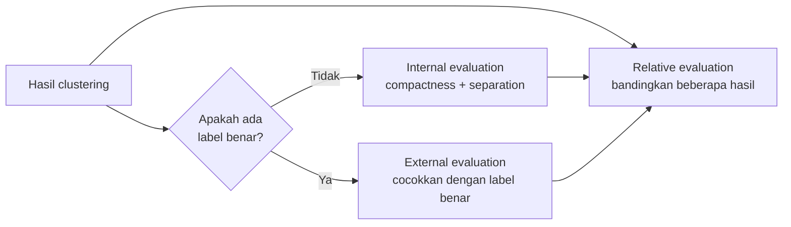
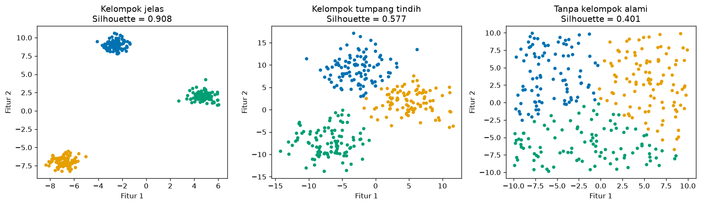
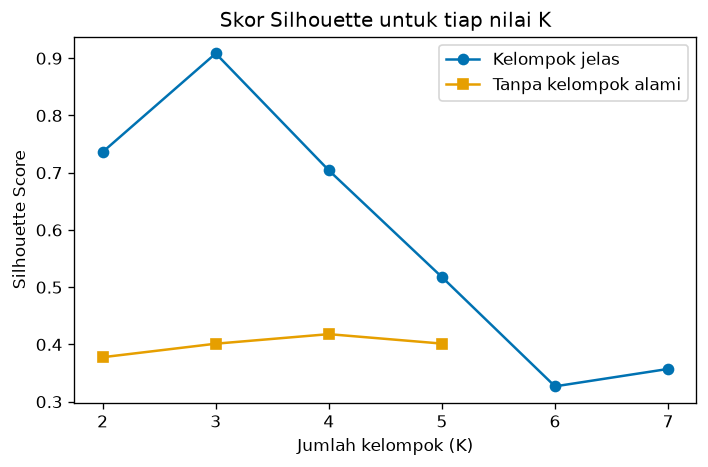

# Bab 1 — Introduction to Clustering Evaluation

## Learning Objectives

Setelah mempelajari bab ini, kamu mampu:

- [x] Menjelaskan apa itu *clustering evaluation* dan mengapa hasil clustering perlu dinilai.
- [x] Menjelaskan mengapa evaluasi clustering berbeda dari evaluasi klasifikasi.
- [x] Menyebutkan ciri hasil clustering yang baik: *compactness*, *separation*, *density*, *consistency*, dan *stability*.
- [x] Membedakan tiga pendekatan: *internal*, *external*, dan *relative evaluation*.
- [x] Menjelaskan mengapa gambar saja tidak cukup, dan mengapa skor saja juga tidak cukup.
- [x] Menghitung tiga skor pertama dengan scikit-learn: Silhouette, Davies-Bouldin, dan Calinski-Harabasz.
- [x] Mengenali bahwa algoritma clustering **selalu** menghasilkan kelompok, bahkan pada data yang tidak punya kelompok.

## Introduction

Di Level 4 kamu sudah menjalankan lima algoritma clustering. Setiap algoritma memberi jawaban: "data ini terbagi menjadi kelompok A, B, dan C". Pertanyaan berikutnya yang sangat penting: **apakah jawaban itu bagus?**

Bayangkan kamu membagi 200 pelanggan toko menjadi lima kelompok. Tim pemasaran akan membuat lima promo berbeda berdasarkan pembagianmu. Kalau pembagiannya asal-asalan, promo juga salah sasaran. Karena itu kita perlu cara untuk **menilai mutu** hasil clustering. Itulah *clustering evaluation*.

Level 5 mengajarkan alat-alat penilaian itu. Bab 1 memberi peta besarnya. Bab 2 sampai 8 membahas alatnya satu per satu.

!!! note "Prasyarat"
    - [Level 3 Bab 2](../fundamental-clustering/02-understanding-clusters.md) (ciri kelompok) dan [Bab 5](../fundamental-clustering/05-distance-metrics.md) (jarak).
    - [Level 4 Bab 2](../clustering-algorithms/02-k-means-clustering.md) (K-Means). Kita memakainya sebagai contoh di seluruh level ini.

## Fundamental Concepts

| Istilah | Arti |
|---|---|
| **Clustering evaluation** | Proses menilai seberapa baik hasil clustering |
| **Ground truth** | Label "jawaban benar" yang sudah diketahui, misalnya jenis bunga yang dicatat ahli. Sering **tidak ada** pada clustering |
| **Compactness** | Seberapa rapat anggota satu kelompok. Makin rapat makin baik |
| **Separation** | Seberapa jauh kelompok satu dari kelompok lain. Makin jauh makin baik |
| **Density** | Seberapa padat titik di dalam kelompok |
| **Consistency** | Seberapa seragam anggota satu kelompok, dan seberapa konsisten hasil bila data sedikit berubah |
| **Stability** | Apakah hasil tetap sama jika algoritma dijalankan ulang atau data diambil ulang |
| **Internal evaluation** | Menilai hanya dari data dan hasil clustering, tanpa label benar |
| **External evaluation** | Membandingkan hasil clustering dengan label benar |
| **Relative evaluation** | Membandingkan beberapa hasil clustering (misalnya K berbeda) untuk memilih yang terbaik |
| **Evaluation metric** | Angka yang meringkas mutu hasil |

## Detailed Explanation

### Mengapa evaluasi clustering berbeda dari klasifikasi?

Pada klasifikasi (*supervised learning*), setiap data punya label benar. Kita tinggal menghitung berapa persen tebakan yang cocok. Itu disebut *accuracy*, dan jawabannya jelas.

Pada clustering (*unsupervised learning*), tidak ada label benar yang diberikan saat belajar. Ada tiga akibat:

1. **Tidak ada "jawaban benar" untuk dicocokkan.** Kita tidak bisa menghitung accuracy.
2. **Nomor kelompok tidak punya arti.** Kelompok "0" pada satu eksekusi bisa menjadi kelompok "2" pada eksekusi lain, padahal isinya sama. Nomor hanya penanda.
3. **Definisi "baik" bergantung pada tujuan.** Dua pembagian bisa sama-sama masuk akal untuk tujuan berbeda. Misalnya pelanggan dibagi menurut penghasilan, atau menurut kebiasaan belanja.

Karena itu evaluasi clustering lebih sulit, dan kita memakai banyak alat sekaligus.

!!! tip "Analogi"
    Klasifikasi seperti ujian pilihan ganda dengan kunci jawaban. Clustering seperti merapikan lemari baju tanpa petunjuk. Kamu bisa menilai "rapi atau tidak" dengan melihat apakah baju sejenis berkumpul dan jenis berbeda terpisah. Tetapi tidak ada satu kunci jawaban yang pasti.

### Apa ciri clustering yang baik?

Lima ciri ini akan terus muncul di bab-bab berikutnya.

**1. Compactness (kerapatan).** Anggota satu kelompok berdekatan satu sama lain. Kelompok yang menyebar lebar kurang kompak.

**2. Separation (keterpisahan).** Kelompok berbeda berjauhan. Kelompok yang saling menempel sulit dibedakan.

**3. Density (kepadatan).** Titik di dalam kelompok rapat dan tidak berlubang. Penting terutama untuk algoritma berbasis kepadatan seperti DBSCAN.

**4. Consistency (keseragaman).** Anggota satu kelompok memang mirip dalam arti yang bermakna untuk tujuanmu.

**5. Stability (kestabilan).** Hasil tidak berubah drastis ketika algoritma dijalankan ulang dengan seed berbeda, atau ketika data sedikit berubah. Di bab ini stability hanya diperkenalkan. Pengujiannya yang lebih dalam menjadi bagian Level 6.

Dua ciri pertama, compactness dan separation, adalah dasar hampir semua metrik evaluasi di Level 5.



### Tiga pendekatan evaluasi

| Pendekatan | Pertanyaan yang dijawab | Perlu label benar? | Contoh metrik |
|---|---|---|---|
| **Internal** | Apakah kelompok rapat dan terpisah? | Tidak | Silhouette, Davies-Bouldin, Calinski-Harabasz |
| **External** | Seberapa cocok kelompok dengan label benar? | Ya | Adjusted Rand Index, NMI |
| **Relative** | Dari beberapa hasil, mana yang paling baik? | Tidak (memakai metrik internal) | Silhouette untuk beberapa nilai K, grafik elbow |

Ketiganya bukan pesaing. Yang dipilih bergantung pada **informasi apa yang kamu punya** dan **tujuan analisismu**. Pada data pelanggan toko, misalnya, kamu hampir pasti tidak punya label benar, sehingga external evaluation tidak mungkin dilakukan.

### Skor versus melihat gambar

Gambar (*visual inspection*) sangat berguna, tetapi punya batas:

- Hanya bisa digambar jika fiturnya satu sampai tiga. Data nyata sering punya puluhan fitur.
- Mata kita bisa tertipu. Pembagian yang tampak rapi belum tentu bermakna.
- Tidak bisa dibandingkan secara objektif antar orang.

Skor menyelesaikan sebagian masalah itu: angkanya bisa dihitung pada data berapa pun dimensinya dan bisa dibandingkan. Tetapi skor punya kelemahan sendiri: ia meringkas banyak hal menjadi satu angka, dan angka itu punya asumsi tersembunyi.

!!! warning "Aturan emas"
    Pakai **gambar dan skor bersama-sama**, ditambah pemahaman tentang data. Jangan memilih hanya berdasarkan satu angka.

### Clustering selalu menemukan kelompok

Ini fakta yang sering mengejutkan pemula: **K-Means akan selalu membagi data menjadi K kelompok**, bahkan jika datanya tersebar rata tanpa kelompok sama sekali. Algoritma tidak pernah berkata "tidak ada kelompok di sini". Karena itu kita membutuhkan evaluasi: untuk memeriksa apakah kelompok yang ditemukan **nyata** atau hanya hasil pemotongan data.

Kita akan melihat contohnya langsung di kode.

### Gambaran alat-alat di Level 5

| Bab | Alat | Jenis |
|---|---|---|
| 2 | Konsep jarak dalam dan antar kelompok | Dasar internal |
| 3 | Inertia / WCSS | Internal |
| 4 | Elbow Method | Relatif |
| 5 | Silhouette Score | Internal |
| 6 | Davies-Bouldin Index | Internal |
| 7 | Calinski-Harabasz Index | Internal |
| 8 | ARI, NMI, Homogeneity, Completeness, V-measure | External |

## Mathematical Foundation

Bab ini belum memakai rumus rinci. Kita hanya butuh dua ukuran jarak dasar dari Level 3. Untuk dua titik \( \mathbf{x} \) dan \( \mathbf{y} \), jarak Euclidean-nya:

$$
d(\mathbf{x}, \mathbf{y}) = \sqrt{\sum_{j=1}^{d} (x_j - y_j)^2}
$$

Artinya: kurangkan tiap fitur, kuadratkan, jumlahkan, lalu akar. Dua gagasan yang kita bangun darinya:

- **Jarak dalam kelompok** (*intra-cluster*): jarak antar titik dari kelompok yang sama. Kita ingin ini **kecil**.
- **Jarak antar kelompok** (*inter-cluster*): jarak antara titik dari kelompok berbeda, atau antar pusatnya. Kita ingin ini **besar**.

Hampir semua metrik internal di Level 5 membandingkan dua jarak ini dengan cara berbeda. Rumus lengkapnya dibahas di bab masing-masing.

## Python Implementation

Skrip lengkapnya ada di `examples/level-5/01_introduction_to_clustering_evaluation.py`, dan versi notebook-nya di `notebooks/level-5/01-introduction-to-clustering-evaluation.ipynb`. **Setiap potongan kode diikuti penjelasannya.**

**Konteks masalah:** kita ingin melihat bagaimana skor evaluasi berubah pada tiga jenis data: kelompok jelas, kelompok tumpang tindih, dan data tanpa kelompok alami.

**Dataset:**

- Dua dataset sintetis dari `make_blobs` (300 titik, 3 pusat), berbeda pada lebar sebaran.
- Satu dataset acak rata (300 titik) tanpa kelompok alami.
- Mall Customers (`data/mall_customers.csv`) untuk contoh data nyata.

**Pustaka:** NumPy, pandas, Matplotlib, scikit-learn.

!!! note "Keterbatasan data sintetis"
    Data sintetis memberi kita kontrol penuh, sehingga bagus untuk belajar. Tetapi data nyata hampir tidak pernah serapi ini. Skor pada data nyata biasanya lebih rendah dan lebih sulit ditafsirkan.

### Bagian A — Siapkan alat

```python
--8<-- "level-5/01_introduction_to_clustering_evaluation.py:setup"
```

**Penjelasan:**

- `KMeans` adalah algoritma clustering dari Level 4. Kita memakainya sebagai contoh.
- `make_blobs` membuat data sintetis berbentuk gerombol.
- `silhouette_score`, `davies_bouldin_score`, dan `calinski_harabasz_score` adalah tiga metrik evaluasi internal dari `sklearn.metrics`. Semuanya dibahas mendalam di Bab 5, 6, dan 7.
- `StandardScaler` menyamakan skala fitur (Level 2, Bab 10).

### Bagian B — Tiga dataset

```python
--8<-- "level-5/01_introduction_to_clustering_evaluation.py:data"
```

**Penjelasan:**

- `make_blobs(n_samples=300, centers=3, cluster_std=0.6, random_state=42)` membuat 300 titik di 3 gerombol. `cluster_std` mengatur lebar sebaran tiap gerombol: `0.6` rapat, `3.0` lebar sehingga gerombol saling menempel. `random_state=42` menjaga hasil tetap sama tiap dijalankan.
- Tanda `_` menampung label asli yang dikembalikan `make_blobs` tetapi **tidak kita pakai**. Clustering tidak boleh melihat label benar.
- `np.random.default_rng(42)` membuat generator angka acak dengan seed tetap. `rng.uniform(low=-10, high=10, size=(300, 2))` menaburkan 300 titik rata dalam persegi dari -10 sampai 10. Data ini sengaja tidak punya kelompok.
- `datasets` adalah dictionary (pasangan nama dan data) agar kita bisa mengulang pekerjaan yang sama untuk tiga dataset.

### Bagian C — Menjalankan K-Means

```python
--8<-- "level-5/01_introduction_to_clustering_evaluation.py:fit"
```

**Penjelasan:**

- `KMeans(n_clusters=3, n_init=10, random_state=42)` membuat model dengan 3 kelompok. `n_init=10` berarti algoritma dijalankan 10 kali dari titik awal berbeda lalu diambil yang terbaik.
- `fit_predict(X)` melatih model dan langsung mengembalikan label tiap titik.
- `np.bincount(labels)` menghitung berapa titik di tiap kelompok.

Perhatikan: pada data **tanpa kelompok alami**, K-Means tetap memberi tiga kelompok dengan ukuran hampir sama.

### Bagian D — Tiga skor pertama

```python
--8<-- "level-5/01_introduction_to_clustering_evaluation.py:scores"
```

**Penjelasan:**

- Tiap fungsi metrik menerima **data** `X` dan **label hasil clustering** `labels`. Tidak ada label benar yang dibutuhkan, itulah ciri evaluasi internal.
- Hasilnya dikumpulkan sebagai daftar dictionary lalu diubah menjadi tabel pandas dengan `pd.DataFrame(rows)`. `.set_index("Dataset")` menjadikan nama dataset sebagai penanda baris. `.round(3)` membulatkan tiga desimal.

### Bagian E — Menggambar tiga dataset

```python
--8<-- "level-5/01_introduction_to_clustering_evaluation.py:plot"
```

**Penjelasan:** `plt.subplots(1, 3)` membuat tiga panel berdampingan. Untuk tiap dataset, kita menggambar titik per kelompok dengan warna berbeda (`labels == j` memilih titik milik kelompok `j`), lalu menaruh nilai Silhouette di judul. `plt.tight_layout()` merapikan jarak antarpanel.

### Bagian F — Evaluasi relatif: membandingkan K

```python
--8<-- "level-5/01_introduction_to_clustering_evaluation.py:relative"
```

**Penjelasan:** kita menjalankan K-Means dengan K dari 2 sampai 7 pada data jelas, menghitung Silhouette tiap K, lalu `idxmax()` memberi K dengan skor tertinggi. Inilah *relative evaluation*: tidak ada label benar, kita hanya membandingkan beberapa hasil.

### Bagian G — Data tanpa kelompok alami

```python
--8<-- "level-5/01_introduction_to_clustering_evaluation.py:noclusters"
```

**Penjelasan:** kita mengulang hal yang sama pada data acak rata, dengan K dari 2 sampai 5.

```python
--8<-- "level-5/01_introduction_to_clustering_evaluation.py:plotrel"
```

**Penjelasan:** dua garis pada satu grafik: skor tiap K untuk data jelas (biru) dan data acak (oranye). `marker="o"` dan `marker="s"` memberi bentuk titik berbeda agar mudah dibedakan.

### Bagian H — Mall Customers

```python
--8<-- "level-5/01_introduction_to_clustering_evaluation.py:mall"
```

**Penjelasan:**

- `pd.read_csv` membaca data. `features` adalah dua kolom yang dipakai.
- `StandardScaler().fit_transform(...)` menyamakan skala. Skala penting karena semua metrik di sini berbasis jarak.
- Selanjutnya K-Means dengan K = 5 dan tiga skor dicetak. `f"{...:.3f}"` mencetak angka dengan tiga desimal.

## Code Explanation

| Bagian kode | Peran |
|---|---|
| `make_blobs(..., cluster_std=...)` | Mengatur lebar sebaran, sehingga bisa membuat data jelas atau tumpang tindih |
| `KMeans(...).fit_predict(X)` | **Proses clustering** (pelatihan): menghasilkan label |
| `silhouette_score(X, labels)` | **Proses evaluasi**: menilai label yang sudah ada |
| `np.bincount(labels)` | Menghitung ukuran tiap kelompok |
| Dictionary `datasets` | Mengulang pekerjaan yang sama pada beberapa data |

!!! note "Clustering dan evaluasi adalah dua langkah terpisah"
    `KMeans(...).fit_predict(X)` **melatih algoritma**. `silhouette_score(X, labels)` **menilai hasilnya**. Fungsi metrik tidak mengubah label dan tidak melatih apa pun. Memisahkan keduanya akan sangat membantu saat kamu mengevaluasi banyak algoritma.

## How to Run

Dari folder utama proyek (setelah mengaktifkan lingkungan virtual):

```powershell
pip install -r requirements-notebooks.txt
python examples/level-5/01_introduction_to_clustering_evaluation.py
```

Skrip mencetak output ke terminal dan menyimpan dua gambar ke `docs/assets/level-5/`. Notebook interaktifnya:

```powershell
jupyter notebook notebooks/level-5/01-introduction-to-clustering-evaluation.ipynb
```

Output di bawah berasal dari eksekusi nyata dengan Python 3.14, NumPy 2.5.4, pandas 3.1.1, scikit-learn 1.9.1, dan Matplotlib 3.11.2.

## Expected Output

```text
--8<-- "level-5/outputs/01.txt"
```

Gambar yang dihasilkan:





### Interpretasi output

**1. Ukuran kelompok.** K-Means membagi ketiga dataset menjadi kelompok berukuran hampir sama (100/100/100, 103/98/99, dan 94/105/101). Pada data acak, pembagian ini **tidak mencerminkan kelompok nyata**. Ukuran seimbang bukan bukti kelompok yang bermakna.

**2. Tiga skor menurun serentak dari data jelas ke data acak.**

| Dataset | Silhouette (makin tinggi makin baik) | Davies-Bouldin (makin rendah makin baik) | Calinski-Harabasz (makin tinggi makin baik) |
|---|---|---|---|
| Kelompok jelas | 0,908 | 0,128 | 14321,247 |
| Tumpang tindih | 0,577 | 0,596 | 647,906 |
| Tanpa kelompok alami | 0,401 | 0,847 | 251,661 |

Ketiganya sepakat: data jelas paling baik, data acak paling buruk. Arah "baik" berbeda antar metrik (Davies-Bouldin kebalikan dari dua lainnya). Bab 5 sampai 7 menjelaskan alasannya.

!!! warning "Skor 0,401 pada data acak bukan nol"
    Pada data acak rata, Silhouette masih **0,401**. Jadi skor yang "sedang" tidak otomatis berarti kelompok nyata. Algoritma tetap memotong data menjadi bagian, dan bagian-bagian itu bersentuhan di batasnya, tetapi di dalam tiap bagian titik tetap relatif dekat. Selalu bandingkan skor dengan gambar dan pengetahuan tentang data.

**3. Evaluasi relatif.** Pada data jelas, Silhouette tertinggi di **K = 3 (0,908)**, tepat sesuai jumlah gerombol sebenarnya. Pada K = 2 skor 0,736 dan pada K = 4 skor 0,704. Pada data acak, skor tertinggi justru di **K = 4 (0,418)**, dan perbedaannya dengan K lain kecil (0,378; 0,401; 0,418; 0,402). Tidak ada puncak yang tegas, tanda bahwa tidak ada struktur kelompok yang jelas.

**4. Mall Customers.** Ukuran kelompok 81, 39, 22, 35, 23. Silhouette **0,555**, Davies-Bouldin **0,572**, Calinski-Harabasz **248,6**. Silhouette 0,555 menandakan struktur yang cukup baik tetapi tidak sebersih data sintetis jelas. Kita belum bisa menyimpulkan lebih jauh sebelum mengenal tiap metrik di bab berikutnya.

!!! note "Nilai Calinski-Harabasz tidak punya batas atas"
    Angka 14321 dan 248 bukan persentase. Skor ini tidak dibatasi pada rentang tertentu dan hanya berguna untuk **membandingkan** hasil pada data yang sama.

## Practical Examples

**Segmentasi pelanggan.** Tanpa label benar, kita memakai evaluasi internal dan relatif untuk memilih jumlah segmen, lalu mengecek apakah segmen masuk akal bagi tim bisnis.

**Pengelompokan dokumen.** Dokumen teks dikelompokkan menurut topik. Jika sebagian dokumen sudah diberi label topik oleh editor, kita bisa memakai evaluasi eksternal untuk menguji kecocokannya.

**Segmentasi gambar medis.** Ahli radiologi kadang menandai area benar. Hasil clustering bisa dibandingkan dengan tanda itu (evaluasi eksternal), tetapi tanda ahli pun bukan kebenaran mutlak.

**Pemeriksaan "ada kelompok atau tidak".** Sebelum percaya pada hasil clustering, bandingkan skornya dengan skor pada data acak berskala sama. Jika selisihnya kecil, hati-hati.

## Hands-on Exercises

1. Pada `X_clear`, jalankan K-Means dengan K = 2, 3, dan 4. Berapa Davies-Bouldin untuk masing-masing? Pada K berapa nilainya paling rendah?
2. Ganti `cluster_std=3.0` menjadi `4.5` pada `X_overlap`. Apa yang terjadi pada Silhouette?
3. Ubah `random_state` pada `np.random.default_rng` menjadi 7. Apakah K terbaik pada data acak berubah? Apa artinya?
4. Jalankan K-Means pada Mall Customers dengan K = 4 dan K = 6. Bandingkan Silhouette dengan K = 5 (0,555).
5. Jelaskan dengan kata-katamu mengapa kita tidak bisa memakai *accuracy* untuk menilai clustering.
6. Mengapa kelompok "0" pada satu eksekusi tidak boleh dianggap sama dengan kelompok "0" pada eksekusi lain?

??? question "Jawaban"
    Hasil nomor 1 sampai 4 berasal dari eksekusi nyata.

    1. Davies-Bouldin: K = 2 **0,397**, K = 3 **0,128**, K = 4 **0,682**. Paling rendah (paling baik) pada K = 3, sesuai jumlah gerombol sebenarnya.
    2. Dengan `cluster_std=4.5`, Silhouette turun menjadi **0,461** (dari 0,577), karena gerombol makin tumpang tindih.
    3. Dengan seed 7, Silhouette data acak: K = 2 **0,369**, K = 3 **0,387**, K = 4 **0,404**, K = 5 **0,392**. Selisihnya kecil dan tidak ada puncak tegas. Skornya juga tidak sama persis dengan seed 42, jadi "K terbaik" pada data acak tidak bisa dipercaya.
    4. Silhouette Mall Customers: K = 4 **0,494**, K = 5 **0,555**, K = 6 **0,540**. K = 5 tertinggi, tetapi K = 6 hanya sedikit lebih rendah. Skor yang lebih tinggi belum tentu berarti pembagian yang lebih bermakna bagi bisnis.
    5. Accuracy butuh label benar untuk dicocokkan. Clustering tidak punya label benar saat belajar, dan nomor kelompok hanya penanda yang bisa tertukar.
    6. Nomor ditentukan oleh algoritma secara acak (bergantung titik awal). Yang bermakna adalah **siapa anggota satu kelompok**, bukan nomornya.

## Troubleshooting

### Masalah teknis

| Masalah | Penyebab | Solusi |
|---|---|---|
| `ValueError: Number of labels is 1` | Semua titik masuk satu kelompok. Metrik butuh minimal 2 kelompok | Pastikan `n_clusters >= 2` |
| `FileNotFoundError: data/mall_customers.csv` | Skrip dijalankan dari folder yang salah | Jalankan dari folder utama proyek |
| Angka berbeda dari output di bab | Versi pustaka atau seed berbeda | Pakai `random_state=42` dan bandingkan polanya |
| `ModuleNotFoundError: sklearn` | Pustaka belum terpasang | `pip install -r requirements-notebooks.txt` |

### Kesalahan umum

1. **Menganggap skor tinggi pasti berarti kelompok nyata.** Data acak pun mendapat skor 0,401.
2. **Memakai accuracy untuk clustering.** Nomor kelompok bukan label benar.
3. **Hanya melihat gambar, atau hanya melihat skor.** Pakai keduanya bersama pengetahuan domain.
4. **Lupa menyamakan skala fitur.** Semua metrik di bab ini bergantung pada jarak.
5. **Membandingkan skor antar dataset berbeda secara langsung.** Skor seperti Calinski-Harabasz bergantung pada data. Bandingkan hanya pada data yang sama.

## Summary

- *Clustering evaluation* menilai seberapa baik hasil clustering, padahal tidak ada label benar saat belajar.
- Clustering yang baik punya kelompok **kompak** dan **terpisah**. Kepadatan, keseragaman, dan kestabilan juga penting.
- Tiga pendekatan: **internal** (tanpa label benar), **external** (dengan label benar), dan **relative** (membandingkan beberapa hasil).
- Algoritma clustering **selalu** menghasilkan kelompok, bahkan pada data acak. Silhouette pada data acak kita masih 0,401.
- Gambar dan skor saling melengkapi. Jangan memutuskan hanya dari satu angka.
- Fungsi metrik di scikit-learn menerima data dan label, dan tidak melatih apa pun.

**Bab berikutnya:** Bab 2 membahas **Internal Clustering Evaluation**: jarak dalam dan antar kelompok sebagai fondasi semua metrik internal.

## References

- Jain, A. K., & Dubes, R. C. (1988). *Algorithms for Clustering Data*. Prentice Hall.
- Halkidi, M., Batistakis, Y., & Vazirgiannis, M. (2001). On clustering validation techniques. *Journal of Intelligent Information Systems*, 17(2–3), 107–145.
- Hennig, C. (2015). What are the true clusters? *Pattern Recognition Letters*, 64, 53–62.
- Scikit-learn documentation: [*Clustering performance evaluation*](https://scikit-learn.org/stable/modules/clustering.html#clustering-performance-evaluation).
- Hastie, T., Tibshirani, R., & Friedman, J. (2009). *The Elements of Statistical Learning* (2nd ed.), Bab 14.3. Springer.
