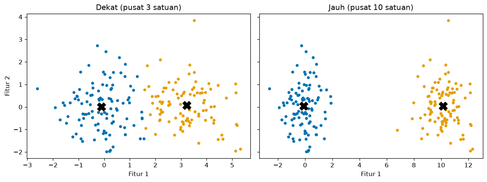
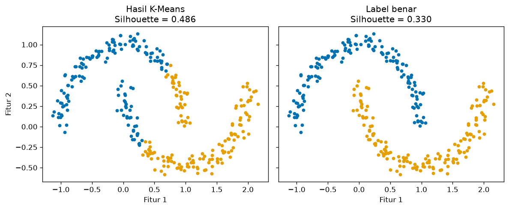

# Bab 2 — Internal Clustering Evaluation

## Learning Objectives

Setelah mempelajari bab ini, kamu mampu:

- [x] Menjelaskan apa itu *internal evaluation* dan mengapa ia penting ketika tidak ada label benar.
- [x] Menghitung *intra-cluster distance* dan *inter-cluster distance* secara manual dan dengan kode.
- [x] Membedakan *compactness*, *cohesion*, *separation*, dan *density*.
- [x] Menjelaskan hubungan antara jarak dan mutu kelompok.
- [x] Membaca perbedaan skor pada kelompok yang dekat dan kelompok yang jauh.
- [x] Menyebutkan kekuatan dan keterbatasan evaluasi internal, termasuk kasus ketika label benar justru mendapat skor lebih rendah.
- [x] Menyiapkan fondasi untuk memahami Inertia, Silhouette, Davies-Bouldin, dan Calinski-Harabasz.

## Introduction

Di [Bab 1](01-introduction-to-clustering-evaluation.md) kita melihat bahwa clustering biasanya tidak punya label benar. Bagaimana menilainya? Jawabannya: lihat **bentuk kelompok itu sendiri**. Kelompok yang baik punya anggota yang saling dekat, dan jauh dari kelompok lain.

Dua gagasan sederhana itu, *dekat ke dalam* dan *jauh ke luar*, adalah dasar semua metrik internal. Silhouette, Davies-Bouldin, Calinski-Harabasz, dan Inertia hanyalah cara berbeda untuk mengukur dan menggabungkan keduanya.

Bab ini membangun fondasi itu dengan ukuran paling sederhana lebih dulu. Kita menghitungnya dengan tangan pada enam titik, lalu dengan kode.

!!! note "Prasyarat"
    - [Bab 1](01-introduction-to-clustering-evaluation.md) Level 5.
    - [Level 3 Bab 3](../fundamental-clustering/03-centroid-and-cluster-representation.md) (centroid) dan [Bab 5](../fundamental-clustering/05-distance-metrics.md) (jarak Euclidean).

## Fundamental Concepts

| Istilah | Arti |
|---|---|
| **Internal evaluation** | Menilai hasil clustering hanya dari data dan label hasil clustering, tanpa label benar |
| **Intra-cluster distance** | Jarak di **dalam** satu kelompok. Ingin kecil |
| **Inter-cluster distance** | Jarak **antar** kelompok. Ingin besar |
| **Compactness** | Seberapa rapat sebuah kelompok. Kebalikan dari sebaran |
| **Cohesion** | Seberapa dekat anggota ke pusat kelompoknya. Di bab ini kita ukur lewat rata-rata jarak titik ke centroid |
| **Separation** | Seberapa jauh dua kelompok. Di bab ini kita ukur lewat jarak antar centroid, dan jarak antar titik terdekat |
| **Density** | Seberapa padat titik di dalam kelompok |
| **Centroid** | Titik rata-rata sebuah kelompok |

!!! note "Nama berbeda di sumber berbeda"
    Beberapa buku mendefinisikan *cohesion* sebagai jumlah **kuadrat** jarak ke centroid (itu sama dengan WCSS, Bab 3). Di sini kita memakai **rata-rata jarak** supaya angkanya mudah dibayangkan. Selalu cek definisi yang dipakai sebuah sumber.

## Detailed Explanation

### Mengapa evaluasi internal penting?

Dalam praktik, kamu hampir selalu mengelompokkan data yang **belum diberi label**: transaksi pelanggan, sensor, teks, gambar. Evaluasi internal adalah satu-satunya pendekatan yang bisa dipakai di situasi itu. Ia menjawab pertanyaan: *"Jika aku hanya melihat data dan pembagiannya, apakah pembagian ini rapi?"*

Evaluasi internal juga berguna untuk **membandingkan** beberapa hasil pada data yang sama, misalnya K berbeda atau algoritma berbeda (inilah *relative evaluation*).

### Ukuran 1: intra-cluster distance (jarak dalam kelompok)

Ambil semua pasangan titik di dalam satu kelompok, hitung jaraknya, lalu rata-ratakan. Angka kecil berarti anggota saling berdekatan.

### Ukuran 2: cohesion (jarak ke centroid)

Alih-alih membandingkan semua pasangan, cukup hitung jarak tiap titik ke **centroid** kelompoknya, lalu rata-ratakan. Hasilnya lebih murah dihitung dan mirip maknanya: kelompok yang kompak punya cohesion kecil.

### Ukuran 3: separation (keterpisahan)

Dua cara paling umum:

- **Jarak antar centroid**: seberapa jauh pusat dua kelompok.
- **Jarak antar titik terdekat**: jarak terkecil antara satu titik dari kelompok A dan satu titik dari kelompok B. Cara ini memperlihatkan seberapa dekat "perbatasan" kedua kelompok.

Keduanya berguna, dan bisa bercerita berbeda. Dua kelompok panjang bisa punya centroid berjauhan tetapi perbatasannya saling menempel.

### Ukuran 4: density (kepadatan)

Kepadatan berbicara tentang **seberapa rapat titik-titik di dalam kelompok**. Cara sederhana: rata-rata jarak ke tetangga terdekat. Makin kecil, makin padat. Dua kelompok bisa punya cohesion mirip tetapi kepadatan berbeda, dan sebaliknya.

### Hubungan jarak dan mutu kelompok

Gabungkan keduanya:

| Jarak dalam | Jarak antar | Gambaran |
|---|---|---|
| Kecil | Besar | Kelompok kompak dan terpisah. **Sangat baik** |
| Kecil | Kecil | Kelompok kompak tetapi saling menempel. Mungkin sebenarnya satu kelompok |
| Besar | Besar | Kelompok terpisah tetapi renggang. Cukup baik |
| Besar | Kecil | Kelompok renggang dan bertumpuk. **Buruk** |

Ukuran tunggal bisa menyesatkan. Karena itu metrik internal yang matang **membandingkan** jarak dalam dengan jarak antar. Kita akan melihatnya di Bab 5, 6, dan 7.

!!! tip "Skala itu penting"
    Semua ukuran ini bergantung pada skala fitur. Jika pendapatan berskala ribuan dan skor belanja berskala puluhan, pendapatan akan menentukan hampir semua jarak. Samakan skala dulu (Level 2, Bab 10).

### Kekuatan dan keterbatasan evaluasi internal

**Kekuatan**

- Tidak butuh label benar, jadi bisa dipakai di mana saja.
- Murah dihitung, dan bisa dipakai untuk membandingkan K atau algoritma.
- Berjalan pada data berdimensi berapa pun.

**Keterbatasan**

- Mengasumsikan bahwa "baik" berarti *kompak dan terpisah*. Kelompok berbentuk melengkung atau memanjang bisa tetap benar tetapi mendapat skor jelek (lihat contoh moons di bawah).
- Cenderung menyukai kelompok bulat dengan ukuran serupa.
- Tidak tahu **tujuan bisnismu**. Pembagian dengan skor tertinggi belum tentu paling berguna.
- Skor tinggi tidak membuktikan kelompok itu nyata (Bab 1: data acak pun mendapat skor).

## Mathematical Foundation

Misalkan kelompok \( C_k \) berisi \( n_k \) titik, dengan centroid

$$
\mu_k = \frac{1}{n_k} \sum_{\mathbf{x}_i \in C_k} \mathbf{x}_i
$$

**Rata-rata jarak dalam kelompok** (semua pasangan berbeda):

$$
\bar{d}_k = \frac{1}{n_k (n_k - 1)} \sum_{\mathbf{x}_i \in C_k} \sum_{\substack{\mathbf{x}_j \in C_k \\ j \neq i}} d(\mathbf{x}_i, \mathbf{x}_j)
$$

Artinya: jumlahkan jarak setiap pasangan titik berbeda di dalam kelompok, lalu bagi dengan banyaknya pasangan berurutan, \( n_k (n_k - 1) \).

**Cohesion** (rata-rata jarak ke centroid):

$$
\text{Cohesion}_k = \frac{1}{n_k} \sum_{\mathbf{x}_i \in C_k} \lVert \mathbf{x}_i - \mu_k \rVert
$$

**Separation** antara kelompok \( a \) dan \( b \):

$$
\text{Sep}_{ab} = \lVert \mu_a - \mu_b \rVert
\qquad
\text{MinDist}_{ab} = \min_{\mathbf{x}_i \in C_a,\ \mathbf{x}_j \in C_b} d(\mathbf{x}_i, \mathbf{x}_j)
$$

### Perhitungan manual pada enam titik

Kelompok 0: \( (1,1),\ (2,1),\ (1,2) \). Kelompok 1: \( (6,5),\ (7,5),\ (6,6) \).

**Centroid kelompok 0:** \( \left(\frac{1+2+1}{3},\ \frac{1+1+2}{3}\right) = (1{,}333;\ 1{,}333) \). Kelompok 1 menghasilkan \( (6{,}333;\ 5{,}333) \) dengan cara yang sama.

**Jarak dalam kelompok 0.** Tiga pasangan:

- \( (1,1) \) ke \( (2,1) \): \( \sqrt{1^2+0^2} = 1 \)
- \( (1,1) \) ke \( (1,2) \): \( \sqrt{0^2+1^2} = 1 \)
- \( (2,1) \) ke \( (1,2) \): \( \sqrt{1^2+1^2} = 1{,}414 \)

Rata-ratanya \( \frac{1 + 1 + 1{,}414}{3} = 1{,}138 \). (Dengan rumus berurutan: tiap pasangan terhitung dua kali, pembaginya \( 3 \times 2 = 6 \), hasilnya sama.)

**Cohesion kelompok 0.** Jarak ke centroid \( (1{,}333;\ 1{,}333) \):

- \( (1,1) \): \( \sqrt{0{,}333^2 + 0{,}333^2} = 0{,}471 \)
- \( (2,1) \): \( \sqrt{0{,}667^2 + 0{,}333^2} = 0{,}745 \)
- \( (1,2) \): \( \sqrt{0{,}333^2 + 0{,}667^2} = 0{,}745 \)

Rata-ratanya \( \frac{0{,}471 + 0{,}745 + 0{,}745}{3} = 0{,}654 \).

**Separation.** Selisih centroid \( (6{,}333 - 1{,}333,\ 5{,}333 - 1{,}333) = (5,\ 4) \), sehingga jaraknya \( \sqrt{25 + 16} = \sqrt{41} = 6{,}403 \).

Pasangan titik terdekat antar kelompok adalah \( (2,1) \) dan \( (6,5) \): \( \sqrt{4^2 + 4^2} = \sqrt{32} = 5{,}657 \).

Kita akan mencocokkan semua angka ini dengan hasil kode.

## Python Implementation

Skrip lengkapnya ada di `examples/level-5/02_internal_clustering_evaluation.py`, dan notebook-nya di `notebooks/level-5/02-internal-clustering-evaluation.ipynb`. **Setiap potongan kode diikuti penjelasannya.**

**Konteks masalah:** menghitung ukuran jarak dalam dan antar kelompok, lalu melihat bagaimana ukuran itu berubah pada kelompok dekat vs jauh, dan di mana ukuran itu keliru.

**Dataset:**

- `X_tiny`: enam titik buatan tangan, untuk mencocokkan hitungan manual.
- `make_blobs`: dua kelompok dekat vs jauh, dan dua kelompok dengan kepadatan berbeda.
- `make_moons`: dua bulan sabit, untuk memperlihatkan keterbatasan.
- Mall Customers: data nyata.

**Pustaka:** NumPy, pandas, Matplotlib, scikit-learn.

### Bagian A — Siapkan alat

```python
--8<-- "level-5/02_internal_clustering_evaluation.py:setup"
```

**Penjelasan:** `pairwise_distances` dari scikit-learn menghitung matriks jarak antar titik. `NearestNeighbors` mencari tetangga terdekat (untuk kepadatan). `make_moons` membuat dua bentuk bulan sabit. Selebihnya sudah dikenal dari bab sebelumnya.

### Bagian B — Data kecil

```python
--8<-- "level-5/02_internal_clustering_evaluation.py:tiny"
```

**Penjelasan:** `X_tiny` adalah enam titik dengan dua kolom (koordinat x dan y). `labels_tiny` adalah label yang **kita tentukan sendiri**: tiga titik pertama kelompok 0, tiga terakhir kelompok 1. Di sini tidak ada algoritma. Kita hanya menilai pembagian yang sudah ada.

### Bagian C — Empat ukuran sebagai fungsi

```python
--8<-- "level-5/02_internal_clustering_evaluation.py:functions"
```

**Penjelasan:**

- `mean_intra_distance`: untuk tiap kelompok `k`, `members = X[labels == k]` mengambil titik-titiknya. `pairwise_distances(members)` membuat matriks jarak `n × n`. Diagonalnya nol (jarak titik ke dirinya sendiri) dan tiap pasangan muncul dua kali, sehingga jumlahnya dibagi `n * (n - 1)`.
- `cohesion`: `centroid = members.mean(axis=0)` menghitung rata-rata per kolom. `members - centroid` mengurangkan centroid dari tiap baris (NumPy melakukannya otomatis untuk semua baris). `np.linalg.norm(..., axis=1)` mengambil panjang tiap selisih, yaitu jarak. `.mean()` merata-ratakannya.
- `centroid_separation`: membuat daftar centroid, menghitung matriks jarak antar centroid, lalu mengembalikan jarak untuk tiap pasangan `(i, j)` dengan `i < j`.
- `min_inter_distance`: `pairwise_distances(A, B)` menghitung jarak **setiap titik A ke setiap titik B**. `.min()` mengambil yang terkecil.
- `np.unique(labels)` memberi daftar label unik, sehingga fungsi ini jalan untuk berapa pun jumlah kelompok.

### Bagian D — Mencocokkan hitungan manual

```python
--8<-- "level-5/02_internal_clustering_evaluation.py:tinyresult"
```

```text title="Output"
--8<-- "level-5/outputs/02/tinyresult.txt"
```

**Penjelasan:** kita memanggil keempat fungsi pada data kecil. `.round(3)` dan `round(float(v), 3)` membulatkan angka ke tiga desimal agar mudah dibaca. Bagian `int(k)` dan `float(v)` hanya mengubah tipe NumPy menjadi angka biasa supaya cetakannya rapi.

### Bagian E — Kelompok dekat vs jauh

```python
--8<-- "level-5/02_internal_clustering_evaluation.py:neardistant"
```

```text title="Output"
--8<-- "level-5/outputs/02/neardistant.txt"
```

**Penjelasan:**

- Kita membuat dua dataset dengan `cluster_std=1.0` yang sama. Satu memiliki dua pusat berjarak 3 satuan, satunya berjarak 10 satuan. Hanya jarak antar pusat yang berbeda.
- `centers=[[0, 0], [3, 0]]` menentukan pusat secara eksplisit, sehingga kita mengendalikan jaraknya.
- Untuk tiap dataset, K-Means dengan K = 2 menghasilkan label, lalu kita menghitung cohesion rata-rata, jarak antar centroid, **rasio separation/cohesion**, dan Silhouette.
- Rasio ini hanya alat bantu bab ini: makin besar rasio, makin terpisah kelompok relatif terhadap sebarannya.

```python
--8<-- "level-5/02_internal_clustering_evaluation.py:plotnear"
```



**Penjelasan:** dua panel berdampingan, `sharey=True` membuat sumbu vertikal sama. Tanda `X` hitam adalah centroid.

### Bagian F — Kepadatan

```python
--8<-- "level-5/02_internal_clustering_evaluation.py:density"
```

```text title="Output"
--8<-- "level-5/outputs/02/density.txt"
```

**Penjelasan:**

- `make_blobs(n_samples=[150, 150], ..., cluster_std=[0.4, 1.6])` membuat dua kelompok dengan sebaran **berbeda**: kelompok 0 rapat, kelompok 1 renggang.
- `y_dens` adalah kelompok bawaan `make_blobs` dan kita pakai di sini hanya untuk memisahkan dua kelompok itu.
- `NearestNeighbors(n_neighbors=2)` mencari dua tetangga terdekat tiap titik. Tetangga pertama adalah titik itu sendiri (jarak 0), jadi kita ambil kolom kedua `dist[:, 1]`.

### Bagian G — Keterbatasan: label benar bisa kalah

```python
--8<-- "level-5/02_internal_clustering_evaluation.py:limits"
```

```text title="Output"
--8<-- "level-5/outputs/02/limits.txt"
```

```python
--8<-- "level-5/02_internal_clustering_evaluation.py:plotmoons"
```



**Penjelasan:** `make_moons` memberi dua bulan sabit beserta label benarnya `y_moons`. Kita menghitung Silhouette dan cohesion untuk dua pembagian: hasil K-Means, dan label benar. Label benar **hanya dipakai untuk dinilai**, tidak untuk melatih K-Means.

### Bagian H — Mall Customers

```python
--8<-- "level-5/02_internal_clustering_evaluation.py:mall"
```

```text title="Output"
--8<-- "level-5/outputs/02/mall.txt"
```

**Penjelasan:** setelah menyamakan skala, K-Means (K = 5) menghasilkan label. Kita membuat tabel ukuran dan cohesion tiap kelompok, lalu mencari pasangan kelompok dengan centroid terdekat dan terjauh. `min(sep_mall, key=sep_mall.get)` mengambil kunci (pasangan kelompok) dengan nilai terkecil.

## Code Explanation

| Bagian kode | Peran |
|---|---|
| `X[labels == k]` | Memilih anggota kelompok `k` |
| `pairwise_distances(members)` | Matriks jarak antar semua titik dalam kelompok |
| `members.mean(axis=0)` | Centroid: rata-rata tiap fitur |
| `np.linalg.norm(members - centroid, axis=1)` | Jarak setiap titik ke centroid |
| `pairwise_distances(A, B).min()` | Jarak terdekat antar dua kelompok |
| `NearestNeighbors(...).kneighbors(...)` | Jarak ke tetangga terdekat, untuk kepadatan |
| `silhouette_score(X, labels)` | Metrik internal siap pakai (dibahas di Bab 5) |

## How to Run

Dari folder utama proyek (setelah mengaktifkan lingkungan virtual):

```powershell
pip install -r requirements-notebooks.txt
python examples/level-5/02_internal_clustering_evaluation.py
```

Skrip mencetak output ke terminal dan menyimpan dua gambar ke `docs/assets/level-5/`. Notebook interaktifnya:

```powershell
jupyter notebook notebooks/level-5/02-internal-clustering-evaluation.ipynb
```

Semua output pada bab ini berasal dari eksekusi nyata dengan Python 3.14, NumPy 2.5.4, pandas 3.1.1, scikit-learn 1.9.1, dan Matplotlib 3.11.2.

## Expected Output

Output setiap langkah ditampilkan langsung di bawah kodenya pada bagian [Python Implementation](#python-implementation).

Gambar yang dihasilkan:


### Interpretasi output

**1. Data kecil cocok dengan hitungan manual.** Centroid \( (1{,}333;\ 1{,}333) \) dan \( (6{,}333;\ 5{,}333) \). Rata-rata jarak dalam kelompok **1,138**, cohesion **0,654**, jarak antar centroid **6,403**, dan jarak antar titik terdekat **5,657**. Semuanya sama dengan hitungan di Mathematical Foundation. Kedua kelompok identik bentuknya (digeser), karena itu angkanya sama untuk kelompok 0 dan 1.

**2. Dekat vs jauh.** Sebaran sama, jadi cohesion hampir sama: **1,161** dan **1,194**. Yang berbeda adalah jarak antar centroid: **3,326** dan **10,244**. Rasio separation/cohesion naik dari **2,866** ke **8,580**, dan Silhouette dari **0,525** ke **0,834**. Jadi, pada sebaran yang sama, kelompok yang lebih berjauhan mendapat skor lebih baik. Cohesion saja tidak mampu membedakan kedua kasus ini. **Separation-lah yang berubah.**

**3. Kepadatan.** Kelompok 0 (rapat): cohesion **0,491**, rata-rata jarak ke tetangga terdekat **0,071**. Kelompok 1 (renggang): cohesion **1,930**, jarak ke tetangga terdekat **0,289**. Keduanya lebih besar pada kelompok yang renggang. Ini menunjukkan satu data bisa memuat kelompok dengan karakter berbeda, dan satu angka rata-rata menyembunyikannya.

**4. Label benar bisa kalah.** Pada moons, pembagian **K-Means** memotong bulan sabit secara lurus tetapi mendapat Silhouette **0,486** dan cohesion **0,604**. **Label benar** (dua bulan utuh) mendapat Silhouette **0,330** dan cohesion **0,729**, yaitu lebih rendah. Skor internal menyukai pembagian K-Means karena kelompoknya lebih bulat dan lebih kompak, meski secara bentuk pembagiannya salah.

!!! warning "Skor internal bukan kebenaran"
    Metrik internal mengukur kompak dan terpisah, bukan "benar". Pada data berbentuk melengkung, pembagian yang tepat bisa dinilai lebih rendah. Jangan jadikan skor internal sebagai satu-satunya dasar keputusan, terutama jika bentuk kelompok bukan bulat.

**5. Mall Customers.** Ukuran 81, 39, 22, 35, 23. Cohesion tiap kelompok **0,387**, **0,627**, **0,447**, **0,625**, **0,549** (dalam satuan terskala). Kelompok 0 (terbesar, 81 titik) justru yang paling kompak, sedangkan kelompok 1 dan 3 paling renggang. Pasangan dengan centroid terdekat adalah kelompok **0 dan 4 (1,568)** dan yang terjauh adalah **2 dan 3 (3,395)**.

## Practical Examples

**Memeriksa pembagian pelanggan.** Hitung cohesion per segmen. Segmen dengan cohesion besar berisi pelanggan yang beragam, dan mungkin perlu dipecah lagi atau ditinjau.

**Menentukan apakah dua segmen perlu digabung.** Jika jarak antar centroid dua segmen sangat kecil dibanding cohesion-nya, kedua segmen hampir menempel dan mungkin sebenarnya satu.

**Memeriksa kualitas pusat kelompok.** Di segmentasi sensor atau logistik, kelompok yang renggang berarti satu "pusat" tidak mewakili anggotanya dengan baik.

**Membandingkan dua hasil pada data yang sama.** Evaluasi internal cocok untuk memilih antara dua pembagian atas data yang sama, selama kamu ingat batasnya (bentuk kelompok).

## Hands-on Exercises

1. Hitung manual cohesion kelompok 1 pada `X_tiny` dan cocokkan dengan output.
2. Pada `X_tiny`, ganti titik \( (6,6) \) menjadi \( (9,9) \). Apa cohesion tiap kelompok, jarak antar centroid, dan jarak antar titik terdekat sekarang?
3. Pada eksperimen dekat vs jauh, ganti `cluster_std=1.0` pada dataset "dekat" menjadi `2.0`. Berapa Silhouette dan cohesion rata-ratanya?
4. Jalankan K-Means dengan K = 3 pada Mall Customers (terskala). Hitung cohesion rata-rata berbobot ukuran kelompok dan bandingkan dengan K = 5.
5. Mengapa cohesion yang sama pada dua dataset bisa menghasilkan Silhouette yang berbeda?
6. Mengapa pada moons, pembagian yang salah bisa mendapat skor internal lebih baik?

??? question "Jawaban"
    Hasil nomor 2, 3, dan 4 berasal dari eksekusi nyata.

    1. Centroid kelompok 1 adalah \( (6{,}333;\ 5{,}333) \). Jarak ke \( (6,5) \) sampai \( 0{,}471 \), ke \( (7,5) \) sampai \( 0{,}745 \), dan ke \( (6,6) \) sampai \( 0{,}745 \). Rata-ratanya **0,654**, sama dengan kelompok 0.
    2. Cohesion kelompok 0 tetap **0,654**, cohesion kelompok 1 menjadi **2,135**, jarak antar centroid menjadi **7,810**, dan jarak antar titik terdekat tetap **5,657**. Titik yang ditarik jauh membuat kelompok 1 renggang, dan menggeser centroid, tetapi tidak mengubah pasangan titik terdekat.
    3. Silhouette turun menjadi **0,384** dan cohesion rata-rata naik menjadi **2,133** (sebaran lebih lebar, kelompok bertumpuk).
    4. Cohesion rata-rata berbobot: K = 3 **0,750** dan K = 5 **0,501**. Cohesion mengecil saat K naik, karena kelompok yang lebih kecil lebih rapat. Ini mirip sifat WCSS di Bab 3: ukuran seperti ini hampir selalu membaik saat K naik, sehingga tidak boleh dipakai sendirian untuk memilih K.
    5. Cohesion hanya mengukur kerapatan ke dalam. Silhouette juga mempertimbangkan jarak ke kelompok tetangga. Dua dataset dengan sebaran sama bisa berbeda jauh dalam jarak antar kelompok.
    6. Ukuran internal menilai "kompak dan terpisah" menurut jarak, bukan "benar". K-Means membentuk kelompok bulat yang lebih rapat menurut jarak, walau memotong bentuk bulan sabit. Label benar memuat titik-titik yang berjauhan di ujung bulan sabit yang sama.

## Troubleshooting

### Masalah teknis

| Masalah | Penyebab | Solusi |
|---|---|---|
| `nan` dan `RuntimeWarning: invalid value encountered in scalar divide` pada `mean_intra_distance` | Kelompok hanya berisi 1 titik, sehingga `n * (n - 1)` bernilai 0 | Lewati kelompok berukuran 1 atau tangani khusus |
| Tabel pandas terpotong dengan `...` | Lebar tabel melebihi layar | Pakai `.to_string()` pada tabel |
| Hasil metrik tidak masuk akal | `labels` tidak sejajar dengan baris `X` | Pastikan `len(labels) == len(X)` dan urutannya sama |
| Angka berbeda dari output di bab | Versi pustaka atau seed berbeda | Pakai `random_state=42` dan bandingkan polanya |
| `pairwise_distances` lambat dan memakan memori | Data besar: matriks `n × n` | Gunakan sampel atau ukuran berbasis centroid |

### Kesalahan umum

1. **Lupa menyamakan skala fitur.** Fitur berskala besar mendominasi jarak.
2. **Hanya melihat cohesion.** Kelompok yang rapat tetapi saling menempel tetap buruk. Lihat separation juga.
3. **Hanya melihat jarak antar centroid.** Dua kelompok memanjang bisa punya centroid berjauhan tetapi perbatasan menempel.
4. **Mengira skor internal sama dengan kebenaran.** Contoh moons menunjukkan sebaliknya.
5. **Membandingkan angka mentah antar dataset berbeda.** Jarak bergantung pada skala dan sebaran data.
6. **Mengandalkan rata-rata.** Rata-rata cohesion menyembunyikan kelompok yang renggang. Lihat per kelompok.

## Summary

- **Evaluasi internal** menilai hasil clustering hanya dari data dan label hasil clustering, tanpa label benar.
- Dua gagasan inti: **jarak dalam** (kecil lebih baik) dan **jarak antar** (besar lebih baik).
- Empat ukuran dasar: rata-rata jarak dalam kelompok, **cohesion** (jarak ke centroid), **separation** (jarak antar centroid dan antar titik terdekat), serta **density** (jarak ke tetangga terdekat).
- Pada enam titik kita menghitung manual dan mendapat angka yang sama dengan kode: cohesion 0,654, jarak antar centroid 6,403, jarak antar titik terdekat 5,657.
- Pada sebaran yang sama, kelompok yang lebih berjauhan mendapat Silhouette lebih tinggi (0,525 vs 0,834).
- Evaluasi internal punya asumsi **kompak dan terpisah**. Pada moons, label benar mendapat Silhouette 0,330, lebih rendah daripada K-Means yang salah bentuk (0,486).
- Samakan skala fitur dan lihat hasil **per kelompok**, bukan hanya rata-rata.

**Bab berikutnya:** Bab 3 membahas **Inertia dan WCSS**: metrik internal paling dasar, yang dihitung oleh K-Means sendiri.

## References

- Tan, P.-N., Steinbach, M., & Kumar, V. (2019). *Introduction to Data Mining* (2nd ed.), Bab 7.5: Cluster Evaluation. Pearson.
- Halkidi, M., Batistakis, Y., & Vazirgiannis, M. (2001). On clustering validation techniques. *Journal of Intelligent Information Systems*, 17(2–3), 107–145.
- Rousseeuw, P. J. (1987). Silhouettes: a graphical aid to the interpretation and validation of cluster analysis. *Journal of Computational and Applied Mathematics*, 20, 53–65.
- Scikit-learn documentation: [`pairwise_distances`](https://scikit-learn.org/stable/modules/generated/sklearn.metrics.pairwise_distances.html) dan [`NearestNeighbors`](https://scikit-learn.org/stable/modules/generated/sklearn.neighbors.NearestNeighbors.html).
