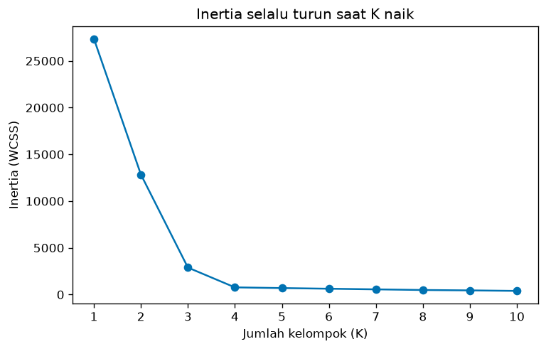
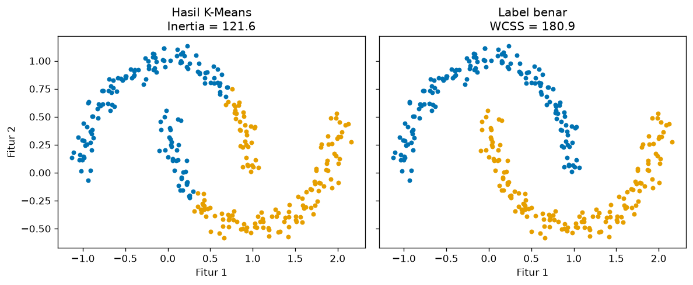

# Bab 3 — Inertia and Within-Cluster Sum of Squares (WCSS)

## Learning Objectives

Setelah mempelajari bab ini, kamu mampu:

- [x] Menjelaskan apa itu *Inertia* dan *Within-Cluster Sum of Squares* (WCSS), dan hubungannya dengan K-Means.
- [x] Menghitung WCSS secara manual, titik demi titik, dan mencocokkannya dengan `inertia_` scikit-learn.
- [x] Menjelaskan mengapa WCSS memakai jarak **kuadrat** ke centroid.
- [x] Menjelaskan mengapa Inertia turun (atau tetap) saat K naik, dan mengapa Inertia terendah bukan berarti hasil terbaik.
- [x] Menjelaskan pengaruh skala dan jumlah data pada nilai Inertia mentah.
- [x] Menjelaskan mengapa Inertia bukan metrik universal untuk semua algoritma clustering.
- [x] Menggambar grafik Inertia terhadap K.
- [x] Mengenali kesalahan umum saat memakai Inertia.

## Introduction

Setelah Bab 2, kita punya gagasan: kelompok yang baik itu kompak. Bagaimana meringkas "kompak" menjadi **satu angka**? Jawaban paling klasik: jumlahkan kuadrat jarak setiap titik ke pusat kelompoknya. Angka ini disebut **WCSS** (*Within-Cluster Sum of Squares*), dan di scikit-learn disebut **Inertia**.

Kamu sudah bertemu WCSS di [Level 4, Bab 2](../clustering-algorithms/02-k-means-clustering.md) sebagai fungsi tujuan K-Means. Di sini kita melihatnya dari sisi lain: **sebagai alat penilaian**. Kita menghitungnya dengan tangan, melihat bagaimana ia berubah terhadap K, dan, yang paling penting, belajar kapan ia menyesatkan.

!!! note "Prasyarat"
    - [Bab 2](02-internal-clustering-evaluation.md) Level 5 (cohesion dan jarak ke centroid).
    - [Level 4 Bab 2](../clustering-algorithms/02-k-means-clustering.md) (K-Means).

## Fundamental Concepts

| Istilah | Arti |
|---|---|
| **WCSS** | *Within-Cluster Sum of Squares*: jumlah kuadrat jarak setiap titik ke centroid kelompoknya |
| **Inertia** | Nama scikit-learn untuk WCSS pada K-Means. Diakses lewat atribut `inertia_` |
| **Centroid** | Rata-rata anggota kelompok |
| **Kuadrat jarak** | Jarak dikalikan dirinya sendiri. Membuat titik yang jauh dihukum lebih berat |
| **Objective function** | Angka yang ingin diminimalkan sebuah algoritma. Pada K-Means, itulah WCSS |
| **Local minimum** | Hasil terbaik di sekitar titik awal, belum tentu terbaik secara keseluruhan |

## Detailed Explanation

### Apa itu Inertia, secara intuitif

Bayangkan setiap titik data terhubung ke pusat kelompoknya dengan sebuah karet. Makin jauh titik dari pusat, makin tegang karetnya. Inertia adalah **total ketegangan semua karet**. Kelompok yang rapat membuat karet longgar (Inertia kecil), kelompok yang renggang membuat karet tegang (Inertia besar).

### Mengapa memakai jarak kuadrat?

Dua alasan:

1. **Titik jauh dihukum lebih keras.** Jarak 4 menjadi 16, sedangkan jarak 1 tetap 1. Satu titik yang sangat jauh menaikkan WCSS jauh lebih banyak daripada banyak titik yang sedikit jauh.
2. **Rata-rata adalah pusat terbaik.** Untuk jumlah kuadrat jarak, titik yang meminimalkan hasilnya adalah rata-rata, yaitu centroid. Inilah sebabnya K-Means memakai rata-rata untuk memperbarui centroid (dibuktikan di Level 4, Bab 2).

### Inertia dan K-Means

Pada K-Means, WCSS bukan sekadar skor. Ia adalah **yang sedang diminimalkan algoritma**. Setiap iterasi (menetapkan titik ke centroid terdekat, lalu menghitung ulang centroid) tidak pernah menaikkan WCSS. Jadi `inertia_` bisa dibaca sebagai "seberapa baik K-Means berhasil meminimalkan tujuannya".

!!! warning "Inertia terkait erat dengan algoritma berbasis centroid"
    Inertia cocok untuk K-Means dan algoritma sejenis yang memakai centroid dan jarak Euclidean. Ia **bukan metrik universal**: DBSCAN, Hierarchical, dan Mean Shift tidak meminimalkan WCSS, dan DBSCAN bahkan tidak punya atribut `inertia_`. Kita membuktikannya di kode.

### Hubungan K dan Inertia

Jika K naik, kelompok makin banyak dan makin kecil, sehingga jarak titik ke pusatnya ikut mengecil. Hasilnya:

- Dengan data dan tujuan K-Means yang sama, nilai terbaik yang mungkin untuk Inertia **turun atau tetap** saat K naik.
- Pada kasus ekstrem **K = n** (tiap titik jadi kelompok sendiri), setiap titik berimpit dengan centroid-nya, jadi Inertia = 0.

Dua catatan jujur: (1) K-Means hanya menemukan *local minimum*, sehingga dalam kasus langka Inertia pada K yang lebih besar bisa sedikit lebih tinggi bila titik awal buruk. Memakai `n_init` yang cukup mengurangi risikonya. (2) Pernyataan "turun saat K naik" berlaku untuk data yang **sama** dan tujuan K-Means yang standar.

### Mengapa Inertia terendah tidak selalu terbaik

Inertia = 0 pada K = n, tetapi hasil itu tidak berguna: tidak ada kelompok yang bisa dijelaskan. Karena Inertia otomatis turun saat K naik, **kamu tidak bisa memilih K dengan Inertia terkecil**. Itulah alasan adanya Elbow Method (Bab 4) dan metrik lain yang tidak otomatis membaik saat K naik (Silhouette, Davies-Bouldin).

Alasan kedua: Inertia hanya mengukur kekompakan **berbentuk bulat** di sekitar centroid. Pada data melengkung, pembagian yang benar bentuknya bisa memiliki Inertia **lebih tinggi** daripada pembagian yang salah. Kita akan melihat ini pada moons.

### Inertia dipengaruhi skala dan jumlah data

Nilai Inertia mentah tidak bisa dibandingkan begitu saja:

- **Skala:** jika semua fitur dikali 10, semua jarak dikali 10, jarak kuadrat dikali **100**, dan Inertia ikut dikali 100.
- **Jumlah data:** semakin banyak titik, semakin banyak suku yang dijumlahkan. Data yang digandakan memberi Inertia sekitar dua kali lipat, padahal kualitas pengelompokannya sama.

Karena itu: bandingkan Inertia hanya pada **data yang sama** (skala dan jumlah sama). Untuk membandingkan antar dataset berbeda, ukuran per titik (Inertia dibagi \( n \)) sedikit membantu, tetapi skala tetap berpengaruh.

### Kelebihan dan keterbatasan

**Kelebihan**

- Sederhana, cepat, dan tersedia langsung di K-Means.
- Makna jelas: total kuadrat jarak ke centroid.
- Dasar Elbow Method.

**Keterbatasan**

- Hanya cocok untuk objektif berbasis centroid dan jarak Euclidean.
- Otomatis turun saat K naik, sehingga tidak bisa memilih K sendirian.
- Hanya mengukur kekompakan, tidak mengukur keterpisahan antar kelompok.
- Mengasumsikan kelompok bulat dan berukuran serupa.
- Nilai mentah dipengaruhi skala dan jumlah data.
- Sensitif terhadap outlier (karena dikuadratkan).

## Mathematical Foundation

Untuk \( K \) kelompok \( C_1, \dots, C_K \) dengan centroid \( \mu_k \):

$$
\text{WCSS} = \sum_{k=1}^{K} \sum_{\mathbf{x}_i \in C_k} \lVert \mathbf{x}_i - \mu_k \rVert^2
$$

Cara membacanya, dari dalam ke luar:

- \( \lVert \mathbf{x}_i - \mu_k \rVert^2 \): jarak kuadrat titik \( \mathbf{x}_i \) ke centroid kelompoknya. Dengan Euclidean, ini sama dengan \( \sum_j (x_{ij} - \mu_{kj})^2 \): kuadratkan selisih tiap fitur, lalu jumlahkan. **Tidak perlu akar.**
- \( \sum_{\mathbf{x}_i \in C_k} \): jumlahkan untuk semua titik di kelompok \( k \).
- \( \sum_{k=1}^{K} \): jumlahkan untuk semua kelompok.

**Centroid** adalah rata-rata anggota:

$$
\mu_k = \frac{1}{n_k} \sum_{\mathbf{x}_i \in C_k} \mathbf{x}_i
$$

### Pengaruh skala (bukti singkat)

Jika semua titik dikali \( c \), centroid juga dikali \( c \), dan selisih \( \mathbf{x}_i - \mu_k \) dikali \( c \). Kuadratnya dikali \( c^2 \), sehingga

$$
\text{WCSS}(c\mathbf{X}) = c^2 \cdot \text{WCSS}(\mathbf{X})
$$

Untuk \( c = 10 \), faktornya 100, sesuai hasil kode di bawah.

### Perhitungan manual

Pakai enam titik dari Bab 2. Kelompok 0: \( (1,1),\ (2,1),\ (1,2) \) dengan centroid \( (1{,}333;\ 1{,}333) \).

| Titik | Selisih ke centroid | Jarak kuadrat |
|---|---|---|
| \( (1,1) \) | \( (-0{,}333;\ -0{,}333) \) | \( 0{,}111 + 0{,}111 = 0{,}222 \) |
| \( (2,1) \) | \( (0{,}667;\ -0{,}333) \) | \( 0{,}444 + 0{,}111 = 0{,}556 \) |
| \( (1,2) \) | \( (-0{,}333;\ 0{,}667) \) | \( 0{,}111 + 0{,}444 = 0{,}556 \) |

Jumlah kelompok 0: \( 0{,}222 + 0{,}556 + 0{,}556 = 1{,}333 \).

Kelompok 1 adalah salinan yang digeser (centroid \( (6{,}333;\ 5{,}333) \)), sehingga jumlahnya juga \( 1{,}333 \). Total:

$$
\text{WCSS} = 1{,}333 + 1{,}333 = 2{,}667
$$

Pecahan eksaknya: \( \tfrac{2}{9} + \tfrac{5}{9} + \tfrac{5}{9} = \tfrac{12}{9} \) per kelompok, atau \( \tfrac{24}{9} = 2{,}667 \) total.

## Python Implementation

Skrip lengkapnya ada di `examples/level-5/03_inertia_and_wcss.py`, dan notebook-nya di `notebooks/level-5/03-inertia-and-wcss.ipynb`. **Setiap potongan kode diikuti penjelasannya.**

**Konteks masalah:** menghitung WCSS manual, mencocokkannya dengan `inertia_`, lalu melihat bagaimana Inertia berubah terhadap K, skala, jumlah data, dan algoritma.

**Dataset:**

- `X_tiny`: enam titik dari Bab 2.
- `make_blobs`: 400 titik, 4 gerombol (`cluster_std=1.0`).
- `make_moons`: untuk menunjukkan Inertia yang menyesatkan.
- Mall Customers.

**Pustaka:** NumPy, pandas, Matplotlib, scikit-learn.

### Bagian A — Siapkan alat

```python
--8<-- "level-5/03_inertia_and_wcss.py:setup"
```

**Penjelasan:** `KMeans` menghitung Inertia. `DBSCAN` kita impor untuk membuktikan bahwa ia tidak punya Inertia. Sisanya sudah dikenal.

### Bagian B — Enam titik

```python
--8<-- "level-5/03_inertia_and_wcss.py:tiny"
```

**Penjelasan:** data dan label yang sama dengan Bab 2. Label kita tentukan sendiri, sehingga kita bisa menghitung WCSS tanpa algoritma.

### Bagian C — WCSS dihitung titik demi titik

```python
--8<-- "level-5/03_inertia_and_wcss.py:manual"
```

```text title="Output"
--8<-- "level-5/outputs/03/manual.txt"
```

**Penjelasan baris demi baris:**

- `total = 0.0` adalah penampung jumlah. Kita mengisinya sambil berjalan.
- `for k in (0, 1):` mengulang untuk tiap kelompok.
- `members = X_tiny[labels_tiny == k]` memilih titik milik kelompok `k`. `centroid = members.mean(axis=0)` menghitung rata-rata per kolom.
- Perulangan dalam `for point in members:` mengambil satu titik. `(point - centroid) ** 2` mengurangkan lalu mengkuadratkan **tiap fitur**, dan `.sum()` menjumlahkannya: itulah jarak kuadrat.
- `total += sq_dist` menambahkannya ke jumlah.
- `f"{sq_dist:.3f}"` mencetak tiga desimal.

### Bagian D — Mencocokkan dengan scikit-learn

```python
--8<-- "level-5/03_inertia_and_wcss.py:sklearn"
```

```text title="Output"
--8<-- "level-5/outputs/03/sklearn.txt"
```

**Penjelasan:** `KMeans(n_clusters=2, ...).fit(X_tiny)` melatih K-Means. `km_tiny.inertia_` adalah Inertia hasil pelatihan. **Perhatikan:** tanda garis bawah di akhir (`inertia_`) adalah konvensi scikit-learn untuk atribut yang baru ada setelah `fit`. `km_tiny.labels_` adalah label hasil K-Means. Kita memeriksa apakah ia sama dengan label buatan tangan kita.

### Bagian E — WCSS sebagai fungsi

```python
--8<-- "level-5/03_inertia_and_wcss.py:wcssfunc"
```

```text title="Output"
--8<-- "level-5/outputs/03/wcssfunc.txt"
```

**Penjelasan:** hitungan yang sama dibungkus dalam fungsi `wcss(X, labels)` yang **menerima label apa pun**, bukan hanya label K-Means. `np.unique(labels)` mendaftar kelompok. Fungsi ini kita pakai lagi pada data moons untuk menilai label benar.

### Bagian F — Inertia untuk K = 1 sampai 10

```python
--8<-- "level-5/03_inertia_and_wcss.py:blobs"
```

```text title="Output"
--8<-- "level-5/outputs/03/blobs.txt"
```

**Penjelasan:**

- `make_blobs(n_samples=400, centers=4, ...)` membuat 400 titik dengan empat gerombol. Tanda `_` menampung label bawaan yang tidak kita pakai.
- Untuk tiap K, kita melatih K-Means dan menyimpan `inertia_`.
- `table["Inertia"].diff()` menghitung selisih antar baris. Kita beri tanda minus agar berarti **penurunan** (nilai positif).
- `np.diff(inertias) <= 1e-9` memeriksa apakah tiap langkah tidak naik. `1e-9` memberi toleransi pembulatan komputer. `np.all(...)` mengecek semuanya.
- `.to_string(index=False)` mencetak tabel tanpa nomor baris.

```python
--8<-- "level-5/03_inertia_and_wcss.py:kequalsn"
```

```text title="Output"
--8<-- "level-5/outputs/03/kequalsn.txt"
```

**Penjelasan:** pada enam titik, K-Means dengan K = 6 menjadikan tiap titik kelompoknya sendiri.

```python
--8<-- "level-5/03_inertia_and_wcss.py:plotk"
```



**Penjelasan:** `ax.plot(..., marker="o")` menggambar garis dengan titik bulat di tiap K. `ax.set_xticks(k_values)` menampilkan tiap bilangan K di sumbu horizontal.

### Bagian G — Skala dan jumlah data

```python
--8<-- "level-5/03_inertia_and_wcss.py:scale"
```

```text title="Output"
--8<-- "level-5/outputs/03/scale.txt"
```

**Penjelasan:**

- `X_blobs * 10` mengalikan semua koordinat dengan 10.
- `np.vstack([X_blobs, X_blobs])` menumpuk data yang sama dua kali (800 baris). Bentuk kelompoknya sama persis, hanya jumlahnya dua kali lipat.
- Terakhir kita cetak rasio dan Inertia **per titik** (`/ len(...)`).

### Bagian H — Inertia bukan untuk semua algoritma

```python
--8<-- "level-5/03_inertia_and_wcss.py:notuniversal"
```

```text title="Output"
--8<-- "level-5/outputs/03/notuniversal.txt"
```

**Penjelasan:** `hasattr(objek, "nama")` bernilai `True` jika objek punya atribut itu. K-Means punya `inertia_`, DBSCAN tidak. DBSCAN tidak meminimalkan jarak ke centroid, jadi konsep Inertia bukan bagian dari modelnya.

### Bagian I — Inertia yang menyesatkan pada moons

```python
--8<-- "level-5/03_inertia_and_wcss.py:moons"
```

```text title="Output"
--8<-- "level-5/outputs/03/moons.txt"
```

```python
--8<-- "level-5/03_inertia_and_wcss.py:plotmoons"
```



**Penjelasan:** kita membandingkan Inertia hasil K-Means dengan WCSS label benar (`y_moons`). Label benar hanya dipakai untuk **dihitung**, tidak untuk melatih K-Means.

### Bagian J — Mall Customers

```python
--8<-- "level-5/03_inertia_and_wcss.py:mall"
```

```text title="Output"
--8<-- "level-5/outputs/03/mall.txt"
```

**Penjelasan:** list comprehension `[... for k in range(1, 11)]` menjalankan K-Means untuk K = 1 sampai 10 dalam satu baris. Hasil tabel ini dipakai lagi di Bab 4.

## Code Explanation

| Bagian kode | Peran |
|---|---|
| `((point - centroid) ** 2).sum()` | Jarak kuadrat satu titik ke centroid |
| `KMeans(...).fit(X).inertia_` | Inertia hasil K-Means |
| `wcss(X, labels)` | WCSS untuk label apa pun |
| `table["Inertia"].diff()` | Selisih Inertia antar K |
| `X * 10` | Menguji pengaruh skala |
| `np.vstack([X, X])` | Menguji pengaruh jumlah data |
| `hasattr(model, "inertia_")` | Memeriksa apakah model punya Inertia |

!!! note "Proses pelatihan vs penilaian"
    `KMeans(...).fit(X)` adalah **pelatihan** (K-Means meminimalkan WCSS). `wcss(X, labels)` adalah **penilaian** (hanya menghitung, tidak mengubah label). Keduanya menghitung hal yang sama pada K-Means, tetapi fungsi `wcss` bisa dipakai pada label dari algoritma apa pun.

## How to Run

Dari folder utama proyek (setelah mengaktifkan lingkungan virtual):

```powershell
pip install -r requirements-notebooks.txt
python examples/level-5/03_inertia_and_wcss.py
```

Skrip mencetak output ke terminal dan menyimpan dua gambar ke `docs/assets/level-5/`. Notebook interaktifnya:

```powershell
jupyter notebook notebooks/level-5/03-inertia-and-wcss.ipynb
```

Semua output pada bab ini berasal dari eksekusi nyata dengan Python 3.14, NumPy 2.5.4, pandas 3.1.1, scikit-learn 1.9.1, dan Matplotlib 3.11.2.

## Expected Output

Output setiap langkah ditampilkan langsung di bawah kodenya pada bagian [Python Implementation](#python-implementation).

Gambar yang dihasilkan:


### Interpretasi output

**1. Hitungan manual cocok.** Jarak kuadrat per titik: 0,222; 0,556; 0,556 untuk kelompok 0, dan nilai yang sama untuk kelompok 1. WCSS manual **2,667**, sama dengan `inertia_` scikit-learn (**2,667**) dan dengan fungsi `wcss` kita. Label K-Means \( [0, 0, 0, 1, 1, 1] \) juga sama dengan label buatan tangan. Nomor kelompok kebetulan sama. Ingat bahwa nomor bisa tertukar tanpa mengubah hasil.

**2. Inertia turun saat K naik.** Pada 400 titik, Inertia: 27364,56 (K = 1), 12840,70, 2886,53, lalu **766,52** (K = 4). Setelah K = 4 penurunan jadi kecil: 75,27; 69,14; 67,93; 69,65; 41,33; 54,59. Pemeriksaan kode menyatakan **tidak pernah naik** (`True`). Penurunan dari K = 3 ke K = 4 adalah **2120,01**, jauh lebih besar daripada langkah-langkah sesudahnya. Pola ini menjadi dasar Elbow Method (Bab 4).

!!! note "Setelah K = 4 Inertia tetap turun"
    Inertia terus turun sampai K = 10 (388,60), padahal data hanya punya empat gerombol. Penurunan itu bukan karena kualitas, melainkan karena kelompok dipecah-pecah. **Inertia yang lebih rendah tidak berarti pembagian lebih baik.**

**3. K sama dengan jumlah titik.** K = 6 pada enam titik menghasilkan Inertia **0,000**, tetapi tidak ada gunanya.

**4. Skala dan jumlah data.** Inertia data asli **766,52**. Setelah semua koordinat dikali 10, Inertia menjadi **76651,83**, tepat **100,0 kali** (sesuai \( c^2 \)). Data yang digandakan menghasilkan **1533,04**, yaitu **2,00 kali**. Inertia per titik tetap **1,916** pada keduanya, karena kualitas pengelompokannya memang sama. Inilah mengapa Inertia mentah tidak boleh dibandingkan antar dataset berbeda.

**5. Hanya untuk objektif centroid.** `KMeans` punya `inertia_` (`True`), `DBSCAN` tidak (`False`).

**6. Moons.** Inertia hasil K-Means yang **memotong bentuk bulan** hanya **121,63**, sedangkan label benar mendapat WCSS **180,93**, lebih tinggi. Jadi nilai Inertia lebih rendah di sini menyukai pembagian yang salah bentuk. Alasannya: WCSS mengukur kedekatan ke centroid, dan bulan sabit bukan bentuk yang rapat di sekitar centroid.

**7. Mall Customers.** Inertia K = 1 adalah tepat **400,00**. Ini bukan kebetulan: data sudah distandarkan (setiap fitur variansnya 1), 200 titik dan 2 fitur memberi \( 200 \times 2 = 400 \). Selanjutnya: 269,69; 157,70; 108,92; **65,57** (K = 5); lalu 55,06; 44,86; 37,23; 32,39; 29,98. Penurunan dari K = 4 ke 5 sebesar 43,35, dan dari K = 5 ke 6 hanya **10,51**. Penurunan yang melandai setelah K = 5 sejalan dengan pilihan K = 5 di Level 4. Angka-angka ini sama dengan yang tercatat di Level 4 Bab 2.

## Practical Examples

**Menilai seberapa baik K-Means berjalan.** `inertia_` memberi tahu seberapa kecil total jarak kuadrat yang dicapai. Dengan `n_init` berbeda atau inisialisasi berbeda, hasil dengan Inertia terkecil dipilih otomatis oleh scikit-learn.

**Bahan Elbow Method.** Mencatat Inertia untuk K = 1, 2, 3, ... lalu menggambarnya adalah langkah pertama memilih K (Bab 4).

**Kompresi warna gambar.** Inertia pada K-Means untuk warna piksel menunjukkan seberapa besar informasi warna yang hilang. Makin kecil Inertia, makin mirip gambar hasil dengan aslinya.

**Memantau kualitas dari waktu ke waktu.** Jika data baru dikelompokkan dengan model lama, Inertia per titik yang melonjak bisa menandakan data berubah dan model perlu dilatih ulang.

## Hands-on Exercises

1. Hitung manual WCSS data satu dimensi \( 1, 2, 6, 7, 8 \) dengan label \( [0, 0, 1, 1, 1] \).
2. Jalankan K-Means pada data tersebut dengan K = 1, 2, dan 3. Berapa Inertia-nya?
3. Ubah `cluster_std=1.0` menjadi `2.0` pada `X_blobs`. Berapa Inertia dengan K = 4? Mengapa lebih besar?
4. Standarkan `X_blobs` dengan `StandardScaler`. Berapa Inertia untuk K = 1 dan K = 4?
5. Hitung Inertia per titik untuk Mall Customers pada K = 5.
6. Mengapa Inertia untuk K = 10 tidak bisa dipakai untuk menyimpulkan bahwa 10 kelompok lebih baik daripada 4?
7. Mengapa kita tidak boleh membandingkan Inertia data A (skala ribuan) dengan Inertia data B (skala satuan)?

??? question "Jawaban"
    Hasil nomor 2 sampai 5 berasal dari eksekusi nyata.

    1. Centroid \( \mu_0 = \frac{1+2}{2} = 1{,}5 \) dan \( \mu_1 = \frac{6+7+8}{3} = 7 \). Jarak kuadrat kelompok 0: \( 0{,}25 + 0{,}25 \). Kelompok 1: \( 1 + 0 + 1 \). Total **2,5**.
    2. K = 1: **38,8**. K = 2: **2,5** (sama dengan hitungan manual). K = 3: **1,0**. Turun dari 38,8 ke 2,5 besar, dari 2,5 ke 1,0 kecil.
    3. Inertia dengan K = 4 menjadi **2932,33** (sebelumnya 766,52). Sebaran yang lebih lebar membuat titik lebih jauh dari centroid, dan jarak dikuadratkan.
    4. Setelah distandarkan, K = 1 memberi **800,00** (400 titik × 2 fitur) dan K = 4 memberi **23,08**. Angka berubah drastis walau bentuk data sama. Skala mengubah nilai Inertia.
    5. \( 65{,}57 / 200 = \) **0,328** per titik (K = 5).
    6. Inertia otomatis turun saat K naik. K = 10 hanya memecah empat gerombol menjadi potongan yang lebih kecil. Untuk menilai, pakai metrik yang tidak otomatis membaik, atau lihat titik tempat penurunan melandai (Bab 4).
    7. Inertia dikali \( c^2 \) saat skala dikali \( c \). Data berskala ribuan akan menghasilkan Inertia yang sangat besar hanya karena skalanya, bukan karena pengelompokannya lebih buruk.

## Troubleshooting

### Masalah teknis

| Masalah | Penyebab | Solusi |
|---|---|---|
| `AttributeError: 'DBSCAN' object has no attribute 'inertia_'` | DBSCAN tidak meminimalkan WCSS | Pakai metrik lain (Bab 5 sampai 7) atau hitung `wcss()` sendiri dengan hati-hati |
| `AttributeError: ... has no attribute 'inertia_'` pada `KMeans` | Memanggil `inertia_` sebelum `fit` | Panggil `fit` terlebih dahulu |
| Inertia pada K besar sedikit lebih tinggi dari K kecil | K-Means terjebak *local minimum* | Naikkan `n_init`, pakai `random_state` tetap |
| Angka berbeda dari output di bab | Versi pustaka atau seed berbeda | Pakai `random_state=42` dan bandingkan polanya |
| `ValueError: n_samples=... should be >= n_clusters=...` | K lebih besar dari jumlah data | Turunkan K |

### Kesalahan umum

1. **Memilih K dengan Inertia terendah.** Inertia selalu turun saat K naik. Cari titik tempat penurunan melandai (Bab 4), dan padukan dengan metrik lain.
2. **Membandingkan Inertia antar dataset berbeda.** Skala dan jumlah data mengubah angkanya.
3. **Lupa menyamakan skala fitur.** Inertia (dan K-Means) akan didominasi fitur berskala besar.
4. **Memakai Inertia untuk DBSCAN atau Hierarchical seolah itu ukuran universal.** Algoritma itu tidak meminimalkannya.
5. **Menganggap Inertia rendah berarti benar.** Pada moons, pembagian yang salah bentuk punya Inertia lebih rendah.
6. **Mengabaikan outlier.** Karena dikuadratkan, satu outlier bisa menaikkan Inertia secara berlebihan.
7. **Mengira Inertia mengukur keterpisahan antar kelompok.** Ia hanya mengukur kekompakan di dalam kelompok.

## Summary

- **Inertia** (WCSS) adalah jumlah kuadrat jarak setiap titik ke centroid kelompoknya. Pada K-Means, inilah yang diminimalkan algoritma.
- Dihitung manual pada enam titik: **2,667**, sama dengan `inertia_` scikit-learn.
- Pada data yang sama dan tujuan K-Means standar, Inertia **turun atau tetap** saat K naik, dan mencapai 0 pada K = n. Karena itu Inertia terendah **bukan** cara memilih K.
- Nilai mentah dipengaruhi **skala** (dikali \( c^2 \)) dan **jumlah data**. Pada data kita, skala × 10 memberi rasio 100,0 dan data digandakan memberi rasio 2,00.
- Inertia **bukan metrik universal**: `DBSCAN` tidak punya `inertia_`, dan pada moons label benar memiliki WCSS (180,93) lebih tinggi daripada K-Means yang salah bentuk (121,63).
- Pada Mall Customers, penurunan Inertia melandai setelah K = 5 (43,35 lalu 10,51).

**Bab berikutnya:** Bab 4 memakai grafik Inertia terhadap K untuk **Elbow Method**: mencari titik tempat tambahan kelompok tidak lagi banyak membantu.

## References

- Lloyd, S. (1982). Least squares quantization in PCM. *IEEE Transactions on Information Theory*, 28(2), 129–137.
- Hastie, T., Tibshirani, R., & Friedman, J. (2009). *The Elements of Statistical Learning* (2nd ed.), Bab 14.3.6: K-means. Springer.
- Tan, P.-N., Steinbach, M., & Kumar, V. (2019). *Introduction to Data Mining* (2nd ed.), Bab 7.5. Pearson.
- Scikit-learn documentation: [*K-means: Inertia*](https://scikit-learn.org/stable/modules/clustering.html#k-means) dan [`KMeans`](https://scikit-learn.org/stable/modules/generated/sklearn.cluster.KMeans.html).
