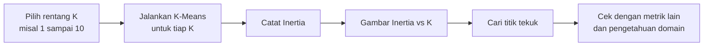
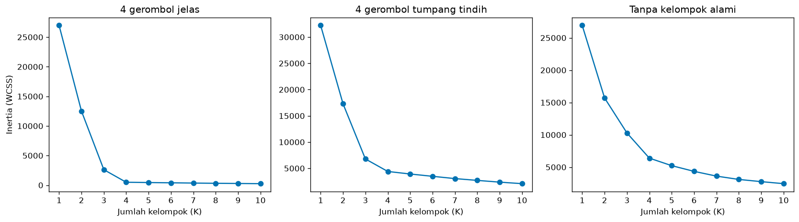
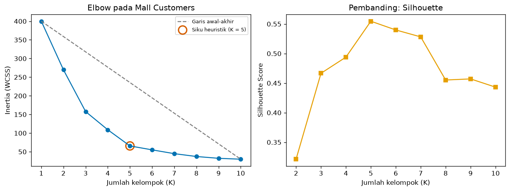

# Bab 4 — Elbow Method

## Learning Objectives

Setelah mempelajari bab ini, kamu mampu:

- [x] Menjelaskan mengapa jumlah kelompok \( K \) perlu dipilih, dan apa peran Elbow Method.
- [x] Menjalankan alur Elbow Method: menghitung Inertia untuk beberapa K, menggambar kurvanya, lalu membaca "siku".
- [x] Membaca kurva elbow dengan bantuan tabel persentase penurunan.
- [x] Menjelaskan mengapa siku bisa **tidak jelas** atau **tidak tunggal**.
- [x] Memakai heuristik sederhana untuk mencari siku, dan memahami bahwa heuristik itu bisa berubah hasilnya.
- [x] Menjelaskan keterbatasan Elbow Method dan mengapa ia hanya petunjuk, bukan jawaban pasti.
- [x] Memadukan elbow dengan metrik lain untuk memilih K.

## Introduction

K-Means meminta kamu menentukan \( K \) lebih dulu. Padahal pada data nyata, kamu sering **belum tahu** ada berapa kelompok. Bagaimana memilihnya?

*Elbow Method* ("metode siku") adalah cara tertua dan paling populer. Idenya sederhana: jalankan K-Means untuk K = 1, 2, 3, ... lalu catat Inertia (Bab 3). Gambar grafiknya. Biasanya grafik turun tajam di awal lalu melandai, membentuk bentuk seperti **lengan yang ditekuk**. Titik tekukan itu, **siku**, diduga menjadi K yang masuk akal.

Namun bab ini juga akan menunjukkan sisi lain: siku sering **tidak jelas**, dan metode ini tidak otomatis memberi jawaban yang benar.

!!! warning "Elbow Method bukan penentu K yang objektif"
    Elbow Method memberi **petunjuk**, bukan jawaban pasti. Pada banyak data, siku tidak tunggal atau tidak ada. Gunakan bersama metrik lain (misalnya Silhouette di Bab 5) dan pemahaman domain.

!!! note "Prasyarat"
    [Bab 3](03-inertia-and-wcss.md) Level 5 (Inertia/WCSS) dan [Level 4 Bab 2](../clustering-algorithms/02-k-means-clustering.md) (K-Means).

## Fundamental Concepts

| Istilah | Arti |
|---|---|
| **Elbow Method** | Memilih K dari titik tekukan pada grafik Inertia terhadap K |
| **Elbow point (siku)** | Nilai K tempat penurunan Inertia berubah dari tajam menjadi landai |
| **Diminishing returns** | Keuntungan yang makin kecil: tambahan kelompok memberi penurunan Inertia yang makin sedikit |
| **Relative evaluation** | Membandingkan beberapa hasil (di sini beberapa nilai K) untuk memilih yang terbaik |
| **Heuristik** | Aturan praktis yang membantu tetapi tidak dijamin benar |

## Detailed Explanation

### Mengapa memilih K itu sulit?

Dari Bab 3: Inertia **selalu turun** saat K naik. Jika kamu memilih K dengan Inertia terkecil, jawabannya selalu K = jumlah data. Itu tidak berguna. Kita butuh cara melihat **kapan tambahan kelompok tidak lagi sepadan**.

### Hubungan K dan Inertia

Bayangkan data dengan empat gerombol nyata:

- Dari K = 1 ke K = 2, 3, dan 4: tiap kelompok baru menangkap satu gerombol nyata. Inertia **jatuh tajam**.
- Dari K = 4 ke K = 5, 6, ...: kelompok baru hanya memotong gerombol yang sudah rapat. Inertia hanya turun sedikit.

Perubahan dari "turun tajam" ke "turun sedikit" itulah siku. Pada kasus ideal, siku ada tepat di jumlah gerombol sebenarnya.



### Alur Elbow Method langkah demi langkah

1. **Siapkan data.** Samakan skala fitur (Level 2, Bab 10).
2. **Tentukan rentang K.** Misalnya 1 sampai 10. Rentang harus cukup lebar untuk melihat bagian melandainya.
3. **Hitung Inertia** untuk tiap K. Pakai `n_init` yang cukup dan `random_state` tetap.
4. **Gambar grafik** Inertia terhadap K.
5. **Baca siku.** Cari K tempat kurva berubah dari tajam ke landai. Tabel **persentase penurunan** membantu membaca.
6. **Verifikasi.** Bandingkan dengan metrik lain dan lihat apakah kelompoknya masuk akal.

### Intuisi matematis

Inertia pada \( K \) kelompok disebut \( W(K) \). Penurunan saat menambah satu kelompok:

$$
\Delta(K) = W(K-1) - W(K)
$$

Kita mencari \( K \) tempat \( \Delta(K) \) masih besar, tetapi \( \Delta(K+1) \) sudah kecil. Karena skala Inertia bergantung pada data, lebih mudah membaca **persentase penurunan**:

$$
\text{Penurunan}(K) = \frac{W(K-1) - W(K)}{W(K-1)} \times 100\%
$$

Contohnya, jika Inertia turun dari 2615,7 (K = 3) ke 490,6 (K = 4), penurunannya \( \frac{2615{,}7 - 490{,}6}{2615{,}7} \times 100\% = 81{,}2\% \). Setelah itu penurunan tinggal sekitar 10%.

### Mengapa siku bisa ambigu?

Ada beberapa sebab:

- **Kelompok tumpang tindih.** Tidak ada patahan jelas, kurva melengkung halus.
- **Tidak ada struktur kelompok.** Data acak pun menghasilkan kurva menurun yang mulus. Kamu bisa "melihat" siku di mana saja.
- **Banyak siku.** Data bisa punya struktur bertingkat: misalnya dua kelompok besar yang masing-masing terdiri dari tiga kelompok kecil.
- **Skala sumbu.** Mengubah rentang sumbu atau memotong grafik mengubah kesan visual.
- **Penilaian subjektif.** Dua orang bisa menunjuk siku yang berbeda pada grafik yang sama.

### Mencari siku secara otomatis: heuristik jarak ke garis

Supaya tidak bergantung pada kesan visual, ada heuristik sederhana: tarik garis lurus dari titik pertama (K = 1) ke titik terakhir. Siku adalah titik kurva yang **paling jauh dari garis itu**. Kita memakai versi dengan kedua sumbu diskalakan ke rentang 0 sampai 1.

!!! warning "Heuristik ini juga punya kelemahan"
    Heuristik ini hanya sebuah aturan praktis. Seperti akan kamu lihat, jawabannya bisa **berubah** jika rentang K diubah. Anggap ia sebagai asisten, bukan pemutus.

### Keterbatasan Elbow Method

- Siku sering tidak jelas atau tidak tunggal.
- Hanya melihat kekompakan (Inertia), bukan keterpisahan.
- Hanya cocok untuk K-Means dan objektif berbasis centroid.
- Hasilnya bergantung pada rentang K, skala, dan seed.
- Tidak bisa membedakan "ada kelompok nyata" dari "tidak ada kelompok" secara pasti.

## Mathematical Foundation

Pada bagian heuristik, setelah kedua sumbu diskalakan ke \( [0, 1] \):

$$
\tilde{k}_i = \frac{k_i - k_{\min}}{k_{\max} - k_{\min}}, \qquad
\tilde{w}_i = \frac{W(k_i) - W_{\min}}{W_{\max} - W_{\min}}
$$

Garis dari titik pertama \( P_1 = (\tilde{k}_1, \tilde{w}_1) \) ke titik terakhir \( P_n \) memiliki arah satuan \( \mathbf{u} = \dfrac{P_n - P_1}{\lVert P_n - P_1 \rVert} \). Untuk titik \( P_i \), vektor dari awal adalah \( \mathbf{v}_i = P_i - P_1 = (v_x, v_y) \). Jarak tegak lurusnya ke garis:

$$
d_i = \lvert v_x \, u_y - v_y \, u_x \rvert
$$

Heuristik memilih \( K \) dengan \( d_i \) terbesar. Artinya: titik yang paling "menggantung" di bawah garis lurus awal-akhir, yaitu bagian kurva yang paling melengkung.

## Python Implementation

Skrip lengkapnya ada di `examples/level-5/04_elbow_method.py`, dan notebook-nya di `notebooks/level-5/04-elbow-method.ipynb`. **Setiap potongan kode diikuti penjelasannya.**

**Konteks masalah:** menentukan jumlah kelompok pada tiga jenis data, lalu pada Mall Customers.

**Dataset:**

- Tiga dataset 400 titik: empat gerombol jelas, empat gerombol tumpang tindih, dan data acak tanpa kelompok.
- Mall Customers.

**Pustaka:** NumPy, pandas, Matplotlib, scikit-learn.

### Bagian A — Siapkan alat

```python
--8<-- "level-5/04_elbow_method.py:setup"
```

**Penjelasan:** `silhouette_score` kita impor hanya sebagai pembanding di bagian Mall Customers (dibahas penuh di Bab 5).

### Bagian B — Tiga dataset

```python
--8<-- "level-5/04_elbow_method.py:data"
```

**Penjelasan:**

- `make_blobs(..., centers=4, cluster_std=0.8)` menghasilkan empat gerombol rapat. Dengan `cluster_std=2.5`, gerombol-gerombol itu saling menempel.
- `np.random.default_rng(42).uniform(-10, 10, size=(400, 2))` menaburkan titik rata tanpa struktur.
- Dictionary `datasets` menyimpan ketiganya agar bisa diproses dalam satu perulangan.
- Tanda `_` menampung label bawaan `make_blobs` yang **tidak dipakai**.

### Bagian C — Kurva Inertia

```python
--8<-- "level-5/04_elbow_method.py:curve"
```

**Penjelasan:**

- `inertia_curve(X, k_values)` adalah fungsi yang menjalankan K-Means untuk tiap K dan mengembalikan daftar Inertia. Ia memakai list comprehension: `[... for k in k_values]`.
- `curves = {name: inertia_curve(X, k_values) for name, X in datasets.items()}` membuat dictionary nama dataset ke daftar Inertia. Ini disebut *dictionary comprehension*.
- `pd.DataFrame(curves, index=k_values)` mengubahnya menjadi tabel, dengan K sebagai baris.

### Bagian D — Persentase penurunan

```python
--8<-- "level-5/04_elbow_method.py:drops"
```

**Penjelasan:** `table.pct_change()` menghitung perubahan relatif tiap baris terhadap baris sebelumnya (hasil negatif karena Inertia turun). `.mul(-100)` mengubahnya menjadi persentase penurunan positif. Baris K = 1 kosong (`NaN`) karena tidak ada sebelumnya.

### Bagian E — Menggambar kurva

```python
--8<-- "level-5/04_elbow_method.py:plotcurve"
```

**Penjelasan:** tiga panel, satu tiap dataset. `ax.set_xticks(k_values)` menampilkan semua nilai K. Setiap panel punya skala vertikal sendiri, jadi bentuk kurvalah yang dibandingkan, bukan angkanya.

### Bagian F — Heuristik jarak ke garis

```python
--8<-- "level-5/04_elbow_method.py:elbowfunc"
```

**Penjelasan baris demi baris:**

- `x` dan `y` adalah K dan Inertia dalam array NumPy. Dua baris berikutnya menskalakan keduanya ke 0 sampai 1 (rumus min-max).
- `start` dan `end` adalah titik pertama dan terakhir. `line = end - start` adalah arah garis, lalu dibagi panjangnya supaya menjadi vektor satuan.
- `points = np.column_stack([x, y]) - start` membuat vektor dari titik awal ke setiap titik kurva.
- `distances = np.abs(points[:, 0] * line[1] - points[:, 1] * line[0])` menghitung jarak tegak lurus tiap titik ke garis (rumus pada Mathematical Foundation).
- `distances.argmax()` mencari posisi jarak terbesar. `k_values[...]` mengubahnya menjadi nilai K.

```python
--8<-- "level-5/04_elbow_method.py:findelbow"
```

**Penjelasan:** untuk tiap dataset, kita cetak K hasil heuristik, jarak terbesar, dan jarak terbesar kedua. Jika dua angka itu berdekatan, berarti siku **tidak tegas**. `np.sort(distances)[-2:][::-1]` mengambil dua terbesar, dengan yang terbesar di depan.

### Bagian G — Siku berubah jika rentang berubah

```python
--8<-- "level-5/04_elbow_method.py:range"
```

**Penjelasan:** heuristik yang sama dijalankan dengan rentang K berbeda: 1 sampai 6, 1 sampai 10, dan 1 sampai 15. `{k_max:<4d}` dan `{name:27s}` hanya mengatur lebar kolom cetakan.

### Bagian H — Mall Customers

```python
--8<-- "level-5/04_elbow_method.py:mall"
```

**Penjelasan:** data distandarkan, kurva Inertia dihitung, lalu heuristik mencari siku. Kita juga menghitung Silhouette untuk K = 2 sampai 10 sebagai pembanding (Silhouette tidak terdefinisi pada K = 1). `max(mall_sil, key=mall_sil.get)` mengambil K dengan Silhouette tertinggi.

```python
--8<-- "level-5/04_elbow_method.py:plotmall"
```

**Penjelasan:** panel kiri menggambar kurva Inertia, garis putus-putus awal-akhir, dan lingkaran pada siku heuristik. Panel kanan menggambar Silhouette. `facecolors="none"` membuat lingkaran kosong sehingga titik di dalamnya tetap terlihat.

## Code Explanation

| Bagian kode | Peran |
|---|---|
| `inertia_curve(X, k_values)` | Inertia untuk tiap K |
| `table.pct_change().mul(-100)` | Persentase penurunan antar K |
| `elbow_by_line(...)` | Heuristik siku: jarak tegak lurus ke garis awal-akhir |
| `np.sort(distances)[-2:]` | Dua jarak terbesar, untuk menilai ketegasan |
| `max(dict, key=dict.get)` | Kunci dengan nilai tertinggi |

!!! note "Pelatihan vs penilaian"
    Setiap `KMeans(...).fit(X)` adalah **pelatihan**. `elbow_by_line` dan tabel persentase adalah **penilaian** atas hasil pelatihan itu.

## How to Run

Dari folder utama proyek (setelah mengaktifkan lingkungan virtual):

```powershell
pip install -r requirements-notebooks.txt
python examples/level-5/04_elbow_method.py
```

Skrip mencetak output ke terminal dan menyimpan dua gambar ke `docs/assets/level-5/`. Notebook interaktifnya:

```powershell
jupyter notebook notebooks/level-5/04-elbow-method.ipynb
```

Output di bawah berasal dari eksekusi nyata dengan Python 3.14, NumPy 2.5.4, pandas 3.1.1, scikit-learn 1.9.1, dan Matplotlib 3.11.2.

## Expected Output

```text
--8<-- "level-5/outputs/04.txt"
```

Gambar yang dihasilkan:





### Interpretasi output

**1. Empat gerombol jelas.** Inertia turun dari 26979,6 (K = 1) ke 12508,7, 2615,7, lalu **490,6** (K = 4), kemudian melandai (442,4; 400,2; ...). Persentase penurunan: 53,6%; 79,1%; **81,2%** (K = 4); lalu hanya **9,8%**; 9,5%; 11,4%; dan seterusnya sekitar 9 sampai 12%. Patahannya tegas: setelah K = 4, setiap tambahan kelompok hanya menurunkan sekitar 10%. Siku sesuai jumlah gerombol sebenarnya (4).

**2. Gerombol tumpang tindih.** Penurunan: 46,3%; 60,8%; **35,1%** (K = 4); lalu 11,0%; 11,2%; 12,4%; dan seterusnya. Ada perubahan setelah K = 4 (dari 35,1% ke 11,0%), tetapi **kurang tegas** daripada data jelas, dan K = 3 ke K = 4 masih turun cukup banyak.

**3. Tanpa kelompok alami.** Penurunan: 41,7%; 34,5%; 37,8%; 18,2%; 16,9%; 16,9%; 14,2%; 11,0%; 11,4%. Tidak ada lompatan yang tegas. Kurva melengkung mulus. Data ini tidak punya kelompok, **tetapi tetap menghasilkan kurva yang tampak seperti elbow.** Ini peringatan penting: kurva menurun adalah **sifat Inertia**, bukan bukti kelompok nyata.

**4. Heuristik jarak ke garis.**

| Dataset | Siku heuristik (K 1 sampai 10) | Jarak terbesar | Jarak terbesar kedua |
|---|---|---|---|
| 4 gerombol jelas | **3** | 0,487 | 0,465 |
| 4 gerombol tumpang tindih | **3** | 0,440 | 0,417 |
| Tanpa kelompok alami | **4** | 0,357 | 0,324 |

Perhatikan: pada data **jelas**, heuristik menjawab **K = 3**, padahal data memiliki 4 gerombol dan tabel persentase menunjuk K = 4. Selisih jarak terbesar dan kedua hanya 0,022 (0,487 vs 0,465), tanda siku tidak tegas menurut heuristik ini. Heuristik tidak selalu sama dengan penilaian dari tabel.

**5. Siku berubah bila rentang berubah.**

| Rentang K | 4 gerombol jelas | Tumpang tindih | Tanpa kelompok |
|---|---|---|---|
| 1 sampai 6 | 3 | 3 | 3 |
| 1 sampai 10 | 3 | 3 | 4 |
| 1 sampai 15 | **4** | **4** | 4 |

Dengan data yang **sama**, jawaban heuristik berubah hanya karena batas K dinaikkan. Pada data jelas, K = 4 baru terpilih saat rentang sampai 15. Artinya: **siku bergantung pada cara kita menggambarnya**.

!!! warning "Jangan mengklaim Elbow Method menemukan K yang benar"
    Eksperimen ini memperlihatkan: (1) data tanpa kelompok pun menghasilkan kurva yang tampak seperti siku, (2) pada data jelas, heuristik otomatis bisa menjawab K yang berbeda dari jumlah gerombol sebenarnya, dan (3) jawaban berubah bila rentang berubah. Elbow Method adalah **alat bantu**.

**6. Mall Customers.** Siku heuristik **K = 5**, Silhouette tertinggi juga **K = 5 (0,555)**. Nilai Silhouette per K: 0,321 (K = 2); 0,467; 0,494; **0,555**; 0,540; 0,528; 0,455; 0,457; 0,443. Dua metode berbeda menunjuk K yang sama, dan itu menambah keyakinan (meski belum bukti pasti). K = 6 dan K = 7 hanya sedikit lebih rendah, sehingga pilihan K = 5 masih bisa dipertimbangkan bersama makna bisnis.

## Practical Examples

**Segmentasi pelanggan.** Gambar kurva elbow, lalu diskusikan dengan tim bisnis: apakah 4, 5, atau 6 segmen masih bisa ditindaklanjuti? Elbow memberi kandidat, bisnis memutuskan.

**Kompresi warna.** Pada K-Means untuk warna gambar, elbow membantu memilih jumlah warna: setelah titik tertentu, tambahan warna tidak banyak memperbaiki gambar.

**Penghematan kapasitas.** Mengelompokkan lokasi gudang atau sensor: elbow menunjukkan saat penambahan pusat kelompok tidak lagi menurunkan total jarak secara berarti.

**Cek cepat awal analisis.** Elbow cepat dihitung, sehingga cocok sebagai langkah pertama sebelum evaluasi yang lebih rinci.

## Hands-on Exercises

1. Pada `X_clear`, berapa persentase penurunan Inertia dari K = 3 ke K = 4? Apa artinya?
2. Ubah `cluster_std=0.8` menjadi `1.5` pada `X_clear`. Hitung persentase penurunan K = 2 sampai K = 8 dan jalankan `elbow_by_line` untuk K 1 sampai 8.
3. Jalankan `elbow_by_line` pada Mall Customers dengan rentang K 1 sampai 8 dan 1 sampai 15. Apa yang kamu amati?
4. Ganti seed data acak dari 42 menjadi 7 (`default_rng(7)`). Berapa siku heuristik? Apa artinya?
5. Mengapa kita perlu menyamakan skala fitur sebelum menghitung kurva elbow?
6. Mengapa kita tidak boleh mengatakan "Elbow Method membuktikan bahwa ada 5 kelompok"?

??? question "Jawaban"
    Hasil nomor 1 sampai 4 berasal dari eksekusi nyata.

    1. Dari 2615,7 ke 490,6: \( \frac{2615{,}7 - 490{,}6}{2615{,}7} \times 100\% = \) **81,2%**. Ini penurunan terbesar. Setelah K = 4, penurunan hanya sekitar 10%, jadi menambah kelompok setelah K = 4 tidak banyak membantu.
    2. Persentase penurunan K = 2 sampai 8: **51,3%; 72,5%; 55,7%; 10,0%; 10,4%; 11,9%; 13,0%**. Setelah K = 4 (55,7%), penurunan turun ke sekitar 10%. Patahan di K = 4 tetap terlihat dari tabel. Namun `elbow_by_line` menjawab **K = 3**. Ini contoh bahwa tabel persentase dan heuristik bisa berbeda.
    3. Rentang 1 sampai 8 memberi **K = 3**, rentang 1 sampai 10 memberi **K = 5**, dan rentang 1 sampai 15 memberi **K = 5**. Jawaban berubah di rentang yang lebih sempit, menunjukkan sensitivitas terhadap rentang.
    4. Siku heuristik tetap **K = 4**, padahal data tidak punya kelompok alami. Jadi hasil heuristik tidak membuktikan adanya kelompok.
    5. Inertia dihitung dari jarak. Fitur berskala besar mendominasi jarak, sehingga kurva elbow mencerminkan fitur itu saja dan menyesatkan.
    6. Karena siku bisa tidak jelas, bergantung rentang K dan cara menggambar, dan data acak pun menghasilkan kurva serupa. Elbow hanya memberi petunjuk yang perlu dicek dengan metrik lain dan pengetahuan domain.

## Troubleshooting

### Masalah teknis

| Masalah | Penyebab | Solusi |
|---|---|---|
| Kurva tidak mulus atau naik di satu titik | K-Means terjebak *local minimum* | Naikkan `n_init`, pakai `random_state` tetap |
| Siku tidak terlihat | Memang tidak ada struktur jelas, atau rentang K terlalu sempit | Perlebar rentang, cek metrik lain |
| Proses lambat pada data besar | K-Means dijalankan berkali-kali | Pakai sampel, atau `MiniBatchKMeans` |
| Hasil berbeda dari output di bab | Versi pustaka atau seed berbeda | Pakai `random_state=42` dan bandingkan polanya |
| `ValueError: n_samples=... should be >= n_clusters=...` | K melebihi jumlah data | Batasi rentang K |

### Kesalahan umum

1. **Menganggap siku pasti ada dan tunggal.** Pada banyak data siku samar atau ganda.
2. **Mengatakan Elbow Method menemukan K yang benar.** Ia hanya memberi kandidat.
3. **Memilih K dengan Inertia terendah.** Inertia selalu turun saat K naik.
4. **Memakai rentang K terlalu sempit.** Bagian melandai tidak terlihat, dan siku bisa salah terbaca.
5. **Menyimpulkan ada kelompok hanya dari kurva menurun.** Data acak pun menghasilkan kurva seperti itu.
6. **Memercayai satu heuristik otomatis.** Jawabannya bergantung pada rentang K.
7. **Lupa menyamakan skala fitur.**
8. **Memakai Elbow untuk algoritma non-centroid** seperti DBSCAN, yang tidak punya Inertia.

## Summary

- **Elbow Method** memilih K dari titik tekuk pada grafik Inertia terhadap K. Idenya: setelah siku, tambahan kelompok tidak banyak menurunkan Inertia.
- Alurnya: skala data, tentukan rentang K, hitung Inertia, gambar kurva, baca siku (dibantu tabel persentase penurunan), lalu verifikasi.
- Pada empat gerombol jelas, penurunan terbesar (81,2%) ada di K = 4, lalu sekitar 10%. Pada gerombol tumpang tindih dan data acak, siku makin samar.
- **Data acak tanpa kelompok pun menghasilkan kurva yang tampak seperti siku.**
- Heuristik jarak ke garis bisa menjawab K yang berbeda dari jumlah gerombol sebenarnya (3, bukan 4, pada data jelas dengan rentang 1 sampai 10), dan jawabannya berubah bila rentang berubah.
- Pada Mall Customers, siku heuristik dan Silhouette sama-sama menunjuk K = 5 (Silhouette 0,555).
- Elbow Method adalah **petunjuk**, bukan penentu objektif. Padukan dengan metrik lain dan pengetahuan domain.

**Bab berikutnya:** Bab 5 membahas **Silhouette Score**, metrik yang mempertimbangkan kekompakan **dan** keterpisahan, dan tidak otomatis membaik saat K naik.

## References

- Thorndike, R. L. (1953). Who belongs in the family? *Psychometrika*, 18(4), 267–276.
- Satopää, V., Albrecht, J., Irwin, D., & Raghavan, B. (2011). Finding a "kneedle" in a haystack: detecting knee points in system behavior. *31st International Conference on Distributed Computing Systems Workshops*, 166–171.
- Tibshirani, R., Walther, G., & Hastie, T. (2001). Estimating the number of clusters in a data set via the gap statistic. *Journal of the Royal Statistical Society: Series B*, 63(2), 411–423.
- Hastie, T., Tibshirani, R., & Friedman, J. (2009). *The Elements of Statistical Learning* (2nd ed.), Bab 14.3.11. Springer.
- Scikit-learn documentation: [`KMeans`](https://scikit-learn.org/stable/modules/generated/sklearn.cluster.KMeans.html).
