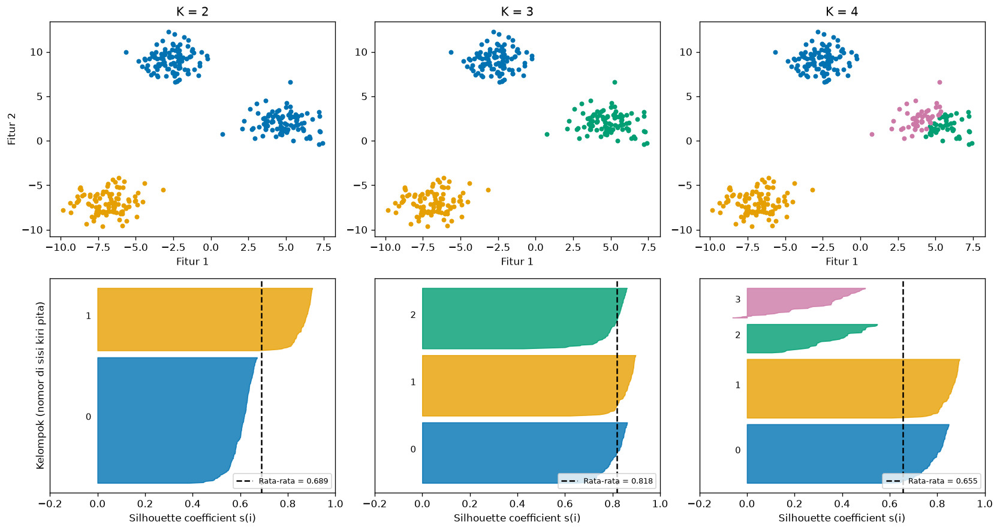
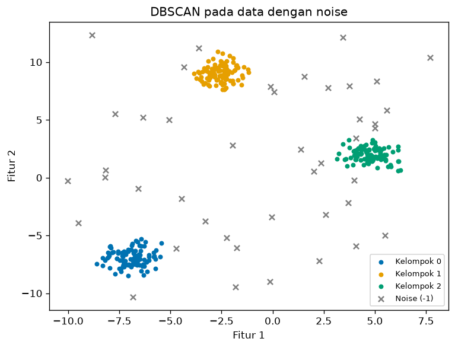
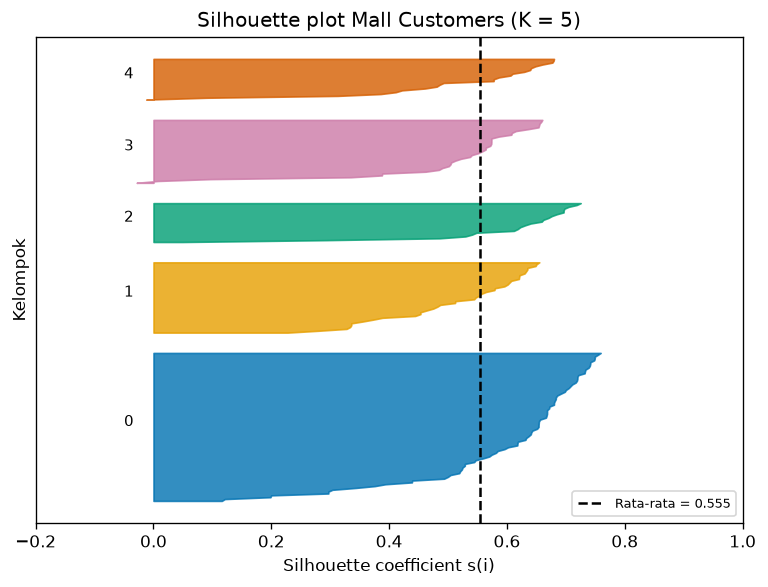

# Bab 5 — Silhouette Score

## Learning Objectives

Setelah mempelajari bab ini, kamu mampu:

- [x] Menjelaskan ide Silhouette: membandingkan kedekatan ke kelompok sendiri dengan kedekatan ke kelompok tetangga.
- [x] Menjelaskan arti \( a(i) \), \( b(i) \), dan \( s(i) \), serta menghitungnya manual pada data kecil.
- [x] Menafsirkan nilai Silhouette dari -1 sampai +1: positif, mendekati nol, dan negatif.
- [x] Membedakan Silhouette per titik dan Silhouette keseluruhan.
- [x] Membaca *silhouette plot*.
- [x] Memakai `silhouette_score` dan `silhouette_samples`, termasuk parameter `metric`, `sample_size`, dan `random_state`.
- [x] Menjelaskan syarat jumlah label dan perlakuan noise pada hasil DBSCAN.
- [x] Mengenali situasi ketika Silhouette tinggi tetapi menyesatkan.

## Introduction

Di Bab 2 kita mengukur kekompakan (jarak ke dalam) dan keterpisahan (jarak ke luar) secara terpisah. Bab 3 dan 4 memakai Inertia, yang hanya melihat kekompakan dan otomatis turun saat K naik.

*Silhouette* menggabungkan kedua sisi dalam **satu angka per titik**: "seberapa pas titik ini berada di kelompoknya, dibanding di kelompok tetangga terdekat?" Nilainya selalu antara -1 dan +1, dan **tidak otomatis membaik saat K naik**. Karena itu Silhouette adalah salah satu metrik internal yang paling populer, baik untuk menilai satu hasil maupun untuk membandingkan beberapa nilai K.

!!! note "Prasyarat"
    [Bab 2](02-internal-clustering-evaluation.md) (jarak dalam dan antar kelompok) dan [Bab 4](04-elbow-method.md) (membandingkan beberapa K). Untuk bagian noise, kamu perlu mengingat [DBSCAN di Level 4](../clustering-algorithms/04-dbscan-clustering.md).

## Fundamental Concepts

| Istilah | Arti |
|---|---|
| **Silhouette coefficient** \( s(i) \) | Nilai untuk **satu titik** \( i \), antara -1 dan +1 |
| **\( a(i) \)** | Rata-rata jarak titik \( i \) ke **semua titik lain di kelompoknya sendiri** |
| **\( b(i) \)** | Rata-rata jarak titik \( i \) ke titik-titik di **kelompok tetangga terdekat** (kelompok lain yang paling dekat) |
| **Silhouette Score** | Rata-rata \( s(i) \) dari seluruh titik |
| **Silhouette plot** | Grafik pita yang menampilkan \( s(i) \) setiap titik, dikelompokkan per kelompok |
| **Noise** | Titik yang tidak masuk kelompok mana pun. DBSCAN memberinya label `-1` |

## Detailed Explanation

### Ide intuitif

Bayangkan titik \( i \) adalah seorang siswa di sebuah kelas. Kita bertanya dua hal:

1. **Seberapa dekat siswa ini dengan teman sekelasnya?** Itulah \( a(i) \). Makin kecil makin baik.
2. **Seberapa dekat siswa ini dengan kelas tetangga terdekat?** Itulah \( b(i) \). Makin besar makin baik, artinya kelas lain jauh.

Jika \( b(i) \) jauh lebih besar dari \( a(i) \), siswa itu jelas milik kelasnya. Jika \( a(i) \) dan \( b(i) \) hampir sama, siswa itu berdiri di perbatasan. Jika \( a(i) \) lebih besar dari \( b(i) \), siswa itu mungkin salah kelas.

### Membaca nilai Silhouette

| Nilai \( s(i) \) | Arti |
|---|---|
| Mendekati **+1** | Titik jauh dari kelompok tetangga dan dekat dengan kelompoknya. Penempatan sangat baik |
| Mendekati **0** | Titik berada di **perbatasan** dua kelompok |
| **Negatif** | Titik lebih dekat ke kelompok tetangga daripada kelompoknya sendiri. Kemungkinan salah tempat |

Untuk **Silhouette Score** keseluruhan, panduan kasar yang sering dikutip (Kaufman & Rousseeuw, 1990) adalah: sekitar 0,71 sampai 1,00 struktur kuat, 0,51 sampai 0,70 cukup masuk akal, 0,26 sampai 0,50 lemah, dan 0,25 ke bawah tidak ada struktur berarti. Anggap ini **aturan kasar**, bukan ambang pasti. Nilai yang "cukup" bergantung pada data dan tujuan.

### Silhouette plot

Silhouette plot menampilkan \( s(i) \) setiap titik sebagai pita mendatar, dikelompokkan per kelompok dan diurutkan. Cara membacanya:

- **Lebar pita ke kanan** = nilai \( s(i) \). Pita yang menjulur jauh dan rata menandakan kelompok yang solid.
- **Tinggi pita** = ukuran kelompok.
- **Garis putus-putus vertikal** = Silhouette Score keseluruhan. Kelompok yang pitanya sebagian besar **di kiri garis** lebih lemah dari rata-rata.
- **Pita yang menembus ke kiri nol** = ada titik bernilai negatif.

Plot ini memberi lebih banyak informasi daripada satu angka: kamu melihat kelompok mana yang bermasalah.

### Syarat dan kasus khusus

!!! warning "Syarat jumlah label"
    Silhouette hanya terdefinisi bila ada **minimal 2 label berbeda** dan **kurang dari jumlah titik** (maksimal \( n - 1 \) label). Dengan satu kelompok tidak ada kelompok tetangga untuk dibandingkan. Jika tiap titik kelompok sendiri, \( a(i) \) tidak terdefinisi. scikit-learn akan melempar `ValueError` pada kedua kasus ini.

- **Kelompok beranggota satu titik:** \( a(i) \) tak bisa dihitung. Konvensi (dipakai scikit-learn): \( s(i) = 0 \).
- **Noise pada DBSCAN:** label `-1` bukan sebuah kelompok sungguhan. Jika langsung dimasukkan, scikit-learn menganggapnya satu kelompok biasa, dan noise yang tersebar menurunkan skor. Pilihan yang umum: **keluarkan noise dahulu** lalu hitung Silhouette pada titik yang tersisa, sambil **melaporkan berapa banyak titik yang dikeluarkan**. Keduanya punya konsekuensi, dan kita akan membandingkannya di kode.

### Kelebihan dan keterbatasan

**Kelebihan**

- Menggabungkan kekompakan dan keterpisahan dalam satu angka.
- Terbatas pada rentang -1 sampai +1, mudah dibandingkan antar K.
- Tidak otomatis membaik saat K naik.
- Memberi informasi **per titik** dan per kelompok (silhouette plot).
- Tidak bergantung pada skala data: jika semua fitur dikali 10, hasilnya sama (lihat output).

**Keterbatasan**

- **Cenderung menyukai kelompok bulat dan kompak**, seperti metrik jarak lain. Kelompok melengkung bisa dinilai rendah.
- Biaya hitung tinggi: butuh jarak antar **semua pasangan** titik (kompleksitas sekitar \( O(n^2) \)).
- Skor tinggi tidak membuktikan kelompok itu **bermakna**.
- Hasil bergantung pada pilihan jarak (`metric`) dan skala fitur.
- Kurang cocok untuk kelompok berukuran atau berkepadatan sangat berbeda.
- Perlakuan noise memengaruhi angka.

## Mathematical Foundation

Untuk titik \( i \) yang berada di kelompok \( C_I \):

$$
a(i) = \frac{1}{|C_I| - 1} \sum_{j \in C_I,\ j \neq i} d(i, j)
$$

Rata-rata jarak ke semua titik **lain** di kelompok yang sama. \( |C_I| \) adalah jumlah anggota kelompok, dan kita membaginya dengan \( |C_I| - 1 \) karena titik \( i \) tidak dihitung terhadap dirinya sendiri.

$$
b(i) = \min_{J \neq I} \ \frac{1}{|C_J|} \sum_{j \in C_J} d(i, j)
$$

Untuk setiap kelompok lain \( J \), hitung rata-rata jarak titik \( i \) ke anggotanya. Ambil yang **terkecil**: itulah kelompok tetangga terdekat.

$$
s(i) = \frac{b(i) - a(i)}{\max\{a(i),\ b(i)\}}
$$

Pembilang \( b(i) - a(i) \) positif bila kelompok tetangga lebih jauh daripada kelompok sendiri. Pembagi \( \max\{a(i), b(i)\} \) menormalkan hasilnya ke rentang -1 sampai +1:

- Jika \( b(i) \gg a(i) \): \( s(i) \approx \dfrac{b}{b} = 1 \).
- Jika \( a(i) = b(i) \): \( s(i) = 0 \).
- Jika \( a(i) \gg b(i) \): \( s(i) \approx \dfrac{-a}{a} = -1 \).

**Silhouette Score keseluruhan:**

$$
S = \frac{1}{n} \sum_{i=1}^{n} s(i)
$$

### Perhitungan manual

Tujuh titik. Kelompok 0: \( (1,1),\ (2,1),\ (1,2),\ (4,3) \). Kelompok 1: \( (6,5),\ (7,5),\ (6,6) \). Titik \( (4,3) \) sengaja diletakkan di antara kedua kelompok.

**Titik \( (1,1) \).**

- \( a \): jarak ke \( (2,1) \) adalah 1, ke \( (1,2) \) adalah 1, ke \( (4,3) \) adalah \( \sqrt{9+4} = 3{,}606 \). Rata-ratanya \( \dfrac{1 + 1 + 3{,}606}{3} = 1{,}869 \).
- \( b \): hanya ada satu kelompok lain. Jarak ke \( (6,5) \) adalah \( 6{,}403 \), ke \( (7,5) \) adalah \( 7{,}211 \), ke \( (6,6) \) adalah \( 7{,}071 \). Rata-ratanya \( 6{,}895 \).
- \( s = \dfrac{6{,}895 - 1{,}869}{\max\{1{,}869;\ 6{,}895\}} = \dfrac{5{,}026}{6{,}895} = 0{,}729 \).

**Titik \( (4,3) \)** (di perbatasan).

- \( a \): jarak ke \( (1,1) \) adalah \( 3{,}606 \), ke \( (2,1) \) adalah \( 2{,}828 \), ke \( (1,2) \) adalah \( 3{,}162 \). Rata-ratanya \( 3{,}199 \).
- \( b \): jarak ke \( (6,5) \) adalah \( 2{,}828 \), ke \( (7,5) \) adalah \( 3{,}606 \), ke \( (6,6) \) adalah \( 3{,}606 \). Rata-ratanya \( 3{,}347 \).
- \( s = \dfrac{3{,}347 - 3{,}199}{3{,}347} = 0{,}044 \).

Mendekati nol, sesuai posisinya di perbatasan. Kita akan mencocokkannya dengan kode.

## Python Implementation

Skrip lengkapnya ada di `examples/level-5/05_silhouette_score.py`, dan notebook-nya di `notebooks/level-5/05-silhouette-score.ipynb`. **Setiap potongan kode diikuti penjelasannya.**

**Konteks masalah:** menghitung Silhouette dengan tangan dan scikit-learn, membaca silhouette plot, memakai parameter penting, dan menangani noise DBSCAN.

**Dataset:**

- `X_tiny`: tujuh titik dengan satu titik di perbatasan.
- `make_blobs`: 300 titik (3 gerombol) dan 3000 titik (4 gerombol).
- Data tiga gerombol ditambah 40 titik noise acak.
- `make_moons`.
- Mall Customers.

**Pustaka:** NumPy, pandas, Matplotlib, scikit-learn.

### Bagian A — Siapkan alat

```python
--8<-- "level-5/05_silhouette_score.py:setup"
```

**Penjelasan:** `silhouette_score` mengembalikan **satu angka** (rata-rata). `silhouette_samples` mengembalikan **satu angka per titik**. `DBSCAN` dipakai untuk bagian noise.

### Bagian B — Tujuh titik

```python
--8<-- "level-5/05_silhouette_score.py:tiny"
```

**Penjelasan:** `labels_tiny` kita tentukan sendiri. Titik ke-4 (indeks 3), yaitu `[4, 3]`, dimasukkan ke kelompok 0 walau letaknya di antara kedua kelompok.

### Bagian C — Silhouette satu titik, manual

```python
--8<-- "level-5/05_silhouette_score.py:manual"
```

**Penjelasan baris demi baris:**

- `d = np.linalg.norm(X - X[i], axis=1)` menghitung jarak titik `i` ke **semua** titik sekaligus (selisih setiap baris dengan `X[i]`, lalu panjangnya).
- `own = labels == labels[i]` menandai anggota kelompok yang sama (`True`/`False`). `own[i] = False` membuang titik `i` sendiri.
- `a = d[own].mean()` adalah rata-rata jarak ke kelompok sendiri.
- `other_means = [...]` menghitung, untuk tiap kelompok lain `k`, rata-rata jarak titik `i` ke anggotanya. `np.unique(labels)` mendaftar kelompok, dan `if k != labels[i]` melewatkan kelompok sendiri.
- `b = min(other_means)` memilih kelompok tetangga terdekat.
- `s = (b - a) / max(a, b)` adalah rumus Silhouette.
- Fungsi mengembalikan ketiganya. Pada pemanggilan, `for i in (0, 3)` mencoba titik pertama dan titik di perbatasan.

### Bagian D — Mencocokkan dengan scikit-learn

```python
--8<-- "level-5/05_silhouette_score.py:check"
```

**Penjelasan:** list comprehension menghitung \( s(i) \) untuk semua titik secara manual (`[2]` mengambil elemen ketiga, yaitu `s`). `silhouette_samples(X, labels)` menghasilkan hal yang sama dari scikit-learn. `.round(3).tolist()` membulatkan dan mengubah array menjadi daftar biasa. Rata-rata \( s(i) \) harus sama dengan `silhouette_score`.

### Bagian E — Tiga gerombol dan beberapa K

```python
--8<-- "level-5/05_silhouette_score.py:blobs"
```

**Penjelasan:**

- `make_blobs(..., centers=3, cluster_std=1.2)` membuat tiga gerombol. Tanda `_` menampung label bawaan yang tidak kita pakai.
- Untuk K = 2 sampai 5, kita menjalankan K-Means dan menghitung `s = silhouette_samples(...)`.
- `s.mean()` adalah Silhouette Score. `(s < 0).sum()` menghitung titik bernilai negatif. `s[labels == c].mean()` adalah rata-rata per kelompok.
- `int(...)` dan `float(...)` hanya mengubah tipe NumPy agar cetakannya rapi.

### Bagian F — Silhouette plot

```python
--8<-- "level-5/05_silhouette_score.py:silplot"
```

**Penjelasan baris demi baris:**

- Fungsi `silhouette_plot(ax, X, labels)` menggambar pada sumbu `ax` yang diberikan.
- `s = silhouette_samples(X, labels)` memberi \( s(i) \) setiap titik.
- `y_lower` adalah posisi vertikal awal pita. Awalnya 10 agar ada jarak dari tepi.
- Untuk setiap kelompok `k`: `np.sort(s[labels == k])` mengurutkan nilainya, `ax.fill_betweenx(...)` mengisi area dari 0 sampai nilai tersebut (inilah pita), dan `ax.text(...)` menulis nomor kelompok di sisi kiri.
- `y_lower = y_upper + 10` memberi jeda antar pita.
- `ax.axvline(s.mean(), ...)` menggambar garis putus-putus rata-rata.
- `ax.set_yticks([])` menghilangkan angka sumbu vertikal karena posisi vertikalnya tidak bermakna selain tinggi pita.

```python
--8<-- "level-5/05_silhouette_score.py:plotblobs"
```

**Penjelasan:** baris atas menggambar sebaran titik, baris bawah silhouette plot. `plt.subplots(2, 3)` membuat dua baris tiga kolom, dan `axes[baris, kolom]` memilih panel.

### Bagian G — Parameter `metric`, `sample_size`, `random_state`

```python
--8<-- "level-5/05_silhouette_score.py:params"
```

**Penjelasan:**

- `metric='euclidean'` (bawaan) menentukan jarak yang dipakai. `'manhattan'` memakai jumlah selisih mutlak (Level 3, Bab 5).
- `sample_size=500` membuat scikit-learn menghitung Silhouette pada **sampel acak 500 titik** saja. Ini jauh lebih cepat pada data besar karena jarak antar semua pasangan tidak perlu dihitung.
- `random_state` mengatur sampel acak itu, supaya hasilnya bisa diulang. Tanpa `sample_size`, parameter ini tidak berpengaruh.
- Baris terakhir menguji data dikali 10.

### Bagian H — Syarat jumlah label

```python
--8<-- "level-5/05_silhouette_score.py:errors"
```

**Penjelasan:** kita sengaja memberi label yang melanggar syarat. `try ... except ValueError as err` menangkap galat dan mencetak pesannya. Berguna agar kamu mengenali pesan ini saat terjadi sungguhan.

### Bagian I — Noise pada DBSCAN

```python
--8<-- "level-5/05_silhouette_score.py:noise"
```

**Penjelasan:**

- `X_core` adalah tiga gerombol rapat. `rng.uniform(low, high, size=(40, 2))` menaburkan 40 titik noise di seluruh area (`X_core.min(axis=0) - 2` dan `.max(axis=0) + 2` memperluas batas dua satuan).
- `np.vstack` menumpuk keduanya menjadi satu dataset.
- `DBSCAN(eps=0.7, min_samples=6).fit_predict(X_noisy)` menghasilkan label, dengan `-1` untuk noise. `eps` adalah radius tetangga dan `min_samples` jumlah tetangga minimal agar sebuah titik dianggap padat.
- **Cara 1:** langsung `silhouette_score(X_noisy, db_labels)`. Label `-1` dianggap satu kelompok.
- **Cara 2:** `mask = db_labels != -1` menyaring titik bukan noise. Kita menghitung Silhouette hanya pada titik itu.

```python
--8<-- "level-5/05_silhouette_score.py:plotnoise"
```

**Penjelasan:** titik noise digambar abu-abu dengan tanda `x`. Tanda `~mask` berarti kebalikan dari `mask`, yaitu titik noise.

### Bagian J — Ketika skor tinggi menyesatkan

```python
--8<-- "level-5/05_silhouette_score.py:misleading"
```

**Penjelasan:** pada moons, K-Means memotong bulan sabit, sedangkan DBSCAN (`eps=0.2`) mengikuti bentuk bulan. Kita membandingkan Silhouette keduanya.

### Bagian K — Mall Customers

```python
--8<-- "level-5/05_silhouette_score.py:mall"
```

```python
--8<-- "level-5/05_silhouette_score.py:plotmall"
```

**Penjelasan:** tabel merangkum ukuran, rata-rata, nilai minimum, dan jumlah titik negatif per kelompok. Fungsi `silhouette_plot` yang sama dipakai ulang untuk menggambar plotnya.

## Code Explanation

| Bagian kode | Peran |
|---|---|
| `silhouette_samples(X, labels)` | \( s(i) \) untuk setiap titik |
| `silhouette_score(X, labels)` | Rata-rata \( s(i) \) |
| `metric=...` | Jenis jarak yang dipakai |
| `sample_size=..., random_state=...` | Menghitung pada sampel acak yang bisa diulang |
| `labels != -1` | Menyaring noise DBSCAN |
| `ax.fill_betweenx(...)` | Menggambar pita pada silhouette plot |

!!! note "Pelatihan vs penilaian"
    `KMeans(...).fit_predict(X)` dan `DBSCAN(...).fit_predict(X)` adalah **pelatihan**. `silhouette_score` dan `silhouette_samples` adalah **penilaian** yang hanya membaca `X` dan `labels`.

## How to Run

Dari folder utama proyek (setelah mengaktifkan lingkungan virtual):

```powershell
pip install -r requirements-notebooks.txt
python examples/level-5/05_silhouette_score.py
```

Skrip mencetak output ke terminal dan menyimpan tiga gambar ke `docs/assets/level-5/`. Notebook interaktifnya:

```powershell
jupyter notebook notebooks/level-5/05-silhouette-score.ipynb
```

Output di bawah berasal dari eksekusi nyata dengan Python 3.14, NumPy 2.5.4, pandas 3.1.1, scikit-learn 1.9.1, dan Matplotlib 3.11.2.

## Expected Output

```text
--8<-- "level-5/outputs/05.txt"
```

Gambar yang dihasilkan:







### Interpretasi output

**1. Perhitungan manual cocok.** Titik \( (1,1) \): \( a = 1{,}869 \), \( b = 6{,}895 \), \( s = 0{,}729 \). Titik \( (4,3) \): \( a = 3{,}199 \), \( b = 3{,}347 \), \( s = 0{,}044 \). Keduanya sama dengan hitungan di Mathematical Foundation. Daftar \( s(i) \) manual dan scikit-learn **identik**: `[0.729, 0.716, 0.706, 0.044, 0.807, 0.798, 0.794]`. Rata-ratanya **0,656**, sama dengan `silhouette_score`. Titik di perbatasan hanya bernilai 0,044, jauh lebih rendah dari titik lain (0,7 sampai 0,8).

**2. Pengaruh K pada tiga gerombol.**

| K | Silhouette | Titik negatif | Rata-rata per kelompok |
|---|---|---|---|
| 2 | 0,689 | 0 | 0,603; 0,862 |
| **3** | **0,818** | 0 | 0,803; 0,853; 0,798 |
| 4 | 0,655 | 3 | 0,784; 0,848; 0,367; 0,300 |
| 5 | 0,480 | 4 | 0,328; 0,367; 0,784; 0,322; 0,300 |

Skor tertinggi di **K = 3**, sesuai tiga gerombol sebenarnya. Pada K = 4, satu gerombol terbelah dua: dua kelompok barunya hanya bernilai 0,367 dan 0,300, dan muncul 3 titik negatif. Berbeda dengan Inertia, **Silhouette turun** ketika K melampaui jumlah gerombol sebenarnya.

**3. Membaca silhouette plot.** Pada K = 3, ketiga pita lebar, rata, dan hampir seluruhnya di kanan garis rata-rata. Pada K = 2, pita kelompok 0 (yang menggabungkan dua gerombol) lebih pendek dari pita lainnya, tanda kelompok itu kurang solid. Pada K = 4, dua pita kecil di atas lebih pendek dari garis rata-rata dan salah satunya menembus ke kiri nol.

**4. Parameter.** Skor penuh pada 3000 titik adalah **0,6910**. Dengan `sample_size=500`: **0,6826**, **0,6968**, dan **0,6824** untuk tiga seed berbeda. Sampel memberi **perkiraan** yang dekat tetapi tidak persis, dan berubah mengikuti seed. `metric='manhattan'` memberi **0,6879**, sedikit berbeda dari euclidean. Data dikali 10 tetap **0,6910**: Silhouette **tidak bergantung pada skala keseluruhan** (berbeda dengan Inertia di Bab 3). Meski begitu, perbedaan skala **antar fitur** tetap memengaruhi jarak, sehingga penyamaan skala tetap diperlukan.

**5. Syarat jumlah label.** Satu kelompok menghasilkan `ValueError: Number of labels is 1. Valid values are 2 to n_samples - 1 (inclusive)`. Tujuh label pada tujuh titik menghasilkan pesan yang sama dengan `Number of labels is 7`.

**6. Noise DBSCAN.** DBSCAN menemukan kelompok 0, 1, dan 2, dengan **43 titik noise dari 340**. (Angka ini tidak harus sama dengan 40 titik acak yang kita tambahkan: sebagian titik acak bisa jatuh di dalam gerombol dan ikut menjadi anggotanya, sedangkan sebagian titik di tepi gerombol bisa ditandai noise.)

| Cara | Silhouette |
|---|---|
| Noise dianggap satu kelompok (`-1`) | **0,708** |
| Noise dikeluarkan (297 titik dinilai) | **0,897** |

Mengeluarkan noise menaikkan skor dari 0,708 ke 0,897. Itu bukan berarti hasilnya "lebih baik", hanya kita **berhenti menilai** 43 titik yang sulit. Karena itu angka 0,897 harus selalu dilaporkan bersama pernyataan: *43 dari 340 titik (12,6%) dikeluarkan sebagai noise*. Memasukkan noise sebagai kelompok juga tidak murni benar, karena noise tersebar dan bukan kelompok yang kompak. Tidak ada satu cara yang "benar". **Pilih, dan nyatakan dengan jelas.**

**7. Moons.** K-Means yang memotong bulan sabit mendapat **0,486**, sedangkan DBSCAN yang mengikuti bentuk bulan (dua kelompok `[0, 1]`) hanya **0,330**. Hasil yang lebih sesuai bentuk justru mendapat skor lebih rendah. Silhouette berbasis jarak ke rata-rata kelompok, sehingga menyukai kelompok bulat.

!!! warning "Skor lebih tinggi belum tentu hasil lebih bermakna"
    Pada moons, pembagian yang memotong bentuk data mendapat Silhouette lebih tinggi. Jangan memilih algoritma atau K hanya karena Silhouette-nya paling besar. Periksa gambar dan pahami data.

**8. Mall Customers.**

| Kelompok | Ukuran | Rata-rata \( s(i) \) | Minimum | Titik negatif |
|---|---|---|---|---|
| 0 | 81 | 0,598 | 0,116 | 0 |
| 1 | 39 | 0,511 | 0,228 | 0 |
| 2 | 22 | 0,598 | 0,050 | 0 |
| 3 | 35 | 0,505 | -0,029 | 1 |
| 4 | 23 | 0,511 | -0,012 | 1 |

Silhouette keseluruhan **0,555**, di kategori "cukup masuk akal" menurut panduan kasar. Dua titik bernilai sedikit negatif (-0,029 dan -0,012), tanda keduanya berada di perbatasan. Kelompok 3 dan 4 sedikit lebih lemah (sekitar 0,51) daripada kelompok 0 dan 2 (0,598).

## Practical Examples

**Memilih jumlah segmen.** Hitung Silhouette untuk beberapa K, lalu pilih yang tertinggi **sebagai kandidat** dan periksa dengan silhouette plot apakah semua kelompok cukup kuat.

**Menemukan kelompok bermasalah.** Silhouette plot menunjukkan kelompok mana yang rendah. Kelompok itu mungkin perlu digabung atau dipecah.

**Menandai titik yang meragukan.** Titik dengan \( s(i) \) mendekati nol atau negatif bisa ditinjau manual, atau diperlakukan sebagai "belum pasti".

**Memperkirakan skor pada data besar.** Gunakan `sample_size` dan `random_state` agar penilaian tetap cepat.

## Hands-on Exercises

1. Hitung manual \( s \) untuk titik \( (6,5) \) pada `X_tiny` dan cocokkan dengan output (0,807).
2. Pindahkan titik \( (4,3) \) ke kelompok 1 (label menjadi `[0, 0, 0, 1, 1, 1, 1]`). Berapa \( s(i) \) setiap titik dan Silhouette keseluruhan?
3. Hitung Silhouette `X_blobs` untuk K = 6.
4. Pada `X_big`, hitung `silhouette_score` dengan `sample_size` 100, 500, dan 1500 (`random_state=0`). Bagaimana pengaruh ukuran sampel?
5. Hitung Silhouette dan jumlah titik negatif pada Mall Customers untuk K = 4 dan K = 6.
6. Mengapa Silhouette tidak bisa dihitung bila semua titik masuk satu kelompok?
7. Mengapa Silhouette Score 0,897 pada hasil DBSCAN (noise dikeluarkan) harus dilaporkan bersama persentase noise?

??? question "Jawaban"
    Hasil nomor 2 sampai 5 berasal dari eksekusi nyata.

    1. \( a = \dfrac{1 + 1}{2} = 1 \) (jarak ke \( (7,5) \) dan \( (6,6) \)). Untuk \( b \), jarak ke kelompok 0: \( 6{,}403;\ 5{,}657;\ 5{,}831;\ 2{,}828 \), rata-ratanya \( 5{,}180 \). \( s = \dfrac{5{,}180 - 1}{5{,}180} = \) **0,807**.
    2. \( s(i) \) = `[0.835, 0.773, 0.782, -0.044, 0.73, 0.704, 0.697]`. Silhouette keseluruhan **0,640** (sebelumnya 0,656). Titik \( (4,3) \) kini bernilai **-0,044**, negatif: ia lebih dekat ke kelompok lain daripada kelompoknya sekarang. Penempatan di kelompok 0 (+0,044) sedikit lebih baik, tetapi keduanya hampir nol karena titik itu memang di perbatasan.
    3. **0,331** (turun jauh dari 0,818 pada K = 3).
    4. `sample_size=100`: **0,6590**, 500: **0,6826**, 1500: **0,6869**, dibanding skor penuh **0,6910**. Sampel yang lebih besar makin dekat ke nilai penuh.
    5. K = 4: Silhouette **0,494**, **0** titik negatif. K = 6: **0,540**, **2** titik negatif. Keduanya di bawah K = 5 (0,555).
    6. \( b(i) \) memerlukan kelompok lain sebagai pembanding. Dengan satu kelompok, tidak ada kelompok tetangga, sehingga \( s(i) \) tidak terdefinisi.
    7. Karena angka itu hanya menilai titik yang tersisa. Tanpa menyebut bahwa 43 dari 340 titik (sekitar 12,6%) dikeluarkan, pembaca mengira seluruh data dinilai.

## Troubleshooting

### Masalah teknis

| Masalah | Penyebab | Solusi |
|---|---|---|
| `ValueError: Number of labels is 1. Valid values are 2 to n_samples - 1` | Hanya satu kelompok, atau tiap titik kelompok sendiri | Pastikan ada 2 sampai \( n-1 \) kelompok |
| `ValueError` setelah menyaring noise | Setelah noise dibuang, hanya tersisa satu kelompok | Periksa parameter DBSCAN, atau gunakan metrik lain |
| Proses lambat atau memori penuh pada data besar | Butuh jarak antar semua pasangan titik | Pakai `sample_size` dan `random_state` |
| Skor berubah antar eksekusi saat memakai `sample_size` | `random_state` tidak diatur | Tetapkan `random_state=42` |
| Angka berbeda dari output di bab | Versi pustaka atau seed berbeda | Pakai `random_state=42` dan bandingkan polanya |
| `ValueError: Found input variables with inconsistent numbers of samples` | `labels` tidak sejajar dengan `X` (misalnya setelah menyaring `X` tetapi lupa menyaring `labels`) | Saring keduanya dengan `mask` yang sama |

### Kesalahan umum

1. **Menganggap Silhouette tertinggi pasti jawaban yang benar.** Lihat contoh moons.
2. **Menghitung Silhouette dengan noise DBSCAN tanpa memikirkan akibatnya.** Nyatakan cara yang dipilih dan persentase noise.
3. **Hanya melihat rata-rata.** Silhouette plot menunjukkan kelompok yang lemah dan titik negatif.
4. **Lupa menyamakan skala fitur.** Skala antar fitur memengaruhi jarak.
5. **Membandingkan Silhouette antar dataset dengan struktur sangat berbeda** sebagai tanda "yang satu lebih baik" tanpa konteks.
6. **Memakai Silhouette untuk kelompok non-bulat** tanpa menyadari bias bentuknya.
7. **Memakai `sample_size` tanpa `random_state`.** Hasil jadi tidak bisa diulang.
8. **Membaca \( s(i) \) negatif sebagai "galat program".** Itu sinyal titik berada di dekat kelompok lain.

## Summary

- **Silhouette** menilai tiap titik dengan membandingkan rata-rata jarak ke kelompok sendiri \( a(i) \) dengan rata-rata jarak ke kelompok tetangga terdekat \( b(i) \): \( s(i) = \dfrac{b(i) - a(i)}{\max\{a(i), b(i)\}} \).
- Nilainya -1 sampai +1: dekat +1 sangat pas, dekat 0 di perbatasan, negatif kemungkinan salah tempat.
- **Silhouette Score** adalah rata-rata \( s(i) \). Silhouette plot menunjukkan nilai tiap titik dan kelompok.
- Hitungan manual pada tujuh titik cocok dengan `silhouette_samples`: 0,729 untuk titik jelas dan 0,044 untuk titik di perbatasan.
- Berbeda dengan Inertia, Silhouette **turun** ketika K melebihi jumlah gerombol: pada tiga gerombol, K = 3 memberi 0,818 dan K = 4 memberi 0,655.
- Butuh minimal 2 dan maksimal \( n - 1 \) label. Pada DBSCAN, **nyatakan perlakuan noise**: pada data kita 0,708 (noise sebagai kelompok) vs 0,897 (noise dikeluarkan, 43 dari 340 titik).
- `sample_size` dan `random_state` mempercepat penilaian pada data besar dengan hasil perkiraan.
- Silhouette cenderung menyukai kelompok bulat: pada moons, K-Means yang memotong bulan (0,486) mengungguli DBSCAN yang mengikuti bentuk (0,330). **Skor tertinggi belum tentu paling bermakna.**

**Bab berikutnya:** Bab 6 membahas **Davies-Bouldin Index**, metrik lain yang membandingkan sebaran dalam kelompok dengan jarak antar kelompok, tetapi berbasis centroid sehingga jauh lebih murah dihitung.

## References

- Rousseeuw, P. J. (1987). Silhouettes: a graphical aid to the interpretation and validation of cluster analysis. *Journal of Computational and Applied Mathematics*, 20, 53–65.
- Kaufman, L., & Rousseeuw, P. J. (1990). *Finding Groups in Data: An Introduction to Cluster Analysis*. Wiley.
- Scikit-learn documentation: [`silhouette_score`](https://scikit-learn.org/stable/modules/generated/sklearn.metrics.silhouette_score.html) dan [`silhouette_samples`](https://scikit-learn.org/stable/modules/generated/sklearn.metrics.silhouette_samples.html).
- Scikit-learn example: [*Selecting the number of clusters with silhouette analysis on KMeans clustering*](https://scikit-learn.org/stable/auto_examples/cluster/plot_kmeans_silhouette_analysis.html).
- Tan, P.-N., Steinbach, M., & Kumar, V. (2019). *Introduction to Data Mining* (2nd ed.), Bab 7.5. Pearson.
