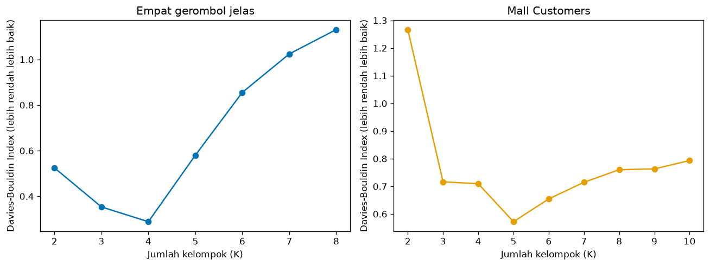
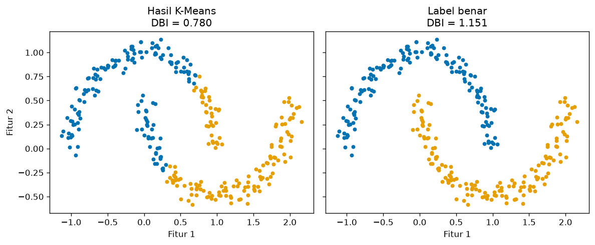

# Bab 6 — Davies-Bouldin Index

## Learning Objectives

Setelah mempelajari bab ini, kamu mampu:

- [x] Menjelaskan tujuan *Davies-Bouldin Index* (DBI) dan ide "kesamaan antar kelompok".
- [x] Menjelaskan sebaran dalam kelompok (*intra-cluster scatter*) dan keterpisahan antar kelompok (*inter-cluster separation*).
- [x] Menghitung DBI secara manual pada data kecil dan mencocokkannya dengan `davies_bouldin_score`.
- [x] Menafsirkan nilai DBI dan menjelaskan mengapa **lebih rendah lebih baik**.
- [x] Memakai DBI untuk membandingkan beberapa nilai K.
- [x] Menyebutkan kelebihan dan keterbatasan DBI, termasuk bentuk kelompok yang tidak cocok.
- [x] Mengenali kesalahan umum dalam memakai DBI.

## Introduction

Silhouette (Bab 5) sangat informatif tetapi mahal: ia butuh jarak antar **semua pasangan titik**. *Davies-Bouldin Index* mengambil jalan pintas: ia hanya memakai **centroid** tiap kelompok. Ide dasarnya tetap sama dengan yang kita bangun sejak Bab 2: kelompok bagus itu **kompak** dan **berjauhan**.

DBI menjawab pertanyaan: *"Untuk tiap kelompok, siapa kelompok lain yang paling mirip dengannya? Seberapa mirip?"* Jika kelompok paling mirip pun masih jauh dan berbeda, hasil clustering bagus. Jika ada dua kelompok yang sebarannya lebar dan pusatnya berdekatan, DBI buruk.

!!! note "Prasyarat"
    [Bab 2](02-internal-clustering-evaluation.md) (cohesion dan jarak antar centroid) dan [Bab 5](05-silhouette-score.md) (membaca skor internal).

## Fundamental Concepts

| Istilah | Arti |
|---|---|
| **Davies-Bouldin Index (DBI)** | Rata-rata, untuk tiap kelompok, dari "kemiripan terburuknya" dengan kelompok lain. Makin **rendah** makin baik |
| **Intra-cluster scatter** \( S_i \) | Sebaran kelompok \( i \): rata-rata jarak titik ke centroid-nya (sama dengan cohesion, Bab 2) |
| **Inter-cluster separation** \( M_{ij} \) | Jarak antara centroid kelompok \( i \) dan \( j \) |
| **Cluster similarity** \( R_{ij} \) | Seberapa "mirip" atau tumpang tindih kelompok \( i \) dan \( j \): \( (S_i + S_j) / M_{ij} \) |
| **Dispersion** | Sebaran titik di sekitar pusatnya |

## Detailed Explanation

### Ide intuitif

Bayangkan dua kelompok sebagai dua bola. Setiap bola punya **jari-jari** (seberapa lebar sebarannya) dan **pusat**. Dua bola mudah dibedakan jika:

- jari-jarinya kecil (kompak), dan
- pusatnya berjauhan.

Jika jari-jari besar dan pusat berdekatan, kedua bola bertumpuk dan sulit dibedakan. DBI mengukur persis itu: **jumlah jari-jari dibagi jarak pusat**. Angka kecil berarti kedua bola terpisah rapi.

### Langkah menghitung DBI

1. Hitung **centroid** tiap kelompok.
2. Hitung **sebaran** \( S_i \) tiap kelompok: rata-rata jarak titik ke centroid-nya.
3. Hitung **jarak antar centroid** \( M_{ij} \) untuk setiap pasangan.
4. Untuk setiap pasangan, hitung **kemiripan** \( R_{ij} = \dfrac{S_i + S_j}{M_{ij}} \).
5. Untuk tiap kelompok \( i \), ambil kemiripan **terburuk**: \( D_i = \max_{j \neq i} R_{ij} \), yaitu dengan kelompok yang paling mirip dengannya.
6. DBI adalah **rata-rata** \( D_i \) seluruh kelompok.

### Mengapa lebih rendah lebih baik?

\( R_{ij} \) besar bila pembilang (sebaran) besar atau penyebut (jarak antar pusat) kecil. Itu situasi yang **buruk**. Karena DBI adalah rata-rata dari kemiripan terburuk, **DBI kecil berarti setiap kelompok punya "pesaing terdekat" yang masih jauh dan berbeda**. DBI paling kecil yang mungkin adalah 0. Tidak ada batas atas.

!!! tip "Hati-hati arah \"baik\""
    Silhouette dan Calinski-Harabasz: makin **tinggi** makin baik. Davies-Bouldin: makin **rendah** makin baik. Banyak kesalahan terjadi karena arahnya tertukar.

### Mengapa memakai "terburuk" (max), bukan rata-rata?

Kelompok yang bagus harus terpisah dari **semua** kelompok lain, bukan hanya dari rata-ratanya. Jika satu kelompok menempel pada kelompok lain, DBI memberi hukuman lewat \( \max \), walau kelompok-kelompok lain jauh. Seperti rantai yang kekuatannya ditentukan mata rantai terlemah.

### Sensitivitas terhadap struktur kelompok

DBI berbasis **centroid dan jarak Euclidean**, sehingga:

- Cocok untuk kelompok **bulat dan berukuran mirip**.
- Kurang cocok untuk kelompok **melengkung, memanjang, atau berbentuk tak beraturan**, karena centroid tidak mewakili bentuknya.
- Mengabaikan **kepadatan** dan **noise**. Rata-rata jarak ke centroid dipengaruhi titik pencilan.
- Tidak mengukur hubungan antar titik tertentu, hanya ringkasan per kelompok.

!!! warning "DBI bukan ukuran universal"
    DBI mengukur dispersi dan keterpisahan **berbasis centroid**. Ia tidak cocok sebagai satu-satunya ukuran untuk setiap struktur kelompok, misalnya hasil DBSCAN pada bentuk bebas.

### Kelebihan dan keterbatasan

**Kelebihan**

- Sederhana dan **cepat**: hanya butuh centroid, bukan semua pasangan titik.
- Tidak butuh label benar.
- Tidak bergantung pada skala keseluruhan (rasio sebaran terhadap jarak).
- Terbatas dari bawah (minimal 0), mudah dibandingkan antar K.

**Keterbatasan**

- Menyukai kelompok bulat dan kompak.
- Hanya memakai jarak Euclidean (di scikit-learn).
- Tidak ada batas atas, dan tidak ada ambang "bagus" yang baku.
- Dipengaruhi outlier karena centroid adalah rata-rata.
- Tidak memberi informasi per titik (berbeda dengan Silhouette).
- Bisa menyukai K yang lebih besar atau kecil secara tidak wajar pada data tanpa struktur.

## Mathematical Foundation

Untuk \( K \) kelompok. Sebaran kelompok \( i \) (rata-rata jarak titik ke centroid \( \mathbf{c}_i \)):

$$
S_i = \frac{1}{|C_i|} \sum_{\mathbf{x} \in C_i} \lVert \mathbf{x} - \mathbf{c}_i \rVert
$$

Jarak antar centroid:

$$
M_{ij} = \lVert \mathbf{c}_i - \mathbf{c}_j \rVert
$$

Kemiripan dua kelompok dan nilai terburuk tiap kelompok:

$$
R_{ij} = \frac{S_i + S_j}{M_{ij}}, \qquad D_i = \max_{j \neq i} R_{ij}
$$

Davies-Bouldin Index:

$$
\text{DBI} = \frac{1}{K} \sum_{i=1}^{K} \max_{j \neq i} \frac{S_i + S_j}{M_{ij}}
$$

Penjelasan simbol: \( K \) jumlah kelompok, \( |C_i| \) jumlah anggota kelompok \( i \), \( \lVert \cdot \rVert \) jarak Euclidean. Notasi \( \max_{j \neq i} \) berarti "ambil nilai terbesar di antara semua kelompok \( j \) yang bukan \( i \) sendiri".

### Perhitungan manual

Sembilan titik, tiga kelompok. Kelompok 0: \( (1,1),\ (2,1),\ (1,2) \). Kelompok 1: \( (6,5),\ (7,5),\ (6,6) \). Kelompok 2: \( (1,8),\ (2,8),\ (1,9) \).

**Langkah 1: centroid.** \( \mathbf{c}_0 = (1{,}333;\ 1{,}333) \), \( \mathbf{c}_1 = (6{,}333;\ 5{,}333) \), \( \mathbf{c}_2 = (1{,}333;\ 8{,}333) \).

**Langkah 2: sebaran.** Ketiga kelompok adalah salinan bentuk yang sama, sehingga \( S_0 = S_1 = S_2 = 0{,}654 \) (hitungannya sama dengan cohesion pada Bab 2: rata-rata dari \( 0{,}471;\ 0{,}745;\ 0{,}745 \)).

**Langkah 3: jarak antar centroid.**

- \( M_{01} = \sqrt{5^2 + 4^2} = \sqrt{41} = 6{,}403 \)
- \( M_{02} = \sqrt{0^2 + 7^2} = 7{,}000 \)
- \( M_{12} = \sqrt{5^2 + 3^2} = \sqrt{34} = 5{,}831 \)

**Langkah 4: kemiripan.**

- \( R_{01} = \dfrac{0{,}654 + 0{,}654}{6{,}403} = 0{,}204 \)
- \( R_{02} = \dfrac{1{,}308}{7{,}000} = 0{,}187 \)
- \( R_{12} = \dfrac{1{,}308}{5{,}831} = 0{,}224 \)

**Langkah 5: terburuk tiap kelompok.**

- \( D_0 = \max(R_{01}, R_{02}) = \max(0{,}204;\ 0{,}187) = 0{,}204 \)
- \( D_1 = \max(R_{10}, R_{12}) = \max(0{,}204;\ 0{,}224) = 0{,}224 \)
- \( D_2 = \max(R_{20}, R_{21}) = \max(0{,}187;\ 0{,}224) = 0{,}224 \)

**Langkah 6: rata-rata.** \( \text{DBI} = \dfrac{0{,}204 + 0{,}224 + 0{,}224}{3} \approx 0{,}218 \). (Kode memakai angka yang tidak dibulatkan dan menghasilkan 0,2177.)

Dua kelompok yang paling "berdekatan" di sini adalah kelompok 1 dan 2 (jarak centroid 5,831), sehingga merekalah yang menentukan \( D_1 \) dan \( D_2 \).

## Python Implementation

Skrip lengkapnya ada di `examples/level-5/06_davies_bouldin_index.py`, dan notebook-nya di `notebooks/level-5/06-davies-bouldin-index.ipynb`. **Setiap potongan kode diikuti penjelasannya.**

**Konteks masalah:** menghitung DBI manual dan dengan scikit-learn, membandingkan beberapa K, dan mengenali keterbatasannya.

**Dataset:**

- `X_tiny`: sembilan titik, tiga kelompok.
- `make_blobs`: empat gerombol (400 titik), dan beberapa pasang kelompok dengan jarak atau sebaran berbeda.
- `make_moons` dan data acak untuk keterbatasan.
- Mall Customers.

**Pustaka:** NumPy, pandas, Matplotlib, scikit-learn.

### Bagian A — Siapkan alat

```python
--8<-- "level-5/06_davies_bouldin_index.py:setup"
```

**Penjelasan:** `davies_bouldin_score` adalah fungsi DBI dari scikit-learn. `silhouette_score` kita impor sebagai pembanding.

### Bagian B — Sembilan titik

```python
--8<-- "level-5/06_davies_bouldin_index.py:tiny"
```

**Penjelasan:** sembilan titik, dan label yang kita tentukan sendiri (0, 1, 2).

### Bagian C — DBI manual

```python
--8<-- "level-5/06_davies_bouldin_index.py:manual"
```

```text title="Output"
--8<-- "level-5/outputs/06/manual.txt"
```

**Penjelasan baris demi baris:**

- `ks = np.unique(labels)` mendaftar kelompok.
- `centroids` adalah rata-rata tiap kelompok (`X[labels == k].mean(axis=0)`).
- `S` adalah sebaran: untuk tiap kelompok, jarak titik ke centroid (`np.linalg.norm(..., axis=1)`) lalu `.mean()`.
- `M = np.linalg.norm(centroids[:, None, :] - centroids[None, :, :], axis=2)` menghitung jarak **setiap pasang centroid** sekaligus. Bentuk `[:, None, :]` dan `[None, :, :]` membuat NumPy memasangkan setiap centroid dengan setiap centroid lain (*broadcasting*). Hasilnya matriks `K × K` dengan nol di diagonal.
- Perulangan ganda mengisi `R[i, j] = (S[i] + S[j]) / M[i, j]` untuk `i != j`. Diagonal dilewati karena membagi dengan jarak nol tidak terdefinisi.
- `D = R.max(axis=1)` mengambil nilai terbesar di tiap baris, yaitu kemiripan terburuk tiap kelompok. Diagonal bernilai 0 sehingga tidak mengganggu.
- `D.mean()` adalah DBI.
- Parameter `verbose=True` mencetak langkah antara supaya kita bisa mencocokkannya dengan hitungan manual.

### Bagian D — Mencocokkan dengan scikit-learn

```python
--8<-- "level-5/06_davies_bouldin_index.py:check"
```

```text title="Output"
--8<-- "level-5/outputs/06/check.txt"
```

**Penjelasan:** `davies_bouldin_score(X, labels)` menerima data dan label, sama seperti metrik lain. Hasilnya harus sama dengan fungsi manual kita.

### Bagian E — DBI untuk beberapa K

```python
--8<-- "level-5/06_davies_bouldin_index.py:blobs"
```

```text title="Output"
--8<-- "level-5/outputs/06/blobs.txt"
```

**Penjelasan:** untuk K = 2 sampai 8 kita menjalankan K-Means dan menghitung DBI serta Silhouette. `idxmin()` memberi K dengan DBI **terendah** dan `idxmax()` memberi K dengan Silhouette **tertinggi** (arah "baik" kedua metrik berlawanan).

### Bagian F — Skala keseluruhan

```python
--8<-- "level-5/06_davies_bouldin_index.py:scale"
```

```text title="Output"
--8<-- "level-5/outputs/06/scale.txt"
```

**Penjelasan:** kita menghitung DBI pada data asli dan data yang dikali 10, dengan label yang sama. Sebaran dan jarak antar centroid sama-sama dikali 10, sehingga rasionya tidak berubah.

### Bagian G — Pengaruh jarak dan sebaran

```python
--8<-- "level-5/06_davies_bouldin_index.py:spread"
```

```text title="Output"
--8<-- "level-5/outputs/06/spread.txt"
```

**Penjelasan:** eksperimen pertama menggeser dua pusat sampai 3, 6, dan 12 satuan dengan sebaran tetap. Eksperimen kedua menetapkan jarak pusat 8 satuan dan mengubah sebaran (`cluster_std`) menjadi 0,5; 1,0; dan 2,0. `centers=[[0, 0], [gap, 0]]` menentukan pusat secara eksplisit.

### Bagian H — Grafik DBI terhadap K

```python
--8<-- "level-5/06_davies_bouldin_index.py:plotk"
```



**Penjelasan:** panel kiri untuk empat gerombol, panel kanan untuk Mall Customers (data distandarkan, K = 2 sampai 10). Kita menghitung DBI Mall Customers dengan dictionary comprehension `{k: ... for k in range(2, 11)}`.

### Bagian I — Keterbatasan

```python
--8<-- "level-5/06_davies_bouldin_index.py:limits"
```

```text title="Output"
--8<-- "level-5/outputs/06/limits.txt"
```

```python
--8<-- "level-5/06_davies_bouldin_index.py:plotmoons"
```



**Penjelasan:** pada moons kita membandingkan DBI K-Means dengan DBI label benar. Pada data acak kita melihat apakah DBI memberi sinyal jelas ketika tidak ada kelompok. Label benar hanya dipakai untuk **dinilai**.

### Bagian J — Mall Customers

```python
--8<-- "level-5/06_davies_bouldin_index.py:mall"
```

```text title="Output"
--8<-- "level-5/outputs/06/mall.txt"
```

**Penjelasan:** hasil DBI Mall Customers dicetak, dan `min(mall_dbi, key=mall_dbi.get)` mengambil K dengan DBI terendah.

## Code Explanation

| Bagian kode | Peran |
|---|---|
| `S` (rata-rata jarak ke centroid) | Sebaran tiap kelompok |
| `M` (jarak antar centroid) | Keterpisahan antar kelompok |
| `R = (S[i] + S[j]) / M[i, j]` | Kemiripan dua kelompok |
| `R.max(axis=1)` | Kelompok paling mirip untuk tiap kelompok |
| `D.mean()` | DBI |
| `davies_bouldin_score(X, labels)` | DBI siap pakai |

!!! note "Pelatihan vs penilaian"
    `KMeans(...).fit_predict(X)` adalah **pelatihan**. `davies_bouldin_score(X, labels)` adalah **penilaian**: ia hanya menghitung centroid dari label yang diberikan. Ia tidak membaca centroid milik model K-Means.

## How to Run

Dari folder utama proyek (setelah mengaktifkan lingkungan virtual):

```powershell
pip install -r requirements-notebooks.txt
python examples/level-5/06_davies_bouldin_index.py
```

Skrip mencetak output ke terminal dan menyimpan dua gambar ke `docs/assets/level-5/`. Notebook interaktifnya:

```powershell
jupyter notebook notebooks/level-5/06-davies-bouldin-index.ipynb
```

Semua output pada bab ini berasal dari eksekusi nyata dengan Python 3.14, NumPy 2.5.4, pandas 3.1.1, scikit-learn 1.9.1, dan Matplotlib 3.11.2.

## Expected Output

Output setiap langkah ditampilkan langsung di bawah kodenya pada bagian [Python Implementation](#python-implementation).

Gambar yang dihasilkan:


### Interpretasi output

**1. Hitungan manual cocok.** Centroid \( (1{,}333;\ 1{,}333) \), \( (6{,}333;\ 5{,}333) \), \( (1{,}333;\ 8{,}333) \). \( S_i = 0{,}654 \) untuk ketiganya. Jarak antar centroid: \( M_{01} = 6{,}403 \), \( M_{02} = 7{,}000 \), \( M_{12} = 5{,}831 \). Kemiripan: \( R_{01} = 0{,}204 \), \( R_{02} = 0{,}187 \), \( R_{12} = 0{,}224 \). Terburuk tiap kelompok: \( D = [0{,}204;\ 0{,}224;\ 0{,}224] \). **DBI manual = 0,2177**, sama dengan `davies_bouldin_score` (**0,2177**).

**2. Beberapa K pada empat gerombol.**

| K | Davies-Bouldin | Silhouette |
|---|---|---|
| 2 | 0,525 | 0,592 |
| 3 | 0,354 | 0,758 |
| **4** | **0,289** | **0,794** |
| 5 | 0,580 | 0,695 |
| 6 | 0,855 | 0,556 |
| 7 | 1,024 | 0,440 |
| 8 | 1,131 | 0,334 |

DBI terendah dan Silhouette tertinggi sama-sama di **K = 4**, sesuai empat gerombol. Perhatikan: berbeda dengan Inertia, **DBI naik** ketika K melebihi jumlah gerombol, karena kelompok yang terbelah punya pusat yang berdekatan (penyebut \( M_{ij} \) kecil).

**3. Skala keseluruhan.** DBI data asli **0,2887** dan data dikali 10 juga **0,2887**. DBI tidak berubah karena sebaran dan jarak sama-sama dikali 10. (Berbeda dengan Inertia pada Bab 3.) Namun perbedaan skala **antar fitur** tetap memengaruhi jarak, sehingga penyamaan skala tetap perlu.

**4. Jarak dan sebaran.**

| Jarak antar pusat (sebaran tetap 1,0) | DBI |
|---|---|
| 3 | 0,739 |
| 6 | 0,403 |
| 12 | 0,202 |

| Sebaran (jarak pusat tetap 8) | DBI |
|---|---|
| 0,5 | 0,152 |
| 1,0 | 0,302 |
| 2,0 | 0,595 |

DBI turun saat pusat makin berjauhan, dan naik saat sebaran makin lebar. Keduanya sesuai rumus \( R_{ij} = (S_i + S_j)/M_{ij} \). Pada pasangan dengan jarak 8, melebarkan sebaran dari 0,5 ke 2,0 menaikkan DBI sekitar empat kali lipat (0,152 ke 0,595).

**5. Moons.** K-Means yang memotong bulan sabit mendapat DBI **0,780**, sedangkan label benar mendapat **1,151**, yaitu lebih buruk. Seperti Silhouette (Bab 5), DBI menyukai kelompok bulat dan menilai bentuk bulan sabit sebagai "tidak rapi" karena jarak antar centroid kedua bulan tidak besar dibanding sebarannya.

**6. Data acak.** DBI: 1,083 (K = 2), 0,842, **0,770** (K = 4), 0,814, 0,872, 0,815, 0,773 (K = 8). Nilai terendah di K = 4 (0,770), tetapi K = 8 (0,773) nyaris sama. Tidak ada minimum yang tegas, sama seperti pada Elbow Method. Dibandingkan dengan empat gerombol jelas (0,289), semua nilai pada data acak jauh lebih tinggi. Jadi **besarnya** DBI memberi petunjuk tentang adanya struktur, tetapi **posisi minimum** pada data tanpa struktur tidak bisa dipercaya.

**7. Mall Customers.** DBI: 1,267 (K = 2), 0,716, 0,710, **0,572 (K = 5)**, 0,655, 0,715, 0,760, 0,763, 0,793. Minimum tegas di **K = 5**, sama dengan Silhouette (Bab 5) dan siku (Bab 4). Tiga metrik yang berbeda menunjuk K yang sama, dan itu menambah keyakinan.

## Practical Examples

**Memilih K dengan cepat.** DBI murah dihitung, cocok untuk membandingkan banyak K pada data yang besar, ketika Silhouette terlalu mahal.

**Menyaring kandidat.** Gunakan DBI untuk menyingkirkan K yang jelas buruk, lalu periksa kandidat tersisa dengan Silhouette dan gambar.

**Memantau segmentasi.** Hitung DBI pada tiap pembaruan segmentasi pelanggan. Kenaikan DBI mengisyaratkan segmen mulai tumpang tindih.

**Membandingkan dua inisialisasi.** Bandingkan dua hasil K-Means (misalnya `random` dan `k-means++`) dengan DBI.

## Hands-on Exercises

1. Hitung manual \( R_{01} \) pada `X_tiny` dan cocokkan dengan output (0,204).
2. Geser titik \( (7,5) \) menjadi \( (9,5) \) pada kelompok 1. Berapa DBI-nya? Mengapa berubah?
3. Hitung DBI `X_tiny` bila K-Means memakai K = 2 dan K = 4. Bandingkan dengan 0,2177.
4. Hitung DBI Mall Customers untuk K = 4 dan K = 6 dan bandingkan dengan K = 5.
5. Pada pasangan dua kelompok berjarak 8, ubah sebaran menjadi 3,0. Berapa DBI-nya?
6. Mengapa DBI **turun** bila kelompok makin berjauhan, dan **naik** bila sebaran melebar?
7. Mengapa DBI tidak cocok dipakai untuk menilai kelompok bentuk bulan sabit?

??? question "Jawaban"
    Hasil nomor 2 sampai 5 berasal dari eksekusi nyata.

    1. \( R_{01} = \dfrac{0{,}654 + 0{,}654}{6{,}403} = \dfrac{1{,}308}{6{,}403} = \) **0,204**.
    2. DBI menjadi **0,3165** (sebelumnya 0,2177). Titik yang ditarik jauh membuat kelompok 1 lebih lebar (\( S_1 \) naik) dan menggeser centroid-nya, sehingga \( R \) yang melibatkan kelompok 1 naik.
    3. K = 2: **0,5944**. K = 4: **0,3269**. Keduanya lebih buruk dari K = 3 (**0,2177**). K = 3 sesuai dengan tiga kelompok yang sebenarnya.
    4. K = 4: **0,710**, K = 6: **0,655**, K = 5: **0,572**. K = 5 terendah.
    5. DBI menjadi **0,789**. Sebaran 3,0 pada jarak pusat 8 membuat kelompok saling bertumpuk, jauh lebih buruk dari sebaran 1,0 (0,302).
    6. \( R_{ij} = (S_i + S_j)/M_{ij} \): jarak antar pusat \( M_{ij} \) di penyebut. Makin besar penyebut, \( R \) makin kecil. Sebaran \( S \) di pembilang: makin besar, \( R \) makin besar.
    7. DBI memakai centroid dan rata-rata jarak ke centroid. Pada bulan sabit, jarak antar centroid kedua bulan tidak besar dibanding sebaran titik ke centroid-nya, sehingga \( R_{ij} \) besar walau kedua bulan sebenarnya terpisah. Pada data kita, label benar mendapat DBI 1,151, lebih buruk dari K-Means yang memotong bentuk (0,780).

## Troubleshooting

### Masalah teknis

| Masalah | Penyebab | Solusi |
|---|---|---|
| `ValueError: Number of labels is 1. Valid values are 2 to n_samples - 1` | Hanya satu kelompok | Pastikan minimal 2 kelompok |
| DBI = 0 | Semua titik tiap kelompok berimpit dengan centroid-nya | Biasanya tanda data duplikat atau sangat sedikit |
| Hasil mengejutkan setelah menyaring noise | `X` dan `labels` tidak disaring dengan `mask` yang sama | Saring keduanya |
| Angka berbeda dari output di bab | Versi pustaka atau seed berbeda | Pakai `random_state=42` dan bandingkan polanya |
| Mengira DBI tinggi itu bagus | Arah metrik tertukar | Ingat: DBI **rendah** = baik |

### Kesalahan umum

1. **Menukar arah.** DBI lebih rendah lebih baik, kebalikan dari Silhouette dan Calinski-Harabasz.
2. **Memakai DBI untuk kelompok non-bulat** tanpa menyadari bias bentuknya.
3. **Memakai DBI sendirian.** Padukan dengan Silhouette, gambar, dan pengetahuan domain.
4. **Lupa menyamakan skala antar fitur.** Fitur berskala besar mendominasi jarak.
5. **Membandingkan DBI antar dataset berbeda** seolah-olah punya patokan yang sama.
6. **Mengira minimum DBI pasti K yang benar.** Pada data acak, minimum tidak tegas.
7. **Mengira DBI memberi tahu kelompok mana yang buruk.** DBI hanya satu angka, sedangkan Silhouette plot memberi rincian.
8. **Memberi hasil DBSCAN langsung ke DBI** tanpa memikirkan noise (label `-1`). Centroid "noise" tidak bermakna.

## Summary

- **Davies-Bouldin Index** menilai tiap kelompok dengan kelompok yang paling mirip dengannya, lalu merata-ratakannya: \( \text{DBI} = \dfrac{1}{K}\sum_i \max_{j \neq i} \dfrac{S_i + S_j}{M_{ij}} \).
- \( S_i \) adalah sebaran (rata-rata jarak ke centroid), dan \( M_{ij} \) jarak antar centroid. DBI **rendah** berarti kelompok kompak dan berjauhan. Minimumnya 0, tanpa batas atas.
- Hitungan manual pada sembilan titik menghasilkan 0,2177, sama dengan `davies_bouldin_score`.
- Pada empat gerombol, DBI terendah (0,289) dan Silhouette tertinggi (0,794) sama-sama di K = 4. Berbeda dengan Inertia, DBI **naik** bila K melampaui jumlah gerombol.
- DBI turun saat jarak pusat membesar (0,739 pada jarak 3, 0,202 pada jarak 12) dan naik saat sebaran melebar (0,152 pada std 0,5, 0,595 pada std 2,0).
- DBI **tidak bergantung pada skala keseluruhan** (data × 10 tetap 0,2887).
- Keterbatasan: berbasis centroid dan Euclidean, menyukai kelompok bulat (pada moons label benar 1,151 vs K-Means 0,780), dan tidak memberi minimum tegas pada data acak.
- Pada Mall Customers, DBI terendah di K = 5 (0,572), sejalan dengan elbow dan Silhouette.

**Bab berikutnya:** Bab 7 membahas **Calinski-Harabasz Index**, metrik berbasis rasio dispersi antar kelompok terhadap dispersi dalam kelompok, dengan arah "lebih tinggi lebih baik".

## References

- Davies, D. L., & Bouldin, D. W. (1979). A cluster separation measure. *IEEE Transactions on Pattern Analysis and Machine Intelligence*, PAMI-1(2), 224–227.
- Scikit-learn documentation: [`davies_bouldin_score`](https://scikit-learn.org/stable/modules/generated/sklearn.metrics.davies_bouldin_score.html) dan [*Davies-Bouldin Index*](https://scikit-learn.org/stable/modules/clustering.html#davies-bouldin-index).
- Halkidi, M., Batistakis, Y., & Vazirgiannis, M. (2001). On clustering validation techniques. *Journal of Intelligent Information Systems*, 17(2–3), 107–145.
- Tan, P.-N., Steinbach, M., & Kumar, V. (2019). *Introduction to Data Mining* (2nd ed.), Bab 7.5. Pearson.
