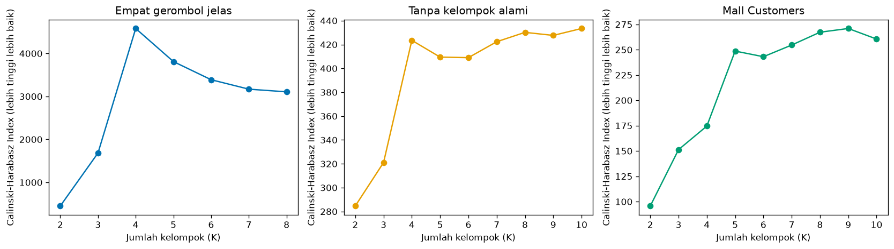
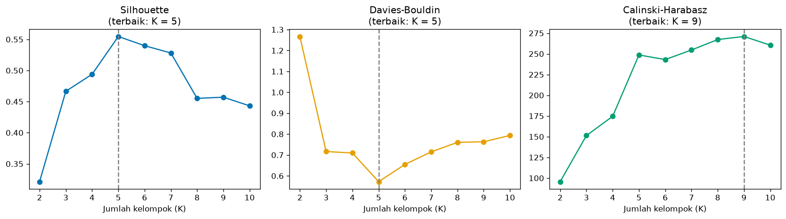

# Bab 7 — Calinski-Harabasz Index

## Learning Objectives

Setelah mempelajari bab ini, kamu mampu:

- [x] Menjelaskan ide *Calinski-Harabasz Index* (CHI), juga disebut *Variance Ratio Criterion*.
- [x] Menjelaskan dispersi antar kelompok (*between-cluster dispersion*) dan dispersi dalam kelompok (*within-cluster dispersion*).
- [x] Menghitung CHI secara manual dan mencocokkannya dengan `calinski_harabasz_score`.
- [x] Menafsirkan nilai CHI dan menjelaskan mengapa **lebih tinggi lebih baik**.
- [x] Menjelaskan bahwa nilai CHI dipengaruhi jumlah data dan jumlah kelompok.
- [x] Menyebutkan kelebihan dan keterbatasan CHI, termasuk bias terhadap kelompok bulat.
- [x] Membandingkan Silhouette, Davies-Bouldin, dan Calinski-Harabasz pada data yang sama, serta memahami mengapa ketiganya bisa tidak sepakat.

## Introduction

Kita sudah punya tiga alat: Inertia (hanya kekompakan), Silhouette (per titik, mahal), dan Davies-Bouldin (berbasis centroid). *Calinski-Harabasz Index* punya semangat yang akrab bagi siapa saja yang pernah belajar statistik: **rasio varians**, mirip dengan ANOVA.

Pertanyaan yang diajukan: *"Seberapa besar sebaran **antar** kelompok dibanding sebaran **dalam** kelompok?"* Jika pusat-pusat kelompok tersebar jauh (sebaran antar besar) sedangkan tiap kelompok rapat (sebaran dalam kecil), rasionya besar. Rasio besar berarti clustering bagus.

CHI sangat cepat dihitung karena hanya memakai centroid dan jumlah kuadrat jarak. Namun, seperti yang akan kamu lihat, ia punya sifat yang perlu diwaspadai.

!!! note "Prasyarat"
    [Bab 3](03-inertia-and-wcss.md) (WCSS), [Bab 5](05-silhouette-score.md), dan [Bab 6](06-davies-bouldin-index.md).

## Fundamental Concepts

| Istilah | Arti |
|---|---|
| **Calinski-Harabasz Index (CHI)** | Rasio dispersi antar kelompok terhadap dispersi dalam kelompok, dengan koreksi jumlah kelompok dan jumlah data. Makin **tinggi** makin baik |
| **Variance Ratio Criterion** | Nama lain CHI, karena ia rasio dua "varians" |
| **Between-cluster dispersion** \( B_k \) | Seberapa jauh centroid kelompok dari centroid seluruh data (dikalikan ukuran kelompok) |
| **Within-cluster dispersion** \( W_k \) | Jumlah kuadrat jarak titik ke centroid kelompoknya, yaitu WCSS (Bab 3) |
| **Total dispersion** | Jumlah kuadrat jarak semua titik ke centroid seluruh data. Sama dengan \( B_k + W_k \) |

## Detailed Explanation

### Ide intuitif: dua sumber variasi

Setiap titik data berbeda dari rata-rata keseluruhan. Perbedaan itu bisa dipecah menjadi dua bagian:

1. **Antar kelompok:** sebagian karena titik berada di kelompok yang pusatnya jauh dari rata-rata keseluruhan.
2. **Dalam kelompok:** sebagian lagi karena titik tidak persis di pusat kelompoknya.

Clustering yang baik menjelaskan **sebagian besar variasi lewat kelompok** (bagian 1 besar) dan hanya menyisakan variasi kecil di dalam kelompok (bagian 2 kecil). CHI membandingkan keduanya.

### Between-cluster dan within-cluster dispersion

- **Within (\( W_k \))**: ukuran kekompakan. Sama persis dengan Inertia/WCSS. Kecil lebih baik.
- **Between (\( B_k \))**: ukuran keterpisahan. Untuk tiap kelompok, hitung jarak kuadrat centroid-nya ke centroid keseluruhan, dikalikan jumlah anggotanya. Besar lebih baik.

Kedua bagian ini selalu berjumlah tetap (total dispersi data tidak bergantung pada pembagian kelompok):

$$
T = B_k + W_k
$$

Jadi mengurangi \( W_k \) otomatis menaikkan \( B_k \). Kita akan memeriksa ini di kode.

### Mengapa dibagi dengan \( k-1 \) dan \( n-k \)?

Dispersi mentah akan selalu makin baik bila K makin besar (\( W_k \) turun). Pembagian dengan **derajat kebebasan** mengoreksinya:

- \( B_k / (k-1) \): dispersi antar kelompok **per derajat kebebasan** (ada \( k-1 \) cara kelompok bisa berbeda dari rata-rata keseluruhan).
- \( W_k / (n-k) \): dispersi dalam kelompok per derajat kebebasan (\( n-k \) titik "bebas" setelah \( k \) centroid dihitung).

Seperti pada ANOVA, ini membuat angka lebih adil terhadap jumlah kelompok. Meski begitu, koreksi ini **tidak sempurna**: seperti yang kita lihat di bawah, CHI tetap bisa cenderung naik terus saat K membesar pada data tanpa struktur.

### Membaca nilai CHI

- **Makin tinggi makin baik**: kelompok kompak dan terpisah.
- **Tidak ada batas atas** dan tidak ada ambang baku. Nilai 450 tidak otomatis "bagus" atau "buruk". Hanya berguna untuk **membandingkan** hasil pada **data yang sama**.
- Nilainya bergantung pada **jumlah data**. Dua dataset dengan jumlah titik berbeda tidak bisa dibandingkan lewat CHI.

!!! warning "Jangan menafsirkan CHI sendirian"
    CHI berbasis dispersi antar dan dalam kelompok, dan cenderung menyukai kelompok **bulat** yang berukuran mirip. Ia bisa menunjuk K yang berbeda dari metrik lain. Bandingkan dengan Silhouette, Davies-Bouldin, gambar, dan pengetahuan domain.

### Sensitivitas terhadap jumlah kelompok

Pada data dengan struktur jelas, CHI biasanya memuncak di jumlah kelompok sebenarnya. Namun pada data tanpa struktur atau struktur lemah, CHI bisa **terus naik atau hampir datar** seiring K membesar. Maka, memilih K dengan CHI tertinggi bisa menghasilkan K yang terlalu besar. Kita akan melihatnya pada data acak dan Mall Customers.

### Kelebihan dan keterbatasan

**Kelebihan**

- Sangat cepat: hanya centroid dan jumlah kuadrat.
- Konsepnya akrab (rasio varians) dan terkait langsung dengan WCSS.
- Tidak bergantung pada skala keseluruhan (rasio).
- Tidak butuh label benar.

**Keterbatasan**

- Menyukai kelompok bulat dan berukuran mirip.
- Nilai bergantung pada jumlah data \( n \) dan jumlah kelompok \( k \).
- Tidak ada batas atas dan tidak ada ambang yang baku.
- Pada data tanpa struktur, cenderung naik seiring K.
- Dipengaruhi outlier (jumlah kuadrat).
- Tidak memberi informasi per titik atau per kelompok.

## Mathematical Foundation

Misalkan data \( \mathbf{x}_1, \dots, \mathbf{x}_n \) dibagi menjadi \( k \) kelompok. \( \mathbf{c} \) adalah centroid **seluruh data**, \( \mathbf{c}_q \) centroid kelompok \( C_q \), dan \( n_q = |C_q| \).

Dispersi antar kelompok:

$$
B_k = \sum_{q=1}^{k} n_q \, \lVert \mathbf{c}_q - \mathbf{c} \rVert^2
$$

Dispersi dalam kelompok:

$$
W_k = \sum_{q=1}^{k} \sum_{\mathbf{x} \in C_q} \lVert \mathbf{x} - \mathbf{c}_q \rVert^2
$$

Calinski-Harabasz Index:

$$
\text{CH} = \frac{B_k / (k - 1)}{W_k / (n - k)} = \frac{B_k}{W_k} \cdot \frac{n - k}{k - 1}
$$

Penjelasan simbol:

- \( \lVert \cdot \rVert^2 \): jarak Euclidean dikuadratkan.
- \( n_q \) pada \( B_k \): kelompok yang lebih besar diberi bobot lebih besar.
- \( W_k \) adalah **persis WCSS** dari Bab 3.
- \( n - k \) dan \( k - 1 \): derajat kebebasan seperti di atas.

Identitas dispersi total: \( \sum_{i=1}^{n} \lVert \mathbf{x}_i - \mathbf{c} \rVert^2 = B_k + W_k \).

### Sifat skala dan jumlah data

Jika semua titik dikali \( s \), maka \( B_k \) dan \( W_k \) sama-sama dikali \( s^2 \), sehingga rasio \( B_k / W_k \) tidak berubah. Jadi **CHI tidak bergantung pada skala keseluruhan**.

Jika data digandakan (setiap titik muncul dua kali, kelompok sama), \( B_k \) dan \( W_k \) sama-sama dikali 2, sehingga \( B_k / W_k \) tetap. Tetapi faktor \( \dfrac{n-k}{k-1} \) berubah. Untuk \( n = 400 \to 800 \) dan \( k = 4 \): \( \dfrac{796}{3} \big/ \dfrac{396}{3} \approx 2{,}01 \). Jadi CHI naik sekitar 2,01 kali **tanpa kualitas clustering berubah**. Inilah mengapa CHI tidak boleh dibandingkan antar data dengan jumlah titik berbeda.

### Perhitungan manual

Sembilan titik yang sama dengan Bab 6. Kelompok 0: \( (1,1),\ (2,1),\ (1,2) \). Kelompok 1: \( (6,5),\ (7,5),\ (6,6) \). Kelompok 2: \( (1,8),\ (2,8),\ (1,9) \). Maka \( n = 9 \) dan \( k = 3 \).

**Centroid.** Kelompok: \( \mathbf{c}_0 = (1{,}333;\ 1{,}333) \), \( \mathbf{c}_1 = (6{,}333;\ 5{,}333) \), \( \mathbf{c}_2 = (1{,}333;\ 8{,}333) \). Keseluruhan: \( \mathbf{c} = \left( \tfrac{27}{9},\ \tfrac{45}{9} \right) = (3;\ 5) \).

**Dispersi antar kelompok \( B_k \).**

- Kelompok 0: \( 3 \times \left[ (1{,}333 - 3)^2 + (1{,}333 - 5)^2 \right] = 3 \times (2{,}778 + 13{,}444) = 3 \times 16{,}222 = 48{,}667 \)
- Kelompok 1: \( 3 \times \left[ (6{,}333 - 3)^2 + (5{,}333 - 5)^2 \right] = 3 \times (11{,}111 + 0{,}111) = 33{,}667 \)
- Kelompok 2: \( 3 \times \left[ (1{,}333 - 3)^2 + (8{,}333 - 5)^2 \right] = 3 \times (2{,}778 + 11{,}111) = 41{,}667 \)

\( B_k = 48{,}667 + 33{,}667 + 41{,}667 = 124 \).

**Dispersi dalam kelompok \( W_k \).** Dari Bab 3, tiap kelompok bernilai \( 1{,}333 \), sehingga \( W_k = 3 \times 1{,}333 = 4 \).

**Pengecekan:** \( B_k + W_k = 128 \). Itu sama dengan jumlah kuadrat total semua titik terhadap \( \mathbf{c} \) (akan kita cocokkan dengan kode).

**CH:**

$$
\text{CH} = \frac{124 / (3 - 1)}{4 / (9 - 3)} = \frac{62}{0{,}6667} = 93
$$

## Python Implementation

Skrip lengkapnya ada di `examples/level-5/07_calinski_harabasz_index.py`, dan notebook-nya di `notebooks/level-5/07-calinski-harabasz-index.ipynb`. **Setiap potongan kode diikuti penjelasannya.**

**Konteks masalah:** menghitung CHI manual dan dengan scikit-learn, melihat pengaruh K, skala, dan jumlah data, lalu membandingkan ketiga metrik internal pada Mall Customers.

**Dataset:**

- `X_tiny`: sembilan titik, tiga kelompok (sama dengan Bab 6).
- `make_blobs`: empat gerombol (400 titik).
- Data acak tanpa kelompok, `make_moons`, dan Mall Customers.

**Pustaka:** NumPy, pandas, Matplotlib, scikit-learn.

### Bagian A — Siapkan alat

```python
--8<-- "level-5/07_calinski_harabasz_index.py:setup"
```

**Penjelasan:** `calinski_harabasz_score` adalah fungsi CHI. Dua metrik lain diimpor untuk perbandingan di akhir bab.

### Bagian B — Sembilan titik

```python
--8<-- "level-5/07_calinski_harabasz_index.py:tiny"
```

**Penjelasan:** data dan label yang sama dengan Bab 6, supaya angkanya bisa dibandingkan.

### Bagian C — CH manual

```python
--8<-- "level-5/07_calinski_harabasz_index.py:manual"
```

```text title="Output"
--8<-- "level-5/outputs/07/manual.txt"
```

**Penjelasan baris demi baris:**

- `n = len(X)` jumlah titik, `ks = np.unique(labels)` daftar kelompok, `k = len(ks)` jumlah kelompok.
- `overall_centroid = X.mean(axis=0)` adalah centroid seluruh data.
- `B = 0.0` dan `W = 0.0` adalah penampung jumlah.
- Untuk tiap kelompok `c`: `members` adalah titik-titiknya, `centroid` rata-ratanya.
  - `B += len(members) * ((centroid - overall_centroid) ** 2).sum()` menambahkan ukuran kelompok dikali jarak kuadrat centroid kelompok ke centroid keseluruhan.
  - `W += ((members - centroid) ** 2).sum()` menambahkan jumlah kuadrat jarak titik ke centroid kelompoknya.
- `ch = (B / (k - 1)) / (W / (n - k))` adalah rumus CHI.
- Bila `verbose=True`, kita mencetak \( B \), \( W \), dan membuktikan bahwa \( B + W \) sama dengan jumlah kuadrat total `total`.

### Bagian D — Mencocokkan dengan scikit-learn

```python
--8<-- "level-5/07_calinski_harabasz_index.py:check"
```

```text title="Output"
--8<-- "level-5/outputs/07/check.txt"
```

**Penjelasan:** `calinski_harabasz_score(X, labels)` seharusnya sama dengan hitungan manual.

### Bagian E — CH untuk beberapa K

```python
--8<-- "level-5/07_calinski_harabasz_index.py:blobs"
```

```text title="Output"
--8<-- "level-5/outputs/07/blobs.txt"
```

**Penjelasan:** untuk K = 2 sampai 8 kita menjalankan K-Means dan menghitung CHI. `idxmax()` mengambil K dengan CHI **tertinggi**.

### Bagian F — Skala dan jumlah data

```python
--8<-- "level-5/07_calinski_harabasz_index.py:invariance"
```

```text title="Output"
--8<-- "level-5/outputs/07/invariance.txt"
```

**Penjelasan:**

- `X_blobs * 10` mengalikan seluruh koordinat dengan 10.
- `np.vstack([X_blobs, X_blobs])` menumpuk data yang sama dua kali. `np.concatenate([labels4, labels4])` menggandakan labelnya agar tiap salinan titik masuk kelompok yang sama.

### Bagian G — Data tanpa kelompok alami

```python
--8<-- "level-5/07_calinski_harabasz_index.py:uniform"
```

```text title="Output"
--8<-- "level-5/outputs/07/uniform.txt"
```

**Penjelasan:** data acak rata (tanpa kelompok), K = 2 sampai 10. `max(uniform_ch, key=uniform_ch.get)` memberi K dengan CHI tertinggi.

### Bagian H — Keterbatasan: moons

```python
--8<-- "level-5/07_calinski_harabasz_index.py:moons"
```

```text title="Output"
--8<-- "level-5/outputs/07/moons.txt"
```

**Penjelasan:** CHI K-Means vs CHI label benar. Label benar hanya dipakai untuk **dinilai**.

### Bagian I — Tiga metrik bersama-sama

```python
--8<-- "level-5/07_calinski_harabasz_index.py:together"
```

```text title="Output"
--8<-- "level-5/outputs/07/together.txt"
```

**Penjelasan:** pada Mall Customers (terskala), untuk K = 2 sampai 10 kita menghitung ketiga metrik dalam satu tabel, lalu mencari K terbaik menurut masing-masing. `idxmin()` dipakai untuk Davies-Bouldin (terendah terbaik) dan `idxmax()` untuk dua lainnya.

### Bagian J — Grafik

```python
--8<-- "level-5/07_calinski_harabasz_index.py:plotk"
```



```python
--8<-- "level-5/07_calinski_harabasz_index.py:plottogether"
```



**Penjelasan:** grafik pertama menampilkan CHI terhadap K untuk tiga dataset. Grafik kedua menampilkan tiga metrik pada Mall Customers berdampingan, dengan garis putus-putus pada K terbaik tiap metrik. `zip(axes, mall_table.columns, palette)` memasangkan panel, nama metrik, dan warna.

## Code Explanation

| Bagian kode | Peran |
|---|---|
| `B += n_q * ||c_q - c||^2` | Dispersi antar kelompok |
| `W += sum ||x - c_q||^2` | Dispersi dalam kelompok (WCSS) |
| `(B / (k - 1)) / (W / (n - k))` | Rumus CHI |
| `calinski_harabasz_score(X, labels)` | CHI siap pakai |
| `idxmax()` / `idxmin()` | K terbaik: tertinggi (CHI, Silhouette) atau terendah (DBI) |

!!! note "Pelatihan vs penilaian"
    `KMeans(...).fit_predict(X)` adalah **pelatihan**. `calinski_harabasz_score(X, labels)` adalah **penilaian**: ia menghitung centroid dari label yang diberikan.

## How to Run

Dari folder utama proyek (setelah mengaktifkan lingkungan virtual):

```powershell
pip install -r requirements-notebooks.txt
python examples/level-5/07_calinski_harabasz_index.py
```

Skrip mencetak output ke terminal dan menyimpan dua gambar ke `docs/assets/level-5/`. Notebook interaktifnya:

```powershell
jupyter notebook notebooks/level-5/07-calinski-harabasz-index.ipynb
```

Semua output pada bab ini berasal dari eksekusi nyata dengan Python 3.14, NumPy 2.5.4, pandas 3.1.1, scikit-learn 1.9.1, dan Matplotlib 3.11.2.

## Expected Output

Output setiap langkah ditampilkan langsung di bawah kodenya pada bagian [Python Implementation](#python-implementation).

Gambar yang dihasilkan:


### Interpretasi output

**1. Hitungan manual cocok.** Centroid keseluruhan \( (3{,}0;\ 5{,}0) \). \( B_k = 124{,}000 \), \( W_k = 4{,}000 \), dan \( B_k + W_k = 128{,}000 \), sama dengan jumlah kuadrat total \( 128{,}000 \). **CH manual = 93,0000**, sama dengan `calinski_harabasz_score` (**93,0000**).

**2. Beberapa K pada empat gerombol.**

| K | Calinski-Harabasz |
|---|---|
| 2 | 450,2 |
| 3 | 1683,3 |
| **4** | **4580,4** |
| 5 | 3810,5 |
| 6 | 3388,6 |
| 7 | 3168,8 |
| 8 | 3106,7 |

Puncak tegas di **K = 4**, sesuai empat gerombol. Setelah itu nilai turun. Pada data yang jelas, CHI bekerja baik.

**3. Skala dan jumlah data.** CHI data asli **4580,38** dan data dikali 10 juga **4580,38**: tidak bergantung pada skala keseluruhan. Data yang digandakan (400 menjadi 800 titik, bentuk kelompok sama) menghasilkan **9207,02**, yaitu sekitar **2,01 kali**, sesuai perkiraan \( \tfrac{796}{396} \approx 2{,}01 \). Kualitas clustering tidak berubah, tetapi CHI naik dua kali lipat. **Jangan membandingkan CHI antar data dengan jumlah titik berbeda.**

**4. Data tanpa kelompok alami.** CHI: 284,6 (K = 2), 321,1, 423,5, 409,5, 409,0, 422,4, 430,2, 427,7, **433,5 (K = 10)**. Nilai tertinggi justru di **K terbesar yang dicoba (10)**, dan hampir mendatar dari K = 4 ke K = 10 (423,5 sampai 433,5). Tidak ada puncak yang berarti, dan nilai terbesarnya mendekati batas rentang K. Jika kita memilih K dengan CHI tertinggi, kita mendapat K = 10 untuk data yang **tidak punya kelompok**.

!!! warning "CHI bisa terus naik pada data tanpa struktur"
    Pada data acak, CHI tertinggi di K = 10 (batas rentang yang dicoba). Memilih K dengan CHI tertinggi tanpa memeriksa gambar atau metrik lain bisa menghasilkan K yang terlalu besar.

**5. Moons.** K-Means yang memotong bulan sabit mendapat CHI **440,2**, sedangkan label benar hanya **198,3**. Seperti Silhouette dan DBI, CHI menyukai kelompok bulat dan menilai label benar yang berbentuk bulan sabit lebih rendah.

**6. Tiga metrik pada Mall Customers.**

| K | Silhouette | Davies-Bouldin | Calinski-Harabasz |
|---|---|---|---|
| 2 | 0,321 | 1,267 | 95,669 |
| 3 | 0,467 | 0,716 | 151,335 |
| 4 | 0,494 | 0,710 | 174,595 |
| **5** | **0,555** | **0,572** | 248,649 |
| 6 | 0,540 | 0,655 | 243,088 |
| 7 | 0,528 | 0,715 | 254,621 |
| 8 | 0,455 | 0,760 | 267,279 |
| 9 | 0,457 | 0,763 | **270,948** |
| 10 | 0,443 | 0,793 | 260,540 |

- Silhouette terbaik: **K = 5**.
- Davies-Bouldin terbaik: **K = 5**.
- Calinski-Harabasz terbaik: **K = 9**.

CHI melonjak dari K = 4 ke K = 5 (174,6 ke 248,6), lalu hanya naik pelan sampai K = 9 (270,9). Perbedaan antara K = 5 dan K = 9 hanya sekitar 9% (248,6 vs 270,9), sehingga CHI tidak membedakan keduanya dengan tegas. Dua metrik lain menolak K = 9 dengan jelas (Silhouette 0,457; DBI 0,763). Pelajaran: **metrik bisa tidak sepakat**, dan itu normal. Mereka mengukur hal yang berbeda: Silhouette memakai jarak titik ke kelompok tetangga, DBI membandingkan sebaran dengan jarak antar centroid, dan CHI memakai rasio jumlah kuadrat dengan koreksi derajat kebebasan.

Hasil ini bukan berarti K = 5 "pasti benar". Ketiganya hanya memberi bukti dari sudut pandang berbeda. Keputusan akhir tetap memerlukan gambar dan pemahaman bisnis.

## Practical Examples

**Pemeriksaan cepat pada data besar.** CHI sangat murah. Gunakan untuk memindai banyak K lebih dulu, lalu validasi kandidat dengan Silhouette.

**Mencari lonjakan, bukan puncak absolut.** Pada Mall Customers, lonjakan besar terjadi di K = 5. Setelah itu kurva nyaris datar. Membaca **lonjakan** sering lebih bermakna daripada mengambil nilai tertinggi.

**Membandingkan algoritma pada data yang sama.** CHI dapat membandingkan dua hasil K-Means (misalnya inisialisasi berbeda) pada data yang sama dan K yang sama.

**Pemantauan.** Penurunan CHI pada data baru (jumlah titik sama) mengisyaratkan kelompok makin tumpang tindih.

## Hands-on Exercises

1. Hitung manual \( B_k \) untuk kelompok 1 pada `X_tiny` dan cocokkan dengan 33,667.
2. Geser titik \( (7,5) \) menjadi \( (9,5) \). Berapa CHI-nya? Mengapa turun?
3. Hitung CHI `X_tiny` untuk K-Means dengan K = 2 dan K = 4, dan bandingkan dengan K = 3 (93,0).
4. Ganti `make_blobs` pada `X_blobs` menjadi `n_samples=800`. Apakah CHI K = 4 naik? Mengapa?
5. Pada Mall Customers, hitung selisih persen CHI antara K = 5 dan K = 9. Apakah selisih itu cukup besar untuk memilih K = 9?
6. Mengapa CHI pada data acak bisa tertinggi di K terbesar?
7. Mengapa kita tidak boleh membandingkan CHI antar dataset dengan jumlah titik berbeda?

??? question "Jawaban"
    Hasil nomor 2 sampai 5 berasal dari eksekusi nyata atau hitungan dari output.

    1. Centroid kelompok 1 \( (6{,}333;\ 5{,}333) \) dan centroid keseluruhan \( (3;\ 5) \). Jarak kuadratnya \( 3{,}333^2 + 0{,}333^2 = 11{,}111 + 0{,}111 = 11{,}222 \). Dikali 3 anggota: **33,667**.
    2. CH menjadi **44,429** (sebelumnya 93,0). Titik yang ditarik jauh menaikkan \( W_k \) (kelompok 1 lebih renggang) sehingga rasio \( B_k / W_k \) turun.
    3. K = 2: **9,291**. K = 4: **65,702**. Keduanya jauh di bawah K = 3 (**93,000**).
    4. Ya. Dengan 800 titik, CHI untuk K = 4 menjadi **8722,5** (dari 4580,4 pada 400 titik), sekitar 1,9 kali lebih besar. Penyebabnya terutama faktor \( (n-k)/(k-1) \) yang membesar dan bertambahnya titik. Itu bukan berarti clustering lebih baik, hanya datanya lebih banyak. Datanya baru (titik berbeda), jadi kenaikannya tidak tepat 2,01 kali seperti pada data yang digandakan persis.
    5. \( \dfrac{270{,}948 - 248{,}649}{248{,}649} \approx 9\% \). Selisih kecil, apalagi Silhouette (0,555 vs 0,457) dan Davies-Bouldin (0,572 vs 0,763) jelas lebih memilih K = 5. Tidak cukup untuk memilih K = 9.
    6. Memecah kelompok selalu menurunkan \( W_k \), dan koreksi derajat kebebasan hanya sebagian mengimbanginya. Pada data tanpa struktur, tidak ada puncak alami yang menghentikan kenaikan, sehingga nilai tertinggi cenderung berada di dekat batas rentang K.
    7. CHI memuat faktor \( (n-k)/(k-1) \). Data yang digandakan memberi CHI sekitar 2,01 kali lebih besar (4580,38 menjadi 9207,02) tanpa perubahan kualitas.

## Troubleshooting

### Masalah teknis

| Masalah | Penyebab | Solusi |
|---|---|---|
| `ValueError: Number of labels is 1. Valid values are 2 to n_samples - 1` | Hanya satu kelompok | Pastikan minimal 2 kelompok |
| CHI sangat besar (puluhan ribu) | Data sangat terpisah, atau titik banyak | Wajar. CHI tak berbatas atas |
| CHI berubah saat jumlah data berubah | Faktor \( (n-k)/(k-1) \) | Bandingkan hanya pada data yang sama |
| Angka berbeda dari output di bab | Versi pustaka atau seed berbeda | Pakai `random_state=42` dan bandingkan polanya |
| Memilih K yang terlalu besar | CHI naik terus pada data lemah | Cek Silhouette, DBI, dan gambar |

### Kesalahan umum

1. **Menukar arah.** CHI lebih tinggi lebih baik. DBI sebaliknya.
2. **Memilih K hanya dari CHI tertinggi.** Pada Mall Customers (K = 9) dan data acak (K = 10), itu menyesatkan.
3. **Membandingkan CHI antar dataset berbeda**, terutama jumlah titik berbeda.
4. **Menafsirkan angkanya seolah punya batas bagus.** Tidak ada ambang baku.
5. **Memakai CHI untuk kelompok non-bulat** tanpa menyadari bias bentuknya.
6. **Lupa menyamakan skala antar fitur.**
7. **Mengabaikan outlier.** Jumlah kuadrat sangat peka terhadap pencilan.
8. **Menganggap tiga metrik harus sepakat.** Perbedaan adalah informasi: periksa mengapa mereka berbeda.

## Summary

- **Calinski-Harabasz Index** (*Variance Ratio Criterion*) adalah rasio dispersi antar kelompok terhadap dispersi dalam kelompok, dikoreksi dengan derajat kebebasan: \( \text{CH} = \dfrac{B_k/(k-1)}{W_k/(n-k)} \).
- \( W_k \) adalah WCSS (Bab 3), dan \( B_k + W_k \) sama dengan dispersi total. Makin **tinggi** CHI, makin baik. Tidak ada batas atas dan ambang baku.
- Hitungan manual pada sembilan titik menghasilkan **93,0**, sama dengan `calinski_harabasz_score`.
- Pada empat gerombol jelas, CHI memuncak tegas di K = 4 (4580,4).
- CHI tidak bergantung pada skala keseluruhan (data × 10 tetap 4580,38), tetapi **bergantung pada jumlah data** (data digandakan memberi 9207,02, sekitar 2,01 kali).
- CHI bisa terus naik pada data tanpa struktur (tertinggi di K = 10 pada data acak) dan menunjuk K = 9 pada Mall Customers, sementara Silhouette dan Davies-Bouldin menunjuk K = 5.
- Seperti metrik internal lain, CHI menyukai kelompok bulat (pada moons, label benar 198,3 vs K-Means 440,2).
- Jangan menafsirkan CHI sendirian. Padukan beberapa metrik, gambar, dan pengetahuan domain.

**Bab berikutnya:** Bab 8 membahas **External Evaluation**: membandingkan hasil clustering dengan label acuan memakai ARI, NMI, Homogeneity, Completeness, dan V-measure, lalu merangkum semua metrik Level 5.

## References

- Caliński, T., & Harabasz, J. (1974). A dendrite method for cluster analysis. *Communications in Statistics*, 3(1), 1–27.
- Milligan, G. W., & Cooper, M. C. (1985). An examination of procedures for determining the number of clusters in a data set. *Psychometrika*, 50(2), 159–179.
- Scikit-learn documentation: [`calinski_harabasz_score`](https://scikit-learn.org/stable/modules/generated/sklearn.metrics.calinski_harabasz_score.html) dan [*Calinski-Harabasz Index*](https://scikit-learn.org/stable/modules/clustering.html#calinski-harabasz-index).
- Halkidi, M., Batistakis, Y., & Vazirgiannis, M. (2001). On clustering validation techniques. *Journal of Intelligent Information Systems*, 17(2–3), 107–145.
