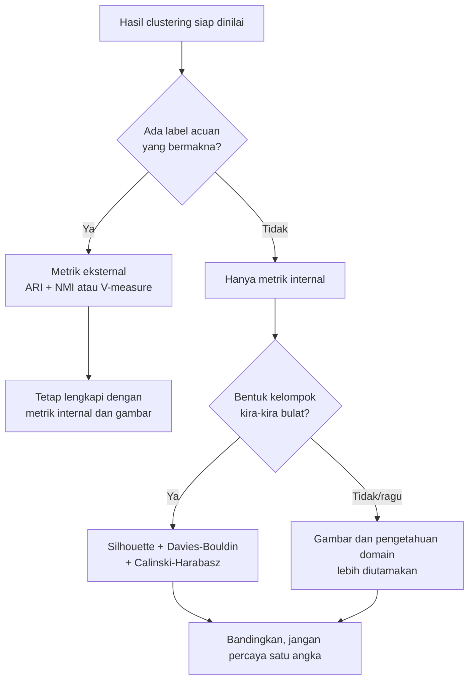
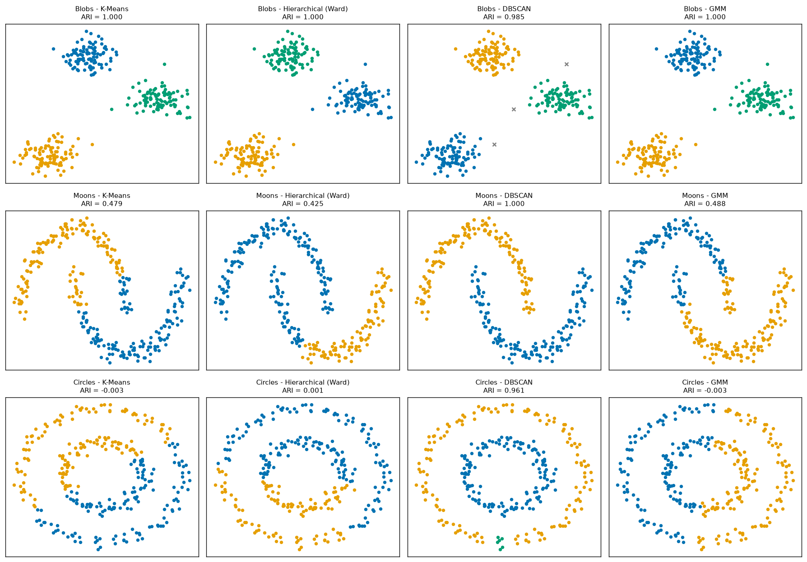
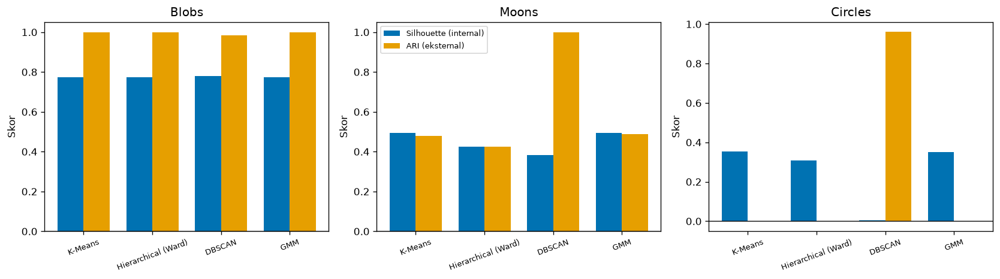

# Bab 8 — External Evaluation and Metric Comparison

## Learning Objectives

Setelah mempelajari bab ini, kamu mampu:

- [x] Menjelaskan apa itu *external evaluation*, apa itu *ground truth*, dan kapan evaluasi eksternal mungkin dilakukan.
- [x] Membedakan label hasil clustering dari label kelas sebenarnya, dan menjelaskan mengapa nomor kelompok bersifat sembarang (*cluster label permutation*).
- [x] Membaca tabel kontingensi antara kelas dan kelompok.
- [x] Menghitung dan menafsirkan *Adjusted Rand Index* (ARI), *Normalized Mutual Information* (NMI), *Homogeneity*, *Completeness*, dan *V-measure*.
- [x] Menjelaskan mengapa metrik eksternal harus **tidak peka terhadap permutasi label**, dan mengapa tidak boleh memakai *accuracy* langsung.
- [x] Menjelaskan keterbatasan evaluasi eksternal dan mengapa label acuan harus bermakna.
- [x] Membandingkan metrik internal dan eksternal pada hasil empat algoritma Level 4, termasuk saat keduanya tidak sepakat.
- [x] Memilih metrik evaluasi yang sesuai dengan situasi, dan bersiap untuk Level 6.

## Introduction

Sejauh ini, semua metrik kita (Inertia, Silhouette, Davies-Bouldin, Calinski-Harabasz) bersifat **internal**: mereka hanya melihat data dan hasil pengelompokan. Kadang kita punya informasi tambahan: **label acuan** yang menyatakan kelompok "sebenarnya". Contohnya jenis bunga yang dicatat ahli botani, atau topik berita yang diberi editor.

Jika label acuan ada, kita bisa bertanya hal yang lebih langsung: *"Seberapa cocok hasil clustering dengan label acuan itu?"* Inilah **evaluasi eksternal**.

Bab ini punya dua tugas. **Pertama**, mengenalkan lima metrik eksternal. **Kedua**, merangkum semua metrik Level 5 dalam satu eksperimen: kita menjalankan empat algoritma dari Level 4 pada tiga dataset, lalu menghitung metrik internal dan eksternal berdampingan. Hasilnya akan menunjukkan bahwa kedua jenis metrik **sering tidak sepakat**, dan itu pelajaran paling penting dari seluruh level ini.

!!! warning "Label acuan hanya untuk menilai"
    Pada semua contoh di bab ini, label acuan **tidak pernah diberikan ke algoritma clustering**. Algoritma hanya melihat data `X`. Label acuan baru dipakai setelah clustering selesai, hanya untuk menghitung skor.

!!! note "Prasyarat"
    Bab 1 sampai 7 Level 5, dan [Level 4](../clustering-algorithms/index.md) (K-Means, Hierarchical, DBSCAN, GMM).

## Fundamental Concepts

| Istilah | Arti |
|---|---|
| **Ground truth** | Label kelas yang dianggap "benar" untuk tiap data, biasanya dari manusia atau eksperimen |
| **Reference label** | Istilah yang lebih hati-hati untuk label acuan. Belum tentu "benar", hanya dipakai sebagai pembanding |
| **External evaluation** | Menilai clustering dengan membandingkannya dengan label acuan |
| **Predicted cluster** | Kelompok yang ditemukan algoritma. Nomornya sembarang |
| **Class label** | Kelas sebenarnya menurut label acuan |
| **Cluster label permutation** | Menukar nomor kelompok tanpa mengubah siapa saja anggotanya |
| **Contingency table** | Tabel yang menghitung berapa titik dari tiap kelas masuk ke tiap kelompok |
| **ARI** | *Adjusted Rand Index*. Mengukur kecocokan pasangan titik, dikoreksi terhadap kebetulan |
| **NMI** | *Normalized Mutual Information*. Mengukur seberapa banyak informasi tentang kelas yang diberikan kelompok |
| **Homogeneity** | Tiap kelompok hanya berisi satu kelas |
| **Completeness** | Tiap kelas masuk ke satu kelompok saja |
| **V-measure** | Rata-rata harmonik homogeneity dan completeness |

## Detailed Explanation

### Kapan evaluasi eksternal mungkin dilakukan?

Evaluasi eksternal hanya mungkin bila **ada label acuan yang bermakna**. Beberapa situasi:

- **Data benchmark** dengan label dari ahli (misalnya jenis bunga, digit tulisan tangan).
- **Data sintetis** yang kita bangkitkan sendiri, sehingga kelompok sebenarnya diketahui. Itu yang kita pakai di buku ini.
- **Sebagian data berlabel**, misalnya sebagian dokumen sudah diberi topik oleh editor.

Pada banyak kasus nyata (misalnya segmentasi pelanggan), **tidak ada** label acuan. Evaluasi eksternal tidak bisa dilakukan, dan kita bergantung pada metrik internal serta penilaian domain. Jadi metrik eksternal **tidak boleh dianggap selalu tersedia**.

### Label hasil clustering bukan label kelas

Ini sumber kebingungan terbesar bagi pemula. Pada klasifikasi, model memprediksi "kelas 0", "kelas 1", dan seterusnya, dan angka itu berarti sesuatu yang tetap. Pada clustering, angka hanya **penanda**.

Bayangkan data dengan tiga kelas, lalu K-Means menghasilkan pembagian yang **persis sama** dengan kelas sebenarnya, tetapi memberi nomor 2 untuk kelas yang kita sebut 0. Pembagiannya sempurna, namun jika nomor dibandingkan langsung, kecocokannya 0%.

!!! danger "Jangan membandingkan nomor kelompok langsung dengan label kelas"
    Jangan pernah menghitung `(labels == y).mean()` lalu menyebutnya akurasi clustering. Nomor kelompok ditentukan acak oleh algoritma. Gunakan metrik yang **tidak peka terhadap permutasi label**: ARI, NMI, Homogeneity, Completeness, V-measure.

Metrik yang dipakai di bab ini hanya melihat **siapa yang sekelompok dengan siapa**, bukan nomor kelompoknya. Menukar nomor tidak mengubah skor.

### Tabel kontingensi

Tabel kontingensi adalah fondasi semua metrik eksternal. Barisnya adalah kelas sebenarnya, kolomnya adalah kelompok hasil clustering, dan tiap sel menghitung berapa titik yang termasuk keduanya.

- Jika clustering sempurna, tiap baris hanya punya **satu sel berisi** (dan tiap kolom juga).
- Jika sel-sel terisi merata, kelompok tidak berkaitan dengan kelas.

### Adjusted Rand Index (ARI)

**Ide:** ambil setiap **pasangan** titik. Ada dua pertanyaan: apakah pasangan itu sekelas menurut label acuan? Apakah pasangan itu sekelompok menurut clustering? Jika jawabannya sama (keduanya "ya" atau keduanya "tidak"), pasangan itu cocok. *Rand Index* adalah persentase pasangan yang cocok.

Masalahnya, clustering acak pun akan punya banyak pasangan yang cocok secara kebetulan. ARI **mengoreksi** itu: nilainya sekitar **0** untuk pengelompokan acak dan **1** untuk kecocokan sempurna. ARI bisa **negatif** bila hasil lebih buruk dari acak.

| ARI | Arti |
|---|---|
| 1 | Pengelompokan identik dengan label acuan (nomor boleh beda) |
| Mendekati 0 | Tidak lebih baik dari acak |
| Negatif | Lebih jarang cocok dari yang diharapkan secara acak |

### Normalized Mutual Information (NMI)

**Ide:** dari teori informasi. Jika kamu tahu kelompok sebuah titik, seberapa banyak kamu tahu tentang kelas-nya? *Mutual information* mengukur pengurangan ketidakpastian itu. NMI menormalkannya ke rentang 0 sampai 1.

- 1: kelompok menentukan kelas dan sebaliknya.
- 0: kelompok tidak memberi informasi apa pun tentang kelas.

!!! note "NMI tidak dikoreksi terhadap kebetulan"
    Berbeda dengan ARI, NMI tidak dikoreksi terhadap kebetulan, sehingga pengelompokan dengan **sangat banyak kelompok kecil** cenderung mendapat NMI yang terlalu tinggi. Perhatikan jumlah kelompok saat membaca NMI.

### Homogeneity, Completeness, dan V-measure

Tiga metrik ini memecah pertanyaan "apakah cocok?" menjadi dua sisi:

- **Homogeneity:** apakah setiap kelompok hanya berisi anggota **satu kelas**? (Kelompok "murni".) Kelompok yang dicampur dua kelas menurunkan homogeneity.
- **Completeness:** apakah semua anggota **satu kelas** masuk ke **kelompok yang sama**? Kelas yang terpecah ke beberapa kelompok menurunkan completeness.
- **V-measure:** rata-rata harmonik keduanya, sehingga satu angka yang tinggi hanya bila **keduanya** tinggi.

Dua kasus ekstrem membantu mengingat:

| Kasus | Homogeneity | Completeness |
|---|---|---|
| Semua titik dalam **satu kelompok** | 0 (kelompok memuat semua kelas) | 1 (tiap kelas utuh di satu kelompok) |
| **Tiap titik** kelompok sendiri | 1 (tiap kelompok murni) | rendah (kelas terpecah) |

### Keterbatasan evaluasi eksternal

- **Label acuan belum tentu "benar".** Ia bisa salah, subjektif, atau menjawab pertanyaan yang berbeda dari yang dipelajari clustering.
- **Label acuan mungkin bukan struktur yang dicari.** Mengelompokkan pelanggan berdasarkan perilaku belanja lalu membandingkannya dengan jenis kelamin hanya menguji apakah perilaku belanja "kebetulan" sama dengan jenis kelamin.
- **Hanya mungkin bila label ada.** Pada kebanyakan masalah clustering, tidak ada.
- **Mengukur kecocokan, bukan kegunaan.** Clustering dengan ARI rendah bisa tetap berguna secara bisnis, dan sebaliknya.
- **Pada DBSCAN, noise perlu kebijakan.** Kita harus memutuskan apakah noise dianggap kelompok sendiri atau dikeluarkan.
- **Label sintetis terlalu rapi.** Data sintetis memberi label acuan yang bersih, yang jarang ada di dunia nyata.

### Internal vs eksternal

| | Internal | Eksternal |
|---|---|---|
| Butuh label acuan | Tidak | **Ya** |
| Yang diukur | Kompak dan terpisah | Kecocokan dengan label acuan |
| Selalu tersedia | Ya | Tidak |
| Bias bentuk | Menyukai kelompok bulat | Tidak punya bias bentuk (hanya melihat keanggotaan) |
| Risiko | Skor tinggi tanpa makna | Label acuan tidak bermakna |

### Perbandingan seluruh metrik Level 5

| Metrik | Jenis | Butuh label acuan | Rentang | Arah baik | Catatan utama |
|---|---|---|---|---|---|
| **Inertia** | Internal | Tidak | \( \ge 0 \) | Rendah | Khusus objektif centroid (K-Means). Turun saat K naik. Bergantung skala dan jumlah data |
| **Silhouette** | Internal | Tidak | -1 sampai 1 | Tinggi | Informasi per titik. Mahal. Menyukai kelompok bulat |
| **Davies-Bouldin** | Internal | Tidak | \( \ge 0 \) | **Rendah** | Berbasis centroid. Murah |
| **Calinski-Harabasz** | Internal | Tidak | \( > 0 \), tanpa batas atas | Tinggi | Bergantung jumlah data. Bisa terus naik pada data lemah |
| **ARI** | Eksternal | **Ya** | -1 sampai 1 (sekitar 0 = acak) | Tinggi | Dikoreksi kebetulan. Tidak peka permutasi |
| **NMI** | Eksternal | **Ya** | 0 sampai 1 | Tinggi | Tidak dikoreksi kebetulan. Tidak peka permutasi |
| **Homogeneity** | Eksternal | **Ya** | 0 sampai 1 | Tinggi | Kemurnian kelompok |
| **Completeness** | Eksternal | **Ya** | 0 sampai 1 | Tinggi | Kelas tidak terpecah |
| **V-measure** | Eksternal | **Ya** | 0 sampai 1 | Tinggi | Rata-rata harmonik homogeneity dan completeness |

### Memilih metrik evaluasi



Panduan ringkas:

- **Ada label bermakna:** gunakan ARI (utama) dan NMI atau V-measure. Lihat Homogeneity dan Completeness untuk tahu *jenis* kesalahannya.
- **Tidak ada label, kelompok kira-kira bulat:** Silhouette, DBI, CHI, dan elbow bila K-Means.
- **Kelompok melengkung atau berkepadatan berbeda:** hati-hati dengan metrik internal. Utamakan gambar dan pengetahuan domain, atau pakai metrik eksternal bila tersedia.
- **Hasil mengandung noise:** nyatakan perlakuan noise.
- **Selalu:** pakai lebih dari satu metrik, dan lihat gambar.

## Mathematical Foundation

### Adjusted Rand Index

Dari tabel kontingensi dengan sel \( n_{ij} \) (titik yang berada di kelas \( i \) dan kelompok \( j \)), jumlah baris \( a_i \) (ukuran kelas), dan jumlah kolom \( b_j \) (ukuran kelompok), dengan \( n \) total titik:

$$
\text{ARI} = \frac{\displaystyle \sum_{ij} \binom{n_{ij}}{2} - \frac{\left[ \sum_i \binom{a_i}{2} \right] \left[ \sum_j \binom{b_j}{2} \right]}{\binom{n}{2}}}{\displaystyle \frac{1}{2} \left[ \sum_i \binom{a_i}{2} + \sum_j \binom{b_j}{2} \right] - \frac{\left[ \sum_i \binom{a_i}{2} \right] \left[ \sum_j \binom{b_j}{2} \right]}{\binom{n}{2}}}
$$

\( \binom{m}{2} = \dfrac{m(m-1)}{2} \) adalah jumlah pasangan dari \( m \) titik. Pembilang: jumlah pasangan yang sekelas dan sekelompok, dikurangi nilai yang diharapkan **secara kebetulan**. Penyebut: nilai maksimum yang mungkin dikurangi nilai kebetulan yang sama.

### Entropi, mutual information, dan NMI

Misalkan \( C \) adalah label kelas dan \( K \) label kelompok. Peluangnya diambil dari proporsi: \( p_i = a_i / n \), \( q_j = b_j / n \), \( p_{ij} = n_{ij} / n \). Entropi mengukur ketidakpastian:

$$
H(C) = -\sum_i p_i \ln p_i, \qquad H(K) = -\sum_j q_j \ln q_j
$$

*Mutual information* mengukur informasi bersama:

$$
I(C; K) = \sum_{i,j} p_{ij} \ln \frac{p_{ij}}{p_i \, q_j}
$$

NMI di scikit-learn (rata-rata aritmetika sebagai bawaan):

$$
\text{NMI} = \frac{I(C; K)}{\tfrac{1}{2} \left[ H(C) + H(K) \right]}
$$

### Homogeneity, Completeness, V-measure

Dengan \( H(C \mid K) \) entropi kelas bila kelompok diketahui, dan \( H(K \mid C) \) entropi kelompok bila kelas diketahui:

$$
h = 1 - \frac{H(C \mid K)}{H(C)}, \qquad c = 1 - \frac{H(K \mid C)}{H(K)}, \qquad V = \frac{2hc}{h + c}
$$

\( h = 1 \) bila setiap kelompok hanya berisi satu kelas (\( H(C \mid K) = 0 \)). \( c = 1 \) bila setiap kelas masuk ke satu kelompok (\( H(K \mid C) = 0 \)). \( V \) adalah rata-rata harmonik keduanya. Dengan pengaturan bawaan, V-measure sama dengan NMI berbasis rata-rata aritmetika. Itu terlihat pada output (angka NMI dan V-measure selalu sama).

### Perhitungan manual

Sembilan titik. Kelas sebenarnya: \( [0,0,0,1,1,1,2,2,2] \). Hasil clustering: \( [0,0,1,1,1,1,2,2,0] \) (dua titik salah kelompok). Tabel kontingensinya:

| Kelas \ Kelompok | 0 | 1 | 2 | Jumlah baris \( a_i \) |
|---|---|---|---|---|
| 0 | 2 | 1 | 0 | 3 |
| 1 | 0 | 3 | 0 | 3 |
| 2 | 1 | 0 | 2 | 3 |
| Jumlah kolom \( b_j \) | 3 | 4 | 2 | 9 |

**ARI.**

- Pasangan di tiap sel: \( \binom{2}{2} + \binom{1}{2} + \binom{3}{2} + \binom{1}{2} + \binom{2}{2} = 1 + 0 + 3 + 0 + 1 = 5 \).
- Pasangan di baris: \( 3 \times \binom{3}{2} = 9 \). Pasangan di kolom: \( \binom{3}{2} + \binom{4}{2} + \binom{2}{2} = 3 + 6 + 1 = 10 \).
- Total pasangan: \( \binom{9}{2} = 36 \).
- Nilai kebetulan: \( \dfrac{9 \times 10}{36} = 2{,}5 \). Maksimum: \( \tfrac{1}{2}(9 + 10) = 9{,}5 \).

$$
\text{ARI} = \frac{5 - 2{,}5}{9{,}5 - 2{,}5} = \frac{2{,}5}{7} = 0{,}357
$$

**NMI.**

- \( H(C) = \ln 3 = 1{,}0986 \).
- \( H(K) = -\left[ \tfrac{3}{9}\ln\tfrac{3}{9} + \tfrac{4}{9}\ln\tfrac{4}{9} + \tfrac{2}{9}\ln\tfrac{2}{9} \right] = 1{,}0609 \).
- \( I(C;K) \): jumlahkan \( p_{ij} \ln \dfrac{p_{ij}}{p_i q_j} \) untuk sel tak nol: \( 0{,}1540 - 0{,}0320 + 0{,}2703 + 0 + 0{,}2441 = 0{,}6365 \).
- \( \text{NMI} = \dfrac{0{,}6365}{\tfrac{1}{2}(1{,}0986 + 1{,}0609)} = \dfrac{0{,}6365}{1{,}0797} = 0{,}590 \).

Kita akan mencocokkan keduanya dengan kode.

## Python Implementation

Skrip lengkapnya ada di `examples/level-5/08_external_evaluation_and_metric_comparison.py`, dan notebook-nya di `notebooks/level-5/08-external-evaluation-and-metric-comparison.ipynb`. **Setiap potongan kode diikuti penjelasannya.**

**Konteks masalah:** memahami metrik eksternal dari nol, lalu mengevaluasi empat algoritma Level 4 dengan metrik internal dan eksternal sekaligus.

**Dataset:**

- Sembilan titik berlabel acuan, untuk perhitungan manual.
- `make_blobs` (3 gerombol), `make_moons`, dan `make_circles`, masing-masing 300 titik dan **dengan label acuan dari pembangkit data**. Data distandarkan.
- Mall Customers (tanpa label acuan).

**Pustaka:** NumPy, pandas, Matplotlib, scikit-learn.

!!! note "Keterbatasan data sintetis"
    Label acuan pada data sintetis bersih dan tidak ambigu. Pada data nyata, label acuan jarang sebersih ini, dan skor eksternal biasanya lebih rendah.

### Bagian A — Siapkan alat

```python
--8<-- "level-5/08_external_evaluation_and_metric_comparison.py:setup"
```

**Penjelasan:** lima fungsi eksternal (`adjusted_rand_score`, `normalized_mutual_info_score`, `homogeneity_score`, `completeness_score`, `v_measure_score`) dan tiga fungsi internal diimpor dari `sklearn.metrics`. `contingency_matrix` membuat tabel kontingensi. `math.comb` menghitung jumlah pasangan. `GaussianMixture` dari `sklearn.mixture` dan `AgglomerativeClustering` melengkapi empat algoritma Level 4.

### Bagian B — Nomor kelompok itu sembarang

```python
--8<-- "level-5/08_external_evaluation_and_metric_comparison.py:permutation"
```

**Penjelasan:**

- `y_true` adalah label acuan. `pred_same` pengelompokan yang **identik** dengan label acuan. `pred_permuted` mengelompokkan data **dengan cara yang sama**, tetapi nomornya ditukar: kelas 0 menjadi 2, kelas 1 menjadi 0, kelas 2 menjadi 1.
- `(pred == true).mean()` menghitung proporsi posisi yang nomornya sama (`True` dihitung 1, `False` dihitung 0). Ini yang **tidak boleh** dipakai untuk menilai clustering.
- `adjusted_rand_score(y_true, pred)` dan `normalized_mutual_info_score(...)` menerima dua daftar label: **label acuan dulu, lalu hasil clustering**.

### Bagian C — Tabel kontingensi

```python
--8<-- "level-5/08_external_evaluation_and_metric_comparison.py:contingency"
```

**Penjelasan:** `pred_mixed` adalah hasil yang tidak sempurna (dua titik salah). `pd.crosstab(a, b)` membuat tabel hitungan silang. `pd.Series(..., name=...)` memberi nama pada baris dan kolom.

### Bagian D — ARI manual

```python
--8<-- "level-5/08_external_evaluation_and_metric_comparison.py:arimanual"
```

**Penjelasan baris demi baris:**

- `contingency_matrix(labels_true, labels_pred)` menghasilkan tabel kontingensi sebagai array. `n = cont.sum()` adalah jumlah titik.
- `comb(v, 2)` menghitung \( \binom{v}{2} \). `sum_cells` menjumlahkannya untuk setiap sel (`cont.ravel()` meratakan tabel). `sum_rows` untuk jumlah tiap baris (`cont.sum(axis=1)`), `sum_cols` untuk jumlah tiap kolom (`axis=0`).
- `expected` adalah nilai kebetulan, dan `maximum` adalah rata-rata `sum_rows` dan `sum_cols`.
- Hasil akhirnya `(sum_cells - expected) / (maximum - expected)`.
- Fungsi juga mencetak angka antara supaya bisa dicocokkan dengan hitungan manual.

### Bagian E — Homogeneity, completeness, V-measure

```python
--8<-- "level-5/08_external_evaluation_and_metric_comparison.py:hcv"
```

**Penjelasan:** empat kasus dibandingkan. `np.zeros(n, dtype=int)` membuat satu kelompok untuk semua titik. `np.arange(n)` membuat tiap titik kelompok sendiri. Dictionary `cases` dan perulangan membangun tabelnya.

### Bagian F — NMI manual

```python
--8<-- "level-5/08_external_evaluation_and_metric_comparison.py:nmimanual"
```

**Penjelasan baris demi baris:**

- `entropy(labels)` menghitung entropi: `np.unique(..., return_counts=True)` menghitung ukuran tiap label, lalu `p` adalah proporsinya. `-(p * np.log(p)).sum()` adalah \( -\sum p \ln p \).
- `nmi_manual`: `pij = cont / n` adalah peluang gabungan, `pi` peluang baris, `pj` peluang kolom. `pi @ pj` adalah perkalian matriks yang membentuk tabel \( p_i q_j \).
- `nonzero = pij > 0` melewati sel kosong (karena \( \ln 0 \) tidak terdefinisi, dan sel kosong tidak menyumbang apa pun).
- `mutual_info` adalah \( \sum p_{ij} \ln \frac{p_{ij}}{p_i q_j} \).
- Hasil akhirnya informasi bersama dibagi rata-rata dua entropi.

### Bagian G — Tiga dataset berlabel

```python
--8<-- "level-5/08_external_evaluation_and_metric_comparison.py:datasets"
```

**Penjelasan:**

- Setiap generator mengembalikan **data `X` dan label acuan `y`**. Label `y` hanya akan dipakai untuk menilai.
- `StandardScaler().fit_transform(X)` menyamakan skala (penting untuk algoritma berbasis jarak).
- `dbscan_eps` adalah `eps` untuk DBSCAN, dipilih sama (0,30) untuk ketiga dataset setelah melihat sebaran data. Kita tidak melakukan pencarian parameter di sini. Itu materi Level 6.

### Bagian H — Menjalankan empat algoritma

```python
--8<-- "level-5/08_external_evaluation_and_metric_comparison.py:algos"
```

**Penjelasan:** fungsi `run_algorithms` hanya menerima `X` dan jumlah kelompok `k`. **Label acuan tidak diberikan.** Keempat algoritma dibuat dengan pengaturan sederhana: `n_clusters=k` untuk K-Means dan Hierarchical, `eps=...` dan `min_samples=5` untuk DBSCAN, dan `n_components=k` untuk GMM (kelompok GMM diambil dengan `.predict(X)`). Setelah itu kita melaporkan berapa kelompok dan noise yang ditemukan DBSCAN.

### Bagian I — Tabel perbandingan

```python
--8<-- "level-5/08_external_evaluation_and_metric_comparison.py:tables"
```

**Penjelasan:**

- `internal_scores`: titik noise (`-1`) **dikeluarkan lebih dulu** dengan `mask = labels != -1`. Jika setelah itu kurang dari dua kelompok, hasilnya `NaN`.
- `external_scores`: di sini noise **tidak dikeluarkan**, tetapi diperlakukan sebagai satu kelompok tersendiri (label `-1`). Alasannya: setiap titik harus punya label agar tabel kontingensi lengkap.
- Inertia hanya dihitung untuk K-Means (`if algo == "K-Means"`), karena hanya K-Means yang meminimalkan objektif itu. Untuk algoritma lain, selnya `NaN`.
- Kita **tidak** menghitung semua metrik untuk semua algoritma tanpa pikir. Inertia dilewati, dan metrik internal dihitung pada titik non-noise.

```python
--8<-- "level-5/08_external_evaluation_and_metric_comparison.py:epssweep"
```

**Penjelasan:** kita mencoba beberapa nilai `eps` pada Circles untuk melihat kepekaan DBSCAN. Peringatan di komentar kode penting: memilih `eps` supaya ARI tinggi berarti **memakai label untuk menyetel model**, sehingga skor eksternal tidak jujur lagi. Di sini kita memakainya hanya untuk memperlihatkan kepekaan.

### Bagian J — Menggambar

```python
--8<-- "level-5/08_external_evaluation_and_metric_comparison.py:plotgrid"
```

**Penjelasan:** `plt.subplots(3, 4)` membuat kisi tiga dataset × empat algoritma. Titik noise DBSCAN digambar abu-abu bertanda `x`. Judul tiap panel memuat ARI.

```python
--8<-- "level-5/08_external_evaluation_and_metric_comparison.py:plotbars"
```

**Penjelasan:** diagram batang berdampingan: Silhouette (internal, biru) dan ARI (eksternal, oranye) untuk tiap algoritma pada tiap dataset. `ax.bar(posisi ± width/2, ...)` menempatkan dua batang berdampingan.

### Bagian K — Mall Customers: tanpa label acuan

```python
--8<-- "level-5/08_external_evaluation_and_metric_comparison.py:mall"
```

**Penjelasan:** hanya tiga algoritma (DBSCAN dilewati karena tidak kita setel di sini), dengan K = 5. Hanya metrik internal yang dihitung.

### Bagian L — Label acuan harus bermakna

```python
--8<-- "level-5/08_external_evaluation_and_metric_comparison.py:refgender"
```

**Penjelasan:** `Gender` adalah kolom yang ada di tabel, jadi kita bisa memakainya sebagai "label acuan". Tetapi apakah ia cocok sebagai jawaban benar untuk pengelompokan berdasarkan pendapatan dan skor belanja? Kita mengukurnya dengan ARI dan NMI.

## Code Explanation

| Bagian kode | Peran |
|---|---|
| `adjusted_rand_score(y_true, labels)` | ARI (urutan argumen: acuan, lalu hasil) |
| `normalized_mutual_info_score(...)` | NMI |
| `homogeneity_score`, `completeness_score`, `v_measure_score` | Homogeneity, completeness, V-measure |
| `contingency_matrix` / `pd.crosstab` | Tabel kontingensi |
| `mask = labels != -1` | Mengeluarkan noise untuk metrik internal |
| `if algo == "K-Means"` | Inertia hanya untuk objektif centroid |
| `fit_predict(X)` | **Pelatihan** (hanya X) |
| `*_score(y, labels)` | **Penilaian** (label acuan hanya di sini) |

!!! note "Pelatihan vs penilaian"
    Pelatihan algoritma clustering hanya memakai `X`. Label acuan `y` hanya muncul di fungsi penilaian. Jika kamu memberikan `y` kepada algoritma (misalnya dalam penyetelan parameter), skor eksternal menjadi bias.

## How to Run

Dari folder utama proyek (setelah mengaktifkan lingkungan virtual):

```powershell
pip install -r requirements-notebooks.txt
python examples/level-5/08_external_evaluation_and_metric_comparison.py
```

Skrip mencetak output ke terminal dan menyimpan dua gambar ke `docs/assets/level-5/`. Notebook interaktifnya:

```powershell
jupyter notebook notebooks/level-5/08-external-evaluation-and-metric-comparison.ipynb
```

Output di bawah berasal dari eksekusi nyata dengan Python 3.14, NumPy 2.5.4, pandas 3.1.1, scikit-learn 1.9.1, dan Matplotlib 3.11.2.

## Expected Output

```text
--8<-- "level-5/outputs/08.txt"
```

Gambar yang dihasilkan:





### Interpretasi output

**1. Nomor kelompok yang ditukar.** Kecocokan langsung bernilai **1,0** bila nomor sama dan **0,0** bila nomor ditukar, padahal pengelompokannya persis sama. ARI **1,0** dan NMI **1,0** pada kedua kasus. Inilah alasan kita memakai metrik yang tidak peka permutasi.

**2. Tabel kontingensi.** Kelas 1 seluruhnya (3 titik) masuk kelompok 1. Kelas 0 terbagi: 2 titik di kelompok 0, 1 titik di kelompok 1. Kelas 2: 1 titik di kelompok 0, 2 titik di kelompok 2.

**3. ARI manual cocok.** Pasangan sel **5**, baris **9**, kolom **10**, total pasangan **36**, nilai kebetulan **2,500**, maksimum **9,5**. ARI manual **0,3571**, sama dengan scikit-learn (**0,3571**).

**4. Homogeneity, completeness, V-measure.**

| Kasus | Homogeneity | Completeness | V-measure | NMI | ARI |
|---|---|---|---|---|---|
| Sempurna | 1,000 | 1,000 | 1,000 | 1,000 | 1,000 |
| Dua titik salah | 0,579 | 0,600 | 0,590 | 0,590 | 0,357 |
| Semua digabung (1 kelompok) | **0,000** | **1,000** | 0,000 | 0,000 | 0,000 |
| Tiap titik sendiri (9 kelompok) | **1,000** | **0,500** | 0,667 | 0,667 | 0,000 |

Dua kasus ekstrem sesuai teori. **Semua digabung:** completeness 1 (tiap kelas utuh di satu kelompok) tetapi homogeneity 0. **Tiap titik sendiri:** homogeneity 1 (tiap kelompok murni) tetapi completeness hanya 0,5. Perhatikan juga: pada kasus terakhir **NMI = 0,667 walau ARI = 0**. Itulah contoh NMI yang tidak dikoreksi terhadap kebetulan: banyak kelompok kecil memberi NMI yang terlihat lumayan. V-measure dan NMI identik di semua baris.

**5. NMI manual cocok.** \( H(\text{kelas}) = 1{,}0986 \), \( H(\text{kelompok}) = 1{,}0609 \), informasi bersama \( = 0{,}6365 \). NMI manual **0,5895**, sama dengan scikit-learn (**0,5895**).

**6. Tiga dataset.** Ketiganya punya 300 titik. Blobs: tiga kelas berukuran 100. Moons dan Circles: dua kelas berukuran 150. Pada `eps = 0,30`, DBSCAN menemukan **3 kelompok dan 3 noise** pada Blobs, **2 kelompok dan 0 noise** pada Moons, dan **3 kelompok dan 0 noise** pada Circles (satu kelompok ekstra).

**7. Blobs: semua metrik tinggi dan hampir sepakat.**

| Algoritma | Silhouette | DBI | CHI | ARI | NMI |
|---|---|---|---|---|---|
| K-Means | 0,773 | 0,313 | 2132,1 | 1,000 | 1,000 |
| Hierarchical (Ward) | 0,773 | 0,313 | 2132,1 | 1,000 | 1,000 |
| DBSCAN | 0,780 | 0,306 | 2263,3 | 0,985 | 0,974 |
| GMM | 0,773 | 0,313 | 2132,1 | 1,000 | 1,000 |

K-Means, Hierarchical, dan GMM menghasilkan pengelompokan yang sama (skor identik). DBSCAN punya skor **internal sedikit lebih tinggi** (Silhouette 0,780) tetapi skor **eksternal sedikit lebih rendah** (ARI 0,985). Penyebabnya terlihat: DBSCAN menandai 3 titik sebagai noise. Untuk metrik internal, titik-titik sulit itu **dikeluarkan**, sehingga skornya naik. Untuk ARI, ketiga noise itu dihitung sebagai kelompok tersendiri, yang menurunkan skor. Perbedaan perlakuan noise ini langsung terlihat pada angka. Inertia K-Means: 39,069.

**8. Moons: internal dan eksternal berlawanan arah.**

| Algoritma | Silhouette | DBI | CHI | ARI | NMI |
|---|---|---|---|---|---|
| K-Means | 0,495 | 0,806 | 417,4 | 0,479 | 0,382 |
| Hierarchical (Ward) | 0,425 | 0,845 | 286,2 | 0,425 | 0,467 |
| DBSCAN | 0,384 | 1,022 | 258,5 | **1,000** | **1,000** |
| GMM | 0,495 | 0,806 | 417,4 | 0,488 | 0,390 |

**DBSCAN mengenali kedua bulan dengan sempurna (ARI 1,000), tetapi mendapat skor internal terburuk** pada ketiga metrik. K-Means dan GMM mendapat skor internal terbaik tetapi ARI hanya sekitar 0,48. Ini sama dengan pelajaran Bab 2, 5, 6, dan 7: metrik internal menyukai kelompok bulat. Perhatikan pula bahwa untuk K-Means pada Moons, Homogeneity, Completeness, dan V-measure sama (0,382). Itu terjadi bila entropi kelas dan entropi kelompok sama, karena \( h = I/H(C) \) dan \( c = I/H(K) \).

**9. Circles: pertentangan paling tajam.**

| Algoritma | Silhouette | DBI | CHI | ARI | Homogeneity | Completeness |
|---|---|---|---|---|---|---|
| K-Means | 0,353 | 1,175 | 174,9 | -0,003 | 0,000 | 0,000 |
| Hierarchical (Ward) | 0,307 | 1,265 | 134,7 | 0,001 | 0,003 | 0,003 |
| DBSCAN | **0,004** | **24,334** | **5,2** | **0,961** | 1,000 | 0,892 |
| GMM | 0,350 | 1,184 | 172,4 | -0,003 | 0,000 | 0,000 |

K-Means, Hierarchical, dan GMM memotong lingkaran dari tengah, sehingga ARI mereka **sekitar 0** (setara pengelompokan acak, bahkan sedikit negatif). Tetapi metrik internal mereka tampak "lumayan" (Silhouette 0,3 sampai 0,35). DBSCAN menemukan lingkaran dengan baik (ARI 0,961), tetapi metrik internalnya **sangat buruk**: Silhouette 0,004, DBI 24,334, dan CHI 5,2. Alasannya jelas: lingkaran dalam dikelilingi lingkaran luar, sehingga titik di kelompok luar tidak dekat dengan centroid-nya.

Mengapa ARI DBSCAN 0,961, bukan 1,0? Homogeneity-nya **1,000** (tiap kelompok murni), tetapi completeness **0,892**: DBSCAN menemukan **3 kelompok**, jadi salah satu lingkaran terpecah menjadi dua (terlihat di gambar sebagai bagian kecil hijau pada lingkaran luar). Ini contoh bagaimana homogeneity dan completeness memberi tahu **jenis** kesalahan: kelompok tetap murni, tetapi satu kelas terpecah.

**10. Kepekaan `eps` pada Circles.**

| `eps` | Kelompok | Noise | ARI |
|---|---|---|---|
| 0,20 | 18 | 29 | 0,529 |
| 0,25 | 7 | 0 | 0,643 |
| 0,30 | 3 | 0 | 0,961 |
| 0,35 | 2 | 0 | **1,000** |
| 0,40 | 2 | 0 | **1,000** |

Hasil DBSCAN sangat bergantung pada `eps`. Dengan `eps` 0,35 atau 0,40, DBSCAN akan sempurna. Tetapi memilih `eps` dengan melihat ARI berarti menyetel model memakai label acuan, yang membuat skor tidak jujur. Pada data tanpa label, kita tidak bisa melakukannya, dan harus mengandalkan cara lain (misalnya grafik k-distance di Level 4, Bab 4) serta pengamatan visual. Pencarian parameter yang sistematis dibahas di Level 6.

!!! warning "Jangan menyimpulkan satu algoritma terbaik"
    Tabel di atas memperlihatkan: tidak ada algoritma yang menang di semua dataset atau semua metrik. DBSCAN tampak terbaik pada Moons dan Circles menurut ARI, tetapi terburuk menurut metrik internal. K-Means tampak terbaik menurut metrik internal pada Moons, tetapi hasilnya memotong bentuk data. Algoritma yang cocok bergantung pada bentuk data **dan** tujuan analisis.

**11. Mall Customers (tanpa label acuan).**

| Algoritma | Silhouette | DBI | CHI |
|---|---|---|---|
| K-Means | 0,555 | 0,572 | 248,649 |
| Hierarchical (Ward) | 0,554 | 0,578 | 244,410 |
| GMM | 0,554 | 0,576 | 244,940 |

Ketiganya nyaris identik: data ini punya struktur gerombol yang cukup jelas, sehingga algoritma berbeda menghasilkan pembagian yang mirip. Perbedaannya sangat kecil sehingga **skor internal tidak cukup untuk memilih salah satu**. Metrik eksternal tidak bisa dihitung karena tidak ada label acuan.

**12. Label acuan yang tidak bermakna.** ARI antara K-Means dan `Gender` adalah **-0,0006** dan NMI **0,0051**: praktis nol. Artinya pengelompokan berdasarkan pendapatan dan skor belanja **tidak berkaitan dengan jenis kelamin**. Ini bukan tanda clustering buruk, melainkan bahwa `Gender` bukan label acuan yang tepat untuk menilai pengelompokan ini. **Skor eksternal hanya berarti bila label acuan bermakna untuk pertanyaan yang dipelajari.**

## Practical Examples

**Benchmark algoritma baru.** Peneliti menguji algoritma clustering pada dataset berlabel (misalnya digit tulisan tangan) dan melaporkan ARI dan NMI. Itu lazim di makalah, dengan catatan label benar-benar acuan yang sah.

**Pelabelan sebagian.** Perusahaan hanya menandai 5% dokumen dengan topik. Mereka mengelompokkan seluruh dokumen, lalu memakai ARI pada 5% yang berlabel untuk memperkirakan mutu.

**Mengecek asumsi bisnis.** Bandingkan segmen hasil clustering dengan kategori yang sudah dipakai bisnis (misalnya paket langganan). ARI rendah berarti segmen bisnis lama tidak mencerminkan perilaku, dan itu juga informasi.

**Kontrol mutu pada data sintetis.** Saat mengembangkan metode, bangkitkan data sintetis dengan kelompok yang diketahui, lalu uji apakah metode memulihkannya (ARI mendekati 1).

## Hands-on Exercises

1. Ubah `pred_mixed` menjadi `[0,0,0,1,1,1,2,2,1]` (hanya satu titik salah). Berapa ARI, NMI, Homogeneity, dan Completeness-nya?
2. Jalankan DBSCAN pada Moons dengan `eps` 0,2 dan 0,5. Berapa kelompok, noise, dan ARI-nya?
3. Pada Blobs, jalankan K-Means (K = 3, `random_state=42`). Hitung `(labels == y_blobs).mean()` dan bandingkan dengan ARI.
4. Jalankan K-Means dengan K = 2 pada Mall Customers dan hitung ARI terhadap `Gender`. Apa artinya?
5. Jelaskan mengapa pada Circles hasil DBSCAN (`eps` 0,30) punya Homogeneity 1,000 tetapi Completeness 0,892.
6. Mengapa kita tidak bisa menghitung ARI pada Mall Customers?
7. Mengapa DBSCAN pada Circles tampak terburuk menurut Silhouette tetapi terbaik menurut ARI?

??? question "Jawaban"
    Hasil nomor 1 sampai 4 berasal dari eksekusi nyata.

    1. ARI **0,6429**, NMI **0,786**, Homogeneity **0,773**, Completeness **0,800**. Satu titik salah menaikkan semuanya dibanding dua titik salah (ARI 0,357).
    2. `eps = 0,2`: **3 kelompok, 5 noise, ARI 0,799**. `eps = 0,5`: **2 kelompok, 0 noise, ARI 1,000**. Hasil sangat bergantung pada `eps`.
    3. `(labels == y_blobs).mean()` adalah **0,333**, padahal ARI **1,000**. Tabel kontingensi `[[100, 0, 0], [0, 0, 100], [0, 100, 0]]` menunjukkan pengelompokan sempurna dengan nomor tertukar. Itulah alasan tidak memakai kecocokan langsung.
    4. ARI **-0,0039**, praktis nol: pengelompokan K = 2 tidak berkaitan dengan jenis kelamin.
    5. Setiap kelompok DBSCAN hanya berisi satu kelas (murni), sehingga homogeneity 1. Tetapi DBSCAN memecah satu lingkaran menjadi dua kelompok (3 kelompok untuk 2 kelas), sehingga satu kelas tersebar di dua kelompok dan completeness turun.
    6. ARI memerlukan label acuan, dan Mall Customers tidak punya label kelompok sebenarnya. Kita hanya bisa memakai metrik internal, atau membandingkan dengan label lain yang bermakna bila ada.
    7. Silhouette mengukur kekompakan dan keterpisahan menurut jarak, dan menyukai kelompok bulat. Dua lingkaran konsentris bukan kelompok bulat yang terpisah (lingkaran dalam dikelilingi lingkaran luar), sehingga Silhouette rendah walau pembagiannya benar. ARI hanya melihat keanggotaan, bukan bentuk.

## Troubleshooting

### Masalah teknis

| Masalah | Penyebab | Solusi |
|---|---|---|
| `ValueError: Found input variables with inconsistent numbers of samples` | Label acuan dan label hasil tidak sama panjang | Pastikan `len(y) == len(labels)` dan urutannya sama |
| ARI mendekati 0 padahal gambar tampak benar | Label acuan salah urut, atau acuan tidak bermakna | Periksa urutan data dan apakah label sesuai pertanyaanmu |
| Hasil metrik internal `NaN` pada DBSCAN | Setelah noise dikeluarkan, hanya tersisa satu kelompok | Periksa `eps` dan `min_samples` |
| Skor berbeda antar eksekusi | Seed tidak diatur | Pakai `random_state=42` |
| Angka berbeda dari output di bab | Versi pustaka berbeda | Bandingkan polanya |
| Menukar urutan argumen | `adjusted_rand_score` simetris, tetapi `homogeneity_score` dan `completeness_score` **tidak** | Selalu tulis `(label_acuan, label_hasil)` |

### Kesalahan umum

1. **Membandingkan nomor kelompok langsung dengan label kelas.** Gunakan metrik tak peka permutasi.
2. **Memberikan label acuan ke algoritma** (atau memakainya untuk menyetel parameter), lalu melaporkan skor eksternal seolah jujur.
3. **Menganggap label acuan selalu benar atau bermakna.** Pastikan ia relevan dengan pertanyaanmu.
4. **Mengira metrik eksternal selalu tersedia.** Pada banyak masalah clustering tidak ada label.
5. **Memercayai NMI tanpa melihat jumlah kelompok.** NMI tidak dikoreksi terhadap kebetulan.
6. **Tidak menyatakan perlakuan noise DBSCAN.** Pada Blobs, perlakuan noise mengubah arah selisih antara metrik internal dan eksternal.
7. **Memilih algoritma terbaik dari satu skor.** Tabel kita menunjukkan metrik bisa saling bertentangan.
8. **Menghitung Inertia untuk semua algoritma.** Inertia hanya bermakna untuk objektif berbasis centroid.
9. **Membandingkan skor antar dataset berbeda** seolah-olah punya patokan yang sama.

## Summary

- **Evaluasi eksternal** membandingkan hasil clustering dengan label acuan. Hanya mungkin bila label bermakna ada, dan label itu **tidak pernah** diberikan ke algoritma.
- Nomor kelompok **sembarang**: kecocokan langsung bernilai 0,0 pada pengelompokan yang sebenarnya sempurna. Gunakan metrik yang tidak peka permutasi: **ARI**, **NMI**, **Homogeneity**, **Completeness**, dan **V-measure**.
- **ARI** menghitung kecocokan pasangan titik dan dikoreksi terhadap kebetulan (0 = acak, 1 = sempurna). **NMI** berbasis informasi bersama tetapi tidak dikoreksi kebetulan. **Homogeneity** (kelompok murni) dan **Completeness** (kelas utuh) menunjukkan jenis kesalahan. V-measure adalah rata-rata harmonik keduanya.
- Perhitungan manual cocok dengan scikit-learn: ARI 0,3571 dan NMI 0,5895 pada sembilan titik.
- Pada eksperimen empat algoritma di tiga dataset, **metrik internal dan eksternal sering berlawanan**: DBSCAN sempurna pada Moons (ARI 1,000) tetapi terburuk menurut Silhouette (0,384), dan pada Circles ARI 0,961 dengan Silhouette 0,004.
- Perlakuan noise memengaruhi skor: pada Blobs, mengeluarkan 3 titik noise menaikkan skor internal DBSCAN sementara ARI-nya sedikit lebih rendah.
- DBSCAN sangat peka terhadap `eps`: 18 kelompok pada 0,20 dan 2 kelompok pada 0,35.
- Label acuan harus bermakna: ARI antara K-Means dan `Gender` pada Mall Customers hanya -0,0006.
- Tidak ada algoritma atau metrik yang terbaik di semua situasi. Gunakan beberapa metrik, gambar, dan pengetahuan domain.

### Persiapan untuk Level 6

Level 5 memberi kamu **alat ukur**. Level 6 (*Experimentation and Interpretation*) akan memakainya secara **sistematis**. Hal-hal yang akan dibahas di sana, dan sengaja tidak dilakukan di sini:

- **Desain eksperimen:** membandingkan algoritma dan parameter secara adil dan terencana.
- **Pencarian parameter:** menyetel `eps`, `K`, `min_samples`, dan lain-lain tanpa membocorkan label acuan.
- **Stabilitas:** mengulang dengan seed atau sampel berbeda, dan melihat apakah hasil bertahan.
- **Interpretasi:** menjelaskan arti tiap kelompok untuk keputusan nyata.
- **Pelaporan:** menyajikan hasil dengan jujur, termasuk ketidakpastian dan batasan metrik.

Bekal dari Level 5: arah tiap metrik, asumsinya, kapan ia menyesatkan, perlakuan noise, dan kebiasaan memakai lebih dari satu sudut pandang.

## References

- Hubert, L., & Arabie, P. (1985). Comparing partitions. *Journal of Classification*, 2(1), 193–218.
- Rand, W. M. (1971). Objective criteria for the evaluation of clustering methods. *Journal of the American Statistical Association*, 66(336), 846–850.
- Rosenberg, A., & Hirschberg, J. (2007). V-Measure: a conditional entropy-based external cluster evaluation measure. *Proceedings of EMNLP-CoNLL 2007*, 410–420.
- Vinh, N. X., Epps, J., & Bailey, J. (2010). Information theoretic measures for clusterings comparison: variants, properties, normalization and correction for chance. *Journal of Machine Learning Research*, 11, 2837–2854.
- Scikit-learn documentation: [*Clustering performance evaluation*](https://scikit-learn.org/stable/modules/clustering.html#clustering-performance-evaluation).
- Hennig, C. (2015). What are the true clusters? *Pattern Recognition Letters*, 64, 53–62.
