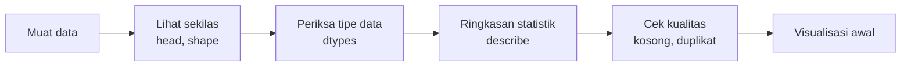
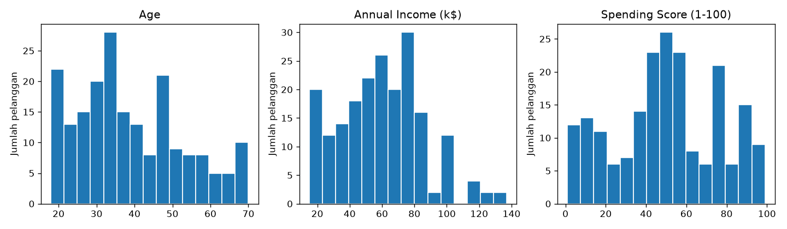
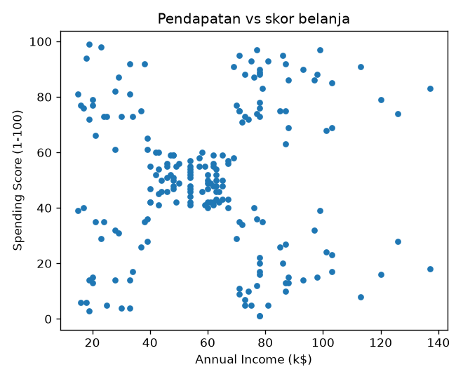

# Bab 1 — Introduction to Data Exploration

## Learning Objectives

Setelah mempelajari bab ini, kamu mampu:

- [x] Menjelaskan apa itu *data exploration* dan perbedaannya dengan *preprocessing*.
- [x] Menjelaskan mengapa clustering sangat bergantung pada kualitas data.
- [x] Membedakan *observation* (baris) dan *feature* (kolom) pada sebuah dataset.
- [x] Memuat file CSV dengan *pandas* dan memeriksanya dengan `head()`, `shape`, `dtypes`, dan `describe()`.
- [x] Melakukan pemeriksaan kualitas dasar: nilai kosong dan baris duplikat.
- [x] Membuat histogram dan *scatter plot* pertama untuk melihat bentuk data.

## Introduction

Pada **supervised learning**, kita punya label sebagai kunci jawaban. Model yang salah bisa langsung ketahuan karena prediksinya dibandingkan dengan label. Pada **clustering**, label itu tidak ada. Algoritma hanya mengelompokkan data berdasarkan kemiripan, dan hasil akhirnya hanya sebaik data yang masuk.

Karena itu, kebiasaan terpenting dalam clustering adalah **mengenal data sebelum memprosesnya**. Beberapa hal yang perlu dicek sebelum menjalankan algoritma apa pun:

- Berapa baris dan kolomnya?
- Apakah ada nilai yang kosong atau baris yang dobel?
- Apakah rentang nilai antar kolom sangat berbeda?
- Apakah datanya sudah tampak membentuk kelompok?

Bab ini membuka **Level 2** dengan latihan pertama: memuat dataset *Mall Customers* dan memeriksanya langkah demi langkah.

## Fundamental Concepts

| Istilah | Arti |
|---|---|
| **Dataset** | Kumpulan data dalam bentuk tabel |
| **Observation** (*record*, sampel) | Satu baris. Di sini: satu pelanggan |
| **Feature** (variabel, atribut) | Satu kolom. Di sini: usia, pendapatan, skor belanja |
| **Data exploration** | Memeriksa data untuk memahami isi, bentuk, dan masalahnya. **Belum mengubah** data |
| **Preprocessing** | Mengubah data agar siap dipakai algoritma: membersihkan, mengubah skala, mengubah kode |

Urutannya penting: **eksplorasi dulu, preprocessing sesudahnya.** Kita tidak bisa memperbaiki masalah yang belum kita lihat.

!!! note "Tentang dataset"
    **Mall Customers** berisi 200 pelanggan dengan lima kolom: `CustomerID`, `Gender`, `Age`, `Annual Income (k$)`, dan `Spending Score (1-100)`. Skor belanja diberikan oleh pihak mall (1–100, makin tinggi berarti makin sering dan banyak berbelanja). File ada di `data/mall_customers.csv`.

    Dataset ini populer sebagai contoh clustering, dan aslinya dipublikasikan di Kaggle. Salinan di repo ini diunduh dari mirror GitHub. Kalau kamu memakainya di luar belajar, periksa lisensi dataset di sumber aslinya.

## Detailed Explanation

### Alur eksplorasi dasar



1. **Muat data.** Baca file CSV menjadi tabel *pandas* yang disebut `DataFrame`.
2. **Lihat sekilas.** `head()` menampilkan beberapa baris pertama, `shape` memberi jumlah baris dan kolom.
3. **Periksa tipe data.** Angka (`int64`) dan teks (`str`/`object`) diperlakukan berbeda oleh algoritma. Pembahasan lengkapnya ada di Bab 2.
4. **Ringkasan statistik.** `describe()` menunjukkan rata-rata, simpangan baku, minimum, dan maksimum. Mulai dari sini kita bisa melihat apakah rentang antar kolom berbeda jauh (dibahas lebih dalam di Bab 3).
5. **Cek kualitas.** Hitung nilai kosong dan baris duplikat (Bab 5 dan 6).
6. **Visualisasi awal.** Histogram untuk bentuk sebaran tiap kolom, *scatter plot* untuk hubungan dua kolom (Bab 4).

### Peta Level 2

Bab ini hanya memperkenalkan semua langkah itu sekilas. Setiap langkah dibahas mendalam di bab sesudahnya, dan Level 2 berakhir dengan dataset yang siap di-*cluster* (Bab 12).

## Mathematical Foundation

Bab pengantar ini belum memerlukan rumus. Statistik ringkasan seperti rata-rata dan simpangan baku dibahas dengan rumusnya di Bab 3.

## Python Implementation

Skrip lengkap ada di `examples/level-2/01_explore_mall_customers.py`:

```python title="examples/level-2/01_explore_mall_customers.py"
--8<-- "level-2/01_explore_mall_customers.py"
```

Notebook versi interaktifnya ada di `notebooks/level-2/01-introduction-to-data-exploration.ipynb`.

## Code Explanation

| Bagian kode | Penjelasan |
|---|---|
| `ROOT = Path(__file__).resolve().parents[2]` | Mencari folder utama repo dari lokasi skrip, sehingga skrip bisa dijalankan dari folder mana pun |
| `pd.read_csv(DATA_PATH)` | Membaca file CSV menjadi `DataFrame` |
| `df.head()` | Menampilkan 5 baris pertama |
| `df.shape` | Pasangan `(jumlah baris, jumlah kolom)` |
| `df.dtypes` | Tipe data tiap kolom |
| `df.describe().round(2)` | Ringkasan statistik kolom numerik, dibulatkan dua desimal |
| `df.isna().sum()` | Menghitung nilai kosong per kolom |
| `df.duplicated().sum()` | Menghitung baris yang sama persis dengan baris sebelumnya |
| `df["Gender"].value_counts()` | Menghitung jumlah tiap nilai pada kolom kategori |
| `ax.hist(...)` | Histogram: seberapa sering tiap rentang nilai muncul |
| `ax.scatter(...)` | *Scatter plot*: satu titik per pelanggan |
| `matplotlib.use("Agg")` | Menyimpan gambar ke file tanpa membuka jendela |

## How to Run

```powershell
python -m venv .venv
.venv\Scripts\Activate.ps1
pip install -r requirements-notebooks.txt
python examples/level-2/01_explore_mall_customers.py
```

Skrip membuat dua gambar di `docs/assets/level-2/`. Untuk menjalankan notebook:

```powershell
jupyter notebook notebooks/level-2/01-introduction-to-data-exploration.ipynb
```

## Expected Output

Output berikut berasal dari eksekusi nyata skrip di atas (pandas 3.1.1, matplotlib 3.11.2, Python 3.14.7):

```text
Lima baris pertama:
   CustomerID  Gender  Age  Annual Income (k$)  Spending Score (1-100)
0           1    Male   19                  15                      39
1           2    Male   21                  15                      81
2           3  Female   20                  16                       6
3           4  Female   23                  16                      77
4           5  Female   31                  17                      40

Ukuran (baris, kolom): (200, 5)

Tipe data per kolom:
CustomerID                int64
Gender                      str
Age                       int64
Annual Income (k$)        int64
Spending Score (1-100)    int64
dtype: object

Ringkasan statistik:
       CustomerID     Age  Annual Income (k$)  Spending Score (1-100)
count      200.00  200.00              200.00                  200.00
mean       100.50   38.85               60.56                   50.20
std         57.88   13.97               26.26                   25.82
min          1.00   18.00               15.00                    1.00
25%         50.75   28.75               41.50                   34.75
50%        100.50   36.00               61.50                   50.00
75%        150.25   49.00               78.00                   73.00
max        200.00   70.00              137.00                   99.00

Jumlah nilai kosong per kolom:
CustomerID                0
Gender                    0
Age                       0
Annual Income (k$)        0
Spending Score (1-100)    0
dtype: int64

Jumlah baris duplikat: 0

Jumlah per Gender:
Gender
Female    112
Male       88
Name: count, dtype: int64
```

Gambar yang dihasilkan:





## Practical Examples

Beberapa temuan dari output di atas, dan artinya untuk clustering:

**1. Tidak ada nilai kosong dan tidak ada duplikat.** Dataset ini sudah bersih untuk dua pemeriksaan itu. Data nyata biasanya tidak seramah ini. Teknik menanganinya dibahas di Bab 5, 6, dan 8.

**2. Rentang tiap kolom berbeda.** Usia berkisar 18–70, pendapatan 15–137, skor belanja 1–99. Banyak algoritma clustering (misalnya K-Means) menghitung **jarak**, sehingga kolom dengan rentang besar bisa lebih mendominasi. Cara mengatasinya, *feature scaling*, dibahas di Bab 10.

**3. `CustomerID` bukan fitur yang bermakna.** Kolom ini hanya nomor urut (rata-ratanya 100,50 karena isinya 1 sampai 200). Memasukkannya ke clustering akan menyesatkan. Memilih kolom yang tepat dibahas di Bab 11.

**4. `Gender` berupa teks.** Algoritma jarak butuh angka, jadi kolom ini perlu diubah dulu (*encoding*, Bab 9).

**5. *Scatter plot* menunjukkan pola.** Pada grafik pendapatan vs skor belanja, titik-titik tampak terkumpul dalam beberapa gerombol, dengan satu gerombol padat di tengah. Ini baru **kesan visual** dari dua kolom saja, bukan hasil clustering. Kita belum menjalankan algoritma apa pun, dan jumlah kelompok sebenarnya perlu diuji secara sistematis di level berikutnya.

## Hands-on Exercises

1. Berapa banyak pelanggan berusia di atas 50 tahun? *(petunjuk: `(df["Age"] > 50).sum()`)*
2. Berapa rata-rata `Spending Score (1-100)` untuk `Female` dan untuk `Male`? *(petunjuk: `df.groupby("Gender")[...].mean()`)*
3. Tampilkan 5 pelanggan dengan pendapatan tertinggi. *(petunjuk: `sort_values`)*
4. Buat *scatter plot* `Age` vs `Spending Score (1-100)`. Apakah kamu melihat pola?
5. Sebutkan dua alasan mengapa `CustomerID` sebaiknya tidak dipakai sebagai fitur clustering.

??? question "Jawaban"
    Hasil berikut dari eksekusi nyata pada data ini:

    1. **40** pelanggan berusia di atas 50 tahun.
    2. Rata-rata skor belanja: `Female` **51,53** dan `Male` **48,51**. Selisihnya kecil.
    3. Pendapatan tertinggi adalah 137 (CustomerID 200 dan 199), disusul 126 (CustomerID 198 dan 197), lalu 120 (CustomerID 196).
    4. Koefisien korelasi `Age` dan `Spending Score (1-100)` adalah **−0,33**: ada kecenderungan lemah bahwa pelanggan yang lebih muda punya skor belanja lebih tinggi, tetapi titik-titiknya tetap tersebar. Buat grafiknya sendiri dan bandingkan dengan kesanmu.

    5. (a) `CustomerID` hanya nomor urut, tidak menggambarkan sifat pelanggan. (b) Nilainya bertambah teratur dari 1 sampai 200, sehingga bisa memengaruhi perhitungan jarak tanpa makna apa pun.

## Troubleshooting

| Masalah | Penyebab | Solusi |
|---|---|---|
| `FileNotFoundError: ... mall_customers.csv` | File belum ada atau lokasi salah | Pastikan `data/mall_customers.csv` ada di folder utama repo |
| `ModuleNotFoundError: No module named 'pandas'` | Pustaka belum terpasang di lingkungan aktif | Aktifkan `.venv`, lalu `pip install -r requirements-notebooks.txt` |
| Kolom teks tampil sebagai `object`, bukan `str` | Perbedaan versi pandas. Pandas 3 menampilkan `str`, versi lebih lama `object` | Bukan kesalahan. Keduanya berarti kolom teks |
| Angka di tabel sedikit berbeda | Versi pandas lain atau pembulatan | Bandingkan nilai `describe()`, bukan tampilan persisnya |
| Jendela grafik tidak muncul | Skrip memakai backend `Agg` yang hanya menyimpan file | Buka file PNG di `docs/assets/level-2/` atau jalankan notebook |

## Summary

- Clustering tidak punya label, jadi **kualitas data** menentukan kualitas hasil.
- **Eksplorasi** (memeriksa data) mendahului **preprocessing** (mengubah data).
- Pemeriksaan dasar dengan pandas: `head()`, `shape`, `dtypes`, `describe()`, `isna().sum()`, `duplicated().sum()`.
- Pada Mall Customers: 200 baris, 5 kolom, tidak ada nilai kosong atau duplikat. Rentang kolom berbeda, `CustomerID` bukan fitur bermakna, dan `Gender` berupa teks.
- Visualisasi awal memberi **kesan** tentang bentuk data, belum membuktikan apa pun.

## References

- pandas documentation: [*Getting started tutorials*](https://pandas.pydata.org/docs/getting_started/index.html) dan [`DataFrame.describe`](https://pandas.pydata.org/docs/reference/api/pandas.DataFrame.describe.html).
- Matplotlib documentation: [`hist`](https://matplotlib.org/stable/api/_as_gen/matplotlib.pyplot.hist.html) dan [`scatter`](https://matplotlib.org/stable/api/_as_gen/matplotlib.pyplot.scatter.html).
- Dataset *Customer Segmentation Tutorial in Python* (Mall Customers), Kaggle.
