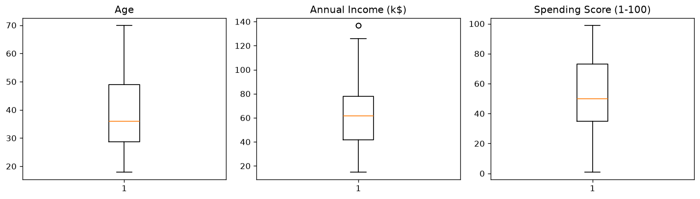
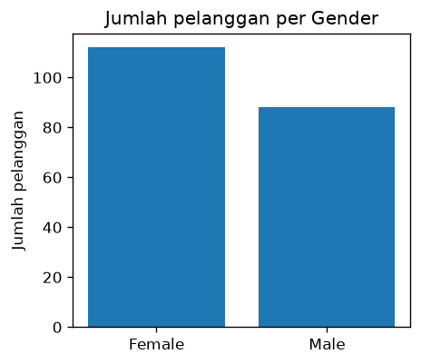
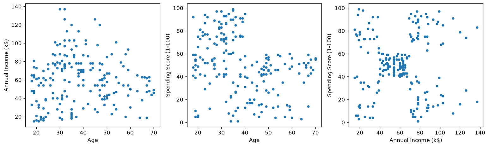
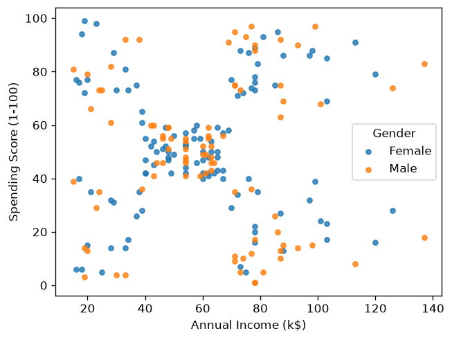
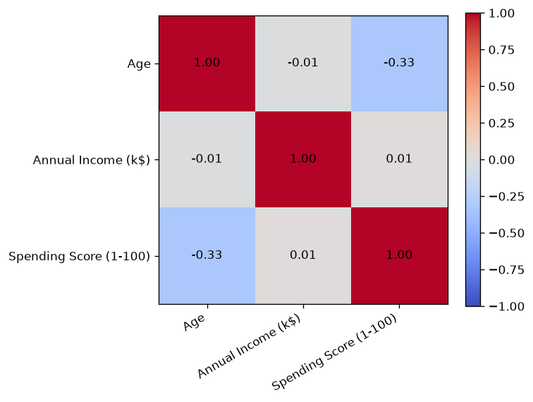
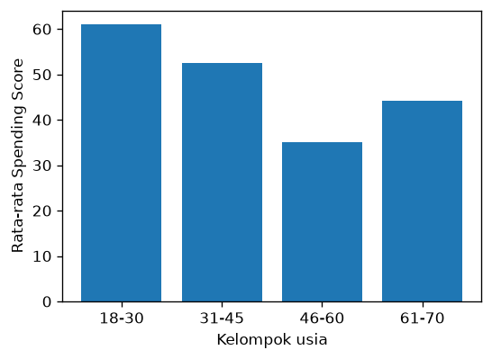

# Bab 4 — Exploratory Data Analysis

## Learning Objectives

Setelah mempelajari bab ini, kamu mampu:

- [x] Menjelaskan apa itu *Exploratory Data Analysis* (EDA) dan tujuannya.
- [x] Membaca *box plot* dan menemukan nilai yang mencurigakan.
- [x] Membuat dan membaca *scatter plot* untuk pasangan fitur.
- [x] Membuat diagram batang untuk kolom kategori.
- [x] Membaca *heatmap* korelasi.
- [x] Mengelompokkan angka menjadi kelompok (*binning*) dengan `pd.cut`.
- [x] Mencatat temuan EDA sebagai bekal untuk preprocessing.

## Introduction

Di Bab 3 kita melihat bahwa korelasi pendapatan dan skor belanja hanya 0,01, padahal gerombol-gerombol tampak jelas di grafik. Pelajarannya: **angka ringkasan saja tidak cukup. Kita perlu melihat data.**

**Exploratory Data Analysis (EDA)** adalah proses mempelajari data lewat **grafik dan ringkasan** untuk menemukan pola, keanehan, dan hal-hal yang perlu diperbaiki. Hasil EDA menentukan langkah preprocessing berikutnya.

## Fundamental Concepts

| Jenis grafik | Cocok untuk | Pertanyaan yang dijawab |
|---|---|---|
| **Histogram** | Satu kolom angka | Bagaimana sebaran nilainya? |
| **Box plot** | Satu kolom angka | Di mana nilai tengahnya? Adakah titik yang mencurigakan? |
| **Diagram batang** | Satu kolom kategori | Berapa banyak data di tiap kategori? |
| **Scatter plot** | Dua kolom angka | Apakah ada pola antar keduanya? Adakah gerombol? |
| **Heatmap korelasi** | Banyak kolom angka | Pasangan mana yang berhubungan? |

### Cara membaca box plot

Sebuah *box plot* merangkum sebaran dalam satu gambar:

- **Kotak** membentang dari `Q1` (25%) sampai `Q3` (75%). Jadi tingginya sama dengan IQR.
- **Garis di dalam kotak** adalah median.
- **Kumis** (garis ke atas dan ke bawah) menjangkau nilai-nilai yang masih dianggap "wajar".
- **Titik di luar kumis** adalah nilai yang **dicurigai** sebagai *outlier*. Bab 7 membahasnya.

## Detailed Explanation

EDA tidak punya urutan baku, tetapi alur berikut membantu pemula:

1. **Satu kolom sekaligus (univariat).** Histogram dan box plot untuk kolom angka, diagram batang untuk kolom kategori.
2. **Dua kolom sekaligus (bivariat).** *Scatter plot* untuk pasangan kolom angka. Tambahkan warna untuk membandingkan kelompok.
3. **Banyak kolom sekaligus.** Heatmap korelasi untuk gambaran umum.
4. **Catat temuan.** Apa yang aneh? Apa yang perlu dibersihkan atau diubah?

!!! tip "Tujuan EDA bukan membuat grafik indah"
    Setiap grafik harus menjawab satu pertanyaan. Kalau kamu tidak tahu apa yang dicari, mulai dari pertanyaan paling dasar: "Seperti apa bentuk data ini?"

## Mathematical Foundation

Bab ini tidak memerlukan rumus baru. Korelasi yang digambar pada heatmap adalah koefisien Pearson dari Bab 3.

## Python Implementation

Kita kerjakan dalam tujuh langkah kecil. **Setiap potongan kode diikuti penjelasannya.** Skrip lengkapnya ada di `examples/level-2/04_exploratory_data_analysis.py`, dan versi notebook-nya di `notebooks/level-2/04-exploratory-data-analysis.ipynb`.

### Langkah 1 — Siapkan alat dan muat data

```python
--8<-- "level-2/04_exploratory_data_analysis.py:setup"
```

**Penjelasan:**

- `pandas` untuk tabel, `matplotlib.pyplot` untuk grafik.
- `df` adalah tabel data, dan `fitur` adalah daftar tiga kolom angka yang akan kita periksa.

### Langkah 2 — Box plot

```python
--8<-- "level-2/04_exploratory_data_analysis.py:box"
```

**Penjelasan:**

- `plt.subplots(1, 3, ...)` membuat tiga grafik berdampingan dalam satu gambar.
- `for ax, col in zip(axes, fitur)` mengulang: tiap grafik (`ax`) dipasangkan dengan satu kolom (`col`).
- `ax.boxplot(df[col])` menggambar box plot untuk kolom itu.
- `fig.tight_layout()` merapikan jarak antar grafik supaya tidak bertumpuk.
- `plt.show()` menampilkan gambar.

### Langkah 3 — Diagram batang untuk Gender

```python
--8<-- "level-2/04_exploratory_data_analysis.py:bar"
```

**Penjelasan:**

- `value_counts()` menghitung jumlah tiap kategori. Hasilnya punya dua bagian: `.index` (nama kategori) dan `.values` (jumlahnya).
- `ax.bar(nama, jumlah)` menggambar satu batang per kategori.
- `set_ylabel` dan `set_title` memberi keterangan pada grafik.

### Langkah 4 — Scatter plot untuk tiap pasangan fitur

```python
--8<-- "level-2/04_exploratory_data_analysis.py:pairs"
```

**Penjelasan:**

- `pasangan` adalah daftar berisi tiga pasangan kolom. Tiap pasangan akan menjadi satu grafik.
- `for ax, (x, y) in zip(axes, pasangan)` mengulang untuk tiap grafik. Tanda kurung `(x, y)` memecah pasangan menjadi kolom sumbu-x dan kolom sumbu-y.
- `ax.scatter(df[x], df[y], s=14)` menggambar satu titik per pelanggan.

### Langkah 5 — Scatter plot berwarna menurut Gender

```python
--8<-- "level-2/04_exploratory_data_analysis.py:gender"
```

**Penjelasan:**

- `df.groupby("Gender")` membagi tabel menjadi dua kelompok. Loop `for nama, kelompok in ...` mengambil satu kelompok per putaran.
- Setiap kelompok digambar dengan warna sendiri, dan `label=nama` mencatat namanya untuk legenda.
- `alpha=0.8` membuat titik sedikit transparan, jadi titik yang bertumpuk masih terlihat.
- `ax.legend(title="Gender")` menampilkan kotak keterangan warna.

### Langkah 6 — Heatmap korelasi

```python
--8<-- "level-2/04_exploratory_data_analysis.py:heatmap"
```

**Penjelasan:**

- `df[fitur].corr()` menghitung matriks korelasi (Bab 3).
- `ax.imshow(korelasi, vmin=-1, vmax=1, cmap="coolwarm")` mewarnai tiap sel sesuai nilainya. `vmin=-1` dan `vmax=1` menetapkan rentang warna, jadi biru untuk negatif, merah untuk positif.
- `set_xticks` dan `set_yticks` menaruh nama kolom pada sumbu.
- Loop bersarang `for i ... for j ...` menulis angka korelasi di tengah tiap sel dengan `ax.text`. `:.2f` berarti dua angka di belakang koma.
- `fig.colorbar(gambar)` menambahkan skala warna di samping.

### Langkah 7 — Mengelompokkan usia

```python
--8<-- "level-2/04_exploratory_data_analysis.py:age"
```

**Penjelasan:**

- `pd.cut` memotong angka menjadi **kelompok** (*binning*). `bins=[17, 30, 45, 60, 70]` adalah batas-batasnya, dan `labels` adalah namanya. Jadi usia 18–30 masuk kelompok `"18-30"`, dan seterusnya. (Batas bawah 17 dipakai karena `pd.cut` menghitung kelompok dari **di atas** batas bawah, sehingga usia 18 ikut masuk.)
- Hasilnya disimpan sebagai kolom baru `Age Group`.
- `groupby("Age Group", observed=True)[...]` `.mean()` menghitung rata-rata skor belanja untuk tiap kelompok usia.
- Diagram batang menampilkan perbandingannya.

## Code Explanation

Ringkasan fungsi baru di bab ini:

| Perintah | Kegunaan |
|---|---|
| `ax.boxplot(data)` | Box plot |
| `ax.bar(nama, nilai)` | Diagram batang |
| `ax.scatter(x, y)` | Scatter plot |
| `ax.imshow(matriks)` | Menggambar matriks sebagai peta warna (heatmap) |
| `ax.legend()` | Kotak keterangan warna |
| `fig.colorbar(...)` | Skala warna |
| `pd.cut(kolom, bins, labels)` | Memotong angka menjadi kelompok |
| `for a, b in zip(x, y)` | Mengulang dua daftar secara berpasangan |

## How to Run

Jalankan dari **folder utama proyek**:

```powershell
python examples/level-2/04_exploratory_data_analysis.py
```

Skrip menyimpan enam gambar di `docs/assets/level-2/`. Untuk notebook:

```powershell
jupyter notebook notebooks/level-2/04-exploratory-data-analysis.ipynb
```

## Expected Output

Output teks dari eksekusi nyata skrip (pandas 3.1.1, matplotlib 3.11.2, Python 3.14.7):

```text
--8<-- "level-2/outputs/04.txt"
```

### Box plot



Angka `1` di bawah tiap kotak hanyalah nomor kotak, bukan data. Pada `Annual Income (k$)` terlihat **satu titik di atas kumis**, sekitar 137. Titik itu patut dicatat untuk Bab 7. `Age` dan `Spending Score (1-100)` tidak menampilkan titik di luar kumis.

### Diagram batang Gender



`Female` (112) sedikit lebih banyak dari `Male` (88).

### Scatter plot tiap pasangan



- **Age vs Annual Income**: titik tersebar tanpa pola yang jelas.
- **Age vs Spending Score**: pelanggan **yang lebih muda** (sekitar di bawah 40 tahun) punya skor belanja yang bisa sangat tinggi, sedangkan pelanggan yang lebih tua jarang melewati skor 60.
- **Annual Income vs Spending Score**: titik membentuk **gerombol-gerombol**. Satu gerombol padat ada di tengah, dan beberapa gerombol lain ada di sudut-sudut grafik.

### Berwarna menurut Gender



Warna `Female` dan `Male` bercampur di semua gerombol. Jadi `Gender` tampaknya bukan pembeda yang jelas pada pasangan ini.

### Heatmap korelasi



Isinya sama dengan matriks korelasi di Bab 3, hanya disajikan sebagai warna.

### Rata-rata skor belanja per kelompok usia



Rata-rata skor belanja: 61,03 (usia 18–30), 52,57 (31–45), 35,10 (46–60), dan 44,18 (61–70). Skor rata-rata cenderung turun dengan bertambahnya usia, tetapi tidak mulus: kelompok 61–70 sedikit naik lagi.

## Practical Examples

**Catatan temuan EDA** untuk dataset ini (inilah yang biasanya ditulis analis setelah EDA):

| Temuan | Tindak lanjut |
|---|---|
| Ada satu titik di atas kumis pada `Annual Income (k$)` | Periksa sebagai calon *outlier* (Bab 7) |
| Rentang tiga kolom berbeda jauh | Samakan skala (Bab 10) |
| `Gender` berupa teks dan tidak jelas pembedanya | Ubah ke angka bila dipakai (Bab 9), atau pertimbangkan tidak dipakai (Bab 11) |
| `Annual Income` vs `Spending Score` membentuk gerombol | Kandidat kuat untuk clustering |
| Usia berhubungan lemah dengan skor belanja (−0,33) | Pertimbangkan sebagai fitur tambahan (Bab 11) |
| Tidak ada nilai kosong dan duplikat (Bab 1) | Tidak perlu penanganan khusus |

!!! warning "Kesan visual belum bukti"
    Gerombol yang terlihat di *scatter plot* adalah **dugaan awal**. Berapa jumlah kelompok yang sebenarnya, dan apakah pembagiannya bermakna, harus diuji dengan algoritma dan evaluasi di level berikutnya.

## Hands-on Exercises

1. Buat histogram kolom `Annual Income (k$)` dengan `bins=10`, lalu `bins=30`. Apa bedanya?
2. Buat *scatter plot* `Age` vs `Annual Income (k$)` yang berwarna menurut `Gender`.
3. Ubah batas kelompok usia pada `pd.cut` menjadi `[17, 25, 35, 50, 70]`. Bagaimana rata-rata skor belanja per kelompoknya?
4. Pada *box plot*, apa arti titik di atas kumis?
5. Mengapa kita membuat grafik meskipun sudah menghitung korelasi?

??? question "Jawaban"
    1. `bins` kecil membuat histogram kasar dan menyembunyikan detail. `bins` besar memperlihatkan detail tetapi bisa tampak berantakan. Cobalah, lalu pilih jumlah `bins` yang paling mudah dibaca.
    2. Gunakan pola Langkah 5, dengan `"Age"` pada sumbu x dan `"Annual Income (k$)"` pada sumbu y.
    3. Hasilnya berupa angka dari data nyata, jadi jalankan sendiri (`df.groupby("Age Group", observed=True)[...]`) dan catat. Bandingkan apakah kecenderungan "turun lalu naik" tetap terlihat.
    4. Titik itu adalah nilai yang **jauh** dari bagian tengah data dan dicurigai sebagai *outlier*. Dicurigai belum berarti salah. Kita periksa dulu penyebabnya (Bab 7).
    5. Korelasi hanya menangkap hubungan garis lurus. Pada data ini, korelasi pendapatan dan skor belanja hanya 0,01, tetapi grafiknya menunjukkan gerombol yang jelas.

## Troubleshooting

| Masalah | Penyebab | Solusi |
|---|---|---|
| Grafik tidak muncul | Skrip menyimpan gambar ke file, bukan membuka jendela | Buka file PNG di `docs/assets/level-2/`, atau pakai notebook |
| `MatplotlibDeprecationWarning` | Memakai parameter lama, misalnya `vert=True` pada `boxplot` | Hapus parameter itu atau ikuti saran pada pesan peringatan |
| Label sumbu x saling menimpa | Nama kolom panjang | Putar label: `rotation=30, ha="right"` |
| `pd.cut` menghasilkan `NaN` untuk usia 18 | Batas bawah `bins` sama dengan nilai terkecil | Mulai `bins` dari angka di bawah nilai minimum (di sini 17) |
| `FutureWarning` pada `groupby` dengan kolom kelompok | Perilaku `observed` berubah antar versi | Tambahkan `observed=True` |

## Summary

- **EDA** = memahami data lewat grafik dan ringkasan, sebelum mengubahnya.
- Grafik utama: histogram, box plot, diagram batang, *scatter plot*, dan heatmap korelasi.
- Pada Mall Customers: ada satu titik di atas kumis pada `Annual Income (k$)`, rentang kolom berbeda jauh, `Gender` bercampur di semua gerombol, dan pendapatan vs skor belanja tampak membentuk gerombol.
- Gerombol yang terlihat baru **dugaan**, belum hasil clustering.
- Catat temuan EDA, karena itu menentukan langkah preprocessing di bab-bab berikutnya.

## References

- Tukey, J. W. (1977). *Exploratory Data Analysis*. Addison-Wesley.
- Matplotlib documentation: [*Pyplot tutorial*](https://matplotlib.org/stable/tutorials/pyplot.html) dan [`boxplot`](https://matplotlib.org/stable/api/_as_gen/matplotlib.pyplot.boxplot.html).
- pandas documentation: [`pandas.cut`](https://pandas.pydata.org/docs/reference/api/pandas.cut.html).
