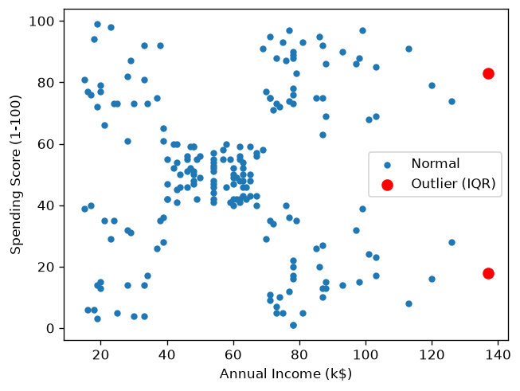

# Bab 7 — Outlier Detection and Handling

## Learning Objectives

Setelah mempelajari bab ini, kamu mampu:

- [x] Menjelaskan apa itu *outlier* dan mengapa ia memengaruhi clustering.
- [x] Mendeteksi outlier dengan **aturan IQR** dan dengan ***z-score***.
- [x] Membedakan outlier yang merupakan **kesalahan** dan outlier yang merupakan **data sah**.
- [x] Menangani outlier dengan membuang baris atau membatasi nilai (*capping*).
- [x] Membandingkan dampak tiap pilihan terhadap data.

## Introduction

**Outlier** adalah nilai yang **jauh berbeda** dari sebagian besar data lainnya. Misalnya, di antara pendapatan pelanggan yang rata-rata 60 ribu dolar, ada satu yang 137 ribu dolar.

Dalam clustering, outlier penting diperhatikan karena banyak algoritma berbasis jarak, seperti K-Means, **sangat peka** terhadapnya. Satu titik yang sangat jauh bisa menarik pusat kelompok ke arahnya, atau bahkan membentuk kelompok sendiri yang tidak bermakna.

Namun, ada satu hal yang sering membingungkan pemula:

!!! warning "Outlier tidak selalu salah"
    Nilai yang ekstrem belum tentu kesalahan. Bisa jadi itu pelanggan super kaya yang memang ada. Membuangnya otomatis berarti **menghapus informasi yang benar**. Tugas kita adalah **memahami** dulu, baru memutuskan.

## Fundamental Concepts

### Dua penyebab outlier

| Penyebab | Contoh | Penanganan umum |
|---|---|---|
| **Kesalahan data** | Usia 250 tahun karena salah ketik | Perbaiki atau buang |
| **Nilai ekstrem yang sah** | Pelanggan berpendapatan sangat tinggi | Biasanya dipertahankan, atau dibatasi jika mengganggu |

### Dua cara mendeteksi

| Metode | Ide | Kelebihan | Kekurangan |
|---|---|---|---|
| **Aturan IQR** | Nilai di luar `Q1 − 1,5 × IQR` atau `Q3 + 1,5 × IQR` | Tidak terlalu dipengaruhi oleh outlier itu sendiri | Batasnya konvensi, bukan hukum |
| **Z-score** | Hitung berapa simpangan baku sebuah nilai dari mean. Biasanya dianggap outlier jika \(\lvert z \rvert > 3\) | Mudah dipahami | Mean dan simpangan baku sendiri ikut terpengaruh outlier |

### Tiga pilihan penanganan

| Pilihan | Cara | Kapan cocok |
|---|---|---|
| **Pertahankan** | Tidak diubah | Nilainya sah dan algoritma tidak terlalu terganggu |
| **Buang baris** | Hapus baris outlier | Nilainya jelas kesalahan, atau jumlahnya sedikit dan tidak mewakili apa pun |
| **Batasi (*capping*)** | Ganti nilai ekstrem dengan batas atas/bawah | Ingin mengurangi pengaruh tanpa kehilangan baris |

## Detailed Explanation

### Aturan IQR

Dari Bab 3, `IQR = Q3 − Q1`. Titik di luar rentang berikut dianggap outlier:

\[
\text{batas bawah} = Q_1 - 1{,}5 \times \text{IQR}
\qquad
\text{batas atas} = Q_3 + 1{,}5 \times \text{IQR}
\]

Aturan inilah yang dipakai *box plot* untuk menggambar titik di luar kumis (Bab 4).

### Z-score

\(z\) menyatakan **berapa simpangan baku** sebuah nilai berada dari rata-rata. \(z = 0\) berarti tepat di rata-rata, \(z = 2\) berarti dua simpangan baku di atas rata-rata.

### Dua metode bisa memberi hasil berbeda

Sebuah nilai bisa terdeteksi oleh satu metode tetapi tidak oleh metode lain. Itu normal, karena kriteria dan sensitivitasnya berbeda. Pada dataset ini kita akan melihat hal itu langsung.

## Mathematical Foundation

**Z-score** sebuah nilai \(x\) dari data dengan mean \(\bar{x}\) dan simpangan baku \(s\):

$$
z = \frac{x - \bar{x}}{s}
$$

Nilai \(x\) dianggap outlier jika \(\lvert z \rvert > 3\) (konvensi yang umum).

**Capping** dengan batas bawah \(L\) dan batas atas \(U\):

$$
x' = \begin{cases} L & \text{jika } x < L \\ x & \text{jika } L \le x \le U \\ U & \text{jika } x > U \end{cases}
$$

## Python Implementation

Kita kerjakan dalam tujuh langkah kecil. **Setiap potongan kode diikuti penjelasannya.** Skrip lengkapnya ada di `examples/level-2/07_outliers.py`, dan versi notebook-nya di `notebooks/level-2/07-outlier-detection-and-handling.ipynb`.

### Langkah 1 — Siapkan alat dan muat data

```python
--8<-- "level-2/07_outliers.py:setup"
```

**Penjelasan:**

- Kita memanggil pandas (tabel) dan matplotlib (grafik), lalu membaca data ke `df`.
- `fitur` adalah tiga kolom angka yang akan diperiksa. `CustomerID` tidak ikut karena hanya nomor urut.

### Langkah 2 — Mendeteksi outlier dengan aturan IQR

```python
--8<-- "level-2/07_outliers.py:iqr"
```

**Penjelasan:**

- `quantile(0.25)` dan `quantile(0.75)` menghitung `Q1` dan `Q3` untuk tiap kolom. `iqr = q3 - q1`.
- `batas_bawah` dan `batas_atas` memakai rumus di atas. Angka `1.5` adalah konstanta konvensi.
- `df[fitur] < batas_bawah` membandingkan **setiap nilai** dengan batas bawah kolomnya. Hasilnya tabel `True/False`. Tanda `|` berarti "atau", jadi `di_luar` bernilai `True` jika nilainya di bawah batas bawah **atau** di atas batas atas.
- `di_luar.sum()` menghitung jumlah outlier per kolom.
- `di_luar.any(axis=1)` memeriksa per baris apakah ada minimal satu `True`. Dengan itu `df[...]` menampilkan baris-baris yang mengandung outlier.

### Langkah 3 — Mendeteksi outlier dengan z-score

```python
--8<-- "level-2/07_outliers.py:zscore"
```

**Penjelasan:**

- `df[fitur] - df[fitur].mean()` mengurangi tiap nilai dengan rata-rata kolomnya. Dibagi `df[fitur].std()` (simpangan baku), hasilnya adalah z-score, sesuai rumus.
- `.abs()` mengambil nilai mutlak, karena kita peduli jaraknya, bukan arahnya.
- `.max()` menampilkan |z| terbesar tiap kolom.
- `(z.abs() > 3).sum()` menghitung berapa nilai yang melewati batas 3.

### Langkah 4 — Melihat outlier pada grafik

```python
--8<-- "level-2/07_outliers.py:plot"
```

**Penjelasan:**

- `is_outlier = di_luar[kolom]` mengambil tanda `True/False` untuk kolom pendapatan.
- Tanda `~` berarti **kebalikan** ("bukan"). Jadi `df.loc[~is_outlier, kolom]` mengambil baris yang **bukan** outlier.
- Titik normal digambar kecil, titik outlier digambar besar dan **merah**, sehingga mudah terlihat.
- `ax.legend()` menampilkan keterangan warna.

### Langkah 5 — Pilihan 1: buang baris outlier

```python
--8<-- "level-2/07_outliers.py:remove"
```

**Penjelasan:**

- `~di_luar.any(axis=1)` berarti "baris yang **tidak** mengandung outlier".
- `df[...]` hanya mempertahankan baris-baris itu. Kita bandingkan ukuran sebelum dan sesudah.

### Langkah 6 — Pilihan 2: batasi nilai (capping)

```python
--8<-- "level-2/07_outliers.py:cap"
```

**Penjelasan:**

- `df.copy()` membuat salinan, supaya data asli tidak berubah.
- `clip(lower=..., upper=...)` memotong nilai: yang di bawah batas bawah dinaikkan ke batas bawah, yang di atas batas atas diturunkan ke batas atas. Nilai di antaranya tidak berubah.
- Berbeda dengan Pilihan 1, jumlah baris **tetap 200**. Hanya nilainya yang dibatasi.

### Langkah 7 — Bandingkan ketiga pilihan

```python
--8<-- "level-2/07_outliers.py:compare"
```

**Penjelasan:**

- `agg(["count", "mean", "std", "max"])` menghitung empat ringkasan sekaligus untuk satu kolom.
- Kita membuat satu tabel perbandingan: data asli, setelah baris dibuang, dan setelah dibatasi.
- Tujuannya melihat **seberapa besar** pengaruh tiap pilihan.

## Code Explanation

Ringkasan fungsi baru di bab ini:

| Perintah | Kegunaan |
|---|---|
| `kolom.quantile(0.25)` | Kuartil pertama |
| `(a < b) \| (a > c)` | Kondisi "atau" |
| `~kondisi` | Kebalikan kondisi |
| `tabel.any(axis=1)` | Apakah ada `True` pada tiap baris |
| `df.loc[kondisi, kolom]` | Mengambil baris dan kolom tertentu |
| `kolom.clip(lower, upper)` | Membatasi nilai |
| `kolom.agg([...])` | Beberapa ringkasan sekaligus |
| `kolom.abs()` | Nilai mutlak |

## How to Run

Jalankan dari **folder utama proyek**:

```powershell
python examples/level-2/07_outliers.py
```

Skrip menyimpan satu gambar di `docs/assets/level-2/`. Untuk notebook:

```powershell
jupyter notebook notebooks/level-2/07-outlier-detection-and-handling.ipynb
```

## Expected Output

Output berikut berasal dari eksekusi nyata skrip di atas (pandas 3.1.1, matplotlib 3.11.2, Python 3.14.7):

```text
--8<-- "level-2/outputs/07.txt"
```



**Cara membaca output:**

- **Aturan IQR** menemukan **2 outlier**, keduanya di `Annual Income (k$)`: pelanggan nomor 199 dan 200, dengan pendapatan 137. Batas atasnya 132,75. `Age` dan `Spending Score (1-100)` tidak punya outlier.
- **Z-score** tidak menemukan satu pun. |z| terbesar hanya 2,91 (pada `Annual Income (k$)`), masih di bawah 3.
- **Dua metode berbeda hasil.** Nilai 137 melewati batas IQR, tetapi belum melewati batas z-score 3. Keduanya benar menurut kriterianya masing-masing.
- **Buang baris**: 200 → 198 baris.
- **Capping**: baris tetap 200, dan nilai maksimum pendapatan turun dari 137 menjadi 132,75.
- **Dampaknya kecil.** Rata-rata pendapatan: asli 60,56, dibuang 59,79, dibatasi 60,52. Simpangan baku: 26,26 → 25,24 → 26,14.

## Practical Examples

**Apakah dua pelanggan ini harus dibuang?** Mari kita bernalar:

- Nilainya **masuk akal**: pendapatan 137 ribu dolar bukan angka mustahil. Tidak tampak sebagai salah ketik.
- Hanya **2 dari 200 baris (1%)**, dan dampaknya pada rata-rata kecil.
- Pada *scatter plot*, titik merah berada di tepi kanan, tetapi tetap dekat dengan pola pelanggan lainnya.

Kesimpulan yang masuk akal: **mempertahankannya** adalah pilihan yang wajar. Kalau nanti hasil clustering terpengaruh oleh dua titik ini, kita bisa mencoba *capping*. Ini adalah **keputusan berdasarkan penilaian**, bukan aturan mutlak.

**Pelajaran pentingnya:** jangan membuang data hanya karena sebuah rumus menyuruhnya. Jawab dulu pertanyaan: "Apakah nilai ini mungkin terjadi di dunia nyata?"

**Kalau ada kesalahan data.** Seandainya ada `Age = 250`, itu jelas salah dan layak diperbaiki atau dibuang. Di dataset ini tidak ada nilai seperti itu: usia berkisar 18–70 dan skor belanja 1–99.

## Hands-on Exercises

1. Ubah pengali `1.5` menjadi `3` pada aturan IQR. Berapa outlier yang terdeteksi sekarang?
2. Ubah batas z-score dari 3 menjadi 2,5. Berapa nilai pada `Annual Income (k$)` yang melewatinya?
3. Mengapa membuang outlier tidak selalu pilihan terbaik?
4. Setelah *capping*, apakah jumlah baris berubah? Apa bedanya dengan membuang baris?
5. Bayangkan kolom `Age` berisi nilai 250. Apakah ini outlier yang sah? Apa langkahmu?

??? question "Jawaban"
    1. Dengan pengali 3, batas atas pendapatan menjadi `78 + 3 × 36,5 = 187,5`. Karena nilai tertinggi hanya 137, **tidak ada** outlier yang terdeteksi pada kolom ini. Jalankan dan cocokkan.
    2. Hasil nyata dari `(z.abs() > 2.5).sum()`: **2** nilai pada `Annual Income (k$)`, yaitu pelanggan nomor 199 dan 200 (yang sama dengan hasil aturan IQR). `Age` dan `Spending Score (1-100)` tetap 0.
    3. Karena outlier bisa berupa data sah yang berisi informasi penting. Membuangnya berarti menghapus informasi yang benar dan bisa membuat hasil tidak mewakili kenyataan.
    4. Jumlah baris **tidak berubah** (tetap 200). Capping hanya mengubah nilai, sedangkan membuang menghapus barisnya.
    5. Usia 250 tidak mungkin. Itu kesalahan data. Periksa sumbernya, perbaiki jika bisa (misalnya salah ketik 25), dan buang jika tidak bisa diperbaiki.

## Troubleshooting

| Masalah | Penyebab | Solusi |
|---|---|---|
| `TypeError: bad operand type for unary ~` | Memakai `~` pada angka, bukan pada `True/False` | Pastikan kondisinya hasil perbandingan |
| `ValueError: The truth value of a Series is ambiguous` | Memakai `and`/`or` pada Series | Pakai `&` (dan) dan `\|` (atau), dengan tanda kurung di tiap kondisi |
| Outlier terdeteksi pada kolom `CustomerID` | Kolom ID ikut dihitung | Pilih hanya kolom fitur: `df[fitur]` |
| Setelah dibuang, indeks melompat | Baris dihapus tetapi nomornya dipertahankan | `reset_index(drop=True)` |
| Metode IQR dan z-score berbeda hasil | Kriterianya berbeda | Wajar. Pilih satu sebagai acuan dan periksa kasusnya secara manual |

## Summary

- **Outlier** = nilai yang jauh dari mayoritas data. Ia bisa memengaruhi clustering berbasis jarak.
- Deteksi: **aturan IQR** dan **z-score**. Hasilnya bisa berbeda.
- Penanganan: pertahankan, buang baris, atau batasi nilai (*capping*).
- **Pahami dulu, baru putuskan.** Outlier bisa berupa kesalahan, bisa juga data sah.
- Pada Mall Customers: aturan IQR menandai 2 pelanggan (pendapatan 137), z-score tidak menandai satu pun, dan dampaknya pada rata-rata kecil. Mempertahankannya adalah pilihan yang masuk akal.

## References

- Tukey, J. W. (1977). *Exploratory Data Analysis*. Addison-Wesley. (asal aturan 1,5 × IQR)
- Aggarwal, C. C. (2017). *Outlier Analysis* (2nd ed.). Springer.
- pandas documentation: [`Series.clip`](https://pandas.pydata.org/docs/reference/api/pandas.Series.clip.html).
