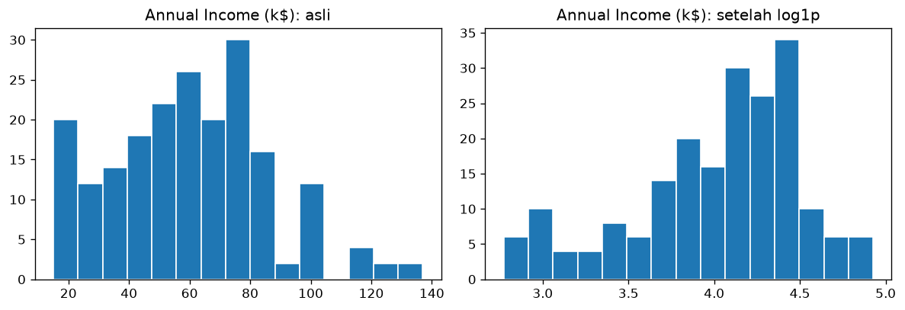

# Bab 9 — Data Transformation and Encoding

## Learning Objectives

Setelah mempelajari bab ini, kamu mampu:

- [x] Menjelaskan mengapa kolom teks harus diubah menjadi angka sebelum clustering.
- [x] Menerapkan *binary encoding* dengan `map()` dan *one-hot encoding* dengan `pd.get_dummies()`.
- [x] Menjelaskan mengapa memberi kode 0, 1, 2 pada kategori tanpa urutan bisa menyesatkan.
- [x] Menerapkan transformasi logaritma dan menilai apakah ia membantu.
- [x] Mengelompokkan angka menjadi kategori (*binning*) dengan `pd.cut()`.

## Introduction

Algoritma clustering berbasis jarak hanya mengerti **angka**. Kolom `Gender` berisi teks `Female` dan `Male`, jadi harus diubah dulu. Proses mengubah kategori menjadi angka disebut ***encoding***.

Selain itu, kadang **bentuk sebaran** angka perlu diubah supaya lebih cocok untuk algoritma. Ini disebut ***transformation***. Contohnya transformasi logaritma yang menekan nilai-nilai besar.

Dua topik ini sering ditaruh dalam satu bab karena sama-sama **mengubah representasi data** tanpa mengubah maknanya.

## Fundamental Concepts

### Teknik encoding

| Teknik | Cara | Cocok untuk |
|---|---|---|
| **Binary encoding** | Dua kategori menjadi 0 dan 1 | Kolom dengan **dua** nilai, misalnya `Gender` |
| **One-hot encoding** | Satu kolom baru (0/1) untuk **setiap** kategori | Kolom kategori **tanpa urutan** dengan banyak nilai |
| **Ordinal encoding** | Kategori menjadi 1, 2, 3 sesuai urutan | Kolom yang **punya urutan**, misalnya kecil, sedang, besar |

### Mengapa tidak asal memberi nomor?

Kalau kita memberi kode `Jakarta = 0`, `Bandung = 1`, `Surabaya = 2`, algoritma jarak menganggap Jakarta lebih dekat ke Bandung (selisih 1) daripada ke Surabaya (selisih 2). Padahal ketiga kota itu **setara**, tanpa urutan. Kita secara tidak sengaja **menciptakan urutan palsu**. *One-hot encoding* menghindari masalah ini.

### Transformasi sebaran

| Transformasi | Rumus | Efek |
|---|---|---|
| **Logaritma** | \(\log(1 + x)\) | Menekan nilai besar, berguna untuk sebaran yang miring ke kanan |
| **Akar kuadrat** | \(\sqrt{x}\) | Efek serupa tetapi lebih lembut |
| **Binning** | Memotong angka menjadi kelompok | Mengubah angka menjadi kategori berurutan |

## Detailed Explanation

### Kapan perlu transformasi?

Transformasi log paling berguna ketika **sebaran sangat miring ke kanan**, misalnya pendapatan atau harga rumah, di mana sebagian besar nilai kecil tetapi ada ekor panjang nilai sangat besar. Setelah di-log, ekor itu memendek.

!!! warning "Transformasi bukan jimat"
    Transformasi hanya berguna jika masalahnya ada. Pada data kita, `Annual Income (k$)` ternyata **tidak sangat miring** (skewness 0,32). Kita akan lihat bahwa log malah membuatnya miring ke arah sebaliknya. Selalu **periksa hasilnya**, jangan menerapkan transformasi secara otomatis.

### Jebakan one-hot

- **Jumlah kolom bertambah.** Kolom dengan 50 kategori menjadi 50 kolom baru.
- **Kolom `drop_first`.** Kadang satu kolom dibuang karena informasinya bisa disimpulkan dari yang lain (jika `Gender_Female = 0`, pasti `Male`). Untuk clustering, biasanya kita **menyimpan semua** agar jaraknya simetris.

## Mathematical Foundation

**Transformasi logaritma** yang aman untuk nilai nol:

$$
x' = \ln(1 + x)
$$

Di NumPy, fungsinya `np.log1p(x)`. Menambah 1 mencegah \(\ln(0)\) yang tidak terdefinisi.

**One-hot encoding** untuk sebuah kategori dengan \(K\) nilai mengubah satu nilai menjadi vektor sepanjang \(K\) yang berisi satu angka 1 dan sisanya 0. Misalnya `Male` menjadi \((0, 1)\) dan `Female` menjadi \((1, 0)\) pada urutan kolom `Gender_Female`, `Gender_Male`.

## Python Implementation

Kita kerjakan dalam tujuh langkah kecil. **Setiap potongan kode diikuti penjelasannya.** Skrip lengkapnya ada di `examples/level-2/09_transformation_encoding.py`, dan versi notebook-nya di `notebooks/level-2/09-data-transformation-and-encoding.ipynb`.

### Langkah 1 — Siapkan alat dan muat data

```python
--8<-- "level-2/09_transformation_encoding.py:setup"
```

**Penjelasan:**

- `numpy` (`np`) menyediakan fungsi matematika seperti logaritma. `pandas` mengolah tabel, `matplotlib` membuat grafik.
- Dua baris `pd.set_option` hanya mengatur tampilan agar tabel lebar tidak terpotong.
- `df` adalah tabel data pelanggan.

### Langkah 2 — Binary encoding dengan `map`

```python
--8<-- "level-2/09_transformation_encoding.py:binary"
```

**Penjelasan:**

- `df.copy()` membuat salinan agar tabel asli tidak berubah.
- `map({"Female": 0, "Male": 1})` mengganti setiap nilai menurut kamus: `Female` menjadi 0, `Male` menjadi 1.
- Hasilnya disimpan di kolom baru `Gender_code`. Kolom `Gender` asli tidak dihapus.
- `value_counts()` memastikan jumlahnya sama dengan sebelumnya: 112 untuk kode 0 dan 88 untuk kode 1.

### Langkah 3 — One-hot encoding dengan `get_dummies`

```python
--8<-- "level-2/09_transformation_encoding.py:onehot"
```

**Penjelasan:**

- `pd.get_dummies(df, columns=["Gender"], dtype=int)` mengganti kolom `Gender` dengan **satu kolom per kategori**: `Gender_Female` dan `Gender_Male`.
- Setiap baris punya angka `1` pada kolom kategorinya dan `0` pada yang lain.
- `dtype=int` membuat isinya angka 0/1. Tanpa ini, pandas versi baru mengisinya `True`/`False`.
- Perhatikan `columns.tolist()`: `Gender` hilang, digantikan dua kolom baru.

### Langkah 4 — Mengapa nomor urut bisa menipu

```python
--8<-- "level-2/09_transformation_encoding.py:order"
```

**Penjelasan:**

- Ini demonstrasi kecil, **bukan dari data pelanggan**. Kita memberi kode 0, 1, 2 pada tiga kota.
- `abs(a - b)` menghitung selisih mutlak, yaitu jarak pada garis bilangan.
- Hasilnya: Jakarta tampak "lebih dekat" ke Bandung (1) dibanding ke Surabaya (2), padahal ketiganya setara. Inilah **urutan palsu** yang dihasilkan oleh pengkodean nomor.

### Langkah 5 — Transformasi logaritma

```python
--8<-- "level-2/09_transformation_encoding.py:log"
```

**Penjelasan:**

- `np.log1p(income)` menghitung \(\ln(1 + x)\) untuk setiap nilai pendapatan.
- `skew()` mengukur kemiringan (Bab 3). Kita bandingkan nilainya sebelum dan sesudah transformasi.
- Rentang nilai juga ditampilkan: dari 15–137 menjadi sekitar 2,77–4,93. Rentangnya menyusut karena log menekan nilai besar.

### Langkah 6 — Melihat efek pada grafik

```python
--8<-- "level-2/09_transformation_encoding.py:plot"
```

**Penjelasan:**

- Dua histogram berdampingan: kiri sebelum, kanan sesudah transformasi.
- `axes[0]` dan `axes[1]` adalah grafik pertama dan kedua.
- Kita membandingkan **bentuk** sebarannya dengan mata, bukan hanya angka skewness.

### Langkah 7 — Binning: mengelompokkan angka

```python
--8<-- "level-2/09_transformation_encoding.py:binning"
```

**Penjelasan:**

- `pd.cut` memotong angka menjadi kelompok. `bins` adalah batas-batasnya, `labels` adalah namanya.
- Hasilnya kolom baru `Age Group` yang bertipe kategori.
- `value_counts().sort_index()` menghitung anggota tiap kelompok, lalu mengurutkannya sesuai urutan kelompok.
- Ingat: setelah di-*binning*, kolomnya kategori, jadi untuk clustering ia perlu di-*encode* lagi. Selain itu, binning **membuang detail** (usia 18 dan 30 dianggap sama).

## Code Explanation

Ringkasan fungsi baru di bab ini:

| Perintah | Kegunaan |
|---|---|
| `kolom.map({...})` | Mengganti nilai menurut kamus |
| `pd.get_dummies(df, columns=[...], dtype=int)` | One-hot encoding |
| `np.log1p(x)` | \(\ln(1 + x)\) |
| `kolom.skew()` | Kemiringan sebaran |
| `pd.cut(kolom, bins, labels)` | Binning |
| `kolom.value_counts().sort_index()` | Menghitung kategori, diurutkan menurut kategori |

## How to Run

Jalankan dari **folder utama proyek**:

```powershell
python examples/level-2/09_transformation_encoding.py
```

Skrip menyimpan satu gambar di `docs/assets/level-2/`. Untuk notebook:

```powershell
jupyter notebook notebooks/level-2/09-data-transformation-and-encoding.ipynb
```

## Expected Output

Output berikut berasal dari eksekusi nyata skrip di atas (pandas 3.1.1, numpy, matplotlib 3.11.2, Python 3.14.7):

```text
--8<-- "level-2/outputs/09.txt"
```



**Cara membaca output:**

- **Binary encoding**: `Female` menjadi 0 (112 orang), `Male` menjadi 1 (88 orang).
- **One-hot**: kolom `Gender` diganti `Gender_Female` dan `Gender_Male`.
- **Urutan palsu**: jarak Jakarta–Bandung 1, Jakarta–Surabaya 2, padahal setara.
- **Log**: skewness pendapatan **sebelum 0,32, sesudah −0,74**. Nilainya tidak membaik: sebaran sekarang miring ke **kiri** (ekor panjang di sisi nilai kecil), dan secara angka lebih jauh dari 0 dibanding sebelumnya. Rentang menyusut dari 15–137 menjadi 2,77–4,93.
- **Pada grafik**: histogram asli punya ekor tipis di kanan. Setelah log, ekor itu memendek tetapi muncul ekor di kiri.
- **Binning**: 62 pelanggan di kelompok 18–30, 72 di 31–45, 49 di 46–60, dan 17 di 61–70.

## Practical Examples

**Keputusan untuk `Gender`.** Karena hanya dua nilai, *binary encoding* atau *one-hot* sama-sama bisa dipakai. Untuk clustering, ingat bahwa kolom 0/1 punya rentang 0–1, jauh lebih kecil dari `Annual Income` (15–137). Tanpa penyamaan skala (Bab 10), kolom ini hampir tidak berpengaruh pada jarak.

**Keputusan untuk log pendapatan.** Berdasarkan hasil di atas, transformasi log **tidak membantu** pada kolom ini: skewness tidak mendekati 0, malah menjauh. Maka kita **tidak menerapkannya** pada `Annual Income (k$)`. Ini contoh keputusan berdasarkan bukti, bukan kebiasaan.

**Kapan log berguna.** Kalau suatu kolom berekor panjang di kanan, misalnya pendapatan pada populasi umum dengan sedikit orang sangat kaya, skewness bisa bernilai besar (misalnya di atas 1) dan log biasanya membantu. Dataset ini tidak seperti itu.

**Kapan binning berguna.** Binning membantu **menjelaskan** hasil (misalnya "kelompok usia 18–30"). Namun untuk clustering, mempertahankan angka aslinya biasanya lebih baik karena tidak membuang detail.

## Hands-on Exercises

1. Lakukan one-hot encoding pada kolom `Age Group` (hasil binning). Berapa kolom baru yang terbentuk?
2. Terapkan `np.sqrt` pada `Annual Income (k$)`, lalu bandingkan skewness-nya dengan log.
3. Mengapa one-hot lebih tepat daripada kode 0, 1, 2 untuk kota?
4. Jika `Gender` di-*one-hot*, mengapa kita tidak harus membuang salah satu kolomnya untuk clustering?
5. Terapkan `np.log1p` pada `Spending Score (1-100)`. Apakah skewness-nya membaik?

??? question "Jawaban"
    1. Ada empat kelompok (`18-30`, `31-45`, `46-60`, `61-70`), jadi terbentuk **4** kolom baru. Gunakan `pd.get_dummies(df_bin, columns=["Age Group"], dtype=int)`.
    2. Jalankan sendiri. `sqrt` efeknya lebih lembut dari log, tetapi karena sebaran pendapatan tidak sangat miring, hasilnya juga tidak perlu diharapkan banyak berubah.
    3. Kode 0, 1, 2 menciptakan urutan dan jarak palsu antar kota. One-hot membuat setiap kota berjarak sama dari yang lain.
    4. Dengan menyimpan kedua kolom, kedua kategori berjarak sama dari titik asal, sehingga perlakuannya simetris. Membuang satu kolom membuat satu kategori berada di titik asal dan yang lain tidak, sehingga perlakuannya tidak seimbang dalam perhitungan jarak.
    5. Jalankan `np.log1p(df["Spending Score (1-100)"]).skew()` dan bandingkan dengan −0,05 (nilai asli di Bab 3). Skor belanja sudah hampir simetris, jadi log kemungkinan besar tidak berguna.

## Troubleshooting

| Masalah | Penyebab | Solusi |
|---|---|---|
| Hasil `get_dummies` berisi `True`/`False` | Pandas versi baru memakai `bool` bawaan | Tambahkan `dtype=int` |
| `map` menghasilkan `NaN` | Ada nilai di kolom yang tidak ada dalam kamus (misalnya beda huruf besar-kecil) | Bersihkan teks dulu (Bab 8) dan periksa `unique()` |
| `RuntimeWarning: divide by zero` pada `np.log` | Ada nilai 0 | Pakai `np.log1p` |
| Log menghasilkan `NaN` | Ada nilai negatif | Log tidak bisa untuk nilai negatif. Geser data dulu atau pakai transformasi lain |
| Jumlah kolom membengkak setelah one-hot | Kategori terlalu banyak | Gabungkan kategori jarang, atau pertimbangkan teknik lain |

## Summary

- Algoritma jarak butuh angka, jadi kategori harus di-*encode*.
- **Binary** untuk dua nilai, **one-hot** untuk kategori tanpa urutan, **ordinal** untuk kategori berurutan.
- Kode 0, 1, 2 pada kategori tanpa urutan menciptakan urutan palsu.
- Transformasi log berguna untuk sebaran sangat miring ke kanan. **Periksa hasilnya**: pada `Annual Income (k$)` log malah menambah kemiringan (0,32 menjadi −0,74), jadi tidak dipakai.
- *Binning* mempermudah penjelasan tetapi membuang detail.

## References

- pandas documentation: [`pandas.get_dummies`](https://pandas.pydata.org/docs/reference/api/pandas.get_dummies.html) dan [`pandas.cut`](https://pandas.pydata.org/docs/reference/api/pandas.cut.html).
- NumPy documentation: [`numpy.log1p`](https://numpy.org/doc/stable/reference/generated/numpy.log1p.html).
- scikit-learn documentation: [*Preprocessing data*](https://scikit-learn.org/stable/modules/preprocessing.html).
