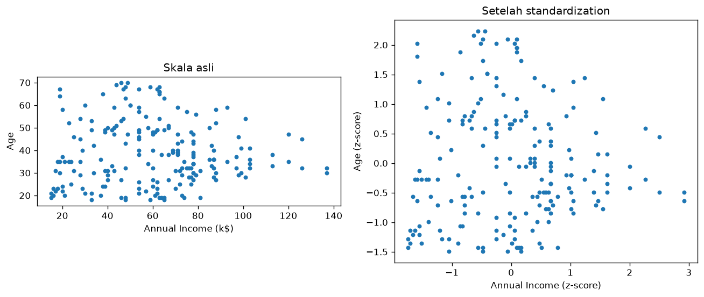

# Bab 10 — Feature Scaling

## Learning Objectives

Setelah mempelajari bab ini, kamu mampu:

- [x] Menjelaskan mengapa kolom dengan rentang besar bisa mendominasi perhitungan jarak.
- [x] Menerapkan ***Min-Max scaling*** dan ***Standardization*** (z-score), baik dengan rumus maupun dengan scikit-learn.
- [x] Membedakan kapan memakai masing-masing.
- [x] Memeriksa bahwa hasil penskalaan benar.
- [x] Menjelaskan hubungan penskalaan dengan clustering berbasis jarak.

## Introduction

Dari Bab 3, kita tahu rentang tiga kolom kita sangat berbeda: usia 18–70, pendapatan 15–137, skor belanja 1–99. Algoritma seperti K-Means mengukur **jarak** antar pelanggan. Kolom dengan angka besar menyumbang lebih banyak pada jarak, **bukan karena lebih penting, tetapi karena satuannya lebih besar**.

Bayangkan menghitung jarak dengan mencampur meter dan milimeter. Selisih 1 meter dan selisih 1 milimeter dihitung sebagai "1", padahal 1.000 kali berbeda. ***Feature scaling*** menyamakan "satuan" semua kolom agar adil.

## Fundamental Concepts

| Teknik | Hasil | Cocok untuk |
|---|---|---|
| **Min-Max scaling** | Semua nilai masuk rentang **0 sampai 1** | Saat ingin rentang tetap dan terbatas |
| **Standardization** (z-score) | Rata-rata **0**, simpangan baku **1** | Pilihan umum untuk clustering berbasis jarak |
| **Robust scaling** | Memakai median dan IQR | Saat ada banyak outlier. (Hanya disebut di sini, tidak dipraktikkan) |

### Mengapa penting untuk clustering

Jarak Euclidean antara dua titik \(a\) dan \(b\) dengan tiga fitur:

$$
d(a, b) = \sqrt{(a_1 - b_1)^2 + (a_2 - b_2)^2 + (a_3 - b_3)^2}
$$

Selisih yang besar (karena satuannya besar) **membesarkan kuadratnya**, sehingga fitur itu menguasai \(d\).

## Detailed Explanation

### Min-Max: menekan ke rentang 0–1

Nilai terkecil menjadi 0, terbesar menjadi 1, dan nilai lain berada di antaranya secara proporsional.

- **Kelebihan:** hasilnya mudah dibayangkan, dan rentangnya pasti.
- **Kekurangan:** sangat dipengaruhi **outlier**. Satu nilai ekstrem menentukan batas atas dan menekan semua nilai lain mendekati 0.

### Standardization: berpusat di 0

Nilai dinyatakan sebagai **berapa simpangan baku dari rata-rata**. Nilai 0 berarti tepat di rata-rata, +1 berarti satu simpangan baku di atas.

- **Kelebihan:** tidak membatasi rentang, dan lebih tahan pada outlier dibanding Min-Max.
- **Kekurangan:** nilainya tidak berada di rentang tetap.

### Mana yang dipakai?

Tidak ada jawaban tunggal. Untuk clustering berbasis jarak seperti K-Means, **standardization** adalah titik awal yang umum. Min-Max juga wajar. Yang penting: **semua kolom diskalakan dengan cara yang sama**, dan kamu tahu alasannya.

!!! tip "Kolom hasil one-hot"
    Kolom 0/1 hasil *one-hot encoding* (Bab 9) sudah berada di rentang 0–1. Apakah perlu diskalakan lagi tergantung strategi. Dibahas saat menyusun dataset final (Bab 12).

## Mathematical Foundation

**Min-Max scaling:**

$$
x' = \frac{x - x_{\min}}{x_{\max} - x_{\min}}
$$

**Standardization (z-score):**

$$
z = \frac{x - \mu}{\sigma}
$$

dengan \(\mu\) rata-rata dan \(\sigma\) simpangan baku kolom.

!!! note "Dua versi simpangan baku"
    Scikit-learn (`StandardScaler`) memakai pembagi \(n\) (populasi), sedangkan `df.std()` pandas memakai \(n-1\) (sampel). Itu sebabnya, pada hitungan manual kita menulis `std(ddof=0)` supaya sama dengan scikit-learn. Selisihnya sangat kecil untuk data sebesar ini.

## Python Implementation

Kita kerjakan dalam enam langkah kecil. **Setiap potongan kode diikuti penjelasannya.** Skrip lengkapnya ada di `examples/level-2/10_feature_scaling.py`, dan versi notebook-nya di `notebooks/level-2/10-feature-scaling.ipynb`.

### Langkah 1 — Siapkan alat dan muat data

```python
--8<-- "level-2/10_feature_scaling.py:setup"
```

**Penjelasan:**

- Kita memanggil pandas dan matplotlib, lalu membaca data ke `df`.
- `fitur` adalah tiga kolom yang akan diskalakan. `CustomerID` tidak ikut karena hanya nomor urut.
- `X = df[fitur]` adalah tabel yang berisi **hanya tiga kolom itu**. Mulai sekarang, kita bekerja dengan `X`.

### Langkah 2 — Masalah: rentang dan varians berbeda

```python
--8<-- "level-2/10_feature_scaling.py:raw"
```

```text title="Output"
--8<-- "level-2/outputs/10/raw.txt"
```

**Penjelasan:**

- `X.agg(["min", "max"])` menampilkan nilai terkecil dan terbesar tiap kolom.
- `X.var()` menghitung **varians** (kuadrat simpangan baku). Varians mengukur seberapa menyebar sebuah kolom, dan sangat menentukan sumbangan kolom itu pada jarak antar titik.
- `varians / varians.sum() * 100` menghitung **porsi** tiap kolom dari total varians, dalam persen.
- Kalau porsi tiap kolom jauh berbeda, jarak akan didominasi kolom dengan porsi terbesar.

### Langkah 3 — Min-Max scaling

```python
--8<-- "level-2/10_feature_scaling.py:minmax"
```

```text title="Output"
--8<-- "level-2/outputs/10/minmax.txt"
```

**Penjelasan:**

- `(X - X.min()) / (X.max() - X.min())` adalah rumus Min-Max, diterapkan pada semua kolom sekaligus.
- `X.min()` menghasilkan nilai terkecil **per kolom**, jadi pandas otomatis mengurangi tiap kolom dengan nilai minimumnya sendiri.
- `head().round(3)` menampilkan 5 baris pertama dengan tiga angka di belakang koma.
- `agg(["min", "max"])` membuktikan bahwa setiap kolom sekarang berada tepat di antara 0 dan 1.

### Langkah 4 — Standardization

```python
--8<-- "level-2/10_feature_scaling.py:standard"
```

```text title="Output"
--8<-- "level-2/outputs/10/standard.txt"
```

**Penjelasan:**

- `(X - X.mean()) / X.std(ddof=0)` adalah rumus z-score. `ddof=0` memakai pembagi \(n\), sama dengan scikit-learn.
- Kita memeriksa **rata-rata** dan **simpangan baku** hasilnya. Rata-ratanya hampir 0 (`-0.000` karena pembulatan, bukan negatif sungguhan), dan simpangan baku 1,003.
- Angka 1,003, bukan tepat 1, muncul karena `agg(["std"])` memakai pembagi \(n-1\), sedangkan kita menskalakan dengan pembagi \(n\). Itu hanya beda definisi, bukan kesalahan.

### Langkah 5 — Hasil yang sama dengan scikit-learn

```python
--8<-- "level-2/10_feature_scaling.py:sklearn"
```

```text title="Output"
--8<-- "level-2/outputs/10/sklearn.txt"
```

**Penjelasan:**

- `MinMaxScaler()` dan `StandardScaler()` adalah alat siap pakai dari scikit-learn untuk dua rumus tadi.
- `fit_transform(X)` melakukan dua hal sekaligus: **belajar** parameter (min/max atau mean/std) lalu **menerapkannya**.
- Hasilnya berupa larik NumPy, bukan tabel pandas. Karena itu kita bandingkan dengan `.to_numpy()`.
- `abs(a - b).max() < 1e-9` memeriksa bahwa selisih terbesarnya **hampir nol** (lebih kecil dari satu per miliar). Jika `True`, hitungan manual kita sama dengan scikit-learn.

### Langkah 6 — Porsi varians setelah penskalaan, dan grafiknya

```python
--8<-- "level-2/10_feature_scaling.py:after"
```

```text title="Output"
--8<-- "level-2/outputs/10/after.txt"
```

**Penjelasan:**

- Kita ulangi perhitungan porsi varians pada data yang sudah diskalakan, untuk kedua metode.
- Loop `for nama, data in [...]` mengulang pekerjaan yang sama untuk dua tabel.
- `print()` kosong hanya membuat baris kosong.

```python
--8<-- "level-2/10_feature_scaling.py:plot"
```



**Penjelasan:**

- Dua *scatter plot* berdampingan: usia vs pendapatan pada skala asli (kiri) dan setelah *standardization* (kanan).
- `set_aspect("equal")` membuat satu satuan di sumbu x sama panjang dengan satu satuan di sumbu y, sehingga kita melihat jarak yang **sesungguhnya** dihitung algoritma.

## Code Explanation

Ringkasan fungsi baru di bab ini:

| Perintah | Kegunaan |
|---|---|
| `X.var()` | Varians tiap kolom |
| `X.std(ddof=0)` | Simpangan baku dengan pembagi \(n\) |
| `MinMaxScaler().fit_transform(X)` | Min-Max scaling dengan scikit-learn |
| `StandardScaler().fit_transform(X)` | Standardization dengan scikit-learn |
| `.to_numpy()` | Mengubah tabel pandas menjadi larik NumPy |
| `ax.set_aspect("equal")` | Skala sumbu x dan y sama |

## How to Run

Jalankan dari **folder utama proyek**:

```powershell
python examples/level-2/10_feature_scaling.py
```

Skrip menyimpan satu gambar di `docs/assets/level-2/`. Untuk notebook:

```powershell
jupyter notebook notebooks/level-2/10-feature-scaling.ipynb
```

## Expected Output

Semua output berasal dari eksekusi nyata skrip (pandas 3.1.1, scikit-learn 1.9.1, Python 3.14.7). Output setiap langkah ditampilkan langsung di bawah kodenya pada bagian [Python Implementation](#python-implementation).


**Cara membaca output:**

- **Sebelum penskalaan**, porsi varians: `Age` 12,6%, `Annual Income (k$)` 44,5%, `Spending Score (1-100)` 43,0%. Usia hanya berperan seperempat dari pendapatan atau skor belanja dalam jarak.
- **Min-Max**: semua kolom tepat 0 sampai 1. Porsi varians menjadi 38,4%, 24,7%, dan 36,9%.
- **Standardization**: rata-rata 0 dan porsi varians **33,3% untuk ketiga kolom**: perlakuannya adil.
- **Scikit-learn** memberi hasil yang sama dengan hitungan manual (`True` untuk keduanya).
- **Grafik kiri** (skala asli, sumbu sama panjang): titik-titik tersebar sangat lebar secara horizontal, tetapi tampak "gepeng" secara vertikal. Pada grafik kanan setelah standardization, sebarannya setara di kedua arah.

## Practical Examples

**Mengapa Min-Max tidak menghasilkan porsi yang sama?** Porsi varians setelah Min-Max (38,4%, 24,7%, 36,9%) tidak merata karena Min-Max hanya menyamakan **rentang**, bukan **sebaran**. Rentang pendapatan (15–137) diperlebar oleh nilai-nilai terbesar di ujung atas, sedangkan sebagian besar nilainya tidak menyebar selebar itu. Akibatnya variansnya setelah di-Min-Max menjadi yang terkecil. Standardization menyamakan sebaran, sehingga porsinya persis sama.

**Pilihan untuk dataset ini.** Karena kita ingin ketiga fitur berperan setara dan data hanya punya 2 titik yang melewati batas outlier IQR (Bab 7), *standardization* adalah pilihan yang wajar dan akan dipakai di Bab 12.

**Skala dan interpretasi.** Setelah penskalaan, nilai tidak lagi dalam satuan asli. Untuk menjelaskan hasil clustering kepada orang lain ("kelompok ini berpendapatan rata-rata berapa?"), kita **kembalikan** ke satuan asli, misalnya dengan menghitung statistik pada data asli per kelompok.

!!! warning "Skala memengaruhi hasil clustering"
    Hasil K-Means pada data yang diskalakan dan yang tidak diskalakan bisa berbeda. Itu bukan kesalahan, melainkan akibat dari definisi jarak yang berbeda. Karena itu, keputusan penskalaan harus **disadari dan dicatat**.

## Hands-on Exercises

1. Terapkan `RobustScaler` dari `sklearn.preprocessing` pada `X`. Apa bedanya dengan `StandardScaler`? (petunjuk: baca dokumentasinya)
2. Tambahkan kolom `Gender_Male` (0/1) ke `X`, lalu hitung porsi variansnya sebelum penskalaan. Berapa persen?
3. Mengapa Min-Max sensitif terhadap outlier?
4. Setelah *standardization*, berapa nilai rata-rata tiap kolom? Mengapa tampil `-0.000`?
5. Hitung z-score untuk usia 40 dengan rata-rata 38,85 dan simpangan baku 13,97 (dari Bab 3).

??? question "Jawaban"
    1. `RobustScaler` memakai **median** dan **IQR**, bukan mean dan simpangan baku, sehingga lebih tahan terhadap outlier.
    2. Jalankan `X.assign(Gender_Male=(df["Gender"] == "Male").astype(int)).var()` lalu hitung porsinya. Karena kolom 0/1 hanya punya selisih maksimum 1, variansnya sangat kecil dibanding tiga kolom lain, sehingga porsinya mendekati nol pada skala asli.
    3. Karena Min-Max menentukan batas dari nilai **minimum dan maksimum**. Satu nilai ekstrem menggeser batas itu, dan semua nilai lain tertekan ke bagian kecil dari rentang 0–1.
    4. Rata-ratanya hampir 0 (jauh lebih kecil dari 0,001). Tanda minus muncul karena sisa pembulatan angka desimal komputer, bukan karena nilainya benar-benar negatif.
    5. \(z = (40 - 38{,}85) / 13{,}97 \approx 0{,}08\). Usia 40 hanya sedikit di atas rata-rata.

## Troubleshooting

| Masalah | Penyebab | Solusi |
|---|---|---|
| Hasil scikit-learn berupa larik tanpa nama kolom | Scikit-learn mengembalikan NumPy | Bungkus kembali: `pd.DataFrame(hasil, columns=fitur)` |
| `ValueError: could not convert string to float` | Ada kolom teks di data yang diskalakan | Pilih hanya kolom angka, atau *encode* dulu (Bab 9) |
| `ValueError: Input contains NaN` | Masih ada nilai kosong | Tangani dulu (Bab 5) |
| Kolom hasil semuanya `NaN` | Kolom konstan, sehingga pembagi 0 | Buang kolom yang nilainya sama semua |
| Hitungan manual sedikit berbeda dari scikit-learn | Beda pembagi (\(n\) vs \(n-1\)) | Pakai `std(ddof=0)` |

## Summary

- Algoritma berbasis jarak sensitif terhadap satuan. Kolom dengan rentang atau sebaran besar bisa mendominasi.
- **Min-Max** menekan nilai ke 0–1. **Standardization** membuat rata-rata 0 dan simpangan baku 1.
- Pada Mall Customers, sebelum penskalaan porsi varians `Age` hanya 12,6%. Setelah *standardization*, ketiga kolom 33,3%.
- Min-Max sensitif terhadap outlier. Standardization lebih tahan, dan menjadi pilihan umum untuk clustering.
- Scikit-learn memberi hasil yang sama dengan rumus manual. Catat metode penskalaan yang kamu pakai.

## References

- scikit-learn documentation: [*Preprocessing data*](https://scikit-learn.org/stable/modules/preprocessing.html), termasuk `MinMaxScaler`, `StandardScaler`, dan `RobustScaler`.
- Han, J., Kamber, M., & Pei, J. (2011). *Data Mining: Concepts and Techniques* (3rd ed.), bab tentang normalisasi data. Morgan Kaufmann.
- Jain, A. K. (2010). *Data clustering: 50 years beyond K-means*. Pattern Recognition Letters, 31(8).
