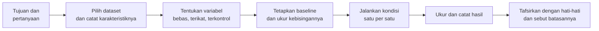
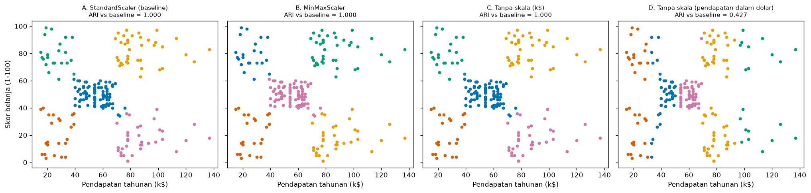

# Bab 1 — Introduction to Clustering Experiments

## Learning Objectives

Setelah mempelajari bab ini, kamu mampu:

- [x] Membedakan "menjalankan sebuah algoritma" dari "melakukan sebuah eksperimen".
- [x] Menjelaskan mengapa eksperimen yang sistematis diperlukan pada clustering.
- [x] Merumuskan tujuan eksperimen dan pertanyaan riset yang sesuai untuk masalah *unsupervised*.
- [x] Mengenali variabel bebas (*independent*), variabel terikat (*dependent*), dan variabel terkontrol (*controlled*).
- [x] Menentukan *baseline* dan mengukur kebisingan baseline.
- [x] Menjelaskan alur eksperimen clustering dari pertanyaan sampai kesimpulan.
- [x] Menjalankan satu eksperimen kecil yang terkontrol dengan Python, dan membaca hasilnya dengan hati-hati.
- [x] Mengenali kesalahan umum dalam eksperimen clustering.

## Introduction

Di Level 4 kamu belajar menjalankan algoritma. Di Level 5 kamu belajar menilai hasilnya. Sekarang muncul pertanyaan yang lebih besar: **bagaimana kita sampai pada kesimpulan yang bisa dipercaya?**

Bayangkan dua orang menganalisis data pelanggan yang sama. Orang pertama menjalankan K-Means sekali, melihat lima kelompok, lalu berkata, "Pelanggan kita ada lima jenis." Orang kedua bertanya lebih dulu: *apakah hasil ini berubah kalau seed diganti? kalau skala fitur diganti? kalau K diganti?* Ia mencatat semuanya, mengubah **satu hal pada satu waktu**, dan baru berkesimpulan setelah melihat polanya.

Orang kedua sedang melakukan **eksperimen**. Level 6 mengajarkan cara berpikir dan bekerja seperti dia: merancang eksperimen, mengatur parameter, membandingkan algoritma, menafsirkan hasil, menguji kestabilan, dan melaporkannya dengan jujur.

!!! note "Prasyarat"
    - [Level 4](../clustering-algorithms/index.md) (cara kerja algoritma) dan [Level 5](../clustering-evaluation/index.md) (metrik evaluasi).
    - [Level 3 Bab 7](../fundamental-clustering/07-clustering-workflow.md) (alur kerja clustering).

## Fundamental Concepts

| Istilah | Arti |
|---|---|
| **Experiment** | Serangkaian percobaan terencana untuk menjawab sebuah pertanyaan, dengan sebagian hal diubah dan sebagian lain ditahan tetap |
| **Research question** | Pertanyaan yang ingin dijawab. Contoh: "Apakah penyamaan skala mengubah pengelompokan?" |
| **Hypothesis** | Dugaan yang bisa diuji. Pada clustering tidak selalu ada, dan itu wajar |
| **Independent variable** | Hal yang **sengaja diubah** oleh peneliti |
| **Dependent variable** | Hal yang **diukur** untuk melihat pengaruh perubahan itu |
| **Controlled variable** | Hal yang **sengaja ditahan sama** supaya tidak mengacaukan hasil |
| **Baseline** | Kondisi pembanding. Hasil kondisi lain dibaca terhadapnya |
| **Condition** | Satu kombinasi nilai variabel bebas yang dijalankan |
| **Run** | Satu kali eksekusi sebuah kondisi |
| **Reproducibility** | Kemampuan mengulang eksperimen dan mendapat hasil yang sama (dibahas di Bab 9) |

## Detailed Explanation

### Menjalankan algoritma vs melakukan eksperimen

| | Menjalankan algoritma | Melakukan eksperimen |
|---|---|---|
| Tujuan | Mendapat satu hasil | Menjawab satu pertanyaan |
| Jumlah percobaan | Satu | Beberapa kondisi terencana |
| Yang diubah | Tidak jelas | Tepat yang dimaksud, satu per satu |
| Pembanding | Tidak ada | Baseline |
| Pencatatan | Di kepala | Tertulis: konfigurasi, seed, hasil |
| Kesimpulan | "Terlihat bagus" | Didukung angka dan pembanding |

Satu kali jalan tidak memberi tahu apakah hasilnya **bergantung pada pilihan yang kebetulan kita ambil**. Eksperimen membuat ketergantungan itu terlihat.

### Mengapa eksperimen sistematis penting pada clustering?

Pada clustering, tidak ada label benar yang memberi tahu kita kapan hasil salah. Maka kita perlu cara lain untuk membangun kepercayaan:

1. **Hasil clustering bergantung pada banyak pilihan**: skala fitur, fitur yang dipakai, algoritma, K atau `eps`, seed, bahkan sampel data.
2. **Hasil bisa tampak meyakinkan tetapi rapuh.** K-Means selalu menghasilkan kelompok. Yang penting adalah apakah kelompok itu tahan terhadap perubahan kecil.
3. **Pilihan yang tidak dicatat tidak bisa diulang.** Tanpa catatan, orang lain (atau dirimu bulan depan) tidak bisa menghasilkan hal yang sama.

### Tujuan eksperimen, pertanyaan riset, dan hipotesis

Pada supervised learning, tujuan biasanya jelas: "buat akurasi setinggi mungkin pada data uji." Pada clustering, tujuan lebih beragam. Beberapa contoh tipe tujuan:

| Tipe tujuan | Contoh pertanyaan |
|---|---|
| **Eksploratif** | Struktur kelompok apa yang tampak pada data ini? |
| **Komparatif** | Algoritma mana yang paling cocok untuk data berbentuk bulan sabit? |
| **Sensitivitas** | Seberapa jauh hasil berubah bila `eps` digeser sedikit? |
| **Dampak praproses** | Apakah penyamaan skala mengubah pengelompokan? |
| **Kestabilan** | Apakah hasil sama bila seed diganti? |

!!! note "Hipotesis tidak selalu ada"
    Pada clustering yang eksploratif, sering **tidak ada hipotesis** dalam arti klasik, dan sering juga **tidak ada label benar**. Itu tidak masalah. Yang penting, **tujuan dan pertanyaannya jelas** sebelum kamu menjalankan apa pun. Jika kamu memang punya dugaan (misalnya "tanpa penyamaan skala, hasil akan didominasi pendapatan"), tulis sebagai hipotesis, lalu uji.

Pertanyaan yang baik: **spesifik** (bisa dijawab dengan data yang ada), **terukur** (ada angka atau pengamatan yang menjawabnya), dan **terbatas** (satu pertanyaan per eksperimen).

### Variabel eksperimen

Ambil pertanyaan: *"Apakah cara menyamakan skala mengubah pengelompokan pelanggan?"*

- **Variabel bebas:** perlakuan skala (StandardScaler, MinMaxScaler, tanpa skala, dan seterusnya). Inilah yang sengaja kita ubah.
- **Variabel terikat:** seberapa mirip hasil pengelompokan dengan baseline, ukuran kelompok, dan metrik internal.
- **Variabel terkontrol:** algoritma (K-Means), K, `n_init`, seed, dan fitur yang dipakai. Semuanya **ditahan sama**.

Jika ada dua hal yang berubah sekaligus (misalnya skala **dan** K), kamu tidak tahu mana yang menyebabkan perbedaan. Inilah alasan utama "ubah satu variabel pada satu waktu".

### Karakteristik dataset dan kondisi eksperimen

Sebelum menjalankan, catat karakteristik data: jumlah titik, jumlah fitur, rentang dan sebaran tiap fitur, ada tidaknya noise atau outlier, perkiraan bentuk kelompok. Karakteristik ini memengaruhi **seberapa jauh kesimpulanmu berlaku**. Kesimpulan dari data yang bersih dan bulat belum tentu berlaku untuk data yang berbentuk bulan sabit.

**Kondisi eksperimen** adalah daftar semua kombinasi yang dijalankan. Pada contoh kita ada empat kondisi, yaitu empat perlakuan skala.

### Baseline dan kebisingan baseline

**Baseline** adalah kondisi pembanding yang wajar, biasanya "cara standar" atau "cara yang paling sederhana". Semua hasil dibaca sebagai selisih terhadap baseline.

Ada satu hal penting yang sering terlewat: **baseline sendiri bisa berubah** bila dijalankan ulang dengan seed lain. Kita menyebutnya *kebisingan baseline*. Sebelum menyimpulkan bahwa kondisi A berbeda dari baseline, kita perlu tahu **seberapa besar perbedaan yang muncul hanya karena seed**. Jika baseline saja sudah berubah banyak antar seed, perbedaan kecil antar kondisi tidak berarti apa-apa.

### Alur eksperimen



### Hubungan eksperimen clustering dengan penelitian

Eksperimen adalah **batu bata** penelitian. Penelitian lengkap (Level 7) menambahkan studi literatur, perumusan celah riset, dan penulisan makalah. Level 6 hanya mengajarkan bagian eksperimennya: merancang, menjalankan, menafsirkan, dan melaporkan hasil satu rangkaian eksperimen.

### Contoh skenario eksperimen clustering

- **Segmentasi pelanggan:** "Berapa banyak segmen yang stabil bila kita mengganti subset fitur?"
- **Pemilihan algoritma:** "Algoritma mana yang paling mampu menemukan gerombol berkepadatan berbeda?"
- **Praproses:** "Apakah menghapus outlier mengubah jumlah kelompok?"
- **Parameter:** "Seberapa peka DBSCAN terhadap `eps`?"
- **Kestabilan:** "Apakah pengelompokan tahan bila 20% data dibuang?"

### Kesalahan umum dalam eksperimen

1. **Mengubah banyak hal sekaligus**, sehingga penyebab perbedaan tidak jelas.
2. **Tidak punya baseline**, sehingga tidak tahu apa yang dibandingkan.
3. **Tidak mengukur kebisingan baseline.**
4. **Mengukur dengan cara yang tidak sebanding** antar kondisi (kita akan melihatnya di kode).
5. **Memilih hasil terbaik dari banyak percobaan** lalu melaporkannya seolah satu percobaan.
6. **Tidak mencatat konfigurasi dan seed.**
7. **Menarik kesimpulan yang lebih luas daripada data mendukung** (terlalu umum, atau mengandung klaim sebab-akibat).

## Experimental Procedure

Eksperimen yang kita lakukan di bab ini, ditulis sebagai prosedur:

1. **Pertanyaan:** apakah cara menyamakan skala mengubah pengelompokan Mall Customers?
2. **Dataset:** Mall Customers, dua fitur (`Annual Income (k$)` dan `Spending Score (1-100)`), 200 pelanggan.
3. **Variabel bebas:** perlakuan skala, dengan empat kondisi: (A) `StandardScaler` sebagai baseline, (B) `MinMaxScaler`, (C) tanpa skala dalam satuan asli (ribu dolar), (D) tanpa skala dengan pendapatan dalam dolar.
4. **Variabel terkontrol:** K-Means, K = 5, `n_init=10`, `random_state=42`, fitur yang sama.
5. **Variabel terikat:** ARI terhadap baseline, ukuran kelompok, dan Silhouette.
6. **Ukur kebisingan baseline:** ulangi baseline dengan 10 seed.
7. **Jalankan** keempat kondisi.
8. **Ukur di ruang yang sama:** metrik internal harus dihitung di ruang yang sama agar sebanding.
9. **Tafsirkan** dan catat batasannya.

## Python Implementation

Skrip lengkapnya ada di `examples/level-6/01_introduction_to_clustering_experiments.py`, dan notebook-nya di `notebooks/level-6/01-introduction-to-clustering-experiments.ipynb`. **Setiap potongan kode diikuti penjelasannya.**

**Konteks masalah:** sebuah toko ingin tahu apakah pengelompokan pelanggannya bergantung pada cara menyamakan skala.

**Tujuan eksperimen:** menjawab pertanyaan pada bagian Experimental Procedure.

**Dataset:** Mall Customers (`data/mall_customers.csv`), 200 pelanggan. Dipilih karena sudah dikenal dari Level 2 sampai 5, dan dua fiturnya punya skala yang mirip (rentang berbeda tetapi sebaran sama), sehingga kita bisa melihat kapan skala penting dan kapan tidak.

**Pustaka:** NumPy, pandas, Matplotlib, scikit-learn.

### Bagian A — Siapkan alat

```python
--8<-- "level-6/01_introduction_to_clustering_experiments.py:setup"
```

**Penjelasan:** `KMeans` adalah algoritma. `adjusted_rand_score` (Level 5, Bab 8) kita pakai untuk **membandingkan dua pengelompokan** tanpa memedulikan nomor kelompok. `silhouette_score` adalah metrik internal. `StandardScaler` dan `MinMaxScaler` adalah dua cara menyamakan skala.

### Bagian B — Merumuskan rancangan lebih dulu

```python
--8<-- "level-6/01_introduction_to_clustering_experiments.py:question"
```

**Penjelasan:** `experiment` adalah dictionary (pasangan kunci dan nilai) yang menuliskan rancangan **sebelum** kita menjalankan apa pun. Perulangan `for key, value in experiment.items()` mencetaknya. `{key:20s}` memberi lebar 20 karakter agar rapi. Kebiasaan menulis rancangan lebih dulu mencegahmu mengubah pertanyaan setelah melihat hasil.

### Bagian C — Dataset dan karakteristiknya

```python
--8<-- "level-6/01_introduction_to_clustering_experiments.py:data"
```

**Penjelasan:**

- `pd.read_csv` membaca data. `features` adalah dua kolom yang dipakai.
- `df[features].to_numpy(dtype=float)` mengubahnya menjadi array NumPy bertipe desimal.
- `.describe()` memberi ringkasan statistik. `.loc[["min", "max", "mean", "std"]]` memilih empat baris yang kita perlukan. `.round(2)` membulatkan dua desimal.

### Bagian D — Baseline dan kebisingannya

```python
--8<-- "level-6/01_introduction_to_clustering_experiments.py:baseline"
```

**Penjelasan baris demi baris:**

- `SEED = 42` menyimpan seed dalam satu tempat supaya mudah diganti.
- `StandardScaler().fit_transform(X_raw)` membuat data baseline: tiap fitur dikurangi rata-rata lalu dibagi simpangan baku.
- `KMeans(n_clusters=5, n_init=10, random_state=SEED).fit_predict(X_standard)` menjalankan K-Means dan mengembalikan label. `np.bincount(...)` menghitung ukuran kelompok, `sorted(..., reverse=True)` mengurutkannya dari terbesar.
- **Kebisingan:** daftar komprehensi `[... for seed in range(10)]` menjalankan baseline dengan seed 0 sampai 9. `adjusted_rand_score(runs[0], run)` membandingkan tiap hasil dengan hasil seed 0. Kita **tidak** membandingkan nomor kelompok langsung (Level 5, Bab 8). `min` dan `max` memberi rentang kebisingan.

### Bagian E — Menjalankan empat kondisi

```python
--8<-- "level-6/01_introduction_to_clustering_experiments.py:conditions"
```

**Penjelasan:**

- `X_dollars[:, 0] *= 1000` mengalikan kolom pendapatan dengan 1000, sehingga satuannya dolar (bukan ribu dolar). Sebelumnya kita salin dulu dengan `.copy()` supaya `X_raw` tidak ikut berubah.
- `conditions` adalah dictionary: nama kondisi menjadi kunci, dan data hasil perlakuannya menjadi nilai.
- Pada perulangan, **hanya data yang berbeda**. K, `n_init`, dan seed sama untuk semua kondisi. Itulah variabel terkontrol.

### Bagian F — Mengukur di ruang yang sama

```python
--8<-- "level-6/01_introduction_to_clustering_experiments.py:commonspace"
```

**Penjelasan:** untuk tiap kondisi kita mencatat tiga angka.

- `ARI vs baseline`: seberapa mirip pengelompokan dengan baseline.
- `Silhouette (ruang sendiri)`: Silhouette yang dihitung pada data kondisi itu sendiri (`X_condition`).
- `Silhouette (ruang bersama)`: Silhouette dari label kondisi itu, dihitung pada **data baseline** (`X_standard`).

Alasannya: jarak di ruang yang berbeda tidak sebanding. Silhouette di ruang bersama mengukur semua kondisi dengan penggaris yang sama.

### Bagian G — Menggambar

```python
--8<-- "level-6/01_introduction_to_clustering_experiments.py:plot"
```

**Penjelasan:** empat panel berdampingan, `sharex=True` dan `sharey=True` membuat sumbu sama. Semua panel digambar dalam satuan asli (`X_raw`) supaya bisa dibandingkan secara visual. Warna menunjukkan kelompok. Nomor warna bisa berbeda antar panel, jadi yang dibandingkan adalah **bentuk pembagian**, bukan warnanya.

### Bagian H — Meringkas

```python
--8<-- "level-6/01_introduction_to_clustering_experiments.py:summary"
```

**Penjelasan:** ambang `0.95` hanya contoh batas "praktis sama" untuk keperluan ringkasan. Pilihan ambang harus ditulis dan dijustifikasi, bukan diam-diam digeser setelah melihat hasil.

## Code Explanation

| Bagian kode | Peran |
|---|---|
| `experiment = {...}` | Rancangan eksperimen yang ditulis lebih dulu |
| `SEED = 42` | Seed tunggal untuk variabel terkontrol |
| `for seed in range(10)` | Mengukur kebisingan baseline |
| `conditions = {...}` | Kondisi-kondisi variabel bebas |
| `adjusted_rand_score(a, b)` | Membandingkan dua pengelompokan tanpa peduli nomor |
| `silhouette_score(X_standard, labels)` | Mengukur di ruang bersama |

!!! note "Pelatihan vs penilaian"
    `KMeans(...).fit_predict(...)` adalah **pelatihan**. ARI dan Silhouette adalah **penilaian**. Dalam eksperimen, kita memisahkan keduanya dengan jelas.

## How to Run

Dari folder utama proyek (setelah mengaktifkan lingkungan virtual):

```powershell
pip install -r requirements-notebooks.txt
python examples/level-6/01_introduction_to_clustering_experiments.py
```

Skrip mencetak output ke terminal dan menyimpan satu gambar ke `docs/assets/level-6/`. Notebook interaktifnya:

```powershell
jupyter notebook notebooks/level-6/01-introduction-to-clustering-experiments.ipynb
```

Output di bawah berasal dari eksekusi nyata dengan Python 3.14, NumPy 2.5.4, pandas 3.1.1, scikit-learn 1.9.1, dan Matplotlib 3.11.2.

## Expected Output

```text
--8<-- "level-6/outputs/01.txt"
```

Gambar yang dihasilkan:



### Interpretasi output

**1. Karakteristik data.** 200 pelanggan. Pendapatan: min 15, maks 137, rata-rata 60,56, simpangan baku 26,26. Skor belanja: min 1, maks 99, rata-rata 50,20, simpangan baku 25,82. Kedua fitur punya **sebaran yang mirip** (26,26 vs 25,82), walau rentangnya berbeda. Catatan ini penting untuk membaca hasil.

**2. Kebisingan baseline.** Ukuran kelompok baseline: 81, 39, 35, 23, 22. ARI antara seed 0 dan seed 1 sampai 9 bernilai **1,0 (terkecil) dan 1,0 (terbesar)**. Jadi pada konfigurasi ini (`n_init=10`), **seed tidak mengubah hasil sama sekali**. Kebisingan baseline nol, sehingga selisih kecil antar kondisi pun bermakna. (Pada konfigurasi lain, kebisingan bisa jauh lebih besar. Kamu akan menemukannya di latihan 1.)

**3. Hasil empat kondisi.**

| Kondisi | Ukuran kelompok | ARI vs baseline | Silhouette (ruang sendiri) | Silhouette (ruang bersama) |
|---|---|---|---|---|
| A. StandardScaler (baseline) | 81, 39, 35, 23, 22 | 1,000 | 0,555 | 0,555 |
| B. MinMaxScaler | 81, 39, 35, 23, 22 | 1,000 | 0,559 | 0,555 |
| C. Tanpa skala (k$) | 81, 39, 35, 23, 22 | 1,000 | 0,554 | 0,555 |
| D. Tanpa skala (dolar) | 56, 50, 42, 32, 20 | **0,427** | 0,584 | **0,157** |

- **B dan C identik dengan baseline** (ARI 1,000, ukuran kelompok sama). Pada data ini, `MinMaxScaler` dan "tanpa skala" menghasilkan pembagian yang sama dengan `StandardScaler`. Alasannya: kedua fitur memang sudah berskala mirip (sebaran 26,26 dan 25,82), jadi penyamaan skala tidak mengubah jarak secara berarti.
- **D berbeda jelas.** Dengan pendapatan dikali 1000, selisih pendapatan membuat jarak jauh lebih besar daripada selisih skor belanja. K-Means hampir hanya membagi menurut pendapatan, terlihat pada gambar sebagai pita vertikal. ARI turun menjadi **0,427**, dan ukuran kelompok berubah.

**4. Mengapa "ruang bersama" penting.** Pada kondisi D, Silhouette di ruang sendiri adalah **0,584**, yang **lebih tinggi** daripada baseline (0,555). Seandainya kita hanya melihat angka itu, kita bisa menyimpulkan D "lebih baik". Padahal di ruang bersama, Silhouette D hanya **0,157**, jauh lebih rendah. Silhouette di ruang sendiri tinggi karena di ruang D hampir semua jarak ditentukan pendapatan, sehingga pembagian berdasarkan pendapatan tampak "rapi" di ruang itu. Angka dari dua ruang yang berbeda **tidak boleh dibandingkan langsung**.

!!! warning "Batas kesimpulan"
    Hasil ini berlaku untuk **satu dataset, satu algoritma (K-Means), satu K (5), dan dua fitur**. Kita **tidak** boleh menyimpulkan bahwa "penyamaan skala tidak pernah penting". Yang kita temukan: pada data ini, ketiga cara menyamakan skala memberi hasil yang sama, dan **ketidakseimbangan skala yang besar** (kondisi D) mengubah hasil secara nyata. Kita juga belum menguji alasan di balik perbedaan itu lebih jauh, dan tidak ada klaim sebab-akibat tentang pelanggan.

## Practical Application

**Menentukan praproses untuk produksi.** Sebuah tim ingin tahu apakah pipeline segmentasi mereka perlu `StandardScaler`. Eksperimen kecil seperti ini menjawabnya dengan bukti: jika ARI antar perlakuan skala 1,0, pilih yang paling sederhana. Jika rendah, pilih satu dan dokumentasikan.

**Memeriksa kerapuhan hasil sebelum dilaporkan.** Sebelum menyampaikan "lima segmen" ke manajemen, ulangi dengan seed berbeda dan perlakuan berbeda. Jika hasil berubah banyak, laporkan ketidakpastiannya.

**Mereproduksi analisis orang lain.** Karena rancangan, seed, dan konfigurasi dicatat, analis lain bisa menjalankan ulang dan membandingkan.

## Hands-on Exercises

1. Ulangi bagian kebisingan baseline dengan `n_init=1` (bukan 10) pada seed 0 sampai 9, lalu hitung ARI tiap hasil terhadap baseline. Berapa ARI terkecil dan terbesarnya? Berapa dari sepuluh yang tepat 1,0? Apa artinya untuk variabel terkontrol?
2. Pada kondisi D, jalankan `StandardScaler` setelah mengalikan pendapatan dengan 1000. Berapa ARI terhadap baseline?
3. Ubah K menjadi 4 dan 6 (K berubah, skala tetap `StandardScaler`). Berapa ARI terhadap baseline K = 5? Mengapa ini bukan eksperimen skala lagi?
4. Tulis rancangan eksperimen (pertanyaan, variabel bebas, terikat, terkontrol, baseline) untuk pertanyaan: "Apakah menghapus fitur `Annual Income` mengubah pengelompokan?"
5. Mengapa Silhouette di ruang sendiri bisa menyesatkan saat membandingkan kondisi dengan skala berbeda?
6. Mengapa kita tidak boleh membandingkan nomor kelompok dua kondisi langsung, misalnya `labels_A == labels_B`?

??? question "Jawaban"
    Hasil nomor 1 sampai 3 berasal dari eksekusi nyata.

    1. Dengan `n_init=1`, ARI terhadap baseline berkisar **0,692 sampai 1,0**, dan **4 dari 10** seed memberi tepat 1,0. Dengan `n_init=1`, hasil bergantung pada titik awal, jadi seed menjadi sumber kebisingan. Berarti `n_init` harus diperlakukan sebagai **variabel terkontrol yang dicatat**: mengubahnya diam-diam mengubah kebisingan baseline.
    2. ARI **1,000**. `StandardScaler` menghapus perbedaan satuan, sehingga pendapatan dalam dolar sama dengan dalam ribu dolar setelah distandarkan. Ini menunjukkan masalahnya adalah **tidak menyamakan skala**, bukan satuannya.
    3. K = 4: ARI **0,753**. K = 6: ARI **0,961**. Karena yang berubah adalah K, bukan skala, perbandingan ini menjawab pertanyaan lain ("seberapa peka hasil terhadap K?").
    4. Contoh: pertanyaan "Apakah menghapus `Annual Income` mengubah pengelompokan?"; variabel bebas: himpunan fitur (dengan atau tanpa pendapatan); terikat: ARI terhadap baseline, ukuran kelompok; terkontrol: K-Means, K = 5, `n_init=10`, seed 42, skala `StandardScaler`; baseline: kedua fitur lengkap. Catatan: bila fitur berbeda, hasil perlu dibandingkan dengan ARI, bukan dengan Silhouette yang dihitung pada ruang masing-masing.
    5. Jarak di ruang yang berskala berbeda tidak sebanding. Pada kondisi D, hampir semua jarak ditentukan pendapatan, sehingga pembagian berdasarkan pendapatan terlihat rapi dan Silhouette-nya tinggi (0,584), padahal di ruang bersama hanya 0,157.
    6. Nomor kelompok sembarang. Dua pengelompokan identik bisa punya nomor yang tertukar. Gunakan metrik tak peka permutasi seperti ARI.

## Troubleshooting

### Masalah teknis

| Masalah | Penyebab | Solusi |
|---|---|---|
| `FileNotFoundError: data/mall_customers.csv` | Skrip dijalankan dari folder yang salah | Jalankan dari folder utama proyek |
| Hasil berbeda dari output di bab | Versi pustaka berbeda, atau `random_state`/`n_init` diubah | Samakan versi, seed, dan `n_init` |
| `X_raw` ikut berubah setelah dikali 1000 | Lupa `.copy()` | Salin dulu: `X_dollars = X_raw.copy()` |
| ARI selalu 1,0 | Memang tidak ada perbedaan, atau dua variabel yang dibandingkan sebenarnya sama | Periksa apakah variabel bebas benar-benar berbeda |
| `ValueError: Number of labels is 1...` | Semua titik masuk satu kelompok | Periksa K dan data |

### Kesalahan umum

1. **Mengubah beberapa hal sekaligus.** Pada eksperimen ini hanya skala yang berubah.
2. **Membandingkan metrik dari ruang berbeda** (Silhouette D sendiri vs baseline).
3. **Mengabaikan kebisingan baseline.** Perbedaan kecil bisa hanya efek seed.
4. **Menyimpulkan terlalu luas.** Satu dataset dan satu algoritma tidak membuktikan hukum umum.
5. **Menggeser ambang "sama" setelah melihat hasil.**
6. **Tidak menulis rancangan lebih dulu**, sehingga pertanyaan ikut berubah mengikuti hasil.
7. **Menafsirkan perbedaan sebagai sebab-akibat tentang pelanggan.** Eksperimen ini hanya tentang perilaku algoritma terhadap perlakuan skala.

## Summary

- **Eksperimen** berbeda dari sekadar menjalankan algoritma: ia punya pertanyaan, variabel yang terkontrol, baseline, dan pencatatan.
- Pada clustering yang *unsupervised*, hipotesis dan label benar tidak selalu ada. Yang wajib: **tujuan dan pertanyaan yang jelas**.
- **Variabel bebas** diubah, **terikat** diukur, **terkontrol** ditahan. Ubah satu variabel pada satu waktu.
- **Baseline** adalah pembanding, dan **kebisingannya** perlu diukur. Pada Mall Customers dengan `n_init=10`, ARI antar seed selalu 1,0, tetapi dengan `n_init=1` bervariasi dari 0,692 sampai 1,0.
- Pada Mall Customers, `MinMaxScaler` dan tanpa skala (k$) memberi pengelompokan yang sama dengan `StandardScaler` (ARI 1,000), sedangkan pendapatan dalam dolar tanpa skala mengubahnya (ARI 0,427).
- Ukur semua kondisi di **ruang yang sama**: Silhouette ruang sendiri untuk kondisi D (0,584) menyesatkan, sedangkan di ruang bersama hanya 0,157.
- Batasi kesimpulan sesuai data dan eksperimen. Hindari klaim sebab-akibat.

**Bab berikutnya:** Bab 2 membahas **desain dan konfigurasi eksperimen**: tabel konfigurasi, pencatatan, dan contoh desain untuk K-Means, DBSCAN, dan Hierarchical Clustering.

## References

- Montgomery, D. C. (2017). *Design and Analysis of Experiments* (9th ed.). Wiley.
- Hennig, C. (2015). What are the true clusters? *Pattern Recognition Letters*, 64, 53–62.
- Jain, A. K. (2010). Data clustering: 50 years beyond K-means. *Pattern Recognition Letters*, 31(8), 651–666.
- Scikit-learn documentation: [*Clustering*](https://scikit-learn.org/stable/modules/clustering.html) dan [*Clustering performance evaluation*](https://scikit-learn.org/stable/modules/clustering.html#clustering-performance-evaluation).
- Sandve, G. K., Nekrutenko, A., Taylor, J., & Hovig, E. (2013). Ten simple rules for reproducible computational research. *PLOS Computational Biology*, 9(10), e1003285.
