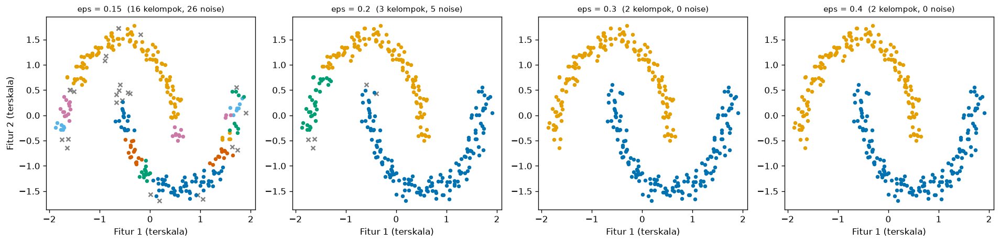
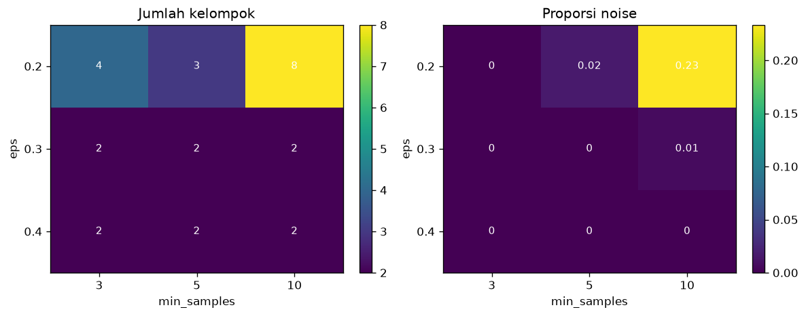

# Bab 2 — Experimental Design and Configuration

## Learning Objectives

Setelah mempelajari bab ini, kamu mampu:

- [x] Membedakan **desain eksperimen** dari **implementasi algoritma**.
- [x] Menentukan tujuan, dataset, variabel, algoritma, dan metrik untuk sebuah eksperimen.
- [x] Menyusun konfigurasi baseline dan tabel konfigurasi eksperimen.
- [x] Menerapkan prinsip "ubah satu variabel pada satu waktu" dan mengenali kapan itu tidak cukup.
- [x] Menjalankan eksperimen multi-faktor sederhana dengan `ParameterGrid`.
- [x] Mencatat pengaturan eksperimen (ID, data, praproses, parameter, seed, hasil, waktu, versi pustaka) ke CSV dan JSON.
- [x] Memeriksa bahwa sebuah eksperimen bisa diulang.
- [x] Membaca hasil desain eksperimen untuk K-Means, DBSCAN, dan Hierarchical Clustering.

## Introduction

Bab 1 menunjukkan **mengapa** kita perlu eksperimen. Bab ini menunjukkan **bagaimana merancangnya**. Perbedaannya penting:

- **Implementasi** menjawab "bagaimana menjalankan algoritma ini?" (Level 4).
- **Desain eksperimen** menjawab "apa saja yang akan kujalankan, mengapa, dengan pengaturan apa, dan bagaimana mencatatnya?"

Desain yang baik dibuat **sebelum** kode dijalankan. Ia seperti resep yang ditulis lengkap dengan takaran, sehingga orang lain (atau dirimu sendiri nanti) bisa memasak ulang dengan hasil yang sama.

!!! note "Prasyarat"
    [Bab 1](01-introduction-to-clustering-experiments.md) Level 6, [Level 4](../clustering-algorithms/index.md) (algoritma), dan [Level 5](../clustering-evaluation/index.md) (metrik).

## Fundamental Concepts

| Istilah | Arti |
|---|---|
| **Experimental design** | Rencana tertulis: apa yang diubah, apa yang ditahan, apa yang diukur |
| **Configuration** | Satu set lengkap pengaturan untuk satu kali jalan (algoritma, parameter, praproses, seed) |
| **Baseline configuration** | Konfigurasi pembanding |
| **One-variable-at-a-time (OVAT)** | Mengubah satu variabel pada satu waktu, yang lain tetap di nilai baseline |
| **Factorial design** | Menjalankan **semua kombinasi** nilai beberapa variabel |
| **Experiment ID** | Kode unik untuk satu kali jalan, misalnya `DB-E3` |
| **Dataset fingerprint** | Sidik jari data (hash) untuk memastikan data yang dipakai identik |
| **Experiment record** | Satu baris catatan yang memuat konfigurasi dan hasil sebuah kali jalan |

## Detailed Explanation

### Langkah-langkah merancang eksperimen

**1. Tentukan tujuan dan pertanyaan.** Satu pertanyaan per eksperimen (Bab 1). Contoh: "Seberapa peka DBSCAN terhadap `eps`?"

**2. Pilih dataset yang sesuai pertanyaan.** Dataset dipilih **karena** ia membantu menjawab pertanyaan, bukan sekadar karena tersedia. Untuk menguji kemampuan menemukan bentuk melengkung, pilih `make_moons`. Untuk menguji K yang tepat, pilih gerombol bulat yang jumlahnya diketahui. Catat alasannya.

**3. Tentukan variabel.** Mana yang bebas (diubah), terikat (diukur), dan terkontrol (ditahan)?

**4. Pilih algoritma.** Berdasarkan pertanyaan dan karakter data. Jangan memasukkan semua algoritma kalau pertanyaannya hanya tentang satu algoritma.

**5. Pilih metrik evaluasi.** Dari Level 5: metrik internal (Silhouette, DBI, CHI) untuk menilai tanpa label, dan metrik eksternal (ARI) hanya bila ada label acuan, dan **hanya sebagai penilaian setelah clustering**, bukan untuk menyetel model. Pakai lebih dari satu metrik.

**6. Tetapkan baseline.** Konfigurasi yang masuk akal dan sederhana sebagai pembanding.

**7. Tulis tabel konfigurasi.** Semua kondisi yang akan dijalankan.

**8. Tentukan cara mencatat.** Apa saja yang disimpan, dan di mana.

### Percobaan terkontrol: ubah satu variabel pada satu waktu

Misalkan kamu ingin tahu pengaruh `eps` dan `min_samples` pada DBSCAN. Cara paling bersih:

- Tetapkan baseline: `eps = 0,3`, `min_samples = 5`.
- Ubah **hanya `eps`** (0,15; 0,2; 0,3; 0,4), `min_samples` tetap 5.
- Ubah **hanya `min_samples`** (3; 10; 20), `eps` tetap 0,3.

Keuntungan: setiap perbedaan hasil jelas disebabkan oleh variabel yang berubah. Kelemahan: **tidak melihat interaksi**. Mungkin efek `min_samples` bergantung pada nilai `eps`. Untuk itu ada desain multi-faktor.

### Desain multi-faktor (pengantar)

Pada desain *factorial*, kita menjalankan **semua kombinasi** dari beberapa variabel. Misalnya `eps` ∈ {0,2; 0,3; 0,4} dan `min_samples` ∈ {3, 5, 10} memberi \( 3 \times 3 = 9 \) kondisi. Hasilnya bisa disusun sebagai tabel silang. Jumlah kondisi tumbuh cepat: tiga variabel dengan lima nilai masing-masing sudah 125 kondisi. Maka desain multi-faktor dipakai dengan hemat. Bab 3 membahas cara mengeksplorasi ruang parameter yang besar.

### Tabel konfigurasi

Tabel konfigurasi adalah daftar semua kondisi, dituliskan **sebelum** dijalankan:

| ID | Dataset | Praproses | Algoritma | Parameter | Seed | Peran |
|---|---|---|---|---|---|---|
| KM-02 | blobs | StandardScaler | K-Means | K = 3 | 42 | **Baseline** |
| KM-01 | blobs | StandardScaler | K-Means | K = 2 | 42 | Variasi K |
| KM-03 | blobs | StandardScaler | K-Means | K = 4 | 42 | Variasi K |
| ... | ... | ... | ... | ... | ... | ... |

Tabel ini sekaligus **daftar tugas** dan **dokumentasi**.

### Apa yang dicatat

Setiap kali jalan sebaiknya mencatat: **ID eksperimen**, **nama dan sidik jari dataset**, **praproses**, **fitur yang dipakai**, **algoritma**, **parameter**, **seed**, **metrik hasil**, **waktu jalan**, dan **versi pustaka**. Dengan itu, orang lain bisa mengulang eksperimen, dan kamu bisa menelusuri kapan sebuah angka dihasilkan.

!!! tip "Format sederhana sudah cukup"
    Kita memakai **CSV** untuk tabel hasil dan **JSON** untuk konfigurasi serta info lingkungan. Keduanya bisa dibuka dengan editor teks atau Excel. Tidak perlu platform pelacakan eksperimen untuk memulai.

### Prosedur yang bisa diulang

Sebuah prosedur disebut *reproducible* bila orang lain yang memakai data, kode, konfigurasi, seed, dan lingkungan yang sama mendapat hasil yang sama. Syaratnya: (1) semua pengaturan tertulis, (2) seed ditetapkan, (3) data diidentifikasi (sidik jari), (4) versi pustaka dicatat. Kita akan **membuktikan** keterulangan di kode dengan menjalankan ulang semua konfigurasi dan membandingkannya dengan catatan.

### Contoh desain untuk tiga algoritma

| Algoritma | Pertanyaan | Dataset | Variabel bebas | Terkontrol |
|---|---|---|---|---|
| **K-Means** | Seberapa peka hasil terhadap K? | Blobs (3 gerombol) | K = 2, 3, 4, 5 | Praproses, `n_init`, seed |
| **DBSCAN** | Seberapa peka terhadap `eps` dan `min_samples`? | Moons | `eps`, `min_samples` | Praproses, metrik jarak |
| **Hierarchical** | Apakah `linkage` mengubah bentuk yang ditemukan? | Moons | `linkage` | Praproses, `n_clusters = 2` |

### Kesalahan umum

1. **Menulis desain sesudah melihat hasil.**
2. **Mengubah banyak variabel tanpa rencana**, sehingga penyebab perbedaan tidak jelas.
3. **Tidak menetapkan baseline.**
4. **Tidak mencatat seed dan versi pustaka.**
5. **Memakai label acuan untuk memilih konfigurasi** (kebocoran informasi). Label hanya untuk menilai.
6. **Terlalu banyak kondisi** tanpa pertanyaan yang jelas, lalu memilih yang paling bagus saja.
7. **Mencampur data praproses berbeda** antar kondisi tanpa mencatatnya.

## Experimental Procedure

Tiga desain yang kita jalankan, dengan dataset dan praproses sama (`StandardScaler`) dan seed 42:

1. **Desain 1 (K-Means):** dataset blobs, variabel bebas K ∈ {2, 3, 4, 5}, baseline K = 3.
2. **Desain 2 (DBSCAN):** dataset moons, OVAT. Pertama `eps` ∈ {0,15; 0,2; 0,3; 0,4} dengan `min_samples = 5`. Kedua `min_samples` ∈ {3, 10, 20} dengan `eps = 0,3`. Baseline `eps = 0,3`, `min_samples = 5`.
3. **Desain 3 (Hierarchical):** dataset moons, variabel bebas `linkage` ∈ {ward, complete, average, single}, `n_clusters = 2`, baseline ward.
4. **Pengantar multi-faktor:** DBSCAN pada moons, `eps` × `min_samples` = 3 × 3.
5. **Pencatatan:** simpan semua catatan ke CSV, konfigurasi dan lingkungan ke JSON.
6. **Pemeriksaan keterulangan:** jalankan ulang dan bandingkan dengan catatan.

## Python Implementation

Skrip lengkapnya ada di `examples/level-6/02_experimental_design_and_configuration.py`, dan notebook-nya di `notebooks/level-6/02-experimental-design-and-configuration.ipynb`. Alat pencatat ada di `examples/level-6/_experiment.py`. **Setiap potongan kode diikuti penjelasannya.**

**Konteks masalah:** merancang dan menjalankan tiga desain eksperimen yang tercatat dan bisa diulang.

**Tujuan eksperimen:** melihat kepekaan hasil terhadap satu variabel (K, `eps`, `min_samples`, `linkage`) pada satu waktu, lalu terhadap dua variabel sekaligus.

**Dataset:** `make_blobs` (3 gerombol bulat, untuk uji K) dan `make_moons` (dua bulan sabit, untuk uji DBSCAN dan linkage). Keduanya sintetis dan punya label acuan. Dipilih karena bentuk kelompoknya **diketahui**, sehingga hasil bisa dinilai setelahnya.

**Pustaka:** NumPy, pandas, Matplotlib, scikit-learn.

### Bagian A — Alat bantu pencatat

```python
--8<-- "level-6/_experiment.py:helpers"
```

**Penjelasan:**

- `dataset_fingerprint(X)`: `np.ascontiguousarray(X).tobytes()` mengubah array menjadi deretan byte. `hashlib.sha256(...).hexdigest()[:12]` menghitung hash dan mengambil 12 karakter pertama. Jika satu angka saja pada data berubah, sidik jarinya berubah.
- `environment_info()`: `platform.python_version()` memberi versi Python. `metadata.version(package)` membaca versi pustaka yang terpasang.
- `timed(function, ...)`: `time.perf_counter()` mencatat waktu sebelum dan sesudah. Fungsi mengembalikan hasil dan selisih waktu (detik).
- `internal_scores(X, labels)`: mengeluarkan noise (`labels != -1`), menghitung jumlah kelompok, proporsi noise, dan tiga metrik internal. Jika kurang dari dua kelompok tersisa, hasilnya `NaN` (Level 5, Bab 5).
- `make_record(...)`: menyusun **satu baris catatan**. `json.dumps(params, sort_keys=True)` menyimpan parameter sebagai teks JSON dengan urutan kunci tetap.
- `save_records` menyimpan daftar catatan ke CSV (`to_csv`). `save_json` menyimpan objek ke JSON. Folder `results/` dibuat otomatis.

### Bagian B — Siapkan alat dan data

```python
--8<-- "level-6/02_experimental_design_and_configuration.py:setup"
```

```python
--8<-- "level-6/02_experimental_design_and_configuration.py:data"
```

```text title="Output"
--8<-- "level-6/outputs/02/data.txt"
```

**Penjelasan:**

- `import _experiment as ex` memuat alat pencatat dengan nama singkat `ex`.
- `ParameterGrid` dari scikit-learn membuat semua kombinasi parameter. Kita memakainya untuk desain multi-faktor.
- `SEED = 42` satu seed untuk semuanya.
- `make_blobs(...)` dan `make_moons(...)` mengembalikan data dan label acuan. `StandardScaler().fit_transform(...)` menyamakan skala. Perlakuan yang sama untuk semua eksperimen adalah variabel terkontrol.
- Sidik jari data dicetak. Jika orang lain mendapat sidik jari yang sama, datanya identik.

### Bagian C — Satu fungsi untuk satu konfigurasi

```python
--8<-- "level-6/02_experimental_design_and_configuration.py:runner"
```

**Penjelasan baris demi baris:**

- `build_estimator(algorithm, params, seed)` membuat model dari nama algoritma. `**params` membongkar dictionary menjadi argumen: `{"n_clusters": 3}` menjadi `n_clusters=3`. `n_init=10` dan `random_state=seed` adalah variabel terkontrol untuk K-Means.
- `run_config(...)` adalah **satu-satunya jalur** menjalankan eksperimen. Memakai satu fungsi untuk semua kondisi menjamin perlakuan yang sama.
  - `estimator.fit_predict(X)` adalah **pelatihan**: hanya `X` yang masuk. `ex.timed` mengukur waktunya.
  - `ex.internal_scores(X, labels)` menghitung metrik internal.
  - `adjusted_rand_score(y_ref, labels)` memakai label acuan **hanya untuk menilai**, setelah clustering selesai.
  - `ex.make_record(...)` merangkum semuanya menjadi satu catatan.
- `columns` adalah kolom yang akan kita tampilkan (tanpa waktu jalan, karena waktu berubah tiap eksekusi).

### Bagian D — Desain 1: K-Means

```python
--8<-- "level-6/02_experimental_design_and_configuration.py:kmeans"
```

```text title="Output"
--8<-- "level-6/outputs/02/kmeans.txt"
```

**Penjelasan:** `enumerate(..., start=1)` memberi nomor urut untuk ID (`KM-01`, `KM-02`, ...). `f"KM-{i:02d}"` memformat nomor menjadi dua digit. Hanya `n_clusters` yang berubah. `pd.DataFrame(records)` mengubah daftar catatan menjadi tabel.

### Bagian E — Desain 2: DBSCAN (OVAT)

```python
--8<-- "level-6/02_experimental_design_and_configuration.py:dbscan"
```

```text title="Output"
--8<-- "level-6/outputs/02/dbscan.txt"
```

**Penjelasan:** dua perulangan terpisah. Pada yang pertama, `min_samples` selalu 5 dan hanya `eps` yang berganti. Pada yang kedua, `eps` selalu 0,3 dan hanya `min_samples` yang berganti. Itulah *one-variable-at-a-time*.

### Bagian F — Desain 3: Hierarchical

```python
--8<-- "level-6/02_experimental_design_and_configuration.py:hier"
```

```text title="Output"
--8<-- "level-6/outputs/02/hier.txt"
```

**Penjelasan:** `n_clusters=2` tetap, hanya `linkage` yang berubah (cara mengukur jarak antar kelompok, Level 4 Bab 3).

### Bagian G — Pengantar multi-faktor

```python
--8<-- "level-6/02_experimental_design_and_configuration.py:factorial"
```

```text title="Output"
--8<-- "level-6/outputs/02/factorial.txt"
```

**Penjelasan:**

- `ParameterGrid({"eps": [...], "min_samples": [...]})` menghasilkan semua kombinasi (3 × 3 = 9 dictionary).
- `json.loads(text)` mengurai teks JSON dari kolom `params` menjadi dictionary, sehingga kita bisa mengambil `eps` dan `min_samples` sebagai kolom terpisah.
- `.pivot(index="eps", columns="min_samples", values=...)` membuat **tabel silang**: baris untuk satu variabel, kolom untuk variabel lain, sel berisi hasil.

### Bagian H — Menyimpan catatan

```python
--8<-- "level-6/02_experimental_design_and_configuration.py:save"
```

```text title="Output"
--8<-- "level-6/outputs/02/save.txt"
```

**Penjelasan:** semua catatan digabung (`records + dbscan_records + ...`) dan disimpan ke `results/02_experiments.csv`. Konfigurasi umum dan info lingkungan disimpan sebagai JSON. File-file ini bisa dibuka kembali, dibagikan, atau dipakai lagi di Bab 10.

### Bagian I — Memeriksa keterulangan

```python
--8<-- "level-6/02_experimental_design_and_configuration.py:repro"
```

```text title="Output"
--8<-- "level-6/outputs/02/repro.txt"
```

**Penjelasan:** setiap catatan dijalankan ulang dari konfigurasi tersimpannya. `json.loads(rec["params"])` mengembalikan parameter, dan `rec["seed"]` mengembalikan seed. Hasil baru dibandingkan dengan CSV yang disimpan (`np.allclose`) **tanpa kolom waktu jalan**, yang memang berbeda tiap eksekusi. `.fillna(-9)` mengganti `NaN` supaya bisa dibandingkan.

### Bagian J — Menggambar

```python
--8<-- "level-6/02_experimental_design_and_configuration.py:plot"
```





**Penjelasan:** gambar pertama menampilkan DBSCAN pada empat nilai `eps`, titik noise berwarna abu-abu bertanda `x`. Gambar kedua adalah dua peta panas (*heatmap*) hasil desain multi-faktor: jumlah kelompok dan proporsi noise. `imshow` menggambar tabel sebagai warna, dan `ax.text` menulis angka di tiap sel.

## Code Explanation

| Bagian kode | Peran |
|---|---|
| `run_config(...)` | Satu jalur tunggal untuk semua kondisi, menjamin perlakuan sama |
| `ex.make_record(...)` | Mencatat konfigurasi dan hasil dalam satu baris |
| `ParameterGrid` | Membuat semua kombinasi untuk desain multi-faktor |
| `.pivot(...)` | Tabel silang antara dua variabel |
| `ex.dataset_fingerprint(X)` | Memastikan data identik |
| `np.allclose(rerun, saved)` | Membuktikan hasil bisa diulang |

!!! note "Desain vs implementasi"
    `KMeans`, `DBSCAN`, dan `AgglomerativeClustering` hanyalah **alat** yang sudah kamu kenal dari Level 4. Bab ini tidak mengajarkan cara kerjanya. Yang baru adalah **rencana** (kondisi apa saja, apa yang ditahan, apa yang dicatat).

## How to Run

Dari folder utama proyek (setelah mengaktifkan lingkungan virtual):

```powershell
pip install -r requirements-notebooks.txt
python examples/level-6/02_experimental_design_and_configuration.py
```

Skrip mencetak output ke terminal, menyimpan dua gambar ke `docs/assets/level-6/`, dan menyimpan hasil ke `examples/level-6/results/`. Notebook interaktifnya:

```powershell
jupyter notebook notebooks/level-6/02-experimental-design-and-configuration.ipynb
```

Semua output pada bab ini berasal dari eksekusi nyata dengan Python 3.14, NumPy 2.5.4, pandas 3.1.1, scikit-learn 1.9.1, dan Matplotlib 3.11.2.

## Expected Output

Output setiap langkah ditampilkan langsung di bawah kodenya pada bagian [Python Implementation](#python-implementation).

Gambar yang dihasilkan:


### Interpretasi output

**1. Sidik jari data.** Blobs `c54d03c906b4`, Moons `1509e053e513`. Jika kamu menjalankan dengan pustaka dan seed yang sama dan mendapat sidik jari lain, datamu berbeda.

**2. Desain 1: K-Means pada blobs (baseline K = 3).**

| ID | K | Silhouette | Davies-Bouldin | ARI acuan |
|---|---|---|---|---|
| KM-01 | 2 | 0,671 | 0,489 | 0,570 |
| **KM-02 (baseline)** | **3** | **0,818** | **0,252** | **1,000** |
| KM-03 | 4 | 0,658 | 0,654 | 0,870 |
| KM-04 | 5 | 0,508 | 0,846 | 0,732 |

K = 3 terbaik menurut kedua metrik internal, dan ARI terhadap label acuan 1,000. Menyimpang dari K = 3 pada kedua arah menurunkan semuanya. Metrik internal (yang tidak melihat label) dan ARI (yang melihat label) sepakat di sini karena gerombolnya bulat dan jelas.

**3. Desain 2: DBSCAN pada moons (baseline `eps = 0,3`, `min_samples = 5`).**

| ID | `eps` | `min_samples` | Kelompok | Noise | Silhouette | ARI acuan |
|---|---|---|---|---|---|---|
| DB-E1 | 0,15 | 5 | 16 | 8,7% | 0,264 | 0,299 |
| DB-E2 | 0,2 | 5 | 3 | 1,7% | 0,355 | 0,799 |
| **DB-E3 (baseline)** | **0,3** | 5 | 2 | 0,0% | 0,384 | 1,000 |
| DB-E4 | 0,4 | 5 | 2 | 0,0% | 0,384 | 1,000 |
| DB-M1 | 0,3 | 3 | 2 | 0,0% | 0,384 | 1,000 |
| DB-M2 | 0,3 | 10 | 2 | 0,7% | 0,391 | 0,987 |
| DB-M3 | 0,3 | 20 | 3 | **49,7%** | **0,617** | **0,196** |

Hal yang dapat dibaca:

- `eps` terlalu kecil (0,15) memecah bulan menjadi **16 kelompok**. Di antara 0,2 dan 0,3 hasil berubah drastis (3 kelompok menjadi 2). Antara 0,3 dan 0,4 **tidak ada perubahan**: kita berada di "dataran" yang stabil.
- Pada DB-M3 (`min_samples = 20`), **hampir separuh data (49,7%) dianggap noise**. Silhouette dan DBI-nya (0,508) tampak **terbaik** dari semua kondisi, tetapi hanya karena setengah data dikeluarkan sebelum dihitung. ARI-nya anjlok menjadi 0,196. Inilah contoh awal bahaya mengoptimalkan satu metrik. Bab 3 membahasnya lebih jauh.

**4. Desain 3: Hierarchical pada moons (baseline ward).**

| ID | `linkage` | Silhouette | Davies-Bouldin | ARI acuan |
|---|---|---|---|---|
| **HC-01 (baseline)** | ward | 0,425 | 0,845 | 0,425 |
| HC-02 | complete | 0,482 | 0,823 | 0,607 |
| HC-03 | average | 0,454 | 0,841 | 0,576 |
| HC-04 | single | 0,384 | 1,022 | **1,000** |

`single` linkage mengenali dua bulan dengan sempurna (ARI 1,000), tetapi mendapat metrik internal **terburuk**. Ini mengulang pelajaran Level 5: metrik internal menyukai kelompok bulat. Desain yang baik membaca **beberapa** metrik dan melihat gambar.

**5. Multi-faktor.** Jumlah kelompok (baris `eps`, kolom `min_samples`):

| `eps` \ `min_samples` | 3 | 5 | 10 |
|---|---|---|---|
| 0,2 | 4 | 3 | 8 |
| 0,3 | 2 | 2 | 2 |
| 0,4 | 2 | 2 | 2 |

Proporsi noise: pada `eps = 0,2`: 0,0; 0,017; 0,233. Pada `eps = 0,3`: 0,0; 0,0; 0,007. Pada `eps = 0,4`: 0,0 semuanya. ARI acuan: `eps = 0,2`: 0,812; 0,799; 0,271. Pada `eps` 0,3 dan 0,4: sekitar 1,0 (0,987 untuk 0,3 dengan `min_samples = 10`).

**Interaksi terlihat:** efek `min_samples = 10` bergantung pada `eps`. Pada `eps = 0,2`, `min_samples = 10` menghasilkan **8 kelompok dan 23,3% noise**. Pada `eps = 0,3`, `min_samples = 10` hanya **0,7% noise**. Desain OVAT (satu variabel per kali) tidak akan menampakkan ini sepenuhnya. Itulah gunanya desain multi-faktor.

**6. Pencatatan.** 24 catatan tersimpan (4 + 7 + 4 + 9). Kolomnya: `experiment_id`, `dataset`, `dataset_fingerprint`, `preprocessing`, `features`, `algorithm`, `params`, `seed`, `n_clusters`, `noise_fraction`, `silhouette`, `davies_bouldin`, `calinski_harabasz`, `ari_reference`, `runtime_seconds`. Lingkungan tercatat: Python 3.14.7, Windows, NumPy 2.5.4, pandas 3.1.1, scikit-learn 1.9.1, SciPy 1.18.1, Matplotlib 3.11.2.

**7. Keterulangan.** Semua 24 konfigurasi dijalankan ulang dan **identik dengan catatan tersimpan** (`True`), tidak termasuk waktu jalan. Pada eksperimen ini, hasil bisa diulang di lingkungan yang sama.

!!! warning "Batas kesimpulan"
    Kesimpulan di atas berlaku untuk dua dataset sintetis kecil dengan satu seed. `eps` yang cocok pada data terskala ini belum tentu cocok pada data lain. Kita juga belum menguji kestabilan terhadap seed atau sampel (Bab 9).

## Practical Application

**Laporan perbandingan konfigurasi.** Tim analisis menyimpan tabel `results/*.csv` bersama kode. Saat atasan bertanya, "Mengapa kalian memilih `eps` ini?", tabel itu menjawabnya.

**Audit dan peninjauan sejawat.** Sidik jari data, seed, dan versi pustaka memudahkan orang lain mengulang analisis.

**Menghindari "kebetulan terbaik".** Karena semua kondisi tercatat, kamu bisa melaporkan **seluruh** hasil, bukan hanya yang paling bagus.

**Menyusun anggaran komputasi.** Tabel konfigurasi menunjukkan berapa kondisi yang akan dijalankan sebelum memulai.

## Hands-on Exercises

1. Tambahkan konfigurasi DBSCAN `eps = 0,25`, `min_samples = 5` pada moons. Berapa kelompok, proporsi noise, dan ARI-nya?
2. Jalankan Hierarchical dengan `n_clusters = 3` dan `linkage = single` serta `ward` pada **blobs**. Berapa ARI dan ukuran kelompok `single`?
3. Buat blobs dengan `random_state=7` (bukan 42), standarkan, dan hitung sidik jarinya. Apa bedanya dengan sidik jari blobs asli?
4. Dari tabel multi-faktor, jelaskan mengapa desain OVAT dengan baseline `eps = 0,3` tidak akan menunjukkan bahwa `min_samples = 10` bisa berbahaya.
5. Mengapa DB-M3 tidak boleh dianggap konfigurasi terbaik walau Silhouette-nya tertinggi?
6. Tulis tabel konfigurasi (ID, dataset, praproses, algoritma, parameter, seed, peran) untuk desain K-Means K = 2 sampai 5.

??? question "Jawaban"
    Hasil nomor 1 sampai 3 berasal dari eksekusi nyata.

    1. **2 kelompok, 0,0% noise, ARI 1,000.** Konsisten dengan dataran stabil antara 0,3 dan 0,4.
    2. `single`: ARI **1,000** dan ukuran kelompok **100, 100, 100**. `ward` juga **1,000**. Pada gerombol bulat dan terpisah, kedua linkage menemukan struktur yang sama. Perbedaan linkage baru terlihat pada bentuk non-bulat seperti moons.
    3. Sidik jari blobs dengan `random_state=7`: **`8512bce8428b`**, berbeda dari `c54d03c906b4`. Data berbeda menghasilkan sidik jari berbeda.
    4. Pada OVAT dengan baseline `eps = 0,3`, `min_samples = 10` hanya menghasilkan 0,7% noise dan ARI 0,987 sehingga tampak aman. Baru pada `eps = 0,2` terlihat bahwa `min_samples = 10` memberi 23,3% noise dan ARI 0,271. Efek `min_samples` bergantung pada `eps` (interaksi).
    5. Karena 49,7% data dikeluarkan sebagai noise sebelum Silhouette dihitung, dan ARI-nya hanya 0,196. Silhouette tinggi di sini adalah akibat membuang data sulit.
    6. Contoh: `KM-01 | blobs | StandardScaler | K-Means | K=2 | 42 | variasi K`; `KM-02 | ... | K=3 | 42 | baseline`; `KM-03 | ... | K=4 | ...`; `KM-04 | ... | K=5 | ...`.

## Troubleshooting

### Masalah teknis

| Masalah | Penyebab | Solusi |
|---|---|---|
| `ModuleNotFoundError: _experiment` | Skrip dijalankan dari tempat yang salah, sehingga folder `examples/level-6` tidak masuk `sys.path` | Jalankan skrip dari folder utama proyek, atau pastikan `_experiment.py` satu folder dengan skrip |
| Sidik jari data berbeda dari bab | Versi NumPy atau scikit-learn berbeda, atau seed berbeda | Samakan versi dan seed |
| Hasil keterulangan `False` | Ada langkah acak tanpa seed, atau data berubah | Tetapkan semua `random_state`, periksa sidik jari |
| `KeyError` saat `pivot` | Kolom `eps` atau `min_samples` belum dibuat | Urai kolom `params` dengan `json.loads` terlebih dulu |
| Waktu jalan berbeda tiap eksekusi | Waktu memang tidak deterministik | Jangan masukkan waktu ke pemeriksaan keterulangan |
| Nilai `NaN` pada metrik DBSCAN | Setelah noise dikeluarkan, kurang dari dua kelompok | Periksa `eps` dan `min_samples` |

### Kesalahan umum

1. **Menulis desain setelah melihat hasil.** Tulis lebih dulu.
2. **Tidak memakai satu jalur eksekusi** untuk semua kondisi, sehingga perlakuan tidak seragam.
3. **Memakai label acuan untuk memilih konfigurasi.**
4. **Memilih "yang terbaik" dari tabel lalu melaporkan hanya itu.** Laporkan semua kondisi.
5. **Menyimpulkan dari satu variabel padahal ada interaksi.**
6. **Mengabaikan proporsi noise** pada DBSCAN saat membaca metrik internal.
7. **Tidak mencatat versi pustaka dan sidik jari data.**
8. **Terlalu banyak kombinasi tanpa pertanyaan jelas.**

## Summary

- **Desain eksperimen** adalah rencana tertulis yang dibuat sebelum menjalankan: tujuan, dataset, variabel, algoritma, metrik, baseline, dan cara mencatat. Ia berbeda dari implementasi algoritma (Level 4).
- **Satu variabel pada satu waktu** (OVAT) membuat sebab perbedaan jelas, tetapi tidak menunjukkan **interaksi**. Desain **multi-faktor** (`ParameterGrid`) mengujinya, dengan jumlah kondisi yang tumbuh cepat.
- Pada moons, hasil DBSCAN berubah drastis antara `eps` 0,2 dan 0,3, lalu stabil antara 0,3 dan 0,4. Efek `min_samples = 10` bergantung pada `eps` (23,3% noise pada `eps = 0,2`, 0,7% pada `eps = 0,3`).
- Konfigurasi dengan `min_samples = 20` tampak terbaik menurut Silhouette (0,617), tetapi 49,7% data jadi noise dan ARI hanya 0,196.
- Pada moons, `single` linkage menemukan dua bulan (ARI 1,000) tetapi punya metrik internal terburuk.
- Catat ID, sidik jari data, praproses, parameter, seed, metrik, waktu, dan versi pustaka dalam CSV dan JSON.
- Semua 24 konfigurasi dijalankan ulang dan identik dengan catatan (tanpa waktu jalan).

**Bab berikutnya:** Bab 3 membahas **hyperparameter tuning**: apa itu hyperparameter, cara menelusuri ruang parameter (manual, grid, acak), dan mengapa mengoptimalkan satu metrik bisa menyesatkan.

## References

- Montgomery, D. C. (2017). *Design and Analysis of Experiments* (9th ed.). Wiley.
- Sandve, G. K., Nekrutenko, A., Taylor, J., & Hovig, E. (2013). Ten simple rules for reproducible computational research. *PLOS Computational Biology*, 9(10), e1003285.
- Scikit-learn documentation: [`ParameterGrid`](https://scikit-learn.org/stable/modules/generated/sklearn.model_selection.ParameterGrid.html).
- Pedregosa, F., et al. (2011). Scikit-learn: machine learning in Python. *Journal of Machine Learning Research*, 12, 2825–2830.
- Ester, M., Kriegel, H.-P., Sander, J., & Xu, X. (1996). A density-based algorithm for discovering clusters in large spatial databases with noise. *Proceedings of KDD-96*, 226–231.
