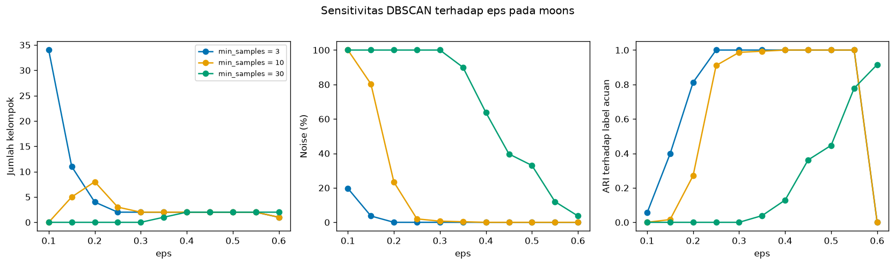
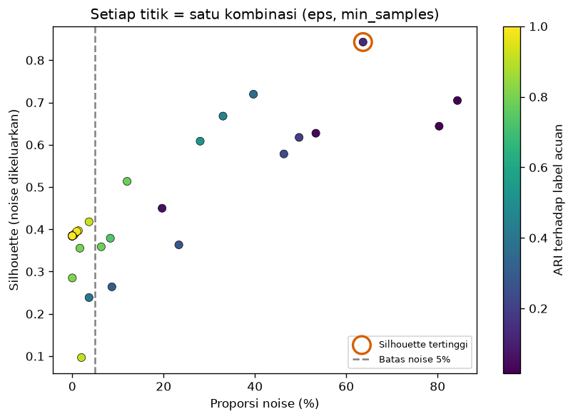

# Bab 3 — Hyperparameter Tuning and Optimization

## Learning Objectives

Setelah mempelajari bab ini, kamu mampu:

- [x] Membedakan **parameter** (dipelajari model) dari **hyperparameter** (ditentukan manusia).
- [x] Menyebutkan hyperparameter utama K-Means, DBSCAN, Hierarchical, GMM, dan Mean Shift beserta fungsinya.
- [x] Melakukan pencarian parameter secara manual, dengan *grid*, dan dengan pengambilan acak (*random*).
- [x] Melakukan analisis sensitivitas terhadap sebuah hyperparameter.
- [x] Menyusun proses pencarian buatan sendiri untuk clustering memakai `ParameterGrid` dan `ParameterSampler`.
- [x] Menjelaskan mengapa `GridSearchCV` tidak boleh dipakai buta untuk clustering.
- [x] Menjelaskan bahaya **mengoptimalkan satu metrik** secara berlebihan, dan cara membatasinya.
- [x] Menjelaskan mengapa satu metrik tidak cukup untuk memilih hyperparameter.

## Introduction

Di Bab 2 kamu melihat bahwa mengubah `eps` pada DBSCAN dari 0,15 menjadi 0,3 mengubah hasil dari 16 kelompok menjadi 2. Pengaturan seperti `eps` itulah yang disebut **hyperparameter**. Memilihnya adalah salah satu keputusan paling berpengaruh dalam clustering.

Pada supervised learning, pemilihan hyperparameter punya "wasit" yang jelas: skor pada data uji. Pada clustering **tidak ada wasit seperti itu**. Kita hanya punya metrik internal (yang punya bias, Level 5) dan kadang label acuan (yang tidak boleh dipakai untuk menyetel). Karena itu tuning pada clustering lebih rumit, dan **godaan untuk mengoptimalkan angka yang salah** jauh lebih besar.

Bab ini mengajarkan cara menelusuri ruang hyperparameter dengan terencana, dan, yang sama pentingnya, cara tidak tertipu oleh hasilnya.

!!! note "Prasyarat"
    [Bab 2](02-experimental-design-and-configuration.md) Level 6 (desain dan pencatatan), [Level 4](../clustering-algorithms/index.md) (algoritma), dan [Level 5](../clustering-evaluation/index.md) (metrik). Bab ini **memakai** metrik Level 5 sebagai alat, tanpa mengulang teorinya.

## Fundamental Concepts

| Istilah | Arti |
|---|---|
| **Parameter** | Nilai yang **dipelajari** model dari data. Di scikit-learn berakhiran `_`, misalnya `cluster_centers_` |
| **Hyperparameter** | Pengaturan yang **ditentukan manusia** sebelum `fit`, misalnya `n_clusters` |
| **Search space** | Himpunan nilai hyperparameter yang akan dicoba |
| **Grid search** | Mencoba **semua kombinasi** dari daftar nilai |
| **Random search** | Mencoba kombinasi yang **diambil acak** dari distribusi |
| **Sensitivity analysis** | Melihat seberapa jauh hasil berubah bila satu hyperparameter diubah |
| **Over-optimization** | Memoles satu metrik sampai tinggi, tetapi hasilnya tidak bermakna |
| **Constraint** | Batasan yang ditulis lebih dulu (misalnya noise maksimum 5%) untuk mencegah solusi yang tidak masuk akal |

## Detailed Explanation

### Parameter vs hyperparameter

Bayangkan kamu mengatur mesin kopi. **Hyperparameter** adalah tombol yang kamu putar: jumlah air, tingkat gilingan. **Parameter** adalah hasil yang keluar dari mesin: rasa kopi. Kamu mengatur tombolnya, mesin menghasilkan hasilnya.

Pada K-Means:

- **Hyperparameter:** `n_clusters`, `init`, `n_init`, `max_iter`.
- **Parameter hasil belajar:** `cluster_centers_` (posisi centroid), `labels_`, `inertia_`, `n_iter_`.

### Hyperparameter tiap algoritma

| Algoritma | Hyperparameter | Fungsi |
|---|---|---|
| **K-Means** | `n_clusters` | Jumlah kelompok |
| | `init` | Cara memilih centroid awal (`"k-means++"` atau `"random"`) |
| | `n_init` | Berapa kali dijalankan dari awal berbeda. Hasil terbaik diambil |
| | `max_iter` | Batas iterasi dalam satu kali jalan |
| **DBSCAN** | `eps` | Radius tetangga |
| | `min_samples` | Jumlah titik minimal dalam radius agar sebuah titik dianggap padat |
| **Hierarchical** | `n_clusters` | Di mana dendrogram dipotong |
| | `linkage` | Cara mengukur jarak antar kelompok (`ward`, `complete`, `average`, `single`) |
| | `metric` | Jarak antar titik. `ward` hanya mendukung `euclidean` |
| **GMM** | `n_components` | Jumlah komponen Gaussian |
| | `covariance_type` | Bentuk elips tiap komponen (`spherical`, `diag`, `tied`, `full`) |
| | `reg_covar` | Angka kecil yang ditambahkan ke kovarians agar stabil |
| **Mean Shift** | `bandwidth` | Lebar jendela pencarian puncak kepadatan |
| | `bin_seeding` | Mulai dari titik pada kisi kasar, bukan semua titik (lebih cepat) |
| | `min_bin_freq` | Dengan `bin_seeding`, abaikan sel kisi dengan titik lebih sedikit dari ini |

!!! tip "Hyperparameter menentukan *definisi* kelompok"
    Pada clustering, mengubah hyperparameter sering berarti mengubah definisi "kelompok". `eps` kecil berarti "kelompok = daerah yang sangat padat". `bandwidth` kecil berarti "banyak puncak kecil". Karena itu tidak ada nilai yang "benar" terlepas dari tujuanmu.

### Mengapa pemilihan hyperparameter penting

Satu algoritma dengan hyperparameter berbeda bisa menghasilkan hasil yang jauh berbeda, sering lebih berbeda daripada dua algoritma berbeda. Maka membandingkan algoritma tanpa memperhatikan hyperparameter bisa menyesatkan (dibahas di Bab 4).

### Tiga cara menelusuri hyperparameter

**1. Pencarian manual.** Kamu mencoba nilai, melihat gambar dan metrik, lalu menyesuaikan. Cocok untuk memahami perilaku, tetapi sulit diulang dan mudah bias.

**2. Grid search.** Tentukan daftar nilai tiap hyperparameter, jalankan semua kombinasi. Sistematis dan bisa diulang, tetapi jumlah kombinasi melonjak: 11 nilai `eps` × 6 nilai `min_samples` = 66 kombinasi.

**3. Random search.** Ambil kombinasi acak dari distribusi (misalnya `eps` seragam antara 0,1 dan 0,6). Lebih hemat saat ruangnya besar, dan menjelajah nilai di antara titik grid. Hasilnya bergantung pada seed pengambil sampel, jadi perlu diulang untuk melihat variasinya.

### Analisis sensitivitas

Ubah satu hyperparameter, tahan yang lain, dan amati hasilnya. Tujuannya bukan mencari nilai terbaik, melainkan **memahami kestabilan**: apakah hasil berubah halus atau melompat? Wilayah di mana hasil **stabil** (misalnya `eps` 0,3 sampai 0,5 pada moons) lebih bisa dipercaya daripada nilai tunggal yang kebetulan tertinggi.

### Memilih metrik untuk tuning

Metrik yang dipakai untuk memilih hyperparameter harus **tidak memakai label acuan** (kalau tidak, itu kebocoran informasi, Level 5 Bab 8). Pilihannya metrik internal. Tetapi setiap metrik punya bias:

- Silhouette dan DBI menyukai kelompok bulat dan bisa **melonjak bila banyak titik dibuang sebagai noise**.
- CHI cenderung naik bersama K pada data lemah.
- Inertia selalu turun saat K naik.

Karena itu: **gunakan lebih dari satu metrik**, ditambah **batasan yang masuk akal**, ditambah gambar.

### Mengapa `GridSearchCV` tidak dipakai buta

`GridSearchCV` dirancang untuk supervised learning. Cara kerjanya: membagi data menjadi lipatan latih dan uji (*cross-validation*), melatih model di lipatan latih, lalu memberi skor di lipatan uji dengan `predict` dan label `y`. Pada clustering ada beberapa masalah:

- **Tidak ada `y`** yang menjadi acuan skor. Kita butuh fungsi skor buatan sendiri.
- **Banyak algoritma tidak punya `predict`**. Kita buktikan di kode: `DBSCAN` dan `AgglomerativeClustering` tidak punya `predict()`.
- **Memisahkan data menjadi lipatan** mengubah struktur kepadatan dan jumlah titik, sehingga metrik berbasis jarak berbeda maknanya.
- Ia mengembalikan "parameter terbaik" seolah-olah itu jawaban, padahal pada clustering definisi "terbaik" tidak tunggal.

Secara teknis `GridSearchCV` bisa dipaksa dengan fungsi skor buatan sendiri, tetapi hasilnya mudah salah. Karena itu kita membuat **proses pencarian sendiri** yang sederhana: ulangi (1) bangun model dengan satu kombinasi, (2) jalankan `fit_predict` pada **seluruh data**, (3) hitung metrik, (4) catat. `ParameterGrid` dan `ParameterSampler` dari scikit-learn membantu menghasilkan kombinasinya.

### Over-optimization

Bayangkan DBSCAN dengan `min_samples` besar. Ia menandai sebagian besar titik sebagai noise, dan hanya menyisakan inti terpadat. Silhouette yang dihitung hanya pada sisa titik itu bisa **sangat tinggi**, padahal sebagian besar data diabaikan. Bila kita mengejar skor tertinggi tanpa batasan, algoritma "menang" dengan membuang data. Inilah *over-optimization*: skor naik, makna turun.

Penangkalnya:

1. **Tetapkan batasan sebelum melihat hasil**: misalnya "noise paling banyak 5%" dan "2 sampai 10 kelompok".
2. **Laporkan beberapa metrik**, bukan satu.
3. **Selalu lihat proporsi noise** dan jumlah kelompok.
4. **Periksa gambar.**

### Kesalahan umum

1. Mengoptimalkan satu metrik tanpa batasan.
2. Memakai label acuan untuk memilih hyperparameter.
3. Memakai `GridSearchCV` tanpa memahami asumsinya.
4. Mencari terlalu banyak kombinasi lalu melaporkan hanya yang terbaik.
5. Tidak melihat wilayah stabil dan hanya nilai tunggal.
6. Tidak mencatat ruang pencarian dan seed.
7. Melupakan bahwa pencarian acak bergantung pada seed pengambil sampel.

## Mathematical Foundation

Bab ini hanya memerlukan satu gagasan matematis ringan: **ukuran ruang pencarian**. Jika ada \( m \) hyperparameter dan hyperparameter ke-\( j \) punya \( n_j \) nilai, grid search menjalankan

$$
N = \prod_{j=1}^{m} n_j
$$

kombinasi. Contohnya `eps` dengan 11 nilai dan `min_samples` dengan 6 nilai memberi \( N = 11 \times 6 = 66 \). Menambah satu hyperparameter dengan 5 nilai membuatnya 330. Inilah alasan grid search tidak cocok untuk banyak hyperparameter, dan random search dengan jumlah percobaan tetap (misalnya 20) menjadi alternatif. Selain itu, **semakin banyak kombinasi yang dicoba**, semakin besar peluang menemukan satu kombinasi yang *kebetulan* tinggi pada suatu metrik. Itulah satu alasan lagi batasan dan beberapa metrik penting.

## Experimental Procedure

1. **Memahami hyperparameter:** tampilkan hyperparameter dan parameter hasil belajar K-Means.
2. **Eksplorasi hyperparameter tiap algoritma** pada dataset yang sesuai:
   - K-Means (`init`, `n_init`, `max_iter`) pada enam gerombol yang sebagian bertumpuk.
   - Hierarchical (`linkage`, `metric`) pada moons.
   - GMM (`covariance_type`, `reg_covar`, `n_components`) pada gerombol miring.
   - Mean Shift (`bandwidth`, `bin_seeding`, `min_bin_freq`) pada tiga gerombol.
3. **Grid search DBSCAN** pada moons: 66 kombinasi, dicatat ke CSV.
4. **Pemilihan tanpa batasan** (Silhouette dan DBI) dan **dengan batasan** (noise paling banyak 5%, 2 sampai 10 kelompok).
5. **Random search**: 20 kombinasi, diulang dengan lima seed pengambil sampel.
6. **Satu metrik tidak cukup:** pilih K pada K-Means memakai tiga metrik.
7. **Mengapa `GridSearchCV` tidak dipakai buta:** periksa `predict()`.
8. **Sensitivitas dan peta pemilihan:** gambar.

## Python Implementation

Skrip lengkapnya ada di `examples/level-6/03_hyperparameter_tuning_and_optimization.py`, dan notebook-nya di `notebooks/level-6/03-hyperparameter-tuning-and-optimization.ipynb`. **Setiap potongan kode diikuti penjelasannya.**

**Konteks masalah:** memilih hyperparameter tanpa label benar, dan tanpa tertipu oleh satu metrik.

**Tujuan eksperimen:** memahami efek hyperparameter lima algoritma, membangun pencarian sendiri, dan memperlihatkan bahaya over-optimization.

**Dataset (dan alasannya):**

- Enam gerombol bulat yang sebagian bertumpuk (`make_blobs`, 600 titik): inisialisasi K-Means paling terlihat pengaruhnya di sini, dan K sebenarnya (6) diketahui.
- Moons (300 titik): bentuk non-bulat, cocok untuk DBSCAN dan linkage.
- Gerombol miring (`make_blobs` dikalikan matriks): berbentuk elips, supaya `covariance_type` GMM berpengaruh.
- Tiga gerombol bulat (400 titik): untuk `bandwidth` Mean Shift.

Semua sintetis dan punya label acuan, yang **hanya dipakai untuk menilai setelah** pemilihan.

**Pustaka:** NumPy, pandas, Matplotlib, SciPy (hanya `scipy.stats` untuk distribusi pencarian acak, SciPy sudah ada di proyek), scikit-learn.

### Bagian A — Siapkan alat

```python
--8<-- "level-6/03_hyperparameter_tuning_and_optimization.py:setup"
```

**Penjelasan:** `uniform` dan `randint` dari `scipy.stats` adalah distribusi yang bisa diambil sampelnya oleh `ParameterSampler`. `ParameterGrid` membuat semua kombinasi. `estimate_bandwidth` memperkirakan `bandwidth` Mean Shift. `_experiment` adalah alat pencatat dari Bab 2.

### Bagian B — Parameter vs hyperparameter

```python
--8<-- "level-6/03_hyperparameter_tuning_and_optimization.py:paramtypes"
```

**Penjelasan:** `model.get_params()` mengembalikan semua hyperparameter dalam dictionary. Kita hanya menampilkan enam. Setelah `fit`, atribut berakhiran garis bawah seperti `cluster_centers_`, `inertia_`, dan `n_iter_` muncul. Itu **parameter hasil belajar**. Konvensi scikit-learn: tanda `_` di akhir berarti "baru ada setelah `fit`".

### Bagian C — Hyperparameter K-Means

```python
--8<-- "level-6/03_hyperparameter_tuning_and_optimization.py:kmeans"
```

**Penjelasan:**

- Untuk setiap kombinasi `init` dan `n_init`, kita menjalankan K-Means dengan 20 seed berbeda (`for seed in range(20)`) dan mengumpulkan `inertia_`.
- `min(inertias)` dan `max(inertias)` memberi rentang. `sum(abs(v - min(inertias)) < 1e-6 for v in inertias)` menghitung berapa seed yang mencapai hasil terbaik (selisih lebih kecil dari `1e-6` dianggap sama).
- Perulangan `max_iter` memakai `n_init=1` dan `init="random"` agar efek iterasi terlihat. `model.n_iter_` adalah jumlah iterasi yang benar-benar dipakai.

### Bagian D — Hyperparameter Hierarchical

```python
--8<-- "level-6/03_hyperparameter_tuning_and_optimization.py:hier"
```

**Penjelasan:** kita mencoba kombinasi `linkage` dan `metric` yang valid. `ward` hanya boleh dengan `euclidean`, jadi hanya satu pasangan untuknya. `metric="cosine"` mengukur sudut, bukan jarak. `sorted(np.bincount(labels).tolist())` menampilkan ukuran kelompok. ARI acuan dipakai untuk menilai.

### Bagian E — Hyperparameter GMM

```python
--8<-- "level-6/03_hyperparameter_tuning_and_optimization.py:gmm"
```

**Penjelasan:** `X_a @ np.array([[...]])` mengalikan data dengan matriks transformasi sehingga gerombol menjadi elips miring (operator `@` adalah perkalian matriks). Lalu kita mengubah `covariance_type`, `reg_covar`, dan `n_components` satu per satu. `{reg_covar:g}` mencetak angka dalam format ringkas.

### Bagian F — Hyperparameter Mean Shift

```python
--8<-- "level-6/03_hyperparameter_tuning_and_optimization.py:meanshift"
```

**Penjelasan:** `estimate_bandwidth(X, quantile=0.2)` memperkirakan `bandwidth` dari data. Kemudian kita mencoba lima `bandwidth`, dan beberapa kombinasi `bin_seeding` dan `min_bin_freq`. `{bin_seeding!s:5}` mengubah `True/False` menjadi teks selebar 5 karakter.

### Bagian G — Grid search DBSCAN

```python
--8<-- "level-6/03_hyperparameter_tuning_and_optimization.py:grid"
```

**Penjelasan:**

- `np.arange(0.10, 0.61, 0.05)` menghasilkan 0,10; 0,15; ...; 0,60 (11 nilai). `round(v, 2)` membersihkan angka desimal.
- `ParameterGrid({...})` membuat 66 kombinasi, dan `len(grid)` menghitungnya.
- `evaluate_dbscan(params)`: `DBSCAN(**params)` membangun model dari dictionary, `fit_predict` melatihnya pada **seluruh data**, `ex.internal_scores` menghitung metrik internal, dan `adjusted_rand_score` hanya mencatat ARI acuan untuk penilaian **setelahnya**. `{**params, **scores}` menggabungkan dua dictionary.
- `grid_table` berisi satu baris per kombinasi. Kolom `silhouette` bernilai `NaN` bila kurang dari dua kelompok.

### Bagian H — Pemilihan tanpa batasan

```python
--8<-- "level-6/03_hyperparameter_tuning_and_optimization.py:naive"
```

**Penjelasan:** `dropna(subset=["silhouette"])` membuang baris yang metriknya tidak bisa dihitung. `sort_values("silhouette", ascending=False).head(3)` mengambil tiga terbaik menurut Silhouette. Davies-Bouldin diurutkan naik (`sort_values("davies_bouldin")`) karena rendah lebih baik.

### Bagian I — Pemilihan dengan batasan

```python
--8<-- "level-6/03_hyperparameter_tuning_and_optimization.py:constrained"
```

**Penjelasan:** batasan ditulis **sebelum** melihat hasil: `noise_fraction <= 0.05` dan `n_clusters.between(2, 10)`. Operator `&` menggabungkan dua syarat. Kita memilih Silhouette tertinggi hanya di antara kombinasi yang memenuhi batasan.

### Bagian J — Pencarian acak

```python
--8<-- "level-6/03_hyperparameter_tuning_and_optimization.py:random"
```

**Penjelasan:**

- `space` mendefinisikan distribusi: `uniform(0.10, 0.50)` berarti `eps` diambil seragam antara 0,10 dan 0,60 (argumennya awal dan lebar). `randint(3, 31)` memberi bilangan bulat 3 sampai 30.
- `ParameterSampler(space, n_iter=20, random_state=sampler_seed)` mengambil 20 kombinasi. Kita ulangi dengan lima seed berbeda untuk melihat variasinya.
- Untuk tiap seed, kita menerapkan batasan yang sama dan memilih Silhouette tertinggi.

### Bagian K — Satu metrik tidak cukup

```python
--8<-- "level-6/03_hyperparameter_tuning_and_optimization.py:multimetric"
```

**Penjelasan:** untuk K = 2 sampai 10 pada enam gerombol, kita menghitung tiga metrik dan ARI acuan, lalu melihat K terbaik menurut masing-masing metrik. `idxmax()` dan `idxmin()` mengembalikan K dengan nilai tertinggi atau terendah.

### Bagian L — Mengapa `GridSearchCV` tidak dipakai buta

```python
--8<-- "level-6/03_hyperparameter_tuning_and_optimization.py:nopredict"
```

**Penjelasan:** `hasattr(objek, "predict")` bernilai `True` bila objek punya method `predict`.

### Bagian M — Menyimpan hasil

```python
--8<-- "level-6/03_hyperparameter_tuning_and_optimization.py:save"
```

**Penjelasan:** seluruh 66 baris hasil grid disimpan ke `results/03_dbscan_grid.csv`, bersama konfigurasi pencarian (ruang, batasan, sidik jari data) ke JSON.

### Bagian N — Gambar

```python
--8<-- "level-6/03_hyperparameter_tuning_and_optimization.py:plotsens"
```

```python
--8<-- "level-6/03_hyperparameter_tuning_and_optimization.py:plotsel"
```

**Penjelasan:** gambar pertama menampilkan tiga kurva (jumlah kelompok, noise, ARI) terhadap `eps` untuk tiga nilai `min_samples`. Gambar kedua menggambar **setiap kombinasi sebagai satu titik**: sumbu x proporsi noise, sumbu y Silhouette, warna ARI acuan. `c=..., cmap="viridis"` mewarnai titik menurut ARI. Lingkaran oranye menandai kombinasi Silhouette tertinggi.

## Code Explanation

| Bagian kode | Peran |
|---|---|
| `model.get_params()` | Hyperparameter sebuah model |
| `model.cluster_centers_`, `inertia_` | Parameter hasil belajar |
| `ParameterGrid(...)` | Semua kombinasi (grid search) |
| `ParameterSampler(space, n_iter, random_state)` | Kombinasi acak (random search) |
| `evaluate_dbscan(params)` | Satu langkah pencarian: bangun, `fit_predict`, nilai, catat |
| `noise_fraction <= 0.05` dan `n_clusters.between(2, 10)` | Batasan yang ditulis lebih dulu |
| `hasattr(estimator, "predict")` | Memeriksa kemampuan `predict` |

!!! note "Pelatihan vs penilaian"
    `fit_predict` melatih model **tanpa label acuan**. Metrik internal dipakai untuk **memilih**. ARI acuan hanya dihitung untuk **menilai pilihan itu setelahnya**.

## How to Run

Dari folder utama proyek (setelah mengaktifkan lingkungan virtual):

```powershell
pip install -r requirements-notebooks.txt
python examples/level-6/03_hyperparameter_tuning_and_optimization.py
```

Skrip mencetak output ke terminal, menyimpan dua gambar ke `docs/assets/level-6/`, dan menyimpan hasil ke `examples/level-6/results/`. Notebook interaktifnya:

```powershell
jupyter notebook notebooks/level-6/03-hyperparameter-tuning-and-optimization.ipynb
```

Output di bawah berasal dari eksekusi nyata dengan Python 3.14, NumPy 2.5.4, pandas 3.1.1, scikit-learn 1.9.1, SciPy 1.18.1, dan Matplotlib 3.11.2.

## Expected Output

```text
--8<-- "level-6/outputs/03.txt"
```

Gambar yang dihasilkan:





### Interpretasi output

**1. Parameter vs hyperparameter.** Hyperparameter K-Means: `n_clusters=3`, `init='k-means++'`, `n_init=10`, `max_iter=300`, `tol=0.0001`, `random_state=42`. Setelah `fit`: `cluster_centers_` berbentuk (3, 2), `inertia_` 364,47, `n_iter_` 2.

**2. K-Means: `init`, `n_init`, `max_iter`.** Dari 20 seed:

| `init` | `n_init` | Inertia terkecil | Inertia terbesar | Seed yang mencapai terkecil |
|---|---|---|---|---|
| random | 1 | 2398,51 | 3358,04 | 2 dari 20 |
| random | 10 | 2398,51 | 2399,72 | 17 dari 20 |
| k-means++ | 1 | 2398,51 | 3004,09 | 3 dari 20 |
| k-means++ | 10 | 2398,51 | 2398,71 | 18 dari 20 |

Dengan `n_init=1`, hasil terburuk bisa jauh lebih buruk (3358,04 vs 2398,51) dan hanya 2 sampai 3 dari 20 seed mencapai hasil terbaik. Dengan `n_init=10`, 17 sampai 18 dari 20 seed mencapainya. `k-means++` sedikit lebih baik daripada `random`. Jadi `n_init` **mengurangi kebisingan akibat seed**. Pada `max_iter`: nilai 1 dan 2 menghentikan algoritma sebelum konvergen (inertia 3379,91 dan 3365,88), nilai 5 dan 300 sama-sama 3358,04 karena algoritma sudah konvergen pada iterasi ke-6 (`n_iter_ = 6`).

**3. Hierarchical: `linkage` dan `metric` (moons).**

| `linkage` | `metric` | ARI acuan | Ukuran kelompok |
|---|---|---|---|
| ward | euclidean | 0,425 | 98, 202 |
| complete | euclidean | 0,607 | 137, 163 |
| complete | manhattan | 0,597 | 116, 184 |
| average | euclidean | 0,576 | 114, 186 |
| average | cosine | 0,425 | 134, 166 |
| single | euclidean | **1,000** | 150, 150 |

`linkage` berpengaruh besar, dan `metric` juga mengubah hasil (average dengan `cosine` jauh lebih buruk dari dengan `euclidean`).

**4. GMM.** Pada gerombol miring: `covariance_type` = spherical **0,947**, diag **0,982**, tied **1,000**, full **1,000**. Bentuk kovarians yang lebih fleksibel menangkap elips miring lebih baik. `reg_covar`: 1e-6, 0,001, dan 0,1 sama-sama **1,000**, tetapi `reg_covar = 1` turun menjadi **0,942**: regularisasi terlalu besar "menggembungkan" kelompok. `n_components`: 2 → **0,571**; 3 → **1,000**; 4 → **0,874**; 6 → **0,582**. Jumlah komponen yang tepat (3) memberi hasil terbaik.

**5. Mean Shift.** `estimate_bandwidth` memberi **1,878**.

| `bandwidth` | Kelompok | ARI acuan |
|---|---|---|
| 0,5 | 69 | 0,085 |
| 1,0 | 7 | 0,916 |
| 2,0 | 3 | **1,000** |
| 4,0 | 3 | **1,000** |
| 8,0 | 2 | 0,569 |

`bandwidth` terlalu kecil memecah data menjadi 69 kelompok, terlalu besar menggabungkan menjadi 2. Ada **dataran stabil** antara 2,0 dan 4,0. `bin_seeding` dan `min_bin_freq` (1, 5, 20) tidak mengubah hasil pada data ini (3 kelompok, ARI 1,000). Pengaruh utamanya biasanya pada **kecepatan**, tidak diukur di sini.

**6. Grid search DBSCAN.** 66 kombinasi. Silhouette hanya bisa dihitung pada **50 dari 66**: 16 kombinasi menghasilkan kurang dari dua kelompok (misalnya semuanya noise atau semuanya satu kelompok).

**7. Pemilihan tanpa batasan: bahaya over-optimization.**

| Peringkat Silhouette | `eps` | `min_samples` | Kelompok | Noise | Silhouette | DBI | ARI acuan |
|---|---|---|---|---|---|---|---|
| 1 | 0,40 | 30 | 2 | **63,7%** | **0,843** | **0,231** | **0,129** |
| 2 | 0,45 | 30 | 2 | 39,7% | 0,720 | 0,427 | 0,362 |
| 3 | 0,20 | 15 | 3 | **84,3%** | 0,705 | 0,416 | 0,020 |

Pemenang menurut Silhouette (0,843) maupun DBI (0,231) adalah kombinasi yang **membuang 63,7% data sebagai noise**, dan ARI-nya hanya 0,129. Peringkat tiga bahkan membuang 84,3% data. Silhouette dan DBI dihitung hanya pada titik yang tersisa, sehingga makin banyak data dibuang, makin tinggi skornya. Inilah over-optimization. Gambar peta pemilihan memperlihatkannya: titik dengan Silhouette tertinggi berada jauh di kanan (noise besar), dengan warna ARI rendah.

**8. Pemilihan dengan batasan** (noise ≤ 5%, 2 sampai 10 kelompok). Sebanyak **34 dari 50** kombinasi memenuhi batasan.

| Peringkat Silhouette | `eps` | `min_samples` | Kelompok | Noise | Silhouette | ARI acuan |
|---|---|---|---|---|---|---|
| 1 | 0,60 | 30 | 2 | 3,7% | 0,418 | 0,916 |
| 2 | 0,35 | 15 | 2 | 1,3% | 0,397 | 0,974 |
| 3 | 0,45 | 20 | 2 | 1,0% | 0,395 | 0,980 |

Dengan batasan, pemenang jauh lebih masuk akal (ARI 0,916 sampai 0,980). Namun **ARI terbesar di antara kombinasi yang memenuhi batasan adalah 1,000**, dan itu **bukan** pemenang Silhouette. Jadi bahkan dengan batasan, memilih dengan Silhouette tidak menemukan kombinasi terbaik menurut label acuan. Pemenang Silhouette (0,418) memang cukup baik, tetapi bukan yang terbaik. Ini mengingatkan bahwa metrik internal adalah **penuntun**, bukan penentu.

**9. Random search (20 kombinasi, lima seed pengambil sampel, dengan batasan sama).**

| Seed sampler | `eps` terpilih | `min_samples` | Silhouette | ARI acuan |
|---|---|---|---|---|
| 0 | 0,292 | 9 | 0,391 | 0,987 |
| 1 | 0,584 | 25 | 0,386 | 0,993 |
| 2 | 0,389 | 17 | 0,401 | 0,967 |
| 3 | 0,479 | 19 | 0,389 | 0,993 |
| 4 | 0,457 | 21 | 0,395 | 0,980 |

Hasil terpilih **berbeda-beda** antar seed (`eps` dari 0,292 sampai 0,584), tetapi semuanya berada di wilayah stabil dengan ARI 0,967 sampai 0,993. Pencarian acak menemukan kombinasi yang berbeda dari grid, namun serupa mutunya. Konsisten dengan analisis sensitivitas: banyak nilai yang "cukup baik".

**10. Satu metrik tidak cukup (K-Means pada enam gerombol bertumpuk, K sebenarnya = 6).**

| K | Silhouette | DBI | CHI | ARI acuan |
|---|---|---|---|---|
| 2 | 0,498 | 0,922 | 549,9 | 0,331 |
| **3** | **0,653** | **0,458** | 1557,3 | 0,463 |
| **4** | 0,602 | 0,530 | **1956,6** | 0,655 |
| 5 | 0,543 | 0,658 | 1889,0 | **0,725** |
| 6 | 0,489 | 0,747 | 1853,5 | 0,718 |
| 7 | 0,461 | 0,803 | 1710,5 | 0,651 |

(K = 8 sampai 10 sengaja tidak ditampilkan di tabel ini, lihat output untuk nilai lengkapnya.) **Silhouette dan DBI memilih K = 3, CHI memilih K = 4**, sedangkan ARI acuan tertinggi di K = 5 (0,725), dan jumlah gerombol sebenarnya 6. Tiga metrik tidak sepakat, dan tidak satu pun menemukan K = 6. Gerombol yang sebagian bertumpuk membuat metrik internal memilih K yang lebih kecil. Tidak ada satu metrik yang cukup.

**11. `predict()` dan `GridSearchCV`.** `KMeans`, `GaussianMixture`, dan `MeanShift` punya `predict()` (`True`). `DBSCAN` dan `AgglomerativeClustering` **tidak** (`False`). `GridSearchCV` yang mengandalkan `predict` pada lipatan uji tidak bisa langsung dipakai untuk dua algoritma itu.

**12. Sensitivitas `eps`.** Pada gambar: untuk `min_samples = 3`, ARI mencapai 1,0 sejak `eps` sekitar 0,25 dan tetap sampai 0,55. Untuk `min_samples = 30`, hampir seluruh data adalah noise (sekitar 100%) sampai `eps` 0,3, dan ARI baru naik pelan sampai 0,6. Pada `eps = 0,6`, `min_samples` 3 dan 10 menjadi satu kelompok (ARI turun ke 0), karena radius terlalu besar menggabungkan kedua bulan. Wilayah stabil (ARI tinggi) bergantung pada `min_samples`.

!!! warning "Batas kesimpulan"
    Hasil ini berlaku untuk dataset sintetis kecil dan satu seed data. Nilai `eps` yang cocok pada data terskala ini belum tentu cocok pada data lain. Kita juga memakai ARI acuan hanya untuk **menilai** pilihan, yang hanya mungkin karena datanya sintetis. Pada data nyata tanpa label, kita hanya punya metrik internal, gambar, dan batasan yang masuk akal.

## Practical Application

**Menyetel DBSCAN pada data transaksi.** Tetapkan batasan "noise paling banyak 5%", jalankan grid, lalu pilih kombinasi di wilayah stabil, bukan nilai tunggal yang tertinggi.

**Memilih K pada segmentasi pelanggan.** Hitung beberapa metrik untuk K = 2 sampai 10, lalu bahas kandidat bersama tim bisnis. Metrik memberi kandidat, bisnis memberi keputusan.

**Mengurangi biaya pencarian.** Dengan ruang besar, pakai pencarian acak dengan jumlah percobaan tetap, lalu kerjakan analisis sensitivitas di sekitar kandidat.

**Mendokumentasikan tuning.** Simpan tabel hasil grid, batasan, dan seed, supaya orang lain bisa memeriksa dan mengulang.

## Hands-on Exercises

1. Jalankan K-Means pada `X_six` dengan `init="k-means++"` dan `n_init=3` untuk 20 seed. Berapa inertia terkecil dan terbesarnya, dan berapa seed yang mencapai terkecil?
2. Dari `03_dbscan_grid.csv`: berapa kombinasi yang memiliki noise lebih dari 50%? Berapa ARI terbesar di antara kombinasi yang Silhouette-nya bisa dihitung dan noise-nya lebih dari 50%?
3. Dari tabel pemilihan tanpa batasan, jelaskan mengapa kombinasi `eps = 0,40`, `min_samples = 30` mendapat Silhouette tertinggi padahal ARI-nya hanya 0,129.
4. Mengapa batasan "noise ≤ 5%" harus ditetapkan **sebelum** melihat hasil?
5. Mengapa `GridSearchCV` tidak bisa langsung dipakai untuk `DBSCAN`?
6. Dengan 4 hyperparameter masing-masing 5 nilai, berapa kombinasi pada grid search? Apa alternatifnya?
7. Pada K-Means enam gerombol, mengapa memilih K dengan Silhouette tertinggi memberi K = 3 padahal K sebenarnya 6?

??? question "Jawaban"
    Hasil nomor 1 dan 2 berasal dari eksekusi nyata.

    1. Inertia terkecil **2398,51**, terbesar **2728,27**, dan **9 dari 20** seed mencapai terkecil. Lebih baik daripada `n_init=1` (3 dari 20) tetapi kalah dari `n_init=10` (18 dari 20).
    2. **17 dari 66** kombinasi punya noise lebih dari 50%. Dari yang Silhouette-nya bisa dihitung, ada 4 kombinasi (Silhouette 0,627 sampai 0,843), dan ARI terbesarnya hanya **0,129**.
    3. Karena 63,7% data dikeluarkan sebagai noise sebelum Silhouette dihitung. Titik yang tersisa adalah inti yang sangat padat, sehingga tampak rapi. Skor tinggi berasal dari membuang data sulit, bukan dari pengelompokan yang lebih baik.
    4. Jika batasan ditentukan setelah melihat hasil, kita bisa menyesuaikannya agar kombinasi favorit lolos. Itu menipu diri sendiri. Batasan yang ditulis lebih dulu membuat pemilihan lebih jujur.
    5. `GridSearchCV` menilai model di lipatan uji dengan `predict`, dan `DBSCAN` tidak punya `predict()`. Selain itu clustering tidak punya `y` untuk skor, dan pemisahan lipatan mengubah struktur kepadatan.
    6. \( 5^4 = 625 \) kombinasi. Alternatif: random search dengan jumlah percobaan tetap, atau mempersempit ruang berdasarkan analisis sensitivitas.
    7. Pada gerombol yang sebagian bertumpuk, metrik internal cenderung menyukai pembagian dengan kelompok yang terpisah jelas (Level 5), yaitu K yang lebih kecil. Data kita memperlihatkannya: Silhouette dan DBI tertinggi di K = 3, walaupun struktur sebenarnya enam. ARI acuan menunjukkan K = 5 lebih dekat (0,725). Itu satu pengamatan pada satu dataset, bukan aturan umum.

## Troubleshooting

### Masalah teknis

| Masalah | Penyebab | Solusi |
|---|---|---|
| `ValueError: ... ward ... only euclidean` | `linkage="ward"` dengan `metric` selain `euclidean` | Pakai `euclidean` untuk ward, atau ganti linkage |
| `ValueError: Number of labels is 1...` saat menghitung metrik | Kombinasi menghasilkan satu kelompok atau semuanya noise | Gunakan `ex.internal_scores`, yang mengembalikan `NaN` |
| `AttributeError: ... has no attribute 'predict'` | Algoritma tidak punya `predict` (DBSCAN, Hierarchical) | Gunakan `fit_predict`, atau jangan pakai `GridSearchCV` |
| Hasil pencarian acak berbeda tiap eksekusi | `random_state` pengambil sampel tidak diatur | Tetapkan `random_state` pada `ParameterSampler` |
| Pencarian terlalu lama | Ruang terlalu besar | Pakai random search atau persempit rentang |
| Semua kombinasi memberi `NaN` | Rentang `eps` terlalu sempit atau `min_samples` terlalu besar | Perlebar rentang, lihat gambar sensitivitas |

### Kesalahan umum

1. **Mengoptimalkan satu metrik tanpa batasan.** Silhouette 0,843 pada hasil yang membuang 63,7% data.
2. **Memakai label acuan untuk memilih.** ARI hanya untuk menilai.
3. **Melaporkan hanya kombinasi terbaik** tanpa menyebut berapa yang dicoba.
4. **Menyimpulkan dari satu seed pencarian acak.**
5. **Tidak melihat wilayah stabil**, hanya nilai tunggal.
6. **Mengubah batasan setelah melihat hasil.**
7. **Percaya bahwa satu metrik cukup.** Silhouette dan DBI memilih K = 3, CHI memilih K = 4, ARI memilih K = 5.
8. **Memakai `GridSearchCV` tanpa memeriksa `predict` dan asumsinya.**

## Summary

- **Parameter** dipelajari model (`cluster_centers_`, `inertia_`), **hyperparameter** ditentukan manusia (`n_clusters`, `eps`, dan seterusnya).
- Setiap algoritma punya hyperparameter yang menentukan **definisi** kelompok. `n_init=10` meningkatkan kemungkinan mencapai hasil terbaik K-Means dari 2 sampai 3 menjadi 17 sampai 18 dari 20 seed.
- Tiga cara menelusuri: manual, **grid** (`ParameterGrid`, kombinasi \( N = \prod n_j \)), dan **acak** (`ParameterSampler`).
- **Analisis sensitivitas** mencari wilayah stabil, bukan nilai tunggal. Mean Shift stabil antara `bandwidth` 2,0 dan 4,0.
- **`GridSearchCV` tidak dipakai buta**: `DBSCAN` dan `AgglomerativeClustering` tidak punya `predict()`, dan clustering tidak punya `y`. Kita membangun pencarian sendiri.
- **Over-optimization:** pemenang Silhouette (0,843) membuang 63,7% data sebagai noise, dengan ARI 0,129. **Batasan yang ditetapkan lebih dulu** (noise ≤ 5%, 2 sampai 10 kelompok) menghasilkan pilihan yang jauh lebih masuk akal, namun bukan yang terbaik menurut label acuan.
- **Satu metrik tidak cukup:** pada enam gerombol bertumpuk, Silhouette dan DBI memilih K = 3, CHI memilih K = 4, ARI memilih K = 5, dan K sebenarnya 6.
- Simpan ruang pencarian, batasan, seed, dan semua hasil.

**Bab berikutnya:** Bab 4 membandingkan **algoritma** secara adil (Eksperimen A): dataset, praproses, dan hyperparameter yang konsisten, serta tabel hasil, waktu jalan, dan penjelasan skor yang bertentangan.

## References

- Bergstra, J., & Bengio, Y. (2012). Random search for hyper-parameter optimization. *Journal of Machine Learning Research*, 13, 281–305.
- Hennig, C. (2015). What are the true clusters? *Pattern Recognition Letters*, 64, 53–62.
- Scikit-learn documentation: [*Tuning the hyper-parameters of an estimator*](https://scikit-learn.org/stable/modules/grid_search.html), [`ParameterGrid`](https://scikit-learn.org/stable/modules/generated/sklearn.model_selection.ParameterGrid.html), dan [`ParameterSampler`](https://scikit-learn.org/stable/modules/generated/sklearn.model_selection.ParameterSampler.html).
- von Luxburg, U., Williamson, R. C., & Guyon, I. (2012). Clustering: science or art? *JMLR Workshop and Conference Proceedings*, 27, 65–79.
- Arthur, D., & Vassilvitskii, S. (2007). k-means++: the advantages of careful seeding. *Proceedings of SODA 2007*, 1027–1035.
