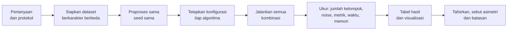
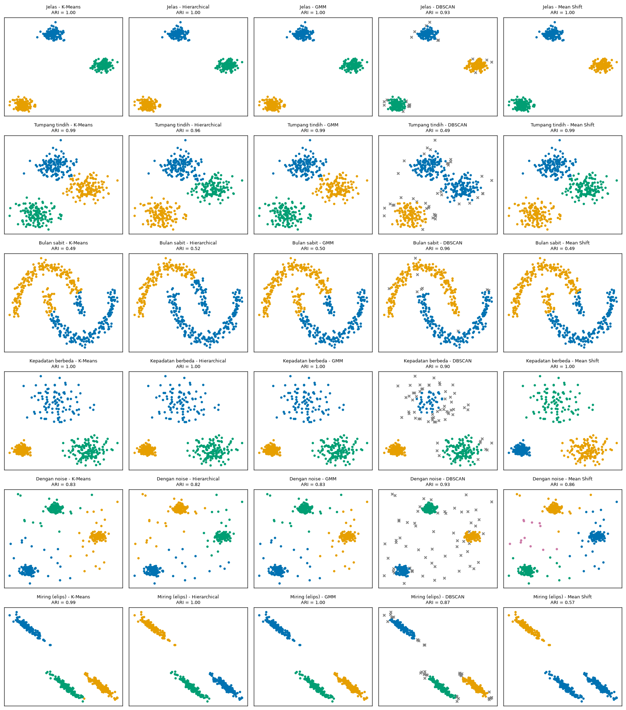
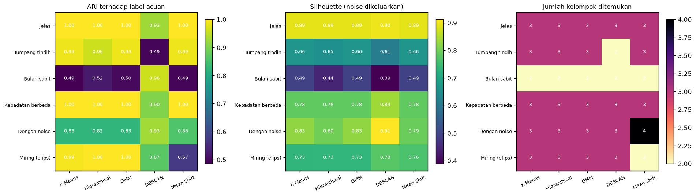
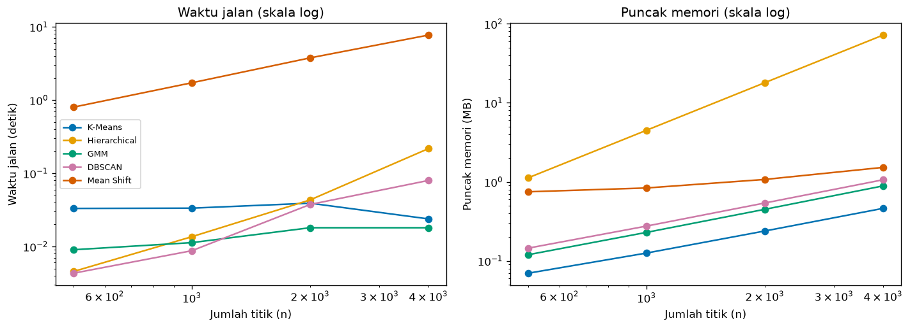

# Bab 4 — Algorithm Comparison and Benchmarking

## Learning Objectives

Setelah mempelajari bab ini, kamu mampu:

- [x] Menjelaskan mengapa algoritma clustering perlu dibandingkan, dan apa arti perbandingan yang **adil**.
- [x] Merancang protokol perbandingan: dataset, praproses, konfigurasi, dan metrik yang konsisten.
- [x] Memilih algoritma berdasarkan karakter data, bukan kebiasaan.
- [x] Membandingkan lima algoritma pada jumlah kelompok, noise, bentuk kelompok, skor metrik, waktu jalan, dan memori.
- [x] Menyusun dan membaca tabel hasil eksperimen.
- [x] Menjelaskan skor yang saling bertentangan.
- [x] Mengenali keterbatasan benchmark dan mengapa tidak ada algoritma terbaik universal.
- [x] Menjalankan **Eksperimen A** dari awal sampai akhir dan mencatatnya.

## Introduction

Level 4 Bab 7 membandingkan lima algoritma secara **visual**. Level 5 memberi alat ukur. Bab ini menyatukannya dalam sebuah **eksperimen perbandingan** yang terencana: semua algoritma dijalankan pada kondisi yang sama, hasilnya diukur dengan beberapa metrik, dan seluruhnya dicatat.

Pertanyaan yang ingin dijawab: **"Bagaimana perilaku lima algoritma pada data dengan karakter berbeda, dan apa yang membuat perbandingannya adil?"**

Bab ini juga mengajarkan sikap penting: sebuah benchmark **bukan perlombaan** yang menghasilkan juara. Ia adalah cara melihat **kapan** dan **mengapa** sebuah algoritma cocok.

!!! note "Prasyarat"
    [Bab 2](02-experimental-design-and-configuration.md) dan [Bab 3](03-hyperparameter-tuning-and-optimization.md) Level 6, [Level 4 Bab 7](../clustering-algorithms/07-comparison-of-clustering-algorithms.md), dan [Level 5](../clustering-evaluation/index.md). Definisi metrik ada di Level 5. Di sini metrik hanya dipakai sebagai alat.

## Fundamental Concepts

| Istilah | Arti |
|---|---|
| **Benchmark** | Perbandingan terencana beberapa metode pada kondisi yang sama |
| **Fair comparison** | Perbandingan di mana perbedaan hasil tidak berasal dari perlakuan yang tidak sama |
| **Protocol** | Aturan tertulis tentang data, praproses, konfigurasi, dan pengukuran |
| **Result table** | Tabel yang merangkum hasil setiap kombinasi algoritma dan dataset |
| **Runtime** | Waktu yang dibutuhkan algoritma untuk berjalan |
| **Peak memory** | Memori terbanyak yang dipakai selama berjalan |
| **Scalability** | Bagaimana waktu atau memori bertambah saat jumlah data bertambah |

## Detailed Explanation

### Mengapa membandingkan algoritma?

Tidak ada algoritma yang paling baik untuk semua data (Level 4 Bab 7). Tiap algoritma memiliki **asumsi** tentang apa itu "kelompok". Membandingkan membantu kita melihat asumsi mana yang cocok dengan data kita, dan mengenali kegagalan sebelum terjadi di produksi.

### Syarat perbandingan yang adil

Perbandingan menjadi **tidak adil** bila perbedaan hasil bisa berasal dari hal selain algoritma. Syarat minimalnya:

1. **Data yang sama.** Semua algoritma memakai data identik (sidik jari data sama, Bab 2).
2. **Praproses yang sama.** Misalnya `StandardScaler` untuk semua.
3. **Seed yang sama** dan dicatat.
4. **Jumlah usaha penyetelan yang sebanding.** Algoritma yang disetel dengan 60 kombinasi lalu dibandingkan dengan yang tidak disetel sama sekali bukan perbandingan yang adil.
5. **Metrik yang sama**, dihitung dengan cara yang sama, dengan perlakuan noise yang dinyatakan.
6. **Label acuan hanya untuk menilai**, tidak untuk menyetel.
7. **Dokumentasi asimetri.** Tidak ada perbandingan yang sempurna sama rata. Kalau ada asimetri (misalnya satu algoritma diberi K, yang lain harus menemukannya), nyatakan dengan jelas.

### Memilih algoritma berdasarkan karakter data

| Karakter data | Algoritma yang biasanya cocok | Catatan |
|---|---|---|
| Gerombol bulat, jelas | K-Means, GMM, Hierarchical (Ward) | Semua sering memberi hasil mirip |
| Gerombol elips | GMM (`full`), Hierarchical | K-Means memakai asumsi bulat |
| Bentuk melengkung | DBSCAN, Hierarchical (`single`) | Algoritma berbasis centroid memotong bentuknya |
| Ada noise dan outlier | DBSCAN | Mengenali noise secara eksplisit |
| Kepadatan sangat berbeda | GMM, K-Means, Mean Shift | DBSCAN dengan satu `eps` sulit |
| K tidak diketahui | DBSCAN, Mean Shift | Menemukan jumlah kelompok dari data |

Tabel ini adalah **panduan awal**, bukan hukum. Eksperimen kita akan menguji sebagian di antaranya.

### Komponen perbandingan

- **Jumlah kelompok** yang ditemukan: apakah sesuai dengan struktur data?
- **Penanganan noise:** berapa titik dianggap noise?
- **Bentuk kelompok:** apakah bentuk yang ditemukan sesuai bentuk data? (dilihat dari gambar)
- **Metrik:** internal (tanpa label) dan eksternal (dengan label acuan, bila ada).
- **Waktu jalan** dan **memori:** biaya komputasi.

### Waktu jalan dan memori

Waktu dan memori bertumbuh berbeda pada tiap algoritma saat data bertambah.

- **Hierarchical (Ward)** menyimpan jarak antar semua pasangan titik. Untuk \( n \) titik, matriks jarak ringkas berisi \( n(n-1)/2 \) angka, masing-masing 8 byte (tipe `float64`). Jadi memori tumbuh **kuadratik**: data dua kali lebih banyak membutuhkan memori sekitar empat kali.
- **K-Means** dan **GMM** hanya perlu menyimpan titik dan centroid atau komponen, sehingga memori tumbuh kira-kira **linear**.
- **DBSCAN** mencari tetangga tiap titik, dan **Mean Shift** menggeser jendela dari banyak titik awal, yang bisa mahal secara waktu.

!!! note "Waktu berubah tiap eksekusi"
    Angka waktu jalan bergantung pada komputer, beban lain, dan jumlah inti prosesor. Karena itu waktu **tidak** dicetak ke output yang dicocokkan, tetapi disimpan ke CSV dan digambar. Yang dapat dipercaya adalah **pola pertumbuhannya**, bukan angka tepatnya.

### Alur benchmark



### Menafsirkan skor yang bertentangan

Seperti di Level 5 Bab 8, metrik internal dan eksternal sering tidak sepakat. Cara menyikapinya:

1. **Cari tahu apa yang diukur tiap metrik.** Silhouette: jarak ke kelompok tetangga. ARI: kecocokan keanggotaan dengan label acuan.
2. **Periksa perlakuan noise.** Metrik internal dihitung tanpa noise, ARI menghitung noise sebagai kelompok sendiri. Itu bisa membuat peringkat berbeda tanpa ada yang "salah".
3. **Lihat gambar.**
4. **Laporkan keduanya** dan jelaskan perbedaannya, jangan memilih yang menguntungkan.

### Keterbatasan benchmark

- **Hanya mewakili dataset yang dipakai.** Enam dataset sintetis kecil tidak mewakili semua data.
- **Hasil bergantung pada cara penyetelan.** Kita akan melihat bahwa pilihan aturan penyetelan mengubah hasil Mean Shift secara drastis.
- **Asimetri yang tidak bisa dihilangkan.** Memberi K kepada sebagian algoritma menguntungkan mereka.
- **Sintetis lebih bersih dari data nyata.**
- **Waktu jalan khas komputer tertentu.**

### Kesalahan umum

1. **Memberi perlakuan berbeda** (praproses, seed) pada algoritma berbeda tanpa menyadarinya.
2. **Menyetel satu algoritma dengan sungguh-sungguh dan yang lain tidak.**
3. **Memilih metrik yang menguntungkan satu algoritma.**
4. **Menyatakan satu algoritma terbaik** dari satu dataset.
5. **Mengabaikan noise** saat membandingkan skor.
6. **Menyajikan waktu jalan tanpa menyebut ukuran data dan lingkungan.**
7. **Tidak mencatat konfigurasi** sehingga tidak bisa diulang.

## Experimental Procedure (Eksperimen A)

1. **Pertanyaan:** bagaimana perilaku K-Means, Hierarchical (Ward), GMM, DBSCAN, dan Mean Shift pada enam jenis data?
2. **Dataset (alasan):**
   - *Jelas:* tiga gerombol terpisah. Pembanding paling mudah.
   - *Tumpang tindih:* tiga gerombol yang saling menempel. Menguji ketahanan.
   - *Bulan sabit:* bentuk non-bulat.
   - *Kepadatan berbeda:* tiga gerombol dengan sebaran dan ukuran berbeda.
   - *Dengan noise:* tiga gerombol ditambah 50 titik acak.
   - *Miring (elips):* gerombol berbentuk elips.
3. **Praproses:** `StandardScaler` untuk semua. Seed 42.
4. **Konfigurasi:** K-Means, Hierarchical, dan GMM diberi K acuan. DBSCAN dan Mean Shift menentukan jumlah kelompok sendiri, dengan parameter yang dipilih **tanpa label** lewat grid, batasan, dan Silhouette tertinggi (prosedur Bab 3).
5. **Metrik:** jumlah kelompok, proporsi noise, Silhouette, DBI, CHI (noise dikeluarkan), ARI dan NMI terhadap label acuan (noise dihitung sebagai satu kelompok). Waktu jalan dicatat.
6. **Benchmark skala:** waktu dan puncak memori pada \( n \) = 500, 1000, 2000, 4000.
7. **Tampilkan, visualisasikan, tafsirkan,** dan nyatakan asimetri serta batasan.

!!! warning "Asimetri dalam eksperimen ini"
    Tiga algoritma **diberi K** yang benar, dua lainnya harus menemukannya. Itu **menguntungkan** K-Means, Hierarchical, dan GMM. Di sisi lain, metrik internal mengeluarkan noise DBSCAN sebelum dihitung (menguntungkan DBSCAN), sedangkan ARI menghitung noise sebagai kelompok tersendiri (merugikan DBSCAN). Keduanya perlu diingat saat membaca tabel.

## Python Implementation

Skrip lengkapnya ada di `examples/level-6/04_algorithm_comparison_and_benchmarking.py`, dan notebook-nya di `notebooks/level-6/04-algorithm-comparison-and-benchmarking.ipynb`. **Setiap potongan kode diikuti penjelasannya.**

**Konteks masalah:** memilih algoritma untuk data yang karakternya belum kita ketahui, dengan bukti terukur.

**Tujuan eksperimen:** membandingkan lima algoritma secara adil dan mendokumentasikan perilakunya.

**Pustaka:** NumPy, pandas, Matplotlib, scikit-learn, `tracemalloc` (pustaka standar Python untuk mengukur memori).

### Bagian A — Siapkan alat

```python
--8<-- "level-6/04_algorithm_comparison_and_benchmarking.py:setup"
```

**Penjelasan:** `tracemalloc` melacak memori yang dialokasikan program (termasuk array NumPy). Lima algoritma diimpor dari Level 4. `ParameterGrid` dipakai untuk penyetelan DBSCAN dan Mean Shift.

### Bagian B — Enam dataset

```python
--8<-- "level-6/04_algorithm_comparison_and_benchmarking.py:datasets"
```

**Penjelasan baris demi baris:**

- `raw` adalah dictionary: nama dataset menjadi kunci, dan pasangan `(X, y)` menjadi nilai.
- `make_blobs(n_samples=[200, 150, 100], centers=[...], cluster_std=[0.4, 1.0, 1.6])` membuat tiga gerombol dengan **ukuran dan sebaran berbeda**.
- Pada dataset noise: `rng.uniform(low, high, size=(50, 2))` menaburkan 50 titik acak di seluruh area, `np.vstack` menumpuknya, dan `np.concatenate` menambah label acuan ke-4 (`np.full(50, 3)`) untuk titik noise itu.
- Pada dataset miring: `X_a @ np.array([[...]])` mengalikan dengan matriks untuk memiringkan gerombol menjadi elips.
- `datasets = {...}` menerapkan `standardize` pada semua. Perlakuan yang sama untuk semua dataset.
- `true_k` mencatat jumlah gerombol sebenarnya (kelas "noise" tidak dihitung). Sidik jari tiap data dicetak.

### Bagian C — Protokol tertulis

```python
--8<-- "level-6/04_algorithm_comparison_and_benchmarking.py:protocol"
```

**Penjelasan:** `protocol` adalah tabel yang mendokumentasikan konfigurasi dan **cara menentukan** parameter tiap algoritma. Menuliskan protokol sebelum menjalankan adalah bagian dari prosedur adil.

### Bagian D — Memilih parameter tanpa label

```python
--8<-- "level-6/04_algorithm_comparison_and_benchmarking.py:tuners"
```

**Penjelasan:**

- `pick_by_internal(X, make_model, grid, max_noise, ...)` menelusuri grid. Untuk tiap kombinasi: bangun model (`make_model(params)`), `fit_predict` pada **seluruh data**, hitung metrik internal. Kombinasi dilewati bila Silhouette tidak bisa dihitung, noise melebihi batas, atau jumlah kelompok di luar rentang.
- Di antara kombinasi yang lolos, yang Silhouette-nya tertinggi dikembalikan. Tidak ada label yang dipakai.
- `lambda p: DBSCAN(**p)` adalah fungsi kecil tanpa nama yang membuat DBSCAN dari dictionary parameter.
- Batas noise: 20% untuk DBSCAN, 0% untuk Mean Shift (Mean Shift tidak punya noise).

### Bagian E — Menjalankan semua kombinasi

```python
--8<-- "level-6/04_algorithm_comparison_and_benchmarking.py:runall"
```

**Penjelasan:**

- Perulangan luar melewati tiap dataset, perulangan dalam melewati tiap algoritma. `chosen` menyimpan parameter tiap algoritma untuk dataset itu.
- Model dibuat dengan rangkaian `if ... elif`. `ex.timed(model.fit_predict, X)` melatih (hanya `X`) dan mengukur waktu.
- `internal_scores` memberi metrik internal. ARI dan NMI memakai `y` hanya untuk **menilai**.
- `ex.make_record(...)` membuat satu catatan per kombinasi, dan `labels_store` menyimpan label untuk digambar.
- Untuk DBSCAN dan Mean Shift, parameter terpilih dicetak.

### Bagian F — Tabel hasil

```python
--8<-- "level-6/04_algorithm_comparison_and_benchmarking.py:tables"
```

**Penjelasan:** fungsi `pivot(column)` mengubah tabel panjang menjadi tabel silang (baris dataset, kolom algoritma) dengan `.pivot(...)`. `.loc[order, algorithms]` mengatur urutan baris dan kolom. Kita mencetak jumlah kelompok, noise, Silhouette, ARI, dan NMI.

### Bagian G — Peringkat menurut metrik berbeda

```python
--8<-- "level-6/04_algorithm_comparison_and_benchmarking.py:rankings"
```

**Penjelasan:** fungsi `winners` menulis **semua** algoritma yang seri untuk nilai terbaik (setelah dibulatkan), bukan hanya satu. Tanpa ini, tabel akan berpura-pura ada satu pemenang padahal beberapa algoritma bernilai sama. `highest=False` dipakai untuk Davies-Bouldin (rendah lebih baik).

### Bagian H — Waktu dan memori terhadap ukuran data

```python
--8<-- "level-6/04_algorithm_comparison_and_benchmarking.py:scaling"
```

**Penjelasan:** untuk tiap ukuran \( n \), `tracemalloc.start()` mulai melacak memori, `ex.timed(...)` menjalankan algoritma, `tracemalloc.get_traced_memory()[1]` mengambil puncak memori (dalam byte, dibagi `1e6` menjadi MB), lalu `tracemalloc.stop()`. Parameter dibuat tetap supaya yang berubah hanya ukuran data.

### Bagian I — Menyimpan hasil

```python
--8<-- "level-6/04_algorithm_comparison_and_benchmarking.py:save"
```

**Penjelasan:** tiga file: tabel benchmark (30 catatan), tabel skala (20 pengukuran), dan JSON protokol dan lingkungan.

### Bagian J — Gambar

```python
--8<-- "level-6/04_algorithm_comparison_and_benchmarking.py:plotgrid"
```

```python
--8<-- "level-6/04_algorithm_comparison_and_benchmarking.py:plotheat"
```

```python
--8<-- "level-6/04_algorithm_comparison_and_benchmarking.py:plotscale"
```

**Penjelasan:** gambar pertama adalah kisi 6 × 5 hasil semua kombinasi, dengan ARI di judul dan noise abu-abu bertanda `x`. Gambar kedua adalah tiga peta panas (ARI, Silhouette, jumlah kelompok). Gambar ketiga menampilkan waktu dan memori terhadap \( n \) dengan **kedua sumbu berskala log**, supaya pola pertumbuhan terlihat sebagai garis dengan kemiringan berbeda.

## Code Explanation

| Bagian kode | Peran |
|---|---|
| `datasets = {...}` | Data identik untuk semua algoritma |
| `protocol` | Konfigurasi dan cara penentuan yang tertulis |
| `pick_by_internal(...)` | Penyetelan tanpa label dengan batasan |
| `ex.timed(model.fit_predict, X)` | Pelatihan dan pengukuran waktu |
| `winners(series, ...)` | Menampilkan semua yang seri |
| `tracemalloc` | Mengukur puncak memori |

!!! note "Pelatihan vs penilaian"
    `fit_predict(X)` melatih hanya dengan `X`. ARI dan NMI memakai label acuan **setelah** pelatihan, hanya untuk menilai.

## How to Run

Dari folder utama proyek (setelah mengaktifkan lingkungan virtual):

```powershell
pip install -r requirements-notebooks.txt
python examples/level-6/04_algorithm_comparison_and_benchmarking.py
```

Skrip membutuhkan beberapa menit (Mean Shift pada data besar paling lambat). Ia mencetak output ke terminal, menyimpan tiga gambar ke `docs/assets/level-6/`, dan hasil ke `examples/level-6/results/`. Notebook interaktifnya:

```powershell
jupyter notebook notebooks/level-6/04-algorithm-comparison-and-benchmarking.ipynb
```

Output di bawah berasal dari eksekusi nyata dengan Python 3.14, NumPy 2.5.4, pandas 3.1.1, scikit-learn 1.9.1, dan Matplotlib 3.11.2.

## Expected Output

```text
--8<-- "level-6/outputs/04.txt"
```

Gambar yang dihasilkan:







### Interpretasi output

**1. Protokol dan data.** Keenam dataset punya 450 titik. Kelas acuan: tiga kelas 150 (Jelas, Tumpang tindih, Miring), dua kelas 225 (Bulan sabit), kelas 200/150/100 (Kepadatan berbeda), dan 134/133/133/50 pada dataset dengan noise (kelas ke-4 adalah titik noise). Sidik jari data dicatat untuk setiap dataset.

**2. Parameter yang dipilih tanpa label.** Contohnya DBSCAN: `eps` 0,10 dengan `min_samples` 10 untuk Jelas, Dengan noise, dan Miring; 0,25 untuk Tumpang tindih dan Kepadatan berbeda; 0,20 untuk Bulan sabit. Mean Shift: `bandwidth` 0,3 untuk Jelas, 0,7 untuk Tumpang tindih dan Kepadatan berbeda, 1,0 untuk Dengan noise dan Miring, dan 1,5 untuk Bulan sabit. Aturan yang **sama** (Silhouette tertinggi dengan batasan) menghasilkan parameter yang berbeda-beda untuk data berbeda.

**3. Jumlah kelompok yang ditemukan** (acuan: 3, 3, 2, 3, 3, 3):

| Dataset | K-Means | Hierarchical | GMM | DBSCAN | Mean Shift |
|---|---|---|---|---|---|
| Jelas | 3 | 3 | 3 | 3 | 3 |
| Tumpang tindih | 3 | 3 | 3 | **2** | 3 |
| Bulan sabit | 2 | 2 | 2 | 2 | 2 |
| Kepadatan berbeda | 3 | 3 | 3 | 3 | 3 |
| Dengan noise | 3 | 3 | 3 | 3 | **4** |
| Miring (elips) | 3 | 3 | 3 | 3 | **2** |

Tiga algoritma pertama selalu menemukan K yang diberikan. DBSCAN menemukan 2 kelompok pada gerombol yang bertumpuk, dan Mean Shift menemukan 4 pada data dengan noise (kelompok tambahan menampung sebagian titik noise, terlihat pada gambar) dan 2 pada data miring (dua gerombol digabung).

**4. Noise.** Hanya DBSCAN yang menandai noise: **4,9%** (Jelas), **8,7%** (Tumpang tindih), **2,0%** (Bulan sabit), **14,0%** (Kepadatan berbeda), **13,8%** (Dengan noise), dan **8,4%** (Miring). Pada data Jelas, 4,9% titik pinggir gerombol ikut ditandai noise karena `eps` yang terpilih kecil (0,10). Pada Kepadatan berbeda, kelompok renggang sebagian besar menjadi noise (terlihat jelas pada gambar).

**5. Hasil per dataset (ARI terhadap label acuan).**

| Dataset | K-Means | Hierarchical | GMM | DBSCAN | Mean Shift |
|---|---|---|---|---|---|
| Jelas | 1,000 | 1,000 | 1,000 | 0,926 | 1,000 |
| Tumpang tindih | 0,987 | 0,961 | 0,987 | **0,492** | 0,987 |
| Bulan sabit | 0,486 | 0,524 | 0,498 | **0,960** | 0,492 |
| Kepadatan berbeda | 1,000 | 1,000 | 1,000 | 0,903 | 1,000 |
| Dengan noise | 0,825 | 0,825 | 0,825 | **0,928** | 0,858 |
| Miring (elips) | 0,993 | 1,000 | 1,000 | 0,868 | **0,570** |

- **Jelas:** empat algoritma sempurna. DBSCAN 0,926 karena noise-nya dihitung sebagai kelompok terpisah.
- **Tumpang tindih:** DBSCAN hanya 0,492 karena menggabungkan dua gerombol yang menempel.
- **Bulan sabit:** DBSCAN 0,960, sedangkan yang lain di bawah 0,53. Hanya algoritma berbasis kepadatan yang mengikuti bentuk.
- **Kepadatan berbeda:** DBSCAN 0,903 karena satu `eps` tidak cocok untuk ketiga kepadatan.
- **Dengan noise:** DBSCAN terbaik (0,928). Tiga algoritma yang diberi K = 3 tidak bisa membuat kelompok untuk noise sehingga ARI mereka paling tinggi 0,825. Mean Shift 0,858 berkat kelompok tambahan.
- **Miring:** Ward dan GMM sempurna (1,000), K-Means 0,993, Mean Shift hanya 0,570.

**6. Silhouette (noise dikeluarkan).** Misalnya Bulan sabit: K-Means/GMM/Mean Shift **0,492**, Hierarchical 0,443, DBSCAN **0,389**. Pada Jelas, DBSCAN 0,899 (sedikit di atas 0,892 yang lain). Pada Dengan noise, DBSCAN **0,912** vs K-Means 0,826.

**7. Peringkat menurut metrik berbeda (siapa terbaik).**

| Dataset | Silhouette | DBI | CHI | ARI |
|---|---|---|---|---|
| Jelas | DBSCAN | DBSCAN | DBSCAN | K-Means / Hierarchical / GMM / Mean Shift |
| Tumpang tindih | K-Means / GMM / Mean Shift | sama | sama | K-Means / GMM / Mean Shift |
| Bulan sabit | K-Means / GMM / Mean Shift | GMM | K-Means | **DBSCAN** |
| Kepadatan berbeda | DBSCAN | DBSCAN | DBSCAN | K-Means / Hierarchical / GMM / Mean Shift |
| Dengan noise | DBSCAN | DBSCAN | DBSCAN | DBSCAN |
| Miring (elips) | DBSCAN | Mean Shift | DBSCAN | Hierarchical / GMM |

**Metrik internal memilih DBSCAN di empat dari enam dataset** (Silhouette), padahal ARI memilih DBSCAN hanya di dua (Bulan sabit dan Dengan noise). Salah satu penyebabnya sudah kita ketahui: untuk metrik internal, titik noise **dikeluarkan** (menaikkan skor), sedangkan ARI **menghitung** noise sebagai kelompok sendiri (menurunkan skor). Ini bukan berarti salah satu metrik "keliru". Perlakuan noise yang berbeda menghasilkan peringkat yang berbeda. Pada Bulan sabit situasinya berbalik: ARI memilih DBSCAN, tetapi metrik internal memilih algoritma bulat. Itu pola bias bentuk dari Level 5.

**8. Waktu jalan (dari eksekusi di komputer ini; angka tepatnya akan berbeda di komputermu).** Pada \( n = 500 \), Mean Shift sekitar 1,4 detik sedangkan yang lain di bawah 0,05 detik. Pada \( n = 4000 \), Mean Shift sekitar 13 detik, Hierarchical sekitar 0,4 detik, DBSCAN sekitar 0,1 detik, sedangkan GMM dan K-Means sekitar 0,02 sampai 0,04 detik. Waktu K-Means hampir tidak berubah di rentang ini (biaya tetap menang atas biaya per titik). Mean Shift jelas paling mahal secara waktu.

**9. Memori.** Puncak memori Hierarchical tumbuh dari sekitar 1,1 MB (\( n = 500 \)) menjadi sekitar 72 MB (\( n = 4000 \)), yaitu sekitar **4 kali lipat setiap \( n \) berlipat dua**. Itu sesuai matriks jarak ringkas: \( 4000 \times 3999 / 2 \times 8 \) byte \( \approx 64 \) MB. Algoritma lain tetap di bawah sekitar 1,5 MB pada \( n = 4000 \). Jika datamu punya ratusan ribu titik, Hierarchical (Ward) tidak praktis.

**10. Menyimpan.** 30 catatan (6 × 5), 20 pengukuran skala, dan JSON protokol dan lingkungan tersimpan.

!!! warning "Penyetelan mempengaruhi kesimpulan"
    Mean Shift pada data miring hanya mendapat ARI 0,570 dengan `bandwidth = 1,0` yang dipilih lewat Silhouette. Jika kita memakai `estimate_bandwidth(quantile=0,2)` (0,384), Mean Shift menemukan 3 kelompok dengan ARI **0,993**. Jadi pernyataan "Mean Shift kurang cocok untuk data elips" belum tentu benar. Yang kurang cocok adalah **aturan penyetelan yang kita pakai**. Benchmark selalu mengukur kombinasi algoritma **dan** cara penyetelannya.

!!! warning "Batas kesimpulan"
    Kita tidak boleh menyimpulkan "algoritma X terbaik". Yang bisa disimpulkan: pada enam dataset sintetis kecil ini, dengan protokol di atas, DBSCAN mengikuti bentuk melengkung dan menangani noise paling baik, sedangkan K-Means, Ward, dan GMM unggul pada gerombol bulat atau elips ketika K diberikan. Hasil bergantung pada protokol, penyetelan, dan data.

## Practical Application

**Memilih algoritma untuk sistem baru.** Bangun beberapa dataset pengganti yang mirip data produksi (misalnya dengan dan tanpa noise), jalankan protokol serupa, lalu pilih berdasarkan perilaku, biaya, dan kemudahan dipelihara.

**Memeriksa kelayakan skala.** Benchmark skala memberi tahu apakah Hierarchical atau Mean Shift masih praktis pada ukuran data target.

**Menjelaskan pilihan kepada tim.** Tabel hasil dan peta panas menunjukkan di mana tiap algoritma kuat dan lemah.

**Dokumentasi keputusan.** Simpan protokol, konfigurasi, dan hasil sehingga keputusan bisa ditinjau ulang.

## Hands-on Exercises

1. Jalankan K-Means dengan K = 3 (bukan 2) pada Bulan sabit. Berapa ARI-nya? Apa artinya untuk "diberi K acuan"?
2. Jalankan DBSCAN pada Kepadatan berbeda dengan `min_samples = 10` dan `eps` 0,25 serta 0,4. Berapa kelompok, noise, dan ARI?
3. Jalankan Mean Shift pada data Miring dengan `bandwidth = estimate_bandwidth(X, quantile=0.2, random_state=42)`. Berapa kelompok dan ARI-nya?
4. Mengapa dalam eksperimen ini DBSCAN dan Mean Shift tidak diberi K?
5. Mengapa Silhouette DBSCAN pada data Jelas (0,899) tidak berarti DBSCAN lebih baik daripada K-Means (0,892)?
6. Mengapa waktu jalan tidak dicetak ke output yang dicocokkan, dan apa yang bisa dipercaya dari benchmark skala?
7. Sebutkan dua asimetri dalam protokol dan arah keuntungannya.

??? question "Jawaban"
    Hasil nomor 1 sampai 3 berasal dari eksekusi nyata.

    1. ARI **0,372** (K = 2 memberi 0,486). K yang berbeda dari acuan menurunkan skor. Pada eksperimen kita K diberi **sama dengan** acuan, yang menguntungkan algoritma berbasis K.
    2. `eps = 0,25`: **3 kelompok, 14,0% noise, ARI 0,903**. `eps = 0,4`: **3 kelompok, 1,1% noise, ARI 0,990**. `eps` lebih besar menangkap kelompok renggang dengan lebih baik. Untuk ketiga kepadatan sekaligus tetap sulit, tetapi pada `eps = 0,4` hasilnya baik.
    3. `estimate_bandwidth` memberi **0,384**, Mean Shift menemukan **3 kelompok** dengan ARI **0,993** (bandingkan 0,570 dengan `bandwidth = 1,0` dari aturan Silhouette). Aturan penyetelan mengubah kesimpulan.
    4. Mereka dirancang untuk menemukan jumlah kelompok dari data (DBSCAN lewat kepadatan, Mean Shift lewat puncak kepadatan). Memberi K berarti mengubah masalahnya. Konsekuensinya, perbandingan tidak sepenuhnya simetris.
    5. Silhouette DBSCAN dihitung setelah mengeluarkan 4,9% titik noise, sedangkan K-Means dihitung pada semua titik. Selisih 0,007 kecil dan perlakuan datanya berbeda. ARI menunjukkan K-Means (1,000) lebih cocok dengan label acuan daripada DBSCAN (0,926).
    6. Waktu berubah tiap eksekusi dan berbeda antar komputer, sehingga tidak cocok untuk pemeriksaan keterulangan. Yang dapat dipercaya adalah **pola pertumbuhan** terhadap \( n \): memori Hierarchical kuadratik, Mean Shift paling mahal waktu.
    7. (a) Tiga algoritma diberi K acuan, menguntungkan mereka. (b) Metrik internal mengeluarkan noise DBSCAN (menguntungkan DBSCAN), sedangkan ARI menghitung noise sebagai kelompok (merugikan DBSCAN).

## Troubleshooting

### Masalah teknis

| Masalah | Penyebab | Solusi |
|---|---|---|
| Skrip berjalan sangat lama | Mean Shift pada data besar | Kecilkan `sizes` pada `scaling_benchmark` |
| `MemoryError` pada Hierarchical | Matriks jarak \( O(n^2) \) terlalu besar | Pakai sampel, atau algoritma lain |
| Hasil berbeda dari bab | Versi pustaka berbeda | Samakan versi, bandingkan polanya |
| `pick_by_internal` mengembalikan `None` | Tidak ada kombinasi yang memenuhi batasan | Perlebar grid atau longgarkan batasan, dan catat perubahannya |
| Peta panas kosong atau `NaN` | Algoritma tidak punya parameter lolos batasan | Periksa `pick_by_internal` |

### Kesalahan umum

1. **Perlakuan berbeda antar algoritma** (praproses, seed, usaha penyetelan).
2. **Menyatakan satu algoritma terbaik.** Hasil bergantung pada data dan protokol.
3. **Mengabaikan asimetri** (K diberikan, perlakuan noise).
4. **Membandingkan metrik internal antar algoritma tanpa memikirkan noise.**
5. **Mengambil kesimpulan tentang algoritma padahal yang diuji adalah aturan penyetelan.**
6. **Menyajikan waktu tanpa konteks ukuran data dan lingkungan.**
7. **Tidak menyimpan protokol dan konfigurasi.**

## Summary

- **Perbandingan yang adil** menuntut data, praproses, seed, metrik, dan usaha penyetelan yang sebanding, dengan asimetri yang dinyatakan.
- Pada enam dataset dan lima algoritma, **tidak ada algoritma yang menang di semua**: DBSCAN unggul pada bulan sabit (ARI 0,960) dan data dengan noise (0,928), tetapi lemah pada gerombol bertumpuk (0,492); K-Means, Ward, dan GMM unggul pada gerombol bulat atau elips jika K diberikan.
- Metrik internal memilih DBSCAN di empat dari enam dataset, ARI hanya di dua. Salah satu penyebabnya perlakuan noise (dikeluarkan vs dihitung sebagai kelompok).
- **Memori Hierarchical** tumbuh kuadratik (sekitar 72 MB pada \( n = 4000 \), cocok dengan \( n(n-1)/2 \times 8 \) byte), sedangkan algoritma lain tetap kecil. **Mean Shift** paling mahal secara waktu.
- **Penyetelan mempengaruhi kesimpulan:** Mean Shift pada data miring ARI 0,570 dengan `bandwidth` dari aturan Silhouette, tetapi 0,993 dengan `estimate_bandwidth`.
- Tabel hasil dan protokol harus disimpan (30 catatan dan 20 pengukuran skala).
- Benchmark mengukur **kombinasi algoritma, data, dan penyetelan**, bukan kebenaran umum.

**Bab berikutnya:** Bab 5 beralih dari algoritma ke **fitur**: bagaimana pilihan fitur, fitur berkorelasi, dan fitur tak relevan mengubah hasil clustering (Eksperimen B).

## References

- Jain, A. K. (2010). Data clustering: 50 years beyond K-means. *Pattern Recognition Letters*, 31(8), 651–666.
- Hennig, C. (2015). What are the true clusters? *Pattern Recognition Letters*, 64, 53–62.
- von Luxburg, U., Williamson, R. C., & Guyon, I. (2012). Clustering: science or art? *JMLR Workshop and Conference Proceedings*, 27, 65–79.
- Scikit-learn documentation: [*Comparing different clustering algorithms on toy datasets*](https://scikit-learn.org/stable/auto_examples/cluster/plot_cluster_comparison.html).
- Python documentation: [`tracemalloc`](https://docs.python.org/3/library/tracemalloc.html).
- Müllner, D. (2011). Modern hierarchical, agglomerative clustering algorithms. *arXiv:1109.2378*.
