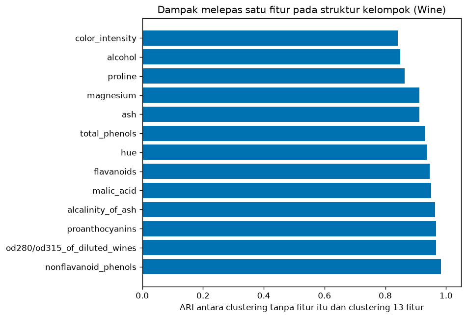
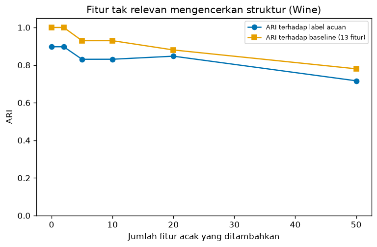
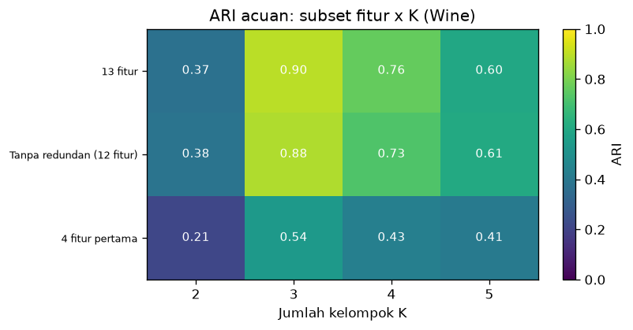

# Bab 5 — Feature Selection and Feature Impact Analysis

## Learning Objectives

Setelah mempelajari bab ini, kamu mampu:

- [x] Menjelaskan mengapa pilihan fitur sangat memengaruhi hasil clustering.
- [x] Membedakan fitur yang relevan, redundan, dan tidak relevan pada clustering.
- [x] Membedakan *feature selection* dari *feature extraction*.
- [x] Menjelaskan mengapa "kepentingan fitur" pada clustering berbeda dari pada prediksi terawasi.
- [x] Menerapkan analisis dampak fitur: melepas satu fitur, menambah fitur tak relevan, membandingkan subset fitur, dan membandingkan skala.
- [x] Membaca hasil analisis dengan hati-hati, tanpa menyimpulkan sebab-akibat.
- [x] Menjalankan **Eksperimen B** (dampak fitur dan parameter) dan mencatatnya.
- [x] Mengenali peran pengetahuan domain dalam memilih fitur.

## Introduction

Clustering mengelompokkan data berdasarkan **jarak**, dan jarak dihitung dari **fitur**. Jadi fitur yang kamu masukkan menentukan "apa arti mirip". Dua analis dengan data pelanggan yang sama tetapi fitur berbeda akan menemukan kelompok yang berbeda, dan keduanya "benar" menurut fiturnya masing-masing.

Bab 3 menunjukkan efek hyperparameter. Bab ini menunjukkan efek **fitur**. Eksperimen kita (Eksperimen B) menjawab: *"Seberapa jauh hasil clustering berubah bila fitur diubah, dan fitur mana yang paling memengaruhi struktur kelompok?"*

!!! warning "Dampak bukan sebab-akibat"
    Bila hasil berubah setelah satu fitur dilepas, itu berarti **fitur itu memengaruhi pembagian yang dihasilkan algoritma**. Itu tidak berarti fitur itu "penyebab" sesuatu di dunia nyata. Kita menganalisis perilaku algoritma terhadap data, bukan mekanisme di balik data.

!!! note "Prasyarat"
    [Bab 3](03-hyperparameter-tuning-and-optimization.md) Level 6, [Level 2 Bab 11](../data-exploration-and-preprocessing/11-feature-selection-and-feature-engineering.md) (teknik seleksi fitur), dan [Level 3 Bab 6](../fundamental-clustering/06-feature-space-and-dimensionality.md) (ruang fitur). Bab ini fokus pada **dampak** pilihan fitur terhadap hasil clustering, bukan pada teknik seleksinya.

## Fundamental Concepts

| Istilah | Arti |
|---|---|
| **Feature selection** | Memilih **sebagian** dari fitur yang ada |
| **Feature extraction** | Membuat fitur **baru** dari kombinasi fitur lama (misalnya PCA, Bab 6) |
| **Relevant feature** | Fitur yang membantu membedakan kelompok |
| **Redundant feature** | Fitur yang memberi informasi yang sama dengan fitur lain (berkorelasi tinggi) |
| **Irrelevant feature** | Fitur yang tidak berkaitan dengan struktur kelompok (pada contoh kita: bilangan acak) |
| **Feature impact analysis** | Mengamati bagaimana hasil clustering berubah saat fitur diubah |
| **Leave-one-feature-out** | Menjalankan clustering berulang kali, tiap kali tanpa satu fitur |
| **Correlation** | Seberapa kuat dua fitur bergerak bersama (dari -1 sampai +1) |

## Detailed Explanation

### Mengapa fitur memengaruhi clustering?

Algoritma berbasis jarak menjumlahkan selisih **semua fitur**. Karena itu:

- Fitur yang berskala besar mendominasi jarak (Bab 1 dan Level 2 Bab 10).
- Fitur yang berkorelasi tinggi **dihitung berkali-kali**, sehingga seolah-olah diberi bobot lebih.
- Fitur yang tidak relevan menambah "kebisingan" ke jarak dan menutupi struktur sebenarnya.

### Relevansi fitur pada *unsupervised learning*

Pada klasifikasi, fitur relevan bila membantu **memprediksi label**. Pada clustering **tidak ada label** yang bisa dijadikan patokan, sehingga "relevan" berarti: *fitur itu ikut membentuk struktur kelompok yang ingin kita temukan*. Dua hal membuatnya sulit:

1. **Relevansi bergantung pada tujuan.** Untuk segmentasi pelanggan berdasarkan nilai belanja, umur mungkin tidak relevan. Untuk segmentasi berdasarkan siklus hidup, umur sangat relevan.
2. **Tidak ada pembanding objektif.** Kita tidak bisa menghitung "akurasi dengan dan tanpa fitur".

Karena itu **pengetahuan domain** sangat penting. Seseorang yang mengerti datanya bisa menilai fitur mana yang masuk akal untuk dipakai.

### Kepentingan fitur: klasifikasi vs clustering

| | Klasifikasi | Clustering |
|---|---|---|
| Patokan | Label (`y`) | Tidak ada |
| Pertanyaan | Fitur mana yang membantu memprediksi `y`? | Fitur mana yang paling memengaruhi **pembagian yang dihasilkan**? |
| Ukuran | Penurunan akurasi, *importance* | Perubahan hasil pengelompokan (misalnya ARI antar hasil) |
| Makna | Terkait tugas prediksi | Terkait **perilaku algoritma** dan tujuan analisis |

Maka, jangan membawa istilah *feature importance* dari model terawasi begitu saja. Di clustering, kita menyebutnya **dampak fitur terhadap struktur kelompok**.

### Fitur berkorelasi dan redundan

Jika dua fitur berkorelasi sangat tinggi, keduanya memuat informasi serupa. Memasukkan keduanya sama dengan menghitung informasi itu **dua kali** dalam jarak. Penanganan umum: pilih salah satu, atau gabungkan (feature extraction). Pilihan fitur mana yang dipertahankan sebaiknya memakai pengetahuan domain, bukan sekadar urutan kolom.

### Fitur tidak relevan

Fitur yang tidak berkaitan dengan struktur kelompok menambah selisih acak ke tiap jarak. Makin banyak fitur seperti itu, makin kabur perbedaan antara titik yang "dekat" dan "jauh" (Level 3 Bab 6). Kita akan mengukur pengaruhnya dengan menambahkan fitur acak murni.

### Selection vs extraction

- **Selection:** memilih subset fitur asli. Hasilnya mudah ditafsirkan ("kita memakai pendapatan dan skor belanja").
- **Extraction:** membuat fitur baru (misalnya komponen PCA, Bab 6). Bisa menangkap informasi lebih ringkas, tetapi fitur barunya lebih sulit ditafsirkan.

### Analisis dampak fitur: empat alat sederhana

1. **Leave-one-feature-out.** Untuk tiap fitur, jalankan clustering tanpanya dan bandingkan hasilnya dengan clustering penuh memakai **ARI**. ARI rendah berarti fitur itu cukup memengaruhi pembagian.
2. **Menambah fitur tak relevan.** Tambahkan fitur acak sebanyak \( m \) dan lihat seberapa cepat hasil memburuk.
3. **Membandingkan subset fitur.** Jalankan clustering pada beberapa subset yang masuk akal (atau acak) dan lihat variasinya.
4. **Membandingkan skala.** Bandingkan hasil dengan dan tanpa penyamaan skala.

Pada semua alat, hasil dibandingkan dengan **baseline** (semua fitur, terskala), dan hasil dilaporkan dengan ARI antar pengelompokan, bukan dengan metrik internal yang dihitung di ruang berbeda (Bab 1).

### Skala fitur

Level 2 Bab 10 dan Bab 1 sudah menunjukkan bahwa skala memengaruhi jarak. Pada dataset Wine, kita akan melihat efeknya dengan sangat jelas karena satu fitur memiliki rentang nilai jauh lebih besar daripada yang lain.

### Kesalahan umum

1. **Memilih fitur memakai label acuan**, lalu melaporkan skor yang bagus.
2. **Menafsirkan dampak sebagai sebab-akibat.**
3. **Menghapus fitur hanya berdasarkan korelasi** tanpa mempertimbangkan arti dan tujuan.
4. **Membandingkan Silhouette antar subset fitur** seolah-olah sebanding (ruangnya berbeda).
5. **Lupa menyamakan skala.**
6. **Menyimpulkan dari satu undian acak** (misalnya satu subset atau satu set fitur acak).
7. **Menganggap fitur yang dampaknya kecil pasti tidak berguna.** Dampaknya kecil bila ada fitur lain yang memuat informasi serupa.

## Mathematical Foundation

### Korelasi

Koefisien korelasi Pearson antara fitur \( a \) dan \( b \) dengan \( n \) titik:

$$
r_{ab} = \frac{\sum_{i=1}^{n} (a_i - \bar{a})(b_i - \bar{b})}{\sqrt{\sum_{i=1}^{n} (a_i - \bar{a})^2} \; \sqrt{\sum_{i=1}^{n} (b_i - \bar{b})^2}}
$$

Nilainya antara -1 dan +1. \( |r| \) mendekati 1 berarti dua fitur hampir memuat informasi yang sama (redundan). Ambang 0,7 yang kita pakai hanyalah **aturan praktis**, bukan batas baku.

### Fitur ganda memberi bobot ganda

Jarak Euclidean kuadrat antara titik \( \mathbf{x} \) dan \( \mathbf{y} \):

$$
d^2(\mathbf{x}, \mathbf{y}) = \sum_{j=1}^{p} (x_j - y_j)^2
$$

Jika fitur ke-\( j \) diduplikasi sehingga muncul \( c \) kali, suku tersebut ikut muncul \( c \) kali:

$$
d^2 = \dots + c \, (x_j - y_j)^2 + \dots
$$

Jadi duplikasi tiga kali sama dengan memberi bobot 3 pada selisih fitur itu. Pada Mall Customers kita mengamatinya langsung dengan menduplikasi pendapatan tiga kali.

### Fitur acak mengencerkan jarak

Jika dua fitur distandarkan (rata-rata 0, varians 1) dan dua titik diambil acak, nilai harapan selisih kuadratnya adalah \( E[(x_j - y_j)^2] = 2 \). Maka untuk 13 fitur Wine yang terstandarkan, jarak kuadrat rata-rata antara dua titik sembarang sekitar

$$
13 \times 2 = 26
$$

Setiap fitur acak murni yang distandarkan menambah **2** pada jarak kuadrat rata-rata, **tanpa membawa informasi kelompok**. Dengan \( m = 50 \) fitur acak, tambahan rata-rata adalah \( 50 \times 2 = 100 \), sekitar empat kali total dari 13 fitur asli. Inilah mengapa banyak fitur tak relevan bisa menutupi struktur. (Ini perkiraan rata-rata dari seluruh pasangan titik. Pada pasangan titik yang dekat dalam kelompok, pengaruh relatifnya bisa lebih besar.)

## Experimental Procedure (Eksperimen B)

1. **Tujuan:** memahami dampak pilihan fitur dan skala terhadap hasil K-Means.
2. **Dataset (alasan):**
   - **Wine** (`sklearn.datasets.load_wine`): 178 sampel, 13 fitur kimia, tiga kelas acuan (kultivar). Dipilih karena berdimensi lebih tinggi dari data sebelumnya, punya fitur berkorelasi, dan ada label acuan untuk **menilai** setelah clustering. Dataset ini bagian dari scikit-learn (sumber asli UCI Machine Learning Repository).
   - **Mall Customers**: contoh data pelanggan **tanpa** label acuan.
3. **Baseline:** Wine, 13 fitur terskala (`StandardScaler`), K-Means dengan K = 3, `n_init=10`, seed 42.
4. **Variabel terkontrol:** algoritma, `n_init`, seed.
5. **Percobaan:**
   - (a) korelasi dan penyaringan redundansi;
   - (b) pengaruh skala;
   - (c) 30 subset acak berukuran 4 fitur;
   - (d) leave-one-feature-out;
   - (e) menambah \( m \) fitur acak (0, 2, 5, 10, 20, 50);
   - (f) tiga subset fitur × K = 2 sampai 5;
   - (g) Mall Customers: lima variasi fitur terhadap baseline pendapatan dan skor belanja.
6. **Ukuran hasil:** ARI antar pengelompokan, ARI terhadap label acuan (hanya untuk Wine, hanya untuk menilai), dan Silhouette.
7. **Catat** semua dan **tafsirkan** dengan hati-hati.

## Python Implementation

Skrip lengkapnya ada di `examples/level-6/05_feature_selection_and_impact_analysis.py`, dan notebook-nya di `notebooks/level-6/05-feature-selection-and-impact-analysis.ipynb`. **Setiap potongan kode diikuti penjelasannya.**

**Konteks masalah:** seorang analis punya banyak fitur dan ingin tahu seberapa besar pilihan fitur memengaruhi hasil.

**Pustaka:** NumPy, pandas, Matplotlib, scikit-learn.

### Bagian A — Siapkan alat

```python
--8<-- "level-6/05_feature_selection_and_impact_analysis.py:setup"
```

**Penjelasan:** `load_wine` memuat dataset Wine. `records` adalah daftar kosong yang akan menampung catatan eksperimen. Fungsi `kmeans_labels(X, k)` menyatukan konfigurasi terkontrol (`n_init=10`, `random_state=SEED`) sehingga **semua** percobaan memakai pengaturan K-Means yang sama. Hanya data dan K yang berubah.

### Bagian B — Dataset Wine dan fitur berkorelasi

```python
--8<-- "level-6/05_feature_selection_and_impact_analysis.py:wine"
```

**Penjelasan baris demi baris:**

- `load_wine(as_frame=True)` mengembalikan data dalam bentuk tabel pandas (`wine.data`) dan label kelas (`wine.target`). Label hanya akan dipakai untuk menilai.
- `X_wine_df.corr()` menghitung matriks korelasi antar kolom.
- Daftar komprehensi membuat daftar pasangan `(a, b, r)` dengan \( |r| > 0{,}7 \). `features[i + 1:]` memastikan tiap pasangan hanya sekali.
- `sorted(..., key=lambda item: -abs(item[2]))` mengurutkan dari korelasi terkuat.
- **Penyaringan sederhana:** untuk tiap fitur sesuai urutan kolom, `all(...)` memeriksa apakah korelasinya dengan semua fitur yang sudah disimpan tidak melebihi 0,7. Bila ya, fitur disimpan. Ini aturan yang mekanis, bukan pilihan domain.

### Bagian C — Baseline dan pengaruh skala

```python
--8<-- "level-6/05_feature_selection_and_impact_analysis.py:baseline"
```

**Penjelasan:**

- `StandardScaler().fit_transform(X_wine_df)` menyamakan skala 13 fitur. `kmeans_labels(X_all, 3)` menghasilkan pengelompokan baseline.
- `ex.make_record(...)` mencatat baseline sebagai eksperimen `B-W-00`.
- Untuk pengaruh skala, K-Means dijalankan pada data **mentah** (`.to_numpy(float)`). `X_wine_df.var()` menghitung varians tiap fitur, dan dibagi totalnya (`/ ... .sum()`) menjadi **porsi varians**. `.sort_values(ascending=False)` menaruh yang terbesar di atas.

### Bagian D — Subset fitur acak

```python
--8<-- "level-6/05_feature_selection_and_impact_analysis.py:randomsubsets"
```

**Penjelasan:** `rng.choice(13, size=4, replace=False)` mengambil 4 indeks kolom berbeda secara acak (`replace=False` berarti tanpa pengulangan). Kita ulangi 30 kali. Tiap kali K-Means dijalankan pada kolom terpilih, dan dua ARI dihitung. `.describe().loc[[...]]` meringkas sebaran: minimum, kuartil, median, maksimum.

### Bagian E — Melepas satu fitur

```python
--8<-- "level-6/05_feature_selection_and_impact_analysis.py:loo"
```

**Penjelasan:** untuk tiap fitur `dropped`, `keep` berisi indeks semua fitur **kecuali** itu. K-Means dijalankan pada `X_all[:, keep]`. `ARI vs baseline` mengukur seberapa mirip hasilnya dengan baseline. `sort_values("ARI vs baseline")` mengurutkan dari yang paling mengubah hasil (ARI terendah).

### Bagian F — Menambah fitur tak relevan

```python
--8<-- "level-6/05_feature_selection_and_impact_analysis.py:noisefeat"
```

**Penjelasan:** `rng.normal(size=(n, m))` membuat \( m \) kolom bilangan acak berdistribusi normal baku (rata-rata 0, varians 1), sehingga skalanya sama dengan fitur terstandarkan. `np.hstack([X_all, extra])` menempelkan kolom acak di sebelah kanan fitur asli. Satu `rng` dipakai berurutan sehingga hasilnya bisa diulang.

### Bagian G — Subset fitur dan K bersama

```python
--8<-- "level-6/05_feature_selection_and_impact_analysis.py:grid"
```

**Penjelasan:** tiga subset (13 fitur, tanpa redundan, 4 fitur pertama) dikombinasikan dengan K = 2 sampai 5, total 12 percobaan, dicatat ke `records`. `.pivot(...)` membuat tabel silang. Silhouette dicetak dengan peringatan bahwa **nilainya tidak sebanding antar baris**, karena dihitung di ruang yang berbeda.

### Bagian H — Mall Customers (tanpa label acuan)

```python
--8<-- "level-6/05_feature_selection_and_impact_analysis.py:mall"
```

**Penjelasan:**

- `(df["Gender"] == "Male").astype(int)` mengubah jenis kelamin menjadi 0 atau 1.
- `z = lambda v: (v - v.mean()) / v.std()` adalah fungsi kecil yang menstandarkan satu kolom.
- `variants` berisi lima variasi fitur. `np.column_stack([...])` menyusun kolom menjadi matriks. Variasi terakhir menduplikasi kolom pendapatan tiga kali.
- Karena tidak ada label acuan, hasil dibandingkan dengan baseline memakai **ARI**, dan Silhouette dihitung di **ruang baseline** (`X_base`) supaya sebanding.

### Bagian I — Menyimpan catatan

```python
--8<-- "level-6/05_feature_selection_and_impact_analysis.py:save"
```

**Penjelasan:** semua 18 catatan disimpan ke `results/05_feature_impact.csv`. Catatan konfigurasi disimpan ke JSON, termasuk pengingat bahwa pada Mall Customers tidak ada label acuan.

### Bagian J — Gambar

```python
--8<-- "level-6/05_feature_selection_and_impact_analysis.py:plotloo"
```

```python
--8<-- "level-6/05_feature_selection_and_impact_analysis.py:plotnoise"
```

```python
--8<-- "level-6/05_feature_selection_and_impact_analysis.py:plotgrid"
```

**Penjelasan:** diagram batang mendatar menampilkan dampak melepas tiap fitur. Grafik garis menampilkan dua ARI terhadap jumlah fitur acak. Peta panas menampilkan ARI acuan untuk subset × K, dengan skala warna tetap 0 sampai 1 (`vmin=0, vmax=1`) supaya tidak menyesatkan.

## Code Explanation

| Bagian kode | Peran |
|---|---|
| `kmeans_labels(X, k)` | Konfigurasi K-Means terkontrol untuk semua percobaan |
| `X_wine_df.corr()` | Matriks korelasi |
| `X_all[:, keep]` | Memilih subset kolom |
| `np.hstack([X, extra])` | Menambah fitur acak |
| `adjusted_rand_score(a, b)` | Membandingkan dua pengelompokan |
| `ex.make_record(...)` | Mencatat eksperimen |

!!! note "Pelatihan vs penilaian"
    `KMeans(...).fit_predict(X)` melatih tanpa label acuan. ARI terhadap `y_wine` hanya **menilai** setelahnya, dan **tidak pernah** dipakai untuk memilih fitur.

## How to Run

Dari folder utama proyek (setelah mengaktifkan lingkungan virtual):

```powershell
pip install -r requirements-notebooks.txt
python examples/level-6/05_feature_selection_and_impact_analysis.py
```

Skrip mencetak output ke terminal, menyimpan tiga gambar ke `docs/assets/level-6/`, dan menyimpan hasil ke `examples/level-6/results/`. Notebook interaktifnya:

```powershell
jupyter notebook notebooks/level-6/05-feature-selection-and-impact-analysis.ipynb
```

Output di bawah berasal dari eksekusi nyata dengan Python 3.14, NumPy 2.5.4, pandas 3.1.1, scikit-learn 1.9.1, dan Matplotlib 3.11.2.

## Expected Output

```text
--8<-- "level-6/outputs/05.txt"
```

Gambar yang dihasilkan:







### Interpretasi output

**1. Dataset dan korelasi.** Wine: 178 sampel × 13 fitur, tiga kelas acuan (59, 71, 48). Hanya dua pasangan fitur yang berkorelasi di atas 0,7: `total_phenols`-`flavanoids` (**r = +0,865**) dan `flavanoids`-`od280/od315_of_diluted_wines` (**r = +0,787**). Penyaringan mekanis menyisakan **12 dari 13** fitur dan membuang `flavanoids`. Pilihan itu tergantung urutan kolom (`total_phenols` ditemui lebih dulu). Pakar domain bisa memilih berbeda.

**2. Baseline dan skala.** Baseline (13 fitur terskala, K = 3): Silhouette **0,285** dan ARI acuan **0,897**. Silhouette-nya rendah walau kecocokan dengan label acuan tinggi, sama seperti pelajaran Level 5 tentang metrik internal dan eksternal. **Tanpa penskalaan**, ARI acuan turun menjadi **0,371**, dan ARI terhadap baseline hanya **0,354**. Penyebabnya: `proline` memiliki **99,8%** dari total varians, sehingga jarak hampir seluruhnya ditentukan satu fitur itu.

**3. Subset acak.** Dari 30 subset acak berukuran 4 fitur:

| | min | 25% | median | 75% | max |
|---|---|---|---|---|---|
| ARI acuan | 0,244 | 0,371 | 0,498 | 0,623 | 0,832 |
| ARI vs baseline | 0,294 | 0,426 | 0,538 | 0,615 | 0,834 |

Variasinya **sangat besar** (0,244 sampai 0,832). Semua subset berada di bawah baseline 13 fitur (0,897). Pilihan fitur bisa mengubah hasil dengan sangat besar.

**4. Melepas satu fitur.** ARI antara hasil tanpa satu fitur dan baseline:

| Fitur dilepas | ARI vs baseline | ARI acuan |
|---|---|---|
| `color_intensity` | **0,840** | 0,778 |
| `alcohol` | 0,850 | 0,814 |
| `proline` | 0,864 | 0,799 |
| `magnesium` | 0,913 | 0,880 |
| `ash` | 0,913 | 0,847 |
| ... | ... | ... |
| `proanthocyanins` | 0,967 | 0,929 |
| `nonflavanoid_phenols` | **0,984** | 0,913 |

(Tabel lengkap 13 baris ada di output.) Semua nilai berada antara 0,840 dan 0,984: **tidak ada satu fitur yang mendominasi** struktur. Fitur yang paling mengubah pembagian adalah `color_intensity`, `alcohol`, dan `proline`. Fitur yang hampir tidak mengubah apa pun adalah `nonflavanoid_phenols` dan beberapa lainnya. Ingat: dampak kecil bisa karena fitur itu memang tidak relevan, **atau** karena fitur lain memuat informasi yang mirip.

Hal yang perlu dicatat: setelah `proanthocyanins` dilepas, ARI acuan malah **naik** menjadi **0,929** (dari 0,897). Jadi menghapus fitur kadang meningkatkan kecocokan dengan label acuan. Meski begitu, kita **tidak boleh** memilih fitur dengan melihat ARI acuan, karena itu memakai label untuk menyetel (kebocoran informasi).

**5. Fitur acak yang ditambahkan.**

| Fitur acak ditambah | ARI acuan | ARI vs baseline |
|---|---|---|
| 0 | 0,897 | 1,00 |
| 2 | 0,897 | 1,00 |
| 5 | 0,831 | 0,93 |
| 10 | 0,831 | 0,93 |
| 20 | 0,847 | 0,88 |
| 50 | 0,717 | 0,78 |

Dua fitur acak belum mengubah hasil. Setelah itu kecocokan menurun, mencapai 0,78 terhadap baseline dan 0,717 terhadap label acuan pada 50 fitur. Penurunannya **tidak mulus**: ARI acuan pada 20 fitur (0,847) lebih tinggi daripada pada 10 fitur (0,831). Fitur acak diambil dari satu undian, sehingga ada kebisingan. Tren keseluruhannya turun. Ini sejalan dengan perhitungan: 50 fitur acak menambah sekitar 100 pada jarak kuadrat rata-rata, dibanding sekitar 26 dari 13 fitur asli.

**6. Subset fitur × K (ARI acuan).**

| Subset | K = 2 | K = 3 | K = 4 | K = 5 |
|---|---|---|---|---|
| 13 fitur | 0,374 | **0,897** | 0,765 | 0,599 |
| Tanpa redundan (12) | 0,384 | **0,880** | 0,726 | 0,607 |
| 4 fitur pertama | 0,211 | **0,541** | 0,430 | 0,412 |

Pada ketiga subset, K = 3 memberi ARI tertinggi. Menghapus satu fitur redundan hanya sedikit menurunkan hasil (0,897 menjadi 0,880), sedangkan memakai hanya 4 fitur pertama menurunkannya jauh (0,541). Silhouette di ruang masing-masing adalah 0,285 (13 fitur, K = 3) dan **0,294 sampai 0,301** (4 fitur pertama, K = 3 sampai 4). Subset 4 fitur tampak "lebih baik" menurut Silhouette padahal ARI-nya jauh lebih rendah. Itu karena Silhouette dihitung di ruang yang berbeda, dan tidak boleh dibandingkan antar baris.

**7. Mall Customers (tanpa label acuan).**

| Variasi | ARI vs baseline | Silhouette ruang baseline | Ukuran kelompok |
|---|---|---|---|
| Baseline: pendapatan + skor belanja | 1,000 | 0,555 | 81, 39, 35, 23, 22 |
| + umur | 0,584 | 0,296 | 54, 47, 40, 39, 20 |
| + umur + gender | 0,400 | 0,169 | 54, 43, 39, 35, 29 |
| umur + skor belanja | 0,372 | -0,007 | 64, 41, 38, 36, 21 |
| pendapatan ×3 + skor belanja | 0,956 | 0,550 | 78, 39, 37, 23, 23 |

Menambah **umur** mengubah pengelompokan secara nyata (ARI 0,584). Menambah **gender** (0 atau 1) juga mengubahnya (ARI 0,400 untuk kombinasi). Mengganti pendapatan dengan umur menghasilkan pembagian yang sama sekali berbeda (ARI 0,372). Menduplikasi pendapatan tiga kali (bobot 3) hanya mengubahnya sedikit (ARI 0,956), karena pendapatan memang sudah salah satu dari dua fitur dasar.

!!! warning "Tafsir dengan hati-hati"
    Hasil Mall Customers **tidak** berarti "umur penyebab pelanggan terpecah". Ia hanya berarti: **jika kita memasukkan umur ke dalam jarak, K-Means memotong data berbeda**. Menambah fitur mengubah pertanyaan yang dijawab clustering. Tidak ada label acuan untuk menyatakan variasi mana yang "benar". Pilihan fitur harus mengikuti **tujuan analisis**.

!!! warning "Batas kesimpulan"
    Hasil ini berlaku untuk dua dataset, satu algoritma (K-Means), dan satu seed. Pada subset acak dan fitur acak kita hanya melakukan satu rangkaian undian (30 subset, satu undian fitur acak per ukuran). Kita tidak mengklaim pola yang sama pada data lain, dan tidak membuktikan mekanisme apa pun.

## Practical Application

**Segmentasi pelanggan.** Tim pemasaran bertanya, "Haruskah umur masuk?" Eksperimen seperti ini menunjukkan seberapa besar umur mengubah segmen, sehingga diskusi didasarkan pada bukti dan tujuan, bukan tebakan.

**Mengurangi dimensi sebelum clustering.** Jika ada puluhan fitur, leave-one-out dan penyaringan redundansi memberi petunjuk fitur mana yang bisa dilepas tanpa banyak mengubah struktur.

**Memeriksa kerentanan terhadap fitur tak relevan.** Menambahkan fitur acak adalah uji sederhana: jika hasil cepat berubah, pembagianmu rapuh.

**Mendokumentasikan alasan pemilihan fitur.** Catat fitur yang dipakai, alasannya, dan hasil perbandingannya.

## Hands-on Exercises

1. Ganti ambang korelasi pada penyaringan dari 0,7 menjadi 0,6 dan 0,5. Berapa fitur tersisa, dan berapa ARI acuan serta ARI terhadap baseline untuk K = 3?
2. Tambahkan 100 fitur acak (`default_rng(42)`) ke Wine terskala. Berapa ARI acuan dan ARI terhadap baseline?
3. Ganti `StandardScaler` menjadi `MinMaxScaler` pada Wine. Berapa ARI acuan dan ARI terhadap baseline (K = 3)?
4. Pada Mall Customers, tambahkan **hanya** gender (tanpa umur) ke pendapatan dan skor belanja. Berapa ARI terhadap baseline?
5. Mengapa tidak boleh memilih fitur dengan melihat ARI acuan, padahal melepas `proanthocyanins` menaikkan ARI acuan?
6. Mengapa Silhouette antar subset fitur tidak sebanding, dan apa alternatifnya?
7. Mengapa hasil "melepas umur mengubah pembagian pelanggan" tidak berarti umur menyebabkan perbedaan perilaku belanja?

??? question "Jawaban"
    Hasil nomor 1 sampai 4 berasal dari eksekusi nyata.

    1. Ambang 0,6: **9 fitur**, ARI acuan **0,770**, ARI vs baseline **0,790**. Ambang 0,5: **7 fitur**, **0,674** dan **0,694**. Makin ketat saringan, makin banyak informasi terbuang dan makin turun ARI.
    2. ARI acuan **0,619**, ARI vs baseline **0,678**. Lebih rendah dari pada 50 fitur acak (0,717 dan 0,78), sesuai arah: makin banyak fitur acak, makin buruk (meski undian acaknya berbeda).
    3. ARI acuan **0,854**, ARI vs baseline **0,918**. `MinMaxScaler` menghasilkan pembagian yang mirip tetapi tidak identik dengan `StandardScaler`. Pada Wine pilihan penskalaan yang sama-sama menyamakan skala mengubah hasil sedikit.
    4. ARI terhadap baseline **0,383**. Satu fitur biner pun mengubah pembagian cukup banyak.
    5. Karena itu memakai label untuk menyetel model (kebocoran informasi), sehingga skor acuan tidak lagi jujur. Selain itu satu data tidak membuktikan bahwa fitur itu memang "mengganggu" pada data lain.
    6. Silhouette dihitung dari jarak di ruang masing-masing, dan ruang berbeda punya skala jarak berbeda. Alternatifnya: ARI antar pengelompokan, atau Silhouette yang dihitung di ruang bersama (misalnya ruang baseline, seperti pada tabel Mall Customers).
    7. Eksperimen hanya mengukur bagaimana algoritma membagi data bila umur dimasukkan. Ia tidak menguji mekanisme di balik perilaku belanja. Hubungan sebab-akibat membutuhkan desain penelitian yang berbeda.

## Troubleshooting

### Masalah teknis

| Masalah | Penyebab | Solusi |
|---|---|---|
| `KeyError` pada nama fitur | Nama kolom salah ketik | Salin dari `X_wine_df.columns` |
| `ValueError: Cannot take a larger sample than population` | `size` pada `rng.choice` lebih besar dari jumlah fitur dengan `replace=False` | Kecilkan `size` |
| Hasil berbeda tiap eksekusi | Seed `rng` atau `random_state` tidak tetap | Tetapkan semua seed |
| ARI vs baseline selalu 1,0 | Fitur yang dilepas atau ditambah ternyata tidak mengubah apa pun | Wajar untuk fitur yang sangat redundan |
| Silhouette negatif | Subset fitur tidak mendukung pembagian itu di ruang yang diukur | Periksa ruang tempat Silhouette dihitung |
| Warna peta panas menyesatkan | Skala warna otomatis | Tetapkan `vmin` dan `vmax` |

### Kesalahan umum

1. **Memilih fitur memakai label acuan.**
2. **Menafsirkan dampak sebagai sebab-akibat.**
3. **Menyaring berdasarkan korelasi saja**, tanpa pengetahuan domain.
4. **Membandingkan Silhouette antar ruang fitur berbeda.**
5. **Lupa menyamakan skala** (ARI acuan 0,371 tanpa skala).
6. **Menyimpulkan dari satu undian acak.**
7. **Menyamakan "dampak kecil" dengan "tidak berguna".**
8. **Menambah fitur tanpa memikirkan bahwa itu mengubah pertanyaan.**

## Summary

- Clustering berbasis jarak, jadi **fitur menentukan arti "mirip"**. Pilihan fitur dapat berpengaruh sangat besar.
- Fitur bisa relevan, **redundan** (berkorelasi, dihitung ganda), atau **tidak relevan** (menambah kebisingan). Duplikasi fitur sebanyak \( c \) kali sama dengan memberi bobot \( c \); setiap fitur acak yang terstandarkan menambah sekitar 2 pada jarak kuadrat rata-rata.
- Kepentingan fitur pada clustering berarti **dampak terhadap struktur kelompok**, bukan kemampuan memprediksi label. Alatnya: leave-one-out, fitur acak, subset, skala.
- Pada Wine: tanpa penskalaan ARI acuan turun dari 0,897 menjadi 0,371 karena `proline` memegang 99,8% varians. Subset 4 fitur acak memberi ARI acuan 0,244 sampai 0,832. Tidak ada satu fitur yang mendominasi (ARI vs baseline 0,840 sampai 0,984 saat melepas satu fitur). Menambah 50 fitur acak menurunkan ARI vs baseline menjadi 0,78.
- Pada Mall Customers, menambah umur mengubah pembagian (ARI 0,584), tanpa implikasi sebab-akibat.
- **Jangan memilih fitur dengan label acuan** dan jangan membandingkan Silhouette antar ruang berbeda.
- Catat semua: 18 catatan eksperimen tersimpan.

**Bab berikutnya:** Bab 6 membahas **reduksi dimensi dan PCA**: membuat fitur baru yang lebih ringkas dan memakainya untuk visualisasi maupun sebagai praproses clustering.

## References

- Dy, J. G., & Brodley, C. E. (2004). Feature selection for unsupervised learning. *Journal of Machine Learning Research*, 5, 845–889.
- Alelyani, S., Tang, J., & Liu, H. (2013). Feature selection for clustering: a review. In *Data Clustering: Algorithms and Applications*. CRC Press.
- Guyon, I., & Elisseeff, A. (2003). An introduction to variable and feature selection. *Journal of Machine Learning Research*, 3, 1157–1182.
- Forina, M., et al. (1991). PARVUS: an extendible package for data exploration, classification and correlation. *Institute of Pharmaceutical and Food Analysis and Technologies, Genoa*. (Sumber dataset Wine, tersedia melalui UCI Machine Learning Repository.)
- Scikit-learn documentation: [`load_wine`](https://scikit-learn.org/stable/modules/generated/sklearn.datasets.load_wine.html).
