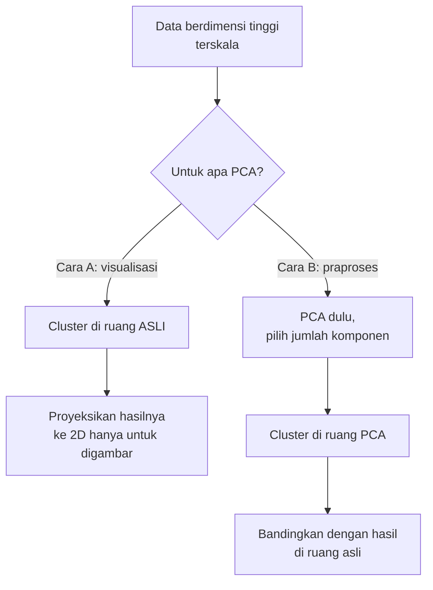
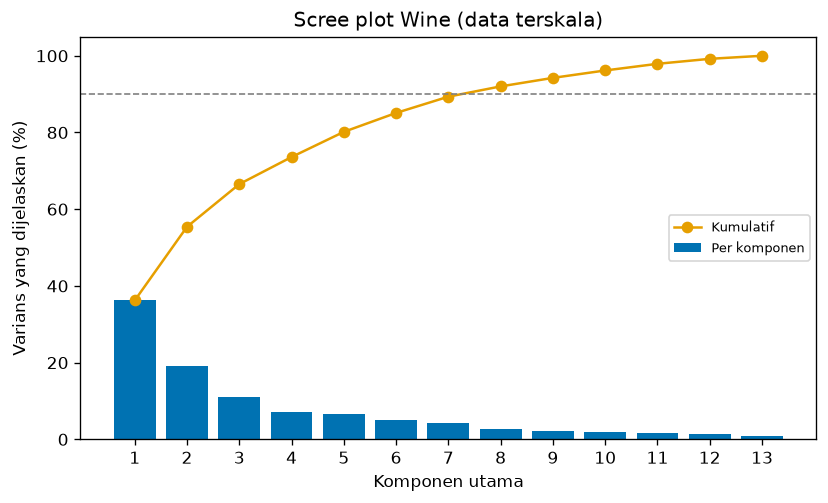
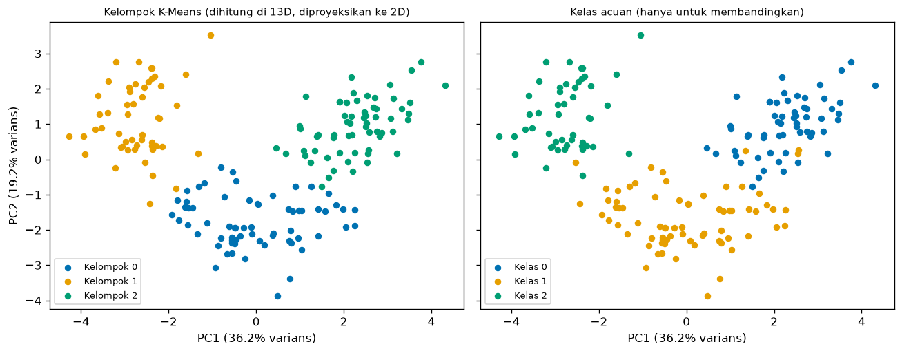
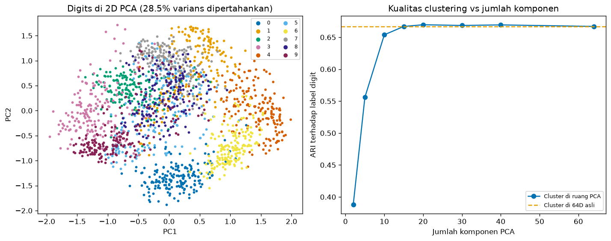

# Bab 6 — Dimensionality Reduction and PCA

## Learning Objectives

Setelah mempelajari bab ini, kamu mampu:

- [x] Menjelaskan apa itu *dimensionality reduction* dan mengapa clustering di banyak dimensi bisa bermasalah.
- [x] Membedakan **seleksi fitur** (Bab 5) dari **ekstraksi fitur** seperti PCA.
- [x] Menjelaskan ide PCA: sumbu baru yang menangkap varians terbesar.
- [x] Menghitung PCA dengan tangan dari matriks kovarians, lalu mencocokkannya dengan `PCA` scikit-learn.
- [x] Membaca *explained variance ratio*, scree plot, dan memilih jumlah komponen.
- [x] Menjelaskan mengapa PCA menuntut **penskalaan** lebih dulu, dan membaca *loadings*.
- [x] Membedakan dua cara memakai PCA: **memproyeksikan hasil** untuk digambar, dan **men-cluster di ruang PCA**.
- [x] Menyebut batas visualisasi 2D dan batas PCA untuk clustering.

## Introduction

Bab 5 menunjukkan bahwa pilihan fitur sangat mengubah hasil clustering. Bab ini membahas dua masalah yang sering muncul bersama:

1. **Terlalu banyak dimensi.** Dataset Digits punya 64 fitur. Kita tidak bisa menggambarnya, dan jarak di ruang berdimensi tinggi menjadi kurang informatif.
2. **Fitur yang saling berkaitan.** Banyak fitur membawa informasi yang tumpang tindih (misalnya `flavanoids` dan `total_phenols` pada Wine).

**Principal Component Analysis (PCA)** membuat sumbu-sumbu baru, yaitu kombinasi dari fitur asli, yang disusun dari yang paling banyak menangkap varians. Dengan memakai beberapa sumbu pertama saja, kita mendapat data yang lebih ringkas.

Pertanyaan yang ingin dijawab: **"Seberapa banyak dimensi yang bisa dibuang tanpa mengubah hasil clustering, dan apa yang tidak boleh kita simpulkan dari gambar 2D?"**

!!! note "Prasyarat"
    [Bab 5](05-feature-selection-and-impact-analysis.md) Level 6 (dampak fitur dan skala), [Level 2](../data-exploration-and-preprocessing/index.md) (*feature scaling*), dan [Level 5](../clustering-evaluation/index.md) (ARI dan Silhouette). Di sini PCA dibahas **hanya sebagai alat bantu clustering**, bukan teori aljabar linear yang lengkap.

## Fundamental Concepts

| Istilah | Arti |
|---|---|
| **Dimensionality reduction** | Mengurangi jumlah fitur sambil mempertahankan sebanyak mungkin informasi |
| **Curse of dimensionality** | Kumpulan masalah yang muncul di dimensi tinggi, termasuk jarak yang makin mirip antar titik |
| **Feature selection** | Memilih **sebagian dari fitur asli** (Bab 5) |
| **Feature extraction** | Membentuk **fitur baru** dari kombinasi fitur asli (PCA) |
| **Principal component (PC)** | Sumbu baru hasil PCA; PC1 menangkap varians terbesar, PC2 terbesar berikutnya, dan seterusnya |
| **Explained variance ratio** | Porsi total varians yang ditangkap sebuah komponen |
| **Scree plot** | Grafik varians tiap komponen, dipakai untuk memilih jumlah komponen |
| **Loading** | Bobot sebuah fitur asli pada sebuah komponen |
| **Projection** | Menggambar titik di sumbu-sumbu komponen |

## Detailed Explanation

### Mengapa dimensi tinggi menyulitkan clustering

Clustering berbasis jarak (K-Means, Hierarchical, DBSCAN) bergantung pada gagasan "dekat" dan "jauh". Makin banyak dimensi, makin banyak fitur yang ikut menambah jarak, termasuk fitur yang tidak membawa struktur kelompok (Bab 5: 50 fitur acak menurunkan ARI terhadap baseline menjadi 0,78). Dimensi tinggi juga membuat data tidak bisa divisualisasikan langsung.

### Ide PCA

Bayangkan awan titik yang memanjang miring. PCA mencari arah di mana awan itu paling **melebar** (varians terbesar), menjadikannya PC1. Arah tegak lurus PC1 yang melebar paling besar berikutnya menjadi PC2, dan seterusnya. Jika beberapa komponen pertama sudah memuat sebagian besar varians, sisanya bisa dibuang dengan kehilangan informasi yang kecil.

!!! note "Varians bukan sama dengan struktur kelompok"
    PCA tidak tahu apa pun tentang kelompok. Ia hanya mencari arah varians terbesar. Arah dengan varians besar **sering**, tetapi **tidak selalu**, adalah arah yang memisahkan kelompok.

### Dua cara memakai PCA pada clustering



- **Cara A (proyeksi untuk menggambar).** Clustering tetap dijalankan di ruang asli. PCA hanya dipakai untuk melihat hasilnya. Hasil clustering tidak berubah.
- **Cara B (praproses).** Clustering dijalankan di ruang PCA. Hasilnya **bisa berubah** karena sebagian informasi dibuang.

### Penskalaan wajib sebelum PCA

PCA mengurutkan sumbu menurut varians. Fitur dengan skala besar otomatis punya varians besar dan akan mendominasi PC1. Pada Wine, `proline` bernilai ratusan hingga ribuan sehingga tanpa penskalaan PC1 menangkap hampir seluruh varians. Karena itu data dimasukkan ke PCA setelah `StandardScaler`, seperti pada Bab 5.

### Memilih jumlah komponen

Beberapa pedoman umum:

1. **Ambang varians kumulatif**, misalnya 80% atau 90%. Pilih jumlah komponen terkecil yang mencapainya.
2. **Scree plot:** cari titik di mana batang varians mulai mendatar ("siku"). Ini seperti metode elbow di Level 5, subjektif.
3. **Tujuan:** untuk visualisasi cukup 2 atau 3 komponen, apa pun variansnya. Untuk praproses clustering, uji dengan membandingkan hasil clustering.

!!! warning "Jangan memilih jumlah komponen dengan label acuan"
    Sama seperti Bab 5, memilih jumlah komponen yang memberi ARI acuan tertinggi adalah **kebocoran informasi**. Pakai varians, scree plot, atau kestabilan hasil clustering terhadap hasil di ruang asli. Label acuan hanya untuk menilai di akhir.

### Keterbatasan

- **Linear.** PCA hanya mencari arah lurus. Struktur melengkung (bulan sabit) tidak diratakan.
- **Komponen sulit ditafsirkan.** Tiap komponen adalah campuran semua fitur.
- **Varians besar bukan jaminan informasi kelompok.** Informasi pemisah kelompok bisa ada di komponen yang variansnya kecil dan ikut terbuang.
- **Gambar 2D memotong informasi.** Dua titik yang tampak berimpit di 2D bisa jauh di dimensi yang dibuang.
- **Hasil bergantung pada penskalaan.**

### Kesalahan umum

1. **Lupa menskalakan data** sebelum PCA.
2. **Menganggap gambar 2D adalah seluruh data.**
3. **Menghitung Silhouette di ruang 2D** lalu membandingkannya dengan Silhouette di ruang asli.
4. **Memilih jumlah komponen dengan label acuan.**
5. **Menafsirkan tanda loading.** Tanda komponen boleh terbalik (PC1 dan -PC1 setara).
6. **Menjalankan PCA (fit) pada data uji dan latih terpisah** pada alur prediksi. Untuk clustering, seluruh data di-*fit* sekali.

## Mathematical Foundation

### Matriks kovarians

Misalkan \( X \) adalah matriks data \( n \times p \) yang kolomnya sudah dipusatkan (dikurangi rata-ratanya). Matriks kovarians:

$$
C = \frac{1}{n-1} X^{\top} X
$$

Elemen diagonal \( C_{jj} \) adalah varians fitur ke-\( j \), dan \( C_{jk} \) adalah kovarians antara fitur \( j \) dan \( k \).

### Komponen utama sebagai vektor eigen

PCA mencari vektor satuan \( \mathbf{w} \) yang memaksimalkan varians data setelah diproyeksikan, \( \mathbf{w}^{\top} C \mathbf{w} \). Solusinya adalah **vektor eigen** dari \( C \):

$$
C \, \mathbf{w}_k = \lambda_k \, \mathbf{w}_k
$$

Nilai eigen \( \lambda_k \) sama dengan varians data pada arah \( \mathbf{w}_k \). Komponen diurutkan dari \( \lambda_1 \) terbesar.

### Rasio varians

$$
\text{rasio}_k = \frac{\lambda_k}{\sum_{j=1}^{p} \lambda_j}
$$

Pada data yang sudah distandarkan, jumlah seluruh nilai eigen kira-kira sama dengan \( p \) (setiap fitur punya varians sekitar 1).

### Proyeksi

Skor titik pada \( m \) komponen pertama:

$$
Z = X \, W_m
$$

dengan \( W_m \) berisi \( m \) vektor eigen pertama sebagai kolom. Hasil \( Z \) berukuran \( n \times m \).

### Perhitungan manual pada enam titik

Data: \( (2, 1), (3, 2), (4, 2{,}5), (5, 4), (6, 4{,}5), (7, 6) \).

**Langkah 1, pusatkan.** Rata-rata \( x \) = 4,5 dan rata-rata \( y \) = 3,3333. Setelah dikurangi, \( x \) menjadi \( -2{,}5; -1{,}5; -0{,}5; 0{,}5; 1{,}5; 2{,}5 \).

**Langkah 2, matriks kovarians** (pembagi \( n - 1 = 5 \)):

- \( \text{var}(x) = 17{,}5 / 5 = 3{,}5 \)
- \( \text{cov}(x, y) = 17{,}0 / 5 = 3{,}4 \)
- \( \text{var}(y) = 16{,}8333 / 5 = 3{,}3667 \)

$$
C = \begin{pmatrix} 3{,}5 & 3{,}4 \\ 3{,}4 & 3{,}3667 \end{pmatrix}
$$

**Langkah 3, nilai eigen.** Untuk matriks 2 × 2, nilai eigen memenuhi \( \lambda^2 - \text{tr}(C)\lambda + \det(C) = 0 \). Di sini \( \text{tr}(C) = 6{,}8667 \) dan \( \det(C) = 3{,}5 \times 3{,}3667 - 3{,}4^2 = 0{,}2233 \). Maka

$$
\lambda_{1,2} = \frac{6{,}8667 \pm \sqrt{6{,}8667^2 - 4 \times 0{,}2233}}{2} = \frac{6{,}8667 \pm 6{,}8013}{2}
$$

sehingga \( \lambda_1 = 6{,}834 \) dan \( \lambda_2 = 0{,}0327 \).

**Langkah 4, rasio varians.** \( 6{,}834 / 6{,}8667 = 0{,}9952 \) untuk PC1 dan \( 0{,}0048 \) untuk PC2. Titik-titik hampir seluruhnya tersebar sepanjang satu garis, sehingga satu komponen sudah cukup.

**Langkah 5, vektor eigen pertama.** Dari \( (3{,}5 - 6{,}834) w_1 + 3{,}4 \, w_2 = 0 \) diperoleh \( w_2 = 0{,}9806 \, w_1 \). Setelah dinormalkan (panjang 1): \( \mathbf{w}_1 \approx (0{,}714;\ 0{,}700) \). Kita akan mencocokkan hasil ini dengan kode.

## Experimental Procedure (Eksperimen C)

1. **Tujuan:** memahami apa yang dipertahankan dan hilang saat dimensi dikurangi, dan dampaknya pada clustering.
2. **Dataset (alasan):**
   - **Enam titik 2D buatan:** untuk perhitungan manual yang bisa dicocokkan dengan kode.
   - **Wine** (13 fitur, 3 kelas acuan): menengah, ada fitur berkorelasi, dan hasil clustering sudah dikenal dari Bab 5 (ARI acuan 0,897 di 13 dimensi).
   - **Digits** (`load_digits`, 1.797 gambar 8 × 8 = 64 fitur, 10 kelas): dimensi tinggi sungguhan. Nilai piksel dibagi 16 menjadi 0 sampai 1. Bagian dari scikit-learn.
3. **Praproses:** `StandardScaler` untuk Wine. Digits hanya dibagi 16 (semua piksel sudah berskala sama). Seed 42.
4. **Algoritma:** K-Means, `n_init=10`, K = 3 untuk Wine dan K = 10 untuk Digits.
5. **Yang diukur:** rasio varians, jumlah komponen untuk 80/90/95%, *loadings*, ARI dan NMI terhadap label acuan (hanya menilai), ARI terhadap hasil di ruang asli (mengukur seberapa berubah hasilnya), dan Silhouette.
6. **Pembanding:** hasil clustering di ruang asli (13D dan 64D).

## Python Implementation

Skrip lengkapnya ada di `examples/level-6/06_dimensionality_reduction_and_pca.py`, dan notebook-nya di `notebooks/level-6/06-dimensionality-reduction-and-pca.ipynb`. **Setiap potongan kode diikuti penjelasannya.**

**Konteks masalah:** data berdimensi tinggi yang ingin kita ringkas dan lihat, tanpa menipu diri sendiri soal apa yang hilang.

**Tujuan eksperimen:** mengukur dampak pengurangan dimensi pada hasil clustering.

**Pustaka:** NumPy, pandas, Matplotlib, scikit-learn (`PCA`, `StandardScaler`, `KMeans`).

### Bagian A — Siapkan alat

```python
--8<-- "level-6/06_dimensionality_reduction_and_pca.py:setup"
```

**Penjelasan:** `PCA` ada di `sklearn.decomposition`. `kmeans_labels` adalah fungsi kecil yang menjalankan K-Means dengan konfigurasi sama untuk semua percobaan, seperti pada Bab 5.

### Bagian B — PCA dari awal pada enam titik

```python
--8<-- "level-6/06_dimensionality_reduction_and_pca.py:manual"
```

**Penjelasan baris demi baris:**

- `X_small - X_small.mean(axis=0)` memusatkan tiap kolom (langkah 1).
- `centered.T @ centered / (len(X_small) - 1)` adalah rumus \( X^{\top}X/(n-1) \) (langkah 2). `@` adalah perkalian matriks.
- `np.linalg.eigh(cov)` menghitung nilai dan vektor eigen untuk matriks simetris. Urutannya **naik**, jadi `np.argsort(...)[::-1]` membaliknya menjadi dari yang terbesar.
- Rasio varians adalah `eigenvalues / eigenvalues.sum()`.

### Bagian C — Mencocokkan dengan scikit-learn

```python
--8<-- "level-6/06_dimensionality_reduction_and_pca.py:sklearn"
```

**Penjelasan:** `PCA(n_components=2).fit(X_small)` mempelajari komponen. `explained_variance_` adalah nilai eigen, `explained_variance_ratio_` adalah rasionya, dan `components_` adalah vektor eigen (satu baris per komponen). `transform` memproyeksikan data. Varians skor komponen 1 harus sama dengan nilai eigen pertama (dihitung dengan `ddof=1`).

### Bagian D — PCA pada Wine

```python
--8<-- "level-6/06_dimensionality_reduction_and_pca.py:wine"
```

**Penjelasan:** setelah `StandardScaler`, `PCA()` tanpa argumen menyimpan semua 13 komponen. `np.cumsum` menjumlahkan rasio secara kumulatif. `np.argmax(cumulative >= target) + 1` mencari indeks pertama yang mencapai ambang, lalu ditambah 1 karena indeks dimulai dari 0.

### Bagian E — Tanpa dan dengan penskalaan

```python
--8<-- "level-6/06_dimensionality_reduction_and_pca.py:scaling"
```

**Penjelasan:** dua PCA dengan data yang sama, satu mentah (`X_wine_df.to_numpy(float)`) dan satu terskala. Yang dibandingkan hanya rasio varians dua komponen pertama.

### Bagian F — Loadings

```python
--8<-- "level-6/06_dimensionality_reduction_and_pca.py:loadings"
```

**Penjelasan:** `pca_scaled.components_.T` mengubah komponen menjadi tabel fitur × komponen (*loadings*). Untuk tiap komponen, kita urutkan menurut nilai **mutlak** (`.abs()`) lalu tampilkan lima teratas. Tanda tidak bermakna mutlak, tetapi tanda **relatif** antar fitur dalam satu komponen menunjukkan fitur yang bergerak searah atau berlawanan.

### Bagian G — Cara A: cluster di ruang asli, proyeksikan untuk menggambar

```python
--8<-- "level-6/06_dimensionality_reduction_and_pca.py:viz"
```

**Penjelasan:** `labels_13d` berasal dari K-Means pada 13 dimensi. `X_2d` hanya dipakai untuk menggambar. Kita juga mencetak Silhouette di dua ruang yang berbeda untuk **label yang sama**, agar terlihat mengapa angkanya tidak boleh dibandingkan.

### Bagian H — Cara B: cluster di ruang PCA

```python
--8<-- "level-6/06_dimensionality_reduction_and_pca.py:inpca"
```

**Penjelasan:** untuk tiap jumlah komponen, `fit_transform` membuat data ringkas, K-Means dijalankan, lalu kita mencatat: varians yang dipertahankan, ARI terhadap label acuan (menilai), dan ARI terhadap hasil 13D (seberapa berubah).

### Bagian I — Digits: 64 dimensi

```python
--8<-- "level-6/06_dimensionality_reduction_and_pca.py:digits"
```

**Penjelasan:** `digits.data / 16.0` mengubah piksel (0 sampai 16) menjadi 0 sampai 1. Kita bandingkan clustering di 64D dengan clustering di ruang PCA berbagai ukuran. ARI terhadap hasil 64D mengukur seberapa **sama** hasilnya.

### Bagian J — Batas visualisasi 2D

```python
--8<-- "level-6/06_dimensionality_reduction_and_pca.py:projection"
```

**Penjelasan:** Silhouette dihitung untuk label digit asli dan untuk hasil K-Means, masing-masing di 64D dan di 2D. Tujuannya melihat apakah proyeksi 2D tampak lebih atau kurang terpisah dibanding aslinya.

### Bagian K — Gambar

```python
--8<-- "level-6/06_dimensionality_reduction_and_pca.py:plotscree"
```

```python
--8<-- "level-6/06_dimensionality_reduction_and_pca.py:plotwine"
```

```python
--8<-- "level-6/06_dimensionality_reduction_and_pca.py:plotdigits"
```

**Penjelasan:** gambar pertama adalah scree plot Wine dengan garis ambang 90%. Gambar kedua menampilkan proyeksi 2D Wine dengan warna dari hasil K-Means (kiri) dan dari kelas acuan (kanan), sumbu dibuat sama (`sharex`, `sharey`) agar bisa dibandingkan. Gambar ketiga memiliki dua panel: Digits di 2D PCA, dan ARI terhadap label digit untuk berbagai jumlah komponen dengan garis putus-putus sebagai hasil 64D.

## Code Explanation

| Bagian kode | Peran |
|---|---|
| `np.linalg.eigh(cov)` | Nilai dan vektor eigen dari matriks kovarians |
| `PCA(n_components=m)` | Memakai \( m \) komponen pertama |
| `explained_variance_ratio_` | Porsi varians tiap komponen |
| `pca.components_` | Vektor eigen (*loadings*), satu baris per komponen |
| `fit_transform(X)` | Mempelajari komponen sekaligus memproyeksikan |
| `ARI vs cluster 13D/64D` | Seberapa mirip hasil di ruang ringkas dengan hasil di ruang asli |

!!! note "PCA di scikit-learn memakai SVD"
    Secara internal `PCA` memakai *singular value decomposition*, bukan `eigh` pada matriks kovarians. Hasil komponennya setara (sampai tanda), dan SVD lebih stabil secara numerik. Perhitungan manual di atas dipakai karena lebih mudah dipahami.

## How to Run

Dari folder utama proyek (setelah mengaktifkan lingkungan virtual):

```powershell
pip install -r requirements-notebooks.txt
python examples/level-6/06_dimensionality_reduction_and_pca.py
```

Skrip mencetak output ke terminal dan menyimpan tiga gambar ke `docs/assets/level-6/`. Notebook interaktifnya:

```powershell
jupyter notebook notebooks/level-6/06-dimensionality-reduction-and-pca.ipynb
```

Output di bawah berasal dari eksekusi nyata dengan Python 3.14, NumPy 2.5.4, pandas 3.1.1, scikit-learn 1.9.1, dan Matplotlib 3.11.2.

## Expected Output

```text
--8<-- "level-6/outputs/06.txt"
```

Gambar yang dihasilkan:







### Interpretasi output

**1. PCA manual cocok dengan scikit-learn.** Kovarians: \( \begin{pmatrix} 3{,}5 & 3{,}4 \\ 3{,}4 & 3{,}3667 \end{pmatrix} \). Nilai eigen **6,834** dan **0,0327**, rasio **0,9952** dan **0,0048**. Vektor eigen pertama \( (-0{,}714; -0{,}7001) \) dari perhitungan manual, dan scikit-learn memberi \( (0{,}714; 0{,}7001) \): arahnya sama, tandanya terbalik, dan itu tidak mengubah arti komponen. Varians skor komponen 1 (6,834) sama dengan nilai eigen pertama. Semuanya sesuai hitungan tangan di *Mathematical Foundation*.

**2. Varians Wine tersebar.** Rasio 6 komponen pertama: 0,362; 0,192; 0,111; 0,071; 0,066; 0,049. Kumulatifnya 0,362; 0,554; 0,665; 0,736; 0,802; 0,851. Untuk mencapai 80% dibutuhkan **5** komponen, 90% butuh **8**, dan 95% butuh **10** dari 13. Berbeda dengan enam titik di atas, Wine tidak punya satu arah dominan, jadi pengurangan dimensi yang agresif akan membuang banyak varians.

**3. Penskalaan menentukan segalanya.** Tanpa penskalaan, PC1 menangkap **99,81%** varians (karena `proline`, yang di Bab 5 memegang 99,8% varians). Dengan penskalaan, PC1 hanya **36,2%** dan PC2 **19,2%**. PCA tanpa penskalaan hanya membuat ulang fitur terbesar.

**4. Loadings.** PC1 didominasi `flavanoids` (0,423), `total_phenols` (0,395), `od280/od315_of_diluted_wines` (0,376), `proanthocyanins` (0,313), dan `nonflavanoid_phenols` (-0,299). Itu adalah fitur-fitur yang berkaitan dengan senyawa fenol, termasuk tiga fitur yang saling berkorelasi di Bab 5. PC2 didominasi `color_intensity` (0,530), `alcohol` (0,484), `proline` (0,365), `ash` (0,316), dan `magnesium` (0,300). Kita boleh menyebut PC1 "kira-kira sumbu fenol" sebagai **cara membaca**, bukan sebagai bukti bahwa komponen itu mengukur satu hal kimiawi.

**5. Silhouette di dua ruang yang berbeda tidak sebanding.** Untuk **label yang persis sama**, Silhouette di 13D adalah **0,285**, sedangkan di 2D proyeksi **0,558**. Dua angka itu dihitung dari jarak di ruang yang berbeda (dua komponen itu hanya mempertahankan **55,4%** varians), jadi bukan berarti clusteringnya "membaik" saat diproyeksikan. Itu pelajaran yang sama dengan Bab 5: Silhouette antar ruang fitur berbeda tidak boleh dibandingkan.

**6. Cluster di ruang PCA (Cara B), Wine.**

| Komponen | Varians dipertahankan | ARI acuan | ARI vs cluster 13D |
|---|---|---|---|
| 2 | 55,4% | 0,895 | 0,932 |
| 3 | 66,5% | 0,880 | 0,982 |
| 5 | 80,2% | 0,897 | **1,000** |
| 8 | 92,0% | 0,897 | **1,000** |
| 13 | 100% | 0,897 | 1,000 |

Mulai dari **5 komponen** (80,2% varians), pembagian kelompok **identik** dengan hasil 13 dimensi (ARI 1,000). Dengan 2 komponen, ARI acuan hampir sama (0,895 vs 0,897), tetapi pembagiannya **tidak identik** dengan hasil 13D (ARI 0,932). Jadi dua pengelompokan bisa sama-sama cocok dengan label acuan dan tetap berbeda satu sama lain. Itu sebabnya kita juga mengukur kemiripan terhadap hasil di ruang asli, bukan hanya terhadap label.

**7. Digits.** Dengan 64 dimensi, **21** komponen sudah menangkap 90% varians. Dua komponen hanya **28,5%**, 10 komponen **73,8%**, dan 30 komponen **95,9%**. Hasil K-Means di 64D: ARI acuan **0,667**, NMI **0,739**.

| Ruang | ARI acuan | NMI acuan | ARI vs cluster 64D |
|---|---|---|---|
| 64 dimensi asli | 0,667 | 0,739 | 1,000 |
| PCA 2 komponen | 0,388 | 0,527 | 0,412 |
| PCA 10 komponen | 0,654 | 0,729 | 0,940 |
| PCA 20 komponen | 0,670 | 0,744 | 0,976 |
| PCA 30 komponen | 0,668 | 0,745 | 0,977 |

Dua komponen merusak hasil (ARI turun dari 0,667 menjadi 0,388, dan pembagiannya hanya mirip 0,412 dengan hasil 64D). Sepuluh komponen sudah hampir cukup (0,654), dan 20 komponen setara dengan 64D (0,670 vs 0,667). Selisih 0,003 antara 20 komponen dan 64D **terlalu kecil untuk disebut perbaikan**: ini satu seed dan satu dataset. Yang bisa dikatakan: 20 sampai 30 komponen memberi hasil hampir sama dengan 64 dimensi, dengan data yang jauh lebih ringkas.

**8. Batas visualisasi 2D.** Pada gambar Digits 2D, sepuluh warna **saling menumpuk** di bagian tengah. Silhouette untuk label digit asli turun dari **0,163** (64D) menjadi **0,105** (2D), dan untuk hasil K-Means dari **0,182** menjadi **0,143**. Kalau kita menilai kualitas clustering hanya dari gambar 2D itu, kita akan menyimpulkan data itu tidak bisa dikelompokkan. Padahal K-Means di 64D memberi ARI 0,667. Gambar 2D hanya menampilkan 28,5% varians.

!!! warning "Batas kesimpulan"
    Hasil ini berlaku untuk dua dataset, satu algoritma (K-Means), dan satu seed. Kita tidak menyimpulkan bahwa PCA selalu mempertahankan hasil clustering, dan tidak menguji algoritma berbasis kepadatan seperti DBSCAN. Pada data dengan struktur melengkung atau dengan pemisah kelompok di komponen bervarians kecil, hasilnya bisa berbeda.

## Practical Application

**Visualisasi hasil segmentasi.** Tim analitik men-cluster pelanggan dengan banyak fitur, lalu memproyeksikan ke 2D untuk presentasi. Pastikan gambarnya disertai persentase varians yang dipertahankan, seperti pada sumbu gambar Wine di atas.

**Praproses sebelum clustering berdimensi tinggi.** Pada data seperti gambar atau teks yang sudah diubah menjadi vektor, PCA mengurangi dimensi sebelum clustering untuk menghemat waktu dan memori. Selalu bandingkan hasilnya dengan ruang asli (ARI vs cluster asli), bukan hanya dengan label.

**Mengurangi fitur yang berkorelasi.** Alih-alih membuang `flavanoids` secara mekanis (Bab 5), PCA menggabungkan fitur berkorelasi menjadi satu komponen.

**Dokumentasi.** Catat jumlah komponen, varians yang dipertahankan, dan metode penskalaan agar eksperimen bisa diulang.

## Hands-on Exercises

1. Berapa komponen minimum pada Wine terskala agar varians kumulatif mencapai 85%?
2. Cluster Digits (K = 10) di ruang PCA dengan 5 dan dengan 15 komponen. Berapa ARI acuan masing-masing?
3. Jalankan PCA pada Wine **tanpa penskalaan**, ambil 2 dan 3 komponen, lalu K-Means (K = 3). Berapa ARI acuannya, dan bagaimana dibandingkan K-Means pada 13 fitur tanpa penskalaan?
4. Gunakan `PCA(n_components=0.90)`. Berapa komponen yang dipilih untuk Wine terskala dan untuk Digits?
5. Ganti `PCA(n_components=2)` pada Wine terskala menjadi `PCA(n_components=2, whiten=True)`. Berapa simpangan baku tiap komponen, dan berapa ARI acuan K-Means (K = 3)?
6. Rekonstruksi Wine terskala dari 2 komponen dengan `inverse_transform`. Hitung rata-rata kuadrat selisih terhadap data asli, dan bandingkan dengan 1 dikurangi rasio varians dua komponen.
7. Mengapa Silhouette Wine di 2D (0,558) tidak berarti hasilnya lebih baik daripada di 13D (0,285)?
8. Mengapa kita tidak boleh memilih jumlah komponen dengan ARI acuan terbesar?

??? question "Jawaban"
    Hasil nomor 1 sampai 6 berasal dari eksekusi nyata.

    1. **6** komponen (kumulatif 0,851). Lima komponen hanya mencapai 0,802.
    2. 5 komponen: ARI acuan **0,556**. 15 komponen: **0,667**, sama dengan hasil di 64D (0,667).
    3. 2 komponen: ARI **0,371**, 3 komponen: ARI **0,371**, dan K-Means pada 13 fitur tanpa penskalaan juga **0,371**. Tanpa penskalaan, hampir seluruh jarak ditentukan `proline`, jadi PCA hanya mengulang hasil yang sama (PC1 menangkap 99,81% varians).
    4. Wine terskala: **8** komponen. Digits: **21** komponen. Memberikan angka antara 0 dan 1 pada `n_components` berarti "pilih jumlah komponen terkecil yang mencapai varians itu".
    5. Simpangan baku keduanya **1,0** dengan `whiten=True`, sedangkan tanpa whiten 2,175 dan 1,585. ARI acuan **0,912** dengan whiten, dibanding **0,895** tanpa whiten. `whiten=True` menyamakan varians tiap komponen sehingga PC2 berpengaruh sama kuat dengan PC1 pada jarak. Selisih ARI pada satu dataset dan satu seed tidak cukup untuk menyimpulkan whitening lebih baik.
    6. Rata-rata kuadrat selisih **0,4459**, sama (sampai empat desimal) dengan 1 - 0,5541 = **0,4459**. Karena tiap fitur terstandarkan punya varians 1, varians yang dibuang oleh komponen yang tidak dipakai sama dengan galat rekonstruksi per elemen.
    7. Kedua Silhouette dihitung dari jarak di ruang yang berbeda: 13 dimensi vs dua komponen yang hanya mempertahankan 55,4% varians. Labelnya sama, jadi tidak ada perbaikan clustering, hanya perubahan ruang pengukuran. Pembandingan yang bermakna adalah ARI antar hasil clustering, atau Silhouette di satu ruang yang sama.
    8. Itu memakai label untuk menyetel (kebocoran informasi), sehingga skor acuan tidak lagi menilai secara jujur. Dalam praktik clustering biasanya tidak ada label. Pakai varians kumulatif, scree plot, dan kemiripan hasil clustering dengan ruang asli.

## Troubleshooting

### Masalah teknis

| Masalah | Penyebab | Solusi |
|---|---|---|
| `ValueError: n_components=... must be between 0 and min(n_samples, n_features)` | Komponen lebih banyak dari fitur atau sampel | Kecilkan `n_components` |
| Tanda komponen berbeda dari buku atau bab | Tanda vektor eigen bebas | Abaikan, atau tetapkan tanda secara manual jika perlu |
| PC1 menangkap hampir 100% varians | Data belum diskalakan | Gunakan `StandardScaler` sebelum PCA |
| Gambar 2D tampak tumpang tindih padahal metrik bagus | 2D hanya mempertahankan sebagian varians | Laporkan varians yang dipertahankan, jangan nilai dari gambar saja |
| Hasil clustering berubah setelah PCA | Informasi pemisah ada di komponen yang dibuang | Naikkan jumlah komponen, bandingkan ARI terhadap ruang asli |
| `fit_transform` lambat pada data besar | Matriks besar | Pakai `svd_solver="randomized"` atau sampel data |

### Kesalahan umum

1. **Tidak menskalakan data sebelum PCA.**
2. **Menganggap gambar 2D menggambarkan seluruh data.**
3. **Membandingkan Silhouette antar ruang berbeda.**
4. **Memilih jumlah komponen memakai label acuan.**
5. **Menafsirkan tanda loading atau menyebut komponen sebagai "faktor nyata".**
6. **Menyimpulkan PCA aman untuk semua algoritma** dari satu eksperimen K-Means.

## Summary

- **PCA** membentuk sumbu baru dari varians terbesar. Nilai eigen matriks kovarians adalah varians tiap komponen. Perhitungan manual pada enam titik (6,834 dan 0,0327) cocok dengan scikit-learn.
- **Penskalaan wajib.** Tanpa itu PC1 Wine menangkap 99,81% varians (dari `proline`), dengan penskalaan hanya 36,2%.
- Wine butuh **5 komponen** untuk 80% varians dan **8** untuk 90%. Digits butuh **21** dari 64 untuk 90%.
- Cluster di ruang PCA: pada Wine, **5 komponen** memberi pembagian yang identik dengan 13D (ARI 1,000). Pada Digits, **20 sampai 30 komponen** hampir setara dengan 64D (ARI 0,670 dan 0,668 vs 0,667), sedangkan 2 komponen merusak hasil (0,388).
- **Gambar 2D bukan seluruh data.** Digits di 2D hanya mempertahankan 28,5% varians dan tampak tumpang tindih walau clustering di 64D memberi ARI 0,667.
- **Silhouette di ruang berbeda tidak sebanding** (Wine: 0,285 di 13D vs 0,558 di 2D untuk label yang sama).
- Jangan memilih jumlah komponen dengan label acuan. Ukur kemiripan terhadap hasil di ruang asli.

**Bab berikutnya:** Bab 7 beralih dari **menghasilkan** kelompok ke **membaca dan menafsirkan** kelompok: bagaimana menggambarkan isi tiap kelompok dengan hati-hati.

## References

- Jolliffe, I. T., & Cadima, J. (2016). Principal component analysis: a review and recent developments. *Philosophical Transactions of the Royal Society A*, 374(2065), 20150202.
- Shlens, J. (2014). A tutorial on principal component analysis. *arXiv:1404.1100*.
- Ding, C., & He, X. (2004). K-means clustering via principal component analysis. *Proceedings of the 21st International Conference on Machine Learning (ICML)*.
- Yeung, K. Y., & Ruzzo, W. L. (2001). Principal component analysis for clustering gene expression data. *Bioinformatics*, 17(9), 763–774.
- Scikit-learn documentation: [*Decomposing signals in components (PCA)*](https://scikit-learn.org/stable/modules/decomposition.html#pca) dan [`sklearn.decomposition.PCA`](https://scikit-learn.org/stable/modules/generated/sklearn.decomposition.PCA.html).
