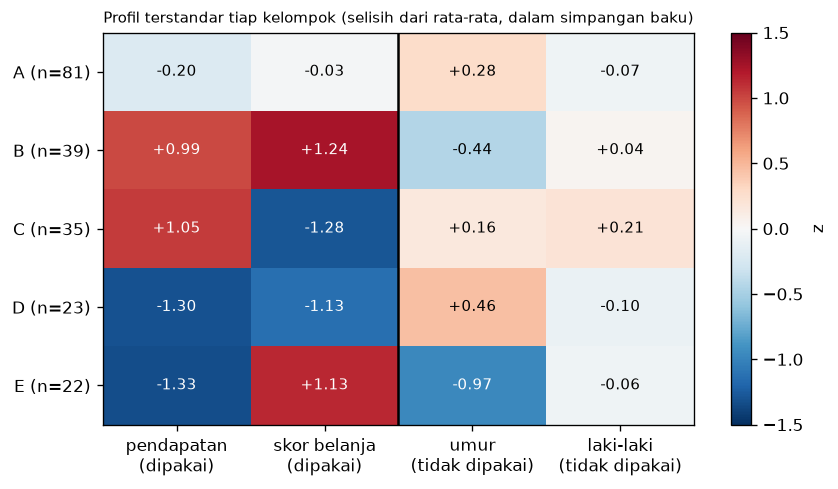

# Bab 7 — Cluster Interpretation and Profiling

## Learning Objectives

Setelah mempelajari bab ini, kamu mampu:

- [x] Menjelaskan bedanya **menghasilkan** kelompok dan **menafsirkan** kelompok.
- [x] Menyusun **profil** tiap kelompok: ukuran, rata-rata, median, dan sebaran dalam satuan asli.
- [x] Membuat **profil terstandar** (selisih dari rata-rata keseluruhan) dan membacanya sebagai peta panas.
- [x] Membedakan variabel yang **dipakai** clustering dari variabel yang **tidak dipakai**, dan mengapa perbedaannya tidak berarti sama.
- [x] Memberi nama kelompok dengan aturan yang jelas, dan menyadari bahwa nama hanyalah label komunikasi.
- [x] Memakai **uji permutasi** untuk memeriksa apakah perbedaan pada variabel di luar clustering lebih besar daripada kebetulan.
- [x] Menyebut kesalahan tafsir yang umum: menganggap kelompok sebagai "tipe orang" nyata, atau menafsirkan sebab-akibat.

## Introduction

Bab 3 sampai 6 membahas cara **menghasilkan** dan menyetel kelompok. Hasil akhir clustering hanyalah **kolom label** (0, 1, 2, ...). Label itu tidak berarti apa-apa sampai kita menjawab: **"Kelompok ini berisi siapa atau apa, dan apa yang membedakannya dari yang lain?"**

Bab ini mengajarkan cara menjawabnya dengan hati-hati pada **Mall Customers**: 200 pelanggan dengan umur, gender, pendapatan tahunan, dan skor belanja. Kita men-cluster memakai pendapatan dan skor belanja (K = 5, seperti baseline Bab 5), lalu menafsirkan hasilnya.

Ada satu sikap yang dipegang sepanjang bab: **profil menggambarkan, bukan menjelaskan.** Kita boleh mengatakan "kelompok E rata-rata berumur 25 tahun". Kita tidak boleh mengatakan "umur membuat mereka berbelanja banyak".

!!! note "Prasyarat"
    [Bab 5](05-feature-selection-and-impact-analysis.md) Level 6 (pengaruh fitur, K-Means pada Mall Customers) dan [Level 5](../clustering-evaluation/index.md) (Silhouette dan kualitas kelompok). Stabilitas hasil terhadap seed dan sampel bukan topik bab ini.

## Fundamental Concepts

| Istilah | Arti |
|---|---|
| **Cluster profiling** | Menggambarkan isi tiap kelompok lewat ringkasan statistik |
| **Segment / persona** | Nama dan deskripsi singkat sebuah kelompok untuk komunikasi |
| **Centroid** | Titik rata-rata sebuah kelompok pada fitur yang dipakai |
| **Standardized profile** | Selisih rata-rata kelompok dari rata-rata seluruh data, dalam satuan simpangan baku |
| **Variabel yang dipakai** | Fitur yang masuk ke clustering (di sini pendapatan dan skor belanja) |
| **Variabel di luar clustering** | Kolom lain yang tidak dipakai (di sini umur dan gender) |
| **Representative point** | Titik nyata yang paling dekat dengan pusat kelompok |
| **Permutation test** | Mengacak label kelompok berkali-kali untuk melihat seberapa besar perbedaan yang bisa muncul karena kebetulan |
| **Circularity** | Menguji perbedaan pada variabel yang justru dipakai membentuk kelompok |

## Detailed Explanation

### Dari label ke makna

Setelah K-Means selesai kita hanya punya angka kelompok. Nomor kelompok K-Means bersifat **acak** (kelompok 0 pada satu eksekusi bisa menjadi kelompok 3 pada eksekusi lain). Karena itu kita memberi huruf (A sampai E) menurut **ukuran** kelompok, terbesar dulu, supaya hasil bisa dibaca dan diulang.

### Empat pertanyaan profil

1. **Seberapa besar** tiap kelompok? (ukuran dan persentase)
2. **Seperti apa** kelompok itu pada variabel yang dipakai? (rata-rata, sebaran)
3. **Apa lagi** yang membedakannya pada variabel yang **tidak** dipakai? (umur, gender)
4. **Seberapa yakin** kita bahwa perbedaan itu bukan kebetulan?

### Satuan asli dan satuan terstandar

- **Satuan asli** (k$, poin skor, tahun) mudah dipahami oleh orang non-teknis: "rata-rata pendapatan 86,5 k$".
- **Satuan terstandar** membuat variabel berbeda skala bisa dibandingkan dalam satu tabel atau peta panas: "pendapatan kelompok B kira-kira 1 simpangan baku di atas rata-rata".

Gunakan keduanya. Laporkan juga **median** dan **simpangan baku**, bukan hanya rata-rata, karena rata-rata bisa menutupi sebaran lebar.

### Variabel yang dipakai dan yang tidak: masalah sirkularitas

Kelompok dibentuk agar anggotanya mirip pada pendapatan dan skor belanja. Jadi **pasti** rata-rata pendapatan berbeda antar kelompok, itu hasil **konstruksi**, bukan temuan. Uji statistik pada variabel yang dipakai clustering hampir selalu "signifikan" dan tidak berarti apa-apa. Variabel yang layak diuji adalah yang **tidak dipakai**, seperti umur dan gender. Jika kelompok yang dibentuk dari pendapatan dan skor belanja juga berbeda pada umur, itu informasi baru.

### Memberi nama kelompok

Nama membantu komunikasi, tetapi berbahaya jika dianggap kebenaran. Prinsipnya:

1. **Gunakan aturan tertulis** (misalnya ambang pada profil terstandar), bukan kesan sesaat.
2. **Nama deskriptif**, bukan penilaian ("pendapatan tinggi, belanja rendah", bukan "pelit").
3. **Nyatakan bahwa nama bergantung pada ambang.** Mengubah ambang bisa mengubah nama (lihat latihan).
4. **Hindari stereotip** pada umur atau gender.

### Titik perwakilan

Titik nyata terdekat dengan pusat kelompok memberi gambaran konkret. Tetapi **satu orang tidak mewakili seluruh kelompok** pada variabel yang tidak dipakai. Ia hanya dekat pada variabel yang dipakai clustering.

### Uji permutasi

Pertanyaan: "Apakah perbedaan umur antar lima kelompok ini lebih besar dari yang bisa muncul bila kelompok dibentuk acak?" Caranya:

1. Hitung ukuran perbedaan pada data asli (selisih rata-rata umur terbesar dan terkecil antar kelompok).
2. Acak label kelompok (jumlah anggota tiap kelompok tetap), hitung ukuran yang sama. Ulangi ribuan kali.
3. Hitung seberapa sering hasil acak setidaknya sebesar hasil asli.

Metode ini tidak mengandaikan sebaran data tertentu, dan mudah dibaca.

### Keterbatasan

- **Profil adalah deskripsi satu hasil clustering.** Seed atau K yang berbeda bisa mengubah kelompoknya.
- **Rata-rata menyembunyikan sebaran.** Anggota satu kelompok bisa sangat beragam.
- **Asosiasi, bukan sebab.** Kelompok yang muda dan berbelanja banyak tidak berarti umur penyebabnya.
- **Nama menyederhanakan.** Orang nyata tidak sesederhana label.
- **Dataset ini kecil** (200 pelanggan), jadi kelompok kecil rentan berubah.

### Kesalahan umum

1. **Menguji variabel yang dipakai clustering** lalu melaporkan "perbedaan signifikan".
2. **Hanya melaporkan rata-rata.**
3. **Menganggap nama sebagai fakta** ("pelanggan hemat").
4. **Menafsirkan sebab-akibat** dari profil.
5. **Menganggap satu titik perwakilan mewakili semuanya.**
6. **Menyimpulkan dari kelompok kecil** tanpa memeriksa ukurannya.
7. **Lupa bahwa nomor kelompok bersifat acak** dan membandingkan "kelompok 2" antar eksekusi.

## Mathematical Foundation

### Profil terstandar

Untuk variabel \( v \), rata-rata keseluruhan \( \bar{v} \) dan simpangan baku keseluruhan \( s_v \), serta rata-rata kelompok \( k \) sebesar \( \bar{v}_k \):

$$
z_{k,v} = \frac{\bar{v}_k - \bar{v}}{s_v}
$$

Nilai positif berarti kelompok \( k \) berada di atas rata-rata seluruh data pada variabel \( v \), negatif di bawahnya. Satuannya simpangan baku, sehingga umur dan pendapatan bisa disandingkan.

### Perhitungan manual

Dari data: pendapatan rata-rata keseluruhan 60,56 dengan simpangan baku 26,2647, skor belanja 50,20 dengan simpangan baku 25,8235, dan umur 38,85 dengan simpangan baku 13,969.

- Pendapatan kelompok E: \( (25{,}73 - 60{,}56) / 26{,}26 = -1{,}33 \)
- Skor belanja kelompok B: \( (82{,}13 - 50{,}20) / 25{,}82 = +1{,}24 \)
- Umur kelompok E: \( (25{,}27 - 38{,}85) / 13{,}97 = -0{,}97 \)

Ketiganya akan kita cocokkan dengan keluaran kode.

### Nilai-p permutasi

Misalkan \( T_{\text{obs}} \) adalah ukuran perbedaan pada data asli dan \( T_1, \dots, T_B \) ukuran pada \( B \) pengacakan label. Nilai-p:

$$
p = \frac{1 + \#\{ b : T_b \ge T_{\text{obs}} \}}{B + 1}
$$

Angka 1 pada pembilang dan penyebut memastikan nilai-p tidak pernah nol: dengan \( B = 2000 \), nilai terkecil yang mungkin adalah \( 1/2001 \approx 0{,}0005 \). Nilai-p kecil berarti perbedaan sebesar itu **jarang** muncul bila kelompok dibentuk acak. Ia tidak menyatakan seberapa **penting** perbedaannya.

## Experimental Procedure (Eksperimen D)

1. **Tujuan:** menafsirkan satu hasil clustering secara terstruktur dan jujur.
2. **Dataset (alasan):** **Mall Customers** (`data/mall_customers.csv`), 200 pelanggan. Dipilih karena ada variabel yang bisa dipisahkan menjadi "dipakai" (pendapatan dan skor belanja) dan "tidak dipakai" (umur dan gender).
3. **Praproses:** z-score per kolom pada dua variabel yang dipakai. Seed 42.
4. **Algoritma:** K-Means, K = 5, `n_init=10` (baseline Bab 5).
5. **Langkah penafsiran:** ukuran kelompok, profil satuan asli, profil terstandar, nama berbasis aturan, titik perwakilan, dan uji permutasi (2000 kali) untuk umur dan gender.
6. **Hasil disimpan:** `examples/level-6/results/07_cluster_profile.csv` dan `07_config.json`.

## Python Implementation

Skrip lengkapnya ada di `examples/level-6/07_cluster_interpretation_and_profiling.py`, dan notebook-nya di `notebooks/level-6/07-cluster-interpretation-and-profiling.ipynb`. **Setiap potongan kode diikuti penjelasannya.**

**Konteks masalah:** sebuah toko ingin memahami segmen pelanggannya dari hasil clustering.

**Tujuan eksperimen:** membaca kelompok tanpa menafsirkan melebihi bukti.

**Pustaka:** NumPy, pandas, Matplotlib, scikit-learn (`KMeans`), dan alat pencatat `_experiment.py`.

### Bagian A — Siapkan alat

```python
--8<-- "level-6/07_cluster_interpretation_and_profiling.py:setup"
```

**Penjelasan:** `_experiment` adalah modul pencatat dari bab-bab sebelumnya; di bab ini hanya dipakai untuk menyimpan hasil.

### Bagian B — Data dan clustering

```python
--8<-- "level-6/07_cluster_interpretation_and_profiling.py:data"
```

**Penjelasan baris demi baris:**

- `df["Male"] = (df["Gender"] == "Male").astype(int)` mengubah gender menjadi 0 atau 1 agar rata-ratanya bisa dibaca sebagai **porsi laki-laki**.
- `used` dan `unused` memisahkan variabel yang dipakai dan tidak dipakai clustering sejak awal. Pemisahan ini menjadi inti penafsiran.
- `X` adalah dua kolom yang sudah dijadikan z-score, dan K-Means hanya melihat `X`.
- `np.bincount(model.labels_)` menghitung ukuran kelompok, `np.argsort(-...)` mengurutkannya dari yang terbesar, dan `"ABCDE"[new]` memberi huruf. `kind="stable"` menjaga urutan bila ada ukuran yang sama.
- `centers_z` adalah centroid dalam ruang terstandar, dengan urutan huruf yang baru.

### Bagian C — Ukuran kelompok

```python
--8<-- "level-6/07_cluster_interpretation_and_profiling.py:sizes"
```

**Penjelasan:** `value_counts()` menghitung anggota tiap huruf, `sort_index()` mengurutkan A sampai E. Persentase dihitung dari 200 pelanggan.

### Bagian D — Profil dalam satuan asli

```python
--8<-- "level-6/07_cluster_interpretation_and_profiling.py:profile"
```

**Penjelasan:** `groupby("Cluster").agg(...)` menghitung beberapa ringkasan sekaligus per kelompok. Setiap argumen berbentuk `nama_kolom_hasil=("kolom_asal", "fungsi")`. Kita mengambil jumlah, rata-rata, dan simpangan baku untuk dua variabel yang dipakai, serta median dan rata-rata umur dan porsi laki-laki. Baris terakhir mencetak rata-rata seluruh pelanggan sebagai pembanding.

### Bagian E — Profil terstandar

```python
--8<-- "level-6/07_cluster_interpretation_and_profiling.py:zprofile"
```

**Penjelasan:** `df.groupby("Cluster")[variables].mean()` memberi rata-rata tiap kelompok, dikurangi rata-rata seluruh data dan dibagi simpangan baku seluruh data. Pandas mencocokkan baris dan kolom otomatis. Nama kolom kemudian diganti dengan nama yang mudah dibaca. Inilah rumus \( z_{k,v} \).

### Bagian F — Memberi nama berbasis aturan

```python
--8<-- "level-6/07_cluster_interpretation_and_profiling.py:names"
```

**Penjelasan:** `level` adalah fungsi kecil: bila \( z \ge 0{,}5 \) disebut tinggi, bila \( z \le -0{,}5 \) disebut rendah, selain itu menengah. `describe` merangkai kalimat dari dua variabel yang dipakai. Docstring-nya menyatakan bahwa nama hanya label. Aturan ditulis di kode, sehingga siapa pun bisa memeriksanya.

### Bagian G — Pelanggan perwakilan

```python
--8<-- "level-6/07_cluster_interpretation_and_profiling.py:represent"
```

**Penjelasan:** untuk tiap kelompok, kita ambil anggotanya, hitung jarak kuadrat tiap anggota ke centroid (`((member_x - centroid) ** 2).sum(axis=1)`), lalu `argmin` memilih yang terdekat. Hasilnya adalah satu baris data nyata per kelompok. Perhatikan bahwa jarak dihitung di ruang yang dipakai clustering, jadi umur dan gender **tidak ikut** menentukan siapa yang terpilih.

### Bagian H — Variabel di luar clustering dan uji permutasi

```python
--8<-- "level-6/07_cluster_interpretation_and_profiling.py:outside"
```

**Penjelasan:**

- `spread(values, labels)` mengelompokkan nilai menurut label dan mengembalikan selisih rata-rata terbesar dan terkecil.
- `rng.permutation(labels)` mengacak urutan label. Jumlah anggota tiap kelompok tetap, hanya penugasannya acak.
- `shuffled` berisi 2000 hasil acak. `np.percentile(shuffled, 95)` memberi batas yang hanya dilewati 5% hasil acak.
- `p_value` mengikuti rumus \( (1 + \#) / (B + 1) \).
- Perulangan dijalankan untuk umur dan untuk gender.

### Bagian I — Menyimpan profil

```python
--8<-- "level-6/07_cluster_interpretation_and_profiling.py:save"
```

**Penjelasan:** profil satuan asli, nama, dan profil terstandar digabung dalam satu tabel CSV. Konfigurasi, aturan penamaan, dan jumlah permutasi disimpan dalam JSON.

### Bagian J — Gambar

```python
--8<-- "level-6/07_cluster_interpretation_and_profiling.py:plotheat"
```

```python
--8<-- "level-6/07_cluster_interpretation_and_profiling.py:plotmap"
```

**Penjelasan:** gambar pertama adalah peta panas profil terstandar dengan angka di tiap sel. Garis tebal memisahkan variabel yang dipakai dan yang tidak. `vmin` dan `vmax` dikunci pada -1,5 sampai 1,5 agar warna tidak berubah menurut data. Gambar kedua berisi peta pendapatan terhadap skor belanja (kiri) dan diagram kotak umur (kanan). Diagram kotak menampilkan **sebaran**, bukan hanya rata-rata.

## Code Explanation

| Bagian kode | Peran |
|---|---|
| `used` dan `unused` | Memisahkan variabel yang dipakai dan tidak dipakai clustering |
| `np.argsort(-np.bincount(...))` | Memberi huruf kelompok menurut ukuran |
| `groupby("Cluster").agg(...)` | Ringkasan statistik per kelompok |
| `z_profile` | Profil terstandar \( z_{k,v} \) |
| `describe(...)` | Nama berbasis aturan |
| `spread` dan `rng.permutation` | Uji permutasi |

!!! note "Mengapa tidak memakai ANOVA atau uji-t?"
    Uji klasik juga bisa dipakai pada variabel di luar clustering. Uji permutasi dipilih di bab ini karena ide dasarnya terlihat langsung di kode (acak lalu bandingkan) dan tidak mengandaikan sebaran data tertentu.

## How to Run

Dari folder utama proyek (setelah mengaktifkan lingkungan virtual):

```powershell
pip install -r requirements-notebooks.txt
python examples/level-6/07_cluster_interpretation_and_profiling.py
```

Skrip mencetak output ke terminal, menyimpan dua gambar ke `docs/assets/level-6/`, dan hasil ke `examples/level-6/results/`. Notebook interaktifnya:

```powershell
jupyter notebook notebooks/level-6/07-cluster-interpretation-and-profiling.ipynb
```

Output di bawah berasal dari eksekusi nyata dengan Python 3.14, NumPy 2.5.4, pandas 3.1.1, scikit-learn 1.9.1, dan Matplotlib 3.11.2.

## Expected Output

```text
--8<-- "level-6/outputs/07.txt"
```

Gambar yang dihasilkan:




### Interpretasi output

**1. Ukuran.** A **81** (40,5%), B **39** (19,5%), C **35** (17,5%), D **23** (11,5%), E **22** (11,0%). Kelompok terbesar hampir empat kali kelompok terkecil. Dua kelompok terkecil masing-masing sekitar 22 sampai 23 orang, jadi angka rata-rata mereka bergantung pada sedikit data.

**2. Profil satuan asli.** Rata-rata seluruh pelanggan: pendapatan 60,56, skor 50,20, umur 38,85, porsi laki-laki 0,44.

| Kelompok | n | Pendapatan (rata ± SD) | Skor (rata ± SD) | Umur (median) | Porsi laki-laki |
|---|---|---|---|---|---|
| A | 81 | 55,30 ± 8,99 | 49,52 ± 6,53 | 46,0 | 0,41 |
| B | 39 | 86,54 ± 16,31 | 82,13 ± 9,36 | 32,0 | 0,46 |
| C | 35 | 88,20 ± 16,40 | 17,11 ± 9,95 | 42,0 | 0,54 |
| D | 23 | 26,30 ± 7,89 | 20,91 ± 13,02 | 46,0 | 0,39 |
| E | 22 | 25,73 ± 7,57 | 79,36 ± 10,50 | 23,5 | 0,41 |

Sebaran pendapatan kelompok B dan C (SD sekitar 16) hampir dua kali kelompok A (8,99). Pada peta, kelompok B dan C membentang dari sekitar 70 sampai di atas 130 k$. "Rata-rata 86,5" bagi B tidak menggambarkan semua anggotanya sama baik.

**3. Profil terstandar cocok dengan hitungan manual.** Pendapatan E **-1,33**, skor belanja B **+1,24**, umur E **-0,97**: persis seperti hitungan tangan. Seluruh tabel:

| Kelompok | pendapatan | skor belanja | umur | laki-laki |
|---|---|---|---|---|
| A | -0,20 | -0,03 | +0,28 | -0,07 |
| B | +0,99 | +1,24 | -0,44 | +0,04 |
| C | +1,05 | -1,28 | +0,16 | +0,21 |
| D | -1,30 | -1,13 | +0,46 | -0,10 |
| E | -1,33 | +1,13 | -0,97 | -0,06 |

Dua kolom pertama (variabel yang dipakai) memiliki nilai besar **karena clustering dibuat begitu**. Dua kolom terakhir tidak dipakai, dan di sanalah informasi baru berada: umur E sangat rendah (-0,97), umur D agak tinggi (+0,46), sedangkan porsi laki-laki hampir tidak bergeser (di bawah 0,25 di semua kelompok).

**4. Nama berbasis aturan (ambang |z| = 0,5).** A: pendapatan menengah, belanja menengah. B: pendapatan tinggi, belanja tinggi. C: pendapatan tinggi, belanja rendah. D: pendapatan rendah, belanja rendah. E: pendapatan rendah, belanja tinggi. Nama-nama itu mengikuti empat sudut peta ditambah satu kelompok tengah. Itu deskripsi posisi, bukan sifat orangnya.

**5. Pelanggan perwakilan.** A: pelanggan 81 (laki-laki, 57 tahun, pendapatan 54, skor 51). B: 176 (perempuan, 30 tahun, 88, 86). C: 177 (laki-laki, 58 tahun, 88, 15). D: 25 (perempuan, 54 tahun, 28, 14). E: 26 (laki-laki, 29 tahun, 28, 82). Perwakilan kelompok A berumur 57 tahun, padahal umur median kelompok itu 46. Titik ini dekat pada pendapatan dan skor (yang dipakai), tetapi tidak harus tipikal pada umur. Pelanggan perwakilan bagus untuk ilustrasi, bukan sebagai pengganti profil.

**6. Uji permutasi.**

| Variabel | Selisih rata-rata antar kelompok | Batas acak 95% | Nilai-p |
|---|---|---|---|
| Umur | 19,945 tahun | 9,890 | **0,0005** |
| Laki-laki | 0,152 | 0,339 | **0,7426** |

Selisih rata-rata umur antar kelompok (E sekitar 25,3 tahun sampai D sekitar 45,2 tahun) kira-kira **dua kali** batas yang bisa dicapai pengacakan, dan nilai-p berada di batas bawah yang mungkin (0,0005). Untuk gender, selisih 0,152 **lebih kecil** dari batas acak (0,339) dan nilai-p 0,74: tidak ada bukti bahwa porsi laki-laki berbeda antar kelompok. Jadi "kelompok C didominasi laki-laki" (0,54) **tidak didukung**, walau angkanya tampak lebih tinggi dari 0,44.

!!! warning "Yang boleh dan tidak boleh disimpulkan"
    **Boleh:** pada 200 pelanggan ini, kelompok yang dibentuk dari pendapatan dan skor belanja berbeda dalam umur lebih dari yang diharapkan secara acak, dengan kelompok pendapatan rendah dan skor tinggi (E) paling muda. **Tidak boleh:** menyimpulkan bahwa umur menyebabkan perilaku belanja, bahwa semua pelanggan muda berbelanja banyak, atau bahwa pola ini berlaku di toko lain. Hasil ini juga hanya untuk satu seed dan K = 5.

**7. Penyimpanan.** Profil dan konfigurasi tersimpan di `07_cluster_profile.csv` dan `07_config.json`.

## Practical Application

**Laporan segmentasi.** Tim pemasaran menerima tabel profil, peta panas, dan nama berbasis aturan. Setiap nama disertai ukuran kelompok dan catatan bahwa itu label, bukan tipe orang.

**Memilih tindakan.** Kelompok C (pendapatan tinggi, belanja rendah, 35 orang) mungkin cocok untuk uji promosi. Kelompok kecil seperti D dan E berisiko, karena ukurannya sekitar 22 orang. Tindakan sebaiknya diuji dulu pada sampel kecil.

**Menguji variabel baru.** Variabel lain yang tidak dipakai (misalnya kota atau kanal pembelian) dapat diperiksa dengan uji permutasi yang sama.

**Dokumentasi.** Simpan profil beserta K, seed, praproses, dan aturan penamaan, agar orang lain bisa memeriksa dan mengulangnya.

## Hands-on Exercises

1. Ubah ambang penamaan dari 0,5 menjadi 0,2 dan menjadi 1,1. Bagaimana nama kelompok berubah?
2. Jalankan K-Means dengan K = 6 pada data yang sama. Kelompok mana yang terpecah, dan berapa ARI terhadap hasil K = 5?
3. Ulangi uji permutasi dengan `default_rng(7)`. Apakah kesimpulan untuk umur dan gender berubah?
4. Mengapa rata-rata umur kelompok A (42,72) berbeda dari mediannya (46,0)?
5. Mengapa tidak bermakna menguji apakah pendapatan berbeda antar kelompok?
6. Apa yang ditunjukkan bahwa pelanggan perwakilan kelompok A berumur 57 tahun, padahal median umurnya 46?
7. Seorang rekan ingin menamai kelompok E "anak muda boros". Apa keberatanmu, dan nama apa yang kamu usulkan?

??? question "Jawaban"
    Hasil nomor 1 sampai 3 berasal dari eksekusi nyata.

    1. Ambang **0,2**: kelompok A menjadi "pendapatan **rendah**, belanja menengah" (z pendapatan -0,20 melewati ambang), yang lain tetap. Ambang **1,1**: B menjadi pendapatan **menengah** dan belanja tinggi, C menjadi pendapatan **menengah** dan belanja rendah (z pendapatan 0,99 dan 1,05 tidak mencapai 1,1), sedangkan D dan E tetap. Nama bergantung pada ambang, dan ambang 1,1 menyebut pelanggan berpendapatan sekitar 87 k$ sebagai "menengah", yang tidak masuk akal bagi pembaca. Karena itu ambang harus dinyatakan dan diperiksa.
    2. Kelompok **B** (39 pelanggan) terpecah menjadi 29 pelanggan (pendapatan rata-rata 78,6, skor 82,2) dan 10 pelanggan (pendapatan rata-rata 109,7, skor 82,0). Ukuran dan rata-rata keempat kelompok lain sama persis. ARI K = 5 terhadap K = 6 adalah **0,961**. Jadi pembagian K = 5 hampir sepenuhnya terkandung dalam K = 6. Pecahan baru kecil (10 orang), dan membedakannya hanya pada pendapatan yang sangat tinggi.
    3. Umur: selisih 19,945, batas acak 95% 9,713, nilai-p **0,0005**. Gender: selisih 0,152, batas acak 0,340, nilai-p **0,7086**. Kesimpulan sama: umur berbeda antar kelompok, gender tidak. Nilai-p gender berubah dari 0,7426 ke 0,7086 karena pengacakan berbeda, dan kesimpulannya tetap.
    4. Median lebih besar dari rata-rata berarti ada anggota yang jauh lebih muda yang menarik rata-rata ke bawah. Itu sesuai diagram kotak: umur kelompok A membentang dari sekitar 18 sampai 70, sangat lebar. Satu angka rata-rata tidak cukup untuk melukiskan kelompok ini.
    5. Kelompok dibentuk dari pendapatan (dan skor belanja), sehingga perbedaannya pasti ada karena cara pembentukannya, bukan karena temuan (sirkularitas). Uji yang bermakna adalah pada variabel yang tidak dipakai.
    6. Satu pelanggan nyata dipilih berdasarkan kedekatan pada pendapatan dan skor saja, jadi umur dan gender-nya tidak dijamin tipikal. Ia berguna sebagai contoh konkret, tetapi tidak menggantikan ringkasan statistik seluruh anggota.
    7. "Boros" adalah penilaian, bukan deskripsi, dan "anak muda" menyiratkan semua anggotanya muda. Padahal umur E bervariasi (batas bawah dan atas terlihat di diagram kotak) dan variabel yang dipakai hanya skor belanja, bukan sifat boros. Usulan: "pendapatan rendah, belanja tinggi" (nama berbasis aturan), dengan catatan terpisah bahwa rata-rata umurnya 25,3 tahun.

## Troubleshooting

### Masalah teknis

| Masalah | Penyebab | Solusi |
|---|---|---|
| `KeyError` pada `groupby` | Nama kolom salah ketik | Periksa `df.columns` |
| Nomor kelompok berbeda dari bab | Nomor K-Means acak | Beri huruf menurut ukuran (seperti di kode) |
| Nilai-p berubah sedikit tiap eksekusi | Seed pengacakan tidak tetap | Tetapkan `default_rng(SEED)` |
| Peta panas berwarna tidak konsisten | Skala warna otomatis | Tetapkan `vmin` dan `vmax` |
| Kelompok kecil menghasilkan rata-rata tidak stabil | Anggota terlalu sedikit | Laporkan ukuran dan sebaran, jangan hanya rata-rata |
| Nama kelompok berubah ketika data berubah | Ambang pada z dekat batas | Nyatakan ambang, dan periksa kepekaannya |

### Kesalahan umum

1. **Menguji variabel yang dipakai clustering** (sirkularitas).
2. **Hanya melaporkan rata-rata**, tanpa median dan sebaran.
3. **Menganggap nama sebagai kebenaran** atau memberi nama yang menghakimi.
4. **Menafsirkan sebab-akibat** dari profil.
5. **Memakai satu titik perwakilan** sebagai gambaran seluruh kelompok.
6. **Mengabaikan ukuran kelompok.**
7. **Membandingkan nomor kelompok antar eksekusi.**

## Summary

- **Profil menggambarkan, bukan menjelaskan.** Empat pertanyaan: seberapa besar, seperti apa pada variabel yang dipakai, apa lagi pada variabel yang tidak dipakai, dan seberapa yakin bukan kebetulan.
- Pada Mall Customers (K = 5): ukuran 81, 39, 35, 23, dan 22. Profil terstandar cocok dengan hitungan manual (pendapatan E -1,33, skor belanja B +1,24, umur E -0,97).
- Perbedaan pada variabel yang **dipakai** adalah hasil konstruksi. Variabel yang layak diuji adalah yang **tidak dipakai**.
- Uji permutasi (2000 kali): umur berbeda antar kelompok (selisih 19,9 tahun vs batas acak 9,9; p = 0,0005), gender tidak (p = 0,74).
- Nama berbasis aturan hanya label dan bergantung pada ambang (ambang 0,2 dan 1,1 mengubah nama).
- Titik perwakilan dan rata-rata menyederhanakan. Laporkan median, sebaran, dan ukuran kelompok.
- Asosiasi tidak sama dengan sebab. Hasil ini berlaku untuk 200 pelanggan, K = 5, dan satu seed.

**Bab berikutnya:** Bab 8 membahas kestabilan hasil: apakah kelompok yang kita tafsirkan bertahan ketika seed, sampel data, atau K berubah.

## References

- Hennig, C. (2015). What are the true clusters? *Pattern Recognition Letters*, 64, 53–62.
- Hennig, C. (2007). Cluster-wise assessment of cluster stability. *Computational Statistics & Data Analysis*, 52(1), 258–271.
- Everitt, B. S., Landau, S., Leese, M., & Stahl, D. (2011). *Cluster Analysis* (5th ed.). Wiley.
- Phipson, B., & Smyth, G. K. (2010). Permutation p-values should never be zero: calculating exact p-values when permutations are randomly drawn. *Statistical Applications in Genetics and Molecular Biology*, 9(1), Article 39.
- Pandas documentation: [*Group by: split-apply-combine*](https://pandas.pydata.org/docs/user_guide/groupby.html).
