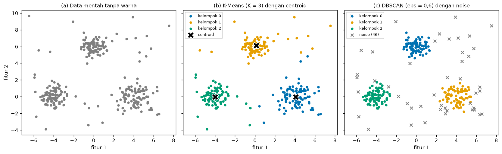
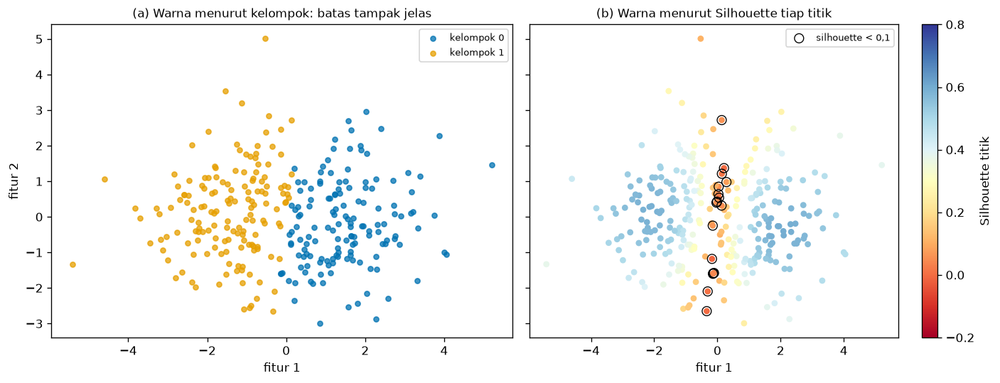
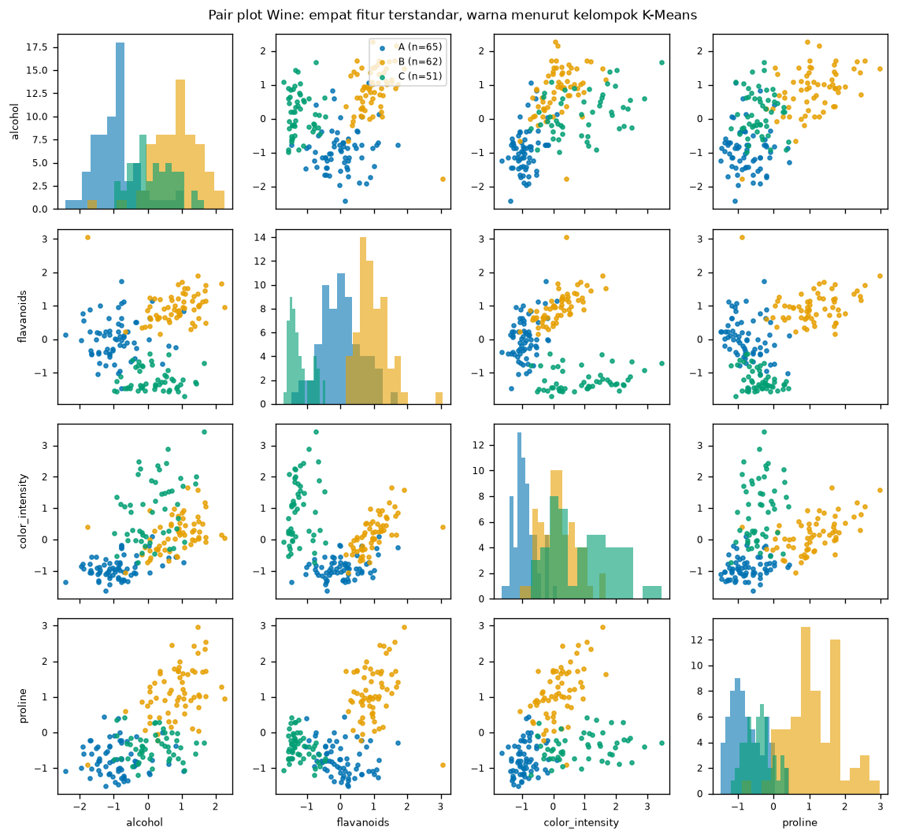
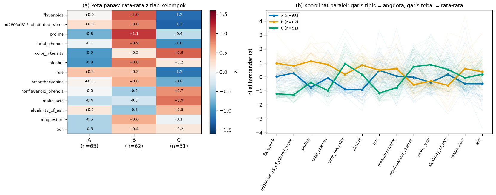

# Bab 8 — Cluster Visualization and Analysis

## Learning Objectives

Setelah mempelajari bab ini, kamu mampu:

- [x] Menjelaskan mengapa visualisasi penting dalam clustering, dan mengapa ia **bukan bukti** bahwa kelompok itu valid.
- [x] Membuat *scatter plot* dengan pemetaan warna yang konsisten, aman bagi pembaca buta warna, dan menandai **centroid** serta **noise** dengan jelas.
- [x] Menyusun **figur multi-panel** untuk membandingkan beberapa hasil secara berdampingan.
- [x] Mengenali **kelompok yang tumpang tindih** dan memakai Silhouette per titik untuk menunjukkan titik yang ambigu.
- [x] Membaca dan membuat *pair plot*, peta panas profil, dan *parallel coordinates* untuk data berdimensi banyak.
- [x] Menjelaskan mengapa gambar 2D (termasuk proyeksi PCA) bisa tampak lebih rapi daripada kenyataan di dimensi asli, dan menunjukkannya dengan angka.
- [x] Mengenali skala sumbu yang menyesatkan dan kesalahan visualisasi yang umum.
- [x] Menjalankan **Eksperimen E** dari awal sampai akhir dan mencatatnya.

## Introduction

Pada data dua dimensi, clustering bisa dinilai dengan mata: kita melihat tiga gerombol, memberi tiga warna, selesai. Pada data nyata yang memiliki belasan fitur, mata tidak bisa melihat langsung. Kita harus **memilih cara menggambar**, dan setiap cara menyembunyikan sesuatu.

Bab ini mengajarkan cara menggambar hasil clustering dengan jujur. Pertanyaan yang ingin dijawab:

**"Bagaimana menampilkan hasil clustering supaya terbaca, dan apa yang tidak boleh disimpulkan dari gambar itu?"**

Ada satu sikap yang dipegang sepanjang bab: **visualisasi adalah alat bantu analisis, bukan bukti.** Gambar yang rapi tidak membuktikan bahwa kelompok itu nyata, stabil, atau berguna. Sebaliknya, gambar yang berantakan belum tentu berarti clusteringnya buruk. Gambar membantu kita **melihat dan bertanya**. Jawabannya tetap datang dari metrik (Level 5), uji kestabilan (Bab 9), dan pengetahuan tentang masalahnya.

!!! note "Prasyarat"
    [Bab 6](06-dimensionality-reduction-and-pca.md) Level 6 (PCA dan batas visualisasi 2D), [Bab 7](07-cluster-interpretation-and-profiling.md) (profil kelompok), dan [Level 5](../clustering-evaluation/index.md) (Silhouette). Bab ini tidak mengulang cara PCA bekerja atau cara menafsirkan profil. Fokusnya adalah **cara menggambar** dan **batas gambar**.

## Fundamental Concepts

| Istilah | Arti |
|---|---|
| **Scatter plot** | Grafik titik: setiap data adalah satu titik pada dua sumbu |
| **Color mapping** | Aturan yang menetapkan warna tiap kelompok, dan harus tetap sama di semua gambar |
| **Centroid** | Titik pusat kelompok (K-Means), digambar dengan penanda khusus |
| **Noise** | Titik yang tidak dimasukkan ke kelompok mana pun (label -1 pada DBSCAN) |
| **Multi-panel figure** | Satu figur berisi beberapa gambar berdampingan yang berbagi sumbu |
| **Pair plot** | Matriks scatter plot untuk semua pasangan fitur, dengan histogram di diagonal |
| **Heatmap** | Tabel angka yang diwarnai menurut nilainya |
| **Parallel coordinates** | Tiap fitur satu sumbu tegak; tiap data digambar sebagai satu garis yang melewati semua sumbu |
| **Overlapping clusters** | Kelompok yang daerah sebarannya saling bertumpuk |
| **Silhouette per titik** | Nilai Silhouette untuk satu titik (Level 5 Bab 5), bukan rata-rata seluruh data |
| **Aspect ratio** | Perbandingan panjang satuan sumbu x dan y pada gambar |

## Detailed Explanation

### Mengapa visualisasi penting

1. **Memeriksa asumsi.** Sebelum memilih K-Means, kita perlu melihat apakah kelompoknya kira-kira bulat. Sebelum memilih `eps`, kita perlu melihat apakah kepadatannya seragam.
2. **Menemukan masalah.** Noise, titik pencilan, kelompok yang bertumpuk, atau kelompok yang terpecah sering langsung terlihat di gambar, padahal sulit ditemukan dari satu angka metrik.
3. **Berkomunikasi.** Pembaca laporan lebih mudah memahami satu gambar yang jelas daripada tabel angka.

Tetapi visualisasi juga punya tiga bahaya: gambar **menyederhanakan** (dimensi dikurangi), gambar **bisa dimanipulasi** (skala sumbu, warna), dan gambar **menggoda kita percaya** (kelompok berwarna terasa nyata).

### Dasar gambar: scatter plot yang jujur

Untuk data dua dimensi, scatter plot adalah dasarnya. Beberapa aturan yang membuat gambar bisa dipercaya:

- **Satu kelompok, satu warna, di semua gambar.** Jika kelompok A berwarna biru di gambar pertama, ia harus biru di gambar lain. Perhatikan bahwa nomor kelompok K-Means bersifat acak (Bab 7), jadi urutkan dan beri nama dulu sebelum menggambar.
- **Pakai palet yang aman bagi buta warna.** Palet Okabe-Ito di kode ini (`#0072B2`, `#E69F00`, `#009E73`, ...) dapat dibedakan oleh pembaca dengan buta warna merah-hijau. Jangan hanya mengandalkan warna: pakai penanda berbeda bila perlu.
- **Beri legenda yang berisi ukuran.** "Kelompok A (n=65)" lebih informatif daripada "Kelompok A".
- **Beri judul dan label sumbu**, termasuk satuannya.

### Centroid

Centroid digambar dengan penanda yang jelas berbeda dari titik data (misalnya tanda `X` hitam berbingkai putih). Ia membantu melihat **di mana pusat kelompok** dan seberapa jauh anggotanya menyebar. Tetapi centroid hanya ada pada algoritma yang punya pusat (K-Means, GMM). DBSCAN tidak punya centroid.

Ingat juga: centroid hanyalah rata-rata. Pada kelompok yang melengkung, centroid bisa jatuh **di luar** kelompok itu sendiri.

### Noise

Pada DBSCAN, noise diberi label -1. Cara menggambarnya penting:

- Beri **warna abu-abu** dan **penanda berbeda** (misalnya `x`), supaya jelas bahwa itu bukan kelompok.
- Tulis jumlahnya di legenda.
- Jangan menggambar noise dengan warna kelompok. Itu menyembunyikan kenyataan bahwa algoritma menolak titik tersebut.

Noise bukan berarti "titik buruk". Titik itu hanya tidak cukup padat di sekitarnya menurut `eps` dan `min_samples` yang dipilih. Mengubah parameter itu mengubah daftar noise.

### Figur multi-panel

Untuk membandingkan beberapa hasil (misalnya data mentah, K-Means, dan DBSCAN), taruh gambar berdampingan dalam satu figur. Aturannya:

- **Bagikan sumbu** (`sharex=True`, `sharey=True`) agar posisi titik bisa dibandingkan langsung.
- **Beri huruf pada panel** ((a), (b), (c)) dan rujuk dari teks.
- **Pakai skala dan warna yang sama** di semua panel.
- Panel pertama sebaiknya **data tanpa warna kelompok**, supaya pembaca melihat data sebelum melihat tafsiran algoritma.

### Kelompok yang tumpang tindih

Gambar dengan dua warna yang berbeda memberi kesan batas yang tegas, padahal pada data yang bertumpuk batas itu **dipaksakan** oleh algoritma. Untuk menunjukkan ketidakpastian, warnai titik menurut **Silhouette per titik**, bukan menurut label. Titik dengan Silhouette mendekati 0 berada di dekat perbatasan, dan titik dengan Silhouette negatif kemungkinan lebih dekat ke kelompok lain daripada kelompoknya sendiri.

Dengan cara ini, gambar menjawab "titik mana yang ambigu?" dan bukan hanya "kelompoknya apa?".

### Data berdimensi banyak: tiga cara melihat

Saat fitur lebih dari dua, kita tidak bisa menggambar semuanya sekaligus. Tiga pendekatan yang saling melengkapi:

1. **Pair plot** menampilkan semua pasangan fitur. Kelebihannya, kita melihat data apa adanya (tanpa transformasi). Kekurangannya, jumlah panel tumbuh kuadrat sehingga hanya praktis untuk sekitar 4 sampai 6 fitur.
2. **Peta panas profil** menampilkan rata-rata (terstandar) tiap fitur untuk tiap kelompok. Ia cocok untuk puluhan fitur. Kekurangannya, ia hanya menampilkan rata-rata dan menyembunyikan sebaran.
3. **Parallel coordinates** menggambar tiap data sebagai satu garis yang melewati semua fitur. Ia menampilkan rata-rata sekaligus sebaran. Kekurangannya, garis yang banyak menumpuk, dan urutan sumbu memengaruhi bacaan. Mengurutkan fitur menurut kemampuannya membedakan kelompok membantu.

Pendekatan keempat adalah **proyeksi 2D** seperti PCA (Bab 6). Ia meringkas semua fitur ke dua sumbu, tetapi dengan harga: sebagian informasi hilang.

### Batas gambar 2D

Tiga hal yang perlu disadari:

1. **Proyeksi bisa membuat kelompok tampak lebih terpisah daripada kenyataan.** Bab 6 sudah menunjukkan batas ini secara umum. Di bab ini kita mengukurnya: Silhouette dihitung di dimensi asli dan di bidang 2D, lalu dibandingkan.
2. **Irisan 2D dari fitur mentah bisa menyembunyikan pemisahan.** Dua fitur yang kebetulan tidak membedakan kelompok akan tampak seperti awan bercampur, walau kelompok jelas terpisah di dimensi lain.
3. **Skala sumbu memengaruhi kesan.** Memadatkan satu sumbu membuat gerombol tampak menempel atau memanjang. Sumbu PCA sebaiknya dibuat dengan *aspect ratio* yang sama (`set_aspect("equal")`) supaya jarak di gambar mewakili jarak di ruang PCA.

### Visualisasi bukan bukti

Pegang daftar berikut:

- Kelompok yang **tampak jelas** di gambar tidak membuktikan kelompok itu stabil (Bab 9) atau bermakna secara praktis.
- Kelompok yang **tampak bertumpuk** di proyeksi belum tentu bertumpuk di ruang asli.
- Gambar yang sama bisa tampak "rapi" atau "berantakan" hanya karena pilihan sumbu, warna, atau ukuran titik.
- Karena itu, gambar harus disertai **angka** (ukuran kelompok, metrik, persentase varians PCA) dan **pernyataan keterbatasan**.

### Kesalahan umum

1. **Warna kelompok berbeda antar gambar.**
2. **Menggambar noise dengan warna kelompok**, atau menghilangkan noise dari gambar.
3. **Menganggap proyeksi 2D sebagai kenyataan** tanpa menyebut persen varians yang ditangkap.
4. **Sumbu yang tidak sama** (misalnya `aspect` yang dipadatkan) pada gambar PCA.
5. **Terlalu banyak titik yang menumpuk** sehingga pola tertutup (atasi dengan mengecilkan titik, menambah transparansi, atau memakai peta panas).
6. **Memakai palet yang bergantung pada warna merah-hijau** saja.
7. **Menafsirkan kedekatan titik pada plot sebagai bukti kemiripan** tanpa melihat apakah fiturnya diskalakan.
8. **Menarik kesimpulan statistik dari gambar** ("terlihat berbeda, jadi berbeda signifikan").

## Mathematical Foundation

Bab ini sedikit memakai matematika baru. Dua rumus yang dipakai hanya sebagai alat gambar.

### Nilai terstandar (z) untuk peta panas

Agar fitur berskala berbeda bisa disandingkan dalam satu peta panas, tiap nilai dijadikan *z-score*. Untuk satu fitur dengan rata-rata \( \bar{x} \) dan simpangan baku \( s \), nilai terstandar sebuah data \( x \) adalah

$$
z = \frac{x - \bar{x}}{s}
$$

Rata-rata \( z \) untuk anggota kelompok \( k \) pada fitur tersebut dituliskan \( \bar{z}_k \). Nilai positif berarti kelompok itu berada di atas rata-rata seluruh data pada fitur tersebut, nilai negatif di bawahnya. Satuannya simpangan baku, sehingga `proline` (ratusan) dan `hue` (sekitar 1) bisa disandingkan.

### Pemisahan kelompok per fitur

Untuk mengurutkan fitur pada peta panas dan *parallel coordinates*, kita memakai selisih rata-rata \( \bar{z}_k \) terbesar dan terkecil antar kelompok:

$$
\text{pemisahan} = \max_k \bar{z}_k - \min_k \bar{z}_k
$$

Fitur dengan pemisahan besar membedakan kelompok lebih jelas, sehingga ditaruh di atas.

**Perhitungan manual.** Dari tabel keluaran (pembulatan satu sampai dua desimal): fitur `flavanoids` memiliki \( \bar{z} = +0{,}98 \) pada kelompok B dan \( -1{,}22 \) pada kelompok C, sehingga

$$
\text{pemisahan} \approx 0{,}98 - (-1{,}22) = 2{,}20
$$

Kode mencetak 2,19 karena memakai nilai tanpa pembulatan. Selisih 0,01 itu hanya efek pembulatan.

!!! warning "Peringatan"
    Pemisahan ini hanya **cara mengurutkan fitur untuk menggambar**. Ini bukan *feature importance* dalam arti supervised dan tidak membuktikan bahwa fitur itu "penyebab" terbentuknya kelompok. Kelompok dibentuk dari **semua** fitur sekaligus.

### Silhouette per titik

Rumus Silhouette untuk satu titik \( i \) sudah dibahas di Level 5 Bab 5:

$$
s(i) = \frac{b(i) - a(i)}{\max\{a(i),\, b(i)\}}
$$

Di sini \( a(i) \) adalah jarak rata-rata \( i \) ke anggota kelompoknya sendiri, dan \( b(i) \) jarak rata-rata ke kelompok tetangga terdekat. Nilai mendekati 1 berarti titik cocok di kelompoknya, mendekati 0 berarti berada di perbatasan, dan negatif berarti kemungkinan lebih dekat ke kelompok lain. Di bab ini nilai per titik dipakai untuk **mewarnai gambar**. Cara menghitung dan memaknainya tidak diulang.

## Experimental Procedure (Eksperimen E)

1. **Tujuan:** menunjukkan cara menggambar hasil clustering dengan jujur: dasar (data mentah, centroid, noise), ketidakpastian (tumpang tindih), dimensi banyak (pair plot, peta panas, koordinat paralel), dan batas gambar 2D.
2. **Dataset (alasan):**
    - **Sintetis** `make_blobs` dengan tiga kelompok berkepadatan berbeda ditambah 30 titik noise acak (total 300 titik). Dipilih karena kita **tahu** mana noise yang sebenarnya, sehingga perilaku DBSCAN dapat diperiksa.
    - **Dua kelompok sintetis yang bertumpuk** (300 titik). Dipilih untuk menunjukkan titik ambigu.
    - **Wine** (`sklearn.datasets.load_wine`, 178 sampel, 13 fitur kimia, dokumentasi di [scikit-learn](https://scikit-learn.org/stable/datasets/toy_dataset.html#wine-recognition-dataset)). Dipilih karena berdimensi cukup banyak untuk membutuhkan pair plot, peta panas, dan koordinat paralel.
3. **Praproses:** `StandardScaler` pada Wine. Data sintetis dipakai apa adanya karena kedua fiturnya berskala sama. Seed 42.
4. **Algoritma:** K-Means (K = 3 pada data sintetis dan Wine, K = 2 pada data bertumpuk), DBSCAN (`eps=0.6`, `min_samples=5`).
5. **Label acuan:** label cultivar Wine **tidak** dipakai untuk clustering. Ia hanya dipakai sekali untuk menghitung ARI (Level 5) sebagai bahan perbandingan.
6. **Keluaran:** lima gambar di `docs/assets/level-6/`, serta `08_wine_z_profile.csv` dan `08_config.json` di `examples/level-6/results/`.

## Python Implementation

Skrip lengkapnya ada di `examples/level-6/08_cluster_visualization_and_analysis.py`, dan notebook-nya di `notebooks/level-6/08-cluster-visualization-and-analysis.ipynb`. **Setiap potongan kode diikuti penjelasannya.**

**Konteks masalah:** kamu harus menyajikan hasil clustering kepada rekan yang tidak melihat prosesnya. Gambar harus terbaca dan tidak menyesatkan.

**Tujuan eksperimen:** menghasilkan gambar yang jujur, serta mengukur seberapa jauh gambar 2D mewakili data aslinya.

**Pustaka:** NumPy, pandas, Matplotlib, scikit-learn (`KMeans`, `DBSCAN`, `PCA`, `StandardScaler`, `silhouette_samples`, `silhouette_score`, `adjusted_rand_score`), dan alat pencatat `_experiment.py`.

### Bagian A — Siapkan alat

```python
--8<-- "level-6/08_cluster_visualization_and_analysis.py:setup"
```

**Penjelasan:** `PALETTE` adalah enam warna palet Okabe-Ito yang aman bagi buta warna, dan `NOISE_COLOR` abu-abu khusus noise. Kedua konstanta dibuat di awal supaya **semua gambar memakai warna yang sama**. `SEED = 42` mengunci hasil acak.

### Bagian B — Data sintetis dengan noise

```python
--8<-- "level-6/08_cluster_visualization_and_analysis.py:synth"
```

```text title="Output"
--8<-- "level-6/outputs/08/synth.txt"
```

**Penjelasan baris demi baris:**

- `make_blobs(..., cluster_std=[0.7, 1.1, 0.6])` membuat tiga gerombol. Daftar `cluster_std` memberi tiap gerombol sebaran (kepadatan) berbeda.
- `rng.uniform(low=..., high=..., size=(30, 2))` membuat 30 titik acak di seluruh bidang. Inilah noise sintetis.
- `np.vstack([blobs, noise])` menumpuk keduanya menjadi satu array 300 baris. **Indeks 270 ke atas adalah noise.** Kita tahu ini karena data sintetis, sesuatu yang tidak ada pada data nyata.
- `KMeans(n_clusters=3, ...)` dan `DBSCAN(eps=0.6, min_samples=5)` dijalankan pada data yang sama.
- `set(dbscan_synth.labels_) - {-1}` menghitung jumlah kelompok DBSCAN tanpa label -1 (noise).
- `is_true_noise` adalah penanda indeks noise sebenarnya. Dua baris `print` berikutnya menghitung berapa noise sebenarnya yang ditandai DBSCAN, dan berapa titik kelompok yang ikut ditandai noise. Kamus `edge` merinci titik kelompok yang ditandai noise menurut gerombol asalnya: `blob_truth` memberi nomor gerombol asal, `np.full(30, -1)` memberi tanda -1 pada 30 titik noise, dan `&` menggabungkan syarat "ditandai noise" dengan "berasal dari gerombol g".

### Bagian C — Figur tiga panel

```python
--8<-- "level-6/08_cluster_visualization_and_analysis.py:plotpanels"
```



**Penjelasan:**

- `plt.subplots(1, 3, sharex=True, sharey=True)` membuat tiga panel berdampingan yang berbagi sumbu, sehingga posisi titik sama persis di ketiganya.
- Panel (a) menggambar data tanpa warna kelompok (abu-abu).
- Panel (b) menggambar tiap kelompok K-Means dengan warna dari `PALETTE`, lalu centroid dengan `marker="X"` hitam berbingkai putih. Argumen `*kmeans_synth.cluster_centers_.T` membongkar array centroid menjadi dua daftar (koordinat x dan y).
- Panel (c) menggambar kelompok DBSCAN, lalu noise dengan `marker="x"` abu-abu. Jumlah noise ditulis di legenda.
- `plt.show()` pada skrip ini menyimpan gambar ke file (lihat `_savefig.py`).

### Bagian D — Kelompok yang tumpang tindih

```python
--8<-- "level-6/08_cluster_visualization_and_analysis.py:overlap"
```

```text title="Output"
--8<-- "level-6/outputs/08/overlap.txt"
```

```python
--8<-- "level-6/08_cluster_visualization_and_analysis.py:plotoverlap"
```



**Penjelasan:**

- `centers=[(-1.2, 0.0), (1.2, 0.0)]` dengan `cluster_std=1.3` membuat dua gerombol yang sengaja bertumpuk (jarak pusat 2,4, sebaran 1,3).
- `silhouette_samples(X_over, over_labels)` mengembalikan **satu nilai Silhouette per titik**, berbeda dari `silhouette_score` yang mengembalikan rata-rata.
- `ambiguous = sample_sil < 0.1` adalah penanda boolean titik di perbatasan. Ambang 0,1 adalah pilihan kita, bukan ketentuan baku. Menyebutnya di laporan itu penting.
- Panel (a) mewarnai menurut label. Panel (b) mewarnai menurut Silhouette per titik dengan `cmap="RdYlBu"` dan skala dikunci (`vmin=-0.2`, `vmax=0.8`). Titik ambigu diberi lingkaran hitam.

### Bagian E — Wine dan K-Means

```python
--8<-- "level-6/08_cluster_visualization_and_analysis.py:wine"
```

```text title="Output"
--8<-- "level-6/outputs/08/wine.txt"
```

**Penjelasan:**

- `load_wine(as_frame=True)` memuat 178 sampel dengan 13 fitur sebagai DataFrame pandas.
- `StandardScaler().fit_transform(wine.data)` membuat setiap fitur memiliki rata-rata 0 dan simpangan baku 1. Tanpa ini, `proline` (ratusan) akan mendominasi jarak.
- K-Means dijalankan pada data terstandar dengan K = 3. Seperti Bab 7, kelompok diberi huruf A sampai C menurut ukuran (`np.argsort(-np.bincount(...))`) supaya konsisten.
- ARI terhadap `wine.target` dihitung **hanya untuk evaluasi**. Label itu tidak pernah masuk ke `fit`.

### Bagian F — Pair plot

```python
--8<-- "level-6/08_cluster_visualization_and_analysis.py:pairs"
```

```text title="Output"
--8<-- "level-6/outputs/08/pairs.txt"
```

```python
--8<-- "level-6/08_cluster_visualization_and_analysis.py:plotpairs"
```



**Penjelasan:**

- Kita memilih empat dari 13 fitur: `alcohol`, `flavanoids`, `color_intensity`, `proline`. Pair plot dengan 13 fitur berisi 169 panel, terlalu padat untuk dibaca.
- `groupby(wine_labels).mean()` menghitung rata-rata tiap kelompok, lalu `.agg(lambda col: col.max() - col.min())` menghitung pemisahan tiap fitur sesuai rumus pemisahan.
- Gambar dibuat dengan perulangan ganda atas baris `i` dan kolom `j`. Jika `i == j` (diagonal) digambar histogram. Selain itu digambar scatter plot fitur kolom `j` terhadap fitur baris `i`.
- `sharex="col"` menyamakan sumbu x per kolom. Legenda hanya ditaruh pada satu panel supaya tidak berulang.

### Bagian G — Peta panas dan koordinat paralel

```python
--8<-- "level-6/08_cluster_visualization_and_analysis.py:heat"
```

```text title="Output"
--8<-- "level-6/outputs/08/heat.txt"
```

```python
--8<-- "level-6/08_cluster_visualization_and_analysis.py:plotheat"
```



**Penjelasan:**

- `groupby(wine_labels).mean()` pada data terstandar memberi rata-rata z tiap kelompok untuk 13 fitur (rumus \( \bar{z}_k \)).
- `apply(lambda col: col.max() - col.min())` menghitung pemisahan, dan `sort_values(ascending=False)` mengurutkan fitur dari yang paling membedakan. Urutan yang sama dipakai di peta panas dan koordinat paralel.
- Peta panas: `imshow(..., vmin=-1.6, vmax=1.6)` mengunci skala warna. Angka ditulis di tiap sel dengan `ax.text`, dengan warna teks putih bila sel gelap.
- Koordinat paralel: perulangan `members.iterrows()` menggambar satu garis tipis transparan (`alpha=0.07`) per anggota, lalu `members.mean()` menggambar garis tebal untuk rata-rata kelompok. Garis tipis menunjukkan sebaran, garis tebal menunjukkan rata-rata.

### Bagian H — Batas irisan 2D

```python
--8<-- "level-6/08_cluster_visualization_and_analysis.py:slice"
```

```text title="Output"
--8<-- "level-6/outputs/08/slice.txt"
```

```python
--8<-- "level-6/08_cluster_visualization_and_analysis.py:plotslice"
```


**Penjelasan:**

- `PCA(n_components=2).fit(X_wine)` lalu `transform` memproyeksikan 13 fitur ke dua komponen (Bab 6). `explained_variance_ratio_.sum()` adalah persen varians yang ditangkap.
- Silhouette dihitung pada tiga ruang, **dengan label yang sama** (label dari 13 fitur): ruang 13 fitur, bidang PCA, dan dua fitur mentah `alcohol` dan `ash`. Perbandingan ini memberi angka untuk "seberapa jujur gambar 2D".
- Panel (a): bidang PCA dengan `set_aspect("equal")`. Panel (b): dua fitur mentah. Panel (c): bidang PCA yang sama dengan `set_aspect(0.25)` yang **sengaja menyesatkan** untuk memperlihatkan bahaya skala sumbu.

### Bagian I — Menyimpan hasil

```python
--8<-- "level-6/08_cluster_visualization_and_analysis.py:save"
```

```text title="Output"
--8<-- "level-6/outputs/08/save.txt"
```

**Penjelasan:** profil terstandar Wine disimpan sebagai CSV. Konfigurasi (seed, dataset, algoritma, palet, dan tiga nilai Silhouette) disimpan sebagai JSON supaya gambar dapat dibuat ulang dan dibandingkan.

## Code Explanation

| Bagian kode | Peran |
|---|---|
| `PALETTE` dan `NOISE_COLOR` | Warna tetap di semua gambar, aman bagi buta warna |
| `sharex=True`, `sharey=True` | Panel berbagi sumbu agar bisa dibandingkan |
| `marker="X"` dan `marker="x"` | Centroid dan noise dibedakan dari titik data |
| `silhouette_samples` | Nilai Silhouette per titik, untuk mewarnai ketidakpastian |
| `vmin`, `vmax` | Skala warna dikunci supaya tidak berubah menurut data |
| `groupby(...).mean()` | Rata-rata z tiap kelompok untuk peta panas dan koordinat paralel |
| `alpha=0.07` | Transparansi garis anggota agar tumpukan tetap terbaca |
| `set_aspect("equal")` | Jarak pada sumbu x dan y diwakili skala yang sama |

!!! tip "Mengapa tidak memakai seaborn?"
    `seaborn.pairplot` dan `pandas.plotting.parallel_coordinates` memang praktis. Bab ini memakai Matplotlib saja agar tidak menambah dependensi baru dan agar setiap elemen gambar terlihat di kode.

## How to Run

Dari folder utama proyek (setelah mengaktifkan lingkungan virtual):

```powershell
pip install -r requirements-notebooks.txt
python examples/level-6/08_cluster_visualization_and_analysis.py
```

Skrip mencetak output ke terminal, menyimpan lima gambar ke `docs/assets/level-6/`, dan hasil ke `examples/level-6/results/`. Notebook interaktifnya:

```powershell
jupyter notebook notebooks/level-6/08-cluster-visualization-and-analysis.ipynb
```

Semua output pada bab ini berasal dari eksekusi nyata dengan Python 3.14.10, NumPy 2.5.2, pandas 3.0.5, scikit-learn 1.9.0, dan Matplotlib 3.11.1.

## Expected Output

Output setiap langkah ditampilkan langsung di bawah kodenya pada bagian [Python Implementation](#python-implementation).

Gambar yang dihasilkan:


### Interpretasi output

**1. Data sintetis dengan noise.** K-Means menghasilkan 3 kelompok dan **tidak punya konsep noise**: ke-30 titik acak ikut masuk ke kelompok terdekat (panel b menunjukkan titik-titik jauh yang tetap berwarna). DBSCAN menemukan 3 kelompok dan menandai **46 titik** sebagai noise. Karena kita tahu 30 noise yang sebenarnya, kita dapat memeriksa:

- Dari 30 noise sebenarnya, DBSCAN menandai **26** sebagai noise (4 lainnya kebetulan jatuh dekat gerombol dan terserap).
- Dari 270 titik kelompok, DBSCAN ikut menandai **20** sebagai noise. Titik ini berada di tepi gerombol yang kurang padat. Asalnya hampir semuanya dari satu gerombol: **17 dari 20** berasal dari gerombol kanan (pusat 4, 0), yang sebarannya paling lebar (`cluster_std` 1,1), sedangkan gerombol dengan sebaran 0,7 hanya 2 titik dan gerombol dengan sebaran 0,6 hanya 1 titik.

Jadi "noise" pada gambar (c) **bukan** sama dengan "titik yang memang salah". Sebagian adalah anggota tepi yang kepadatannya di bawah ambang. Pada data nyata kita tidak punya daftar noise sebenarnya, sehingga gambar seperti ini hanya menunjukkan **apa yang ditolak algoritma**, bukan apa yang benar-benar noise.

**2. Kelompok yang bertumpuk.** Silhouette rata-rata 0,408. Dari 300 titik, **17** (5,7%) memiliki Silhouette di bawah 0,1 dan **3** titik negatif. Panel (a) memberi kesan batas lurus di tengah, padahal panel (b) menunjukkan bahwa titik di sekitar batas itu ambigu. Rata-rata Silhouette 0,408 saja tidak menunjukkan **di mana** ketidakpastiannya berada, sedangkan gambar per titik menunjukkannya.

**3. Wine dan K-Means.** Ukuran kelompok 65, 62, dan 51. Silhouette di 13 fitur terstandar adalah **0,285**, yaitu di rentang 0,26 sampai 0,50 yang oleh panduan kasar Level 5 Bab 5 disebut struktur lemah (dan hanya sedikit di atas batas bawah 0,25). ARI terhadap label cultivar adalah **0,897** (tinggi, tetapi ini perbandingan dengan label acuan, bukan bukti kelompok "benar").

**4. Pair plot.** Dari empat fitur yang digambar, pemisahan kelompok terbesar ada pada `flavanoids` (2,19), lalu `proline` (1,88), `color_intensity` (1,84), dan `alcohol` (1,76). Pasangan yang paling baik memisahkan ketiga kelompok adalah `flavanoids` terhadap `color_intensity`: kelompok C (hijau) rendah pada flavanoid dan tinggi pada warna, kelompok B (kuning) tinggi pada flavanoid, kelompok A (biru) rendah pada warna. Pada `flavanoids` terhadap `proline`, kelompok B terpisah, tetapi A dan C bertumpuk pada `proline`. Tidak ada satu pasangan pun yang memisahkan ketiganya tanpa tumpang tindih sama sekali. Kelompok terbentuk dari **kombinasi** fitur.

**5. Peta panas dan koordinat paralel.** Fitur diurutkan dari yang paling membedakan: `flavanoids`, `od280/od315_of_diluted_wines`, `proline`, `total_phenols`, `color_intensity`, ... hingga `alcalinity_of_ash`, `magnesium`, `ash` yang paling kecil. Pada peta panas:

| Fitur | A | B | C |
|---|---|---|---|
| flavanoids | +0,02 | +0,98 | -1,22 |
| proline | -0,75 | +1,13 | -0,41 |
| color_intensity | -0,90 | +0,17 | +0,94 |

Kelompok B berflavanoid dan prolin tinggi, kelompok C berflavanoid rendah dan warna pekat, kelompok A berprolin dan warna rendah. Koordinat paralel menambahkan satu hal yang tidak terlihat di peta panas: **garis tipis anggota bertumpuk dan saling memotong**. Rata-rata kelompok jelas berbeda, tetapi anggota individunya banyak yang bertumpang tindih pada banyak fitur. Itu sesuai dengan Silhouette 0,285.

**6. Batas irisan 2D (hasil terpenting bab ini).** Dengan label yang **sama**:

| Ruang yang dipakai menghitung Silhouette | Silhouette |
|---|---|
| 13 fitur terstandar | **0,285** |
| Bidang PCA (PC1 dan PC2, varians 55,4%) | **0,558** |
| Dua fitur mentah: `alcohol` dan `ash` | **0,087** |

Gambar 2D memberi kesan yang berbeda-beda untuk data yang sama. Bidang PCA tampak **lebih rapi** daripada kenyataan di 13 dimensi (0,558 versus 0,285), karena PCA membuang 44,6% varians, dan Silhouette dihitung hanya pada dua dimensi yang tersisa. Bab ini tidak memeriksa apa isi varians yang dibuang itu. Yang terukur hanyalah selisih angkanya. Sebaliknya, dua fitur mentah yang kebetulan tidak membedakan kelompok tampak **bercampur** (0,087), padahal kelompoknya ada. Panel (c) menunjukkan bahwa **hanya dengan memadatkan sumbu y**, gerombol yang tadinya terpisah kini tampak menempel. Tidak ada data yang berubah.

!!! warning "Yang boleh dan tidak boleh disimpulkan dari gambar"
    **Boleh:** pada Wine, kelompok K-Means berbeda terutama pada flavanoid, prolin, dan intensitas warna, dan gambar PCA memperlihatkan tiga gerombol yang cukup terpisah di bidang 2D. **Tidak boleh:** menyimpulkan bahwa kelompok itu "terpisah jelas" berdasarkan gambar PCA saja (Silhouette di ruang asli hanya 0,285), atau menyimpulkan bahwa fitur `alcohol` dan `ash` tidak penting karena irisan 2D-nya tampak bercampur.

**7. Penyimpanan.** Profil z dan konfigurasi tersimpan di `08_wine_z_profile.csv` dan `08_config.json`.

## Practical Application

**Laporan eksperimen.** Gambar tiga panel (data mentah, hasil algoritma A, hasil algoritma B) adalah bentuk paling informatif untuk perbandingan. Selalu sertakan nilai metrik dan persen varians PCA di keterangan gambar.

**Menyeleksi masalah data.** Sebelum menyetel DBSCAN, gambarlah data dan lihat kepadatannya. Kepadatan yang tidak seragam (seperti gerombol kanan (pusat 4, 0) pada data sintetis) memberi tanda bahwa satu `eps` mungkin tidak cukup.

**Menunjukkan ketidakpastian kepada pemangku kepentingan.** Gambar yang diwarnai menurut Silhouette per titik mengatakan "sebagian anggota ini ada di perbatasan". Itu lebih jujur daripada gambar yang diwarnai kelompok dengan batas tegas.

**Eksplorasi data berdimensi banyak.** Mulailah dengan peta panas untuk melihat fitur mana yang membedakan, lanjutkan dengan pair plot pada fitur terpilih, dan gunakan PCA untuk gambaran umum, sambil mencatat persen varians dan melakukan pemeriksaan di ruang asli.

## Hands-on Exercises

1. Ubah `eps` DBSCAN pada data sintetis menjadi 0,4 dan 1,0. Berapa kelompok dan titik noise yang dihasilkan? Gambar versi baru dan jelaskan perbedaannya.
2. Pada data bertumpuk, ubah pusat dari ±1,2 menjadi ±2,0 dan ±3,0. Bagaimana Silhouette rata-rata dan jumlah titik ambigu berubah?
3. Pada Wine, jalankan K-Means (K = 3) hanya pada `alcohol` dan `ash`, lalu hitung ARI terhadap hasil K-Means 13 fitur. Ulangi untuk `flavanoids` dan `proline`. Apa artinya?
4. Hitung Silhouette (terhadap label 13 fitur) pada hasil PCA dengan 2, 3, 4, dan 5 komponen. Bagaimana polanya?
5. Mengapa peta panas dan pair plot sebaiknya memakai data terstandar?
6. Mengapa noise sebaiknya tidak diberi warna kelompok?
7. Seorang rekan berkata: "Di gambar PCA ketiga kelompok terpisah, jadi clustering ini valid." Apa keberatanmu, dan bukti tambahan apa yang akan kamu minta?

??? question "Jawaban"
    Hasil nomor 1 sampai 4 berasal dari eksekusi nyata.

    1. `eps = 0,4`: **5** kelompok (ukuran 83, 21, 79, 42, 6) dan **69** noise. `eps = 1,0`: **3** kelompok (ukuran 93, 92, 92) dan **23** noise. Pada `eps = 0,4` jumlah kelompok naik (ada kelompok kecil berukuran 6 dan 21 titik) dan noise membengkak, karena kerapatan di tepi gerombol tidak lagi memenuhi ambang. Pada `eps = 1,0` kelompok menyerap hampir semua titik, termasuk sebagian noise sebenarnya (noise tinggal 23). Gambar tiga panel akan tampak bersih pada `eps = 1,0`, tetapi itu bukan berarti lebih benar. Itu hanya lebih permisif.
    2. Pusat ±1,2: Silhouette 0,408, titik di bawah 0,1 sebanyak 17, titik negatif 3. Pusat ±2,0: 0,506, titik di bawah 0,1 sebanyak 16, titik negatif 0. Pusat ±3,0: 0,630, titik di bawah 0,1 sebanyak 4, titik negatif 0. Silhouette rata-rata naik jelas, sedangkan jumlah titik ambigu turun dari 17 ke 16 lalu ke 4. Menjauhkan pusat dari 1,2 ke 2,0 hampir tidak mengurangi titik di perbatasan, karena sebaran (1,3) masih besar. Ketambiguan baru berkurang banyak saat pusat cukup jauh.
    3. `alcohol` dan `ash`: ARI terhadap K-Means 13 fitur hanya **0,232**. `flavanoids` dan `proline`: **0,66**. Dua fitur yang kebetulan tidak membedakan kelompok (`alcohol`, `ash`) hampir tidak bisa menghasilkan kelompok yang sama dengan hasil 13 fitur, sedangkan dua fitur yang membedakan kelompok (`flavanoids`, `proline`) sudah mendekati. Fitur yang dipilih menentukan kelompok, dan irisan 2D yang sembarang menyesatkan.
    4. Silhouette terhadap label 13 fitur: 2 komponen **0,558**, 3 komponen **0,454**, 4 komponen **0,405**, 5 komponen **0,369**, 13 fitur **0,285**. Semakin sedikit dimensi, semakin tinggi Silhouette. Ini sesuai dengan temuan bab bahwa proyeksi dimensi rendah tampak lebih rapi daripada kenyataan di dimensi asli.
    5. Tanpa standarisasi, fitur berskala besar (`proline`, ratusan) mendominasi gambar dan jarak, sedangkan fitur berskala kecil (misalnya `hue`) tampak datar. Selain itu, warna pada peta panas hanya bisa dibandingkan antar fitur bila skalanya sama (satuan simpangan baku).
    6. Warna kelompok menyiratkan bahwa titik itu **anggota** kelompok. Noise justru titik yang **ditolak** algoritma. Menggambarnya dengan warna kelompok menyembunyikan fakta ini dan membuat jumlah anggota tampak lebih besar. Warna abu-abu dan penanda `x` menyatakan "bukan anggota".
    7. Keberatan: gambar PCA hanya menangkap 55,4% varians dan tampak lebih rapi (Silhouette 0,558) daripada di 13 fitur (0,285). Terlihat terpisah tidak sama dengan valid. Bukti tambahan yang diminta: metrik di ruang asli (Level 5), uji kestabilan terhadap seed dan sampel (Bab 9), perbandingan dengan algoritma lain (Bab 4), dan apakah kelompok bermakna bagi tujuan masalahnya.

## Troubleshooting

### Masalah teknis

| Masalah | Penyebab | Solusi |
|---|---|---|
| Warna kelompok berbeda antar gambar | Nomor kelompok K-Means acak | Beri huruf menurut ukuran (seperti Bab 7) dan pakai kamus warna tetap |
| Noise berwarna sama dengan kelompok terakhir | `PALETTE[-1]` valid di Python (indeks negatif), jadi label -1 memberi warna terakhir tanpa galat | Pisahkan noise dulu, gambar noise terpisah dengan warna abu-abu |
| Pair plot terlalu padat | Terlalu banyak fitur | Pilih 4 sampai 6 fitur, atau pakai peta panas |
| Garis koordinat paralel menumpuk jadi bercak | Terlalu banyak anggota | Turunkan `alpha`, atau gambar rata-rata saja |
| Warna peta panas berbeda antar gambar | Skala warna otomatis | Tetapkan `vmin` dan `vmax` |
| Gambar PCA tampak terdistorsi | Aspect ratio tidak sama | Pakai `ax.set_aspect("equal")` |
| Kolom tidak ditemukan saat `groupby` | Nama fitur salah ketik | Periksa `list(wine.data.columns)` |
| `plt.show()` tidak menampilkan gambar pada skrip | Backend tanpa layar (Agg) | Gambar disimpan lewat `_savefig.py` ke `docs/assets/level-6/` |

### Kesalahan umum

1. **Warna kelompok tidak konsisten** antar gambar.
2. **Noise digambar dengan warna kelompok** atau dihapus dari gambar.
3. **Menganggap gambar 2D sebagai kenyataan** tanpa menyebut persen varians atau membandingkannya dengan ruang asli.
4. **Sumbu yang dimanipulasi** (aspect ratio tidak sama).
5. **Tidak menandai ketidakpastian** pada kelompok yang bertumpuk.
6. **Hanya mengandalkan warna** untuk membedakan kelompok.
7. **Menyimpulkan validitas statistik dari gambar.**
8. **Menggambar data yang belum diskalakan** lalu menafsirkan jarak di gambar.

## Summary

- **Visualisasi adalah alat bantu, bukan bukti.** Gambar membantu kita melihat dan bertanya. Validitas datang dari metrik, kestabilan, dan makna praktis.
- Dasar gambar yang jujur: warna kelompok tetap, palet aman bagi buta warna, centroid dan noise dibedakan jelas, panel berbagi sumbu, dan legenda berisi ukuran.
- Pada data sintetis dengan 30 noise, K-Means memasukkan semuanya ke kelompok, sedangkan DBSCAN menandai 46 titik sebagai noise (26 dari 30 noise sebenarnya, ditambah 20 titik tepi gerombol).
- Pada dua kelompok yang bertumpuk, 17 dari 300 titik (5,7%) memiliki Silhouette di bawah 0,1. Mewarnai titik menurut Silhouette per titik menunjukkan ketidakpastian yang tidak terlihat pada gambar berwarna label.
- Untuk data berdimensi banyak, pair plot, peta panas, koordinat paralel, dan PCA saling melengkapi. Masing-masing menyembunyikan sesuatu.
- Pada Wine, Silhouette dengan label yang sama adalah **0,285** di 13 fitur, **0,558** di bidang PCA, dan **0,087** di dua fitur mentah. Gambar 2D bisa tampak lebih rapi atau lebih berantakan daripada kenyataan.
- Memadatkan satu sumbu saja sudah mengubah kesan gambar tanpa mengubah data.

**Bab berikutnya:** Bab 9 membahas kestabilan dan reproduksibilitas: apakah kelompok yang kita gambar dan tafsirkan bertahan ketika seed, sampel data, atau K berubah.

## References

- Tufte, E. R. (2001). *The Visual Display of Quantitative Information* (2nd ed.). Graphics Press.
- Inselberg, A. (1985). The plane with parallel coordinates. *The Visual Computer*, 1(4), 69–91.
- Wong, B. (2011). Color blindness. *Nature Methods*, 8(6), 441.
- Rousseeuw, P. J. (1987). Silhouettes: a graphical aid to the interpretation and validation of cluster analysis. *Journal of Computational and Applied Mathematics*, 20, 53–65.
- Hennig, C. (2015). What are the true clusters? *Pattern Recognition Letters*, 64, 53–62.
- Matplotlib documentation: [*Constrained layout, subplots, and shared axes*](https://matplotlib.org/stable/users/explain/axes/index.html).
- Scikit-learn documentation: [*Wine recognition dataset*](https://scikit-learn.org/stable/datasets/toy_dataset.html#wine-recognition-dataset).
