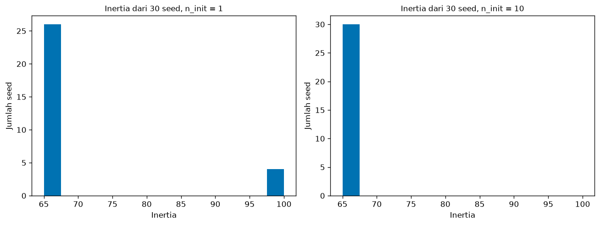
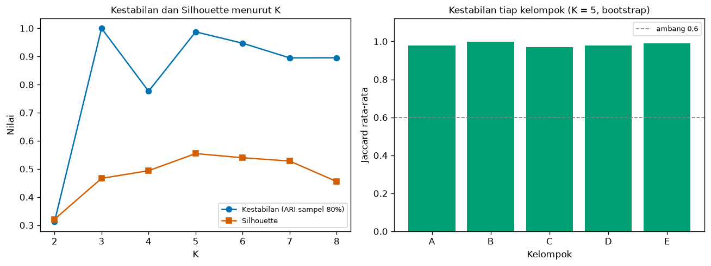
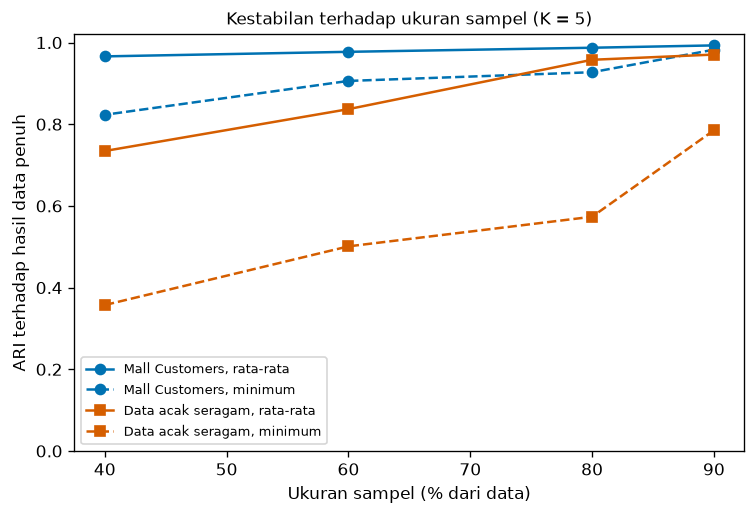

# Bab 9 — Cluster Stability and Reproducibility

## Learning Objectives

Setelah mempelajari bab ini, kamu mampu:

- [x] Menjelaskan beda **kestabilan** (*stability*) dan **reproduksibilitas** (*reproducibility*), dan mengapa keduanya perlu diperiksa.
- [x] Menjelaskan mengapa **ID kelompok tidak boleh dibandingkan langsung** antar eksekusi, dan memakai ARI sebagai gantinya.
- [x] Mengukur kestabilan terhadap **seed inisialisasi**, **sampel data**, **praproses**, dan **hyperparameter** (termasuk K).
- [x] Menghitung kestabilan **tiap kelompok** dengan *bootstrap* dan indeks Jaccard.
- [x] Menjelaskan bahwa hasil yang stabil **belum tentu benar atau bermakna**, dan menunjukkannya dengan data tanpa struktur.
- [x] Mencatat seed, versi pustaka, sidik jari data, dan konfigurasi agar eksperimen bisa diulang.
- [x] Menyebut keterbatasan analisis kestabilan.
- [x] Menjalankan **Eksperimen F** dari awal sampai akhir dan mencatatnya.

## Introduction

Bab 3 sampai 8 menghasilkan, menyetel, membandingkan, menggambar, dan menafsirkan kelompok. Semuanya berpegang pada **satu** hasil clustering. Padahal hasil itu bisa berbeda bila seed berubah, bila beberapa baris data hilang, atau bila data diskalakan dengan cara lain. Jika kesimpulan kita runtuh karena perubahan sekecil itu, kesimpulan itu rapuh.

Bab ini menjawab dua pertanyaan yang berbeda:

1. **Kestabilan:** *apakah hasil clustering bertahan bila kondisi sedikit diubah?* (seed, sampel, praproses, hyperparameter)
2. **Reproduksibilitas:** *apakah orang lain (atau kita sendiri, bulan depan) bisa menjalankan ulang dan mendapat hasil yang sama?*

Contoh data utama adalah **Mall Customers** (200 pelanggan, pendapatan dan skor belanja, K = 5), sama seperti Bab 7. Sebagai pembanding dipakai data acak seragam yang **tidak memiliki struktur**, supaya terlihat apa arti "stabil" dan apa yang tidak dibuktikannya.

!!! note "Prasyarat"
    [Bab 2](02-experimental-design-and-configuration.md) (pencatatan eksperimen), [Bab 3](03-hyperparameter-tuning-and-optimization.md) (hyperparameter), [Bab 7](07-cluster-interpretation-and-profiling.md) (profil Mall Customers), dan [Level 5 Bab 8](../clustering-evaluation/08-external-evaluation-and-metric-comparison.md) (ARI). Definisi dan teori ARI tidak diulang. Di sini ARI dipakai sebagai alat untuk membandingkan dua hasil.

## Fundamental Concepts

| Istilah | Arti |
|---|---|
| **Stability** | Seberapa mirip hasil clustering ketika kondisi sedikit diubah (seed, sampel, praproses, parameter) |
| **Reproducibility** | Kemampuan mengulang eksperimen dan mendapat hasil yang sama, dengan data, kode, seed, dan lingkungan yang sama |
| **Random seed** | Angka awal pembangkit bilangan acak. Seed sama berarti urutan acak sama |
| **Initialization sensitivity** | Hasil berubah menurut titik awal algoritma (K-Means mencari optimum lokal) |
| **Subsampling** | Mengambil sebagian data (tanpa pengembalian) lalu meng-cluster ulang |
| **Bootstrap** | Mengambil sampel **dengan pengembalian** sebesar data asli lalu meng-cluster ulang |
| **Cluster ID** | Nomor kelompok yang diberikan algoritma. Nilainya sembarang |
| **ARI** | *Adjusted Rand Index*: kemiripan dua pengelompokan, tidak bergantung pada ID (Level 5 Bab 8) |
| **Jaccard index** | Ukuran kemiripan dua himpunan: \( \lvert A \cap B \rvert / \lvert A \cup B \rvert \) |
| **Dataset fingerprint** | Kode ringkas (hash) isi data, untuk memastikan data yang dipakai sama |
| **Configuration file** | File (JSON/CSV) yang menyimpan semua pengaturan eksperimen |

## Detailed Explanation

### Stabil dan reproduksibel itu berbeda

| | Pertanyaan | Contoh gagal |
|---|---|---|
| **Reproduksibilitas** | Apakah menjalankan ulang yang **persis sama** memberi hasil yang sama? | Lupa mencatat seed, versi pustaka berubah, file data berubah |
| **Stabilitas** | Apakah hasil bertahan jika kondisi **sedikit berbeda**? | Hasil berubah total saat 20% data dibuang atau seed diganti |

Eksperimen bisa **reproduksibel tetapi tidak stabil**: dengan seed 7 kita selalu mendapat hasil yang sama, namun seed 8 memberi hasil berbeda. Eksperimen juga bisa **stabil tetapi tidak reproduksibel**: hasilnya selalu mirip, tetapi kita tidak mencatat bagaimana mencapainya, sehingga orang lain tidak bisa mengulangnya. Idealnya kedua sifat dimiliki.

!!! warning "Stabil belum tentu benar"
    Hasil yang stabil hanya berarti algoritma **konsisten**, bukan bahwa kelompoknya bermakna. K-Means pada data tanpa struktur pun menghasilkan kelompok yang cukup stabil (lihat Eksperimen F). Kestabilan adalah **syarat perlu yang lemah**, bukan bukti. Ia harus dibaca bersama metrik (Level 5), visualisasi (Bab 8), dan makna praktis.

### Jangan bandingkan ID kelompok langsung

K-Means memberi nomor kelompok 0, 1, 2, ... secara **sembarang**. Dua eksekusi bisa menghasilkan pengelompokan yang **identik** tetapi dengan nomor yang tertukar: kelompok yang tadinya 0 menjadi 2.

Jika kita menghitung "berapa persen titik yang ID-nya sama" antar eksekusi, hasilnya bisa mendekati nol padahal pengelompokannya sama persis. Karena itu kita memakai ukuran yang **tidak bergantung pada ID**, yaitu ARI: ia hanya melihat **pasangan titik**, apakah dua titik berada dalam kelompok yang sama di kedua hasil, dan bukan nomornya.

### Empat sumber ketidakstabilan

1. **Inisialisasi acak.** K-Means mulai dari pusat awal acak dan bisa berhenti di optimum lokal yang berbeda. `n_init` (jumlah percobaan awal; hasil terbaik dipilih) menekan masalah ini. Hasilnya diperiksa dengan mengganti seed.
2. **Sampel data.** Jika membuang sebagian data mengubah kelompok, kelompok itu bergantung pada titik-titik tertentu. Diperiksa dengan *subsampling* atau *bootstrap*.
3. **Praproses.** *Scaling* yang berbeda mengubah jarak (Bab 5, Bab 6). Diperiksa dengan membandingkan hasil di bawah beberapa cara praproses.
4. **Hyperparameter.** Terutama K. Nilai K yang membuat hasil berubah-ubah menunjukkan data tidak mendukung pembagian itu dengan jelas.

### Mengukur kestabilan antar-eksekusi

Untuk \( R \) eksekusi (misalnya 30 seed), hitung ARI untuk **setiap pasangan** eksekusi, lalu laporkan **rata-rata, minimum, dan maksimum**. Rata-rata saja menyembunyikan eksekusi yang jelek. Minimum menunjukkan skenario terburuk.

### Kestabilan terhadap sampel

Langkahnya:

1. Cluster seluruh data. Hasil ini adalah **acuan**.
2. Ambil sampel acak (misalnya 80% data tanpa pengembalian), cluster ulang.
3. Bandingkan hasil sampel dengan acuan **hanya pada titik yang ada di sampel**, memakai ARI.
4. Ulangi puluhan kali, lalu laporkan rata-rata dan minimum. Ulangi untuk beberapa ukuran sampel.

ARI mendekati 1 berarti pengelompokan hampir sama. **Tidak ada ambang baku** untuk "cukup stabil"; yang penting adalah membaca nilainya bersama pembanding dan minimumnya.

### Kestabilan terhadap K

Langkah di atas dapat dijalankan untuk beberapa nilai K, lalu dibandingkan. Beberapa hal yang perlu diwaspadai:

- K yang **sangat tidak stabil** menunjukkan bahwa data tidak punya satu pembagian yang jelas pada K itu. Algoritma memilih salah satu dari beberapa pembagian yang sama-sama masuk akal.
- K yang **sangat stabil** belum tentu K terbaik. Kestabilan dan Silhouette bisa tidak sepakat, dan keduanya hanya alat bantu (Bab 4).

### Kestabilan tiap kelompok (Jaccard dengan bootstrap)

ARI menilai **seluruh** pengelompokan sekaligus. Seringkali beberapa kelompok kokoh dan satu kelompok rapuh. Pendekatan Hennig (2007) menilai **tiap kelompok**:

1. Ambil sampel bootstrap (dengan pengembalian) dan cluster ulang.
2. Untuk tiap kelompok asli, cari kelompok pada hasil bootstrap yang paling mirip (Jaccard terbesar).
3. Ulangi ratusan kali, ambil rata-rata.

Panduan kasar yang sering dikutip: di bawah **0,6** kelompok rapuh, 0,6 sampai 0,75 ada pola tetapi meragukan, di atas **0,75** stabil. Seperti ambang metrik lain, ini aturan kasar.

### Reproduksibilitas: yang harus dicatat

Agar orang lain (atau kamu sendiri nanti) bisa mengulang eksperimen:

| Yang dicatat | Mengapa |
|---|---|
| **Seed** | Mengunci bagian acak |
| **Versi Python dan pustaka** | Algoritma dan nilai bawaan bisa berubah antar versi |
| **Sidik jari data** | Memastikan data yang sama, bukan hanya nama file yang sama |
| **Praproses dan fitur** | Hasil bergantung pada keduanya |
| **Hyperparameter** | Termasuk nilai bawaan yang diandalkan |
| **File konfigurasi** | Satu tempat untuk semua pengaturan |
| **Hasil dan metrik** | Untuk perbandingan, bukan hanya gambar |

Bab 2 sudah memperkenalkan pencatatan ini. Bab ini menambahkan **sidik jari data** dan **pencatatan lingkungan** untuk satu eksperimen utuh.

!!! note "Seed bukan jaminan lintas lingkungan"
    Seed yang sama menghasilkan hasil yang sama **di lingkungan yang sama**. Versi pustaka atau mesin yang berbeda bisa memberi hasil sedikit berbeda, terutama pada perhitungan bilangan pecahan. Itu sebabnya versi dicatat.

### Keterbatasan analisis kestabilan

- **Bukan bukti validitas.** Data acak pun bisa menghasilkan kelompok yang cukup stabil.
- **Bergantung pada pilihan.** Ukuran sampel, jumlah pengulangan, dan ukuran kemiripan memengaruhi angka.
- **Sampel kecil.** Pada 200 titik, sampel 40% hanya 80 titik. Ketidakstabilan bisa berasal dari sampel yang terlalu kecil, bukan dari kelompoknya.
- **Sampel bukan data baru.** Subsampling hanya menguji sensitivitas terhadap data yang sama. Ia tidak menjamin hasil bertahan pada data dari populasi lain.
- **Biaya komputasi.** Ratusan pengulangan pada data besar bisa mahal.

### Kesalahan umum

1. **Membandingkan ID kelompok langsung** antar eksekusi.
2. **Hanya melaporkan rata-rata**, tanpa minimum.
3. **Menyimpulkan "benar" dari "stabil".**
4. **Tidak mencatat seed** atau versi pustaka.
5. **Hanya memeriksa satu sumber** ketidakstabilan (misalnya seed) dan melupakan sampel, praproses, serta K.
6. **Mengganti seed sampai hasilnya bagus**, lalu melaporkan hanya yang bagus.
7. **Menganggap `n_init=1` cukup** karena sekali jalan tampak masuk akal.
8. **Menguji kestabilan dengan data yang sudah bocor** (misalnya menyetel parameter dengan label acuan).

## Mathematical Foundation

Dua rumus dipakai sebagai alat: ARI (antar-eksekusi dan antar-sampel) dan Jaccard (tiap kelompok).

### Adjusted Rand Index (ringkasan)

Teori ARI ada di Level 5 Bab 8. Singkatnya, untuk dua pengelompokan \( U \) dan \( V \) atas \( n \) titik, dengan \( n_{ij} \) jumlah titik yang berada di kelompok \( i \) pada \( U \) dan kelompok \( j \) pada \( V \), \( a_i \) jumlah baris tabel silang dan \( b_j \) jumlah kolomnya:

$$
\text{ARI} = \frac{\sum_{ij}\binom{n_{ij}}{2} - \dfrac{\sum_i\binom{a_i}{2}\sum_j\binom{b_j}{2}}{\binom{n}{2}}}{\dfrac{1}{2}\left[\sum_i\binom{a_i}{2}+\sum_j\binom{b_j}{2}\right] - \dfrac{\sum_i\binom{a_i}{2}\sum_j\binom{b_j}{2}}{\binom{n}{2}}}
$$

Nilai 1 berarti pengelompokan identik (terlepas dari ID), dan nilai sekitar 0 berarti kesepakatan setara dengan kebetulan.

### Perhitungan manual ARI

Enam titik. Hasil pertama \( U = [0,0,0,1,1,1] \), hasil kedua \( V = [0,0,1,1,1,1] \). Tabel silangnya: kelompok 0 di \( U \) berisi 2 titik yang di \( V \) juga berkelompok 0 dan 1 titik yang berkelompok 1. Kelompok 1 di \( U \) berisi 3 titik, semuanya berkelompok 1 di \( V \).

- \( \sum_{ij}\binom{n_{ij}}{2} = \binom{2}{2}+\binom{1}{2}+\binom{3}{2} = 1+0+3 = 4 \)
- Jumlah baris \( a = (3, 3) \), sehingga \( \sum_i\binom{a_i}{2} = 3+3 = 6 \)
- Jumlah kolom \( b = (2, 4) \), sehingga \( \sum_j\binom{b_j}{2} = 1+6 = 7 \)
- \( \binom{6}{2} = 15 \), sehingga nilai harapan acak \( = 6 \times 7 / 15 = 2{,}8 \)
- Nilai maksimum \( = (6+7)/2 = 6{,}5 \)

$$
\text{ARI} = \frac{4 - 2{,}8}{6{,}5 - 2{,}8} = \frac{1{,}2}{3{,}7} \approx 0{,}324
$$

Kode (`adjusted_rand_score`) memberi **0,3243**, cocok. Dan untuk dua pengelompokan yang hanya **bertukar ID**, \( [0,0,1,1] \) terhadap \( [1,1,0,0] \), ARI-nya tepat **1,0**.

### Indeks Jaccard

Untuk dua himpunan titik \( A \) (kelompok asli) dan \( B \) (kelompok pada hasil bootstrap):

$$
J(A, B) = \frac{\lvert A \cap B \rvert}{\lvert A \cup B \rvert}
$$

Nilainya 1 jika himpunannya identik dan 0 jika tidak beririsan. **Contoh:** \( A = \{1,2,3,4\} \) dan \( B = \{3,4,5\} \). Irisannya \( \{3,4\} \) berukuran 2 dan gabungannya \( \{1,2,3,4,5\} \) berukuran 5, sehingga \( J = 2/5 = 0{,}4 \).

Kestabilan kelompok \( c \) adalah rata-rata nilai Jaccard **terbaik** pada \( B \) ulangan bootstrap:

$$
\gamma_c = \frac{1}{B}\sum_{b=1}^{B}\max_{d}\, J\!\left(C_c,\; C^{*}_{b,d}\right)
$$

\( C_c \) adalah kelompok asli \( c \) (dibatasi pada titik yang muncul di sampel bootstrap), dan \( C^{*}_{b,d} \) kelompok \( d \) pada hasil bootstrap ke-\( b \). Maksimum diambil karena kelompok yang sama bisa muncul dengan ID berbeda.

## Experimental Procedure (Eksperimen F)

1. **Tujuan:** menguji seberapa tahan hasil K-Means pada Mall Customers terhadap seed, sampel, praproses, hyperparameter, dan K, serta mencatat eksperimen agar bisa diulang.
2. **Dataset (alasan):**
    - **Mall Customers** (`data/mall_customers.csv`, 200 pelanggan). Dipilih karena sudah dipakai di Bab 7, sehingga kita menguji **hasil yang sudah ditafsirkan**.
    - **Data acak seragam** (200 titik, dua fitur), sebagai pembanding **tanpa struktur**. Dipilih untuk menunjukkan bahwa kestabilan saja tidak membuktikan adanya kelompok.
    - **Wine** (`sklearn.datasets.load_wine`, 13 fitur), hanya untuk perbandingan praproses pada data dengan skala fitur yang sangat berbeda.
3. **Praproses:** z-score per kolom sebagai baseline. Seed 42 (kecuali dinyatakan lain).
4. **Algoritma:** K-Means.
5. **Langkah:** (a) tunjukkan masalah ID kelompok, (b) 30 seed dengan `n_init` 1 dan 10, (c) tiga praproses, (d) dua cara inisialisasi, (e) subsampling 90%, 80%, 60%, dan 40%, (f) kestabilan menurut K = 2 sampai 8, (g) Jaccard tiap kelompok dengan 100 bootstrap, (h) data tanpa struktur, (i) uji reproduksibilitas dan pencatatan.
6. **Hasil disimpan:** `09_stability_by_k.csv`, `09_cluster_jaccard.csv`, dan `09_config.json` di `examples/level-6/results/`, serta tiga gambar di `docs/assets/level-6/`.

## Python Implementation

Skrip lengkapnya ada di `examples/level-6/09_cluster_stability_and_reproducibility.py`, dan notebook-nya di `notebooks/level-6/09-cluster-stability-and-reproducibility.ipynb`. **Setiap potongan kode diikuti penjelasannya.** Skrip membutuhkan sekitar satu setengah menit karena melakukan ratusan clustering ulang.

**Konteks masalah:** kamu sudah menafsirkan lima kelompok pelanggan di Bab 7. Sebelum melaporkannya, kamu perlu tahu seberapa kokoh kelima kelompok itu.

**Tujuan eksperimen:** mengukur kestabilan dan mencatat eksperimen agar bisa diulang.

**Pustaka:** NumPy, pandas, Matplotlib, scikit-learn (`KMeans`, `StandardScaler`, `MinMaxScaler`, `adjusted_rand_score`, `silhouette_score`, `load_wine`), pustaka standar (`hashlib`, `itertools`), dan alat pencatat `_experiment.py`.

### Bagian A — Siapkan alat

```python
--8<-- "level-6/09_cluster_stability_and_reproducibility.py:setup"
```

**Penjelasan:** `combinations` dari `itertools` akan dipakai untuk membentuk semua pasangan eksekusi. `hashlib` membuat sidik jari. `_experiment` adalah modul pencatat dari bab-bab sebelumnya.

### Bagian B — Data

```python
--8<-- "level-6/09_cluster_stability_and_reproducibility.py:data"
```

**Penjelasan:** data Mall Customers dibaca, dua fitur dijadikan z-score (`(x - rata-rata) / simpangan baku`), dan hasilnya adalah array 200 baris dengan dua kolom. Sama seperti Bab 7.

### Bagian C — ID kelompok tidak boleh dibandingkan langsung

```python
--8<-- "level-6/09_cluster_stability_and_reproducibility.py:relabel"
```

**Penjelasan:**

- Dua eksekusi K-Means dengan seed 0 dan seed 1 (masing-masing `n_init=10`).
- `(run_a == run_b).mean()` membandingkan ID **titik demi titik** (cara naif) dan menghitung porsi yang sama.
- `adjusted_rand_score(run_a, run_b)` membandingkan **pengelompokannya**.
- `pd.crosstab(run_a, run_b)` membuat tabel silang: baris untuk ID di eksekusi A, kolom untuk ID di eksekusi B. Jika pengelompokannya sama, setiap baris hanya punya **satu** sel berisi, yaitu isi kelompok yang sama dengan ID berbeda.

### Bagian D — Kestabilan terhadap seed

```python
--8<-- "level-6/09_cluster_stability_and_reproducibility.py:seed"
```

**Penjelasan:**

- `pairwise_ari` menerima daftar label dari beberapa eksekusi, membentuk semua pasangan dengan `combinations(label_sets, 2)` (untuk 30 eksekusi ada 435 pasangan), menghitung ARI tiap pasangan, dan mengembalikan rata-rata, minimum, maksimum.
- Perulangan luar mencoba `n_init=1` (satu titik awal) dan `n_init=10` (sepuluh titik awal, hasil terbaik dipilih).
- Perulangan dalam (`range(30)`) menjalankan K-Means dengan 30 seed berbeda. `r.inertia_` adalah jumlah kuadrat jarak ke centroid (Level 5): semakin kecil, semakin baik secara internal. Dua eksekusi yang inertia-nya sama persis hampir pasti menghasilkan pengelompokan yang sama.

### Bagian E — Kepekaan terhadap praproses

```python
--8<-- "level-6/09_cluster_stability_and_reproducibility.py:prep"
```

**Penjelasan:**

- `variants` berisi tiga versi data Mall Customers: z-score, `MinMaxScaler` (diskalakan ke 0 sampai 1), dan tanpa penskalaan (satuan asli).
- Setiap versi di-cluster dengan K-Means yang sama, lalu hasilnya dibandingkan dengan baseline (z-score) memakai ARI. `sorted(np.bincount(labels).tolist(), reverse=True)` mencetak ukuran kelompok dari yang terbesar. Ukuran dipakai karena ID tidak bisa dibandingkan.
- Bagian kedua mengulang hal yang sama untuk **Wine**, yang 13 fiturnya berskala sangat berbeda (K = 3).

### Bagian F — Kepekaan terhadap hyperparameter inisialisasi

```python
--8<-- "level-6/09_cluster_stability_and_reproducibility.py:hyper"
```

**Penjelasan:** hyperparameter `init` menentukan cara memilih pusat awal: `"k-means++"` (pilihan cerdas yang menyebarkan pusat awal, bawaan scikit-learn) atau `"random"` (acak murni). Dengan `n_init=1`, kita mengamati 30 seed untuk tiap cara. `best` menghitung berapa seed yang mencapai inertia terbaik (nilai terkecil ditambah toleransi kecil `1e-6`).

### Bagian G — Kestabilan terhadap sampel

```python
--8<-- "level-6/09_cluster_stability_and_reproducibility.py:sample"
```

**Penjelasan baris demi baris:**

- `rng = np.random.default_rng(seed)` membuat pembangkit acak dengan seed, supaya sampel yang sama bisa diulang.
- `full = KMeans(...).fit(X).labels_` adalah hasil pada **seluruh data** (acuan).
- `rng.choice(len(X), size=int(fraction * len(X)), replace=False)` memilih indeks sampel **tanpa pengembalian**.
- `part = KMeans(...).fit(X[idx]).labels_` meng-cluster sampel.
- `adjusted_rand_score(full[idx], part)` membandingkan label acuan **yang dipotong ke titik sampel** dengan label sampel, sehingga keduanya sama panjang dan titiknya sama.
- Fungsi mengembalikan 50 nilai ARI. Perulangan di bawahnya menjalankan empat ukuran sampel dan mencetak rata-rata, minimum, maksimum. `mall_curve` menyimpan rata-rata dan minimum untuk gambar nanti.

### Bagian H — Kestabilan terhadap K

```python
--8<-- "level-6/09_cluster_stability_and_reproducibility.py:kscan"
```

**Penjelasan:** untuk tiap K dari 2 sampai 8, kita hitung kestabilan (ARI sampel 80%) dan Silhouette pada data penuh, lalu menyusunnya dalam tabel. Bagian bawahnya adalah pemeriksaan khusus K = 2: pada tiap dari 50 sampel, `abs(c0[0] - c1[0]) > abs(c0[1] - c1[1])` membandingkan apakah dua pusat lebih berbeda pada sumbu pendapatan (indeks 0) atau skor belanja (indeks 1). Hasilnya menjelaskan mengapa K = 2 tidak stabil.

### Bagian I — Kestabilan tiap kelompok

```python
--8<-- "level-6/09_cluster_stability_and_reproducibility.py:jaccard"
```

**Penjelasan:**

- `rng.choice(len(X), size=len(X), replace=True)` membuat sampel **bootstrap**: sebesar data asli, dengan pengembalian, sehingga sebagian titik muncul lebih dari sekali dan sebagian tidak muncul.
- `order = np.argsort(-sizes, kind="stable")` memberi huruf A sampai E menurut ukuran, seperti Bab 7.
- `in_sample = np.unique(idx)` adalah titik yang muncul dalam sampel. Kelompok asli dibatasi pada titik-titik ini (`original`).
- Untuk tiap kelompok hasil bootstrap `d`, `found = set(idx[part == d])` adalah himpunan titiknya, dan Jaccard dihitung sebagai `len(irisan) / len(gabungan)`. `max` memilih kelompok yang paling mirip. Ini rumus \( \gamma_c \).
- Hasil dibagi `repeats` (100) untuk mendapat rata-rata.

### Bagian J — Data tanpa struktur

```python
--8<-- "level-6/09_cluster_stability_and_reproducibility.py:nostruct"
```

**Penjelasan:** `rng_u.uniform(size=(200, 2))` membuat 200 titik acak merata di persegi. Titik-titik ini **tidak memiliki kelompok alami**, tetapi K-Means tetap membaginya menjadi lima. Data distandarkan seperti Mall Customers. Kita menjalankan `subsample_ari` yang sama dan membandingkan hasilnya dengan Mall Customers.

### Bagian K — Reproduksibilitas

```python
--8<-- "level-6/09_cluster_stability_and_reproducibility.py:repro"
```

**Penjelasan:**

- `run_pipeline(seed)` membungkus **seluruh alur dari membaca file sampai mendapat label** dalam satu fungsi. Eksperimen yang reproduksibel bisa dijalankan dari nol.
- `label_hash` membuat sidik jari label. Dua eksekusi dengan seed sama harus punya sidik jari yang sama.
- Kita menjalankan seed 7 dua kali dan seed 8 satu kali, dengan `n_init=1` agar pengaruh seed terlihat.
- `ex.dataset_fingerprint(z1)` memberi sidik jari data. `ex.environment_info()` mencatat versi Python dan pustaka.

### Bagian L — Menyimpan hasil

```python
--8<-- "level-6/09_cluster_stability_and_reproducibility.py:save"
```

**Penjelasan:** tabel kestabilan menurut K dan tabel Jaccard disimpan sebagai CSV. File JSON menyimpan semua pengaturan: seed, sidik jari data, fitur, praproses, algoritma, jumlah pengulangan, ukuran sampel, dan lingkungan perangkat lunak. Dengan file ini, orang lain dapat memeriksa persis kondisi eksperimen.

### Bagian M — Gambar

```python
--8<-- "level-6/09_cluster_stability_and_reproducibility.py:plotseed"
```

```python
--8<-- "level-6/09_cluster_stability_and_reproducibility.py:plotk"
```

```python
--8<-- "level-6/09_cluster_stability_and_reproducibility.py:plotsample"
```

**Penjelasan:** gambar pertama adalah histogram inertia 30 seed pada `n_init` 1 dan 10, dengan sumbu x yang sama (65 sampai 100) agar bisa dibandingkan. Gambar kedua berisi kestabilan dan Silhouette menurut K (kiri) serta Jaccard tiap kelompok dengan garis ambang 0,6 (kanan). Gambar ketiga menunjukkan kestabilan terhadap ukuran sampel pada Mall Customers dan data acak seragam, dengan garis penuh untuk rata-rata dan garis putus-putus untuk minimum.

## Code Explanation

| Bagian kode | Peran |
|---|---|
| `adjusted_rand_score` | Membandingkan dua pengelompokan tanpa bergantung pada ID |
| `combinations(label_sets, 2)` | Membentuk semua pasangan eksekusi |
| `n_init` | Jumlah titik awal; hasil terbaik dipilih |
| `rng.choice(..., replace=False/True)` | Subsampling (tanpa pengembalian) dan bootstrap (dengan pengembalian) |
| `full[idx]` | Memotong label acuan ke titik sampel sebelum dibandingkan |
| Jaccard + `max` | Kestabilan tiap kelompok |
| `dataset_fingerprint`, `label_hash` | Memastikan data dan hasil sama |
| `environment_info` | Versi Python dan pustaka |

!!! tip "Mengapa tidak memakai `GridSearchCV` atau `cross_val_score`?"
    Keduanya dirancang untuk model supervised yang punya target. Analisis kestabilan clustering dibangun sendiri (acak sampel, cluster ulang, bandingkan), seperti di kode ini. Alasannya sama dengan Bab 3.

## How to Run

Dari folder utama proyek (setelah mengaktifkan lingkungan virtual):

```powershell
pip install -r requirements-notebooks.txt
python examples/level-6/09_cluster_stability_and_reproducibility.py
```

Skrip mencetak output ke terminal, menyimpan tiga gambar ke `docs/assets/level-6/`, dan hasil ke `examples/level-6/results/`. Notebook interaktifnya:

```powershell
jupyter notebook notebooks/level-6/09-cluster-stability-and-reproducibility.ipynb
```

Output di bawah berasal dari eksekusi nyata dengan Python 3.14.10, NumPy 2.5.2, pandas 3.0.5, scikit-learn 1.9.0, SciPy 1.18.1, dan Matplotlib 3.11.1.

## Expected Output

```text
--8<-- "level-6/outputs/09.txt"
```

Gambar yang dihasilkan:







### Interpretasi output

**1. ID kelompok tidak bisa dibandingkan langsung.** Dua eksekusi (seed 0 dan 1) hanya **19,5%** titik yang ID-nya sama, tetapi ARI-nya **1,0**. Tabel silang menunjukkan setiap baris hanya memiliki satu sel berisi: kelompok 0 pada eksekusi A (81 titik) adalah kelompok 2 pada eksekusi B, kelompok 1 (39) tetap 1, kelompok 2 (35) menjadi 0, kelompok 3 (23) menjadi 4, dan kelompok 4 (22) menjadi 3. Pengelompokannya **identik**, hanya nomornya yang tertukar. Membandingkan ID langsung akan menyimpulkan bahwa hasilnya 80% berbeda.

**2. Kestabilan terhadap seed.**

| `n_init` | Inertia | ARI antar 30 seed (rata-rata, minimum) |
|---|---|---|
| 1 | 65,2406 sampai **98,3137** | 0,921 dan **0,506** |
| 10 | 65,2406 sampai 65,2406 | **1,000** dan **1,000** |

Dengan `n_init=1`, sebagian seed terjebak di optimum lokal yang jauh lebih buruk (inertia sampai 98,3 padahal terbaik 65,2): histogram kiri menunjukkan 26 seed di dekat 65 dan 4 seed di dekat 98. Rata-rata ARI 0,921 tampak tinggi, tetapi **minimum 0,506** menunjukkan ada pasangan eksekusi yang hanya setengah sepakat. Dengan `n_init=10`, seluruh 30 seed menghasilkan solusi yang sama (ARI 1,0). Jika kita melaporkan hanya rata-rata pada `n_init=1`, kita menutupi eksekusi yang jelek.

**3. Kepekaan terhadap praproses.**

| Data | Praproses | Ukuran kelompok | ARI terhadap z-score |
|---|---|---|---|
| Mall Customers (K = 5) | min-max | 81, 39, 35, 23, 22 | 1,000 |
| Mall Customers (K = 5) | tanpa penskalaan | 81, 39, 35, 23, 22 | 1,000 |
| Wine (K = 3) | min-max | 62, 61, 55 | **0,918** |
| Wine (K = 3) | tanpa penskalaan | 69, 62, 47 | **0,354** |

Pada Mall Customers, ketiga praproses memberi kelompok yang sama persis karena kedua fiturnya berskala sebanding (pendapatan 15 sampai 137 dan skor belanja 1 sampai 99). **Tidak adanya kepekaan di sini bukan kesimpulan umum.** Pada Wine, yang fiturnya berskala sangat berbeda, hasil tanpa penskalaan hanya cocok **0,354** dengan baseline, dan min-max berbeda **0,918**. Menguji kepekaan praproses perlu dilakukan pada data masing-masing, dan jawabannya bergantung pada data.

**4. Kepekaan terhadap inisialisasi.** Dengan `n_init=1` dan 30 seed:

| `init` | Seed yang mencapai inertia terbaik | ARI antar seed (rata-rata, minimum) |
|---|---|---|
| `k-means++` | 16 dari 30 | 0,921 dan 0,506 |
| `random` | 9 dari 30 | 0,782 dan 0,464 |

`k-means++` lebih sering mencapai optimum terbaik daripada inisialisasi acak (16 versus 9 dari 30), dan rata-rata ARI-nya lebih tinggi. Tetapi **tidak satu pun cara** menjamin hasil terbaik pada `n_init=1`. Peredam yang paling efektif tetap `n_init` yang lebih besar.

**5. Kestabilan terhadap sampel (Mall Customers, K = 5).**

| Ukuran sampel | ARI rata-rata | ARI minimum |
|---|---|---|
| 90% | 0,993 | 0,983 |
| 80% | 0,987 | 0,927 |
| 60% | 0,977 | 0,906 |
| 40% | 0,966 | 0,823 |

Hasil sangat stabil: bahkan dengan hanya 40% data (80 pelanggan), rata-rata ARI masih 0,966, dan minimum terendah 0,823. Semakin kecil sampelnya, semakin turun, terutama minimumnya.

**6. Kestabilan terhadap K.**

| K | Silhouette | Kestabilan (rata-rata) | Kestabilan (minimum) |
|---|---|---|---|
| 2 | 0,321 | **0,313** | -0,013 |
| 3 | 0,467 | **1,000** | 1,000 |
| 4 | 0,494 | 0,776 | 0,547 |
| 5 | **0,555** | 0,987 | 0,927 |
| 6 | 0,540 | 0,947 | 0,840 |
| 7 | 0,528 | 0,895 | 0,612 |
| 8 | 0,455 | 0,895 | 0,697 |

Tiga hal yang perlu dibaca:

- **K = 3 paling stabil (1,000), tetapi Silhouette-nya lebih rendah dari K = 5** (0,467 versus 0,555). Kestabilan dan Silhouette tidak harus sepakat. Stabil berarti konsisten, bukan terbaik.
- **K = 2 sangat tidak stabil** (rata-rata 0,313, minimum mendekati 0). Pemeriksaan pada 50 sampel menunjukkan dua kelompok memisah menurut **skor belanja pada 29 sampel** dan menurut **pendapatan pada 21 sampel**. Data punya dua pembagian dua-kelompok yang sama-sama masuk akal, dan K-Means memilih salah satunya secara berbeda-beda tergantung sampel.
- **K = 5 adalah yang paling stabil kedua** (0,987) **dan Silhouette tertinggi.** Keduanya sejalan di sini, tetapi itu kebetulan data ini, bukan aturan.

**7. Kestabilan tiap kelompok (K = 5, 100 bootstrap).**

| Kelompok | Ukuran | Jaccard rata-rata |
|---|---|---|
| A | 81 | 0,979 |
| B | 39 | 1,000 |
| C | 35 | 0,970 |
| D | 23 | 0,980 |
| E | 22 | 0,990 |

Kelima kelompok jauh di atas ambang 0,75. Dua kelompok terkecil (D, E, sekitar 22 sampai 23 orang) tetap stabil (0,98 dan 0,99), jadi kekhawatiran Bab 7 tentang kelompok kecil tidak terbukti untuk **kestabilan**. Perlu dicatat: stabil terhadap sampel tidak menghilangkan keterbatasan lain, misalnya bahwa rata-rata dari 22 orang masih berbasis sedikit data.

**8. Data tanpa struktur.** Pada 200 titik acak seragam, K-Means (K = 5) tetap membuat lima kelompok dengan **Silhouette 0,414**, di rentang 0,26 sampai 0,50 yang oleh panduan Level 5 disebut struktur lemah (Mall Customers: 0,555).

| Ukuran sampel | Data acak: rata-rata, minimum | Mall Customers: rata-rata, minimum |
|---|---|---|
| 90% | 0,971 dan 0,785 | 0,993 dan 0,983 |
| 80% | 0,958 dan 0,574 | 0,987 dan 0,927 |
| 60% | 0,837 dan 0,501 | 0,977 dan 0,906 |
| 40% | 0,735 dan 0,357 | 0,966 dan 0,823 |

Data acak lebih tidak stabil, terutama pada sampel kecil dan pada nilai **minimum** (0,357 versus 0,823 pada sampel 40%). Tetapi pada sampel 80% atau 90% rata-rata ARI data acak sudah 0,96 sampai 0,97, hampir sama dengan Mall Customers. Artinya **angka rata-rata yang tinggi saja tidak membuktikan adanya struktur**. Hanya dengan pembanding (data acak), ukuran sampel yang beragam, dan nilai minimum, perbedaannya terlihat.

!!! warning "Yang boleh dan tidak boleh disimpulkan"
    **Boleh:** pada Mall Customers, lima kelompok K-Means (pendapatan dan skor belanja) bertahan terhadap seed (dengan `n_init=10`), sampel (ARI 0,97 sampai 0,99 untuk sampel 40% sampai 90%), dan praproses, dan tiap kelompok memiliki Jaccard 0,97 atau lebih. **Tidak boleh:** menyimpulkan bahwa lima kelompok itu "nyata" atau "benar", bahwa K = 5 pasti terbaik (K = 3 lebih stabil), atau bahwa hasil bertahan pada pelanggan lain. Kestabilan hanya menunjukkan konsistensi terhadap gangguan yang kita uji.

**9. Reproduksibilitas.** Seed 7 dijalankan dua kali menghasilkan label yang **identik** (sidik jari label sama: `674866d4cc5a`), sedangkan seed 8 menghasilkan label berbeda (ARI 0,703 terhadap seed 7). Sidik jari data sama pada kedua pembacaan file (`edb2a3858344`). Jadi untuk mengulang eksperimen **persis**, kita wajib mencatat seed. File `09_config.json` menyimpan seed, sidik jari data, dan versi lingkungan (Python 3.14.10, NumPy 2.5.2, pandas 3.0.5, scikit-learn 1.9.0, SciPy 1.18.1, Matplotlib 3.11.1).

**10. Penyimpanan.** `09_stability_by_k.csv`, `09_cluster_jaccard.csv`, dan `09_config.json` tersimpan di `examples/level-6/results/`.

## Practical Application

**Sebelum melaporkan segmentasi.** Tim analis menjalankan uji kestabilan di atas sebelum memberi nama kelompok. Jika satu kelompok punya Jaccard di bawah 0,6, kelompok itu dilaporkan sebagai "tidak stabil" dan tidak dijadikan dasar keputusan.

**Memilih K.** Selain Silhouette dan Elbow (Level 5), laporkan kestabilan menurut K. K dengan kestabilan sangat rendah (seperti K = 2 pada data ini) perlu dihindari, atau dijelaskan alasannya.

**Menentukan `n_init`.** Jalankan beberapa seed dan lihat apakah inertia dan hasilnya konsisten. Jika tidak, naikkan `n_init`.

**Berbagi eksperimen.** Kirimkan skrip, file data (atau sidik jarinya), `requirements`, dan file konfigurasi JSON. Penerima dapat memeriksa bahwa data dan lingkungan sama sebelum membandingkan hasil.

**Memantau data yang terus bertambah.** Jika data baru datang setiap bulan, ulangi uji kestabilan untuk melihat apakah kelompok bergeser.

## Hands-on Exercises

1. Ulangi bagian seed dengan `n_init=1` memakai seed 100 sampai 129 (bukan 0 sampai 29). Apakah kesimpulannya sama?
2. Coba `n_init=3` dan `n_init=5` pada seed 0 sampai 29. Berapa ARI rata-rata dan minimumnya?
3. Tambahkan `Age` sebagai fitur ketiga (K = 5, z-score). Berapa ARI terhadap baseline dua fitur?
4. Hitung Jaccard tiap kelompok untuk K = 4 dan K = 7. Kelompok mana yang di bawah 0,75?
5. Mengapa `(run_a == run_b).mean()` tidak layak dipakai untuk menilai kestabilan?
6. Mengapa kita membandingkan label acuan yang **dipotong ke titik sampel** (`full[idx]`), bukan seluruh label?
7. Seorang rekan berkata: "Hasil kita stabil, jadi kelompok ini pasti nyata." Apa keberatanmu?

??? question "Jawaban"
    Hasil nomor 1 sampai 4 berasal dari eksekusi nyata.

    1. Dengan seed 100 sampai 129 dan `n_init=1`: **19 dari 30** seed mencapai inertia terbaik, ARI antar seed rata-rata **0,916** dan minimum **0,722**, inertia terburuk 98,384. Pola yang sama dengan seed 0 sampai 29 (rata-rata 0,921, minimum 0,506): rata-rata tinggi, tetapi ada eksekusi buruk. Nilai minimum berubah dari 0,506 menjadi 0,722 karena himpunan seednya berbeda. Itulah alasan melaporkan banyak seed dan minimumnya, bukan satu angka.
    2. `n_init=3`: ARI rata-rata **0,997**, minimum **0,985**, inertia terburuk 65,251 (hampir sama dengan terbaik 65,241). `n_init=5`: rata-rata **0,999**, minimum **0,985**. Kenaikan dari `n_init=1` ke 3 sangat besar, sedangkan dari 3 ke 5 kecil. Pada data ini `n_init=10` sudah lebih dari cukup.
    3. ARI terhadap baseline dua fitur adalah **0,584**. Menambah `Age` mengubah pengelompokan cukup besar. Ini menunjukkan bahwa pilihan fitur adalah sumber ketidakstabilan tersendiri (Bab 5), bukan masalah seed.
    4. K = 4: ukuran 100, 39, 38, 23 dengan Jaccard 0,812, 1,000, 0,980, **0,610**. Kelompok D (23 orang) berada di antara 0,6 dan 0,75, yaitu "ada pola tetapi meragukan". K = 7: ukuran 79, 29, 27, 23, 22, 10, 10 dengan Jaccard 0,811, 0,904, 0,843, 0,947, 0,973, **0,698**, **0,711**. Kedua kelompok berukuran 10 (F dan G) di bawah 0,75. Kelompok kecil hasil pemecahan K yang lebih besar cenderung kurang stabil.
    5. ID kelompok bersifat sembarang. Pengelompokan identik bisa punya ID yang tertukar, dan pada data ini hanya 19,5% ID yang sama padahal ARI 1,0. ARI hanya melihat apakah **pasangan titik** berada di kelompok yang sama, sehingga tidak bergantung pada ID.
    6. Hasil sampel hanya berisi titik-titik sampel. Untuk membandingkan, kedua pengelompokan harus mencakup **titik yang sama**. Itu sebabnya label acuan dipotong ke indeks sampel (`full[idx]`). Tanpa itu, panjang label tidak sama dan ARI tidak dapat dihitung.
    7. Stabil hanya berarti **konsisten** terhadap gangguan yang kita uji. Data acak seragam, yang tidak punya kelompok, menghasilkan rata-rata ARI 0,958 pada sampel 80%, dekat dengan Mall Customers (0,987). Selain itu, K = 3 lebih stabil (1,000) daripada K = 5 (0,987), tetapi bukan berarti K = 3 lebih benar. Bukti tambahan: metrik internal, perbandingan dengan pembanding tanpa struktur, visualisasi, dan apakah kelompok bermakna bagi tujuan masalahnya.

## Troubleshooting

### Masalah teknis

| Masalah | Penyebab | Solusi |
|---|---|---|
| ARI 1,0 tetapi "persentase ID sama" rendah | ID kelompok tertukar | Pakai ARI, jangan bandingkan ID |
| `ValueError: Found input variables with inconsistent numbers of samples` | Label acuan tidak dipotong ke titik sampel | Pakai `full[idx]` untuk label acuan |
| Hasil berbeda tiap eksekusi | Seed tidak dikunci | Pakai `random_state=SEED` dan `default_rng(SEED)` |
| Skrip lambat | Ratusan clustering ulang dengan `n_init=10` | Kurangi `repeats` atau `n_init` untuk uji coba, lalu naikkan lagi untuk laporan |
| Kestabilan negatif (misalnya -0,013) | ARI dapat bernilai negatif untuk kesepakatan di bawah kebetulan | Itu normal, tandanya hasil tidak konsisten |
| Hasil berbeda di komputer lain | Versi pustaka berbeda | Catat dan samakan versi (`environment_info`) |
| Jaccard tidak terhitung (`ZeroDivisionError`) | Kelompok kosong pada sampel | Periksa `union`; kode ini menanganinya dengan nilai 0 |

### Kesalahan umum

1. **Membandingkan ID kelompok langsung.**
2. **Hanya melaporkan rata-rata.**
3. **Menyimpulkan benar dari stabil.**
4. **Tidak mencatat seed, versi, atau sidik jari data.**
5. **Hanya menguji satu sumber ketidakstabilan.**
6. **Memilih seed yang memberi hasil bagus** lalu menyembunyikan yang lain.
7. **`n_init=1`** tanpa memeriksa seed lain.
8. **Mengabaikan pembanding tanpa struktur.**

## Summary

- **Stabilitas** (bertahan jika kondisi sedikit diubah) dan **reproduksibilitas** (bisa diulang persis) adalah dua hal berbeda. Hasil stabil belum tentu benar.
- **ID kelompok tidak boleh dibandingkan langsung.** Dua eksekusi dengan ARI 1,0 hanya memiliki 19,5% ID yang sama. Pakai ARI.
- Pada Mall Customers: dengan `n_init=1`, ARI antar 30 seed rata-rata 0,921 tetapi minimum 0,506 (inertia sampai 98,3 versus terbaik 65,2). Dengan `n_init=10`, semuanya 1,000.
- Kestabilan terhadap sampel tinggi (ARI rata-rata 0,966 sampai 0,993 untuk sampel 40% sampai 90%), dan semua lima kelompok memiliki Jaccard di atas 0,97.
- K = 3 paling stabil (1,000) tetapi Silhouette-nya lebih rendah dari K = 5, dan K = 2 sangat tidak stabil (0,313) karena data punya dua pembagian dua-kelompok yang sama-sama masuk akal.
- Kepekaan praproses bergantung pada data: tidak ada pada Mall Customers, besar pada Wine (ARI 0,354 tanpa penskalaan).
- Pada data acak seragam, rata-rata ARI sampel 80% sudah 0,958, jadi **angka rata-rata tinggi saja tidak membuktikan struktur**. Lihat minimum, sampel kecil, dan pembanding tanpa struktur.
- Untuk reproduksibilitas, catat seed, sidik jari data, versi pustaka, praproses, hyperparameter, dan hasil.

**Bab berikutnya:** Bab 10 membahas cara melaporkan eksperimen dan menafsirkannya tanpa melebih-lebihkan, dengan memakai catatan hasil dari bab-bab sebelumnya.

## References

- Hennig, C. (2007). Cluster-wise assessment of cluster stability. *Computational Statistics & Data Analysis*, 52(1), 258–271.
- Ben-Hur, A., Elisseeff, A., & Guyon, I. (2002). A stability based method for discovering structure in clustered data. *Pacific Symposium on Biocomputing*, 7, 6–17.
- Von Luxburg, U. (2010). Clustering stability: an overview. *Foundations and Trends in Machine Learning*, 2(3), 235–274.
- Hubert, L., & Arabie, P. (1985). Comparing partitions. *Journal of Classification*, 2(1), 193–218.
- Arthur, D., & Vassilvitskii, S. (2007). k-means++: the advantages of careful seeding. *Proceedings of SODA 2007*, 1027–1035.
- Sandve, G. K., Nekrutenko, A., Taylor, J., & Hovig, E. (2013). Ten simple rules for reproducible computational research. *PLOS Computational Biology*, 9(10), e1003285.
- Scikit-learn documentation: [*Controlling randomness*](https://scikit-learn.org/stable/common_pitfalls.html#controlling-randomness).
