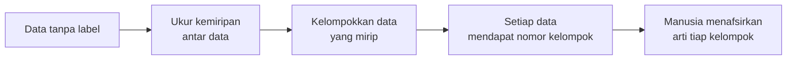
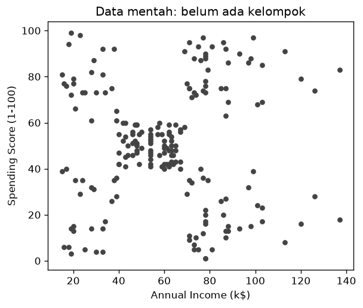
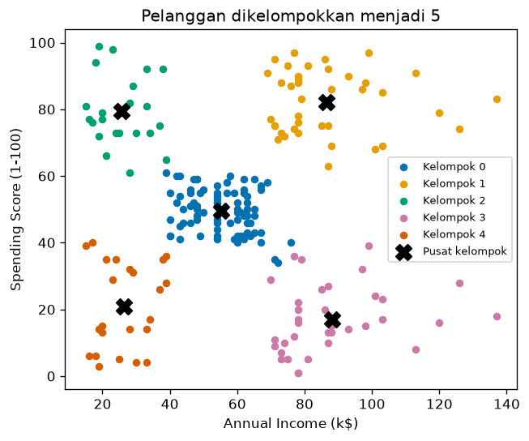

# Bab 1 — Introduction to Clustering

## Learning Objectives

Setelah mempelajari bab ini, kamu mampu:

- [x] Menjelaskan apa itu *clustering* dengan bahasamu sendiri.
- [x] Menjelaskan mengapa clustering termasuk *unsupervised learning*.
- [x] Membedakan clustering dari *classification* dan *regression*.
- [x] Menyebut ciri masalah clustering dan contoh penerapannya di dunia nyata.
- [x] Menyebut kelebihan dan keterbatasan clustering.
- [x] Menjalankan clustering pertamamu pada data Mall Customers dan membaca hasilnya.
- [x] Menjelaskan apa arti "pusat kelompok" dan mengapa bab-bab berikutnya penting.

## Introduction

Bayangkan kamu mengelola sebuah pusat perbelanjaan dan punya data 200 pelanggan. Tidak ada yang memberi tahu kamu "pelanggan ini tipe A, itu tipe B". Kamu hanya punya angka: pendapatan tahunan dan skor belanja tiap pelanggan. Pertanyaannya: **adakah kelompok pelanggan yang mirip satu sama lain?**

Kalau ada, kamu bisa merancang promosi yang berbeda untuk tiap kelompok. Pekerjaan menemukan kelompok seperti itu, **tanpa diberi tahu kelompoknya lebih dulu**, disebut **clustering** (pengelompokan).

Level 3 adalah fondasi sebelum kamu mempelajari algoritma clustering di Level 4. Di sini kita belajar:

| Bab | Pertanyaan yang dijawab |
|---|---|
| 1 | Apa itu clustering dan untuk apa? (bab ini) |
| 2 | Seperti apa kelompok yang baik? |
| 3 | Bagaimana sebuah kelompok diwakili oleh satu titik pusat? |
| 4 | Bagaimana mengukur "mirip" dan "berbeda"? |
| 5 | Bagaimana menghitung jarak antar data? |
| 6 | Apa pengaruh jumlah fitur terhadap jarak? |
| 7 | Bagaimana alur lengkap sebuah proyek clustering? |

!!! note "Prasyarat"
    Kamu sebaiknya sudah membaca [Level 1](../types-of-machine-learning/07-clustering.md) dan Level 2 (khususnya pengenalan data dan *preprocessing*). Bab ini memakai dataset yang sama dengan Level 2, yaitu **Mall Customers**.

## Fundamental Concepts

| Istilah | Arti |
|---|---|
| **Clustering** | Membagi data ke dalam kelompok (*cluster*) sehingga data dalam satu kelompok **mirip**, dan data antar kelompok **berbeda** |
| **Cluster** | Satu kelompok hasil clustering |
| **Unsupervised learning** | Belajar dari data **tanpa label** (tanpa kunci jawaban) |
| **Label** | Jawaban yang sudah diketahui untuk tiap data, misalnya "spam" atau "bukan spam" |
| **Observation** | Satu baris data. Di sini: satu pelanggan |
| **Feature** | Satu kolom data. Di sini: pendapatan dan skor belanja |
| **Similarity** | Ukuran seberapa **mirip** dua data |
| **Centroid** | Titik pusat (rata-rata) sebuah kelompok. Dibahas lengkap di Bab 3 |

### Intuisi: mengelompokkan tanpa aba-aba

Bayangkan kamu diberi sekantong kancing campur dan diminta mengelompokkannya. Tidak ada yang bilang berapa kelompoknya atau berdasarkan apa. Kamu mungkin mengelompokkan menurut warna, lalu ukuran. Itulah clustering: **manusia atau algoritma sendiri yang menemukan pola**, bukan menebak jawaban yang sudah ada.

### Clustering sebagai unsupervised learning

Pada **supervised learning**, tiap data punya label, sehingga model bisa belajar dari contoh yang sudah dijawab, lalu dinilai dengan membandingkan prediksinya dengan jawaban asli. Pada **unsupervised learning**, label itu tidak ada. Model hanya melihat fitur dan mencari struktur sendiri. Clustering adalah salah satu tugas unsupervised learning yang paling umum. Jenis lainnya (misalnya *dimensionality reduction*) sudah dibahas sekilas di [Level 1](../types-of-machine-learning/06-unsupervised-learning.md).

!!! warning "Tidak ada kunci jawaban"
    Karena tidak ada label, hasil clustering tidak bisa dibilang "benar" atau "salah" begitu saja. Hasilnya lebih tepat dinilai **berguna** atau **tidak berguna** untuk tujuanmu. Cara menilainya secara sistematis dibahas di Level 5.

## Detailed Explanation

### Clustering vs classification vs regression

Tiga tugas ini sering tertukar. Perbedaan utamanya ada pada **apa yang diketahui sebelumnya** dan **apa yang dihasilkan**.

| | Clustering | Classification | Regression |
|---|---|---|---|
| Jenis belajar | Unsupervised | Supervised | Supervised |
| Punya label? | **Tidak** | Ya, berupa **kategori** | Ya, berupa **angka** |
| Pertanyaan | "Adakah kelompok alami di data ini?" | "Data baru ini masuk kategori yang mana?" | "Berapa nilai angka untuk data ini?" |
| Hasil | Nomor kelompok (0, 1, 2, ...) | Nama kategori yang sudah dikenal | Bilangan, misalnya harga |
| Contoh | Mengelompokkan pelanggan | Menyaring email *spam* atau bukan | Memperkirakan harga rumah |

Perhatikan satu hal penting pada clustering: nomor kelompok (0, 1, 2) **hanya penanda**, bukan nama atau peringkat. Kelompok 0 tidak "lebih baik" daripada kelompok 3. Kamulah yang memberi arti pada tiap kelompok setelah memeriksa isinya.

### Ciri masalah clustering

Sebuah masalah cocok disebut masalah clustering jika:

1. **Tidak ada label.** Kita tidak punya kategori yang sudah ditentukan.
2. **Tujuannya eksplorasi.** Kita ingin menemukan struktur atau pola, bukan menebak jawaban.
3. **Ada ukuran kemiripan.** Kita harus bisa menentukan "mirip" itu apa, biasanya lewat jarak antar data (Bab 4 dan 5).
4. **Jumlah kelompok sering belum diketahui.** Menentukannya adalah bagian dari pekerjaan.
5. **Hasilnya perlu ditafsirkan manusia.** Algoritma memberi nomor kelompok, kita yang menjelaskan maknanya.

### Alur ringkas clustering



### Penerapan di dunia nyata

| Bidang | Data | Hasil clustering dipakai untuk |
|---|---|---|
| Pemasaran | Pendapatan, frekuensi belanja | Segmentasi pelanggan, promosi yang sesuai tiap kelompok |
| Perbankan | Pola transaksi | Menemukan pola yang tidak biasa (kemungkinan penipuan) |
| Kesehatan | Gejala, hasil laboratorium | Mengenali sub-tipe penyakit atau kelompok pasien |
| Biologi | Ekspresi gen | Mengelompokkan gen yang bekerja serupa |
| Media | Kebiasaan menonton atau membaca | Rekomendasi konten dan pengelompokan topik |
| Pengolahan citra | Warna piksel | Mengompresi atau menyegmentasi gambar |

Contoh di riset: peneliti mengelompokkan pasien berdasarkan hasil pemeriksaan untuk menemukan sub-tipe penyakit yang belum dikenal. Contoh di industri: toko daring mengelompokkan pelanggan menurut kebiasaan belanja untuk menyusun kampanye iklan.

### Kelebihan dan keterbatasan

| Kelebihan | Keterbatasan |
|---|---|
| Tidak butuh label, yang mahal dan lama dibuat | Tidak ada jawaban pasti untuk menilai benar atau salah |
| Menemukan pola yang belum terpikirkan | Hasil bergantung pada fitur yang dipilih dan cara mengukur jarak |
| Berguna untuk eksplorasi data awal | Jumlah kelompok sering harus ditebak atau diuji |
| Meringkas data besar menjadi beberapa kelompok | Data yang tidak punya kelompok alami tetap bisa "dipaksa" menjadi kelompok |
| Mudah dijelaskan ke pihak non-teknis | Sensitif terhadap *outlier* dan skala fitur (lihat Level 2) |

## Mathematical Foundation

Bab pengantar ini hanya membutuhkan satu rumusan formal. Rumus jarak, *centroid*, dan lainnya dibahas bertahap pada Bab 3 sampai 5.

Misalkan kita punya \( n \) data:

$$
X = \{\mathbf{x}_1, \mathbf{x}_2, \dots, \mathbf{x}_n\}
$$

Setiap \( \mathbf{x}_i \) adalah satu observation. Pada contoh kita, \( \mathbf{x}_i \) berisi dua angka: pendapatan dan skor belanja pelanggan ke-\( i \), dan \( n = 200 \).

**Clustering** membagi \( X \) menjadi \( K \) kelompok \( C_1, C_2, \dots, C_K \) dengan dua aturan (untuk jenis clustering yang paling dasar, disebut *hard clustering*):

$$
C_1 \cup C_2 \cup \dots \cup C_K = X
\qquad \text{dan} \qquad
C_i \cap C_j = \emptyset \;\; (i \neq j)
$$

Penjelasan simbol:

- \( \cup \) berarti **gabungan**. Aturan pertama: kalau semua kelompok digabung, hasilnya seluruh data. Tidak ada data yang tertinggal.
- \( \cap \) berarti **irisan** dan \( \emptyset \) berarti **himpunan kosong**. Aturan kedua: dua kelompok berbeda tidak punya anggota yang sama. Setiap data masuk **tepat satu** kelompok.
- \( K \) adalah jumlah kelompok.

**Contoh dengan angka kecil.** Misalkan ada 6 pelanggan bernomor 1–6 yang dibagi menjadi \( K = 2 \) kelompok: \( C_1 = \{1, 2, 3\} \) dan \( C_2 = \{4, 5, 6\} \).

1. Gabungan: \( \{1,2,3\} \cup \{4,5,6\} = \{1,2,3,4,5,6\} \). Semua pelanggan tercakup, jadi aturan pertama terpenuhi.
2. Irisan: \( \{1,2,3\} \cap \{4,5,6\} = \emptyset \). Tidak ada yang masuk dua kelompok, jadi aturan kedua terpenuhi.

Jadi pembagian ini adalah clustering yang sah. Pembagian \( C_1 = \{1,2,3\} \), \( C_2 = \{3,4,5\} \) **tidak** sah: pelanggan 3 ada di dua kelompok dan pelanggan 6 tidak ada di mana-mana. (Ada jenis clustering lain yang memperbolehkan data berada di beberapa kelompok sekaligus. Itu dibahas di bab-bab berikutnya.)

Rumus di atas hanya menyatakan **bagaimana bentuk hasil**. Ia belum mengatakan **cara memilih** pembagian yang bagus. Itu bergantung pada kemiripan (Bab 4 dan 5) dan algoritma (Level 4).

## Python Implementation

Kita kerjakan dalam tujuh langkah kecil. **Setiap potongan kode diikuti penjelasannya.** Skrip lengkapnya ada di `examples/level-3/01_introduction_to_clustering.py`, dan versi notebook-nya di `notebooks/level-3/01-introduction-to-clustering.ipynb`.

**Konteks masalah:** kita punya 200 pelanggan mall. Kita ingin tahu apakah ada kelompok pelanggan berdasarkan `Annual Income (k$)` (pendapatan tahunan, dalam ribu dolar) dan `Spending Score (1-100)` (skor belanja).

**Input yang diharapkan:** file `data/mall_customers.csv`, dijalankan dari folder utama proyek.

!!! note "Tentang algoritma yang dipakai"
    Untuk mengelompokkan, kita memakai *K-Means* dari scikit-learn sebagai **alat bantu**. Di bab ini K-Means hanya "kotak hitam" yang menghasilkan kelompok supaya kamu bisa melihat seperti apa hasil clustering. Cara kerjanya dibahas lengkap di Level 4. Jangan khawatir kalau belum paham, memang belum waktunya.

### Langkah 1 — Siapkan alat dan muat data

```python
--8<-- "level-3/01_introduction_to_clustering.py:setup"
```

**Penjelasan:**

- `import pandas as pd` memanggil *pandas*, pustaka untuk mengolah tabel. `pd` hanya nama singkat.
- `import matplotlib.pyplot as plt` memanggil *matplotlib*, pustaka untuk membuat grafik.
- `from sklearn.cluster import KMeans` mengambil alat K-Means dari *scikit-learn*, pustaka Machine Learning di Python.
- `pd.read_csv("data/mall_customers.csv")` membaca file CSV menjadi tabel (`DataFrame`) bernama `df`.
- `df[["Annual Income (k$)", "Spending Score (1-100)"]]` memilih **dua kolom saja** dan menyimpannya di `X`. Perhatikan **kurung siku ganda**: kurung luar untuk mengambil kolom, kurung dalam adalah daftar nama kolom. Kita memilih dua kolom ini agar hasilnya mudah digambar di bidang dua dimensi.
- Kolom `CustomerID` (nomor urut), `Gender`, dan `Age` sengaja tidak dipakai. Alasan memilih fitur dibahas di Level 2 Bab 11 dan Level 3 Bab 7.

### Langkah 2 — Pastikan data tidak berlabel

```python
--8<-- "level-3/01_introduction_to_clustering.py:nolabel"
```

**Penjelasan:**

- `list(df.columns)` mencetak daftar nama kolom. Kamu bisa memastikan **tidak ada kolom jawaban** seperti "kelompok" atau "tipe pelanggan". Inilah ciri data untuk clustering.
- `X.shape` memberi `(jumlah baris, jumlah kolom)`. `X` berisi 200 baris dan 2 kolom.
- `X.head()` menampilkan lima baris pertama. Satu baris berisi satu pelanggan.

### Langkah 3 — Lihat data mentah

```python
--8<-- "level-3/01_introduction_to_clustering.py:look"
```

**Penjelasan:**

- `plt.subplots(figsize=(5.5, 4.5))` membuat satu bidang gambar. `fig` adalah gambar keseluruhan, `ax` adalah bidang tempat kita menggambar. `figsize` mengatur ukuran dalam inci.
- `ax.scatter(x, y, ...)` menggambar **satu titik untuk tiap pelanggan**. Sumbu x adalah pendapatan, sumbu y adalah skor belanja. `s=18` mengatur ukuran titik dan `color` mengatur warnanya. Semua titik kita beri warna abu-abu yang sama karena **belum ada kelompok**.
- `set_xlabel`, `set_ylabel`, `set_title` memberi nama pada sumbu dan judul.
- `plt.show()` menampilkan gambar. (Skrip kita menyimpannya ke file `docs/assets/level-3/`.)

Selalu **lihat data mentah dulu**. Dari sini kamu mendapat firasat apakah ada gerombol alami.

### Langkah 4 — Kelompokkan data

```python
--8<-- "level-3/01_introduction_to_clustering.py:cluster"
```

**Penjelasan:**

- `KMeans(n_clusters=5, n_init=10, random_state=42)` membuat "mesin pengelompok". Tiga pengaturannya:
    - `n_clusters=5`: kita meminta **5 kelompok**. Dari gambar di Langkah 3 terlihat sekitar lima gerombol. Pada proyek nyata, jumlah ini harus diuji (Level 5).
    - `n_init=10`: algoritma dicoba 10 kali dengan titik awal berbeda, lalu hasil terbaik dipakai. Ini membuat hasilnya lebih stabil.
    - `random_state=42`: mengunci unsur acak supaya hasilnya **sama setiap kali dijalankan**. Tanpa ini, hasil bisa sedikit berbeda antar eksekusi.
- `model.fit_predict(X)` melakukan dua hal sekaligus: **mempelajari** pembagian kelompok dari `X`, lalu **memberi nomor kelompok** (0 sampai 4) pada tiap pelanggan.
- `df["Cluster"] = ...` menyimpan hasilnya sebagai kolom baru bernama `Cluster`.
- `df[[...]].head()` menampilkan beberapa kolom dan lima baris pertama, termasuk nomor kelompoknya.

### Langkah 5 — Hitung ukuran tiap kelompok

```python
--8<-- "level-3/01_introduction_to_clustering.py:sizes"
```

**Penjelasan:**

- `df["Cluster"].value_counts()` menghitung berapa pelanggan di tiap kelompok.
- `.sort_index()` mengurutkan hasilnya menurut nomor kelompok (0, 1, 2, ...), bukan menurut jumlah.

### Langkah 6 — Buat profil tiap kelompok

```python
--8<-- "level-3/01_introduction_to_clustering.py:profile"
```

**Penjelasan:**

- `df.groupby("Cluster")` memisahkan tabel menurut nomor kelompok.
- `[["Annual Income (k$)", "Spending Score (1-100)"]].mean()` menghitung **rata-rata** dua kolom itu di tiap kelompok.
- `.round(1)` membulatkan ke satu angka di belakang koma.

Tabel ini adalah **profil** tiap kelompok, dasar untuk memberi arti.

### Langkah 7 — Gambar hasil clustering

```python
--8<-- "level-3/01_introduction_to_clustering.py:result"
```

**Penjelasan:**

- `colors = [...]` adalah daftar lima warna, satu per kelompok. Warna dipilih agar tetap mudah dibedakan oleh pembaca dengan buta warna.
- `for k in range(5)` mengulang pekerjaan yang sama untuk kelompok 0 sampai 4.
- `df[df["Cluster"] == k]` memilih baris yang kelompoknya sama dengan `k`. Hasilnya disimpan di `members`.
- `ax.scatter(..., color=colors[k], label=...)` menggambar anggota kelompok itu dengan warnanya sendiri.
- `model.cluster_centers_` berisi **koordinat pusat** tiap kelompok (dua angka per kelompok). Pusat ini digambar sebagai tanda `X` hitam (`marker="X"`). Konsep pusat kelompok dibahas di Bab 3.
- `centers[:, 0]` berarti "semua baris, kolom pertama" (koordinat x semua pusat), dan `centers[:, 1]` adalah koordinat y-nya.
- `ax.legend(fontsize=8)` menampilkan keterangan warna.

## Code Explanation

Ringkasan pola yang dipakai pada kode di atas:

| Yang kamu lihat | Artinya |
|---|---|
| `X` | Fitur yang dikelompokkan. **Tidak** berisi label |
| `KMeans(...)` | Membuat model. Pengaturan ditulis di dalam kurung |
| `.fit_predict(X)` | Belajar dari data sekaligus memberi nomor kelompok |
| `df["Cluster"]` | Kolom hasil. Nomornya hanya penanda |
| `.groupby(...).mean()` | Ringkasan per kelompok, dasar untuk menafsirkan |
| `random_state=42` | Membuat hasil dapat diulang |

Pola kerja clustering yang akan kamu pakai terus: **pilih fitur → lihat data → kelompokkan → hitung ukuran dan profil → gambar → tafsirkan.**

## How to Run

Jalankan dari **folder utama proyek** (folder yang berisi `mkdocs.yml`):

```powershell
python -m venv .venv
.venv\Scripts\Activate.ps1
pip install -r requirements-notebooks.txt
python examples/level-3/01_introduction_to_clustering.py
```

Skrip membuat dua gambar di `docs/assets/level-3/`. Untuk menjalankan notebook:

```powershell
jupyter notebook notebooks/level-3/01-introduction-to-clustering.ipynb
```

## Expected Output

Output berikut berasal dari eksekusi nyata skrip di atas (Python 3.14.10, pandas 3.0.5, scikit-learn 1.9.0, matplotlib 3.11.1):

```text
--8<-- "level-3/outputs/01.txt"
```

Gambar yang dihasilkan:





### Interpretasi output

Mari baca tabel rata-rata tiap kelompok. Kita mengartikannya dengan melihat pendapatan (rendah atau tinggi) dan skor belanja (rendah atau tinggi):

| Kelompok | Jumlah | Pendapatan rata-rata | Skor belanja rata-rata | Kemungkinan arti |
|---|---|---|---|---|
| 0 | 81 | 55,3 | 49,5 | Menengah di keduanya, kelompok terbesar |
| 1 | 39 | 86,5 | 82,1 | Pendapatan tinggi, belanja tinggi |
| 2 | 22 | 25,7 | 79,4 | Pendapatan rendah, belanja tinggi |
| 3 | 35 | 88,2 | 17,1 | Pendapatan tinggi, belanja rendah |
| 4 | 23 | 26,3 | 20,9 | Pendapatan rendah, belanja rendah |

Beberapa hal yang perlu diperhatikan:

1. **Jumlah anggota** kelompok 0 sampai 4 adalah 81, 39, 22, 35, dan 23. Jumlahnya 200, sama dengan jumlah pelanggan. Ini sesuai aturan pada Mathematical Foundation: tiap pelanggan masuk tepat satu kelompok.
2. **Pusat kelompok** (tanda `X`) berada di tengah gerombol masing-masing. Nilainya sama dengan rata-rata yang kita hitung di Langkah 6. Itu bukan kebetulan, dan alasannya dibahas di Bab 3.
3. **Nama kelompok** seperti "pendapatan tinggi, belanja rendah" adalah **tafsiran kita**, bukan keluaran algoritma. Algoritma hanya memberi nomor.

## Practical Examples

**Segmentasi untuk promosi.** Dari lima kelompok di atas, manajer mall bisa menyusun langkah berbeda:

- Kelompok 1 (pendapatan dan belanja tinggi): tawarkan program keanggotaan premium.
- Kelompok 3 (pendapatan tinggi tetapi jarang belanja): cari tahu mengapa, misalnya lewat survei. Potensinya besar karena mereka mampu berbelanja.
- Kelompok 2 (pendapatan rendah tetapi belanja tinggi): pertahankan lewat diskon atau cicilan ringan.
- Kelompok 4 (pendapatan dan belanja rendah): kelompok dengan prioritas promosi lebih rendah.

**Mengapa tidak memakai classification?** Kita tidak punya daftar "tipe pelanggan" sejak awal. Kelompok-kelompok itu **muncul dari data**, bukan dari label yang kita berikan.

**Contoh kapan clustering tidak membantu.** Jika kamu ingin memprediksi apakah seorang pelanggan akan berhenti berlangganan, dan kamu punya riwayat pelanggan yang sudah berhenti, itu masalah *classification*. Gunakan clustering hanya saat tujuannya menemukan struktur, bukan menebak label yang sudah diketahui.

!!! warning "Kelompok bukan fakta mutlak"
    Hasil ini bergantung pada fitur yang kita pilih (dua kolom) dan jumlah kelompok yang kita minta (lima). Jika kita memilih fitur lain atau jumlah lain, kelompoknya bisa berbeda. Itu sebabnya Level 3 dan 5 mengajarkan cara memilih dan menilai.

## Hands-on Exercises

1. Ubah `n_clusters` menjadi 3, lalu menjadi 6. Berapa jumlah anggota tiap kelompok? *(petunjuk: jalankan `value_counts().sort_index()`)*
2. Ubah `random_state` menjadi 0. Apakah jumlah anggota tiap kelompok berubah?
3. Hitung rata-rata `Age` di setiap kelompok pada hasil `n_clusters=5`. Kelompok mana yang rata-rata usianya paling muda? *(petunjuk: `df.groupby("Cluster")["Age"].mean()`)*
4. Klasifikasikan tiga tugas berikut sebagai clustering, classification, atau regression: (a) memperkirakan harga mobil bekas, (b) mengelompokkan artikel berita menurut topik tanpa daftar topik, (c) menentukan apakah tumor jinak atau ganas dari data pasien yang sudah diberi label dokter.
5. Mengapa nomor kelompok (0, 1, 2, ...) tidak boleh dibaca sebagai peringkat?

??? question "Jawaban"
    Hasil berikut berasal dari eksekusi nyata pada data ini:

    1. Dengan `n_clusters=3`, jumlah anggota per kelompok (urut nomor 0, 1, 2) adalah **38, 39, dan 123**. Dengan `n_clusters=6`, jumlahnya **81, 35, 10, 23, 22, dan 29**. Satu gerombol besar pada tiga kelompok terpecah menjadi beberapa gerombol kecil pada enam kelompok. Jumlah kelompok mengubah gambaran data.
    2. Dengan `random_state=0`, kumpulan ukuran kelompoknya **sama** (22, 23, 35, 39, dan 81). Pada data ini struktur gerombolnya cukup jelas sehingga hasilnya stabil. Tidak semua data seramah ini, dan nomor kelompoknya bisa saja tertukar meski isinya sama.
    3. Rata-rata usia per kelompok: kelompok 0 **42,7**, kelompok 1 **32,7**, kelompok 2 **25,3**, kelompok 3 **41,1**, dan kelompok 4 **45,2**. Kelompok **2** (pendapatan rendah, belanja tinggi) paling muda. Perhatikan bahwa `Age` tidak dipakai saat mengelompokkan, tetapi tetap berguna untuk menafsirkan hasilnya.
    4. (a) **Regression**, karena hasilnya angka (harga). (b) **Clustering**, karena tidak ada daftar topik (label) sebelumnya. (c) **Classification**, karena ada label (jinak atau ganas) dan hasilnya kategori.
    5. Nomor hanya penanda yang diberikan algoritma. Kelompok 0 tidak lebih baik atau lebih besar nilainya daripada kelompok 4. Mengurutkan atau membandingkan nomor tidak bermakna.

## Troubleshooting

| Masalah | Penyebab | Solusi |
|---|---|---|
| `FileNotFoundError: ... mall_customers.csv` | Skrip dijalankan dari folder yang salah, atau file tidak ada | Jalankan dari folder utama proyek dan pastikan `data/mall_customers.csv` ada |
| `ModuleNotFoundError: No module named 'sklearn'` | scikit-learn belum terpasang di lingkungan aktif | Aktifkan `.venv`, lalu `pip install -r requirements-notebooks.txt` |
| `KeyError: 'Annual Income (k$)'` | Nama kolom salah ketik | Salin nama persis dari `df.columns`, termasuk spasi dan tanda kurung |
| Nomor kelompok berbeda dari tabel di atas | Versi scikit-learn atau `random_state` lain | Bandingkan **ukuran dan rata-rata** kelompok, bukan nomornya. Nomor boleh tertukar |
| Peringatan terkait `n_init` | Versi scikit-learn lama punya nilai bawaan berbeda | Tulis `n_init=10` secara eksplisit seperti pada contoh |
| Gambar tidak muncul saat menjalankan skrip | Skrip menyimpan gambar ke file | Buka PNG di `docs/assets/level-3/` atau jalankan notebook |

## Summary

- **Clustering** mengelompokkan data berdasarkan kemiripan, **tanpa label**.
- Clustering termasuk **unsupervised learning**. Classification dan regression adalah **supervised learning** karena memakai label.
- Hasil clustering adalah nomor kelompok. Nomor itu hanya penanda, dan **arti** kelompok kita tafsirkan sendiri dari profilnya.
- Pada clustering dasar, tiap data masuk **tepat satu** kelompok: gabungan semua kelompok sama dengan seluruh data, dan antar kelompok tidak beririsan.
- Pada Mall Customers, lima kelompok pelanggan ditemukan dari pendapatan dan skor belanja: 81, 39, 22, 35, dan 23 anggota.
- Hasil bergantung pada fitur, jumlah kelompok, dan cara mengukur kemiripan. Hal-hal itu dibahas di bab-bab berikutnya.

**Bab berikutnya:** Bab 2 membahas seperti apa kelompok yang baik: kekompakan (*compactness*), keterpisahan (*separation*), kepadatan, bentuk, dan ukuran.

## References

- Scikit-learn documentation: [*Clustering*](https://scikit-learn.org/stable/modules/clustering.html) dan [`KMeans`](https://scikit-learn.org/stable/modules/generated/sklearn.cluster.KMeans.html).
- pandas documentation: [`DataFrame.groupby`](https://pandas.pydata.org/docs/reference/api/pandas.DataFrame.groupby.html) dan [`Series.value_counts`](https://pandas.pydata.org/docs/reference/api/pandas.Series.value_counts.html).
- Matplotlib documentation: [`scatter`](https://matplotlib.org/stable/api/_as_gen/matplotlib.pyplot.scatter.html).
- Dataset *Customer Segmentation Tutorial in Python* (Mall Customers), Kaggle. Lihat Level 2 Bab 1 untuk catatan sumber dan lisensi.
