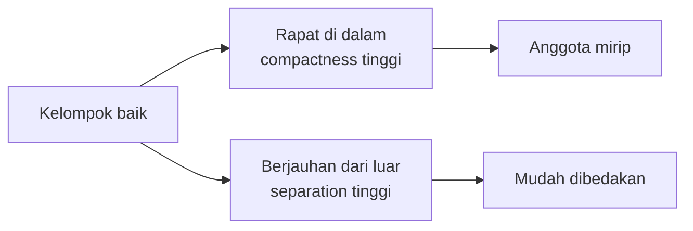
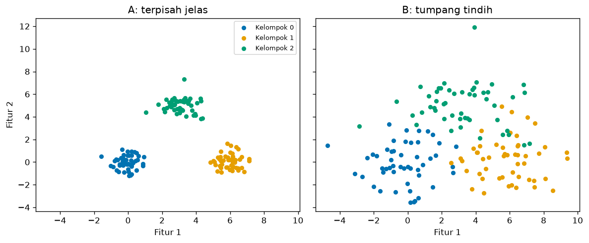
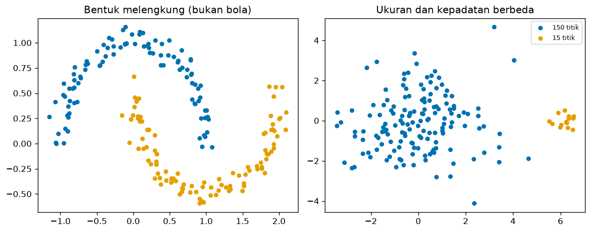
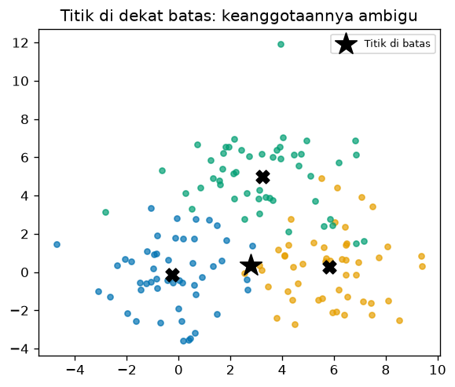

# Bab 2 — Understanding Clusters

## Learning Objectives

Setelah mempelajari bab ini, kamu mampu:

- [x] Menjelaskan apa itu *cluster* dan ciri-ciri kelompok yang baik.
- [x] Menjelaskan *intra-cluster similarity* dan *inter-cluster dissimilarity*.
- [x] Menghitung *compactness* (kekompakan) dan *separation* (keterpisahan) sebuah kelompok.
- [x] Menjelaskan *cluster boundary*, *density*, bentuk, dan ukuran kelompok.
- [x] Menjelaskan *cluster membership* dan mengapa titik di batas kelompok bersifat ambigu.
- [x] Membedakan kelompok yang terpisah jelas dari kelompok yang tumpang tindih lewat angka dan gambar.

## Introduction

Di Bab 1 kita meminta komputer membuat lima kelompok pelanggan, dan hasilnya tampak masuk akal. Tetapi apa sebenarnya yang membuat sebuah kelompok **baik**? Apakah cukup asal titik-titiknya berdekatan? Bagaimana kalau dua kelompok saling menumpuk? Bagaimana kalau bentuknya bukan bola?

Bab ini mengajarkan **bahasa untuk menggambarkan kelompok**: kekompakan, keterpisahan, kepadatan, bentuk, ukuran, dan keanggotaan. Dengan bahasa ini kamu bisa melihat sebuah hasil clustering dan menjelaskan mengapa ia bagus atau bermasalah, sebelum kita mempelajari algoritma di Level 4 dan metrik evaluasi di Level 5.

## Fundamental Concepts

| Istilah | Arti |
|---|---|
| **Cluster** | Sekumpulan data yang lebih mirip satu sama lain dibanding dengan data di luar kelompoknya |
| **Intra-cluster similarity** | Kemiripan **di dalam** satu kelompok. Kelompok yang baik: tinggi |
| **Inter-cluster dissimilarity** | Perbedaan **antar** kelompok. Kelompok yang baik: tinggi |
| **Compactness** (kekompakan) | Seberapa rapat anggota kelompok mengumpul di sekitar pusatnya |
| **Separation** (keterpisahan) | Seberapa jauh satu kelompok dari kelompok lain |
| **Cluster boundary** | Daerah perbatasan tempat satu kelompok berganti ke kelompok lain |
| **Density** (kepadatan) | Seberapa rapat titik-titik di suatu daerah |
| **Membership** (keanggotaan) | Kelompok mana yang memiliki sebuah titik data |

!!! note "Istilah sinonim"
    *Cluster* sering disebut juga **kelompok**, **gerombol**, atau **segmen** (terutama di pemasaran). Di bab ini kita memakai "kelompok" dan "cluster" bergantian.

## Detailed Explanation

### Apa yang membuat kelompok baik?

Kelompok yang baik punya dua sifat sekaligus:

1. **Rapat di dalam.** Anggotanya mirip satu sama lain (*intra-cluster similarity* tinggi). Dalam bahasa jarak: jarak antar anggota **kecil**.
2. **Berjauhan dari luar.** Anggotanya berbeda dari anggota kelompok lain (*inter-cluster dissimilarity* tinggi). Dalam bahasa jarak: jarak antar kelompok **besar**.

Kamu butuh **keduanya**. Kelompok yang rapat tetapi menempel pada kelompok lain sulit dipisahkan, dan kelompok yang berjauhan tetapi longgar di dalam kurang bermakna.



### Kelompok terpisah jelas vs tumpang tindih

Gambar berikut dibuat dari data sintetis (kodenya ada di bagian Python Implementation). Pusat ketiga kelompok **sama** di kedua panel. Yang berbeda hanya seberapa menyebar anggotanya.



- **Panel A:** tiga gerombol rapat dan berjauhan. Mata kita langsung menemukan batasnya.
- **Panel B:** gerombol yang sama, tetapi menyebar, sehingga saling bersinggungan. Di daerah tengah, kita sulit mengatakan sebuah titik milik kelompok yang mana.

Data nyata lebih sering mirip panel B daripada panel A. Karena itu, kemampuan menilai kualitas kelompok tidak bisa hanya dengan mata.

### Compactness: seberapa rapat?

Kekompakan sebuah kelompok bisa diukur dari **rata-rata jarak setiap anggota ke pusat kelompoknya**. Makin kecil angkanya, makin rapat. Pusat kelompok (*centroid*) dibahas lengkap di Bab 3. Untuk sekarang, anggap saja ia adalah **titik rata-rata** semua anggota.

### Separation: seberapa berjauhan?

Keterpisahan bisa diukur dari **jarak antara pusat dua kelompok**. Makin besar, makin terpisah. Namun angka ini harus dibandingkan dengan kekompakan. Jarak pusat 6 terasa jauh bila kelompoknya rapat (rata-rata jarak ke pusat 0,7), tetapi terasa dekat bila kelompoknya longgar (rata-rata jarak ke pusat 2,2). Karena itu kita sering memakai **rasio** keduanya.

### Cluster boundary: batas yang kabur

Batas kelompok adalah daerah tempat sebuah titik hampir sama dekatnya ke dua kelompok. Pada kelompok yang terpisah jelas, batasnya berupa ruang kosong. Pada kelompok yang tumpang tindih, batasnya berupa **daerah padat yang ambigu**, dan titik di situ mudah berpindah kelompok jika algoritma atau pengaturannya sedikit berubah.

### Density: kepadatan

Kepadatan menyatakan seberapa rapat titik di suatu daerah. Dua kelompok bisa punya pusat yang sama, tetapi yang satu padat dan yang lain jarang. Salah satu cara sederhana mengukurnya adalah **rata-rata jarak setiap titik ke tetangga terdekatnya**: makin kecil, makin padat. Kepadatan menjadi dasar algoritma jenis lain (misalnya DBSCAN di Level 4).

### Shape dan size: bentuk dan ukuran

Kelompok tidak harus berbentuk bola dan tidak harus berukuran sama.



- **Bentuk melengkung** (kiri): dua bulan sabit yang saling mengait. Pusat (rata-rata) kedua bulan sabit hanya berjarak sekitar 1,26 (di \( (0{,}00;\,0{,}64) \) dan \( (1{,}00;\,-0{,}12) \)), padahal kedua bentuk membentang sekitar 3 satuan. Pusat tidak mencerminkan lengkungan, sehingga ukuran yang bergantung pada pusat menyesatkan di sini.
- **Ukuran dan kepadatan berbeda** (kanan): satu kelompok besar yang longgar dan satu kelompok kecil yang rapat. Banyak algoritma cenderung menganggap kelompok berukuran mirip, sehingga kasus seperti ini sulit.

Ini alasan mengapa tidak ada satu algoritma yang cocok untuk semua data. Kamu akan melihatnya di Level 4.

### Membership: siapa milik siapa?

Pada *hard clustering* (yang kita pakai sekarang), setiap titik dimiliki **tepat satu** kelompok. Biasanya titik masuk ke kelompok dengan pusat **terdekat**. Titik di dekat batas hanya sedikit lebih dekat ke satu kelompok dibanding yang lain, sehingga keanggotaannya rapuh. Ada juga *soft clustering* yang memberi tiap titik **derajat keanggotaan** pada beberapa kelompok sekaligus (misalnya 60% kelompok A dan 40% kelompok B). Itu dibahas di Level 4.

## Mathematical Foundation

Misalkan kelompok \( C_k \) berisi \( n_k \) titik dan pusatnya (rata-rata anggotanya) adalah \( \mu_k \).

**Compactness** kelompok \( C_k \) (rata-rata jarak ke pusat):

$$
\text{compactness}(C_k) = \frac{1}{n_k} \sum_{\mathbf{x} \in C_k} \lVert \mathbf{x} - \mu_k \rVert
$$

**Separation** antara kelompok \( i \) dan \( j \) (jarak antar pusat):

$$
\text{separation}(C_i, C_j) = \lVert \mu_i - \mu_j \rVert
$$

Penjelasan simbol:

- \( \mathbf{x} \) adalah satu titik data (berupa daftar angka, misalnya pendapatan dan skor belanja).
- \( \mathbf{x} \in C_k \) dibaca "\( \mathbf{x} \) anggota kelompok \( C_k \)".
- \( \lVert \mathbf{a} - \mathbf{b} \rVert \) adalah **jarak Euclidean** antara \( \mathbf{a} \) dan \( \mathbf{b} \), yaitu jarak garis lurus. Rumusnya dibahas penuh di Bab 5. Untuk dua dimensi:

$$
\lVert \mathbf{a} - \mathbf{b} \rVert = \sqrt{(a_1 - b_1)^2 + (a_2 - b_2)^2}
$$

- \( \sum \) berarti "jumlahkan untuk semua anggota", dan \( \frac{1}{n_k} \) mengubah jumlah menjadi rata-rata.

Tujuan rumus: mengubah kesan visual ("rapat" dan "berjauhan") menjadi **angka** yang bisa dibandingkan.

### Contoh hitung manual

Dua kelompok kecil, masing-masing dengan dua titik pada bidang dua dimensi:

- \( C_1 = \{(1,1), (3,1)\} \)
- \( C_2 = \{(7,5), (9,5)\} \)

**Langkah 1: pusat tiap kelompok** (rata-rata tiap koordinat).

- \( \mu_1 = \left(\frac{1+3}{2}, \frac{1+1}{2}\right) = (2, 1) \)
- \( \mu_2 = \left(\frac{7+9}{2}, \frac{5+5}{2}\right) = (8, 5) \)

**Langkah 2: jarak tiap titik ke pusatnya.**

- \( C_1 \): jarak \( (1,1) \) ke \( (2,1) \) adalah \( \sqrt{(1-2)^2 + (1-1)^2} = \sqrt{1} = 1 \). Jarak \( (3,1) \) ke \( (2,1) \) adalah \( \sqrt{1} = 1 \).
- \( C_2 \): jarak \( (7,5) \) ke \( (8,5) \) adalah 1, dan jarak \( (9,5) \) ke \( (8,5) \) juga 1.

**Langkah 3: compactness** (rata-rata jarak).

- \( \text{compactness}(C_1) = \frac{1+1}{2} = 1 \)
- \( \text{compactness}(C_2) = \frac{1+1}{2} = 1 \)

**Langkah 4: separation** (jarak antar pusat).

$$
\sqrt{(2-8)^2 + (1-5)^2} = \sqrt{36 + 16} = \sqrt{52} \approx 7{,}21
$$

**Interpretasi.** Anggota tiap kelompok berjarak rata-rata 1 dari pusatnya, sedangkan kedua pusat berjarak 7,21. Rasionya \( 7{,}21 / 1 \approx 7{,}2 \): jarak antar kelompok sekitar tujuh kali lebih besar daripada "lebar" kelompok itu sendiri. Itu menandakan kelompok yang terpisah baik.

## Python Implementation

Kita kerjakan dalam delapan langkah kecil. **Setiap potongan kode diikuti penjelasannya.** Skrip lengkapnya ada di `examples/level-3/02_understanding_clusters.py`, dan versi notebook-nya di `notebooks/level-3/02-understanding-clusters.ipynb`.

**Konteks masalah:** kita membandingkan dua dataset sintetis (satu terpisah jelas, satu tumpang tindih) memakai ukuran kekompakan, keterpisahan, dan kepadatan, lalu menerapkannya pada kelompok Mall Customers dari Bab 1.

**Input yang diharapkan:** tidak ada file khusus untuk data sintetis (dibuat di kode). Langkah terakhir memakai `data/mall_customers.csv`.

### Langkah 1 — Buat data sintetis

Pada langkah ini kita memakai **dataset sintetis**, yaitu data buatan yang dibangkitkan oleh program (bukan hasil pengukuran dunia nyata). Alasannya:

- **Kelompok aslinya diketahui pasti.** Kita sendiri yang menentukan pusat dan sebaran tiap gerombol, sehingga kita bisa memeriksa apakah ukuran kekompakan, keterpisahan, dan kepadatan benar-benar menangkap apa yang kita rancang.
- **Kondisinya bisa dikendalikan.** Dengan mengubah satu parameter saja (`cluster_std`), kita mendapat dua dataset yang hanya berbeda pada tingkat tumpang tindihnya. Pada data nyata, perbedaan seperti ini sulit diisolasi.
- **Hasilnya dapat diulang.** Dengan `random_state=42`, siapa pun yang menjalankan kode ini mendapat data dan angka yang sama.

!!! note "Batasan data sintetis"
    Data sintetis rapi dan "ramah" terhadap algoritma, jadi tidak mewakili kerumitan data nyata. Karena itu, pada langkah terakhir kita menerapkan ukuran yang sama pada data nyata (Mall Customers).

```python
--8<-- "level-3/02_understanding_clusters.py:setup"
```

```text title="Output"
--8<-- "level-3/outputs/02/setup.txt"
```

**Maksud output:**

- `Bentuk XA: (150, 2)` dan `Bentuk XB: (150, 2)`: *shape* (bentuk) larik data. Angka pertama (150) adalah jumlah titik/baris, angka kedua (2) adalah jumlah fitur/kolom, yaitu koordinat \( x \) dan \( y \). Jadi kedua dataset sama-sama berisi 150 titik pada bidang dua dimensi, sehingga bisa langsung digambar.
- `Jumlah anggota per kelompok (A): [50 50 50]`: hasil `np.bincount(yA)`, yaitu banyaknya titik pada kelompok 0, 1, dan 2. Ketiganya 50, artinya 150 titik terbagi rata ke tiga gerombol. Ini memastikan kelompok seimbang, sehingga perbedaan ukuran kelompok tidak memengaruhi perbandingan nanti.

**Penjelasan:**

- `import numpy as np` memanggil *NumPy*, pustaka untuk menghitung dengan larik (array) angka.
- `make_blobs` membuat data buatan berupa gerombol titik. Kita memakainya supaya tahu pasti kelompok aslinya.
- `make_moons` membuat data berbentuk dua bulan sabit (dipakai di Langkah 6).
- `COLORS` adalah daftar tiga warna yang tetap terbedakan oleh pembaca buta warna.
- `centers = [(0, 0), (6, 0), (3, 5)]` menentukan **pusat sebenarnya** ketiga gerombol.
- `make_blobs(n_samples=150, centers=centers, cluster_std=0.6, random_state=42)`: membuat 150 titik. `cluster_std` mengatur **sebaran** tiap gerombol (kecil berarti rapat). `random_state=42` mengunci unsur acak. Hasilnya dua nilai: `XA` (koordinat titik) dan `yA` (nomor kelompok asli).
- Dataset B memakai pusat dan `random_state` yang sama tetapi `cluster_std=1.8`, sehingga sebarannya lebih lebar dan saling menumpuk.
- `np.bincount(yA)` menghitung berapa titik di tiap kelompok.

### Langkah 2 — Gambar kedua dataset

```python
--8<-- "level-3/02_understanding_clusters.py:plot_two"
```


**Penjelasan:**

- `plt.subplots(1, 2, ..., sharex=True, sharey=True)` membuat dua panel berdampingan dengan skala sumbu yang sama. Skala yang sama penting agar kita bisa membandingkan sebaran secara adil.
- `for ax, X, y, title in [...]` mengulang pekerjaan yang sama untuk dua panel, dengan data dan judul masing-masing.
- `X[y == k, 0]` artinya "koordinat pertama dari semua titik yang kelompoknya `k`". `y == k` menghasilkan daftar benar/salah yang dipakai memilih baris.
- `ax.scatter(...)` menggambar titik, satu warna per kelompok.
- `fig.tight_layout()` merapikan jarak antar elemen.

### Langkah 3 — Ukur kekompakan (compactness)

Setelah melihat kedua dataset secara visual di Langkah 2, kini kita mengubah kesan "rapat" atau "longgar" menjadi **angka**. Ukuran pertama adalah **kekompakan** (*compactness*): seberapa dekat anggota sebuah kelompok dengan pusatnya.

Caranya sederhana, mengikuti rumus di bagian Mathematical Foundation:

1. Cari **pusat** kelompok, yaitu rata-rata koordinat semua anggotanya.
2. Hitung **jarak** setiap anggota ke pusat itu.
3. Ambil **rata-rata** jarak tersebut.

Makin **kecil** angkanya, makin rapat kelompoknya. Kita membungkus ketiga langkah ini dalam satu fungsi `compactness`, lalu menjalankannya pada Dataset A dan B. Karena hanya `cluster_std` yang berbeda di antara keduanya, selisih angka yang muncul berasal dari tingkat sebaran itu. Angka ini juga menjadi pembagi pada rasio keterpisahan di Langkah 4.

```python
--8<-- "level-3/02_understanding_clusters.py:compact"
```

```text title="Output"
--8<-- "level-3/outputs/02/compact.txt"
```

**Cara membaca output:**

- Setiap baris berisi tiga angka, satu per kelompok (kelompok 0, 1, 2 berurutan). Angkanya adalah rata-rata jarak anggota ke pusat kelompoknya, dalam satuan koordinat data.
- Dataset A: `0.68`, `0.72`, `0.79`. Rata-rata anggota hanya berjarak sekitar 0,7 dari pusatnya, jadi ketiga kelompok rapat.
- Dataset B: `2.05`, `2.16`, `2.38`. Jaraknya sekitar 2,2, jadi kelompok jauh lebih longgar.
- Rata-rata ketiga kelompok adalah sekitar 0,73 untuk A dan 2,20 untuk B, selisih sekitar **3 kali**. Ini sejalan dengan `cluster_std` yang kita pilih (0,6 dan 1,8, juga berselisih 3 kali), jadi ukuran ini memang menangkap tingkat sebaran.
- Dalam satu dataset, ketiga angkanya berdekatan karena ketiga kelompok dibuat dengan sebaran yang sama. Selisih kecil di antaranya berasal dari acak sampel, bukan dari perbedaan yang dirancang.
- Angka rata-rata inilah yang menjadi pembagi pada rasio di Langkah 4.

**Penjelasan:**

- `def compactness(X, y):` membuat **fungsi**: potongan kode yang bisa dipakai berulang. Ia menerima titik `X` dan nomor kelompok `y`.
- `np.unique(y)` mengambil daftar nomor kelompok tanpa pengulangan (0, 1, 2).
- `members = X[y == k]` memilih titik anggota kelompok `k`.
- `center = members.mean(axis=0)` menghitung **pusat** (rata-rata tiap kolom). `axis=0` berarti "turun sepanjang baris", jadi hasilnya satu rata-rata per kolom.
- `members - center` mengurangkan pusat dari setiap titik. NumPy melakukannya untuk semua baris sekaligus (disebut *broadcasting*).
- `** 2` mengkuadratkan, `.sum(axis=1)` menjumlahkan **per baris** (jumlah kuadrat selisih tiap koordinat), dan `np.sqrt` mengakarkan. Hasilnya jarak Euclidean tiap titik ke pusatnya.
- `dist.mean()` mengambil rata-ratanya: inilah compactness kelompok itu.
- `.round(2)` membulatkan ke dua angka di belakang koma.

### Langkah 4 — Ukur keterpisahan (separation)

Kekompakan di Langkah 3 hanya menjawab setengah pertanyaan: seberapa rapat **satu** kelompok. Kelompok yang rapat belum tentu mudah dibedakan bila kelompok tetangganya menempel di sebelahnya. Karena itu kita perlu ukuran kedua, **keterpisahan** (*separation*): seberapa jauh kelompok yang satu dari kelompok yang lain.

Ukuran paling sederhana adalah **jarak antar pusat** kelompok. Namun jarak ini tidak cukup bila berdiri sendiri. Lihat outputnya: jarak antar pusat di Dataset A (5,69 sampai 6,03) hampir sama dengan di Dataset B (5,41 sampai 6,20), padahal Dataset A jelas terpisah dan Dataset B saling menumpuk. Pusat yang berjauhan tidak berarti kelompoknya terpisah, karena kelompok yang sangat lebar tetap bisa saling bertemu di tengah.

Maka jarak pusat dibandingkan dengan **lebar kelompok** (kekompakan dari Langkah 3) dalam bentuk rasio:

- Kita mengambil **jarak pusat terdekat** karena pasangan yang paling dekat adalah titik terlemah. Dua kelompok yang bertumpuk sudah cukup membuat pemisahan gagal, walaupun pasangan lain berjauhan.
- Kita membaginya dengan **rata-rata kekompakan** agar jaraknya dinilai relatif terhadap sebaran. Rasio besar berarti jarak antar kelompok jauh melebihi lebar kelompok itu sendiri (terpisah jelas). Rasio kecil berarti lebar kelompok hampir sama dengan jaraknya (mudah tumpang tindih).

Hasilnya, Dataset A mendapat rasio 7,76 dan Dataset B hanya 2,46. Selisih ini yang menangkap perbedaan yang tidak terlihat dari jarak pusat saja. Ide yang sama, jarak antar kelompok dibandingkan dengan sebaran di dalam kelompok, akan muncul lagi dalam metrik evaluasi clustering di level berikutnya.

```python
--8<-- "level-3/02_understanding_clusters.py:separate"
```

```text title="Output"
--8<-- "level-3/outputs/02/separate.txt"
```

**Cara membaca output:**

- `{(0, 1): 6.03, (0, 2): 5.95, (1, 2): 5.69}` adalah jarak antar pusat. Kunci `(0, 1)` berarti pasangan kelompok 0 dan 1, nilainya jarak Euclidean kedua pusat. Dataset A punya tiga pasangan karena ada tiga kelompok.
- Jarak antar pusat kedua dataset hampir sama (sekitar 5,4 sampai 6,2). Wajar, sebab `centers` yang dipakai memang sama. Jadi angka ini saja tidak bisa membedakan A dari B.
- Pasangan terdekat di Dataset A adalah `(1, 2)` dengan 5,69, sedangkan di Dataset B adalah `(1, 2)` dengan 5,41. Nilai inilah yang menjadi pembilang rasio.
- Rata-rata kekompakan dari Langkah 3 adalah sekitar 0,73 untuk A dan 2,20 untuk B. Maka rasio A = 5,69 / 0,73 ≈ **7,76**, dan rasio B = 5,41 / 2,20 ≈ **2,46**.
- Pada Dataset A, jarak pusat terdekat sekitar 7,8 kali lebar kelompok, sehingga ketiga kelompok terpisah lega. Pada Dataset B, jaraknya hanya sekitar 2,5 kali lebar kelompok, jadi tepi kelompok saling bertemu dan itu sesuai dengan gambar yang tumpang tindih di Langkah 2.
- Jadi yang membedakan kedua dataset adalah **sebarannya**, bukan jarak antar pusatnya.

**Penjelasan:**

- `center_distances` menghitung pusat tiap kelompok, lalu **jarak antar pusat** untuk setiap pasangan `(i, j)`.
- Dua `for` bertingkat, `for i ...` lalu `for j in range(i + 1, ...)`, menghasilkan tiap pasangan **sekali saja** (pasangan (0,1) dan (1,0) sama, jadi tidak diulang).
- `pairs = {}` adalah **kamus** (dictionary): menyimpan pasangan kelompok sebagai kunci dan jaraknya sebagai nilai.
- `ratio = min(pairs.values()) / compactness(X, y).mean()` membagi **jarak pusat terdekat** dengan **rata-rata kekompakan**. Rasio besar berarti kelompok jauh lebih terpisah daripada selebar kelompok itu sendiri.
- `f"... {ratio:.2f}"` adalah *f-string*: menyisipkan nilai ke teks. `:.2f` berarti dua angka di belakang koma.

### Langkah 5 — Ukur kepadatan (density)

Kekompakan dan keterpisahan menilai kelompok dari pusatnya. Ada sisi lain yang belum tertangkap: seberapa **rapat titik-titik berdekatan satu sama lain** di dalam kelompok. Inilah **kepadatan** (*density*). Sebagian algoritma, seperti DBSCAN di Level 4, membentuk kelompok justru dari daerah yang padat, jadi ukuran ini perlu dikenali sejak sekarang.

Caranya, untuk setiap titik kita cari **tetangga terdekatnya**, lalu merata-ratakan jarak itu. Kita memakai tetangga terdekat, bukan jarak ke pusat, karena kepadatan adalah sifat **lokal**: titik yang dikelilingi banyak tetangga dekat berada di daerah padat, apa pun posisinya terhadap pusat. Makin **kecil** angkanya, makin padat kelompoknya.

Untuk membandingkannya secara adil, kita buat dua kelompok dengan jumlah titik sama (60) dan pusat sama, yaitu (0, 0). Satu-satunya perbedaan adalah sebarannya (0,3 dan 1,5). Dengan begitu, selisih angka yang muncul berasal dari kepadatan, bukan dari jumlah titik atau posisi.

```python
--8<-- "level-3/02_understanding_clusters.py:density"
```

```text title="Output"
--8<-- "level-3/outputs/02/density.txt"
```

**Cara membaca output:**

- Angka `0.063` dan `0.422` adalah rata-rata jarak setiap titik ke tetangga terdekatnya. Satuannya sama dengan koordinat data.
- Pada kelompok padat, rata-rata titik hanya berjarak 0,063 dari tetangga terdekatnya. Pada kelompok jarang, jaraknya 0,422, sekitar **6,7 kali** lebih jauh (0,422 / 0,063).
- Kedua kelompok berisi 60 titik dan berpusat di tempat yang sama. Jadi 60 titik yang sama terasa rapat bila ditempatkan di area sempit (sebaran 0,3) dan renggang bila disebar di area luas (sebaran 1,5).
- Nilai kecil berarti padat, nilai besar berarti jarang. Kelompok jarang tidak "salah", tetapi algoritma berbasis kepadatan akan kesulitan menganggapnya satu kelompok bila jarak antar titiknya terlalu besar.

**Penjelasan:**

- `X[:, None, :] - X[None, :, :]` menghitung selisih **setiap pasangan titik** sekaligus. Hasilnya larik tiga dimensi: (titik pertama, titik kedua, koordinat).
- Setelah dikuadratkan, dijumlahkan, dan diakarkan, kita punya **matriks jarak**: tabel jarak setiap titik ke setiap titik lain (dibahas di Bab 4).
- `np.fill_diagonal(dist, np.inf)` mengisi diagonal (jarak titik ke dirinya sendiri, yaitu 0) dengan tak hingga, supaya titik tidak dianggap tetangga terdekat dirinya sendiri.
- `dist.min(axis=1)` mengambil jarak ke tetangga terdekat untuk tiap titik, lalu `.mean()` merata-ratakannya.
- `np.random.default_rng(42)` membuat pembangkit angka acak dengan seed tetap. `rng.normal(loc, scale, size)` mengambil titik acak berpusat di `loc` dengan sebaran `scale`.
- Kita buat dua kelompok dengan jumlah titik sama (60) tetapi sebaran berbeda (0,3 dan 1,5).

### Langkah 6 — Lihat bentuk dan ukuran

Langkah 3 sampai 5 menghasilkan angka, dan semuanya diam-diam mengandaikan kelompok berbentuk **bola**: ada satu pusat, dan titik menyebar merata di sekelilingnya. Padahal data nyata tidak selalu begitu. Langkah ini sengaja memperlihatkan dua keadaan yang membuat asumsi tersebut gagal, supaya kita tahu bahwa angka saja tidak cukup dan **bentuk** serta **ukuran** kelompok juga perlu dilihat.

Kita memakai gambar, bukan angka, karena bentuk adalah sifat yang paling mudah dikenali mata dan paling sulit diringkas dalam satu bilangan. Dua kasus yang ditampilkan:

- **Bentuk melengkung** (`make_moons`): dua kelompok berbentuk bulan sabit yang saling mengait. Pusat (rata-rata) kelompok seperti ini jatuh di ruang kosong, bukan di tempat ada titiknya, sehingga ukuran berbasis pusat menjadi menyesatkan.
- **Ukuran dan kepadatan berbeda**: satu kelompok besar yang longgar (150 titik) dan satu kelompok kecil yang rapat (15 titik). Jumlah anggota dan kerapatannya timpang, sehingga satu ukuran yang sama sulit adil untuk keduanya.

```python
--8<-- "level-3/02_understanding_clusters.py:shape"
```


**Cara membaca gambar:**

- **Panel kiri:** dua bulan sabit, satu biru dan satu oranye, yang saling mengait. Tiap bulan jelas merupakan satu kelompok, tetapi pusatnya (rata-rata koordinat) berada di area lengkung yang kosong. Titik biru di ujung kiri bahkan lebih dekat ke bulan oranye daripada ke pusat birunya sendiri. Artinya, pengelompokan berdasarkan jarak ke pusat akan memotong bulan sabit secara keliru.
- **Panel kanan:** kelompok biru (150 titik) menyebar lebar sekitar pusat (0, 0), sedangkan kelompok oranye (15 titik) berupa gumpalan kecil dan rapat di sekitar x = 6. Jaraknya jauh, tetapi ukuran dan kepadatannya sangat berbeda. Kelompok kecil seperti ini mudah terlewat atau dianggap *outlier* oleh algoritma yang hanya memperhatikan kelompok besar.
- Pelajarannya: kekompakan, keterpisahan, dan kepadatan tetap berguna, tetapi hanya sebagai **bahan pertimbangan**. Selalu lihat bentuk data bila memungkinkan, dan ingat bahwa algoritma yang berbeda cocok untuk bentuk yang berbeda (dibahas di Level 4).

**Hasil dalam angka:**

Potongan kode Langkah 6 hanya menggambar, jadi angka berikut dihitung terpisah dengan data dan seed yang sama (`random_state=42`, `default_rng(42)`) memakai ukuran dari Langkah 3 dan 5. Tujuannya membuktikan bahwa kesan visual di atas bukan tebakan.

*Bulan sabit (panel kiri):*

- Pusat kedua bulan sabit hanya berjarak sekitar **1,25** satu sama lain, padahal masing-masing bulan membentang sekitar 3 satuan. Pusat yang "berdekatan" itu muncul karena kedua bulan saling mengait, bukan karena kelompoknya berdekatan.
- Rata-rata anggota berjarak sekitar 0,74 dari pusat bulannya sendiri. Namun **21 dari 100** titik di tiap bulan justru lebih dekat ke pusat bulan yang lain. Jadi aturan "ikut pusat terdekat" akan salah menempatkan sekitar seperlima titik.

*Dua kelompok berbeda ukuran (panel kanan):*

| | Kelompok besar | Kelompok kecil |
|---|---|---|
| Jumlah titik | 150 | 15 |
| Kekompakan | 1,84 | 0,36 |
| Jarak tetangga terdekat | 0,291 | 0,141 |

- Kelompok besar sekitar **5 kali** lebih longgar dari kelompok kecil (1,84 melawan 0,36), dan jarak tetangga terdekatnya sekitar 2 kali lebih besar.
- Jarak antar pusatnya sekitar 6,2, jauh lebih besar dari lebar keduanya, jadi kedua kelompok sebenarnya **terpisah**. Masalahnya bukan keterpisahan, melainkan perbedaan ukuran dan kepadatan: satu ambang jarak yang cocok untuk kelompok besar akan terlalu longgar untuk kelompok kecil, dan sebaliknya.

**Penjelasan:**

- `make_moons(n_samples=200, noise=0.07, random_state=42)` membuat 200 titik dua bulan sabit. `noise` menambah sedikit getaran acak.
- `besar` dan `kecil` adalah dua kelompok acak: 150 titik yang longgar dan 15 titik yang rapat.
- `plt.subplots(1, 2, ...)` membuat dua panel: kiri bulan sabit, kanan dua kelompok berbeda ukuran.
- Bagian lain sama seperti Langkah 2.

### Langkah 7 — Keanggotaan di dekat batas

Langkah 3 sampai 6 menilai **kelompok**. Langkah ini beralih ke pertanyaan tentang **satu titik**: kelompok mana yang memilikinya? Pada *hard clustering*, jawabannya selalu tegas, yaitu satu kelompok, biasanya yang pusatnya paling dekat. Aturan itu bekerja baik untuk titik yang jelas berada di tengah kelompok, tetapi bagaimana dengan titik di perbatasan?

Untuk mengujinya kita menaruh satu titik **sengaja di tengah** antara pusat dua kelompok pada Dataset B (yang tumpang tindih), lalu melihat seberapa meyakinkan keputusan "terdekat" itu. Dataset B dipilih karena kelompoknya saling menumpuk, sehingga situasi ambigu seperti ini memang sering terjadi di data nyata.

```python
--8<-- "level-3/02_understanding_clusters.py:member"
```

```text title="Output"
--8<-- "level-3/outputs/02/member.txt"
```



**Cara membaca output dan gambar:**

- `Titik uji: [2.79 0.36]` adalah koordinat titik yang kita buat, yaitu bintang hitam pada gambar.
- `[3.08 3.04 4.66]` adalah jarak titik itu ke pusat kelompok 0, 1, dan 2. Kelompok 2 jelas jauh (4,66), tetapi jarak ke kelompok 0 (3,08) dan 1 (3,04) nyaris sama.
- `Kelompok terdekat: 1` adalah keputusan hard clustering. Keputusan itu hanya ditentukan oleh selisih **0,04** satuan, jadi pergeseran kecil pada titik atau pusat bisa membalikkannya ke kelompok 0.
- Pada gambar, bintang berada di antara kelompok biru (0) dan oranye (1), di daerah tempat kedua sebaran bercampur. Kelompok hijau (2) berada lebih jauh di atas. Tanda `X` hitam adalah pusat masing-masing kelompok.
- Pelajarannya: label tegas "kelompok 1" menyembunyikan fakta bahwa titik ini hampir sama miripnya dengan kelompok 0. Inilah alasan adanya *soft clustering*, yang memberi derajat keanggotaan pada tiap kelompok, bukan satu label.

**Penjelasan:**

- `centers_B` adalah pusat tiga kelompok dataset B, dihitung dengan rata-rata.
- `titik = (centers_B[0] + centers_B[1]) / 2 + np.array([0.0, 0.3])` membuat satu titik uji **di tengah** antara pusat kelompok 0 dan 1, lalu menggesernya sedikit ke atas. Titik ini sengaja ditaruh di batas.
- `dist` adalah jarak titik uji ke tiap pusat, dan `dist.argmin()` memberi nomor pusat **terdekat**. Itulah aturan keanggotaan pada hard clustering.
- Bagian grafik menggambar titik uji sebagai bintang hitam dan pusat sebagai tanda `X`. `alpha=0.7` membuat titik sedikit transparan agar tumpukan titik terlihat.

### Langkah 8 — Terapkan pada Mall Customers

Sejauh ini kita mengukur kelompok pada data sintetis, yang jawabannya sudah kita ketahui. Langkah ini membawa ukuran yang sama ke **data nyata**: pelanggan Mall Customers dari Bab 1. Tujuannya melihat bahwa fungsi `compactness` tidak terikat pada data buatan, dan bahwa pada data nyata angka seperti ini menjadi satu-satunya petunjuk, karena tidak ada "kelompok asli" untuk dibandingkan.

Kelompok di sini dibentuk dengan K-Means (hanya sebagai alat bantu, bukan fokus bab ini), lalu tiap kelompok diringkas dengan dua hal: **jumlah anggota** dan **kekompakan**. Dua kolom itu menunjukkan apakah kelompok yang terbentuk seimbang ukurannya dan seberapa rapat masing-masing.

```python
--8<-- "level-3/02_understanding_clusters.py:mall"
```

```text title="Output"
--8<-- "level-3/outputs/02/mall.txt"
```

**Cara membaca output:**

- Setiap baris adalah satu kelompok (indeks 0 sampai 4). Kolom `Jumlah` adalah banyak pelanggan di kelompok itu, dan totalnya 200 (81 + 39 + 22 + 35 + 23), sesuai jumlah baris data.
- Ukuran kelompok tidak seimbang: kelompok 0 memuat 81 pelanggan, sedangkan kelompok 2 hanya 22. Itu wajar pada data nyata, karena kelompok tidak harus sama besar.
- Kolom `Kekompakan` adalah rata-rata jarak anggota ke pusat kelompoknya. Kelompok 0 paling rapat (10,1) padahal paling besar, sedangkan kelompok 1 dan 3 paling longgar (sama-sama 16,3).
- Angka ini tidak bisa dibandingkan langsung dengan 0,7 atau 2,2 pada data sintetis. Satuannya mengikuti data: fitur pendapatan (k\$) dan skor belanja (1-100) berkisar jauh lebih lebar daripada koordinat buatan kita, dan keduanya belum diskalakan.
- Karena itu kekompakan paling berguna untuk **membandingkan antarkelompok pada data yang sama**, bukan antardataset yang skalanya berbeda.

**Penjelasan:**

- Kita memuat data dan memilih dua fitur seperti Bab 1, lalu `.to_numpy()` mengubah tabel menjadi larik NumPy agar cocok dengan fungsi `compactness` kita.
- `KMeans(...).fit_predict(X)` membuat lima kelompok (K-Means hanya alat bantu, lihat Bab 1).
- `pd.DataFrame({...})` membuat tabel ringkas berisi jumlah anggota dan kekompakan tiap kelompok.

## Code Explanation

| Yang kamu lihat | Artinya |
|---|---|
| `X[y == k]` | Memilih baris yang kelompoknya `k` |
| `.mean(axis=0)` | Rata-rata per kolom, dipakai untuk mencari pusat |
| `.sum(axis=1)` | Jumlah per baris, dipakai menggabungkan selisih tiap koordinat |
| `np.sqrt(((a - b) ** 2).sum(axis=1))` | Jarak Euclidean antara baris-baris `a` dan `b` |
| `def ...:` | Membuat fungsi agar perhitungan bisa dipakai berulang |
| `rng.normal(loc, scale, size)` | Titik acak bersebaran normal dengan seed tetap |

Pola umumnya: **pilih kelompok → cari pusat → ukur jarak → bandingkan angka.**

## How to Run

Jalankan dari **folder utama proyek** (folder yang berisi `mkdocs.yml`):

```powershell
pip install -r requirements-notebooks.txt
python examples/level-3/02_understanding_clusters.py
```

Skrip membuat tiga gambar di `docs/assets/level-3/`. Untuk notebook:

```powershell
jupyter notebook notebooks/level-3/02-understanding-clusters.ipynb
```

## Expected Output

Semua output berasal dari eksekusi nyata skrip (Python 3.14.10, NumPy 2.5.2, pandas 3.0.5, scikit-learn 1.9.0, matplotlib 3.11.1). Output setiap langkah ditampilkan langsung di bawah kodenya pada bagian [Python Implementation](#python-implementation).


Gambar keanggotaan di batas:


### Interpretasi output

**Kekompakan.** Pada dataset A rata-rata jarak ke pusat sekitar 0,7 (0,68; 0,72; 0,79). Pada dataset B sekitar 2,2 (2,05; 2,16; 2,38), kira-kira tiga kali lebih longgar. Itu sesuai dengan `cluster_std` yang kita pakai (0,6 melawan 1,8).

**Keterpisahan.** Jarak antar pusat hampir sama di kedua dataset (sekitar 5,4 sampai 6,2), karena pusat sebenarnya kita buat sama. Tetapi **rasio** terhadap kekompakan sangat berbeda: **7,76** pada A dan **2,46** pada B. Jarak pusat yang sama terasa jauh pada A dan terasa dekat pada B. Inilah mengapa jarak antar pusat harus dibandingkan dengan lebar kelompok.

**Kepadatan.** Jarak ke tetangga terdekat 0,063 pada kelompok padat dan 0,422 pada kelompok jarang. Meski jumlah titiknya sama (60), kelompok jarang sekitar 6,7 kali lebih renggang.

**Keanggotaan.** Titik uji berjarak 3,08 ke pusat kelompok 0 dan 3,04 ke pusat kelompok 1. Selisihnya hanya 0,04. Titik itu masuk kelompok 1, tetapi hasilnya nyaris seri dan bisa berubah kalau data sedikit berbeda. Itulah wajah batas kelompok yang kabur.

**Mall Customers.** Kelompok 0 (81 anggota) paling kompak (10,1). Kelompok 1 dan 3 (masing-masing 39 dan 35 anggota) paling longgar (16,3). Satuan angkanya campuran (ribu dolar dan skor), jadi nilai ini hanya cocok untuk membandingkan **antar kelompok pada data yang sama**, bukan dengan dataset lain.

## Practical Examples

**Segmentasi pelanggan.** Kelompok yang kompak dan terpisah baik (seperti kelompok pelanggan "belanja tinggi, pendapatan tinggi") bisa dijadikan target kampanye dengan yakin. Kelompok yang longgar dan menempel pada kelompok lain perlu diperlakukan hati-hati: batas antar segmennya sebenarnya kabur.

**Pengenalan pola di biologi.** Dua jenis sel yang bentuk sebarannya melengkung atau berbeda kepadatan sulit dipisahkan dengan pusat kelompok. Kamu perlu menyadari ini sebelum memilih algoritma.

**Bahaya "memaksa" kelompok.** Algoritma selalu bisa menghasilkan lima kelompok, bahkan dari data yang sebenarnya satu gumpalan. Karena itu angka kekompakan dan keterpisahan membantu mengecek apakah kelompoknya bermakna.

## Hands-on Exercises

1. Pada dataset B, tambahkan satu kelompok dengan `cluster_std=0.6` dan bandingkan kekompakannya dengan dataset A. *(petunjuk: panggil `make_blobs` lagi dengan `cluster_std` berbeda)*
2. Hitung compactness manual untuk \( C = \{(0,0), (4,0), (2,6)\} \): cari pusat, jarak tiap titik ke pusat, lalu rata-ratanya.
3. Mengapa jarak antar pusat 6 bisa dianggap "jauh" pada dataset A tetapi "dekat" pada dataset B?
4. Ubah posisi `titik` pada Langkah 7 menjadi tepat di tengah antara pusat kelompok 0 dan 1 (hapus `+ np.array([0.0, 0.3])`). Apa yang terjadi pada selisih jaraknya?
5. Mengapa pusat dua bulan sabit pada `make_moons` bisa menyesatkan?

??? question "Jawaban"
    Hasil berikut dihitung dari data dan kode pada bab ini:

    1. Hasilnya bergantung pada pusat dan jumlah titik yang kamu pilih. Yang bisa kamu periksa: kekompakannya akan mendekati 0,6 (nilai `cluster_std`), jauh lebih rendah dari 2,05 sampai 2,38 pada B.
    2. Pusat: \( \left(\frac{0+4+2}{3}, \frac{0+0+6}{3}\right) = (2, 2) \). Jarak: \( (0,0) \) ke \( (2,2) \) = \( \sqrt{8} \approx 2{,}83 \). \( (4,0) \) ke \( (2,2) \) = \( \sqrt{8} \approx 2{,}83 \). \( (2,6) \) ke \( (2,2) \) = \( \sqrt{16} = 4 \). Rata-rata: \( (2{,}83 + 2{,}83 + 4)/3 \approx 3{,}22 \).
    3. Karena yang menentukan adalah **rasio** terhadap lebar kelompok. Pada A rasionya 7,76, pada B hanya 2,46 meski jarak pusatnya hampir sama.
    4. Selisih jaraknya menyusut mendekati 0 (titiknya hampir persis sama jauhnya ke kedua pusat), sehingga keanggotaannya makin ambigu. Jalankan kodenya untuk melihat angka persisnya.
    5. Kedua bulan sabit saling mengait. Rata-rata masing-masing jatuh di (0,00; 0,64) dan (1,00; −0,12), hanya berjarak sekitar 1,26, sementara bentuknya membentang sekitar 3 satuan. Titik pusat tidak menggambarkan lengkungan kelompok, dan titik di ujung bulan sabit bisa lebih dekat ke pusat bulan sabit lain.

## Troubleshooting

| Masalah | Penyebab | Solusi |
|---|---|---|
| `ValueError: operands could not be broadcast together` | Ukuran larik tidak cocok saat mengurangkan | Periksa `X.shape` dan pastikan `X` berbentuk (jumlah titik, jumlah fitur) |
| Hasil acak berbeda dari tabel di atas | `random_state` atau seed tidak sama | Pakai `random_state=42` dan `default_rng(42)` seperti contoh |
| `MemoryError` pada matriks jarak | Matriks jarak ukuran \( n \times n \) terlalu besar | Untuk data ribuan titik, pakai `sklearn.metrics.pairwise_distances` per bagian |
| Mengira jarak 0 pada diagonal ikut dihitung | Titik dianggap tetangga dirinya | Isi diagonal dengan `np.inf` sebelum mencari minimum |
| Membandingkan kekompakan antar dataset dengan satuan berbeda | Angka bergantung pada satuan fitur | Bandingkan antar kelompok pada data yang sama, atau skalakan dulu (Level 2 Bab 10) |

## Summary

- **Kelompok yang baik** rapat di dalam (*compactness*) dan berjauhan dari kelompok lain (*separation*).
- Compactness = rata-rata jarak anggota ke pusat. Separation = jarak antar pusat. Keduanya paling informatif jika **dibandingkan sebagai rasio**.
- Pada data sintetis kita, rasio keterpisahan 7,76 (terpisah jelas) melawan 2,46 (tumpang tindih).
- **Kepadatan**, **bentuk**, dan **ukuran** juga memengaruhi seberapa mudah kelompok ditemukan. Pusat kelompok tidak cukup untuk bentuk yang melengkung.
- Pada hard clustering, titik masuk kelompok dengan pusat terdekat. Titik di batas keanggotaannya rapuh.

**Bab berikutnya:** Bab 3 membahas pusat kelompok (*centroid*) dan alternatifnya (*medoid*) secara lengkap.

## References

- Tan, P.-N., Steinbach, M., Karpatne, A., & Kumar, V. *Introduction to Data Mining* (Pearson), bab *Cluster Analysis: Basic Concepts and Algorithms*.
- Scikit-learn documentation: [`make_blobs`](https://scikit-learn.org/stable/modules/generated/sklearn.datasets.make_blobs.html) dan [`make_moons`](https://scikit-learn.org/stable/modules/generated/sklearn.datasets.make_moons.html).
- NumPy documentation: [*Broadcasting*](https://numpy.org/doc/stable/user/basics.broadcasting.html).
- Scikit-learn documentation: [*Clustering*](https://scikit-learn.org/stable/modules/clustering.html).
