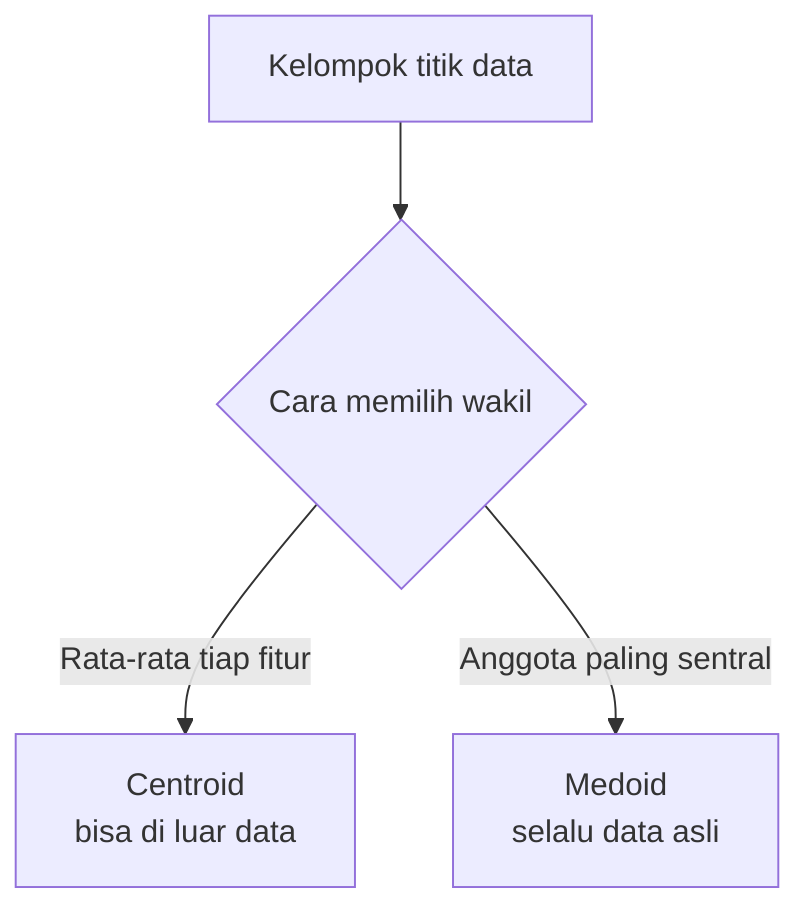
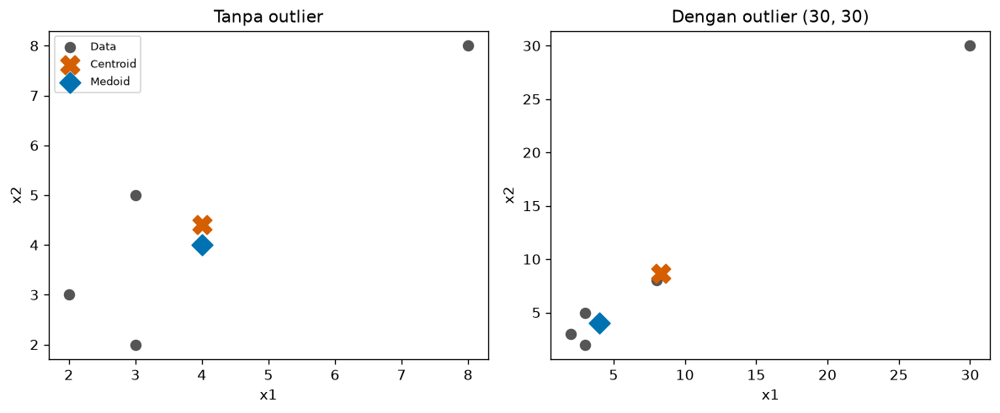
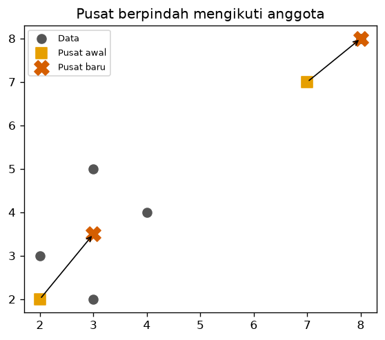
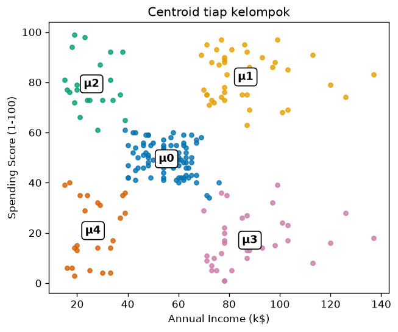

# Bab 3 — Centroid and Cluster Representation

## Learning Objectives

Setelah mempelajari bab ini, kamu mampu:

- [x] Menjelaskan apa itu *centroid* dan mengapa ia dipakai untuk mewakili sebuah kelompok.
- [x] Menghitung centroid data numerik secara manual dan dengan NumPy.
- [x] Menjelaskan perbedaan *centroid* dan *medoid*.
- [x] Menjelaskan mengapa centroid sensitif terhadap *outlier* sedangkan medoid lebih tahan.
- [x] Menjelaskan bagaimana posisi centroid berubah ketika anggota kelompok berubah.
- [x] Memvisualisasikan centroid dengan Matplotlib dan menafsirkannya sebagai profil kelompok.

## Introduction

Di Bab 1 dan 2 kita sudah beberapa kali menyebut "pusat kelompok" (tanda `X` pada grafik). Sekarang kita membahasnya dengan teliti.

Bayangkan sebuah kelompok berisi 81 pelanggan. Kamu tidak mungkin membacakan 81 baris data kepada manajer. Kamu butuh **satu titik yang mewakili** kelompok itu: "pelanggan tipikal di kelompok ini berpendapatan 55 dan bernilai belanja 49". Titik wakil inilah yang dipelajari di bab ini.

Wakil kelompok punya dua kegunaan utama:

1. **Menafsirkan.** Ia meringkas ciri kelompok dalam satu baris angka.
2. **Menentukan keanggotaan.** Banyak algoritma memasukkan titik baru ke kelompok yang wakilnya paling dekat (Bab 2). Level 4 membahasnya mendalam.

## Fundamental Concepts

| Istilah | Arti |
|---|---|
| **Centroid** | Titik **rata-rata** semua anggota kelompok. Belum tentu berimpit dengan data asli |
| **Medoid** | Anggota kelompok yang **paling sentral**: jumlah jaraknya ke anggota lain paling kecil. Selalu merupakan data asli |
| **Representative point** | Istilah umum untuk titik wakil kelompok: bisa centroid, medoid, atau titik lain |
| **Mean** | Rata-rata hitung. Centroid adalah *mean* yang dihitung per fitur |
| **Outlier** | Data yang jauh berbeda dari kebanyakan data lain (Level 2 Bab 7) |

!!! note "Mengapa disebut "pusat massa""
    Bayangkan tiap titik data sebagai kelereng berbobot sama di atas papan tipis. Titik tempat papan seimbang di ujung jari adalah centroid, sama seperti **pusat massa** dalam fisika.

## Detailed Explanation

### Centroid: rata-rata per fitur

Cara mencari centroid sederhana: **rata-ratakan setiap fitur secara terpisah**. Jika tiap titik punya dua fitur (pendapatan dan skor belanja), centroid juga punya dua angka: rata-rata pendapatan dan rata-rata skor belanja.

Contoh: tiga pelanggan dengan (pendapatan, skor) = (2, 3), (4, 4), dan (6, 5). Rata-rata pendapatan: \( (2+4+6)/3 = 4 \). Rata-rata skor: \( (3+4+5)/3 = 4 \). Centroid-nya \( (4, 4) \).

Perhatikan bahwa centroid **boleh jatuh di tempat yang tidak ada datanya**. Kalau data kita (1, 1) dan (3, 3), centroid-nya (2, 2) walau tidak ada pelanggan di sana. Itu wajar: ia adalah titik wakil, bukan anggota.

### Medoid: anggota yang paling sentral

**Medoid** adalah anggota kelompok yang jumlah jaraknya ke semua anggota lain paling kecil. Ia selalu berupa **data nyata**. Ini bermanfaat ketika:

- Rata-rata tidak bermakna (misalnya data kategori: "rata-rata" dari Female dan Male tidak ada artinya).
- Kamu ingin mencontohkan kelompok dengan satu **kasus nyata** ("pelanggan nomor 57 mewakili kelompok ini").
- Data punya *outlier* yang tidak ingin kamu biarkan menarik wakil kelompok.

### Centroid vs medoid

| | Centroid | Medoid |
|---|---|---|
| Cara hitung | Rata-rata tiap fitur | Anggota dengan jumlah jarak terkecil |
| Berupa data asli? | Belum tentu | **Selalu** |
| Tahan outlier? | **Tidak**, tertarik ke outlier | **Ya**, lebih stabil |
| Biaya hitung | Murah | Lebih mahal (butuh semua pasangan jarak) |
| Data kategori | Tidak cocok | Bisa, selama ada ukuran jarak |
| Dipakai oleh | K-Means (Level 4) | K-Medoids (Level 4) |



### Centroid berpindah ketika anggota berubah

Centroid ditentukan oleh anggotanya. Jika anggota bertambah, berkurang, atau berpindah kelompok, centroid ikut bergeser. Banyak algoritma memanfaatkan ini: **tebak pusat → tentukan anggota → hitung ulang pusat → ulangi.** Pada Python Implementation kita menjalankan **satu putaran** saja agar kamu melihat pergeseran pusatnya. Algoritma lengkapnya (K-Means) dibahas di Level 4.

### Pusat sebagai profil kelompok

Centroid pada data bisa dibaca sebagai **profil**: "pelanggan tipikal kelompok ini". Pada Bab 1 kita menafsirkan rata-rata tiap kelompok sebagai profil, dan ternyata itu persis centroid-nya. Kita membuktikannya dengan kode di bawah.

## Mathematical Foundation

Misalkan kelompok \( C \) berisi \( n \) titik \( \mathbf{x}_1, \mathbf{x}_2, \dots, \mathbf{x}_n \), dengan tiap \( \mathbf{x}_i \) berisi \( d \) angka (satu per fitur). **Centroid** \( \mu \) adalah:

$$
\mu = \frac{1}{n} \sum_{i=1}^{n} \mathbf{x}_i
$$

Penjelasan simbol:

- \( n \) adalah jumlah anggota kelompok.
- \( \mathbf{x}_i \) adalah anggota ke-\( i \). Huruf tebal berarti ia berisi **beberapa angka** (satu per fitur).
- \( \sum_{i=1}^{n} \) berarti "jumlahkan dari \( i = 1 \) sampai \( i = n \)". Penjumlahan titik dilakukan **per fitur**.
- \( \frac{1}{n} \) membagi hasil jumlah dengan banyaknya anggota. Hasilnya rata-rata.
- Untuk fitur ke-\( j \), rumusnya menjadi \( \mu_j = \frac{1}{n} \sum_{i=1}^{n} x_{ij} \).

**Medoid** \( \mathbf{m} \) adalah anggota yang meminimalkan jumlah jarak ke semua anggota lain:

$$
\mathbf{m} = \underset{\mathbf{x}_a \in C}{\arg\min} \sum_{b=1}^{n} \lVert \mathbf{x}_a - \mathbf{x}_b \rVert
$$

- \( \arg\min \) berarti "ambil argumen yang menghasilkan nilai terkecil", yaitu **titik** \( \mathbf{x}_a \), bukan nilainya.
- \( \lVert \mathbf{x}_a - \mathbf{x}_b \rVert \) adalah jarak Euclidean (Bab 5). Untuk dua dimensi: \( \sqrt{(x_{a1}-x_{b1})^2 + (x_{a2}-x_{b2})^2} \).

### Contoh hitung manual: centroid

Lima pelanggan: \( P_1 = (2,3) \), \( P_2 = (3,5) \), \( P_3 = (4,4) \), \( P_4 = (3,2) \), \( P_5 = (8,8) \).

1. Jumlah fitur pertama: \( 2 + 3 + 4 + 3 + 8 = 20 \).
2. Jumlah fitur kedua: \( 3 + 5 + 4 + 2 + 8 = 22 \).
3. Bagi dengan \( n = 5 \): \( \mu_1 = 20/5 = 4 \) dan \( \mu_2 = 22/5 = 4{,}4 \).

Centroid-nya \( (4;\ 4{,}4) \). Perhatikan bahwa tidak ada pelanggan di titik itu.

### Contoh hitung manual: medoid

Jumlah jarak sebuah titik ke keempat titik lain. Untuk \( P_3 = (4,4) \):

- Ke \( P_1 \): \( \sqrt{(4-2)^2 + (4-3)^2} = \sqrt{5} \approx 2{,}236 \)
- Ke \( P_2 \): \( \sqrt{(4-3)^2 + (4-5)^2} = \sqrt{2} \approx 1{,}414 \)
- Ke \( P_4 \): \( \sqrt{(4-3)^2 + (4-2)^2} = \sqrt{5} \approx 2{,}236 \)
- Ke \( P_5 \): \( \sqrt{(4-8)^2 + (4-8)^2} = \sqrt{32} \approx 5{,}657 \)

Jumlahnya \( 2{,}236 + 1{,}414 + 2{,}236 + 5{,}657 \approx 11{,}54 \). Dengan cara yang sama, jumlah jarak \( P_1 \) kira-kira 13,70 (\( \sqrt{5} + \sqrt{5} + \sqrt{2} + \sqrt{61} \)). Titik dengan jumlah **terkecil** adalah medoid. Kita lihat hasil lengkapnya di bagian Python.

**Interpretasi.** Centroid (4; 4,4) agak tertarik ke arah \( P_5 = (8,8) \) yang jauh. Medoid adalah salah satu anggota nyata, yang paling "di tengah" dalam arti jarak.

## Python Implementation

Kita kerjakan dalam tujuh langkah kecil. **Setiap potongan kode diikuti penjelasannya.** Skrip lengkapnya ada di `examples/level-3/03_centroid_and_representation.py`, dan versi notebook-nya di `notebooks/level-3/03-centroid-and-cluster-representation.ipynb`.

**Konteks masalah:** kita menghitung centroid dan medoid lima titik, melihat pengaruh outlier, melihat pergeseran pusat, lalu membuktikan bahwa centroid kelompok Mall Customers sama dengan rata-rata anggotanya.

**Input yang diharapkan:** data kecil dibuat di kode. Langkah 6 memakai `data/mall_customers.csv`.

### Langkah 1 — Siapkan data kecil

```python
--8<-- "level-3/03_centroid_and_representation.py:setup"
```

```text title="Output"
--8<-- "level-3/outputs/03/setup.txt"
```

**Penjelasan:**

- `import numpy as np`, `pandas as pd`, dan `matplotlib.pyplot as plt` memanggil tiga pustaka dengan nama singkat. `KMeans` kita pakai di Langkah 6.
- `np.array([[2, 3], [3, 5], ...], dtype=float)` membuat larik dua dimensi: tiap baris satu pelanggan, tiap kolom satu fitur. `dtype=float` membuat angkanya desimal agar hasil rata-rata tidak terpotong.
- `names` adalah daftar nama titik agar output mudah dibaca.
- `pd.DataFrame(points, index=names, columns=[...])` menampilkan larik sebagai tabel berlabel.

### Langkah 2 — Hitung centroid

```python
--8<-- "level-3/03_centroid_and_representation.py:centroid"
```

```text title="Output"
--8<-- "level-3/outputs/03/centroid.txt"
```

**Penjelasan:**

- `n = len(points)` memberi jumlah baris (jumlah titik), yaitu 5.
- `points.sum(axis=0)` menjumlahkan **turun per kolom**. `axis=0` berarti "sepanjang baris", sehingga hasilnya satu jumlah per fitur: `[20, 22]`.
- Membaginya dengan `n` memberi rata-rata tiap fitur, yaitu centroid. Ini sama persis dengan rumus \( \mu = \frac{1}{n}\sum \mathbf{x}_i \).
- `np.allclose(a, b)` memeriksa apakah dua larik sama (dengan toleransi pembulatan). Kita membandingkan dengan `points.mean(axis=0)`, cara singkat NumPy untuk hal yang sama.

### Langkah 3 — Hitung medoid

```python
--8<-- "level-3/03_centroid_and_representation.py:medoid"
```

```text title="Output"
--8<-- "level-3/outputs/03/medoid.txt"
```

**Penjelasan:**

- `distance_matrix(X)` adalah fungsi yang menghitung jarak **setiap titik ke setiap titik lain**. Hasilnya tabel \( n \times n \) (disebut *matriks jarak*, dibahas di Bab 4).
- `X[:, None, :] - X[None, :, :]` menghitung selisih semua pasangan sekaligus lewat *broadcasting*. `** 2`, `.sum(axis=2)`, dan `np.sqrt` mengubah selisih itu menjadi jarak Euclidean.
- `D.sum(axis=1)` menjumlahkan jarak **per baris**: untuk tiap titik, berapa jumlah jaraknya ke semua titik lain.
- `total.argmin()` memberi **nomor baris** dengan jumlah terkecil. Itulah medoid.
- `zip(names, total.round(2))` memasangkan nama dan nilai agar bisa dicetak berdampingan.

### Langkah 4 — Efek outlier

```python
--8<-- "level-3/03_centroid_and_representation.py:outlier"
```

```text title="Output"
--8<-- "level-3/outputs/03/outlier.txt"
```

**Penjelasan:**

- `np.vstack([points, [[30, 30]]])` menumpuk satu baris baru (titik (30, 30)) di bawah data lama. Titik ini sengaja jauh: sebuah *outlier*.
- Kita hitung ulang centroid dan medoid pada data baru, lalu membandingkannya dengan hasil sebelum outlier ditambahkan.

### Langkah 5 — Centroid berpindah

```python
--8<-- "level-3/03_centroid_and_representation.py:move"
```

```text title="Output"
--8<-- "level-3/outputs/03/move.txt"
```

**Penjelasan:**

- `start` adalah dua **tebakan** pusat awal: (2, 2) dan (7, 7).
- `points[:, None, :] - start[None, :, :]` menghitung jarak setiap titik ke kedua tebakan pusat. Hasil `d` berukuran (5 titik) × (2 pusat).
- `d.argmin(axis=1)` memilih, untuk tiap titik, **nomor pusat terdekat**. Itulah keanggotaan.
- `points[assign == k].mean(axis=0)` menghitung **rata-rata anggota** kelompok `k`, yaitu centroid baru.
- Baris terakhir menghitung seberapa jauh tiap pusat bergeser dari tebakan awalnya.

!!! note "Ini hanya satu putaran"
    Kita memakai langkah "tentukan anggota lalu hitung ulang pusat" **sekali** untuk memperlihatkan pergeseran. Pada algoritma K-Means di Level 4, langkah ini diulang sampai pusat tidak banyak berubah.

### Langkah 6 — Centroid pada Mall Customers

```python
--8<-- "level-3/03_centroid_and_representation.py:mall"
```

```text title="Output"
--8<-- "level-3/outputs/03/mall.txt"
```

**Penjelasan:**

- Kita memuat data dan melakukan clustering seperti Bab 1.
- `df.groupby("Cluster")[cols].mean()` menghitung rata-rata tiap kelompok dengan pandas.
- `model.cluster_centers_` adalah centroid yang dihitung K-Means.
- `np.allclose(...)` membuktikan keduanya sama. Jadi "rata-rata anggota" dan "centroid" adalah hal yang sama.
- `pd.DataFrame(model.cluster_centers_, columns=cols)` membungkus larik menjadi tabel berlabel.

### Langkah 7 — Visualisasi

```python
--8<-- "level-3/03_centroid_and_representation.py:plot"
```







**Penjelasan:**

- Grafik pertama membandingkan data **tanpa** outlier dan **dengan** outlier. Centroid digambar sebagai `X` oranye dan medoid sebagai berlian biru.
- Grafik kedua menggambar tebakan pusat awal (kotak), pusat baru (tanda `X`), dan panah pergeseran memakai `ax.annotate("", xy=..., xytext=..., arrowprops=...)`.
- Grafik ketiga menandai centroid tiap kelompok Mall Customers dengan label \( \mu_0 \) sampai \( \mu_4 \) di dalam kotak putih (`bbox=...`) agar terbaca di atas titik.
- `marker="X"` dan `marker="D"` memilih bentuk tanda, `s=` ukuran, dan `alpha=` transparansi.

## Code Explanation

| Yang kamu lihat | Artinya |
|---|---|
| `points.sum(axis=0) / n` | Rumus centroid: jumlah per fitur dibagi jumlah titik |
| `points.mean(axis=0)` | Cara singkat menghitung hal yang sama |
| `D.sum(axis=1).argmin()` | Mencari medoid: baris dengan jumlah jarak terkecil |
| `.argmin(axis=1)` pada jarak ke pusat | Keanggotaan: pusat terdekat |
| `points[assign == k].mean(axis=0)` | Centroid baru untuk kelompok `k` |

Pola umumnya: **jarak → pilih yang terdekat → rata-ratakan anggota.** Ini fondasi hampir semua algoritma berbasis pusat.

## How to Run

Jalankan dari **folder utama proyek**:

```powershell
pip install -r requirements-notebooks.txt
python examples/level-3/03_centroid_and_representation.py
```

Skrip membuat tiga gambar di `docs/assets/level-3/`. Untuk notebook:

```powershell
jupyter notebook notebooks/level-3/03-centroid-and-cluster-representation.ipynb
```

## Expected Output

Semua output berasal dari eksekusi nyata skrip (Python 3.14.10, NumPy 2.5.2, pandas 3.0.5, scikit-learn 1.9.0, matplotlib 3.11.1). Output setiap langkah ditampilkan langsung di bawah kodenya pada bagian [Python Implementation](#python-implementation).


Gambar yang dihasilkan:


### Interpretasi output

**Centroid dan medoid.** Centroid kelima titik adalah \( (4;\ 4{,}4) \), sama dengan hitungan manual. Jumlah jarak terkecil dimiliki \( P_3 \) (11,54), jadi medoid adalah \( P_3 = (4, 4) \). Kedua wakil ini berdekatan karena data tidak punya outlier berat.

**Efek outlier.** Setelah titik (30, 30) ditambahkan, centroid melonjak dari \( (4;\ 4{,}4) \) menjadi \( (8{,}33;\ 8{,}67) \): bergeser sekitar dua kali lipat hanya karena **satu titik**. Medoid tetap di \( (4, 4) \). Inilah alasan medoid disebut lebih tahan *outlier*. Itu juga alasan Level 2 Bab 7 menekankan penanganan outlier sebelum clustering berbasis rata-rata.

**Pusat berpindah.** Dari tebakan awal (2, 2) dan (7, 7), empat titik pertama jatuh ke pusat pertama dan \( P_5 \) ke pusat kedua. Pusat baru adalah rata-rata anggotanya: \( (3;\ 3{,}5) \) dan \( (8;\ 8) \). Pusat pertama bergeser 1,8 satuan dan pusat kedua 1,41 satuan.

**Mall Customers.** Tabel `groupby` dan centroid K-Means identik di semua angka, dan `np.allclose` menghasilkan `True`. Misalnya kelompok 1 berpusat di \( (86{,}54;\ 82{,}13) \): pelanggan tipikalnya berpendapatan dan berbelanja tinggi.

## Practical Examples

**Menjelaskan segmen ke manajer.** Alih-alih membacakan 39 baris, katakan: "Kelompok 1 berpusat di pendapatan 86,5 ribu dolar dan skor belanja 82". Itu satu kalimat yang bisa langsung dipakai.

**Memilih contoh nyata.** Jika manajer ingin "satu pelanggan contoh" untuk wawancara, ambil **medoid** kelompok: ia pelanggan sungguhan yang paling mewakili kelompoknya.

**Data dengan outlier.** Pada data penjualan yang ada transaksi sangat besar sesekali, centroid bisa menyesatkan. Medoid atau penanganan outlier lebih aman.

**Data kategori.** Untuk data seperti jenis produk atau kota, rata-rata tidak berarti. Medoid, yang hanya butuh ukuran jarak, tetap bisa dipakai. Topik jarak untuk data kategori dibahas di Bab 4.

## Hands-on Exercises

1. Hitung centroid manual untuk \( \{(1,1), (2,3), (6,5)\} \).
2. Cari medoid dan centroid untuk data satu dimensi \( \{1, 2, 9\} \) secara manual. Apakah keduanya sama?
3. Pada Langkah 4, ganti outlier menjadi (100, 100). Apakah medoid berubah? Apakah centroid bergeser lebih jauh?
4. Mengapa centroid tidak cocok untuk data kategori seperti `Gender`?
5. Pada Langkah 5, tukar urutan pusat awal menjadi `[[7, 7], [2, 2]]`. Apa yang berubah pada hasil?

??? question "Jawaban"
    1. \( \mu_1 = (1+2+6)/3 = 3 \) dan \( \mu_2 = (1+3+5)/3 = 3 \). Centroid: \( (3, 3) \).
    2. Centroid: \( (1+2+9)/3 = 4 \). Jumlah jarak: titik 1 = \( |1-2| + |1-9| = 9 \); titik 2 = \( |2-1| + |2-9| = 8 \); titik 9 = \( |9-1| + |9-2| = 15 \). Terkecil adalah 8, jadi medoid = **2**. Keduanya berbeda: centroid (4) bukan anggota data dan tertarik oleh angka 9, sedangkan medoid (2) adalah data asli.
    3. Hasil eksekusi nyata: medoid **tetap** \( (4, 4) \), sedangkan centroid melonjak ke \( (20{,}00;\ 20{,}33) \). Makin jauh outlier, makin jauh centroid tertarik, sementara medoid tidak ikut.
    4. Rata-rata dari kategori ("Female" dan "Male") tidak punya arti. Kategori hanya bisa dihitung kemunculannya, jadi wakil yang masuk akal adalah **nilai yang paling sering muncul** atau medoid dengan ukuran jarak khusus kategori.
    5. Hasil eksekusi nyata: empat titik pertama kini masuk kelompok 1 dan \( P_5 \) masuk kelompok 0, jadi **nomor kelompok tertukar**. Pusat barunya tetap \( (3;\ 3{,}5) \) dan \( (8;\ 8) \) (urutannya ikut tertukar). Ini contoh bahwa nomor kelompok hanyalah penanda.

## Troubleshooting

| Masalah | Penyebab | Solusi |
|---|---|---|
| Centroid berisi angka yang dibulatkan ke bilangan bulat | Larik bertipe integer | Buat larik dengan `dtype=float` |
| `axis` tertukar, hasil berbentuk salah | Bingung `axis=0` dan `axis=1` | Ingat: `axis=0` meringkas **turun** baris (satu hasil per kolom), `axis=1` meringkas **ke samping** (satu hasil per baris) |
| Centroid tampak aneh pada data dengan outlier | Rata-rata tertarik outlier | Tangani outlier (Level 2 Bab 7) atau pakai medoid |
| Medoid lambat pada data besar | Matriks jarak berukuran \( n \times n \) | Pakai sampel atau algoritma yang efisien. Untuk belajar, data kecil sudah cukup |
| Pusat K-Means berbeda dari `groupby` | Memakai data berbeda atau sudah diskalakan | Pastikan fitur yang dipakai untuk `fit` dan `groupby` sama dan dalam skala yang sama |

## Summary

- **Centroid** adalah rata-rata tiap fitur anggota kelompok: \( \mu = \frac{1}{n}\sum \mathbf{x}_i \). Ia belum tentu berupa data asli.
- **Medoid** adalah anggota nyata dengan jumlah jarak terkecil ke anggota lain.
- Centroid **sensitif outlier**: satu titik (30, 30) menggeser centroid dari \( (4;\ 4{,}4) \) ke \( (8{,}33;\ 8{,}67) \), sedangkan medoid tetap di \( (4, 4) \).
- Centroid **berpindah** mengikuti anggotanya. Banyak algoritma memanfaatkannya secara berulang.
- Centroid kelompok pada Mall Customers sama dengan rata-rata anggotanya, sehingga ia bisa dibaca sebagai profil kelompok.

**Bab berikutnya:** Bab 4 membahas cara mengukur kemiripan (*similarity*) dan perbedaan (*dissimilarity*) antar data, termasuk matriks jarak.

## References

- Tan, P.-N., Steinbach, M., Karpatne, A., & Kumar, V. *Introduction to Data Mining* (Pearson), bab tentang *Cluster Analysis*.
- Kaufman, L., & Rousseeuw, P. J. (1990). *Finding Groups in Data: An Introduction to Cluster Analysis*. Wiley. (Sumber klasik gagasan medoid.)
- NumPy documentation: [`numpy.mean`](https://numpy.org/doc/stable/reference/generated/numpy.mean.html) dan [`numpy.argmin`](https://numpy.org/doc/stable/reference/generated/numpy.argmin.html).
- Scikit-learn documentation: [`KMeans`](https://scikit-learn.org/stable/modules/generated/sklearn.cluster.KMeans.html), atribut `cluster_centers_`.
