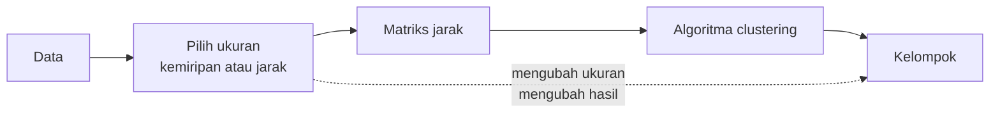

# Bab 4 — Similarity and Dissimilarity

## Learning Objectives

Setelah mempelajari bab ini, kamu mampu:

- [x] Menjelaskan *similarity* (kemiripan) dan *dissimilarity* (ketidakmiripan).
- [x] Menjelaskan hubungan antara *similarity* dan *distance* (jarak).
- [x] Menjelaskan mengapa ukuran kemiripan menentukan hasil clustering.
- [x] Menghitung *pairwise distance* dan menyusunnya menjadi *distance matrix* serta *similarity matrix*.
- [x] Membaca matriks jarak dan menemukan pasangan data paling mirip.
- [x] Mengenali perbedaan penanganan data numerik dan data kategori.
- [x] Menghindari kesalahan umum saat mengukur kemiripan.

## Introduction

Bab 1 mengatakan clustering mengelompokkan data yang **mirip**. Tetapi komputer tidak punya rasa "mirip". Ia hanya bisa menghitung angka. Jadi sebelum algoritma apa pun bisa bekerja, kita harus **menerjemahkan "mirip" menjadi angka**.

Bayangkan dua pelanggan: yang satu berusia 19 tahun dengan skor belanja 39, yang lain berusia 21 tahun dengan skor belanja 81. Mirip atau tidak? Jawabannya bergantung pada cara kita mengukur, dan cara mengukur itu **menentukan kelompok yang terbentuk**. Mengubah cara mengukur berarti mengubah hasil clustering, walaupun datanya sama.

Bab ini membahas konsepnya secara umum. Bab 5 melanjutkannya dengan rumus jarak yang spesifik (Euclidean, Manhattan, Minkowski, cosine).

## Fundamental Concepts

| Istilah | Arti |
|---|---|
| **Similarity** | Ukuran seberapa **mirip** dua data. Makin besar, makin mirip |
| **Dissimilarity** | Ukuran seberapa **berbeda** dua data. Makin besar, makin berbeda |
| **Distance** (jarak) | Bentuk dissimilarity yang memenuhi aturan tertentu (lihat di bawah). Jarak 0 berarti identik |
| **Pairwise distance** | Jarak antara **sepasang** data. Dihitung untuk semua pasangan |
| **Distance matrix** | Tabel \( n \times n \) berisi jarak setiap data ke setiap data lain |
| **Similarity matrix** | Tabel \( n \times n \) berisi kemiripan setiap pasangan data |

### Similarity vs distance

Keduanya dua sisi dari hal yang sama:

- **Jarak kecil = mirip.** Dua data yang jaraknya 0 identik.
- **Similarity besar = mirip.** Dua data identik punya similarity maksimum (biasanya 1).

Karena itu, similarity dan distance sering diubah satu sama lain. Salah satu cara sederhana:

$$
s = \frac{1}{1 + d}
$$

dengan \( d \) jarak dan \( s \) kemiripan. Jika \( d = 0 \) maka \( s = 1 \) (identik), dan makin besar \( d \) makin kecil \( s \), mendekati 0. Cara lain untuk similarity yang bernilai antara 0 dan 1 adalah \( d = 1 - s \).

## Detailed Explanation

### Mengapa pengukuran kemiripan begitu penting?

Algoritma clustering hampir selalu bekerja dengan pola: "gabungkan data yang jaraknya kecil, pisahkan yang jaraknya besar". Artinya hasilnya **sepenuhnya bergantung pada jarak yang kamu hitung**. Jika jaraknya menyesatkan (misalnya satu fitur terlalu mendominasi), kelompoknya ikut menyesatkan, seberapa pun canggih algoritmanya.



### Aturan sebuah jarak

Agar disebut **jarak (metrik)** secara matematis, ukuran harus memenuhi empat sifat:

| Sifat | Arti | Contoh |
|---|---|---|
| **Tidak negatif** | \( d(a,b) \ge 0 \) | Jarak tidak bisa minus |
| **Identitas** | \( d(a,b) = 0 \) hanya jika \( a = b \) | Jarak nol berarti titik yang sama |
| **Simetri** | \( d(a,b) = d(b,a) \) | Jarak dari A ke B sama dengan dari B ke A |
| **Ketaksamaan segitiga** | \( d(a,c) \le d(a,b) + d(b,c) \) | Jalan langsung tidak lebih panjang dari jalan memutar |

Dua sifat pertama dan simetri langsung terlihat pada matriks jarak: tidak ada angka negatif, diagonalnya nol, dan matriksnya cermin terhadap diagonal.

### Pairwise distance dan distance matrix

Jika ada \( n \) data, jarak dihitung untuk **setiap pasangan**. Hasilnya disusun menjadi matriks \( n \times n \): sel baris \( i \) kolom \( j \) berisi jarak data ke-\( i \) dan data ke-\( j \). Karena simetris dan diagonalnya nol, hanya separuh matriks yang berisi informasi baru.

Untuk \( n = 5 \) data ada \( \frac{5 \times 4}{2} = 10 \) pasangan unik. Untuk \( n = 200 \) pelanggan ada \( \frac{200 \times 199}{2} = 19.900 \) pasangan. Jumlah pasangan tumbuh kira-kira **kuadrat** terhadap jumlah data, itulah mengapa matriks jarak berat untuk data yang sangat besar.

### Data numerik dan data kategori

| Jenis data | Contoh | Cara mengukur kemiripan |
|---|---|---|
| **Numerik** | Usia, pendapatan, skor | Selisih angka, lalu digabung menjadi jarak (Euclidean, Manhattan; Bab 5) |
| **Kategori biner** | Membeli produk X atau tidak (1 atau 0) | *Simple matching*, *Jaccard* |
| **Kategori umum** | Kota, jenis produk | Cocok atau tidak cocok. Ukuran khusus seperti Gower distance untuk data campuran |

Untuk data **biner**, dua ukuran yang sering dipakai:

- **Simple matching similarity** = banyak posisi yang sama dibagi banyak posisi:

$$
\text{SMC} = \frac{\text{jumlah posisi yang nilainya sama}}{\text{jumlah seluruh posisi}}
$$

- **Jaccard similarity** = hanya melihat posisi di mana **setidaknya satu** bernilai 1:

$$
J(a,b) = \frac{|a \cap b|}{|a \cup b|} = \frac{\text{posisi bernilai 1 pada keduanya}}{\text{posisi bernilai 1 pada salah satunya}}
$$

Jaccard cocok ketika "sama-sama tidak membeli" bukan bukti kemiripan. Dua orang yang sama-sama tidak membeli ribuan produk lain tidak otomatis mirip.

!!! warning "Jangan menganggap kode angka sebagai jarak"
    Jika `Gender` ditulis Female = 0 dan Male = 1, memasukkannya ke rumus jarak numerik menganggap "Male" lebih besar dari "Female" dan jaraknya 1. Itu bisa berguna sebagai kasus biner, tetapi untuk kategori dengan banyak nilai (misalnya kota = 1, 2, 3) **angka itu tidak punya urutan atau jarak**. Gunakan *encoding* yang tepat (Level 2 Bab 9).

## Mathematical Foundation

Untuk dua data numerik \( \mathbf{x} = (x_1, \dots, x_d) \) dan \( \mathbf{y} = (y_1, \dots, y_d) \), bentuk jarak yang paling umum adalah **jarak Euclidean**:

$$
d(\mathbf{x}, \mathbf{y}) = \sqrt{\sum_{j=1}^{d} (x_j - y_j)^2}
$$

Penjelasan simbol:

- \( d \) di ruas kiri adalah **jarak**, sedangkan \( d \) pada batas penjumlahan adalah **jumlah fitur** (dimensi). Dua hal berbeda yang kebetulan memakai huruf sama.
- \( x_j \) dan \( y_j \) adalah nilai fitur ke-\( j \) dari kedua data.
- \( (x_j - y_j)^2 \) adalah kuadrat selisih fitur ke-\( j \). Kuadrat membuat selisih selalu positif dan menekankan selisih yang besar.
- \( \sum \) menjumlahkan semua fitur, dan akar kuadrat mengembalikan satuan ke satuan semula.

Rumus ini diuraikan penuh di Bab 5. Di sini kita memakainya untuk menghitung matriks jarak.

### Contoh hitung manual

Pelanggan 2 berusia 21, berpendapatan 15, dan bernilai belanja 81. Pelanggan 4 berusia 23, berpendapatan 16, dan bernilai belanja 77.

1. Selisih tiap fitur: usia \( 21 - 23 = -2 \), pendapatan \( 15 - 16 = -1 \), skor \( 81 - 77 = 4 \).
2. Kuadratkan: \( 4 \), \( 1 \), \( 16 \).
3. Jumlahkan: \( 4 + 1 + 16 = 21 \).
4. Akar: \( \sqrt{21} \approx 4{,}58 \).

Jarak 4,58 termasuk kecil. Kemiripannya \( s = \frac{1}{1 + 4{,}58} \approx 0{,}179 \).

**Interpretasi.** Pelanggan 2 dan 4 hanya berbeda sedikit di semua fitur, jadi jaraknya kecil dan kemiripannya relatif tinggi. Nilai 0,179 tampak kecil karena rumus \( 1/(1+d) \) menyusut cepat. Yang penting adalah **urutannya**: pasangan dengan jarak lebih kecil punya similarity lebih besar.

## Python Implementation

Kita kerjakan dalam tujuh langkah kecil. **Setiap potongan kode diikuti penjelasannya.** Skrip lengkapnya ada di `examples/level-3/04_similarity_and_dissimilarity.py`, dan versi notebook-nya di `notebooks/level-3/04-similarity-and-dissimilarity.ipynb`.

**Konteks masalah:** dari 200 pelanggan Mall Customers, kita ambil lima pelanggan pertama, menghitung seberapa mirip mereka satu sama lain, lalu melihat bagaimana skala fitur mengubah gambaran.

**Input yang diharapkan:** `data/mall_customers.csv`, dijalankan dari folder utama proyek.

### Langkah 1 — Ambil lima pelanggan

```python
--8<-- "level-3/04_similarity_and_dissimilarity.py:setup"
```

```text title="Output"
--8<-- "level-3/outputs/04/setup.txt"
```

**Penjelasan:**

- `pairwise_distances` dari scikit-learn menghitung jarak semua pasangan data. `StandardScaler` dipakai di Langkah 6.
- `cols` adalah tiga fitur numerik yang kita pakai: `Age`, `Annual Income (k$)`, dan `Spending Score (1-100)`.
- `df.loc[:4, [...]]` mengambil baris dari indeks 0 sampai **4 (termasuk 4)**, yaitu lima pelanggan pertama, dengan kolom yang kita pilih. Berbeda dengan potongan Python biasa, `.loc` **menyertakan** batas akhir.
- `.set_index("CustomerID")` menjadikan `CustomerID` sebagai label baris agar tabel jarak mudah dibaca.

### Langkah 2 — Hitung matriks jarak

Algoritma clustering tidak "melihat" pelanggan seperti manusia. Yang ia butuhkan adalah angka yang menyatakan **seberapa dekat** dua pelanggan. Cara termudah mengumpulkannya adalah menghitung jarak setiap pelanggan ke setiap pelanggan lain, lalu menyusunnya dalam satu tabel persegi yang disebut **matriks jarak** (*distance matrix*).

Kita memakai jarak Euclidean, yaitu jarak garis lurus yang sudah dikenal dari Bab 3, pada lima pelanggan dari Langkah 1. Dengan lima pelanggan, matriksnya cukup kecil untuk dibaca langsung, tetapi bentuknya sama dengan yang dipakai pada 200 pelanggan. Matriks ini juga menjadi masukan langkah-langkah berikutnya: mengubah jarak menjadi kemiripan (Langkah 3) dan memeriksa sifat-sifatnya (Langkah 4).

```python
--8<-- "level-3/04_similarity_and_dissimilarity.py:matrix"
```

```text title="Output"
--8<-- "level-3/outputs/04/matrix.txt"
```

**Cara membaca output:**

- Baris dan kolom diberi label `CustomerID` 1 sampai 5. Angka di baris `i` dan kolom `j` adalah jarak antara pelanggan `i` dan `j`.
- **Diagonal bernilai 0.00**, karena jarak pelanggan ke dirinya sendiri adalah nol.
- Tabelnya **simetris**: jarak 1 ke 2 (42,05) sama dengan jarak 2 ke 1. Karena itu cukup separuh tabel yang berisi informasi, dan sifat ini kita periksa resmi di Langkah 4.
- **Pasangan paling dekat** adalah pelanggan 2 dan 4 (4,58). Lihat data di Langkah 1: keduanya muda (21 dan 23 tahun), berpendapatan sama (15 dan 16), dan sama-sama berbelanja tinggi (skor 81 dan 77).
- **Pasangan paling jauh** adalah pelanggan 2 dan 3 (75,01). Usia dan pendapatan keduanya hampir sama, tetapi skor belanjanya 81 melawan 6.
- Contoh membaca satu baris: pelanggan terdekat dari pelanggan 1 adalah pelanggan 5 (12,21), karena skor belanja mereka mirip (39 dan 40), sedangkan selisih usianya 12 tahun.
- Perhatikan bahwa angka jarak sebagian besar ditentukan oleh `Spending Score`, fitur dengan selisih terbesar antarpelanggan (dari 6 sampai 81). Fitur berskala besar mendominasi jarak. Masalah ini kita bahas di Langkah 6.

**Penjelasan:**

- `five.to_numpy()` mengubah tabel menjadi larik NumPy.
- `pairwise_distances(..., metric="euclidean")` mengembalikan matriks 5 × 5: jarak Euclidean setiap pelanggan ke setiap pelanggan lain.
- `pd.DataFrame(D, index=..., columns=...)` memberi label `CustomerID` pada baris dan kolom, dan `.round(2)` membulatkan dua angka di belakang koma.

### Langkah 3 — Ubah jarak menjadi kemiripan

Matriks di Langkah 2 mengukur **ketidakmiripan**: makin besar angkanya, makin berbeda dua pelanggan. Sebagian metode, dan sebagian cara berpikir kita, lebih natural dengan arah sebaliknya: makin besar angkanya, makin **mirip**. Langkah ini mengubah jarak menjadi kemiripan agar kita bisa berpindah di antara dua sudut pandang itu.

Rumus yang dipakai, \( s = 1/(1+d) \), sederhana dan punya sifat yang berguna: jarak 0 menghasilkan kemiripan 1 (identik), sedangkan jarak yang makin besar menghasilkan kemiripan yang makin mendekati 0 tetapi tidak pernah negatif. Angka `1` di penyebut mencegah pembagian dengan nol saat jaraknya 0.

```python
--8<-- "level-3/04_similarity_and_dissimilarity.py:similarity"
```

```text title="Output"
--8<-- "level-3/outputs/04/similarity.txt"
```

**Cara membaca output:**

- **Diagonal bernilai 1.000**: tiap pelanggan identik dengan dirinya sendiri (jarak 0 menjadi kemiripan 1).
- Kemiripan tertinggi di luar diagonal adalah pelanggan 2 dan 4 (**0.179**). Ini pasangan yang sama dengan jarak terkecil di Langkah 2 (4,58), karena \( 1/(1+4{,}58) \approx 0{,}179 \).
- Kemiripan terendah adalah pelanggan 2 dan 3 (**0.013**), pasangan dengan jarak terbesar (75,01).
- Urutannya **terbalik** dari matriks jarak: jarak kecil menjadi kemiripan besar, dan sebaliknya. Tidak ada informasi baru, hanya cara lain membacanya.
- Sebagian besar angka kecil (0,01 sampai 0,08) karena jarak antar pelanggan di data mentah relatif besar. Kemiripan ini cocok untuk membandingkan urutan, tetapi nilainya bukan persentase.

**Penjelasan:**

- `S = 1 / (1 + D)` menerapkan rumus \( s = 1/(1+d) \) pada **seluruh matriks sekaligus**. NumPy mengerjakannya untuk setiap sel.
- Hasilnya matriks kemiripan: diagonalnya 1 (tiap pelanggan identik dengan dirinya sendiri) dan angka lain di antara 0 dan 1.

### Langkah 4 — Periksa sifat matriks jarak

Sebelum matriks jarak dipakai oleh algoritma, kita perlu yakin bahwa ia memang berperilaku seperti jarak. Kalau tidak, hasil clustering bisa janggal dan sulit dilacak penyebabnya, misalnya jarak negatif atau jarak A ke B berbeda dari B ke A.

Karena itu kita memeriksa tiga sifat dasar secara eksplisit: **simetris**, **diagonal nol**, dan **tidak negatif**. Pemeriksaan semacam ini murah, dan berguna sebagai kebiasaan, terutama saat kelak kita membuat matriks jarak sendiri dengan metrik buatan. Terakhir, kita memakai matriks itu untuk menjawab pertanyaan praktis: siapa pasangan pelanggan yang paling mirip?

```python
--8<-- "level-3/04_similarity_and_dissimilarity.py:check"
```

```text title="Output"
--8<-- "level-3/outputs/04/check.txt"
```

**Cara membaca output:**

- Tiga baris pertama berisi `True`, artinya matriks dari Langkah 2 memenuhi sifat jarak: simetris, diagonal nol, dan tidak ada nilai negatif. Bila salah satunya `False`, ada yang keliru pada perhitungan atau datanya.
- Pemeriksaan ini tidak mencakup sifat keempat jarak, yaitu ketaksamaan segitiga. Untuk jarak Euclidean sifat itu dijamin berlaku, jadi tidak perlu dicek.
- `Pasangan paling mirip: pelanggan 2 dan 4 dengan jarak 4.58` adalah pasangan dengan jarak terkecil di luar diagonal, sesuai yang kita lihat langsung di tabel Langkah 2. Pada tabel kecil kita bisa menemukannya dengan mata, tetapi pada 200 pelanggan cara kode ini yang diperlukan.

**Penjelasan:**

- `np.allclose(D, D.T)` memeriksa **simetri**: `D.T` adalah transpos (baris dan kolom ditukar). Jika sama, maka \( d(a,b) = d(b,a) \).
- `np.diag(D)` mengambil diagonal, dan kita periksa semuanya nol.
- `(D >= 0).all()` memeriksa tidak ada jarak negatif. `bool(...)` mengubah hasilnya menjadi `True` atau `False` biasa.
- `D + np.diag([np.inf] * len(D))` menambahkan tak hingga pada diagonal supaya jarak nol ke diri sendiri **tidak terpilih** sebagai yang terkecil.
- `masked.argmin()` memberi posisi terkecil dalam bentuk satu angka, dan `np.unravel_index(..., masked.shape)` mengubahnya kembali menjadi (baris, kolom). Itulah pasangan paling mirip.

### Langkah 5 — Data kategori biner

Jarak Euclidean cocok untuk angka seperti usia dan pendapatan. Namun banyak data berupa **ya/tidak**: apakah pelanggan membeli produk tertentu atau tidak. Untuk data biner seperti ini, selisih angka kurang bermakna, sehingga kita memakai ukuran lain yang menghitung **kecocokan**.

Langkah ini membandingkan dua ukuran pada dua pelanggan dan lima produk: *simple matching* (menghitung semua posisi yang sama) dan *Jaccard* (hanya memperhatikan produk yang dibeli setidaknya oleh salah satu). Perbedaan keduanya penting: pada data belanja, kebanyakan produk tidak dibeli siapa pun, jadi dua pelanggan yang sama-sama **tidak** membeli suatu produk tidak banyak memberi tahu bahwa mereka mirip.

```python
--8<-- "level-3/04_similarity_and_dissimilarity.py:categorical"
```

```text title="Output"
--8<-- "level-3/outputs/04/categorical.txt"
```

**Cara membaca output:**

- Data kedua pelanggan: `a = [1, 1, 0, 0, 1]` dan `b = [1, 0, 0, 1, 1]`. Posisi yang sama adalah posisi 1, 3, dan 5, jadi `Jumlah posisi yang sama: 3`.
- **Simple matching similarity = 3 / 5 = 0.6.** Posisi 3 (keduanya 0) ikut dihitung sebagai kecocokan.
- Posisi **keduanya membeli** adalah 1 dan 5 (2 posisi). Posisi **salah satunya membeli** adalah 1, 2, 4, dan 5 (4 posisi). Posisi 3 tidak dihitung karena tidak ada yang membeli.
- **Jaccard similarity = 2 / 4 = 0.5**, dan **Jaccard distance = 1 − 0.5 = 0.5**.
- Hasilnya berbeda (0,6 melawan 0,5) karena Jaccard mengabaikan produk yang tidak dibeli siapa pun. Makin banyak produk yang tidak dibeli keduanya, makin besar simple matching tertarik naik, sedangkan Jaccard tidak terpengaruh.

**Penjelasan:**

- `a` dan `b` adalah dua pelanggan dan lima produk: 1 berarti membeli, 0 berarti tidak.
- `(a == b).sum()` menghitung posisi yang sama (di sini 3). Bagi dengan 5 menghasilkan *simple matching similarity*.
- `(a == 1) & (b == 1)` bernilai benar hanya jika **keduanya** membeli. `(a == 1) | (b == 1)` bernilai benar jika **salah satunya** membeli. `.sum()` menghitung masing-masing.
- Rasio keduanya adalah *Jaccard similarity*, dan `1 - ...` menghasilkan *Jaccard distance*.

### Langkah 6 — Kesalahan umum: skala fitur

Di Langkah 2 kita melihat bahwa `Spending Score` tampak mendominasi jarak. Langkah ini membuktikannya dengan angka, lalu menunjukkan perbaikannya. Jarak Euclidean menjumlahkan **kuadrat selisih** semua fitur. Fitur dengan rentang selisih besar akan menenggelamkan fitur lain, walaupun fitur lain itu sama pentingnya.

Cara memperbaikinya adalah **standardisasi**: mengubah tiap fitur menjadi skala yang sebanding (rata-rata 0, simpangan baku 1) sebelum menghitung jarak. Kita mulai dengan membedah satu pasangan pelanggan (1 dan 2) untuk melihat kontribusi tiap fitur, lalu menghitung ulang seluruh matriks setelah standardisasi.

```python
--8<-- "level-3/04_similarity_and_dissimilarity.py:scale"
```

```text title="Output"
--8<-- "level-3/outputs/04/scale.txt"
```

**Cara membaca output:**

- Selisih pelanggan 1 dan 2: `Age` −2, `Annual Income` 0, `Spending Score` −42. Tanda minus hanya menunjukkan pelanggan 1 lebih kecil nilainya, dan tidak berpengaruh karena selisih dikuadratkan.
- Kuadratnya: 4, 0, dan **1764**. Totalnya 1768, dan akarnya 42,05, yaitu jarak 1 ke 2 di Langkah 2. `Spending Score` menyumbang 1764 dari 1768 (**sekitar 99,8%**) dari jarak itu. Usia dan pendapatan nyaris tidak berpengaruh.
- Matriks setelah standardisasi punya angka yang jauh lebih kecil (0,21 sampai 2,91 dibanding 4,58 sampai 75,01), karena satuannya kini simpangan baku, bukan satuan asli.
- Pada lima pelanggan ini, **urutan kedekatan tidak berubah**: pasangan terdekat tetap 2 dan 4 (0,21), dan terjauh tetap 2 dan 3 (2,91). Standardisasi baru mengubah urutan bila fitur-fiturnya "menarik" ke arah yang berbeda dan besarnya timpang, dan kondisi itu tidak terjadi pada contoh kecil ini.
- Yang berubah adalah **perbandingan besarnya**. Sebelum standardisasi, jarak 1 ke 5 (12,21) sekitar 2,7 kali jarak 2 ke 4 (4,58). Setelah standardisasi, jarak 1 ke 5 (0,87) sekitar 4,1 kali jarak 2 ke 4 (0,21).

**Penjelasan:**

- `raw[0] - raw[1]` adalah selisih tiap fitur antara pelanggan 1 dan 2. Kita cetak selisih dan **kuadrat selisih** (kontribusi tiap fitur pada jarak).
- `StandardScaler().fit(df[cols])` mempelajari rata-rata dan simpangan baku tiap fitur dari **seluruh 200 pelanggan**. `.transform(five)` lalu mengubah lima pelanggan menjadi skala yang sebanding (rata-rata 0, simpangan baku 1). Standardisasi dibahas di Level 2 Bab 10.
- Kita hitung ulang matriks jarak pada data terstandardisasi untuk membandingkannya.

### Langkah 7 — Visualisasi matriks jarak

Tabel angka mudah dibaca untuk lima pelanggan, tetapi sulit dipindai bila lebih banyak. Peta warna (*heatmap*) memungkinkan kita menangkap pola jarak sekilas pandang: daerah terang berarti dekat, daerah gelap berarti jauh.

Kita menggambar dua matriks berdampingan, sebelum dan sesudah standardisasi dari Langkah 6, supaya pengaruh standardisasi terlihat langsung dalam satu gambar.

```python
--8<-- "level-3/04_similarity_and_dissimilarity.py:plot"
```


**Cara membaca gambar:**

- Setiap sel adalah satu pasangan pelanggan, dan angkanya sama dengan tabel di Langkah 2 (kiri) dan Langkah 6 (kanan), dibulatkan satu angka di belakang koma. Sel kuning terang adalah jarak kecil, dan sel ungu tua adalah jarak besar (`viridis_r`).
- **Diagonal kuning** adalah jarak 0 ke diri sendiri. Gambar tampak **simetris** terhadap diagonal, mencerminkan sifat yang diperiksa di Langkah 4.
- Sel terang di luar diagonal ada pada pasangan **2 dan 4** (4,6 pada panel kiri dan 0,2 pada panel kanan), dan agak terang pada pasangan 1 dan 5. Pasangan paling gelap adalah **2 dan 3** (75,0 dan 2,9), diikuti 3 dan 4.
- **Pola warna kedua panel hampir sama.** Ini sejalan dengan Langkah 6: urutan kedekatan pada lima pelanggan ini tidak berubah oleh standardisasi. Yang berbeda adalah skala angkanya (maksimum 75,0 melawan 2,9).
- Warna pada tiap panel dihitung dari skalanya sendiri, jadi warna gelap di kiri dan di kanan tidak berarti jarak yang sama besar. Bandingkan polanya, bukan warna absolutnya.

**Penjelasan:**

- `ax.imshow(M, cmap="viridis_r")` menggambar matriks sebagai **peta warna**. Dengan `viridis_r`, jarak kecil berwarna terang (kuning) dan jarak besar berwarna gelap.
- `ax.set_xticks(range(5), labels=...)` menuliskan `CustomerID` di sumbu.
- Dua `for` bertingkat menulis angka jarak di tiap sel dengan `ax.text(...)`. Warna teksnya diganti (hitam pada latar terang, putih pada latar gelap) agar tetap terbaca.

## Code Explanation

| Yang kamu lihat | Artinya |
|---|---|
| `pairwise_distances(X)` | Matriks jarak semua pasangan baris `X` |
| `D.T` | Transpos matriks (baris dan kolom ditukar) |
| `1 / (1 + D)` | Mengubah jarak menjadi kemiripan di seluruh matriks |
| `np.diag(D)` | Mengambil diagonal matriks |
| `(a == b).sum()` | Menghitung posisi yang sama |
| `StandardScaler().fit(...).transform(...)` | Menyamakan skala fitur |

Pola umumnya: **data → matriks jarak → periksa sifat → baca pasangan paling mirip.**

## How to Run

Jalankan dari **folder utama proyek**:

```powershell
pip install -r requirements-notebooks.txt
python examples/level-3/04_similarity_and_dissimilarity.py
```

Skrip membuat satu gambar di `docs/assets/level-3/`. Untuk notebook:

```powershell
jupyter notebook notebooks/level-3/04-similarity-and-dissimilarity.ipynb
```

## Expected Output

Semua output berasal dari eksekusi nyata skrip (Python 3.14.10, NumPy 2.5.2, pandas 3.0.5, scikit-learn 1.9.0, matplotlib 3.11.1). Output setiap langkah ditampilkan langsung di bawah kodenya pada bagian [Python Implementation](#python-implementation).


### Interpretasi output

**Matriks jarak.** Jarak pelanggan 2 dan 4 hanya 4,58, yang terkecil di tabel, jadi keduanya pasangan paling mirip. Jarak pelanggan 2 dan 3 adalah 75,01, yang terbesar. Pelanggan 3 punya skor belanja 6 sedangkan pelanggan 2 punya 81, selisih 75 pada skor belanja.

**Sifat matriks.** Ketiga pemeriksaan menghasilkan `True`: matriks simetris, diagonal nol, dan tidak ada jarak negatif.

**Matriks kemiripan.** Pasangan (2, 4) punya similarity tertinggi di luar diagonal (0,179). Urutannya sejalan dengan jarak, hanya terbalik arah.

**Data biner.** Kedua pelanggan sama pada 3 dari 5 produk, sehingga simple matching = 0,6. Jaccard hanya memperhatikan produk yang dibeli salah satunya: 2 dibeli keduanya dari 4 yang dibeli salah satunya, jadi Jaccard = 0,5 dan jarak Jaccard = 0,5. Nilainya berbeda karena Jaccard tidak menghitung posisi "sama-sama 0".

**Skala fitur.** Antara pelanggan 1 dan 2, selisih usia −2, selisih pendapatan 0, dan selisih skor belanja −42. Kuadratnya 4, 0, dan 1764. Dari jumlah 1768 itu, sekitar **99,8%** datang dari skor belanja. Jarak 42,05 antara pelanggan 1 dan 2 sebenarnya hampir seluruhnya hanya soal skor belanja. Setelah standardisasi, tiap fitur punya bobot sebanding, dan angka jaraknya berubah ke skala sekitar 0 sampai 3 (misalnya 1,64 untuk pelanggan 1 dan 2). Perhatikan juga bahwa **urutan pasangan bisa berubah**: sebelum standardisasi, jarak pelanggan 1 ke 4 (38,22) lebih kecil daripada jarak ke 2 (42,05), dan sesudahnya 1,50 melawan 1,64. Pada lima pelanggan ini urutannya kebetulan sama, tetapi pada Bab 5 kita akan melihat bahwa pada seluruh 200 pelanggan tetangga terdekat banyak yang berubah.

## Practical Examples

**Rekomendasi produk.** Pelanggan dengan pola pembelian mirip (Jaccard tinggi) bisa direkomendasikan produk yang sama. Di sini Jaccard lebih masuk akal daripada simple matching, karena ribuan produk yang sama-sama tidak dibeli bukan bukti kemiripan.

**Segmentasi pelanggan.** Jika kamu memasukkan pendapatan dalam rupiah (jutaan) dan skor belanja (1 sampai 100) tanpa penyamaan skala, hasil clustering hanya akan membagi pelanggan menurut pendapatan. Itu kesalahan umum yang bisa kamu hindari dengan memeriksa kontribusi tiap fitur seperti di Langkah 6.

**Deteksi kemiripan dokumen.** Dokumen dapat dibuat menjadi vektor jumlah kata. Pada kasus itu *cosine similarity* (Bab 5) lebih cocok daripada Euclidean, karena panjang dokumen tidak boleh mendominasi.

### Kesalahan umum

| Kesalahan | Akibat | Cara menghindari |
|---|---|---|
| Memakai fitur dengan skala berbeda tanpa menyamakan | Fitur ber-skala besar mendominasi jarak | Standardisasi atau normalisasi sebelum menghitung jarak |
| Memperlakukan kode kategori sebagai angka | Jarak mengada-ada (kota 1 "lebih dekat" ke 2 daripada 3) | Pakai *one-hot encoding* atau ukuran khusus kategori |
| Mengira similarity dan distance bisa dicampur | Algoritma memilih pasangan yang paling **berbeda** | Pastikan arahnya: jarak kecil = mirip, similarity besar = mirip |
| Memasukkan kolom ID sebagai fitur | Jarak dipengaruhi nomor urut | Buang kolom ID (Level 2 Bab 11) |
| Memakai Euclidean untuk data biner jarang | Kesamaan "sama-sama 0" mengaburkan | Pakai Jaccard |

## Hands-on Exercises

1. Hitung manual jarak Euclidean antara pelanggan 1 (19, 15, 39) dan pelanggan 5 (31, 17, 40). Samakah dengan angka di matriks?
2. Ubah `five` menjadi sepuluh pelanggan pertama (`df.loc[:9, ...]`). Siapa pasangan paling mirip?
3. Berapa banyak pasangan unik pada 200 data?
4. Hitung Jaccard similarity untuk \( a = [1,0,1,0,0,1] \) dan \( b = [1,1,1,0,0,0] \). Bandingkan dengan simple matching.
5. Mengapa `Spending Score` mendominasi jarak pelanggan 1 dan 2 pada data mentah?

??? question "Jawaban"
    1. Selisih: \( 19-31 = -12 \), \( 15-17 = -2 \), \( 39-40 = -1 \). Kuadrat: 144, 4, 1. Jumlah: 149. Akar: \( \sqrt{149} \approx 12{,}21 \). Sama dengan sel (1, 5) pada matriks, yaitu 12,21.
    2. Jalankan kodenya. Pasangan (2, 4) tetap kandidat kuat karena jaraknya hanya 4,58, tetapi ada pelanggan baru yang bisa lebih dekat. Periksa matriksnya.
    3. \( \frac{200 \times 199}{2} = 19.900 \) pasangan.
    4. Posisi yang sama: posisi 1 (1,1), 3 (1,1), 4 (0,0), 5 (0,0) = 4 dari 6, jadi simple matching \( 4/6 \approx 0{,}667 \). Jaccard: keduanya 1 di posisi 1 dan 3 (2 posisi). Salah satunya 1 di posisi 1, 2, 3, 6 (4 posisi). Jaccard = \( 2/4 = 0{,}5 \). Simple matching lebih tinggi karena menghitung posisi "sama-sama 0".
    5. Skor belanja berkisar 1 sampai 99 dan selisihnya antara kedua pelanggan 42, sedangkan usia hanya selisih 2 dan pendapatan 0. Karena jarak mengkuadratkan selisih, perbedaan besar menjadi jauh lebih berpengaruh (1764 melawan 4).

## Troubleshooting

| Masalah | Penyebab | Solusi |
|---|---|---|
| `ValueError: could not convert string to float` | Ada kolom teks (misalnya `Gender`) di data yang dihitung jaraknya | Pilih hanya kolom numerik atau lakukan encoding dulu |
| Diagonal bukan nol | Memakai ukuran similarity, bukan jarak | Periksa apakah ukurannya jarak (diagonal 0) atau similarity (diagonal 1) |
| Pasangan paling mirip adalah titik dengan dirinya sendiri | Diagonal nol ikut terpilih saat mencari minimum | Isi diagonal dengan `np.inf` seperti di Langkah 4 |
| `MemoryError` untuk data besar | Matriks \( n \times n \) terlalu besar | Hitung per bagian atau pakai sampel |
| Jarak tidak berubah setelah standardisasi | Menggunakan variabel data lama | Pastikan memakai hasil `transform`, bukan data awal |

## Summary

- **Similarity** mengukur kemiripan dan **dissimilarity** (jarak) mengukur perbedaan. Keduanya saling berbalik: jarak kecil berarti mirip, similarity besar berarti mirip.
- Hasil clustering bergantung pada cara kita mengukur kemiripan, jadi pemilihan ukuran harus disadari.
- **Distance matrix** berisi jarak semua pasangan. Ia tidak negatif, simetris, dan berdiagonal nol.
- Data numerik memakai jarak Euclidean atau sejenisnya. Data biner memakai *simple matching* atau *Jaccard*.
- Pada data mentah Mall Customers, 99,8% jarak antara pelanggan 1 dan 2 berasal dari satu fitur (skor belanja). Karena itu **skala fitur** harus disamakan dulu.

**Bab berikutnya:** Bab 5 membahas rumus jarak secara rinci: Euclidean, Manhattan, Minkowski, dan cosine.

## References

- Tan, P.-N., Steinbach, M., Karpatne, A., & Kumar, V. *Introduction to Data Mining* (Pearson), bab tentang ukuran kemiripan dan ketidakmiripan.
- Scikit-learn documentation: [`pairwise_distances`](https://scikit-learn.org/stable/modules/generated/sklearn.metrics.pairwise_distances.html) dan [*Pairwise metrics*](https://scikit-learn.org/stable/modules/metrics.html).
- Scikit-learn documentation: [`StandardScaler`](https://scikit-learn.org/stable/modules/generated/sklearn.preprocessing.StandardScaler.html).
- Gower, J. C. (1971). A general coefficient of similarity and some of its properties. *Biometrics*, 27(4), 857–871.
