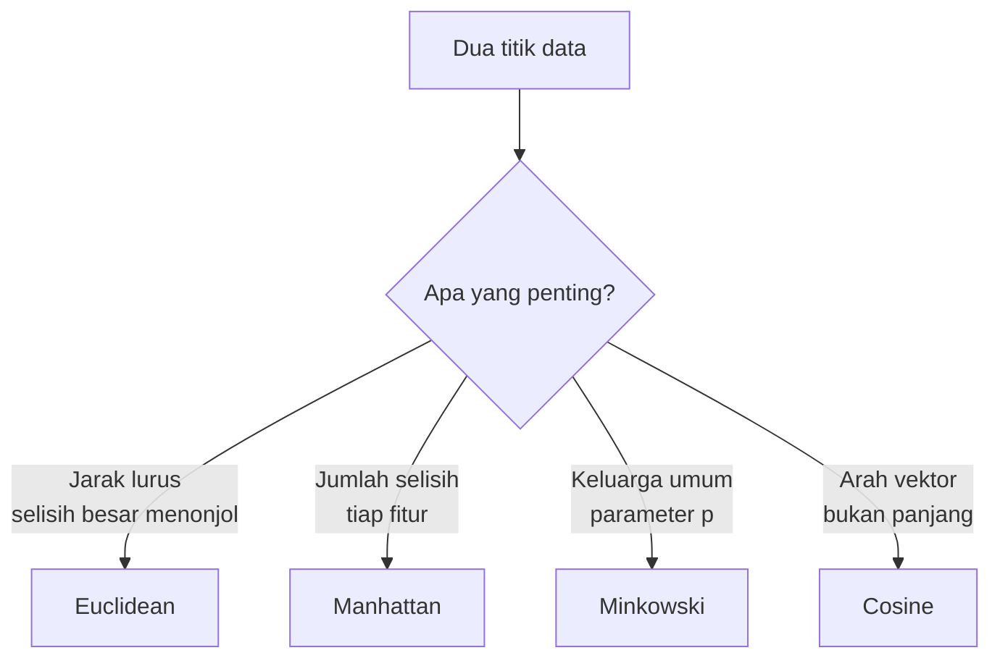
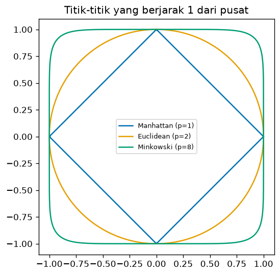
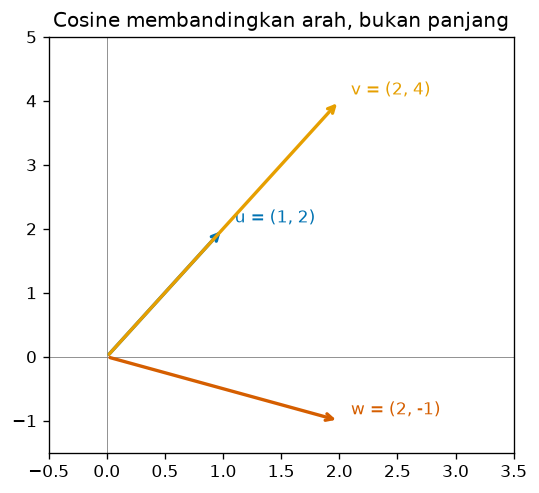

# Bab 5 — Distance Metrics

## Learning Objectives

Setelah mempelajari bab ini, kamu mampu:

- [x] Menjelaskan mengapa *distance metric* (metrik jarak) menentukan hasil clustering.
- [x] Menghitung jarak *Euclidean*, *Manhattan*, dan *Minkowski* secara manual dan dengan Python.
- [x] Menghitung *cosine similarity* dan *cosine distance*, serta menjelaskan bedanya dengan jarak biasa.
- [x] Menjelaskan arti tiap simbol pada rumus jarak.
- [x] Memilih metrik yang sesuai untuk jenis data tertentu.
- [x] Menjelaskan bagaimana skala fitur mengubah jarak dan tetangga terdekat.

## Introduction

Bab 4 menyimpulkan bahwa kemiripan harus diterjemahkan menjadi angka. Sekarang kita belajar **rumus-rumus** untuk melakukannya. Pilihan rumus penting: dua metrik yang berbeda bisa menyebut pasangan data yang sama sebagai "dekat" atau "jauh", dan itu mengubah kelompok yang terbentuk.

Bab ini membahas empat ukuran yang paling sering dipakai: **Euclidean**, **Manhattan**, **Minkowski**, dan **cosine**. Untuk tiap ukuran kita pelajari intuisinya, rumusnya, hitungan manualnya, kapan dipakai, dan kodenya.

## Fundamental Concepts

| Istilah | Arti |
|---|---|
| **Distance metric** | Aturan menghitung jarak dua titik yang memenuhi sifat jarak (Bab 4) |
| **Euclidean distance** | Jarak garis lurus, "jarak burung terbang" |
| **Manhattan distance** | Jumlah selisih mutlak tiap fitur, "jarak berjalan di kota berkotak-kotak" |
| **Minkowski distance** | Keluarga jarak yang menggeneralisasi Euclidean dan Manhattan dengan parameter \( p \) |
| **Cosine similarity** | Ukuran kesamaan **arah** dua vektor, tanpa memperhatikan panjangnya |
| **Cosine distance** | \( 1 - \) cosine similarity |
| **Vector** | Titik data dipandang sebagai anak panah dari titik asal |

## Detailed Explanation

### Intuisi: tiga cara berjalan dari A ke B

Bayangkan kamu di titik A dan ingin ke titik B yang 3 blok ke timur dan 4 blok ke utara.

- **Euclidean:** terbang lurus. Jaraknya \( \sqrt{3^2 + 4^2} = 5 \) blok.
- **Manhattan:** berjalan lewat jalan kota. Kamu harus menyusuri \( 3 + 4 = 7 \) blok.
- **Cosine:** tidak peduli jarak, hanya bertanya "apakah kita **menghadap arah yang sama** dari titik asal?".



### Euclidean distance

Jarak garis lurus antara dua titik. Ini ukuran paling umum dan dasar K-Means (Level 4). Ia **menonjolkan selisih besar** karena selisih dikuadratkan.

**Kapan dipakai:** data numerik kontinu dengan skala sebanding, dan kamu ingin pengertian "jarak" sehari-hari.

### Manhattan distance

Jumlah selisih mutlak tiap fitur. Karena tidak dikuadratkan, ia **kurang terpengaruh oleh satu selisih yang sangat besar** dibanding Euclidean.

**Kapan dipakai:** data berdimensi tinggi, data dengan outlier pada satu fitur, atau fitur yang bersifat "bertahap" seperti hitungan.

### Minkowski distance

Rumus umum dengan parameter \( p \):

- \( p = 1 \) menghasilkan Manhattan.
- \( p = 2 \) menghasilkan Euclidean.
- Makin besar \( p \), makin yang menentukan hanyalah selisih terbesar. Pada \( p \to \infty \), hasilnya **jarak Chebyshev**, yaitu selisih terbesar dari semua fitur.

**Kapan dipakai:** ketika kamu ingin menyetel seberapa kuat selisih besar ditonjolkan.

### Bentuk "jarak yang sama"

Cara melihat perbedaan metrik: gambarkan semua titik yang berjarak 1 dari pusat.



- Manhattan berbentuk **belah ketupat**.
- Euclidean berbentuk **lingkaran**.
- Minkowski dengan \( p \) besar makin mendekati **persegi**.

Artinya, tiap metrik punya definisi sendiri tentang "titik-titik yang sama dekatnya". Dua titik yang "tetangga terdekat" menurut satu metrik belum tentu demikian menurut metrik lain.

### Cosine similarity dan cosine distance

Cosine melihat **sudut** antara dua vektor, bukan panjang atau jaraknya:

- Searah: cosine similarity = 1.
- Tegak lurus: cosine similarity = 0.
- Berlawanan arah: cosine similarity = −1.



Vektor \( \mathbf{u} = (1, 2) \) dan \( \mathbf{v} = (2, 4) \) searah, hanya panjangnya berbeda. Menurut cosine keduanya **identik** (jarak 0), padahal menurut Euclidean mereka berjarak 2,24.

**Kapan dipakai:** data teks (jumlah kata), profil preferensi, atau situasi lain ketika **proporsi** lebih penting daripada **besaran**. Dua dokumen yang membicarakan topik sama tetapi berbeda panjang tetap dianggap mirip.

### Perbandingan ringkas

| Metrik | Yang diukur | Sensitif selisih besar | Cocok untuk |
|---|---|---|---|
| Euclidean | Jarak garis lurus | Tinggi | Data numerik berskala sebanding, ruang berdimensi rendah |
| Manhattan | Jumlah selisih mutlak | Sedang | Dimensi tinggi, data dengan outlier |
| Minkowski (\( p \)) | Keluarga umum | Naik bersama \( p \) | Menyetel kepekaan |
| Cosine | Arah vektor | Tidak berlaku | Teks, proporsi, data jarang (*sparse*) |

### Pengaruh skala fitur

Semua jarak di atas bergantung pada **angka mentah** tiap fitur. Fitur berskala besar (misalnya gaji dalam rupiah) akan mendominasi fitur berskala kecil (misalnya usia). Solusinya adalah menyamakan skala lebih dulu dengan *feature scaling* (Level 2 Bab 10), misalnya standardisasi. Pada praktik di bawah kita mengukur seberapa besar pengaruhnya pada Mall Customers.

## Mathematical Foundation

Untuk dua titik \( \mathbf{x} = (x_1, \dots, x_d) \) dan \( \mathbf{y} = (y_1, \dots, y_d) \) dengan \( d \) fitur:

**Euclidean:**

$$
d_{\text{Euc}}(\mathbf{x}, \mathbf{y}) = \sqrt{\sum_{i=1}^{d} (x_i - y_i)^2}
$$

**Manhattan:**

$$
d_{\text{Man}}(\mathbf{x}, \mathbf{y}) = \sum_{i=1}^{d} |x_i - y_i|
$$

**Minkowski** dengan parameter \( p \ge 1 \):

$$
d_{p}(\mathbf{x}, \mathbf{y}) = \left( \sum_{i=1}^{d} |x_i - y_i|^{p} \right)^{1/p}
$$

**Cosine similarity** dan **cosine distance**:

$$
\cos(\theta) = \frac{\mathbf{x} \cdot \mathbf{y}}{\lVert \mathbf{x} \rVert \, \lVert \mathbf{y} \rVert}
= \frac{\sum_{i=1}^{d} x_i y_i}{\sqrt{\sum_{i=1}^{d} x_i^2}\;\sqrt{\sum_{i=1}^{d} y_i^2}},
\qquad
d_{\cos}(\mathbf{x}, \mathbf{y}) = 1 - \cos(\theta)
$$

Penjelasan simbol:

- \( d \) pada batas penjumlahan adalah **jumlah fitur**. \( i \) adalah penomoran fitur dari 1 sampai \( d \).
- \( x_i \) dan \( y_i \) adalah nilai fitur ke-\( i \) pada kedua titik.
- \( |x_i - y_i| \) adalah selisih mutlak: selalu positif, apa pun arahnya.
- \( p \) adalah pangkat yang menyetel kepekaan. \( p = 1 \) Manhattan, \( p = 2 \) Euclidean.
- \( \mathbf{x} \cdot \mathbf{y} = \sum x_i y_i \) adalah **dot product** (hasil kali titik): kalikan fitur yang bersesuaian, lalu jumlahkan.
- \( \lVert \mathbf{x} \rVert = \sqrt{\sum x_i^2} \) adalah **panjang** (norma) vektor.
- \( \theta \) adalah sudut antara kedua vektor. Membagi dengan panjang membuat hasilnya hanya bergantung pada **arah**.

Tujuan tiap rumus: Euclidean, Manhattan, dan Minkowski mengukur **seberapa jauh**. Cosine mengukur **seberapa searah**.

### Contoh hitung manual

Titik \( A = (1, 2) \) dan \( B = (4, 6) \).

**Langkah 1: selisih per fitur.**

- Fitur 1: \( 4 - 1 = 3 \)
- Fitur 2: \( 6 - 2 = 4 \)

**Euclidean:**

$$
\sqrt{3^2 + 4^2} = \sqrt{9 + 16} = \sqrt{25} = 5
$$

**Manhattan:**

$$
|3| + |4| = 7
$$

**Minkowski \( p = 3 \):**

$$
\left(3^3 + 4^3\right)^{1/3} = (27 + 64)^{1/3} = 91^{1/3} \approx 4{,}498
$$

(Karena \( 4{,}5^3 = 91{,}125 \), hasilnya sedikit di bawah 4,5.)

**Chebyshev** (selisih terbesar): \( \max(3, 4) = 4 \).

**Interpretasi.** Urutannya Manhattan (7) > Euclidean (5) > Minkowski \( p=3 \) (4,498) > Chebyshev (4). Makin besar \( p \), makin kecil nilainya, mendekati selisih terbesar (4). Ini sesuai pola: \( p = 1 \) menjumlahkan semua selisih, \( p \to \infty \) hanya melihat yang terbesar.

**Cosine** untuk \( \mathbf{u} = (1, 2) \) dan \( \mathbf{v} = (2, 4) \):

1. Dot product: \( 1 \times 2 + 2 \times 4 = 2 + 8 = 10 \).
2. Panjang: \( \lVert \mathbf{u} \rVert = \sqrt{1 + 4} = \sqrt{5} \), \( \lVert \mathbf{v} \rVert = \sqrt{4 + 16} = \sqrt{20} \).
3. Hasil kali panjang: \( \sqrt{5} \times \sqrt{20} = \sqrt{100} = 10 \).
4. Cosine similarity: \( 10 / 10 = 1 \). Cosine distance: \( 1 - 1 = 0 \).

Untuk \( \mathbf{w} = (2, -1) \): dot product \( 1 \times 2 + 2 \times (-1) = 0 \), sehingga cosine similarity = 0 (tegak lurus) dan cosine distance = 1.

## Python Implementation

Kita kerjakan dalam enam langkah kecil. **Setiap potongan kode diikuti penjelasannya.** Skrip lengkapnya ada di `examples/level-3/05_distance_metrics.py`, dan versi notebook-nya di `notebooks/level-3/05-distance-metrics.ipynb`.

**Konteks masalah:** kita menghitung semua jarak untuk dua titik kecil, mencocokkannya dengan scikit-learn, membandingkan cosine, melihat bentuk jarak, lalu mengukur pengaruh skala fitur pada 200 pelanggan Mall Customers.

**Input yang diharapkan:** data titik dibuat di kode. Langkah 5 memakai `data/mall_customers.csv`.

### Langkah 1 — Siapkan dua titik

```python
--8<-- "level-3/05_distance_metrics.py:setup"
```

```text title="Output"
--8<-- "level-3/outputs/05/setup.txt"
```

**Penjelasan:**

- `A = np.array([1.0, 2.0])` dan `B = np.array([4.0, 6.0])` adalah dua titik dengan dua fitur. Kita memakai `1.0` (bukan `1`) agar tipenya desimal.
- `B - A` menghitung selisih tiap fitur sekaligus (NumPy mengurangkan elemen yang bersesuaian): `[3, 4]`.
- `np.abs(B - A)` mengambil nilai mutlaknya.

### Langkah 2 — Hitung dengan rumus

```python
--8<-- "level-3/05_distance_metrics.py:manual"
```

```text title="Output"
--8<-- "level-3/outputs/05/manual.txt"
```

**Penjelasan:**

- `np.sum((A - B) ** 2)` menjumlahkan kuadrat selisih, dan `np.sqrt(...)` mengakarkannya. Ini rumus Euclidean.
- `np.sum(np.abs(A - B))` adalah Manhattan.
- `np.sum(np.abs(A - B) ** p) ** (1 / p)` adalah Minkowski. Kita pilih `p = 3`.
- `np.max(np.abs(A - B))` memberi selisih terbesar, yaitu Chebyshev.
- `np.isclose(a, b)` memeriksa dua angka sama dalam toleransi pembulatan. Kita memakainya untuk membuktikan bahwa Minkowski dengan \( p=1 \) sama dengan Manhattan dan \( p=2 \) sama dengan Euclidean.
- `float(...)` dan `round(..., 4)` hanya merapikan tampilan angka.

### Langkah 3 — Periksa dengan scikit-learn

```python
--8<-- "level-3/05_distance_metrics.py:sklearn"
```

```text title="Output"
--8<-- "level-3/outputs/05/sklearn.txt"
```

**Penjelasan:**

- `np.vstack([A, B])` menumpuk kedua titik menjadi tabel 2 × 2 (dua baris, dua fitur).
- Daftar `[("euclidean", {}), ("manhattan", {}), ("minkowski", {"p": 3})]` memasangkan nama metrik dengan pengaturan tambahannya (kamus kosong berarti tidak ada).
- `pairwise_distances(pair, metric=name, **kwargs)` menghitung matriks jarak. `**kwargs` meneruskan pengaturan seperti `p=3`.
- `[0, 1]` mengambil jarak antara baris pertama dan kedua dari matriks 2 × 2.
- `{name:<10}` di f-string menyejajarkan nama ke kiri selebar 10 karakter agar rapi.

Hasilnya harus sama dengan hitungan manual. Itu cara kita mengecek bahwa kode kita benar.

### Langkah 4 — Cosine similarity dan cosine distance

```python
--8<-- "level-3/05_distance_metrics.py:cosine"
```

```text title="Output"
--8<-- "level-3/outputs/05/cosine.txt"
```

**Penjelasan:**

- `u`, `v`, dan `w` adalah tiga vektor. `v` searah dengan `u` tetapi dua kali lebih panjang. `w` tegak lurus terhadap `u`.
- `def cosine_similarity(x, y)` membuat fungsi dari rumus: `np.dot(x, y)` adalah dot product, `np.linalg.norm(x)` adalah panjang vektor.
- Dalam perulangan kita cetak cosine similarity, cosine distance (\( 1 - \) similarity), dan jarak Euclidean agar bisa dibandingkan langsung.
- `:.4f` di f-string berarti empat angka di belakang koma.

### Langkah 5 — Bentuk jarak sama

```python
--8<-- "level-3/05_distance_metrics.py:shape"
```


**Penjelasan:**

- `np.linspace(0, 2 * np.pi, 400)` membuat 400 sudut dari 0 sampai satu putaran penuh.
- Untuk tiap sudut kita cari titik yang **berjarak tepat 1** dari pusat menurut metrik Minkowski \( p \). Titik arah `(cos, sin)` dikalikan faktor `r = 1 / (|c|^p + |s|^p)^(1/p)` supaya jaraknya 1.
- Kita gambar tiga garis: \( p = 1 \) (Manhattan), \( p = 2 \) (Euclidean), \( p = 8 \).
- `ax.set_aspect("equal")` membuat skala sumbu x dan y sama agar lingkaran tampak bulat.

### Langkah 6 — Pengaruh skala pada Mall Customers

```python
--8<-- "level-3/05_distance_metrics.py:scale"
```

```text title="Output"
--8<-- "level-3/outputs/05/scale.txt"
```

**Penjelasan:**

- `X` berisi tiga fitur mentah semua pelanggan. `StandardScaler().fit_transform(X)` mengubahnya menjadi versi standar: tiap fitur berrata-rata 0 dan simpangan baku 1.
- `nearest_neighbors(data)` menghitung semua jarak dengan `pairwise_distances`, mengisi diagonal dengan `np.inf` agar titik tidak terpilih sebagai tetangganya sendiri, lalu `d.argmin(axis=1)` memberi **tetangga terdekat tiap pelanggan**.
- `np.where(nn_raw != nn_scaled)[0]` menemukan pelanggan yang tetangga terdekatnya **berubah** setelah standardisasi.
- Bagian akhir memilih satu contoh yang perbedaannya jelas (bukan seri), lalu mencetak datanya dan jarak pada kedua skala.
- `X.std(axis=0)` menghitung simpangan baku tiap fitur. Pada data terstandardisasi nilainya 1 semua.

## Code Explanation

| Yang kamu lihat | Artinya |
|---|---|
| `np.sqrt(np.sum((A - B) ** 2))` | Euclidean |
| `np.sum(np.abs(A - B))` | Manhattan |
| `np.sum(np.abs(A - B) ** p) ** (1 / p)` | Minkowski |
| `np.dot(x, y) / (np.linalg.norm(x) * np.linalg.norm(y))` | Cosine similarity |
| `pairwise_distances(X, metric="...")` | Matriks jarak dengan metrik pilihan |
| `StandardScaler().fit_transform(X)` | Menyamakan skala fitur |

Pola umumnya: **hitung selisih → gabungkan sesuai metrik → bandingkan.**

## How to Run

Jalankan dari **folder utama proyek**:

```powershell
pip install -r requirements-notebooks.txt
python examples/level-3/05_distance_metrics.py
```

Skrip membuat dua gambar di `docs/assets/level-3/`. Untuk notebook:

```powershell
jupyter notebook notebooks/level-3/05-distance-metrics.ipynb
```

## Expected Output

Semua output berasal dari eksekusi nyata skrip (Python 3.14.10, NumPy 2.5.2, pandas 3.0.5, scikit-learn 1.9.0, matplotlib 3.11.1). Output setiap langkah ditampilkan langsung di bawah kodenya pada bagian [Python Implementation](#python-implementation).


### Interpretasi output

**Rumus manual.** Euclidean 5, Manhattan 7, Minkowski \( p=3 \) sekitar 4,4979, dan Chebyshev 4, persis seperti hitungan manual. Kedua pengecekan `True` membuktikan \( p=1 \) adalah Manhattan dan \( p=2 \) adalah Euclidean.

**scikit-learn.** Ketiga nilainya (5,0; 7,0; 4,4979) identik dengan hitungan kita. Berarti rumus manual benar.

**Cosine.** Untuk `u` dan `v` (searah), cosine similarity 1 dan cosine distance 0, walau jarak Euclidean-nya 2,2361. Untuk `u` dan `w` (tegak lurus), cosine similarity 0 dan cosine distance 1, sedangkan Euclidean 3,1623. Jadi urutan "mana yang lebih dekat" bisa berbeda antara cosine dan Euclidean.

**Skala fitur.** Setelah standardisasi, **54 dari 200 pelanggan** (27%) punya tetangga terdekat yang berbeda. Simpangan baku mentah usia 13,93 sedangkan pendapatan 26,20 dan skor belanja 25,76. Dengan data mentah, selisih satu satuan usia sama berat dengan satu satuan skor belanja, padahal skala keduanya berbeda.

Contohnya pelanggan 11 (usia 67, pendapatan 19, skor 14). Pada data mentah, tetangga terdekatnya pelanggan 13 (usia 58, pendapatan 20, skor 15) dengan jarak 9,11, sedangkan pelanggan 9 (usia 64, pendapatan 19, skor 3) berjarak 11,40. Setelah standardisasi urutannya terbalik: pelanggan 9 berjarak 0,48 dan pelanggan 13 berjarak 0,65. Alasannya, selisih usia 9 tahun dengan pelanggan 13 setara 0,65 simpangan baku usia, sedangkan selisih skor 11 dengan pelanggan 9 hanya sekitar 0,43 simpangan baku skor. Skala yang sebanding mengubah siapa yang tampak dekat.

## Practical Examples

**Segmentasi pelanggan (Euclidean + standardisasi).** Fitur numerik seperti usia, pendapatan, dan skor belanja biasanya dikelompokkan dengan Euclidean setelah diskalakan. Ini kombinasi bawaan K-Means.

**Data dengan outlier (Manhattan).** Jika satu pelanggan punya pengeluaran 100 kali lipat, Euclidean terlalu terguncang oleh selisih itu. Manhattan lebih tenang karena selisih tidak dikuadratkan.

**Pengelompokan dokumen (cosine).** Artikel panjang dan ringkasannya membahas topik yang sama, tetapi jumlah katanya berbeda jauh. Euclidean menganggap mereka jauh, cosine menganggap mereka mirip.

### Cara memilih metrik

| Situasi | Pilihan yang masuk akal |
|---|---|
| Fitur numerik, skala sudah disamakan, dimensi rendah | Euclidean |
| Banyak fitur, ada outlier pada fitur tertentu | Manhattan |
| Ingin menyetel kepekaan terhadap selisih besar | Minkowski dengan \( p \) lain |
| Teks atau data jarang, proporsi lebih penting dari besaran | Cosine |
| Data biner | Jaccard (Bab 4) |
| Data campuran angka dan kategori | Gower (dibahas di Level 4 dan seterusnya) |

!!! tip "Tidak ada metrik yang selalu benar"
    Metrik yang bagus bergantung pada makna datamu. Tanyakan: "dua data ini disebut mirip kalau apa?" Lalu pilih rumus yang mengukur hal itu.

## Hands-on Exercises

1. Hitung manual Euclidean, Manhattan, dan Minkowski \( p=3 \) untuk \( P = (0, 0) \) dan \( Q = (6, 8) \).
2. Hitung cosine similarity antara \( (3, 0) \) dan \( (5, 5) \).
3. Pada kode, ganti `p = 3` menjadi `p = 10`. Ke arah mana nilainya bergerak?
4. Mengapa cosine distance antara \( (1, 2) \) dan \( (100, 200) \) adalah 0 tetapi Euclidean-nya besar?
5. Pada Langkah 6, ganti standardisasi dengan *MinMaxScaler*. Apakah jumlah pelanggan yang tetangganya berubah sama dengan 54?

??? question "Jawaban"
    1. Selisih: 6 dan 8. Euclidean: \( \sqrt{36 + 64} = \sqrt{100} = 10 \). Manhattan: \( 6 + 8 = 14 \). Minkowski \( p=3 \): \( (216 + 512)^{1/3} = 728^{1/3} \approx 8{,}996 \) (karena \( 9^3 = 729 \)).
    2. Dot product: \( 3 \times 5 + 0 \times 5 = 15 \). Panjang: \( \sqrt{9} = 3 \) dan \( \sqrt{50} \approx 7{,}071 \). Cosine similarity: \( 15 / (3 \times 7{,}071) = 15 / 21{,}21 \approx 0{,}707 \). Sudutnya 45 derajat.
    3. Nilainya turun dari 4,498 menjadi sekitar 4,02, mendekati selisih terbesar yaitu 4. Makin besar \( p \), makin mendekati jarak Chebyshev.
    4. Kedua vektor searah (yang kedua hanya 100 kali lebih panjang), jadi sudutnya 0 dan cosine distance 0. Euclidean mengukur jarak titik, yang besar karena panjangnya berbeda.
    5. Tidak ada jawaban pasti tanpa menjalankan. Hasilnya bisa berbeda dari 54 karena MinMaxScaler membagi dengan rentang, bukan simpangan baku. Jalankan kodenya dan bandingkan.

## Troubleshooting

| Masalah | Penyebab | Solusi |
|---|---|---|
| `RuntimeWarning: invalid value encountered in divide` pada cosine | Salah satu vektor bernilai nol semua, panjangnya 0 | Buang atau tangani vektor nol sebelum menghitung cosine |
| Hasil `pairwise_distances` tidak cocok dengan hitungan manual | Parameter `p` lupa diteruskan atau memakai metrik lain | Periksa `metric` dan `p`. Bandingkan juga dengan hitungan manual |
| Jarak didominasi satu fitur | Skala fitur berbeda | Standardisasi sebelum menghitung jarak |
| `ValueError: Unknown metric` | Nama metrik salah ketik | Gunakan nama seperti `"euclidean"`, `"manhattan"`, `"minkowski"`, `"cosine"` |
| Dua metrik memberi tetangga terdekat berbeda | Itu wajar, definisi "dekat" berbeda | Pilih metrik berdasarkan makna data (lihat tabel memilih metrik) |

## Summary

- **Euclidean** \( \sqrt{\sum (x_i - y_i)^2} \): jarak lurus. **Manhattan** \( \sum |x_i - y_i| \): jumlah selisih mutlak. **Minkowski** \( \left(\sum |x_i - y_i|^p\right)^{1/p} \): keluarga yang mencakup keduanya.
- Pada \( A = (1,2) \) dan \( B = (4,6) \): Euclidean 5, Manhattan 7, Minkowski \( p=3 \) sekitar 4,498, Chebyshev 4. Makin besar \( p \), makin mendekati selisih terbesar.
- **Cosine** mengukur arah, bukan panjang: cosine distance = \( 1 - \cos\theta \). Vektor searah punya cosine distance 0.
- **Skala fitur** mengubah jarak. Setelah standardisasi, 54 dari 200 pelanggan punya tetangga terdekat yang berbeda.
- Tidak ada metrik terbaik untuk semua data. Pilih menurut makna data.

**Bab berikutnya:** Bab 6 membahas ruang fitur (*feature space*) dan efek jumlah fitur terhadap jarak.

## References

- Tan, P.-N., Steinbach, M., Karpatne, A., & Kumar, V. *Introduction to Data Mining* (Pearson), bab tentang ukuran kemiripan.
- Scikit-learn documentation: [*Pairwise metrics, affinities and kernels*](https://scikit-learn.org/stable/modules/metrics.html).
- Scikit-learn documentation: [`pairwise_distances`](https://scikit-learn.org/stable/modules/generated/sklearn.metrics.pairwise_distances.html) dan [`StandardScaler`](https://scikit-learn.org/stable/modules/generated/sklearn.preprocessing.StandardScaler.html).
- NumPy documentation: [`numpy.linalg.norm`](https://numpy.org/doc/stable/reference/generated/numpy.linalg.norm.html).
