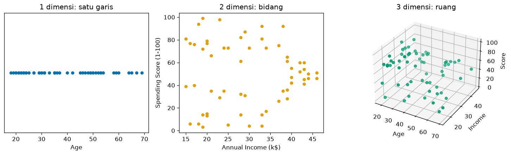
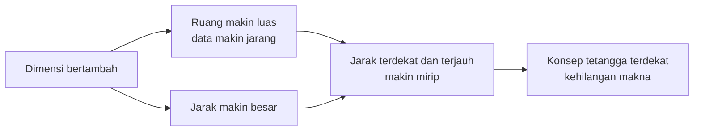
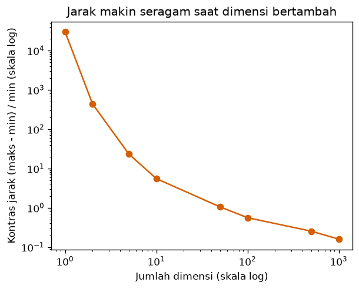
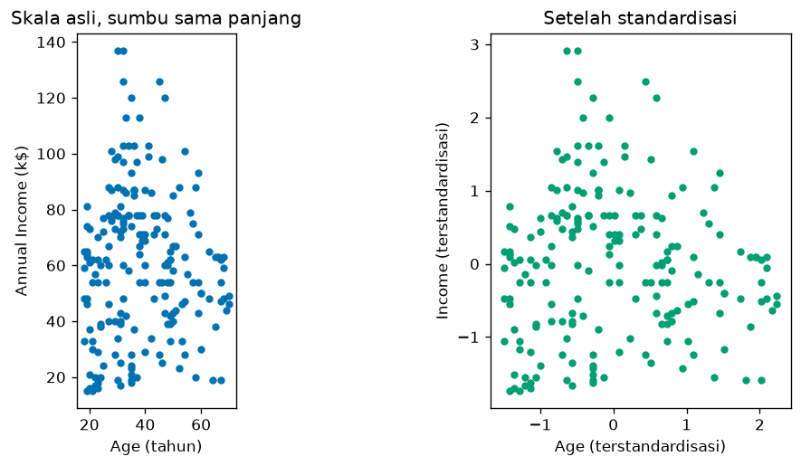

# Bab 6 — Feature Space and Dimensionality

## Learning Objectives

Setelah mempelajari bab ini, kamu mampu:

- [x] Menjelaskan apa itu *feature* dan *feature space* (ruang fitur).
- [x] Menggambarkan data sebagai titik di ruang satu, dua, dan banyak dimensi.
- [x] Menjelaskan hubungan antara jumlah fitur, dimensi, dan koordinat.
- [x] Menjelaskan bagaimana menambah dimensi mengubah perhitungan jarak.
- [x] Menjelaskan *curse of dimensionality* secara intuitif dan dengan angka.
- [x] Menjelaskan mengapa skala fitur mengubah bentuk ruang fitur.
- [x] Memvisualisasikan ruang fitur dengan Matplotlib.

## Introduction

Di Bab 4 dan 5 kita menghitung jarak antara dua pelanggan memakai angka-angka mereka. Tetapi dari mana jarak itu "berada"? Jawabannya: dari **ruang fitur**. Setiap pelanggan adalah sebuah **titik**, setiap fitur adalah sebuah **sumbu**, dan jarak adalah ukuran antara dua titik di ruang itu.

Memahami ruang fitur membuat banyak hal terasa wajar: mengapa menambah fitur mengubah hasil clustering, mengapa grafik hanya bisa kita gambar untuk dua atau tiga fitur, dan mengapa data dengan ratusan fitur berperilaku aneh. Bab ini membahas semuanya, disertai eksperimen kecil yang bisa kamu ulangi.

## Fundamental Concepts

| Istilah | Arti |
|---|---|
| **Feature** | Satu kolom data yang menggambarkan sebuah sifat, misalnya `Age` |
| **Feature space** | Ruang tempat data hidup. Tiap fitur menjadi satu **sumbu** |
| **Dimension** (dimensi) | Banyaknya fitur. Dua fitur berarti ruang dua dimensi |
| **Coordinate** | Angka-angka sebuah titik, satu per sumbu. Pelanggan 1: (19, 15, 39) |
| **Data point** | Satu observation sebagai titik di ruang fitur |
| **High-dimensional data** | Data dengan banyak fitur (puluhan, ratusan, atau lebih) |
| **Curse of dimensionality** | Kumpulan masalah yang muncul ketika jumlah dimensi sangat besar |

## Detailed Explanation

### Fitur menjadi sumbu, pelanggan menjadi titik

Sebuah tabel data bisa dipandang sebagai peta. Misalkan tabel pelanggan berikut:

| Pelanggan | Age | Income | Score |
|---|---|---|---|
| 1 | 19 | 15 | 39 |
| 2 | 21 | 15 | 81 |

- Jika kita **hanya memakai `Age`**, tiap pelanggan adalah titik pada **satu garis**: pelanggan 1 di 19 dan pelanggan 2 di 21.
- Jika kita memakai **`Income` dan `Score`**, tiap pelanggan adalah titik pada **bidang**: (15, 39) dan (15, 81).
- Jika kita memakai **ketiganya**, tiap pelanggan adalah titik di **ruang tiga dimensi**: (19, 15, 39) dan (21, 15, 81).

Jumlah fitur sama dengan jumlah dimensi, dan jumlah angka pada satu titik (koordinat) sama dengan jumlah dimensi.



Perhatikan bahwa **bentuk data berubah tergantung fitur yang dipilih**. Dua pelanggan yang tampak berdekatan pada satu garis bisa berjauhan pada bidang.

### Interpretasi geometris

Pada ruang fitur:

- **Mirip berarti berdekatan.** Pelanggan dengan profil serupa menjadi titik-titik yang berdekatan.
- **Kelompok berarti gerombol titik.** Clustering mencari gerombol itu.
- **Centroid berarti titik tengah gerombol** (Bab 3).
- **Jarak berarti panjang garis antar titik** (Bab 5).

Kita hanya bisa **melihat** ruang sampai tiga dimensi. Untuk lebih dari itu, matematika tetap berlaku, tetapi kita tidak bisa menggambarnya. Kita harus mempercayai perhitungan.

### Menambah dimensi mengubah jarak

Jarak Euclidean menjumlahkan kuadrat selisih **semua** fitur. Menambah fitur berarti menambah suku pada jumlah itu, sehingga jarak **tidak pernah berkurang**. Ia bisa tetap (kalau selisih fitur baru 0) atau bertambah:

- Fitur baru yang kedua titiknya sama menambah 0.
- Fitur baru yang kedua titiknya berbeda jauh menambah banyak.

Pada pelanggan 1 dan 2, usia dan pendapatan hampir tidak membedakan keduanya (selisih 2 dan 0), sedangkan skor belanja membedakan banyak (selisih 42). Kita buktikan dengan kode.

### Curse of dimensionality

Seiring bertambahnya dimensi, beberapa hal berubah secara tidak intuitif:

1. **Ruang menjadi sangat luas.** Titik-titik data menjadi jarang. Untuk "mengisi" ruang dengan kepadatan sama, jumlah data yang dibutuhkan naik sangat cepat.
2. **Jarak antar titik membesar.** Jarak rata-rata naik kira-kira sebanding akar jumlah dimensi.
3. **Jarak menjadi seragam.** Jarak terdekat dan terjauh makin mirip. Akibatnya, konsep "tetangga terdekat" kehilangan makna, padahal clustering bergantung padanya.

Akibatnya, algoritma yang memakai jarak menjadi kurang membedakan titik "mirip" dari titik "berbeda" pada dimensi sangat tinggi. Pada praktik, solusinya meliputi memilih fitur yang relevan (Level 2 Bab 11), mengurangi dimensi (*dimensionality reduction*, misalnya PCA, dibahas di Level 1 sekilas dan level berikutnya), dan memakai metrik yang lebih cocok.



### Skala dan bentuk ruang fitur

Ruang fitur mengikuti satuan tiap sumbu. Jika `Age` berkisar 18 sampai 70 (rentang 52) sedangkan `Income` berkisar 15 sampai 137 (rentang 122), maka ruang yang kita gambar dengan sumbu sama panjang menjadi memanjang pada satu arah. Jarak mengikuti bentuk itu: satu satuan di sumbu pendapatan dihitung sama dengan satu satuan di sumbu usia, padahal maknanya berbeda. Standardisasi membuat tiap sumbu berukuran sebanding sehingga ruang menjadi lebih "bulat".

## Mathematical Foundation

Titik data \( \mathbf{x} \) di ruang \( d \) dimensi ditulis sebagai daftar \( d \) bilangan:

$$
\mathbf{x} = (x_1, x_2, \dots, x_d) \in \mathbb{R}^d
$$

- \( x_j \) adalah koordinat pada sumbu ke-\( j \) (nilai fitur ke-\( j \)).
- \( d \) adalah jumlah dimensi (fitur).
- \( \mathbb{R}^d \) dibaca "ruang bilangan real berdimensi \( d \)".

Jarak Euclidean antara dua titik:

$$
d(\mathbf{x}, \mathbf{y}) = \sqrt{\sum_{j=1}^{d} (x_j - y_j)^2}
$$

Menambah satu dimensi berarti menambah satu suku \( (x_{d+1} - y_{d+1})^2 \ge 0 \) pada jumlah di bawah akar, jadi jarak tidak pernah menurun.

### Contoh hitung manual: jarak bertambah seiring fitur

Pelanggan 1 = (19, 15, 39) dan pelanggan 2 = (21, 15, 81).

1. **Satu fitur (`Age`):** \( \sqrt{(19-21)^2} = \sqrt{4} = 2 \).
2. **Dua fitur (`Age`, `Income`):** \( \sqrt{4 + (15-15)^2} = \sqrt{4 + 0} = 2 \). Fitur `Income` tidak menambah apa pun karena kedua pelanggan sama.
3. **Tiga fitur (+ `Score`):** \( \sqrt{4 + 0 + (39-81)^2} = \sqrt{4 + 0 + 1764} = \sqrt{1768} \approx 42{,}05 \).

**Interpretasi.** Jarak melonjak dari 2 menjadi 42,05 hanya karena fitur ketiga. Fitur yang berbeda jauh mendominasi jarak total.

### Mengapa jarak "seragam" pada dimensi tinggi

Ambil dua titik acak di kubus satuan berdimensi \( d \), dengan tiap koordinat tersebar merata antara 0 dan 1. Untuk satu koordinat, rata-rata kuadrat selisih kedua titik adalah \( \frac{1}{6} \). Jumlah \( d \) koordinat memberi \( \frac{d}{6} \), sehingga jarak rata-rata kira-kira:

$$
\mathbb{E}\big[d(\mathbf{x}, \mathbf{y})\big] \approx \sqrt{\frac{d}{6}}
$$

Pendekatan ini makin baik untuk \( d \) besar. Dua hal terjadi bersamaan: jarak rata-rata **tumbuh** seperti \( \sqrt{d} \), tetapi **sebarannya hampir tetap**. Maka selisih jarak terjauh dan terdekat menjadi kecil **dibanding** jarak itu sendiri. Itulah arti "jarak makin seragam". Pada kode kita mengukur **kontras jarak**:

$$
\text{kontras} = \frac{d_{\max} - d_{\min}}{d_{\min}}
$$

Kontras besar berarti ada pasangan yang jauh lebih dekat daripada yang lain (clustering bermakna). Kontras mendekati 0 berarti semua pasangan hampir sama jauhnya.

## Python Implementation

Kita kerjakan dalam enam langkah kecil. **Setiap potongan kode diikuti penjelasannya.** Skrip lengkapnya ada di `examples/level-3/06_feature_space_and_dimensionality.py`, dan versi notebook-nya di `notebooks/level-3/06-feature-space-and-dimensionality.ipynb`.

**Konteks masalah:** kita melihat pelanggan sebagai titik, menambah fitur satu per satu untuk melihat jarak berubah, mengukur efek dimensi pada data acak, dan menguji bagaimana fitur tak relevan mengacaukan tetangga terdekat.

**Input yang diharapkan:** `data/mall_customers.csv` dan data acak yang dibuat di kode (dengan seed tetap).

### Langkah 1 — Pelanggan sebagai titik

```python
--8<-- "level-3/06_feature_space_and_dimensionality.py:setup"
```

```text title="Output"
--8<-- "level-3/outputs/06/setup.txt"
```

**Penjelasan:**

- Kita memuat data dan memilih tiga fitur numerik dalam `cols`.
- `df.loc[0, cols]` mengambil nilai tiga fitur pada baris pertama (pelanggan 1). `.to_numpy(dtype=float)` mengubahnya menjadi larik angka desimal.
- Larik `[19. 15. 39.]` itulah **koordinat** pelanggan 1 di ruang tiga dimensi. `len(p1)` memberi jumlah dimensi.

### Langkah 2 — Jarak saat fitur ditambah

```python
--8<-- "level-3/06_feature_space_and_dimensionality.py:grow"
```

```text title="Output"
--8<-- "level-3/outputs/06/grow.txt"
```

**Penjelasan:**

- `for k in range(1, 4)` mengulang untuk 1, 2, dan 3 fitur.
- `p1[:k]` mengambil **k fitur pertama**. Selisihnya dikuadratkan, dijumlahkan, dan diakarkan: jarak Euclidean pada ruang berdimensi `k`.
- `', '.join(cols[:k])` menyambung nama fitur menjadi satu teks untuk dicetak.

### Langkah 3 — Gambar ruang 1D, 2D, dan 3D

```python
--8<-- "level-3/06_feature_space_and_dimensionality.py:plot_dims"
```


**Penjelasan:**

- `sample = df.iloc[:60]` mengambil 60 pelanggan pertama agar grafik tidak terlalu ramai.
- `fig.add_subplot(1, 3, 1)` menambah panel pertama dari tiga panel dalam satu baris. Panel 1D memplot `Age` dengan tinggi tetap 0 (`np.zeros(...)`), sehingga semua titik berada di satu garis.
- Panel 2D memplot pendapatan dan skor belanja.
- Panel 3D memakai `projection="3d"` dan `scatter(x, y, z)` dengan tiga fitur. Ini fitur bawaan Matplotlib.
- `set_yticks([])` menghapus penanda sumbu y pada panel 1D karena tidak bermakna.

### Langkah 4 — Efek dimensi pada jarak

```python
--8<-- "level-3/06_feature_space_and_dimensionality.py:curse"
```

```text title="Output"
--8<-- "level-3/outputs/06/curse.txt"
```



**Penjelasan:**

- `np.random.default_rng(42)` membuat pembangkit angka acak dengan seed tetap, jadi hasilnya sama setiap kali dijalankan.
- `rng.random((200, dim))` membuat 200 titik acak di kubus satuan berdimensi `dim`.
- `pairwise_distances(X)` menghitung matriks jarak 200 × 200.
- `np.triu_indices_from(d, k=1)` mengambil bagian **segitiga atas** matriks tanpa diagonal, sehingga tiap pasangan dihitung **sekali** (bukan dua kali dan bukan jarak ke diri sendiri).
- Kita simpan jarak minimum, maksimum, rata-rata, dan **kontras** \( (d_{\max} - d_{\min})/d_{\min} \) untuk tiap dimensi dalam daftar `rows`, lalu mengubahnya menjadi tabel dengan `pd.DataFrame`.
- Grafik memakai skala logaritma (`set_xscale("log")` dan `set_yscale("log")`) karena nilainya bergerak dari puluhan ribu sampai di bawah 1.

### Langkah 5 — Fitur tak relevan mengacaukan tetangga

```python
--8<-- "level-3/06_feature_space_and_dimensionality.py:noise"
```

```text title="Output"
--8<-- "level-3/outputs/06/noise.txt"
```

**Penjelasan:**

- `base` adalah data dua fitur (pendapatan dan skor belanja) yang sudah distandardisasi.
- `nearest(data)` mencari tetangga terdekat tiap pelanggan: hitung semua jarak, isi diagonal dengan `np.inf` agar tidak memilih diri sendiri, lalu `argmin(axis=1)`.
- `nn_base` adalah tetangga terdekat pada data dua fitur asli.
- Dalam perulangan, `rng.standard_normal((len(df), n_noise))` membuat `n_noise` fitur berisi angka acak tanpa makna. `np.hstack([base, noise])` menempelkannya di samping fitur asli (menambah kolom).
- `(nearest(with_noise) != nn_base).sum()` menghitung berapa pelanggan yang tetangga terdekatnya berubah.

### Langkah 6 — Skala mengubah bentuk ruang

```python
--8<-- "level-3/06_feature_space_and_dimensionality.py:scale"
```

```text title="Output"
--8<-- "level-3/outputs/06/scale.txt"
```



**Penjelasan:**

- `raw` adalah dua fitur (usia dan pendapatan) dalam satuan aslinya. `std` adalah versi terstandardisasinya.
- `ax.set_aspect("equal")` membuat satu satuan di sumbu x sama panjang dengan satu satuan di sumbu y. Dengan begitu bentuk ruang yang sebenarnya terlihat jujur.
- Dua panel memperlihatkan data yang sama sebelum dan sesudah standardisasi.
- `.max() - .min()` menghitung rentang tiap fitur.

## Code Explanation

| Yang kamu lihat | Artinya |
|---|---|
| `p1[:k]` | Mengambil k fitur pertama sebuah titik |
| `rng.random((n, d))` | n titik acak berdimensi d |
| `np.triu_indices_from(d, k=1)` | Indeks segitiga atas tanpa diagonal (tiap pasangan sekali) |
| `np.hstack([a, b])` | Menempelkan kolom `b` di samping kolom `a` |
| `projection="3d"` | Membuat grafik tiga dimensi |
| `set_aspect("equal")` | Skala sumbu sama agar bentuk tidak menipu |

Pola umumnya: **fitur menjadi sumbu → titik menjadi pelanggan → jarak mengikuti sumbu yang dipilih.**

## How to Run

Jalankan dari **folder utama proyek**:

```powershell
pip install -r requirements-notebooks.txt
python examples/level-3/06_feature_space_and_dimensionality.py
```

Skrip membuat tiga gambar di `docs/assets/level-3/`. Untuk notebook:

```powershell
jupyter notebook notebooks/level-3/06-feature-space-and-dimensionality.ipynb
```

## Expected Output

Semua output berasal dari eksekusi nyata skrip (Python 3.14.10, NumPy 2.5.2, pandas 3.0.5, scikit-learn 1.9.0, matplotlib 3.11.1). Output setiap langkah ditampilkan langsung di bawah kodenya pada bagian [Python Implementation](#python-implementation).


### Interpretasi output

**Koordinat dan jarak.** Pelanggan 1 adalah titik (19, 15, 39) dan pelanggan 2 adalah (21, 15, 81). Jarak memakai satu fitur 2,00. Menambah `Income` tidak mengubahnya (tetap 2,00) karena kedua pelanggan sama-sama 15. Menambah `Score` melonjak menjadi 42,05, sama dengan hitungan manual \( \sqrt{1768} \).

**Efek dimensi.** Pada tabel data acak:

- Jarak rata-rata naik dari 0,327 (1 dimensi) menjadi 4,081 (100 dimensi) dan 12,909 (1000 dimensi). Rumus \( \sqrt{d/6} \) memberi 4,082 untuk \( d=100 \) dan 12,910 untuk \( d=1000 \), sangat dekat dengan hasil eksekusi.
- Kontras jarak turun dari 29.829 (1 dimensi) menjadi 5,524 (10 dimensi), 0,560 (100 dimensi), dan 0,160 (1000 dimensi). Pada 1000 dimensi, jarak terjauh (13,859) hanya sekitar 16% lebih besar daripada yang terdekat (11,949). Pada 1 dimensi, rasio itu astronomis karena ada pasangan yang hampir berhimpit.

Artinya, pada dimensi tinggi hampir semua pasangan titik terasa sama jauhnya, dan "tetangga terdekat" kehilangan daya bedanya.

**Fitur tak relevan.** Dengan hanya dua fitur asli, tetangga terdekat tidak berubah (0 dari 200, sebagai pembanding). Setelah menambah **hanya 2** fitur acak, **179 dari 200** pelanggan (89,5%) punya tetangga terdekat berbeda. Dengan 10 fitur acak menjadi 193, dan dengan 50 menjadi 197. Fitur yang tidak bermakna menenggelamkan fitur yang bermakna. Inilah alasan **pemilihan fitur** (Level 2 Bab 11) penting.

**Skala.** Rentang usia 52 dan rentang pendapatan 122. Pada panel kiri, sebaran memanjang ke arah pendapatan. Pada panel kanan, kedua sumbu sebanding sehingga bentuk sebaran lebih seimbang dan jarak tidak lagi dipengaruhi satuan.

## Practical Examples

**Memilih fitur untuk segmentasi.** Jika kamu menambahkan lima kolom yang tidak berhubungan dengan perilaku belanja (misalnya nomor telepon yang dikodekan, kode pos), hasil clustering bisa berubah drastis, seperti 179 dari 200 pelanggan berpindah tetangga pada percobaan kita dengan hanya dua fitur acak.

**Data genetika dan teks.** Dataset ekspresi gen atau teks punya ribuan fitur. Di situ clustering langsung pada semua fitur sering kurang bermakna. Praktik umum: pilih fitur penting atau kurangi dimensi lebih dulu.

**Visualisasi hasil.** Karena hanya dua atau tiga dimensi yang bisa digambar, hasil clustering pada data berdimensi tinggi biasanya divisualisasikan setelah reduksi dimensi ke dua dimensi.

### Kesalahan umum

| Kesalahan | Akibat | Cara menghindari |
|---|---|---|
| Memasukkan semua kolom "karena ada" | Fitur tak relevan menenggelamkan fitur penting | Pilih fitur berdasarkan tujuan |
| Mengabaikan skala | Satu fitur mendominasi jarak | Standardisasi (Level 2 Bab 10) |
| Mengira dimensi tinggi pasti lebih baik | Jarak makin seragam, data makin jarang | Kurangi fitur atau dimensi |
| Menilai kelompok hanya dari grafik 2D data berdimensi tinggi | Proyeksi bisa menyembunyikan pemisahan | Gunakan ukuran evaluasi (Level 5) |

## Hands-on Exercises

1. Hitung manual jarak pelanggan 1 dan 4 memakai tiga fitur. Pelanggan 4 = (23, 16, 77).
2. Ubah daftar dimensi pada Langkah 4 menjadi `[2, 3, 4]`. Bagaimana kontras jaraknya?
3. Ganti `n_noise` pada Langkah 5 menjadi `[0, 1, 2]`. Berapa pelanggan yang tetangganya berubah pada 1 fitur acak?
4. Mengapa menambah fitur tidak pernah memperkecil jarak Euclidean?
5. Mengapa kontras jarak turun saat dimensi naik, padahal jarak rata-rata justru naik?

??? question "Jawaban"
    1. Selisih: \( 19-23 = -4 \), \( 15-16 = -1 \), \( 39-77 = -38 \). Kuadrat: 16, 1, 1444. Jumlah: 1461. Akar: \( \sqrt{1461} \approx 38{,}22 \). Angka ini sama dengan jarak pelanggan 1 dan 4 pada Bab 4 (38,22).
    2. Hasil eksekusi nyata dengan daftar `[2, 3, 4]` (seed 42): kontras **289,74** (2 dimensi), **93,34** (3 dimensi), dan **30,37** (4 dimensi). Angkanya berbeda dari tabel utama (438,08 untuk 2 dimensi) karena urutan pengambilan angka acak berbeda, tetapi **polanya sama**: makin banyak dimensi, makin kecil kontrasnya.
    3. Hasil eksekusi nyata dengan `[0, 1, 2]`: **0** pelanggan berubah tanpa fitur acak, **165** dengan 1 fitur acak, dan **177** dengan 2 fitur acak. Angka untuk 2 fitur (177) sedikit berbeda dari 179 pada tabel utama karena angka acaknya diambil dalam urutan lain. Satu fitur acak saja sudah mengubah tetangga terdekat sebagian besar pelanggan.
    4. Menambah fitur menambah satu suku \( (x - y)^2 \ge 0 \) pada jumlah di bawah akar. Jumlah yang bertambah tidak mungkin menghasilkan akar yang lebih kecil.
    5. Jarak rata-rata tumbuh seperti \( \sqrt{d} \), tetapi selisih jarak terjauh dan terdekat tumbuh jauh lebih lambat. Rasio selisih terhadap jarak terdekat (kontras) pun mengecil.

## Troubleshooting

| Masalah | Penyebab | Solusi |
|---|---|---|
| Grafik 3D tidak muncul atau error `Unknown projection '3d'` | Versi Matplotlib sangat lama | Perbarui Matplotlib (`pip install -U matplotlib`) |
| Angka acak berbeda dari tabel di atas | Seed atau urutan pemanggilan `rng` berbeda | Pakai `default_rng(42)` dan jangan ubah urutan pemanggilan `rng.random` |
| `MemoryError` pada dimensi besar | Data atau matriks jarak terlalu besar | Kurangi jumlah titik (misalnya 200 menjadi 100) |
| Grafik tampak gepeng (aspek tidak sama) | `set_aspect("equal")` tidak dipanggil | Panggil `ax.set_aspect("equal")` untuk memeriksa bentuk sebenarnya |
| Jarak nol membuat kontras tak hingga | Dua titik identik, \( d_{\min} = 0 \) | Hindari pembagian dengan nol, misalnya buang duplikat (Level 2 Bab 6) |

## Summary

- **Fitur** menjadi **sumbu**, **observasi** menjadi **titik**, dan **jumlah fitur** adalah **jumlah dimensi**. Jarak mengukur panjang antar titik di ruang itu.
- Menambah fitur tidak pernah memperkecil jarak Euclidean. Fitur yang berbeda jauh mendominasi: jarak pelanggan 1 dan 2 melonjak dari 2,00 menjadi 42,05 karena satu fitur.
- **Curse of dimensionality:** jarak rata-rata tumbuh seperti \( \sqrt{d/6} \) pada data acak, sedangkan kontras jarak turun dari 29.829 (1 dimensi) ke 0,160 (1000 dimensi). Tetangga terdekat kehilangan makna.
- Fitur tak relevan merusak: menambah 2 fitur acak mengubah tetangga terdekat 179 dari 200 pelanggan.
- Skala fitur membentuk ruang. Standardisasi membuat sumbu sebanding.

**Bab berikutnya:** Bab 7 menyatukan semua konsep Level 3 dalam alur kerja clustering dari awal sampai laporan.

## References

- Bellman, R. (1961). *Adaptive Control Processes: A Guided Tour*. Princeton University Press. (Asal istilah *curse of dimensionality*.)
- Beyer, K., Goldstein, J., Ramakrishnan, R., & Shaft, U. (1999). When is "nearest neighbor" meaningful? *ICDT 1999*, hlm. 217–235.
- Hastie, T., Tibshirani, R., & Friedman, J. *The Elements of Statistical Learning* (Springer), bagian tentang *curse of dimensionality*.
- Matplotlib documentation: [*3D plotting*](https://matplotlib.org/stable/gallery/mplot3d/index.html) dan [`set_aspect`](https://matplotlib.org/stable/api/_as_gen/matplotlib.axes.Axes.set_aspect.html).
