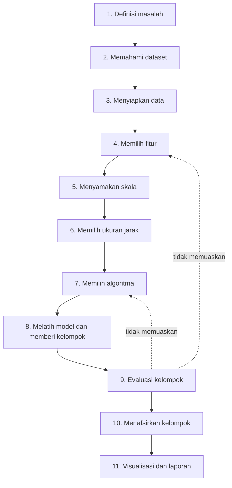
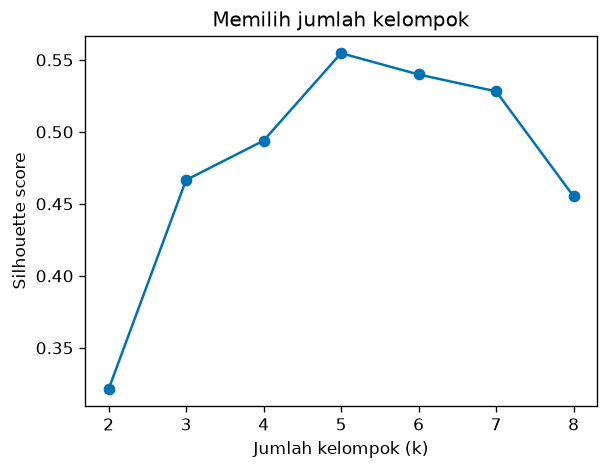
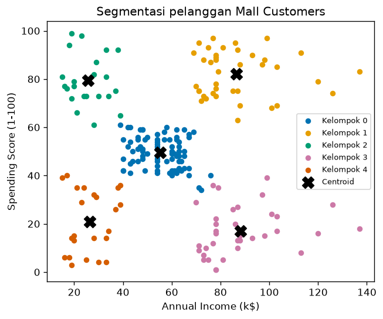

# Bab 7 — Clustering Workflow

## Learning Objectives

Setelah mempelajari bab ini, kamu mampu:

- [x] Menyebut dan menjelaskan tahapan sebuah proyek clustering dari awal sampai laporan.
- [x] Merumuskan masalah clustering yang jelas sebelum menyentuh data.
- [x] Menghubungkan tiap tahap dengan konsep dari Bab 1 sampai 6 dan Level 2.
- [x] Menjalankan alur kerja lengkap pada dataset Mall Customers.
- [x] Memilih jumlah kelompok dengan bantuan *silhouette score* (pratinjau Level 5).
- [x] Memeriksa kestabilan hasil dan menafsirkan kelompok menjadi temuan yang bisa dilaporkan.
- [x] Mengenali kesalahan umum dalam proyek clustering.
- [x] Menjelaskan apa yang akan dipelajari di Level 4.

## Introduction

Kamu sudah mempelajari bagian-bagiannya: apa itu clustering (Bab 1), seperti apa kelompok yang baik (Bab 2), centroid (Bab 3), kemiripan dan jarak (Bab 4 dan 5), serta ruang fitur (Bab 6). Level 2 mengajarkan cara mengenal dan membersihkan data. Bab ini **merangkai semuanya** menjadi satu alur kerja yang bisa kamu pakai pada proyek apa pun.

Penting dipahami bahwa memilih algoritma hanya **satu langkah kecil** di tengah alur. Sebagian besar kualitas hasil ditentukan oleh langkah **sebelum** dan **sesudah** algoritma: merumuskan masalah, memahami data, memilih fitur, menyamakan skala, dan menafsirkan hasil.

## Fundamental Concepts

| Istilah | Arti |
|---|---|
| **Workflow** | Urutan langkah kerja dari masalah sampai laporan |
| **Problem definition** | Merumuskan apa yang ingin dijawab dan untuk apa hasilnya dipakai |
| **Model fitting** | Menjalankan algoritma pada data untuk membentuk kelompok |
| **Cluster assignment** | Memberi nomor kelompok pada tiap data |
| **Cluster evaluation** | Menilai kualitas kelompok dengan ukuran tertentu (Level 5) |
| **Cluster interpretation** | Memberi arti pada kelompok berdasarkan profilnya |
| **Silhouette score** | Ukuran kualitas kelompok dari −1 sampai 1. Makin tinggi, makin baik terpisah dan padat. Dibahas rinci di Level 5 |

## Detailed Explanation

### Gambaran alur



Perhatikan panah putus-putus: alur ini **berulang**. Jika evaluasi atau tafsiran tidak memuaskan, kamu kembali memilih fitur atau algoritma.

### 1. Problem definition (definisi masalah)

Mulailah dengan pertanyaan, bukan dengan algoritma. Contoh yang baik: *"Adakah kelompok pelanggan berdasarkan pendapatan dan perilaku belanja, yang bisa kita beri promosi berbeda?"* Pertanyaan ini memberi tahu fitur apa yang relevan dan seperti apa hasil yang berguna. Pertanyaan yang buruk: "Mari clusteringkan data ini."

### 2. Dataset understanding (memahami dataset)

Periksa ukuran data, tipe kolom, rentang nilai, nilai kosong, dan duplikat (Level 2 Bab 1 sampai 6). Tujuannya menghindari kejutan di tengah proyek.

### 3. Data preparation (menyiapkan data)

Tangani nilai kosong, duplikat, dan outlier (Level 2 Bab 5 sampai 8). Ubah kolom kategori menjadi angka bila perlu (Bab 9).

### 4. Feature selection (memilih fitur)

Pilih kolom yang relevan dengan pertanyaanmu. Buang kolom ID. Ingat Bab 6: fitur tak relevan merusak jarak. Fitur yang tidak dipakai untuk clustering masih berguna untuk **menafsirkan** kelompok nanti (misalnya `Age`).

### 5. Feature scaling (menyamakan skala)

Standardisasi atau normalisasi agar tidak ada fitur yang mendominasi jarak (Bab 5 dan Level 2 Bab 10).

### 6. Distance measurement (ukuran jarak)

Pilih metrik yang cocok dengan makna datamu. Untuk fitur numerik berskala sama, Euclidean adalah pilihan umum (Bab 5).

### 7. Algorithm selection (memilih algoritma)

Pilih algoritma yang cocok dengan bentuk dan ukuran kelompok yang kamu perkirakan (Bab 2). Algoritma yang ada: *K-Means* (kelompok berbentuk bola), *hierarchical clustering* (hubungan bertingkat), *DBSCAN* (kelompok berdasarkan kepadatan, tahan outlier), dan lain-lain. Semuanya dibahas di Level 4. Pada bab ini kita memakai K-Means sebagai alat bantu.

### 8. Model fitting dan cluster assignment

Jalankan algoritma pada data. Hasilnya nomor kelompok untuk tiap data (Bab 1) dan, untuk algoritma berbasis pusat, centroid (Bab 3).

### 9. Cluster evaluation (evaluasi)

Nilai kualitas kelompok. Karena tidak ada label, kita memakai ukuran internal seperti *silhouette score* yang menggabungkan kekompakan dan keterpisahan (Bab 2). Level 5 membahas berbagai ukuran evaluasi.

### 10. Cluster interpretation (penafsiran)

Hitung profil tiap kelompok (rata-rata fitur), lihat ukurannya, dan beri arti dalam bahasa bisnis atau riset. Kelompok yang tidak bisa dijelaskan sering menandakan masalah pada fitur atau jumlah kelompok.

### 11. Visualization dan reporting

Gambarkan hasilnya dan susun laporan: pertanyaan, data, langkah penyiapan, jumlah kelompok dan alasannya, profil tiap kelompok, serta rekomendasi dan keterbatasan.

### Kesalahan umum dalam proyek clustering

| Kesalahan | Akibat | Pencegahan |
|---|---|---|
| Langsung menjalankan algoritma tanpa merumuskan masalah | Hasil tidak berguna | Tulis pertanyaan dulu |
| Memakai semua kolom, termasuk ID | Jarak menyesatkan | Pilih fitur (Bab 6) |
| Lupa menyamakan skala | Satu fitur mendominasi | Standardisasi (Bab 5) |
| Memutuskan jumlah kelompok hanya dengan menebak | Kelompok dipaksakan | Uji beberapa nilai dan evaluasi |
| Menjalankan sekali dan percaya | Hasil bisa tidak stabil | Periksa kestabilan |
| Menganggap kelompok sebagai fakta mutlak | Kesimpulan berlebihan | Ingat bahwa hasil bergantung pada fitur dan metode |
| Tidak menafsirkan kelompok | Angka tanpa arti | Buat profil dan beri nama kelompok |

## Mathematical Foundation

Bab ini tidak memperkenalkan rumus baru, tetapi memakai satu ukuran evaluasi yang akan dibahas penuh di Level 5. Untuk sebuah titik \( i \):

- \( a(i) \) adalah **rata-rata jarak titik \( i \) ke anggota lain di kelompoknya sendiri** (makin kecil makin baik, cerminan kekompakan, Bab 2).
- \( b(i) \) adalah **rata-rata jarak titik \( i \) ke anggota kelompok terdekat lainnya** (makin besar makin baik, cerminan keterpisahan).

$$
s(i) = \frac{b(i) - a(i)}{\max\{a(i),\, b(i)\}}
$$

Nilai \( s(i) \) berada di antara −1 dan 1. Silhouette score sebuah pengelompokan adalah rata-rata \( s(i) \) semua titik.

### Contoh hitung manual

Misalkan titik \( i \) punya \( a(i) = 2 \) dan \( b(i) = 6 \).

1. Selisih: \( b - a = 6 - 2 = 4 \).
2. Penyebut: \( \max\{2, 6\} = 6 \).
3. \( s(i) = 4/6 \approx 0{,}667 \).

**Interpretasi.** Titik ini jauh lebih dekat ke kelompoknya sendiri (rata-rata jarak 2) daripada ke kelompok tetangga (6), jadi nilainya mendekati 1: ditempatkan dengan baik. Jika \( a(i) = 5 \) dan \( b(i) = 5 \), maka \( s(i) = 0 \): titik berada di batas. Jika \( a(i) > b(i) \), nilainya negatif: titik mungkin salah kelompok.

## Python Implementation

Kita kerjakan dalam sembilan langkah kecil. **Setiap potongan kode diikuti penjelasannya.** Skrip lengkapnya ada di `examples/level-3/07_clustering_workflow.py`, dan versi notebook-nya di `notebooks/level-3/07-clustering-workflow.ipynb`.

**Langkah 1 (definisi masalah)** ditulis sebagai pertanyaan, bukan kode: *"Adakah kelompok pelanggan menurut pendapatan dan perilaku belanja, yang bisa diberi promosi berbeda?"*

**Input yang diharapkan:** `data/mall_customers.csv`, dijalankan dari folder utama proyek.

### Langkah 2 — Pahami dataset

Sebelum memilih fitur atau algoritma, kita perlu mengenal datanya. Langkah ini mencegah kejutan di tengah jalan: nilai kosong bisa membuat perhitungan jarak gagal, baris ganda bisa membuat satu pelanggan terhitung dua kali, dan rentang nilai tiap kolom menentukan perlu tidaknya penyamaan skala nanti.

Kita memeriksa empat hal secara berurutan: ukuran data, jumlah nilai kosong, jumlah baris ganda, dan ringkasan statistik (minimum, rata-rata, maksimum).

```python
--8<-- "level-3/07_clustering_workflow.py:understand"
```

```text title="Output"
--8<-- "level-3/outputs/07/understand.txt"
```

**Cara membaca output:**

- `Ukuran: (200, 5)` berarti 200 pelanggan dan 5 kolom.
- `Nilai kosong total: 0` dan `Baris duplikat: 0` berarti data bersih. Kita tidak perlu menangani nilai hilang atau menghapus baris ganda, jadi alur bisa langsung berlanjut.
- Tabel ringkasan hanya memuat kolom numerik, yaitu empat kolom. Kolom kelima, `Gender`, berisi teks sehingga tidak ikut dihitung.
- `CustomerID` berkisar 1 sampai 200 dengan rata-rata 100,5. Itu hanya nomor urut, bukan ukuran pelanggan, sehingga tidak layak dipakai untuk clustering.
- Rentang tiap fitur berbeda: `Age` 18 sampai 70 (rentang 52), `Annual Income` 15 sampai 137 (rentang 122), dan `Spending Score` 1 sampai 99 (rentang 98). Perbedaan rentang ini menjadi alasan langkah penyamaan skala nanti.

**Penjelasan:**

- `df.shape` memberi ukuran data (baris, kolom).
- `df.isna().sum().sum()` menghitung total sel kosong: `isna()` menandai sel kosong, `.sum()` pertama menjumlahkan per kolom, `.sum()` kedua menjumlahkan semua kolom. `int(...)` merapikan tampilannya.
- `df.duplicated().sum()` menghitung baris ganda.
- `df.describe().round(1).loc[["min", "mean", "max"]]` menampilkan ringkasan statistik, lalu **memilih hanya baris** minimum, rata-rata, dan maksimum agar tampil ringkas.

### Langkah 3 — Pilih fitur

Tidak semua kolom pantas dijadikan bahan clustering. Fitur yang dipilih menentukan **ruang** tempat pelanggan dibandingkan (Bab 6), jadi pilihan ini langsung memengaruhi hasil. Dasar pilihannya adalah pertanyaan masalah di Langkah 1: kelompok pelanggan menurut **pendapatan dan perilaku belanja**. Maka fiturnya adalah `Annual Income` dan `Spending Score`.

Memilih hanya dua fitur juga membuat hasil mudah divisualisasikan di bidang dua dimensi, dan menghindari fitur yang tidak relevan yang bisa mengacaukan jarak (Bab 6).

```python
--8<-- "level-3/07_clustering_workflow.py:prepare"
```

```text title="Output"
--8<-- "level-3/outputs/07/prepare.txt"
```

**Cara membaca output:**

- `Fitur untuk clustering` adalah dua kolom yang dipakai: pendapatan tahunan dan skor belanja.
- `Kolom yang tidak dipakai: ['CustomerID', 'Gender', 'Age']` memuat tiga kolom yang sengaja disisihkan, masing-masing dengan alasan:
    - `CustomerID` hanya nomor urut dan tidak mengandung informasi tentang perilaku.
    - `Gender` berupa kategori. Memakainya perlu *encoding* dan ukuran jarak yang sesuai (Bab 4 dan 5).
    - `Age` tidak dipakai untuk membentuk kelompok, tetapi kita simpan untuk **menafsirkan** kelompok di Langkah 8.
- Keputusan ini bukan satu-satunya yang benar. Bila pertanyaannya berbeda, misalnya segmentasi menurut usia, pilihan fiturnya juga berbeda.

**Penjelasan:**

- `features` adalah daftar kolom yang dipakai: pendapatan dan skor belanja, sesuai pertanyaan masalah.
- `X = df[features]` membuat tabel hanya berisi kolom itu.
- Daftar `[c for c in df.columns if c not in features]` menampilkan kolom yang **tidak** dipakai: `CustomerID` (hanya nomor urut), `Gender` (kategori, perlu encoding), dan `Age` (kita simpan untuk menafsirkan kelompok).

### Langkah 4 — Samakan skala

Kedua fitur terpilih berskala berbeda: pendapatan membentang 15 sampai 137, skor belanja 1 sampai 99. Jarak Euclidean menjumlahkan selisih tiap fitur, sehingga fitur yang rentangnya lebih besar cenderung mendominasi (Bab 5 dan 6). Standardisasi mengubah tiap fitur ke skala sebanding agar keduanya punya bobot setara.

Setelah standardisasi, kita memeriksa hasilnya. Memeriksa rata-rata dan simpangan baku itu cepat, dan menangkap kesalahan seperti lupa menskalakan atau menskalakan kolom yang salah.

```python
--8<-- "level-3/07_clustering_workflow.py:scale"
```

```text title="Output"
--8<-- "level-3/outputs/07/scale.txt"
```

**Cara membaca output:**

- `Rata-rata setelah skala: [0. 0.]` dan `Simpangan baku setelah skala: [1. 1.]` berarti kedua fitur kini berpusat di 0 dengan sebaran 1. Itulah definisi standardisasi.
- Angkanya dibulatkan dua angka di belakang koma oleh kode (`.round(2)`), jadi `0.` dan `1.` berarti sangat dekat dengan 0 dan 1.
- Satu satuan pada fitur pendapatan kini bermakna sama dengan satu satuan pada skor belanja, yaitu satu simpangan baku. Hasilnya, `X_scaled`, dipakai untuk memilih `k` dan melatih model.

**Penjelasan:**

- `StandardScaler()` membuat alat standardisasi. `.fit_transform(X)` mempelajari rata-rata dan simpangan baku tiap fitur, lalu mengubah data sehingga rata-rata 0 dan simpangan baku 1.
- Kita cetak rata-rata dan simpangan baku hasilnya untuk memastikan standardisasi berjalan. Tambahan `+ 0.0` hanya menghindari tampilan `-0.`.
- Hasil `X_scaled` adalah larik NumPy, dan itulah yang akan dikelompokkan.

### Langkah 5 — Pilih jumlah kelompok

K-Means butuh jumlah kelompok `k` yang ditentukan di awal, padahal kita tidak tahu berapa yang tepat. Kita mencobanya dengan `k` dari 2 sampai 8, lalu menilai tiap hasil dengan **silhouette score**. Silhouette mengukur seberapa rapat sebuah titik dengan kelompoknya dibanding kelompok terdekat lain, dan nilainya makin tinggi bila kelompok makin rapat dan terpisah (Level 5 membahas ukuran ini lebih dalam).

Kita memilih `k` dengan silhouette tertinggi sebagai titik awal, lalu menggambar grafiknya agar terlihat seberapa jelas pilihan itu.

```python
--8<-- "level-3/07_clustering_workflow.py:choose"
```

```text title="Output"
--8<-- "level-3/outputs/07/choose.txt"
```

**Cara membaca output:**

- Silhouette naik dari 0,321 pada `k = 2` hingga 0,555 pada `k = 5`, lalu turun lagi: 0,540 (`k = 6`), 0,528 (`k = 7`), dan 0,455 (`k = 8`).
- Nilai tertinggi ada pada **`k = 5`**, sehingga `best_k = 5`.
- Selisih antara `k = 5` (0,555) dan `k = 6` (0,540) hanya 0,015. Artinya `k = 6` hampir sama baiknya. Pilihan `k = 5` kuat, tetapi bukan satu-satunya yang masuk akal. Karena itu pemahaman bisnis tetap perlu mendampingi angka.



**Cara membaca gambar:**

- Sumbu x adalah jumlah kelompok dan sumbu y adalah silhouette score. Titik-titik adalah nilai yang tercetak di atas.
- Kurvanya **naik tajam** dari `k = 2` ke `k = 5`, mencapai **puncak di `k = 5`**, lalu menurun perlahan sampai `k = 7`, dan turun lebih tajam di `k = 8`.
- Puncak yang jelas lebih meyakinkan daripada kurva yang datar. Di sini puncaknya cukup tegas, dan itu sejalan dengan pola lima kelompok yang terlihat di gambar-gambar sebelumnya.
- Penurunan setelah `k = 5` menunjukkan bahwa membagi lagi kelompok-kelompok yang sudah wajar justru membuat batas kelompok kurang bersih.

**Penjelasan:**

- Kita mencoba `k` dari 2 sampai 8. Untuk tiap `k`, `KMeans(...).fit_predict(X_scaled)` membuat kelompok dan `silhouette_score(X_scaled, labels_k)` menghitung kualitasnya.
- `scores` adalah kamus (*dictionary*): kunci adalah `k`, nilai adalah skornya.
- `max(scores, key=scores.get)` mengambil **kunci** dengan nilai terbesar, yaitu `k` terbaik menurut silhouette.
- Bagian grafik memplot skor terhadap `k`.

!!! note "Silhouette hanya salah satu petunjuk"
    Jumlah kelompok sebaiknya dipilih dengan beberapa petunjuk: silhouette, pemahaman bisnis, dan kemudahan menafsirkan. Silhouette membantu, tetapi bukan keputusan akhir. Level 5 membahas ukuran lain.

### Langkah 6 — Latih model dan beri nomor kelompok

Setelah `k` dipilih, kita melatih model akhir dan memberi **nomor kelompok** pada setiap pelanggan. Nomor ini disimpan sebagai kolom baru `Cluster` pada tabel asli. Dengan begitu, hasil clustering bisa langsung dipakai untuk analisis lanjutan seperti merata-ratakan per kelompok (Langkah 8).

Kita juga menghitung jumlah anggota tiap kelompok. Pemeriksaan ini cepat tetapi penting: kelompok yang sangat kecil (hanya beberapa titik) atau satu kelompok yang menelan hampir semua data adalah tanda untuk mencurigai hasilnya.

```python
--8<-- "level-3/07_clustering_workflow.py:fit"
```

```text title="Output"
--8<-- "level-3/outputs/07/fit.txt"
```

**Cara membaca output:**

- Lima baris, kelompok 0 sampai 4, berisi 81, 39, 22, 35, dan 23 pelanggan. Totalnya 200, sama dengan jumlah pelanggan.
- Tidak ada kelompok yang sangat kecil dan tidak ada yang menguasai hampir seluruh data. Kelompok terbesar (81) sekitar 4 kali kelompok terkecil (22), sebaran yang wajar pada data nyata.
- Angka dan urutan nomor ini sama dengan yang muncul di bab-bab sebelumnya, karena data, fitur, `k`, dan `random_state` yang sama menghasilkan pengelompokan yang sama. Nomor kelompok hanyalah label, bukan peringkat.
- `dtype: int64` dan `Name: count` hanya keterangan tipe dan nama kolom hasil hitung, tidak perlu dipikirkan.

**Penjelasan:**

- `KMeans(n_clusters=best_k, ...)` membuat model dengan jumlah kelompok terpilih. `random_state=42` mengunci hasil.
- `fit_predict(X_scaled)` melatih model dan memberi nomor kelompok. Kita simpan di kolom baru `df["Cluster"]`.
- `value_counts().sort_index()` menghitung jumlah anggota tiap kelompok.

### Langkah 7 — Periksa kestabilan

K-Means dimulai dari pusat awal acak, sehingga pada data tertentu hasilnya bisa berbeda tergantung `random_state`. Kalau kelompok berubah-ubah tiap kali dijalankan, kita tidak bisa mempercayainya sebagai temuan.

Karena itu kita menguji **kestabilan**: menjalankan K-Means lagi dengan lima seed berbeda dan membandingkan tiap hasil dengan hasil utama memakai *Adjusted Rand Index* (ARI). ARI cocok di sini karena membandingkan **cara titik dikelompokkan**, bukan nomor kelompoknya. Nomor boleh tertukar (kelompok 0 di satu hasil bisa jadi kelompok 3 di hasil lain), tetapi ARI tetap 1 selama pengelompokannya sama.

```python
--8<-- "level-3/07_clustering_workflow.py:stability"
```

```text title="Output"
--8<-- "level-3/outputs/07/stability.txt"
```

**Cara membaca output:**

- Kelima baris menunjukkan **ARI = 1.000** untuk `random_state` 0 sampai 4. Nilai 1 berarti pengelompokan **identik** dengan hasil utama, walaupun pusat awalnya diacak dengan cara berbeda.
- Jadi kelima kelompok ini stabil: hasilnya tidak bergantung pada keberuntungan pusat awal. Ini wajar karena data punya lima gerombol yang jelas dan `n_init=10` membuat K-Means mencoba banyak titik awal lalu memilih yang terbaik.
- Hasil ini hanya berlaku untuk data dan pengaturan ini. Pada data yang gerombolnya kurang jelas, ARI bisa turun di bawah 1, dan itu pertanda kelompok kurang meyakinkan.
- Lima seed adalah pemeriksaan cepat, bukan bukti mutlak. Cukup sebagai pemeriksaan dasar di alur kerja.

**Penjelasan:**

- Kita menjalankan K-Means lagi dengan lima `random_state` berbeda (0 sampai 4).
- `adjusted_rand_score(a, b)` membandingkan dua pengelompokan **tanpa peduli nomor kelompoknya**. Nilai 1 berarti identik, nilai sekitar 0 berarti tidak lebih mirip daripada kebetulan.
- Jika hasil berubah-ubah menurut seed, kelompok tidak stabil dan harus dicurigai.

### Langkah 8 — Tafsirkan kelompok

Nomor kelompok `0, 1, 2, 3, 4` belum bermakna bagi orang lain. Agar hasil clustering berguna, kita perlu menjelaskan **siapa** anggota tiap kelompok. Caranya dengan merata-ratakan fitur per kelompok dalam **satuan asli** (bukan terstandardisasi), sehingga angkanya mudah dipahami, misalnya "pendapatan rata-rata 86,5 k\$".

Kita juga menambahkan `Age`, yang tidak dipakai membentuk kelompok. Kalau kelompok yang terbentuk dari pendapatan dan belanja ternyata juga berbeda usianya, tafsirannya jadi lebih kaya.

```python
--8<-- "level-3/07_clustering_workflow.py:interpret"
```

```text title="Output"
--8<-- "level-3/outputs/07/interpret.txt"
```

**Cara membaca output:**

Tiap baris adalah profil satu kelompok (jumlah anggota, rata-rata pendapatan, rata-rata skor belanja, rata-rata usia):

| Kelompok | Jumlah | Pendapatan | Skor belanja | Usia | Pembacaan |
|---|---|---|---|---|---|
| 0 | 81 | 55,3 | 49,5 | 42,7 | menengah di pendapatan dan belanja |
| 1 | 39 | 86,5 | 82,1 | 32,7 | pendapatan tinggi, belanja tinggi |
| 2 | 22 | 25,7 | 79,4 | 25,3 | pendapatan rendah, belanja tinggi |
| 3 | 35 | 88,2 | 17,1 | 41,1 | pendapatan tinggi, belanja rendah |
| 4 | 23 | 26,3 | 20,9 | 45,2 | pendapatan rendah, belanja rendah |

- Kelima kelompok memang berbeda satu sama lain di dua fitur yang dipakai: rendah/menengah/tinggi di pendapatan, dan rendah/menengah/tinggi di belanja.
- `Age` tidak dipakai saat clustering, tetapi nilainya ikut berbeda: kelompok 2 paling muda (25,3) dan kelompok 4 paling tua (45,2). Itu pola yang menarik, tetapi **bukan sebab-akibat**. Ia hanya menunjukkan bahwa usia ikut bervariasi menurut kelompok.
- Ini rata-rata kelompok. Tidak semua anggota persis seperti itu, dan inilah sebabnya profil ini perlu dibaca bersama gambar di Langkah 9.

**Penjelasan:**

- `df.groupby("Cluster")[features + ["Age"]].mean()` menghitung rata-rata tiap fitur **dalam satuan asli** per kelompok. Kita tambahkan `Age` meski tidak dipakai saat clustering, untuk memperkaya tafsiran.
- `.round(1)` membulatkan satu angka di belakang koma.
- `profile.insert(0, "Jumlah", ...)` menambahkan kolom jumlah anggota di posisi paling kiri.

### Langkah 9 — Visualisasi akhir dan laporan

Langkah terakhir mengemas hasil. Gambar akhir menunjukkan bahwa kelompok memang terlihat di data, dan ringkasan tertulis menerjemahkan angka menjadi kalimat yang bisa dibaca pemangku kepentingan yang tidak ikut menjalankan kode.

Centroid dikembalikan ke satuan asli (`inverse_transform`) karena model menyimpannya dalam skala standar. Tanpa langkah ini, tanda centroid akan jatuh di tempat yang salah di atas data asli.

```python
--8<-- "level-3/07_clustering_workflow.py:plot"
```



**Cara membaca gambar:**

- Setiap warna adalah satu kelompok, dan tanda `X` hitam adalah centroid dalam satuan asli (k\$ dan skor).
- Lima daerah terlihat terpisah: kelompok 0 (biru) di tengah, kelompok 1 (kuning) di kanan atas, kelompok 2 (hijau) di kiri atas, kelompok 3 (merah muda) di kanan bawah, dan kelompok 4 (oranye) di kiri bawah.
- Tiap `X` berada di tengah gerombol warnanya, dan posisinya sesuai tabel Langkah 8, misalnya centroid kelompok 1 sekitar (86,5; 82,1).
- Kelompok 0 paling padat dan paling dekat ke tengah, sedangkan kelompok di pojok-pojok lebih tersebar. Beberapa titik di perbatasan, misalnya antara kelompok 0 dan 3 di sekitar pendapatan 70 sampai 80, bisa terasa ambigu (Bab 2).

**Penjelasan:**

- `scaler.inverse_transform(model.cluster_centers_)` mengubah centroid dari skala standar **kembali ke satuan asli** (ribu dolar dan skor) agar pas digambar di atas data asli. Ini penting: centroid model berada di ruang terstandardisasi.
- Selebihnya sama seperti Bab 1: gambar titik per kelompok dengan warna berbeda, lalu centroid sebagai tanda `X`.

```python
--8<-- "level-3/07_clustering_workflow.py:report"
```

```text title="Output"
--8<-- "level-3/outputs/07/report.txt"
```

**Cara membaca output:**

- Setiap baris adalah satu kalimat laporan per kelompok, dibuat otomatis dari tabel profil di Langkah 8.
- Persentase anggota: 40,5%, 19,5%, 11,0%, 17,5%, dan 11,5%. Totalnya 100%.
- Kelompok terbesar adalah kelompok 0 (pelanggan "menengah", 40,5%). Dua kelompok terkecil, kelompok 2 dan 4, masing-masing sekitar 11%.
- Kalimat seperti ini siap dipindahkan ke laporan. Untuk menjawab pertanyaan di Langkah 1 (promosi berbeda), tiap kelompok bisa dibaca sebagai segmen dengan karakter berbeda, misalnya kelompok 3 dengan pendapatan tinggi tetapi belanja rendah.
- Keputusan promosi sesungguhnya tetap butuh pertimbangan bisnis. Clustering hanya memberi **bahan** untuk keputusan itu.

**Penjelasan:**

- `profile.iterrows()` mengulang baris tabel profil satu per satu: `k` adalah nomor kelompok, `row` datanya.
- Kita hitung persentase anggota (`jumlah / total * 100`) dan menyusun satu kalimat laporan per kelompok memakai f-string.

## Code Explanation

| Yang kamu lihat | Artinya |
|---|---|
| `StandardScaler().fit_transform(X)` | Menyamakan skala fitur |
| `KMeans(n_clusters=k, n_init=10, random_state=42)` | Model dengan k kelompok, hasil dapat diulang |
| `silhouette_score(X, labels)` | Kualitas kelompok (−1 sampai 1) |
| `adjusted_rand_score(a, b)` | Kesamaan dua pengelompokan, tidak peduli nomor |
| `groupby("Cluster").mean()` | Profil tiap kelompok |
| `scaler.inverse_transform(...)` | Kembali ke satuan asli |

Pola umumnya: **pahami → siapkan → skalakan → kelompokkan → evaluasi → periksa stabil → tafsirkan → laporkan.**

## How to Run

Jalankan dari **folder utama proyek**:

```powershell
pip install -r requirements-notebooks.txt
python examples/level-3/07_clustering_workflow.py
```

Skrip membuat dua gambar di `docs/assets/level-3/`. Untuk notebook:

```powershell
jupyter notebook notebooks/level-3/07-clustering-workflow.ipynb
```

## Expected Output

Semua output berasal dari eksekusi nyata skrip (Python 3.14.10, NumPy 2.5.2, pandas 3.0.5, scikit-learn 1.9.0, matplotlib 3.11.1). Output setiap langkah ditampilkan langsung di bawah kodenya pada bagian [Python Implementation](#python-implementation).


### Interpretasi output

**Memahami dataset.** 200 baris, 5 kolom, tanpa nilai kosong dan tanpa duplikat. Data siap dipakai tanpa pembersihan tambahan.

**Pemilihan jumlah kelompok.** Silhouette tertinggi 0,555 pada `k = 5`, diikuti 0,540 pada `k = 6` dan 0,528 pada `k = 7`. Selisih antara 5 dan 6 kecil, jadi `k = 6` juga layak dipertimbangkan. Di sinilah pertimbangan lain (pemahaman bisnis dan kemudahan menafsirkan) ikut berperan. Kita memakai `k = 5` karena silhouette tertinggi dan hasilnya mudah ditafsirkan, sesuai dengan Bab 1.

**Kestabilan.** Kelima seed menghasilkan ARI = 1,000: pengelompokannya identik. Pada data ini struktur kelompoknya cukup jelas sehingga hasil stabil.

**Profil kelompok.**

| Kelompok | Jumlah (%) | Pendapatan | Skor belanja | Usia | Kemungkinan arti |
|---|---|---|---|---|---|
| 0 | 81 (40,5%) | 55,3 | 49,5 | 42,7 | Menengah di keduanya. Kelompok terbesar |
| 1 | 39 (19,5%) | 86,5 | 82,1 | 32,7 | Mampu dan aktif berbelanja |
| 2 | 22 (11,0%) | 25,7 | 79,4 | 25,3 | Pendapatan rendah tetapi aktif berbelanja, paling muda |
| 3 | 35 (17,5%) | 88,2 | 17,1 | 41,1 | Mampu tetapi jarang berbelanja |
| 4 | 23 (11,5%) | 26,3 | 20,9 | 45,2 | Pendapatan rendah dan jarang berbelanja |

Angka ini sama dengan hasil Bab 1 karena fitur dan jumlah kelompoknya sama. Yang berbeda di bab ini adalah **proses**: kita membuktikan data bersih, memilih jumlah kelompok dengan alasan, memeriksa kestabilan, dan menafsirkan dengan variabel tambahan (`Age`).

## Practical Examples

**Contoh laporan singkat (dari output di atas).**

> Dari 200 pelanggan, ditemukan lima segmen berdasarkan pendapatan tahunan dan skor belanja. Segmen terbesar (40,5%) berpendapatan dan berbelanja sedang. Segmen "mampu tetapi jarang berbelanja" (17,5%, pendapatan rata-rata 88,2 ribu dolar, skor belanja 17,1) adalah peluang promosi karena potensi belanjanya besar. Segmen "pendapatan rendah tetapi aktif berbelanja" (11,0%) paling muda (rata-rata 25,3 tahun). Hasil stabil pada lima seed berbeda. Keterbatasan: hanya dua fitur yang dipakai, dan nama segmen adalah tafsiran kami.

**Alur yang sama untuk bidang lain.** Ganti dataset: pasien dengan hasil laboratorium (kelompok pasien), artikel berita (topik), atau sensor (kondisi mesin). Tahapannya sama: rumuskan, pahami, siapkan, pilih fitur, skalakan, kelompokkan, evaluasi, tafsirkan, laporkan.

**Mengulang alur.** Jika `Age` ditambahkan sebagai fitur, silhouette dan kelompoknya berubah. Itu bukan kegagalan, melainkan eksperimen: alur ini memang berulang. Level 6 membahas eksperimen dan interpretasi lebih jauh.

### Persiapan untuk Level 4

Dengan fondasi Level 3, kamu siap mempelajari algoritma di Level 4:

| Konsep Level 3 | Dipakai di Level 4 |
|---|---|
| Centroid dan medoid (Bab 3) | K-Means dan K-Medoids |
| Jarak dan kemiripan (Bab 4 dan 5) | Hierarchical clustering dan semua algoritma |
| Kepadatan dan bentuk (Bab 2) | DBSCAN |
| Keanggotaan batas (Bab 2) | Soft clustering |
| Ruang fitur dan dimensi (Bab 6) | Memilih fitur dan mengurangi dimensi |

## Hands-on Exercises

1. Tambahkan `Age` ke daftar `features`. Berapa `k` terbaik menurut silhouette, dan berapa skornya?
2. Ubah rentang `k` menjadi 2 sampai 10. Apakah `k` terbaik berubah?
3. Hitung manual \( s(i) \) jika \( a(i) = 3 \) dan \( b(i) = 4 \).
4. Sebutkan tiga langkah alur kerja yang paling sering dilewati pemula, dan akibatnya.
5. Tulis tiga kalimat laporan untuk kelompok 3 menggunakan angka dari output.

??? question "Jawaban"
    1. Hasil eksekusi nyata dengan tiga fitur (`Age`, `Annual Income (k$)`, `Spending Score (1-100)`) yang distandardisasi: silhouette tertinggi **0,428 pada `k = 6`**, dengan `k = 5` mendapat 0,417. Skor lebih rendah daripada dua fitur (0,555), dan `k` terbaik bergeser dari 5 ke 6. Menambah fitur mengubah struktur data.
    2. Jalankan kodenya. Bandingkan skor `k` = 9 dan 10 dengan puncak di `k` = 5. Kamu akan melihat apakah ada `k` yang mengalahkan 0,555.
    3. \( s = (4 - 3)/\max\{3, 4\} = 1/4 = 0{,}25 \). Titik sedikit lebih dekat ke kelompoknya sendiri daripada ke kelompok tetangga, tetapi tidak jelas.
    4. Contoh: (a) merumuskan masalah, akibatnya hasil tidak relevan. (b) menyamakan skala, akibatnya satu fitur mendominasi jarak. (c) menafsirkan dan memeriksa kestabilan, akibatnya angka tanpa arti dan kesimpulan yang rapuh.
    5. Contoh jawaban: "Kelompok 3 berisi 35 pelanggan (17,5%) dengan pendapatan rata-rata 88,2 ribu dolar tetapi skor belanja hanya 17,1. Usia rata-rata 41,1 tahun. Segmen ini bernilai karena mampu membeli tetapi jarang berbelanja, sehingga cocok untuk survei dan promosi khusus."

## Troubleshooting

| Masalah | Penyebab | Solusi |
|---|---|---|
| Skor silhouette sangat rendah (di bawah 0,2) | Data tidak punya struktur kelompok jelas, atau fitur kurang tepat | Tinjau fitur, skala, dan jumlah kelompok. Mungkin data memang tidak berkelompok |
| Hasil berbeda tiap dijalankan | `random_state` tidak dikunci atau `n_init` kecil | Tetapkan `random_state` dan `n_init=10` |
| Centroid tergambar di tempat yang salah | Memakai centroid terstandardisasi pada grafik data asli | Pakai `scaler.inverse_transform(...)` |
| `ValueError: could not convert string to float` | Kolom teks ikut dikelompokkan | Pilih fitur numerik atau lakukan encoding dulu |
| `k` terbaik berubah drastis saat fitur ditambah | Struktur data berubah | Wajar. Bandingkan beberapa konfigurasi dan pilih yang paling bermakna |
| Kelompok tidak bisa dijelaskan | Fitur kurang relevan atau `k` terlalu besar | Kurangi `k` atau ganti fitur (Bab 6) |

## Summary

- Alur proyek clustering: **definisi masalah → pahami data → siapkan → pilih fitur → skalakan → ukuran jarak → algoritma → model dan kelompok → evaluasi → tafsir → laporan**, dan alur ini berulang.
- Memilih algoritma hanya satu langkah. Kualitas hasil sangat ditentukan langkah sebelum dan sesudahnya.
- Pada Mall Customers: data bersih (200 baris, 0 kosong, 0 duplikat), silhouette tertinggi 0,555 pada `k = 5`, hasil stabil (ARI = 1,000 pada lima seed), dan lima kelompok bisa ditafsirkan.
- Silhouette \( s(i) = \frac{b(i) - a(i)}{\max\{a(i), b(i)\}} \) menggabungkan kekompakan dan keterpisahan (Bab 2). Pembahasan lengkapnya di Level 5.
- Kamu kini siap mempelajari algoritma di **Level 4**: K-Means, hierarchical clustering, DBSCAN, dan lainnya.

## References

- Rousseeuw, P. J. (1987). Silhouettes: a graphical aid to the interpretation and validation of cluster analysis. *Journal of Computational and Applied Mathematics*, 20, 53–65.
- Scikit-learn documentation: [`silhouette_score`](https://scikit-learn.org/stable/modules/generated/sklearn.metrics.silhouette_score.html) dan [`adjusted_rand_score`](https://scikit-learn.org/stable/modules/generated/sklearn.metrics.adjusted_rand_score.html).
- Scikit-learn documentation: [*Clustering*](https://scikit-learn.org/stable/modules/clustering.html).
- Han, J., Kamber, M., & Pei, J. *Data Mining: Concepts and Techniques* (Morgan Kaufmann), bab tentang analisis klaster.
