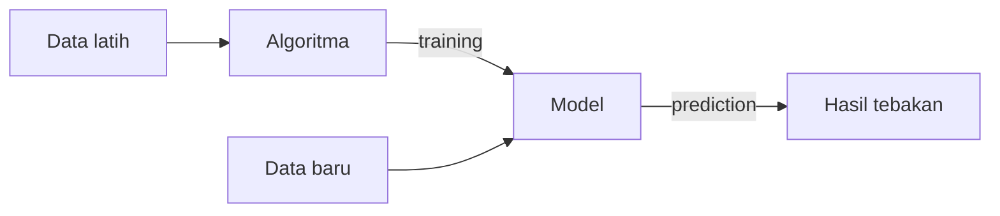

# Definisi Machine Learning

## Definisi dari literatur

Dua definisi yang paling sering dikutip:

**Arthur Samuel (1959).** Machine Learning sering dikaitkan dengan kalimat *"bidang studi yang memberi komputer kemampuan untuk belajar tanpa diprogram secara eksplisit"*. Kalimat ini sangat populer, tetapi biasanya dikutip dari sumber sekunder, bukan kata per kata dari makalah aslinya. Makalah Samuel sendiri membahas program yang belajar bermain *checkers* dari pengalaman. Lihat [Referensi](14-references.md).

**Tom Mitchell (1997).** Definisi yang lebih formal:

> Sebuah program komputer dikatakan belajar dari pengalaman \(E\) terhadap suatu tugas \(T\) dan ukuran kinerja \(P\), jika kinerjanya pada tugas \(T\), yang diukur dengan \(P\), membaik karena pengalaman \(E\).

(Terjemahan bebas dari Mitchell, 1997.)

### Memahami definisi Mitchell dengan contoh

Misalkan program penyaring *spam*:

| Simbol | Arti | Pada contoh spam |
|---|---|---|
| \(T\) (Task) | Tugas yang dikerjakan | Menggolongkan email sebagai spam atau bukan |
| \(E\) (Experience) | Pengalaman belajar | Kumpulan email yang sudah diberi label |
| \(P\) (Performance) | Ukuran keberhasilan | Persentase email yang digolongkan dengan benar |

Jika persentase benar meningkat setelah program melihat lebih banyak email berlabel, berarti program itu **belajar**.

## Konsep inti: belajar dari data

Secara sederhana, ML mencari sebuah fungsi yang memetakan input ke output:

\[
\hat{y} = f(x)
\]

Arti simbolnya:

- \(x\): data masukan (misalnya jumlah jam belajar).
- \(\hat{y}\) (dibaca "y topi"): hasil tebakan model (misalnya perkiraan nilai ujian).
- \(f\): aturan atau pola yang ditemukan dari data.

Tugas algoritma adalah menemukan \(f\) yang tebakannya sedekat mungkin dengan kenyataan.

## Algoritma dan model

Dua istilah ini sering tertukar:

- **Algoritma** adalah *resep* atau prosedur belajar. Contoh: *Linear Regression*.
- **Model** adalah *hasil* dari proses belajar: pola yang sudah ditemukan dan siap dipakai.

Analogi: algoritma seperti cara belajar (misalnya membuat rangkuman dan latihan soal), sedangkan model seperti pengetahuan yang kamu miliki setelah belajar.

## Training dan prediction

- **Training** (pelatihan): tahap ketika algoritma mempelajari data sehingga menghasilkan model.
- **Prediction** (prediksi): tahap ketika model dipakai pada data baru untuk menghasilkan tebakan.

## Contoh masalah belajar yang sederhana

| Masalah | Input (x) | Yang ingin ditebak |
|---|---|---|
| Menebak nilai ujian | Jam belajar | Nilai ujian |
| Menebak harga rumah | Luas tanah, jumlah kamar | Harga |
| Mengenali email spam | Isi email | Spam atau bukan |
| Mengelompokkan pelanggan | Usia, pendapatan, kebiasaan belanja | Tidak ada jawaban yang ditentukan di awal (ini *clustering*) |

Contoh terakhir akan menjadi pusat perhatian kita di bab-bab selanjutnya.

Lanjut ke [AI, ML, dan Deep Learning](03-ai-ml-deep-learning.md).
