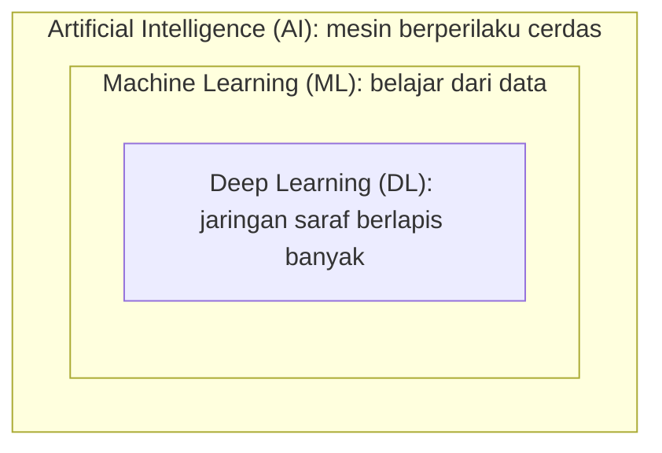

# Hubungan AI, ML, dan Deep Learning

Tiga istilah ini sering dipakai bergantian di berita, padahal artinya berbeda. Cara mudah mengingatnya: **ketiganya seperti lingkaran yang bersarang**.

## Artificial Intelligence (AI)

**Artificial Intelligence** adalah bidang luas yang bertujuan membuat mesin melakukan pekerjaan yang biasanya membutuhkan kecerdasan manusia: bernalar, memahami bahasa, mengenali gambar, mengambil keputusan.

AI tidak selalu memakai data untuk belajar. Program catur klasik yang dipenuhi aturan buatan manusia pun termasuk AI.

## Machine Learning (ML)

**Machine Learning** adalah *cabang* AI yang membuat mesin **belajar dari data** sehingga aturannya tidak perlu ditulis satu per satu.

## Deep Learning (DL)

**Deep Learning** adalah *cabang* ML yang memakai **jaringan saraf tiruan** (*artificial neural network*) dengan banyak lapisan. Pendekatan ini sangat kuat untuk data kompleks seperti gambar, suara, dan teks.

## Diagram hubungan

Hubungan hierarkinya:

\[
\text{Deep Learning} \subset \text{Machine Learning} \subset \text{Artificial Intelligence}
\]

Simbol \(\subset\) dibaca "bagian dari".

## Perbandingan

| Aspek | AI | ML | DL |
|---|---|---|---|
| Cakupan | Paling luas | Bagian dari AI | Bagian dari ML |
| Cara kerja | Bisa berbasis aturan atau data | Belajar dari data | Jaringan saraf berlapis |
| Kebutuhan data | Bervariasi | Sedang sampai banyak | Biasanya sangat banyak |
| Contoh | Program catur berbasis aturan | Prediksi harga rumah, clustering pelanggan | Pengenalan wajah, penerjemah mesin |

!!! note "Posisi materi ini"
    Kurikulum ini berfokus pada **Machine Learning klasik**, khususnya *clustering*. Deep Learning tidak dibahas mendalam, tetapi kamu perlu tahu letaknya di peta besar ini.

Lanjut ke [Pemrograman Tradisional vs ML](04-traditional-programming-vs-ml.md).
