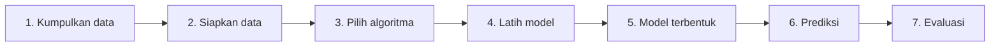

# Bagaimana Machine Learning Bekerja?

Kita ikuti satu contoh sederhana dari awal sampai akhir: **menebak nilai ujian seorang mahasiswa dari jam belajarnya**.

## 1. Data collection (pengumpulan data)

Kita catat jam belajar dan nilai ujian beberapa mahasiswa.

| Mahasiswa | Jam belajar | Nilai ujian |
|---|---|---|
| A | 2 | 55 |
| B | 4 | 64 |
| C | 6 | 72 |
| D | 8 | 83 |

Data yang baik harus **relevan** dengan masalah dan **cukup banyak**.

## 2. Data preparation (persiapan data)

Data mentah jarang langsung siap dipakai. Kita periksa apakah ada:

- nilai yang kosong,
- baris yang terduplikasi,
- angka yang janggal (misalnya jam belajar 90 jam sehari).

Lalu data dipisah menjadi **data latih** (untuk belajar) dan **data uji** (untuk menguji). Alasannya dijelaskan di [Komponen Dasar](06-basic-components.md).

## 3. Learning algorithm (algoritma belajar)

Kita pilih algoritma. Di sini kita pakai *Linear Regression*, yang mencari garis lurus terbaik yang melewati data. Detail algoritmanya tidak perlu dipahami sekarang.

## 4. Model training (pelatihan model)

Algoritma menyesuaikan garis agar sedekat mungkin dengan titik-titik data latih. Seluruh proses penyesuaian ini disebut **training**.

## 5. Model representation (representasi model)

Setelah training, model tersimpan dalam bentuk angka-angka. Untuk contoh ini, polanya berbentuk:

\[
\hat{y} = w \cdot x + b
\]

- \(x\): jam belajar.
- \(\hat{y}\): perkiraan nilai ujian.
- \(w\): *bobot* (seberapa besar nilai naik untuk tiap tambahan 1 jam belajar).
- \(b\): *bias* atau titik awal (perkiraan nilai ketika jam belajar nol).

Angka \(w\) dan \(b\) itulah isi model. Contoh kasar: jika \(w = 4\) dan \(b = 48\), maka belajar 5 jam menghasilkan tebakan \(4 \times 5 + 48 = 68\).

!!! note "Parameter"
    Angka yang ditemukan algoritma saat training (di sini \(w\) dan \(b\)) disebut **parameter** model.

## 6. Prediction (prediksi)

Mahasiswa baru belajar 6,5 jam. Kita masukkan 6,5 ke model, dan model mengeluarkan tebakan nilai. Prediksi dibuat untuk data yang **tidak ada** pada data latih.

## 7. Model evaluation (evaluasi model)

Kita bandingkan tebakan dengan nilai sebenarnya pada **data uji**. Salah satu ukuran sederhana adalah *Mean Absolute Error* (MAE), yaitu rata-rata selisih absolut:

\[
\text{MAE} = \frac{1}{n} \sum_{i=1}^{n} \left| y_i - \hat{y}_i \right|
\]

- \(n\): jumlah data uji.
- \(y_i\): nilai sebenarnya pada data ke-\(i\).
- \(\hat{y}_i\): nilai tebakan pada data ke-\(i\).
- \(|\cdot|\): nilai mutlak (selisih selalu positif).

Contoh: tebakan 70, 80, 90 dan nilai sebenarnya 72, 79, 93. Selisihnya 2, 1, 3, sehingga \(\text{MAE} = (2+1+3)/3 = 2\). Artinya rata-rata tebakan meleset 2 poin. Semakin kecil, semakin baik.

Kode lengkap untuk alur ini ada di [Praktik Pertama](11-hands-on-introduction.md).

Lanjut ke [Komponen Dasar](06-basic-components.md).
