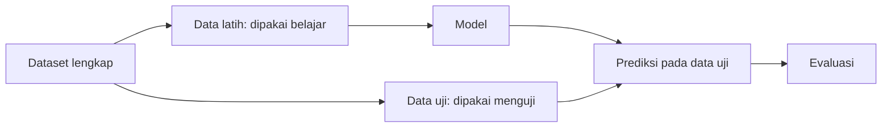

# Komponen Dasar Machine Learning

Sebelum membaca kode atau buku ML, kenali dulu "kosakata" dasarnya. Kita pakai satu dataset kecil sebagai ilustrasi.

## Ilustrasi dataset

| No | Jam belajar | Jam tidur | Nilai ujian |
|---|---|---|---|
| 1 | 2 | 7 | 55 |
| 2 | 4 | 6 | 64 |
| 3 | 6 | 8 | 72 |
| 4 | 8 | 6 | 83 |
| 5 | 10 | 7 | 92 |

## Daftar istilah

**Dataset**
:   Kumpulan data yang dipakai untuk belajar, biasanya berbentuk tabel. Tabel di atas adalah sebuah dataset dengan 5 baris.

**Sample / observation (contoh data)**
:   Satu baris pada dataset, misalnya mahasiswa nomor 1.

**Feature (fitur)**
:   Kolom yang menjadi **masukan** atau ciri yang dipakai model. Pada contoh: *Jam belajar* dan *Jam tidur*.

**Target variable (variabel target / label)**
:   Kolom yang ingin **ditebak**. Pada contoh: *Nilai ujian*. Pada clustering, **tidak ada** kolom target.

**Algorithm (algoritma)**
:   Prosedur belajar, misalnya *Linear Regression*.

**Model**
:   Hasil dari algoritma setelah belajar dari data.

**Training data (data latih)**
:   Bagian dataset yang dipakai model untuk belajar.

**Testing data (data uji)**
:   Bagian dataset yang **disembunyikan** saat belajar dan dipakai untuk menguji model.

**Prediction (prediksi)**
:   Tebakan model untuk data baru.

**Evaluation (evaluasi)**
:   Mengukur seberapa baik prediksi, misalnya dengan MAE.

## Mengapa data harus dibagi latih dan uji?

Bayangkan guru memberi soal latihan, lalu memakai soal **yang persis sama** saat ujian. Nilai bagus belum tentu berarti murid paham. Bisa saja ia hanya menghafal.

Hal yang sama terjadi pada model. Jika diuji dengan data yang sudah pernah dilihat, hasilnya terlalu optimis. Karena itu sebagian data disimpan dan baru dipakai saat pengujian. Kebiasaan yang umum adalah membagi sekitar 70–80% untuk latih dan 20–30% untuk uji.

## Memetakan istilah pada contoh

| Istilah | Pada contoh nilai ujian |
|---|---|
| Dataset | Tabel 5 mahasiswa |
| Feature | Jam belajar, jam tidur |
| Target | Nilai ujian |
| Algorithm | Linear Regression |
| Model | Rumus nilai dari jam belajar dan jam tidur |
| Prediction | Nilai tebakan untuk mahasiswa baru |
| Evaluation | MAE pada data uji |

!!! tip "Notasi yang sering ditemui"
    Dalam kode dan buku, fitur biasanya diberi nama **`X`** (huruf besar karena berupa tabel) dan target diberi nama **`y`** (huruf kecil karena berupa satu kolom).

Lanjut ke [Penerapan di Dunia Nyata](07-real-world-applications.md).
