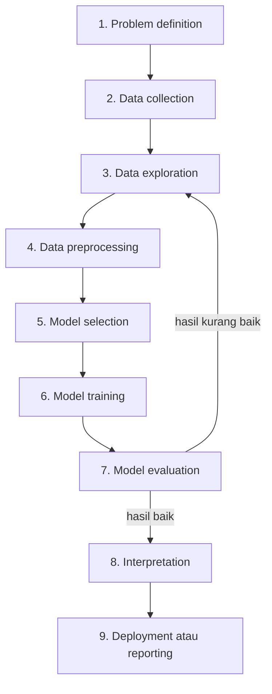

# Workflow Machine Learning

Proyek ML bukan hanya "menjalankan algoritma". Ada serangkaian langkah yang biasanya diikuti. Urutannya sering **berulang**: hasil evaluasi bisa membuat kita kembali memperbaiki data atau memilih model lain.

## Penjelasan tiap langkah

**1. Problem definition (mendefinisikan masalah)**
:   Apa yang ingin diselesaikan? Contoh: "Saya ingin mengelompokkan pelanggan toko agar promosi lebih tepat." Masalah yang jelas menentukan semua langkah berikutnya.

**2. Data collection (pengumpulan data)**
:   Mengumpulkan data dari database, file CSV, survei, sensor, atau sumber terbuka. Catat asal dan arti tiap kolom.

**3. Data exploration (eksplorasi data)**
:   Mengenali data: berapa baris dan kolom, tipe datanya, rata-rata, sebaran, serta pola awal lewat grafik.

**4. Data preprocessing (pra-pemrosesan data)**
:   Merapikan data: menangani nilai kosong, duplikat, dan *outlier*, mengubah kategori menjadi angka, dan menyamakan skala.

**5. Model selection (pemilihan model)**
:   Memilih jenis algoritma yang cocok dengan masalah dan data.

**6. Model training (pelatihan model)**
:   Menjalankan algoritma pada data latih untuk menghasilkan model.

**7. Model evaluation (evaluasi model)**
:   Mengukur kualitas model dengan data uji atau ukuran khusus. Pada clustering, ukurannya berbeda dan dibahas di level tersendiri.

**8. Interpretation (interpretasi)**
:   Memahami arti hasil: apa yang dipelajari model, apakah masuk akal, dan apa kesimpulannya bagi masalah awal.

**9. Deployment atau reporting**
:   Memasang model agar dipakai pada aplikasi nyata, atau menyusun laporan atau artikel ilmiah berisi temuan.

## Di mana kursus ini berada?

| Langkah | Dibahas di |
|---|---|
| 1 | Bab ini dan seluruh level |
| 3 dan 4 | Level 2: Data Exploration and Preprocessing |
| 5 dan 6 | Level 3 dan 4: Fundamental Clustering dan Clustering Algorithms |
| 7 | Level 5: Clustering Evaluation |
| 8 | Level 6: Experimentation and Interpretation |
| 9 | Level 7: Research Project |

!!! tip "Jangan lewati langkah 3 dan 4"
    Pemula sering langsung loncat ke pelatihan model. Padahal sebagian besar waktu pada proyek nyata dipakai untuk memahami dan merapikan data.

Lanjut ke [Jenis Masalah ML](09-machine-learning-problems.md).
