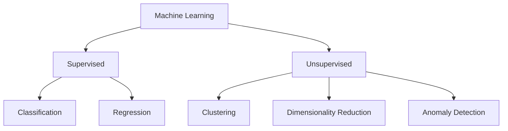

# Pengantar Jenis Masalah Machine Learning

Masalah ML punya beberapa "jenis". Sub-bab ini hanya **perkenalan singkat**. Setiap jenis akan dibahas lebih dalam di bab dan level lain.

Pembeda paling penting: apakah data punya **label (jawaban)** atau tidak.

- **Supervised learning**: data punya label. Model belajar dari pasangan input dan jawaban.
- **Unsupervised learning**: data tidak punya label. Model mencari struktur atau pola sendiri.

## Classification (klasifikasi)

Menebak **kategori**.

- Contoh: email ini *spam* atau *bukan spam*? Foto ini *kucing* atau *anjing*?
- Jenis: supervised.
- Keluaran: salah satu dari kategori yang sudah ditentukan.

## Regression (regresi)

Menebak **angka** yang nilainya bisa berapa saja dalam suatu rentang.

- Contoh: berapa harga rumah ini? Berapa nilai ujian mahasiswa ini?
- Jenis: supervised.
- Keluaran: bilangan.

## Clustering

**Mengelompokkan** data yang mirip, tanpa jawaban yang ditentukan di awal.

- Contoh: mengelompokkan pelanggan toko berdasarkan kebiasaan belanja.
- Jenis: unsupervised.
- Keluaran: nomor atau nama kelompok untuk tiap data. Ini topik utama materi ini.

## Dimensionality Reduction (reduksi dimensi)

**Mengurangi jumlah fitur** sambil mempertahankan informasi penting. Berguna ketika fitur sangat banyak, atau agar data bisa digambar pada grafik 2 dimensi.

- Contoh: meringkas 50 kolom hasil survei menjadi 2 kolom untuk divisualisasikan.
- Jenis: umumnya unsupervised.
- Keluaran: data dengan fitur lebih sedikit.

## Anomaly Detection (deteksi anomali)

Menemukan data yang **tidak biasa** atau menyimpang dari pola umum.

- Contoh: transaksi kartu kredit yang sangat berbeda dari kebiasaan pemilik kartu.
- Jenis: bisa unsupervised atau supervised, tergantung data.
- Keluaran: tanda "normal" atau "tidak biasa", atau skor keanehan.

## Perbandingan ringkas

| Jenis | Pertanyaan | Ada label? | Keluaran | Contoh |
|---|---|---|---|---|
| Classification | Termasuk kategori mana? | Ya | Kategori | Spam atau bukan |
| Regression | Berapa nilainya? | Ya | Angka | Harga rumah |
| Clustering | Mana yang mirip? | Tidak | Kelompok | Segmen pelanggan |
| Dimensionality Reduction | Bagaimana meringkas fitur? | Umumnya tidak | Fitur lebih sedikit | Ringkasan survei |
| Anomaly Detection | Mana yang tidak biasa? | Bervariasi | Normal atau anomali | Transaksi mencurigakan |

!!! note "Catatan"
    Diagram ini menyederhanakan. Anomaly detection, misalnya, bisa juga dikerjakan secara supervised bila tersedia data berlabel.

Lanjut ke [Peran ML dalam Clustering](10-role-of-ml-in-clustering.md).
