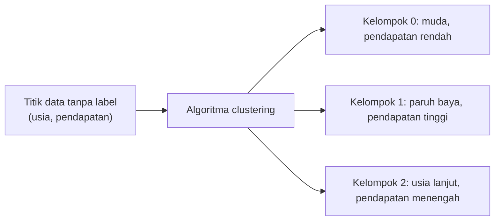
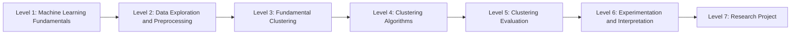

# Peran Machine Learning dalam Clustering

## Apa itu clustering?

**Clustering** adalah proses mengelompokkan data ke dalam beberapa **cluster** (kelompok) sehingga data dalam satu kelompok **mirip satu sama lain**, dan berbeda dari data di kelompok lain.

Analogi: bayangkan kamu diminta merapikan ratusan baju tanpa diberi aturan. Kamu mungkin mengelompokkannya sendiri: kaus di satu tumpukan, kemeja di tumpukan lain, celana di tumpukan ketiga. Tidak ada yang memberi tahu nama kelompoknya. Kamu menemukannya dari kemiripan. Itu clustering.

## Mengapa clustering termasuk Unsupervised Learning?

Karena data yang dipakai **tidak punya label**. Tidak ada kolom jawaban seperti "kelompok yang benar". Algoritma hanya melihat fitur, misalnya usia dan pendapatan, lalu mencari struktur sendiri.

| | Supervised (misal classification) | Unsupervised (clustering) |
|---|---|---|
| Data | Fitur **dan** label | Hanya fitur |
| Yang dicari | Aturan dari fitur ke label | Struktur atau kelompok alami |
| Contoh pertanyaan | "Pelanggan ini akan membeli atau tidak?" | "Ada berapa tipe pelanggan?" |

## Mengapa tidak butuh target label?

Pada banyak masalah nyata, label **tidak tersedia** atau **mahal** untuk dibuat. Toko punya data transaksi jutaan pelanggan, tetapi tidak ada yang pernah memberi tiap pelanggan label "tipe A" atau "tipe B". Clustering memungkinkan kita menemukan kelompok itu dari data saja.

Konsekuensinya, menilai hasil clustering lebih sulit karena tidak ada "kunci jawaban". Itu sebabnya ada level tersendiri tentang evaluasi dan interpretasi.

## Contoh penerapan

- **Segmentasi pelanggan** (e-commerce): kelompok pelanggan untuk promosi berbeda.
- **Pengelompokan wilayah** (kebencanaan): wilayah dengan tingkat kerawanan serupa.
- **Pengelompokan dokumen**: artikel dengan topik mirip.
- **Pengelompokan siswa** (pendidikan): pola belajar yang serupa.
- **Kompresi gambar**: mengelompokkan warna yang mirip.

## Gambaran sederhana

Dua fitur pelanggan: usia dan pendapatan. Tanpa label, data terlihat seperti titik-titik. Clustering mencari titik-titik yang saling berdekatan:

Nama kelompok seperti di atas **tidak dihasilkan algoritma**. Algoritma hanya memberi nomor (0, 1, 2). Manusialah yang menafsirkan arti tiap kelompok.

## Peta perjalanan belajar

Kamu sedang berada di Level 1. Setiap level menambah satu kemampuan yang dibutuhkan untuk menyelesaikan proyek clustering secara utuh.

Lanjut ke [Praktik Pertama](11-hands-on-introduction.md).
