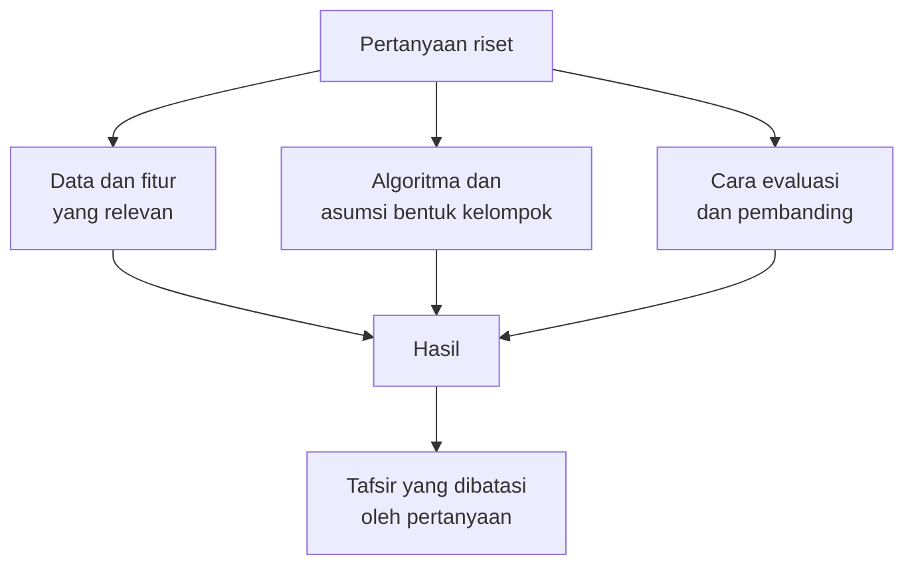
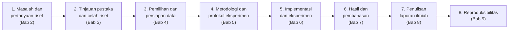

# Bab 1 — Introduction to Clustering Research

## Learning Objectives

Setelah mempelajari bab ini, kamu mampu:

- [x] Menjelaskan peran clustering dalam penelitian ilmiah.
- [x] Membedakan *mempelajari* clustering, *menjalankan* clustering, dan *meneliti* dengan clustering.
- [x] Menyebutkan ciri khas penelitian yang memakai *unsupervised learning*.
- [x] Mengenali contoh penelitian clustering di berbagai bidang.
- [x] Menjelaskan hubungan antara pertanyaan riset, data, algoritma, dan evaluasi.
- [x] Menggambarkan alur penelitian clustering dari awal sampai akhir, dan menunjuk bab mana di Level 7 yang membahas tiap tahap.
- [x] Menjalankan satu demonstrasi kecil dengan Python yang menunjukkan bahwa pertanyaan riset menentukan hasil.
- [x] Mengenali kesalahan umum pemula dalam penelitian clustering.

## Introduction

Kamu sudah menempuh enam level. Kamu tahu cara menyiapkan data (Level 2), memahami konsep kelompok dan jarak (Level 3), memakai algoritma (Level 4), menilai hasilnya (Level 5), dan bereksperimen secara sistematis (Level 6). Level 7 mengajukan pertanyaan yang berbeda:

> **Bagaimana semua itu dirangkai menjadi sebuah penelitian yang bisa dipertanggungjawabkan?**

Bayangkan dua mahasiswa dengan data yang sama. Mahasiswa pertama menulis, "Saya menjalankan K-Means pada data ini dan mendapat dua kelompok." Mahasiswa kedua menulis, "Saya ingin tahu apakah profil morfologi inti sel punya struktur kelompok yang stabil. Saya merumuskan pertanyaan itu, memilih data dan fitur yang sesuai, memeriksa penelitian sebelumnya, menetapkan protokol sebelum menjalankan apa pun, lalu melaporkan hasil beserta keterbatasannya."

Hasil teknis keduanya bisa persis sama, yaitu dua kelompok dari K-Means. Bedanya ada pada **pertanggungjawaban**: mahasiswa kedua bisa menjelaskan *mengapa* ia melakukan analisis itu, *seberapa jauh* hasilnya boleh dipercaya, dan *apa yang tidak bisa disimpulkan*. Itulah inti penelitian.

!!! note "Prasyarat"
    - [Level 3 Bab 7 — Clustering Workflow](../fundamental-clustering/07-clustering-workflow.md): alur kerja clustering.
    - [Level 5 Bab 8 — External Evaluation and Metric Comparison](../clustering-evaluation/08-external-evaluation-and-metric-comparison.md): ARI dan NMI.
    - [Level 6 Bab 1 — Introduction to Clustering Experiments](../experimentation-and-interpretation/01-introduction-to-clustering-experiments.md): eksperimen, variabel, dan baseline. Bab ini tidak mengulangnya, hanya memakainya.

## Fundamental Concepts

| Istilah | Arti |
|---|---|
| **Research** (penelitian) | Penyelidikan terencana untuk menjawab pertanyaan, dengan cara yang bisa diperiksa dan diulang orang lain |
| **Research problem** | Masalah atau ketidaktahuan yang ingin dijawab. Dibahas di Bab 2 |
| **Research question** | Pertanyaan spesifik yang diturunkan dari masalah tersebut |
| **Research gap** | Hal yang belum dijawab oleh penelitian sebelumnya. Dibahas di Bab 3 |
| **Contribution** | Apa yang ditambahkan penelitianmu pada pengetahuan yang sudah ada |
| **Methodology** | Cara penelitian dilakukan: data, praproses, algoritma, evaluasi, dan pembanding |
| **Protocol** | Versi rinci dari metodologi yang ditulis *sebelum* eksperimen berjalan, sehingga orang lain bisa mengulanginya. Dibahas di Bab 5 |
| **Internal evaluation** | Menilai kelompok memakai data itu sendiri, misalnya Silhouette (Level 5) |
| **External validation** | Membandingkan kelompok dengan label atau pengetahuan di luar proses clustering, misalnya ARI atau NMI (Level 5 Bab 8) |
| **Reproducibility** | Kemampuan orang lain mengulang penelitian dan memperoleh hasil yang sama. Dibahas di Bab 9 |

## Detailed Explanation

### Peran clustering dalam penelitian ilmiah

Clustering dipakai ketika peneliti ingin **menemukan struktur** dalam data yang belum diberi label. Beberapa peran umum:

1. **Eksplorasi.** "Apakah data ini punya kelompok alami?" Hasilnya sering menjadi pijakan untuk pertanyaan berikutnya, bukan kesimpulan akhir.
2. **Pembentukan hipotesis.** Kelompok yang muncul bisa memunculkan dugaan baru yang diuji dengan data atau metode lain.
3. **Pengurangan kompleksitas.** Ribuan objek diringkas menjadi beberapa kelompok yang lebih mudah dipelajari.
4. **Pembanding metode.** Penelitian metodologis membandingkan algoritma atau praproses pada data yang sama (Level 6 Bab 4).
5. **Langkah pada alur yang lebih besar.** Misalnya sebagai tahap awal sebelum analisis lanjutan.

!!! warning "Clustering menemukan pola, bukan menjelaskan sebab"
    Clustering memberi tahu bahwa titik-titik tertentu *mirip menurut fitur yang dipakai*. Ia tidak memberi tahu *mengapa* mereka mirip, dan tidak membuktikan hubungan sebab-akibat. Prinsip ini akan berulang di setiap bab Level 7.

### Mempelajari, menjalankan, dan meneliti

Tiga kegiatan ini sering tercampur, padahal tujuannya berbeda.

| | Mempelajari clustering | Menjalankan clustering | Meneliti dengan clustering |
|---|---|---|---|
| Tujuan | Memahami konsep dan algoritma | Mendapat pengelompokan dari data | Menjawab pertanyaan yang belum terjawab |
| Titik awal | Materi atau tutorial | Data dan sebuah algoritma | Masalah dan pertanyaan riset |
| Pilihan data | Disediakan | Yang tersedia | Dipilih karena cocok dengan pertanyaan, dan didokumentasikan sumber serta lisensinya |
| Pilihan metode | Mengikuti contoh | Yang familiar | Dijustifikasi, dibandingkan dengan alternatif |
| Pembanding | Tidak wajib | Biasanya tidak ada | Wajib: baseline dan penelitian terdahulu |
| Keluaran | Pemahaman | Label kelompok | Temuan yang dilaporkan beserta keterbatasan |
| Pembaca | Diri sendiri | Diri sendiri atau tim | Komunitas ilmiah yang bisa memeriksa dan mengulang |

Level 1 sampai 6 melatih dua kolom pertama. Level 7 melatih kolom ketiga.

### Ciri penelitian dengan *unsupervised learning*

Penelitian dengan *supervised learning* punya ukuran keberhasilan yang jelas: akurasi pada data uji. Pada *unsupervised learning* keadaannya berbeda, dan ini memengaruhi cara kamu merancang penelitian.

1. **Tidak ada jawaban benar yang otomatis tersedia.** Kamu tidak bisa menghitung "akurasi" kelompok. Evaluasi harus dirancang dan dijustifikasi.
2. **Hasil bergantung pada banyak pilihan.** Fitur, skala, algoritma, K atau `eps`, seed, dan sampel semuanya memengaruhi hasil (Level 6). Penelitian harus menunjukkan seberapa peka kesimpulannya terhadap pilihan itu.
3. **Algoritma selalu menghasilkan kelompok.** K-Means akan membagi data menjadi K kelompok bahkan pada data tanpa struktur. Adanya kelompok bukan bukti adanya struktur.
4. **"Kelompok yang benar" tergantung tujuan.** Ini yang membedakan clustering dari klasifikasi. von Luxburg dkk. (2012) membahasnya dengan judul "Clustering: Science or Art?": cara menilai clustering perlu disesuaikan dengan tujuan pemakaiannya.
5. **Makna kelompok bukan keluaran algoritma.** Memberi nama pada kelompok adalah penafsiran peneliti. Penafsiran itu harus ditandai sebagai penafsiran dan dibatasi pada bukti yang ada.

### Contoh penelitian clustering

Contoh berikut adalah **ilustrasi jenis pertanyaan**, bukan kutipan dari publikasi tertentu.

| Bidang | Contoh pertanyaan riset |
|---|---|
| Kesehatan (data publik, tanpa data pribadi) | Apakah profil pengukuran sel punya struktur kelompok yang stabil, dan seberapa selaras dengan diagnosis yang tercatat? |
| Pemasaran | Apakah segmen pelanggan stabil bila fitur perilaku diganti dengan fitur demografis? |
| Pendidikan | Adakah pola belajar mahasiswa yang konsisten antar-semester? |
| Lingkungan | Apakah stasiun pengukuran bisa dikelompokkan menurut pola musiman? |
| Metodologi | Algoritma mana yang paling tahan terhadap noise pada data berbentuk tidak bulat? |

Perhatikan bahwa semuanya berupa **pertanyaan**, bukan "saya akan menjalankan K-Means". Algoritma adalah alat untuk menjawab, bukan tujuan.

### Pertanyaan, data, algoritma, dan evaluasi saling terkait

Inilah ide pusat bab ini. Keempat unsur itu tidak dipilih terpisah. **Pertanyaan riset menentukan yang lain.**



Contoh: pertanyaan "Apakah *ukuran* inti sel membentuk kelompok?" mengharuskan fitur ukuran. Pertanyaan "Apakah *tekstur* inti sel membentuk kelompok?" mengharuskan fitur tekstur. Jika kamu memakai fitur yang sama untuk kedua pertanyaan, jawabanmu tidak menjawab salah satunya dengan tepat. Bagian kode di bab ini menunjukkan hal ini dengan data nyata.

### Alur penelitian clustering dari awal sampai akhir



| Tahap | Pertanyaan pemandu | Bab |
|---|---|---|
| 1. Masalah dan pertanyaan | Apa yang ingin diketahui, dan mengapa penting? | 2 |
| 2. Pustaka dan celah | Apa yang sudah dilakukan orang lain, dan apa yang belum? | 3 |
| 3. Data | Data apa yang cocok, dari mana, boleh dipakai untuk apa? | 4 |
| 4. Metodologi | Bagaimana kita akan menjawab, dan apa pembandingnya? | 5 |
| 5. Implementasi | Bagaimana menjalankannya dengan benar dan tercatat? | 6 |
| 6. Hasil dan pembahasan | Apa temuannya, apa maknanya, apa yang tidak boleh disimpulkan? | 7 |
| 7. Penulisan | Bagaimana menyampaikannya sebagai tulisan ilmiah? | 8 |
| 8. Reproduksibilitas | Bagaimana orang lain mengulanginya? | 9 |

Bab 10 menjalankan seluruh alur ini pada satu proyek akhir.

!!! note "Alur ini tidak selalu lurus"
    Pada praktiknya kamu sering kembali ke tahap sebelumnya. Misalnya, saat menyusun protokol kamu sadar pertanyaanmu terlalu luas, lalu kembali ke tahap 1. Itu wajar. Yang tidak wajar adalah mengubah pertanyaan **setelah melihat hasil** supaya cocok dengan hasil, tanpa mengatakannya.

### Level 7 tidak mengulang Level 1 sampai 6

Level ini **memakai** pengetahuan sebelumnya. Bila konsep sudah dibahas, kita menautkannya. Pembagian peran terhadap Level 6:

| Topik | Level 6 | Level 7 |
|---|---|---|
| Pencatatan konfigurasi dan seed | Bab 2 dan 9 | Bab 9: struktur proyek, Git, dan paket reproduksi |
| Struktur laporan eksperimen | Bab 10 | Bab 8: format makalah ilmiah |
| Merumuskan pertanyaan eksperimen | Bab 1 | Bab 2: pertanyaan riset yang berakar pada masalah dan pustaka |
| Membandingkan algoritma secara adil | Bab 4 | Bab 5: perbandingan sebagai bagian dari protokol penelitian |

### Kesalahan umum pemula

1. **Memulai dari algoritma, bukan dari pertanyaan.** "Saya mau pakai K-Means" bukan pertanyaan riset.
2. **Memilih data lalu mencari pertanyaan yang cocok** tanpa menyadari keterbatasan data itu.
3. **Menganggap adanya kelompok sebagai bukti adanya struktur.**
4. **Memberi nama kelompok seolah fakta**, misalnya "pelanggan loyal", tanpa dasar selain intuisi.
5. **Memakai label untuk melatih lalu mengklaim clustering "berhasil".** Label hanya boleh dipakai untuk validasi (lihat demonstrasi di bawah).
6. **Memilih hasil terbaik dari banyak percobaan** dan melaporkannya seolah satu percobaan.
7. **Tidak mencatat konfigurasi**, sehingga hasil tidak bisa diulang.
8. **Menarik kesimpulan sebab-akibat** dari kelompok.

## Mathematical Foundation

Bab ini hanya memakai dua ukuran yang sudah dibahas di Level 5 Bab 8. Berikut ringkasannya agar kamu bisa membaca output nanti.

**Adjusted Rand Index (ARI)** membandingkan dua pengelompokan \( U \) dan \( V \) dengan mengoreksi kemiripan yang terjadi karena kebetulan:

$$
\mathrm{ARI} = \frac{\mathrm{RI} - \mathbb{E}[\mathrm{RI}]}{\max(\mathrm{RI}) - \mathbb{E}[\mathrm{RI}]}
$$

Di sini \( \mathrm{RI} \) adalah *Rand Index*, yaitu proporsi pasangan titik yang diperlakukan sama oleh kedua pengelompokan (sama-sama satu kelompok, atau sama-sama beda kelompok). \( \mathbb{E}[\mathrm{RI}] \) adalah nilai harapannya bila pengelompokan acak. Nilai 1 berarti identik, nilai sekitar 0 berarti tidak lebih mirip daripada kebetulan. ARI tidak peduli pada nomor kelompok.

**Normalized Mutual Information (NMI)** mengukur seberapa banyak informasi yang dibagi dua pengelompokan:

$$
\mathrm{NMI}(U, V) = \frac{I(U; V)}{\tfrac{1}{2}\left(H(U) + H(V)\right)}
$$

dengan \( I(U;V) \) informasi bersama dan \( H \) entropi. Penyebut memakai rata-rata aritmetika, yang merupakan pengaturan bawaan scikit-learn. Nilainya antara 0 dan 1.

Keduanya dipakai di sini sebagai **validasi eksternal**: membandingkan kelompok dengan diagnosis yang tercatat. Mereka tidak menjadi tujuan optimasi.

## Python Implementation

Skrip lengkapnya ada di `examples/level-7/01_introduction_to_clustering_research.py`, dengan helper bersama di `examples/level-7/_research.py`. Bab ini bersifat konseptual, jadi tidak punya notebook. **Setiap potongan kode diikuti penjelasannya.**

**Konteks masalah:** satu dataset yang sama, tiga pertanyaan riset berbeda. Kita ingin melihat bahwa pertanyaan menentukan fitur, dan fitur menentukan pengelompokan.

**Dataset:** Breast Cancer Wisconsin (Diagnostic), dari UCI Machine Learning Repository. Berisi 569 sampel dan 30 fitur numerik hasil pengukuran citra inti sel. Lisensinya CC BY 4.0 menurut halaman dataset di UCI (DOI 10.24432/C5DW2B). Dokumentasi lengkap sumber dan lisensi ada di Bab 4.

!!! warning "Bukan alat diagnosis"
    Dataset ini bersifat medis, tetapi tujuan kita **hanya belajar metodologi penelitian clustering**. Tidak ada klaim klinis. Hasil di bab ini tidak boleh dipakai untuk menilai pasien. Label diagnosis dipakai hanya sebagai pembanding setelah clustering selesai.

**Pustaka:** NumPy, pandas, Matplotlib, scikit-learn.

### Bagian A — Siapkan alat

```python
--8<-- "level-7/01_introduction_to_clustering_research.py:setup"
```

**Penjelasan:** `KMeans` adalah algoritma yang kita pakai (Level 4 Bab 2). `StandardScaler` menyamakan skala fitur (Level 2 Bab 10). `PCA` hanya dipakai untuk menggambar data berdimensi tinggi dalam dua sumbu (Level 6 Bab 6). `silhouette_score` adalah metrik internal. `adjusted_rand_score` dan `normalized_mutual_info_score` adalah validasi eksternal. `_research` adalah modul bantu kita, isinya ada di bawah.

Isi modul bantu `_research.py`:

```python
--8<-- "level-7/_research.py:helpers"
```

- `load_breast_cancer(as_frame=True)` memuat dataset sebagai tabel pandas. `bunch.data` berisi fitur, `bunch.target` berisi label (0 dan 1).
- `.map({0: "malignant", 1: "benign"})` mengubah angka menjadi nama diagnosis. Pemetaan ini sesuai dokumentasi scikit-learn untuk dataset ini.
- Fungsi `load_wdbc` mengembalikan **dua objek terpisah**: fitur dan diagnosis. Memisahkannya sejak awal membantu kita tidak sengaja memasukkan diagnosis sebagai fitur.
- `dataset_fingerprint` menghitung hash SHA-256 isi data. Dua dataset yang berbeda satu angka saja akan punya sidik jari berbeda (konsep dari Level 6 Bab 9).

### Bagian B — Mengenal data penelitian

```python
--8<-- "level-7/01_introduction_to_clustering_research.py:data"
```

**Penjelasan:**

- `X_all.shape` mengembalikan (jumlah baris, jumlah kolom). Indeks `[0]` adalah baris, `[1]` adalah kolom.
- `X_all.isna().sum().sum()` menghitung nilai hilang: `isna()` menandai sel kosong, `sum()` pertama menjumlah per kolom, `sum()` kedua menjumlah semuanya.
- `diagnosis.value_counts().to_dict()` menghitung jumlah tiap diagnosis dan mengubahnya menjadi dictionary.
- Sidik jari dicetak agar kita bisa memastikan semua orang memakai data yang sama.

### Bagian C — Tiga pertanyaan riset

```python
--8<-- "level-7/01_introduction_to_clustering_research.py:questions"
```

**Penjelasan:** `questions` adalah dictionary: kunci berupa nama pertanyaan, nilai berupa daftar kolom yang relevan.

- **Q1** bertanya tentang *ukuran* inti sel, jadi memakai radius, keliling, dan luas.
- **Q2** bertanya tentang *tekstur dan kehalusan*, jadi memakai empat fitur lain.
- **Q3** bertanya tentang *profil morfologi secara keseluruhan*, jadi memakai ke-30 fitur.

`list(X_all.columns)` mengambil semua nama kolom. Kalimat `f"{name:30s}"` memberi lebar 30 karakter agar output rapi.

!!! note "Ini ilustrasi, bukan rancangan penelitian lengkap"
    Pengelompokan fitur di sini sengaja sederhana untuk keperluan demonstrasi. Pada penelitian sungguhan, pemilihan fitur harus dijustifikasi dan diuji (Level 6 Bab 5). Kita membahasnya di Bab 5 dan Bab 6.

### Bagian D — Satu protokol untuk tiap pertanyaan

```python
--8<-- "level-7/01_introduction_to_clustering_research.py:cluster"
```

**Penjelasan baris demi baris:**

- Semua yang **bukan** variabel bebas ditahan sama: `StandardScaler`, K-Means, `n_clusters=2`, `n_init=10`, dan `random_state=SEED` (42). Yang berubah hanya fitur. Ini prinsip variabel terkontrol dari Level 6 Bab 1.
- `StandardScaler().fit_transform(X_all[columns])` memilih kolom pertanyaan itu lalu menstandarkannya. Hasilnya disimpan di `spaces` karena nanti dipakai untuk menghitung Silhouette dan menggambar.
- `KMeans(...).fit_predict(X_scaled)` melatih model dan mengembalikan label kelompok untuk tiap sampel.
- `np.bincount(labels[name])` menghitung ukuran tiap kelompok.

!!! warning "K = 2 adalah asumsi"
    Kita memilih K = 2 karena dataset punya dua diagnosis. Itu keputusan **untuk keperluan demonstrasi**. Dalam penelitian, jumlah kelompok harus dijustifikasi dan diuji (Level 5 dan Level 6 Bab 3). Menetapkan K dari jumlah label membuat validasi eksternal tampak lebih baik daripada yang seharusnya.

### Bagian E — Evaluasi internal dan validasi eksternal

```python
--8<-- "level-7/01_introduction_to_clustering_research.py:evaluate"
```

**Penjelasan:** untuk tiap pertanyaan kita menghitung tiga angka.

- `silhouette_score(spaces[name], labels[name])`: kualitas kelompok **menurut data itu sendiri**, di ruang fitur pertanyaan tersebut.
- `adjusted_rand_score(diagnosis, labels[name])` dan `normalized_mutual_info_score(...)`: kesesuaian kelompok dengan diagnosis. **Diagnosis tidak pernah dipakai saat clustering.** Ia baru dipakai di sini, sebagai pembanding.

`pd.DataFrame(rows).set_index("Pertanyaan")` menyusun daftar dictionary menjadi tabel dengan nama pertanyaan sebagai indeks baris.

### Bagian F — Membandingkan pengelompokan antar pertanyaan

```python
--8<-- "level-7/01_introduction_to_clustering_research.py:compare"
```

**Penjelasan:** daftar komprehensi bersarang membuat matriks: baris dan kolomnya adalah pertanyaan, isinya ARI antara dua pengelompokan. Kita memakai ARI dan **bukan** membandingkan nomor kelompok langsung, karena nomor kelompok bersifat sembarang (Level 6 Bab 9). Diagonal selalu 1,000 karena sebuah pengelompokan identik dengan dirinya.

### Bagian G — Menggambar

```python
--8<-- "level-7/01_introduction_to_clustering_research.py:plot"
```

**Penjelasan:**

- Dua baris, tiga kolom. **Baris atas** diwarnai menurut kelompok K-Means, **baris bawah** memakai tata letak yang sama tetapi diwarnai menurut diagnosis.
- `pair` menentukan dua fitur yang digambar untuk Q1 dan Q2. Untuk Q3 yang berdimensi 30, kita memakai `PCA(n_components=2)` agar bisa digambar. PCA hanya untuk gambar, bukan untuk clustering.
- Warna kelompok (biru dan oranye) sengaja berbeda dari warna diagnosis (hijau dan merah muda), sehingga tidak ada yang mengira nomor kelompok sama dengan diagnosis. Penanda titik (lingkaran dan kotak) juga berbeda agar terbaca tanpa bergantung pada warna.

### Bagian H — Catatan penelitian

```python
--8<-- "level-7/01_introduction_to_clustering_research.py:record"
```

**Penjelasan:** kita menulis ringkasan keputusan dalam satu dictionary: dataset dan lisensinya, sidik jari data, algoritma, praproses, seed, daftar pertanyaan, dan pernyataan bahwa diagnosis hanya untuk validasi. Kebiasaan ini diperluas menjadi protokol penuh di Bab 5 dan paket reproduksi di Bab 9.

## Code Explanation

| Bagian kode | Peran |
|---|---|
| `rs.load_wdbc()` | Memisahkan fitur dan diagnosis sejak awal |
| `questions = {...}` | Pertanyaan riset menentukan fitur |
| `StandardScaler`, `KMeans(...)` identik untuk semua | Variabel terkontrol |
| `silhouette_score` | Evaluasi internal |
| `adjusted_rand_score(diagnosis, ...)` | Validasi eksternal, bukan target optimasi |
| matriks ARI antar pertanyaan | Mengukur seberapa berbeda pengelompokan antar pertanyaan |
| `record = {...}` | Catatan keputusan, cikal bakal protokol |

!!! note "Pelatihan, evaluasi, dan validasi"
    `fit_predict` adalah **pelatihan** (hanya melihat fitur). Silhouette adalah **evaluasi internal**. ARI dan NMI terhadap diagnosis adalah **validasi eksternal**. Menjaga ketiganya terpisah adalah praktik dasar penelitian clustering.

## How to Run

Dari folder utama proyek (setelah mengaktifkan lingkungan virtual):

```powershell
pip install -r requirements-notebooks.txt
python examples/level-7/01_introduction_to_clustering_research.py
```

Skrip mencetak output ke terminal dan menyimpan satu gambar ke `docs/assets/level-7/`. Dataset dimuat dari scikit-learn, jadi tidak perlu mengunduh apa pun.

Output di bawah berasal dari eksekusi nyata dengan Python 3.14.10, NumPy 2.5.2, pandas 3.0.5, scikit-learn 1.9.0, dan Matplotlib 3.11.1.

## Expected Output

```text
--8<-- "level-7/outputs/01.txt"
```

Gambar yang dihasilkan:


### Interpretasi output

**1. Data.** 569 sampel, 30 fitur, tanpa nilai hilang. Diagnosis tercatat 357 *benign* dan 212 *malignant*. Sidik jari data `6b202a2072f9`.

**2. Tiga pertanyaan, tiga pengelompokan.**

| Pertanyaan | Fitur | Ukuran kelompok | Silhouette | ARI vs diagnosis | NMI vs diagnosis |
|---|---|---|---|---|---|
| Q1 ukuran inti sel | 3 | 141, 428 | **0,658** | 0,493 | 0,430 |
| Q2 tekstur dan kehalusan | 4 | 346, 223 | 0,287 | **0,066** | 0,037 |
| Q3 seluruh profil morfologi | 30 | 375, 194 | 0,343 | **0,654** | 0,532 |

**3. Pengelompokan berbeda antar pertanyaan.** ARI antar pengelompokan:

| | Q1 | Q2 | Q3 |
|---|---|---|---|
| Q1 | 1,000 | 0,014 | 0,498 |
| Q2 | 0,014 | 1,000 | 0,143 |
| Q3 | 0,498 | 0,143 | 1,000 |

Q1 dan Q2 punya ARI **0,014**, hampir tidak lebih mirip daripada kebetulan. Artinya, mengelompokkan sel menurut *ukuran* dan menurut *tekstur* menghasilkan dua pembagian yang nyaris tidak berkaitan. **Pertanyaan yang berbeda memberi jawaban yang berbeda**, bahkan pada data, algoritma, K, dan seed yang sama.

**4. Silhouette tinggi tidak sama dengan selaras dengan diagnosis.** Q1 punya Silhouette tertinggi (0,658), tetapi ARI terhadap diagnosis (0,493) lebih rendah daripada Q3 (0,654), yang Silhouette-nya hanya 0,343. Dua metrik ini menjawab pertanyaan berbeda: Silhouette menilai kepadatan dan keterpisahan kelompok di ruang fiturnya, sedangkan ARI menilai kesesuaian dengan label eksternal. Pada gambar baris atas panel Q1, pembagiannya memisahkan sel besar dari yang kecil sepanjang kurva radius dan luas. Kita tidak menyelidiki lebih jauh mengapa Silhouette-nya tinggi, jadi kita tidak menarik kesimpulan tentang sebabnya.

**5. Q2 hampir tidak selaras dengan diagnosis.** ARI 0,066 dan NMI 0,037. Pada gambar baris bawah panel Q2, titik dari kedua diagnosis bercampur. Ini bukan berarti fitur tekstur tidak berguna untuk hal lain. Artinya, **pada pengaturan ini** (K-Means, K = 2, empat fitur tekstur), pembagian yang ditemukan hampir tidak mengikuti diagnosis.

!!! warning "Batas kesimpulan"
    Hasil ini berlaku untuk **satu dataset, satu algoritma (K-Means), K = 2, dan pengelompokan fitur yang kita pilih sendiri untuk ilustrasi**. Kita **tidak** menyimpulkan bahwa ukuran inti sel "menentukan" diagnosis, bahwa fitur tekstur "tidak penting", atau apa pun yang bersifat klinis. Pengelompokan fitur di Q1 sampai Q3 adalah contoh didaktik, bukan hasil seleksi fitur yang dijustifikasi. Angka-angka ini adalah **hasil demonstrasi**, bukan temuan penelitian.

## Practical Examples

**Merumuskan proposal penelitian.** Sebelum membuka data, tulis satu kalimat pertanyaan riset. Lalu tulis fitur apa yang relevan dan mengapa. Bila kamu sulit menjawab "mengapa", pertanyaanmu belum matang. Bab 2 membahasnya.

**Menilai makalah orang lain.** Saat membaca makalah clustering, tanyakan lima hal: (1) apa pertanyaannya, (2) data dari mana dan apa lisensinya, (3) apa baseline-nya, (4) apakah label dipakai untuk melatih atau hanya memvalidasi, (5) apakah hasil diuji terhadap perubahan pilihan. Makalah yang tidak menjawab kelimanya perlu dibaca dengan hati-hati.

**Memeriksa pekerjaanmu sendiri.** Sebelum melaporkan kelompok, uji apakah kesimpulanmu berubah bila fitur diganti. Pada demonstrasi di atas, ARI antar pertanyaan serendah 0,014. Itu peringatan bahwa klaim "data ini punya dua kelompok" hampir pasti bergantung pada fitur yang dipakai.

## Hands-on Exercises

Semua angka di jawaban berasal dari eksekusi nyata dengan pengaturan yang sama seperti skrip (`StandardScaler`, `KMeans`, `n_init=10`, `random_state=42`) pada ke-30 fitur kecuali disebut lain.

1. Jalankan K-Means pada ke-30 fitur (Q3) dengan K = 2, 3, dan 4. Catat ukuran kelompok, Silhouette, dan ARI terhadap diagnosis. Apakah K = 2 memang yang terbaik menurut kedua ukuran itu?
2. Gabungkan fitur Q1 dan Q2 (7 fitur) lalu lakukan clustering K = 2. Berapa ARI-nya terhadap pengelompokan Q3 dan terhadap diagnosis?
3. Ulangi Q3 dengan seed 0 sampai 9 (`n_init=10`). Berapa ARI terkecil dan terbesar antara seed 0 dan seed lain? Lalu ulangi dengan `n_init=1`.
4. Jalankan K-Means pada ke-30 fitur **tanpa** `StandardScaler`. Bagaimana ukuran kelompok dan ARI terhadap Q3 yang berskala?
5. Tulis satu pertanyaan riset untuk dataset ini yang baik dan satu yang buruk, lalu jelaskan perbedaannya.
6. Mengapa diagnosis tidak boleh dimasukkan sebagai fitur lalu hasilnya disebut "clustering yang akurat"?

??? question "Jawaban"
    Nomor 1 sampai 4 berasal dari eksekusi nyata.

    1. K = 2: ukuran 375 dan 194, Silhouette **0,343**, ARI **0,654**. K = 3: ukuran 110, 359, 100, Silhouette 0,314, ARI 0,511. K = 4: ukuran 345, 35, 97, 92, Silhouette 0,283, ARI 0,552. Pada pengaturan ini, K = 2 punya Silhouette tertinggi **dan** ARI tertinggi. Tetapi ingat, ARI membandingkan dengan dua label diagnosis, jadi K = 2 memang diuntungkan oleh pembanding itu. Untuk Silhouette saja, K = 2 tertinggi di antara tiga nilai yang dicoba.
    2. ARI terhadap Q3: **0,563**. ARI terhadap diagnosis: **0,578**. Ukuran kelompok 151 dan 418. Gabungan itu tidak sama dengan Q3 maupun Q1, menegaskan bahwa pemilihan fitur mengubah hasil.
    3. Dengan `n_init=10`: ARI seed 0 vs seed lain berkisar **0,9647 sampai 1,0**. Dengan `n_init=1`: **0,9577 sampai 1,0**. Jadi pada Q3, seed hampir tidak mengubah hasil, tetapi pada `n_init=10` pun belum persis 1,0 untuk semua seed. Kebisingan ini perlu dilaporkan sebagai bagian dari penelitian.
    4. Tanpa skala, ukuran kelompok 131 dan 438, ARI terhadap diagnosis **0,491**, dan ARI terhadap Q3 yang berskala **0,496**. Fitur dengan rentang nilai besar (misalnya luas, `area`) mendominasi jarak. Ini sejalan dengan [Level 2 Bab 10](../data-exploration-and-preprocessing/10-feature-scaling.md).
    5. Contoh yang baik: "Apakah pengelompokan K-Means pada fitur ukuran inti sel stabil bila seed dan sampel diubah, dan seberapa selaras dengan diagnosis yang tercatat?" Spesifik, terukur, dan terbatas. Contoh yang buruk: "Apakah clustering bisa mendiagnosis kanker?" Terlalu luas, mengandung klaim klinis, dan tidak bisa dijawab oleh eksperimen unsupervised pada dataset ini.
    6. Karena kelompok yang dihasilkan sudah "mengintip" jawaban. Kecocokannya dengan diagnosis jadi tidak membuktikan apa pun. Pada penelitian clustering, label hanya boleh dipakai setelah pengelompokan selesai, sebagai validasi eksternal.

## Troubleshooting

### Masalah teknis

| Masalah | Penyebab | Solusi |
|---|---|---|
| `ModuleNotFoundError: _research` | Skrip dijalankan dari tempat yang salah atau `_research.py` terhapus | Jalankan dari folder utama proyek. Skrip menambahkan foldernya ke `sys.path` |
| `ModuleNotFoundError: sklearn` | Dependensi belum terpasang | `pip install -r requirements-notebooks.txt` |
| Angka berbeda dari output di bab | Versi pustaka, `n_init`, atau `random_state` berbeda | Samakan versi dan pengaturan. Periksa sidik jari data |
| Gambar tidak muncul | Skrip dijalankan tanpa layar (backend Agg) | Gambar disimpan ke `docs/assets/level-7/`, bukan ditampilkan |
| Label diagnosis terbalik | Salah memetakan 0 dan 1 | Di dataset ini 0 = *malignant*, 1 = *benign* |

### Kesalahan umum

1. **Menyimpulkan klinis dari hasil demonstrasi.** Bab ini tentang metodologi.
2. **Memakai diagnosis sebagai fitur atau target optimasi.**
3. **Membaca Silhouette tinggi sebagai bukti kelompok bermakna.**
4. **Menganggap kelompok dari satu pertanyaan berlaku untuk pertanyaan lain.**
5. **Menyamakan "K sama dengan jumlah label" dengan "K sudah dijustifikasi".**
6. **Mengubah fitur dan K sekaligus**, sehingga penyebab perbedaan tidak jelas.
7. **Lupa mencatat sidik jari data dan seed.**

## Summary

- **Penelitian dengan clustering** berawal dari **pertanyaan**, bukan dari algoritma. Level 7 melatih kemampuan itu, sedangkan Level 1–6 melatih alat dan eksperimennya.
- Ciri penelitian *unsupervised*: tidak ada jawaban benar otomatis, hasil bergantung pada banyak pilihan, algoritma selalu menghasilkan kelompok, dan makna kelompok adalah penafsiran peneliti.
- **Pertanyaan riset menentukan data, fitur, algoritma, dan evaluasi.** Pada demonstrasi, tiga pertanyaan pada data yang sama menghasilkan pengelompokan yang berbeda (ARI antar pertanyaan: 0,014 sampai 0,498).
- **Silhouette tinggi tidak sama dengan selaras dengan label**: Q1 punya Silhouette 0,658 tetapi ARI terhadap diagnosis 0,493, sedangkan Q3 punya Silhouette 0,343 dan ARI 0,654.
- **Label hanya untuk validasi eksternal**, tidak untuk melatih.
- Clustering menemukan pola, **bukan sebab**. Semua angka di bab ini adalah hasil demonstrasi pada satu dataset, bukan temuan klinis.
- Alur penelitian: masalah, pustaka, data, metodologi, implementasi, hasil, penulisan, reproduksibilitas. Bab 2 sampai 9 membahasnya, Bab 10 menjalankannya.

**Bab berikutnya:** Bab 2 membahas **perumusan masalah penelitian**: dari ide yang kabur menjadi tujuan, pertanyaan, dan ruang lingkup yang bisa dijawab.

## References

- von Luxburg, U., Williamson, R. C., & Guyon, I. (2012). Clustering: Science or Art? *Proceedings of ICML Workshop on Unsupervised and Transfer Learning, JMLR Workshop and Conference Proceedings*, 27, 65–79. [proceedings.mlr.press/v27/luxburg12a.html](https://proceedings.mlr.press/v27/luxburg12a.html)
- Jain, A. K. (2010). Data clustering: 50 years beyond K-means. *Pattern Recognition Letters*, 31(8), 651–666.
- Hennig, C. (2015). What are the true clusters? *Pattern Recognition Letters*, 64, 53–62.
- Wolberg, W., Mangasarian, O., Street, N., & Street, W. (1993). *Breast Cancer Wisconsin (Diagnostic)* [Dataset]. UCI Machine Learning Repository. [doi.org/10.24432/C5DW2B](https://doi.org/10.24432/C5DW2B). Lisensi CC BY 4.0 menurut halaman dataset.
- Street, W. N., Wolberg, W. H., & Mangasarian, O. L. (1993). Nuclear feature extraction for breast tumor diagnosis. *Electronic Imaging* (artikel pengantar dataset yang dicantumkan UCI).
- Scikit-learn documentation: [*Clustering performance evaluation*](https://scikit-learn.org/stable/modules/clustering.html#clustering-performance-evaluation).
