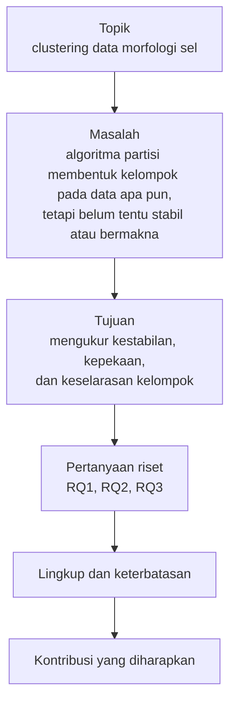

# Bab 2 — Research Problem Formulation

## Learning Objectives

Setelah mempelajari bab ini, kamu mampu:

- [x] Membedakan topik, masalah, tujuan, dan pertanyaan penelitian.
- [x] Mengidentifikasi masalah penelitian clustering dan menuliskan konteksnya.
- [x] Merumuskan tujuan penelitian dengan kata kerja yang terukur.
- [x] Menulis pertanyaan penelitian yang spesifik, terukur, terbatas, dan bisa dijawab oleh data.
- [x] Mengenali pertanyaan yang baik dan yang buruk, beserta alasannya.
- [x] Menetapkan ruang lingkup (*scope*) dan keterbatasan (*limitations*) secara jujur.
- [x] Menyatakan kontribusi yang diharapkan tanpa melebih-lebihkan.
- [x] Mencocokkan pertanyaan penelitian dengan pendekatan clustering dan evaluasinya.
- [x] Memeriksa dengan kode apakah data yang tersedia sanggup menjawab pertanyaanmu.

## Introduction

Di Bab 1 kamu melihat bahwa pertanyaan menentukan fitur, dan fitur menentukan hasil. Maka pertanyaan adalah keputusan pertama yang paling berpengaruh dalam penelitian. Pertanyaan yang kabur menghasilkan analisis yang kabur, sebanyak apa pun kode yang kamu tulis.

Banyak pemula mulai dari data atau algoritma: "Saya punya data sel, saya mau pakai K-Means." Dari situ ada tiga akibat yang umum. Pertama, tidak jelas apa yang dianggap berhasil. Kedua, tidak jelas apa yang boleh disimpulkan. Ketiga, tidak jelas apa yang membedakan penelitianmu dari tutorial.

Bab ini mengajarkan cara menyempitkan sebuah ide menjadi rumusan masalah yang bisa dijawab. Alurnya seperti corong:



!!! note "Prasyarat"
    - [Bab 1 — Introduction to Clustering Research](01-introduction-to-clustering-research.md).
    - [Level 6 Bab 1](../experimentation-and-interpretation/01-introduction-to-clustering-experiments.md): tujuan eksperimen, pertanyaan, dan variabel. Bab ini memperluasnya dari pertanyaan eksperimen ke pertanyaan penelitian.

## Fundamental Concepts

| Istilah | Arti | Contoh |
|---|---|---|
| **Topik** | Bidang luas yang menarik minat | Clustering data morfologi sel |
| **Research problem** | Ketidaktahuan atau kesulitan spesifik yang ingin diatasi | Algoritma partisi membentuk kelompok pada data apa pun, tetapi belum tentu stabil atau bermakna |
| **Context** | Situasi yang membuat masalah itu penting | Hasil clustering sering dilaporkan tanpa uji kestabilan |
| **Objective** (tujuan) | Hal yang ingin dicapai, ditulis dengan kata kerja terukur | Mengukur kestabilan pengelompokan |
| **Research question** | Pertanyaan yang jawabannya didapat dari data dan metode | Seberapa stabil pengelompokan bila seed diganti? |
| **Hypothesis** | Dugaan yang bisa diuji. Tidak selalu ada pada clustering eksploratif | "Tanpa standardisasi, hasil didominasi fitur berskala besar" |
| **Scope** (ruang lingkup) | Batas yang **sengaja kamu pilih** | Satu dataset, empat algoritma |
| **Limitation** (keterbatasan) | Batas yang **tidak sepenuhnya kamu kendalikan** | Hanya 569 sampel |
| **Contribution** | Apa yang ditambahkan penelitianmu | Protokol yang bisa diulang |
| **Feasibility** | Apakah penelitian bisa dilakukan dengan data dan waktu yang ada | Data punya label untuk validasi eksternal |

## Detailed Explanation

### Dari topik ke masalah

**Topik** bukan masalah. "Clustering data pelanggan" adalah topik: tidak ada yang bisa dijawab atau dibantah. **Masalah** muncul ketika ada hal yang belum diketahui atau belum beres. Cara bertanya untuk menemukan masalah:

| Sumber masalah | Pertanyaan pemandu | Contoh |
|---|---|---|
| **Praktik** | Apa yang sering dilakukan tanpa pemeriksaan? | Hasil clustering dilaporkan dari satu kali jalan |
| **Metodologi** | Mana yang lebih baik atau lebih tahan, dan dalam kondisi apa? | Algoritma mana yang tahan terhadap perubahan skala? |
| **Pustaka** | Apa yang belum diuji penelitian terdahulu? | Dibahas di Bab 3 |
| **Replikasi** | Apakah temuan lama bertahan pada data atau pengaturan lain? | Mengulang analisis dengan protokol yang lebih ketat |
| **Aplikasi** | Apa yang dibutuhkan pemakai hasil? | Segmen yang stabil untuk keputusan operasional |

!!! tip "Uji sederhana: topik atau masalah?"
    Coba tulis kalimat "Saya tidak tahu apakah ...". Bila kalimat itu bisa kamu lengkapi dengan sesuatu yang spesifik, kamu sudah punya masalah. Bila tidak, kamu baru punya topik.

### Konteks penelitian

Konteks menjawab pertanyaan **"mengapa ini penting dan mengapa sekarang?"** Konteks yang baik singkat, bersumber, dan mengarah ke masalah. Konteks yang buruk berupa sejarah panjang tanpa menyebut ketidaktahuan yang ingin diatasi.

Untuk proyek akhir kita, konteksnya: algoritma clustering berbasis partisi (seperti K-Means) menghasilkan kelompok pada data apa pun, sedangkan kelompok itu bergantung pada banyak pilihan (Level 6). Karena itu klaim bahwa "data ini punya kelompok" perlu didukung uji kestabilan dan pembanding. Kita juga akan merujuk pustaka untuk memperkuat konteks ini di Bab 3, bukan hanya mengandalkan penalaran sendiri.

### Merumuskan tujuan

**Tujuan** adalah apa yang ingin kamu capai. Kata kerjanya menentukan apakah tujuan itu bisa diperiksa.

| Kata kerja terukur | Kata kerja kabur |
|---|---|
| mengukur, membandingkan, menguji, menghitung, mengidentifikasi | memahami, mengetahui, melihat, mempelajari, mengeksplorasi (tanpa batas) |

Aturan praktis: **satu tujuan khusus sebaiknya punya satu pertanyaan penelitian**. Bila tujuan tidak punya pertanyaan, tujuan itu tidak akan terjawab. Bila pertanyaan tidak punya tujuan, pertanyaan itu tidak jelas untuk apa.

| Tujuan khusus | Pertanyaan penelitian |
|---|---|
| Mengukur kestabilan pengelompokan terhadap seed dan sampel | RQ1: Seberapa stabil pengelompokan bila seed dan sampel diubah? |
| Mengukur kepekaan terhadap penyamaan skala | RQ2: Apakah pengelompokan berubah bila fitur tidak distandarkan? |
| Mengukur keselarasan dengan label eksternal | RQ3: Seberapa selaras kelompok dengan diagnosis yang tercatat? |

### Menulis pertanyaan penelitian

Pertanyaan yang baik memenuhi lima hal.

1. **Berbentuk pertanyaan.** Bukan perintah ("Menggunakan K-Means untuk...") dan bukan topik.
2. **Spesifik.** Menyebut apa yang diteliti (fitur apa, algoritma apa, aspek apa).
3. **Terukur.** Ada angka atau pengamatan yang menjawabnya (ARI, Silhouette, rentang kestabilan).
4. **Terbatas.** Satu pertanyaan, satu aspek. Pertanyaan yang memuat tiga aspek sekaligus sebaiknya dipecah.
5. **Bisa dijawab oleh data dan metode yang kamu miliki.** Pertanyaan klinis tidak bisa dijawab oleh clustering pada data ukuran sel.

Pertanyaan juga **tidak boleh memuat jawabannya sendiri** dan tidak boleh memuat klaim sebab-akibat yang tidak bisa diuji dengan *unsupervised learning*.

!!! note "Hipotesis tidak wajib"
    Seperti di Level 6, pada clustering eksploratif sering tidak ada hipotesis klasik. Bila kamu punya dugaan, tulis sebagai hipotesis yang bisa salah, misalnya "Tanpa standardisasi, ARI terhadap baseline akan rendah." Jangan membuat hipotesis hanya agar tampak formal.

### Contoh pertanyaan yang baik dan yang buruk

Contoh di bawah adalah ilustrasi untuk belajar. Kode di bab ini mengujinya dengan sebuah daftar periksa.

| Kode | Pertanyaan | Penilaian | Alasan |
|---|---|---|---|
| B1 | Menggunakan K-Means untuk mengelompokkan data kanker. | Buruk | Bukan pertanyaan, dimulai dari algoritma, tidak terukur |
| B2 | Apakah clustering bisa mendiagnosis kanker payudara? | Buruk | Klaim klinis, tidak bisa dijawab oleh clustering pada data ini |
| B3 | Mengapa ukuran inti sel menyebabkan kelompok ganas? | Buruk | Klaim sebab-akibat, clustering tidak membuktikan sebab |
| B4 | Algoritma clustering mana yang selalu terbaik untuk semua data? | Buruk | Klaim universal, tidak ada algoritma yang selalu terbaik |
| B5 | Bagaimana data ini? | Buruk | Terlalu kabur, tidak ada yang diukur |
| G1 | Seberapa stabil pengelompokan K-Means pada 30 fitur morfologi bila seed dan sampel data diubah? | Baik | Spesifik, terukur (kestabilan), terbatas |
| G2 | Apakah pengelompokan pada 30 fitur morfologi berubah bila fitur tidak distandarkan, dan seberapa besar perubahannya (ARI)? | Baik | Satu faktor diubah, ada ukuran |
| G3 | Seberapa selaras pengelompokan tak terawasi pada profil morfologi dengan diagnosis yang tercatat (ARI dan NMI)? | Baik | Label hanya untuk validasi, ada ukuran |
| T1 | Apakah hasil clustering stabil dan selaras dengan diagnosis serta berbeda antar algoritma pada semua aspek? | Buruk | Tiga pertanyaan dalam satu, "semua aspek" tidak terbatas |

T1 sengaja dimasukkan karena ia menunjukkan keterbatasan daftar periksa otomatis. Kita akan melihat bahwa daftar periksa kata kunci meloloskannya, padahal pertanyaan itu buruk.

### Ruang lingkup dan keterbatasan

Dua hal ini sering tertukar.

| | Scope (ruang lingkup) | Limitation (keterbatasan) |
|---|---|---|
| Siapa yang memutuskan | **Kamu** | **Keadaan** (data, waktu, metode) |
| Sifat | Batas yang dipilih sengaja | Kelemahan yang tidak sepenuhnya bisa dihindari |
| Contoh | Hanya empat algoritma dari Level 4 | Hanya 569 sampel |
| Cara menulis | Dinyatakan di awal | Dinyatakan jujur di akhir |

Tulis lingkup **dalam** dan **di luar** lingkup. Menyatakan apa yang tidak diklaim melindungimu dari kesimpulan berlebihan. Pada proyek kita, di luar lingkup antara lain klaim klinis, klaim sebab-akibat, dan generalisasi ke dataset lain.

### Kontribusi yang diharapkan

Kontribusi adalah apa yang bertambah setelah penelitianmu selesai. Jenisnya beragam.

| Jenis | Arti | Contoh |
|---|---|---|
| **Empiris** | Temuan baru dari data | Tingkat kestabilan pada data tertentu |
| **Metodologis** | Cara kerja baru atau lebih ketat | Protokol evaluasi yang lebih adil |
| **Replikasi** | Mengulang temuan lama dengan data atau pengaturan lain | Menguji apakah klaim lama bertahan |
| **Teoretis** | Penjelasan atau model baru | Jarang untuk penelitian pemula |
| **Didaktik** | Bahan belajar atau demonstrasi | Protokol yang bisa dipakai untuk belajar |

!!! warning "Kontribusi bukan implementasi"
    Menjalankan K-Means pada dataset publik **bukan** kontribusi ilmiah. Itu implementasi rutin. Kontribusi muncul bila kamu menjawab pertanyaan yang belum terjawab, atau menjawabnya dengan cara yang lebih ketat. Pada proyek akhir, kontribusi yang kita klaim sengaja **didaktik dan metodologis**: mendemonstrasikan protokol yang bisa diulang. Kita tidak mengklaim kebaruan ilmiah, dan kita memeriksa pustaka di Bab 3 sebelum mengatakan sesuatu "belum pernah dilakukan".

### Mencocokkan pertanyaan dengan pendekatan clustering

Tipe pertanyaan menentukan pendekatan dan evaluasi. Tabel ini dihasilkan oleh kode di bab ini:

| Tipe pertanyaan | Contoh | Pendekatan | Evaluasi | Rujukan |
|---|---|---|---|---|
| Eksploratif | Adakah struktur kelompok? | K-Means, Hierarchical | Silhouette, visualisasi | Level 4 B2–B3, Level 6 B8 |
| Komparatif | Algoritma mana yang cocok untuk data ini? | K-Means, GMM, DBSCAN, Hierarchical | Metrik di ruang yang sama | Level 4 B7, Level 6 B4 |
| Sensitivitas | Seberapa peka hasil terhadap praproses atau parameter? | Satu algoritma, satu faktor diubah | ARI terhadap baseline | Level 6 B2, B3, B5 |
| Kestabilan | Apakah hasil tahan terhadap seed dan sampel? | Satu algoritma, ulang berkali-kali | ARI antar-ulangan, Jaccard | Level 6 B9 |
| Validasi eksternal | Seberapa selaras dengan pengetahuan di luar data? | Clustering dulu, label sesudahnya | ARI, NMI terhadap label | Level 5 B8 |

Bila pertanyaanmu tidak cocok dengan satu pun baris, periksa lagi apakah itu pertanyaan clustering. Mungkin ia lebih cocok untuk klasifikasi atau analisis lain.

### Pemeriksaan kelayakan (*feasibility*)

Pertanyaan yang bagus tetap gagal bila data tidak mendukungnya. Sebelum melangkah, periksa:

| Pemeriksaan | Mengapa penting |
|---|---|
| Jumlah sampel dan fitur | Cukup untuk dibagi, diulang, dan diambil sampelnya |
| Nilai hilang | Mempengaruhi praproses (Level 2 Bab 5) |
| Ada label eksternal? | Tanpa label, validasi eksternal tidak mungkin |
| Ada kolom waktu? | Tanpa waktu, pertanyaan tentang perubahan dari waktu ke waktu tidak bisa dijawab |
| Ada identitas individu? | Menyangkut privasi dan etika (Bab 4) |

Bagian Python di bawah memeriksa hal-hal ini dengan data nyata.

### Pertanyaan boleh berubah, tetapi tidak diam-diam

Merumuskan ulang pertanyaan setelah membaca pustaka (Bab 3) atau saat menyusun protokol (Bab 5) adalah wajar. Yang tidak boleh adalah **mengubah pertanyaan atau hipotesis setelah melihat hasil, lalu menyajikannya seolah itu rencana awal**. Praktik ini dikenal sebagai *HARKing* (*Hypothesizing After the Results are Known*; Kerr, 1998). Bila pertanyaan berubah setelah eksperimen berjalan, catat perubahannya dan alasannya, dan laporkan pertanyaan awal dan akhir.

### Kesalahan umum

1. **Mencampur topik dengan masalah.**
2. **Mulai dari algoritma.** "Menggunakan K-Means untuk..." bukan pertanyaan.
3. **Tujuan dengan kata kerja kabur** seperti "memahami" tanpa ukuran.
4. **Satu pertanyaan memuat banyak aspek** sehingga tidak ada jawaban tunggal.
5. **Pertanyaan yang tidak bisa dijawab oleh data yang ada**, misalnya klaim klinis atau sebab-akibat.
6. **Klaim universal** ("selalu", "semua data", "terbaik").
7. **Mengklaim kontribusi tanpa memeriksa pustaka.**
8. **Mengubah pertanyaan diam-diam setelah melihat hasil.**
9. **Mengandalkan daftar periksa otomatis sebagai pengganti penilaian manusia.**

## Mathematical Foundation

Bab ini tidak memerlukan rumus baru. Perumusan masalah adalah kerja penalaran dan penulisan, bukan perhitungan. Ukuran seperti ARI dan NMI yang disebut dalam pertanyaan sudah dijelaskan di [Level 5 Bab 8](../clustering-evaluation/08-external-evaluation-and-metric-comparison.md) dan diringkas di [Bab 1](01-introduction-to-clustering-research.md).

## Python Implementation

Skrip lengkapnya ada di `examples/level-7/02_research_problem_formulation.py`, dan notebook-nya di `notebooks/level-7/02-research-problem-formulation.ipynb`. **Setiap potongan kode diikuti penjelasannya.**

**Konteks masalah:** kita ingin merumuskan pertanyaan riset untuk proyek akhir dan memastikan data bisa menjawabnya.

**Tujuan:** (1) memeriksa kelayakan data, (2) memeriksa pertanyaan dengan daftar periksa, (3) mencocokkan tipe pertanyaan dengan pendekatan, (4) menyimpan rumusan masalah proyek.

**Dataset:** Breast Cancer Wisconsin (Diagnostic), UCI, CC BY 4.0 (dibahas lengkap di Bab 4). Bukan alat diagnosis: kita hanya belajar metodologi.

**Pustaka:** pandas, `re` dan `json` dari pustaka standar Python, serta helper `_research` dari Bab 1.

### Bagian A — Siapkan alat

```python
--8<-- "level-7/02_research_problem_formulation.py:setup"
```

**Penjelasan:** `json` untuk menyimpan hasil, `re` (*regular expression*) untuk memecah kalimat menjadi kata. `X_all, diagnosis = rs.load_wdbc()` memuat fitur dan diagnosis sebagai dua objek terpisah, seperti di Bab 1.

### Bagian B — Apakah data bisa menjawab?

```python
--8<-- "level-7/02_research_problem_formulation.py:feasibility"
```

```text title="Output"
--8<-- "level-7/outputs/02/feasibility.txt"
```

**Penjelasan baris demi baris:**

- `facts` adalah dictionary: kunci berupa nama pemeriksaan, nilai berupa hasilnya.
- `X_all.shape[0]` dan `X_all.shape[1]` adalah jumlah baris dan kolom.
- `X_all.isna().sum().sum()` menghitung semua nilai hilang. `int(...)` mengubahnya menjadi bilangan bulat biasa agar tercetak rapi.
- `diagnosis is not None` memeriksa apakah label ada. Hasilnya `True` atau `False`.
- `diagnosis.value_counts().to_dict()` menghitung jumlah tiap kelas.
- `any("time" in c or "date" in c for c in X_all.columns)` memeriksa apakah ada kolom yang namanya mengandung "time" atau "date". `any(...)` bernilai `True` jika **minimal satu** elemen memenuhi syarat. Ekspresi di dalamnya disebut *generator expression*: ia dievaluasi satu per satu untuk tiap nama kolom `c`.
- Pemeriksaan kolom pasien memakai pola yang sama untuk mendeteksi kolom identitas individu.
- Perulangan `for key, value in facts.items()` mencetak semuanya. `{key:22s}` memberi lebar 22 karakter.

### Bagian C — Pemeriksa pertanyaan riset

```python
--8<-- "level-7/02_research_problem_formulation.py:checker"
```

**Penjelasan:**

- `text.lower()` mengubah kalimat menjadi huruf kecil agar pencarian tidak peka huruf besar.
- `re.findall(r"[a-z]+", low)` mengambil semua rangkaian huruf sebagai kata, lalu `set(...)` mengubahnya menjadi himpunan (kumpulan tanpa urutan dan tanpa duplikat). Kata "ARI" dicari sebagai kata utuh, sehingga tidak ikut cocok dengan kata lain yang kebetulan mengandung huruf "ari".
- `text.strip().endswith("?")` memeriksa apakah kalimat berakhir dengan tanda tanya. `not` membalikkannya: `True` berarti **masalah**.
- `low.startswith((...))` menerima beberapa awalan sekaligus dalam bentuk tuple (kurung dengan koma).
- `any(w in low for w in [...])` memeriksa apakah ada kata kunci klaim sebab-akibat, klinis, atau universal di dalam kalimat.
- `words & {...}` adalah **irisan himpunan**: kata yang muncul di kalimat **dan** di daftar kata pengukuran. Bila irisannya kosong, tidak ada kata pengukuran sehingga `tidak_terukur` bernilai `True`.
- Fungsi mengembalikan dictionary berisi enam penanda. `True` berarti ada masalah pada aspek itu.
- `verdict(flags)` menyusun daftar aspek bermasalah dan mengembalikan "lolos" bila tidak ada.

!!! warning "Ini alat bantu berpikir, bukan penilai"
    Pemeriksa ini berbasis kata kunci. Ia bisa **salah meloloskan** (pertanyaan buruk yang kebetulan memuat kata kunci yang benar) dan **salah menandai** (pertanyaan baik yang memakai kata lain). Fungsinya mengingatkan kamu pada aspek yang perlu dipikirkan, bukan menggantikan penilaianmu atau pembimbingmu.

### Bagian D — Menguji pertanyaan baik dan buruk

```python
--8<-- "level-7/02_research_problem_formulation.py:examples"
```

```text title="Output"
--8<-- "level-7/outputs/02/examples.txt"
```

**Penjelasan:** `examples` adalah dictionary: kunci berupa kode (B untuk buruk, G untuk baik, T untuk jebakan), nilai berupa kalimat. Perulangan mencetak kalimat dan hasil `verdict(check_question(text))`. Kode `B1` sampai `B5` dirancang buruk, `G1` sampai `G3` dirancang baik, dan `T1` dirancang untuk melihat apa yang **tidak** ditangkap pemeriksa.

### Bagian E — Mencocokkan pertanyaan dengan pendekatan

```python
--8<-- "level-7/02_research_problem_formulation.py:matching"
```

```text title="Output"
--8<-- "level-7/outputs/02/matching.txt"
```

**Penjelasan:** `pd.DataFrame([...], columns=[...])` membuat tabel dari daftar baris, setiap baris adalah daftar bernilai lima kolom. `matching.to_string(index=False)` mencetaknya tanpa nomor baris. Tabel ini berfungsi sebagai peta: dari tipe pertanyaan ke pendekatan, evaluasi, dan bab Level 4–6 tempat kamu belajar caranya.

### Bagian F — Rumusan masalah proyek

```python
--8<-- "level-7/02_research_problem_formulation.py:project"
```

```text title="Output"
--8<-- "level-7/outputs/02/project.txt"
```

**Penjelasan:**

- `project` adalah dictionary bertingkat yang berisi judul kerja, masalah, tujuan, tiga pertanyaan, lingkup, di luar lingkup, keterbatasan, dan kontribusi. Ini adalah **rumusan masalah** dalam bentuk data.
- Kita menyebutnya **draf**: setelah tinjauan pustaka (Bab 3) rumusannya boleh disempurnakan.
- Perulangan terakhir menjalankan pemeriksa pada ketiga pertanyaan proyek.
- Perhatikan bahwa `kontribusi` ditulis jujur: didaktik dan metodologis, **tanpa** klaim kebaruan.

!!! note "Catatan revisi (ditambahkan saat menulis Bab 8)"
    Kalimat `masalah` semula berbunyi "Clustering **selalu** menghasilkan kelompok, ...". Pemeriksa kata berlebihan di Bab 8 menandai kata "selalu", dan Bab 6 memang menunjukkan bahwa DBSCAN pada data ini **tidak** menghasilkan kelompok. Kalimat itu terlalu umum, sehingga diperbaiki menjadi "Algoritma clustering berbasis partisi menghasilkan kelompok pada data apa pun, ...". Perubahan ini tidak memengaruhi protokol Bab 5, karena protokol hanya memuat judul kerja dan pertanyaan, bukan kalimat `masalah` (hash protokol tidak berubah).

### Bagian G — Menyimpan rumusan masalah

```python
--8<-- "level-7/02_research_problem_formulation.py:save"
```

```text title="Output"
--8<-- "level-7/outputs/02/save.txt"
```

**Penjelasan:** kita menambahkan sidik jari data dan status, lalu menyimpannya sebagai JSON. `rs.RESULTS_DIR.mkdir(exist_ok=True)` membuat folder hasil bila belum ada tanpa error jika sudah ada. `json.dumps(..., indent=2, ensure_ascii=False)` mengubah dictionary menjadi teks JSON yang rapi dan mempertahankan huruf non-ASCII. `out.write_text(..., encoding="utf-8")` menulis berkas. `relative_to(ROOT).as_posix()` menampilkan jalur relatif dengan garis miring biasa. File ini dipakai lagi di bab-bab berikutnya agar rumusan masalah tetap satu sumber kebenaran.

## Code Explanation

| Bagian kode | Peran |
|---|---|
| `facts = {...}` | Pemeriksaan kelayakan data |
| `any(... for c in X_all.columns)` | Mencari kolom dengan nama tertentu |
| `check_question(text)` | Daftar periksa berbasis kata kunci |
| `words & {...}` | Irisan himpunan untuk mendeteksi kata pengukuran |
| `verdict(flags)` | Menerjemahkan penanda menjadi kalimat |
| `matching = pd.DataFrame(...)` | Peta tipe pertanyaan ke pendekatan |
| `project = {...}` | Rumusan masalah sebagai data |
| `json.dumps(...)` | Menyimpan rumusan untuk dipakai bab lain |

## How to Run

Dari folder utama proyek (setelah mengaktifkan lingkungan virtual):

```powershell
pip install -r requirements-notebooks.txt
python examples/level-7/02_research_problem_formulation.py
```

Skrip mencetak output dan menyimpan `examples/level-7/results/02_research_problem.json`. Notebook interaktifnya:

```powershell
jupyter notebook notebooks/level-7/02-research-problem-formulation.ipynb
```

Notebook memuat Bagian A sampai G dari bab ini, ditambah tiga bagian **Praktik** yang tidak ada di halaman: menulis pertanyaan risetmu sendiri, memperluas pemeriksa dengan aturan baru, dan mengisi lembar rumusan masalah.

Semua output pada bab ini berasal dari eksekusi nyata dengan Python 3.14.10, NumPy 2.5.2, pandas 3.0.5, dan scikit-learn 1.9.0.

## Expected Output

Output setiap langkah ditampilkan langsung di bawah kodenya pada bagian [Python Implementation](#python-implementation).

### Interpretasi output

**1. Kelayakan data.** 569 sampel, 30 fitur, tanpa nilai hilang. Ada label eksternal dengan dua kelas (357 *benign* dan 212 *malignant*). Tidak ada kolom waktu dan tidak ada kolom identitas pasien. Konsekuensinya:

| Pertanyaan | Bisa dijawab oleh data ini? | Alasan |
|---|---|---|
| RQ1 kestabilan | Ya | Ada 569 sampel untuk diulang dan dicuplik |
| RQ2 kepekaan skala | Ya | Cukup mengubah perlakuan skala |
| RQ3 keselarasan dengan label | Ya | Label tersedia |
| Pertanyaan tentang perubahan dari waktu ke waktu | **Tidak** | Tidak ada kolom waktu |

**2. Pertanyaan buruk tertangkap, dengan alasan.** B1 ditandai tiga hal (bukan pertanyaan, mulai dari algoritma, tidak terukur). B2 ditandai klaim klinis, B3 klaim sebab-akibat, B4 klaim universal, dan B5 tidak terukur. Pada kelimanya `tidak_terukur` juga muncul karena tidak ada satu pun kata pengukuran.

**3. Pertanyaan baik lolos.** G1, G2, dan G3 lolos tanpa penanda, begitu juga ketiga pertanyaan proyek (RQ1 sampai RQ3).

**4. T1 lolos padahal buruk.** Pertanyaan T1 memuat tiga aspek dan frasa "pada semua aspek", tetapi pemeriksa meloloskannya karena ia memuat kata pengukuran (stabil, selaras, berbeda), berakhir dengan tanda tanya, dan tidak memuat kata kunci terlarang. Ini bukti nyata bahwa **pemeriksa kata kunci tidak bisa menggantikan penilaian manusia**: aturan "satu pertanyaan, satu aspek" tidak bisa diperiksa dengan kata kunci sederhana.

**5. Rumusan masalah tersimpan.** `02_research_problem.json` berisi 3 pertanyaan dan 3 tujuan, lengkap dengan sidik jari data dan status draf.

!!! warning "Batas kesimpulan"
    Lolosnya RQ1 sampai RQ3 dari pemeriksa **tidak membuktikan** pertanyaannya sudah matang. Artinya hanya bahwa pertanyaan itu tidak memuat enam masalah yang dicek. Tinjauan pustaka (Bab 3) dan protokol (Bab 5) masih dapat menyempurnakan atau mengubahnya, dan perubahan itu harus dicatat.

## Practical Examples

**Proposal skripsi atau penelitian.** Sebelum menulis Bab Pendahuluan, isi lima baris: masalah, tujuan, pertanyaan, lingkup, kontribusi. Bila ada baris yang sulit diisi, bagian itu belum matang.

**Mengevaluasi topik dari pembimbing atau rekan.** Ubah topik menjadi pertanyaan, lalu periksa dengan lima ciri pertanyaan baik. Bila tidak lolos, diskusikan versi yang lebih sempit.

**Membaca makalah.** Cari pertanyaan atau tujuan penelitiannya. Bila tidak bisa menemukan dalam dua kalimat, atau pertanyaannya berubah antara pendahuluan dan kesimpulan, bacalah dengan lebih kritis.

## Hands-on Exercises

1. Tulis tiga pertanyaan riset milikmu untuk dataset ini, lalu jalankan `check_question` pada masing-masing. Pertanyaan mana yang ditandai, dan apakah kamu setuju?
2. Mengapa T1 lolos padahal buruk? Pecah T1 menjadi pertanyaan-pertanyaan yang masing-masing terbatas.
3. Tambahkan satu aturan baru pada `check_question`: tandai pertanyaan yang jumlah kata "dan" ditambah "serta" di dalamnya sama dengan 2 atau lebih. Apakah T1 tertangkap? Apakah G1, G2, atau G3 ikut tertandai? Lalu coba aturan yang hanya menghitung kata "dan" lebih dari satu kali: apakah T1 tertangkap?
4. Ubah B2 ("Apakah clustering bisa mendiagnosis kanker payudara?") menjadi pertanyaan yang bisa dijawab clustering pada data ini.
5. Jika dataset tidak punya label diagnosis, pertanyaan mana dari RQ1 sampai RQ3 yang tidak bisa dijawab lagi?
6. Klasifikasikan sebagai *scope* atau *limitation*: (a) hanya memakai K-Means dan Hierarchical, (b) data hanya dari satu lembaga, (c) tidak menguji data baru, (d) label hanya dua kelas.

??? question "Jawaban"
    Jawaban nomor 2 dan 3 memakai output dan penghitungan nyata. Nomor lain bersifat konseptual.

    1. Jawaban bergantung pada pertanyaanmu. Yang perlu diperhatikan: jika ditandai `tidak_terukur`, tambahkan ukuran (ARI, Silhouette, "seberapa"). Jika ditandai `klaim_sebab_akibat` atau `klaim_klinis`, ubah menjadi pertanyaan tentang pola atau keselarasan.
    2. Pada output, T1 dinilai "lolos". Alasannya: ia berakhir dengan "?", memuat kata pengukuran ("stabil", "selaras", "berbeda"), dan tidak memuat kata kunci terlarang. Aturan "satu pertanyaan, satu aspek" tidak diperiksa sama sekali. Pecahannya: (a) Seberapa stabil pengelompokan K-Means bila seed diganti? (b) Seberapa selaras pengelompokan dengan diagnosis (ARI, NMI)? (c) Seberapa berbeda pengelompokan antara K-Means dan Hierarchical pada fitur yang sama (ARI)?
    3. Hasil penghitungan nyata pada kalimat contoh: T1 memuat satu "dan" dan satu "serta" (jumlah 2), sedangkan G1, G2, dan G3 masing-masing memuat satu "dan" dan tanpa "serta" (jumlah 1). Jadi aturan "dan + serta >= 2" menangkap T1 dan tidak menandai G1 sampai G3. Aturan yang hanya menghitung "dan" lebih dari satu **tidak** menangkap T1, karena T1 hanya punya satu "dan". Pelajaran: aturan kata kunci sangat bergantung pada rumusan kalimat. Aturan yang cocok untuk sembilan contoh ini belum tentu cocok untuk kalimat lain, misalnya pertanyaan baik yang memakai dua kata sambung, jadi tetap perlu penilaian manusia.
    4. Contoh: "Seberapa selaras pengelompokan pada profil morfologi dengan diagnosis yang tercatat (ARI dan NMI)?" Ini bertanya tentang keselarasan, bukan kemampuan mendiagnosis.
    5. RQ3, karena membutuhkan label eksternal. RQ1 dan RQ2 tetap bisa dijawab.
    6. (a) *scope*, karena kamu yang memilih. (b) *limitation*. (c) bisa keduanya: *scope* bila sengaja dikecualikan, *limitation* bila tidak ada data baru. Tulis alasannya. (d) *limitation*.

## Troubleshooting

### Masalah teknis

| Masalah | Penyebab | Solusi |
|---|---|---|
| `ModuleNotFoundError: _research` | Skrip dijalankan dari tempat yang salah | Jalankan dari folder utama proyek |
| `ModuleNotFoundError: sklearn` | Dependensi belum terpasang | `pip install -r requirements-notebooks.txt` |
| `02_research_problem.json` tidak ada | Skrip belum dijalankan sampai selesai | Jalankan ulang, periksa pesan error di terminal |
| Pemeriksa tidak menandai kata yang kamu harapkan | Kata kunci tidak ada dalam daftar | Tambahkan kata ke daftar, ingat aturan ini hanya alat bantu |
| Karakter Indonesia rusak di berkas | Penyimpanan tanpa `encoding="utf-8"` | Selalu tulis dengan `encoding="utf-8"` |

### Kesalahan umum

1. **Memercayai pemeriksa otomatis.** T1 menunjukkan batasnya.
2. **Menyamakan "lolos pemeriksa" dengan "pertanyaan matang".**
3. **Menulis pertanyaan setelah melihat hasil.**
4. **Tidak memeriksa kelayakan data** sebelum merumuskan pertanyaan.
5. **Menulis kontribusi tanpa memeriksa pustaka.**
6. **Menyembunyikan keterbatasan.**

## Summary

- **Topik** bukan masalah. Masalah adalah ketidaktahuan yang spesifik, dan perumusan penelitian menyempitkannya melalui masalah, tujuan, pertanyaan, lingkup, dan kontribusi.
- **Tujuan** memakai kata kerja terukur, dan sebaiknya setiap tujuan khusus punya satu pertanyaan.
- **Pertanyaan yang baik**: berbentuk pertanyaan, spesifik, terukur, terbatas, dan bisa dijawab oleh data dan metode yang ada. Ia tidak memuat klaim klinis, sebab-akibat, atau universal.
- **Scope** adalah batas yang kamu pilih, **limitation** adalah batas yang diberikan keadaan.
- **Kontribusi** bukan implementasi. Pada proyek akhir kita mengklaim hanya kontribusi didaktik dan metodologis.
- **Periksa kelayakan data**: pada dataset kita ada 569 sampel, 30 fitur, tanpa nilai hilang, dan ada label, tetapi tidak ada kolom waktu sehingga pertanyaan tentang perubahan waktu tidak bisa dijawab.
- **Daftar periksa otomatis hanya alat bantu**: ia meloloskan T1 yang buruk.
- Pertanyaan boleh disempurnakan, tetapi **jangan diubah diam-diam setelah melihat hasil** (*HARKing*).

**Bab berikutnya:** Bab 3 membahas **tinjauan pustaka dan celah riset**: mencari makalah, membandingkannya dengan matriks, dan merumuskan celah yang bisa dipertanggungjawabkan.

## References

- Booth, W. C., Colomb, G. G., Williams, J. M., Bizup, J., & FitzGerald, W. T. (2016). *The Craft of Research* (4th ed.). University of Chicago Press.
- Kerr, N. L. (1998). HARKing: Hypothesizing after the results are known. *Personality and Social Psychology Review*, 2(3), 196–217. [doi.org/10.1207/s15327957pspr0203_4](https://doi.org/10.1207/s15327957pspr0203_4)
- von Luxburg, U., Williamson, R. C., & Guyon, I. (2012). Clustering: Science or Art? *JMLR Workshop and Conference Proceedings*, 27, 65–79. [proceedings.mlr.press/v27/luxburg12a.html](https://proceedings.mlr.press/v27/luxburg12a.html)
- Hennig, C. (2015). What are the true clusters? *Pattern Recognition Letters*, 64, 53–62.
- Wolberg, W., Mangasarian, O., Street, N., & Street, W. (1993). *Breast Cancer Wisconsin (Diagnostic)* [Dataset]. UCI Machine Learning Repository. [doi.org/10.24432/C5DW2B](https://doi.org/10.24432/C5DW2B). Lisensi CC BY 4.0 menurut halaman dataset.
