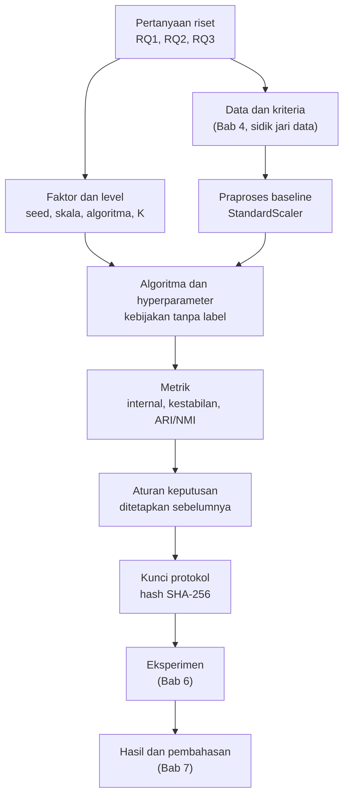

# Bab 5 — Research Methodology and Experimental Protocol

## Learning Objectives

Setelah mempelajari bab ini, kamu mampu:

- [x] Menerjemahkan pertanyaan riset menjadi rancangan metodologi: faktor, level, ulangan, dan metrik.
- [x] Membedakan variabel bebas, terikat, dan terkontrol dalam penelitian clustering.
- [x] Menetapkan baseline dan kebijakan pemilihan hyperparameter yang **tidak memakai label**.
- [x] Menyusun prosedur perbandingan algoritma yang adil dan menyatakan ketidakadilan yang tersisa.
- [x] Menulis protokol eksperimen yang cukup rinci untuk diulang peneliti lain.
- [x] Menguji protokol dengan *smoke test* tanpa melihat hasil.
- [x] Mengunci protokol dengan hash dan mencatat perubahan sebagai *amendment*.
- [x] Membedakan analisis konfirmatori dari eksploratori, dan mengungkapkan hal yang sudah kamu lihat.

## Introduction

Kamu sudah punya pertanyaan (Bab 2), pustaka (Bab 3), dan data (Bab 4). Sebelum menjalankan eksperimen apa pun, ada satu dokumen yang harus ditulis: **protokol**.

Protokol menjawab pertanyaan: *"Bagaimana tepatnya kita akan menjawab pertanyaan ini?"* Ia menetapkan data, praproses, algoritma, hyperparameter, metrik, aturan keputusan, dan prosedur pembanding, **sebelum** kamu melihat hasil. Alasannya sederhana tetapi penting. Pada clustering ada banyak sekali pilihan, dan tanpa protokol, mudah sekali (sering tanpa sadar) memilih kombinasi yang menghasilkan cerita terbaik. Protokol membatasi kebebasan itu.

Bayangkan seorang peneliti menjalankan sepuluh konfigurasi, lalu melaporkan yang terbaik seolah-olah itu satu-satunya yang dicoba. Hasilnya tampak meyakinkan, tetapi tidak bisa dipercaya. Protokol adalah janji bahwa kamu tidak akan melakukan itu, dan bukti bagi pembaca bahwa kamu menepatinya.

Level 6 Bab 2 sudah mengajarkan desain dan pencatatan konfigurasi eksperimen. Bab ini menambah tingkat penelitian: **penetapan sebelum eksperimen, aturan keputusan, pengungkapan, dan penguncian**.

!!! note "Prasyarat"
    - [Bab 2](02-research-problem-formulation.md) (pertanyaan), [Bab 3](03-literature-review-and-research-gap.md) (pustaka), [Bab 4](04-dataset-selection-and-research-data-preparation.md) (data dan kriteria). Skrip bab ini membaca keluaran Bab 2 dan Bab 4.
    - [Level 6 Bab 2](../experimentation-and-interpretation/02-experimental-design-and-configuration.md) (desain eksperimen), [Bab 4](../experimentation-and-interpretation/04-algorithm-comparison-and-benchmarking.md) (perbandingan adil), dan [Bab 9](../experimentation-and-interpretation/09-cluster-stability-and-reproducibility.md) (kestabilan).

## Fundamental Concepts

| Istilah | Arti |
|---|---|
| **Methodology** | Kerangka cara penelitian dijalankan dan mengapa cara itu dipilih |
| **Protocol** | Versi rinci dan operasional dari metodologi, ditulis sebelum eksperimen berjalan |
| **Factor** | Hal yang sengaja diubah (variabel bebas), misalnya perlakuan skala |
| **Level** | Satu nilai dari sebuah faktor, misalnya "StandardScaler" |
| **Replicate** (ulangan) | Pengulangan kondisi yang sama dengan seed atau sampel berbeda |
| **Baseline** | Kondisi pembanding. Hasil lain dibaca terhadapnya |
| **Primary analysis** | Analisis yang ditetapkan sebelumnya untuk menjawab pertanyaan utama |
| **Confirmatory / exploratory** | Analisis yang direncanakan sebelumnya vs analisis yang muncul setelah melihat data |
| **Decision rule** | Aturan tertulis tentang cara menyimpulkan atau memilih konfigurasi |
| **Label leakage** | Label ikut memengaruhi pelatihan atau pemilihan, sehingga validasi menjadi menyesatkan |
| **Smoke test** | Uji bahwa kode berjalan, **tanpa** menilai hasil |
| **Protocol lock** | Mengunci isi protokol dengan hash, agar perubahan terdeteksi |
| **Amendment** | Perubahan protokol setelah dikunci, dicatat dengan alasan, tidak menimpa isi lama |
| **Tuning budget** | Jumlah konfigurasi yang dicoba untuk menyetel sebuah algoritma |

## Detailed Explanation

### Dari pertanyaan ke metodologi

Setiap pertanyaan diterjemahkan menjadi **faktor yang diubah**, **yang diukur**, dan **yang ditahan sama**.



Tabel berikut adalah ringkasan protokol proyek kita:

| Pertanyaan | Faktor (diubah) | Terkontrol | Metrik (terikat) |
|---|---|---|---|
| **RQ1** kestabilan | Seed (20) dan subsampel data (50 kali, 80 persen) | K-Means, K = 2, `n_init = 10`, StandardScaler | ARI antar-seed; ARI subsampel terhadap data penuh |
| **RQ2** kepekaan skala | Perlakuan skala: StandardScaler (baseline), tanpa skala, MinMaxScaler | K-Means, K = 2, seed | ARI terhadap baseline |
| **RQ3** keselarasan | Algoritma: K-Means, Agglomerative, GMM, DBSCAN | Data, praproses, metrik | ARI dan NMI terhadap diagnosis; Silhouette, Davies-Bouldin, Calinski-Harabasz |
| Sensitivitas K | K = 2 sampai 6 pada tiga algoritma | Data, praproses | Silhouette |

### Variabel dalam penelitian clustering

Pembagian variabel yang kamu kenal dari Level 6 Bab 1 berlaku di sini, dengan satu penajaman: **label diagnosis bukan variabel bebas dan bukan masukan algoritma**. Ia hanya muncul pada sisi pengukuran, sebagai pembanding eksternal.

| Jenis | Pada proyek kita |
|---|---|
| **Bebas** | Seed, subsampel, perlakuan skala, algoritma, K |
| **Terikat** | ARI, NMI, Silhouette, Davies-Bouldin, Calinski-Harabasz, ukuran kelompok |
| **Terkontrol** | Data (sidik jari), kriteria inklusi, praproses baseline, `random_state` dasar, lingkungan |
| **Tidak dipakai melatih** | Label diagnosis |

### Baseline

Baseline harus **wajar dan sederhana**: StandardScaler pada ke-30 fitur dengan K-Means, K = 2. Semua kondisi RQ2 dibaca sebagai selisih terhadapnya. Seperti di Level 6, perlu diukur juga **kebisingan baseline**, yaitu seberapa besar hasil baseline berubah hanya karena seed. Itulah RQ1.

### Memilih algoritma dan hyperparameter

Algoritma berasal dari Level 4 dan dipilih karena menjawab pertanyaan: K-Means (pusat kelompok), Agglomerative dengan *ward* (hierarki), GMM (campuran model probabilistik), dan DBSCAN (kepadatan). Alasan memilih keempatnya: mereka mewakili empat asumsi bentuk kelompok yang berbeda, jadi perbandingannya informatif untuk RQ3. Algoritma lain tidak dimasukkan karena tidak ada alasan terkait pertanyaan.

**Kebijakan hyperparameter** adalah bagian protokol yang paling sering diabaikan dan paling berbahaya:

1. **Label tidak boleh dipakai untuk memilih konfigurasi.** Jika kamu memilih K atau `eps` yang memberi ARI terhadap diagnosis tertinggi, maka validasi eksternal menjadi lingkaran: kamu mengukur seberapa baik kamu menyetel ke label, bukan seberapa selaras struktur data dengan label. Itu contoh *label leakage*.
2. **K = 2 adalah asumsi desain.** Kita memilihnya karena RQ3 membandingkan dengan diagnosis dua kelas. Pilihan itu dipengaruhi label, dan hal ini dinyatakan terang-terangan. Sensitivitas terhadap K (2 sampai 6) dilaporkan terpisah.
3. **DBSCAN disetel dengan aturan tanpa label.** `eps` diambil dari kuantil jarak ke tetangga ke-*k* (0,80; 0,85; 0,90; 0,95), `min_samples` dari {5, 10}, dan konfigurasi dipilih dengan Silhouette tertinggi di antara yang punya minimal dua kelompok dan *noise* paling banyak 10 persen. Bila tidak ada yang memenuhi, hasilnya dilaporkan "tidak ada konfigurasi valid" dan aturan **tidak dilonggarkan**.

!!! warning "Tidak semua algoritma disetel sama banyak"
    Hanya DBSCAN yang disetel (8 konfigurasi). Tiga algoritma lain memakai pengaturan tetap. Itu berarti upaya penyetelan **tidak setara**. Ketidakadilan ini tidak bisa dihilangkan sepenuhnya, jadi dicatat sebagai keterbatasan di protokol, bukan disembunyikan.

### Praproses

Praproses baseline: `StandardScaler` pada ke-30 fitur. Keputusan dari Bab 4 yang dikunci: outlier **tidak dibuang**, dan tidak ada seleksi fitur pada analisis utama. Perlakuan skala sendiri adalah **faktor** pada RQ2, jadi penyamaan skala sengaja belum dilakukan pada dataset final di Bab 4.

### Metrik

Pembagian yang kamu kenal dari Level 5 dipakai dengan peran berbeda.

| Metrik | Jenis | Peran dalam protokol |
|---|---|---|
| Silhouette, Davies-Bouldin, Calinski-Harabasz | Internal | Menilai kelompok menurut data, dihitung di **ruang baseline yang sama** |
| ARI dan NMI terhadap diagnosis | Eksternal | Validasi RQ3. **Bukan target optimasi** |
| ARI antar-seed dan subsampel | Kestabilan | RQ1 |
| ARI terhadap baseline | Kepekaan | RQ2 |

**Definisi kestabilan** yang dipakai (dihitung di Bab 6). Untuk \( S \) seed menghasilkan pengelompokan \( \ell_1,\dots,\ell_S \):

$$
\mathrm{Stab}_{\text{seed}} = \frac{2}{S(S-1)} \sum_{i<j} \mathrm{ARI}(\ell_i, \ell_j)
$$

Untuk \( B \) subsampel \( I_b \) (sebagian data) dengan pengelompokan \( \ell^{(b)} \) dan pengelompokan data penuh \( \ell^{\text{full}} \):

$$
\mathrm{Stab}_{\text{sub}} = \frac{1}{B} \sum_{b=1}^{B} \mathrm{ARI}\!\left(\ell^{\text{full}}[I_b],\ \ell^{(b)}\right)
$$

Pada rumus kedua, \( \ell^{\text{full}}[I_b] \) adalah label data penuh yang **dibatasi pada titik yang termasuk subsampel**, sehingga dua pengelompokan yang dibandingkan mencakup titik yang sama.

**Aturan keputusan.** Sebuah kondisi dianggap "praktis sama dengan baseline" bila ARI-nya minimal 0,95. Ambang ini sama dengan yang dipakai di Level 6 dan **ditetapkan sebelum eksperimen**. Menggeser ambang setelah melihat hasil dilarang.

### Prosedur perbandingan yang adil

Perbandingan algoritma hanya bermakna bila kondisinya setara. Daftar periksa:

1. **Data dan praproses sama** untuk semua algoritma.
2. **Metrik internal dihitung di ruang yang sama** (ruang baseline), karena jarak di ruang berbeda tidak sebanding (Level 6 Bab 1 dan 4).
3. **Label tidak dipakai untuk memilih** konfigurasi.
4. **Upaya penyetelan** disetarakan atau ketidaksetaraannya diungkapkan.
5. **Satu aturan untuk menangani *noise***: label *noise* DBSCAN diperlakukan secara konsisten dan dinyatakan di protokol.
6. **Ulangan yang cukup** supaya perbedaan bisa dibedakan dari kebisingan seed.

### Mengontrol kondisi eksperimen

Hal yang ditahan sama: sidik jari data, praproses, `random_state` dasar (42), dan lingkungan perangkat lunak. Versi pustaka **dicatat terpisah** dari protokol, sebagai `05_environment.json`. Alasannya: hash protokol harus sama di mesin mana pun, sedangkan versi pustaka berbeda antar mesin. Protokol mengunci **desain**, lingkungan mencatat **keadaan**.

### Mencatat konfigurasi agar bisa diulang

Ujilah protokolmu dengan satu pertanyaan: *"Bisakah peneliti lain, hanya dari dokumen ini, menjalankan eksperimen yang sama?"* Untuk itu protokol memuat:

| Bagian | Isi |
|---|---|
| Identitas data | Nama dan sidik jari |
| Pertanyaan dan rencana analisis | Faktor, level, ulangan, metrik per pertanyaan |
| Algoritma dan hyperparameter | Nilai tetap dan grid |
| Praproses | Baseline dan keputusan outlier |
| Kebijakan | Pemilihan hyperparameter dan label |
| Pembanding adil | Daftar syarat dan keterbatasan |
| Aturan keputusan | Ambang yang ditetapkan sebelumnya |
| Pengungkapan | Hal yang sudah dilihat |
| Amendments | Catatan perubahan |

### Konfirmatori dan eksploratori

Semua yang tertulis di protokol adalah analisis **konfirmatori**: direncanakan sebelum melihat hasil. Apa pun yang kamu lakukan setelah melihat hasil (misalnya mencoba fitur lain karena penasaran) boleh, tetapi harus diberi label **eksploratori** dan tidak boleh dilaporkan seolah rencana awal. Pembedaan ini mencegah *HARKing* (Bab 2).

### Pengungkapan: apa yang sudah kamu lihat

Ini bagian yang jarang ada di tutorial. Di Bab 1, kita sudah menjalankan demonstrasi K-Means pada data yang sama, dan menampilkan ARI terhadap diagnosis. Jadi protokol ini **tidak sepenuhnya buta terhadap data**, dan pilihan K = 2 dipengaruhi jumlah kelas diagnosis. Kita menuliskannya di bagian `pengungkapan` protokol. Pengungkapan semacam ini tidak merusak penelitian. Menyembunyikannya yang merusak.

### Smoke test, bukan pilot yang mengintip

Sebelum mengunci protokol, kamu perlu tahu bahwa semua konfigurasi **bisa dijalankan**: tidak ada error, jumlah kelompok masuk akal, waktu eksekusi wajar. Itu *smoke test*. Aturannya: **jangan hitung metrik hasil** (khususnya yang memakai label) dan **jangan mengubah protokol berdasarkan nilai metrik**. Bila smoke test menemukan error, perbaiki kodenya. Bila ia menemukan sesuatu yang membuatmu ingin mengubah desain, tulis sebagai amendment dengan alasan.

### Mengunci protokol dan mencatat perubahan

Protokol disimpan sebagai JSON, lalu dihitung hash SHA-256 isinya. Hash itu disimpan di berkas terpisah. Bila ada yang mengubah isi protokol, hash berubah dan Bab 6 akan menolak menjalankan eksperimen.

Protokol bisa saja salah dan perlu diperbaiki. Jangan menimpanya diam-diam. Buat **amendment**: tanggal, perubahan, dan alasan, lalu protokol versi baru dengan hash baru. Riwayat tetap utuh, dan pembaca bisa menilai apakah perubahan itu wajar.

### Kesalahan umum

1. **Menjalankan eksperimen dulu, menulis protokol kemudian.**
2. **Memilih hyperparameter dengan label** lalu melaporkan ARI terhadap label itu.
3. **Mengubah ambang atau metrik setelah melihat hasil.**
4. **Membandingkan algoritma dengan upaya penyetelan tidak setara** tanpa mengungkapkannya.
5. **Menghitung metrik internal di ruang berbeda** lalu membandingkannya.
6. **Tidak menyebut apa yang sudah dilihat** sebelum protokol ditulis.
7. **Menimpa protokol** alih-alih mencatat amendment.
8. **Menaruh versi pustaka di dalam hash protokol**, sehingga hash berbeda antar mesin.
9. **Melaporkan hasil smoke test sebagai temuan.**
10. **Protokol terlalu kabur** sehingga orang lain tidak bisa mengulanginya.

## Mathematical Foundation

Bab ini hanya mendefinisikan dua ukuran kestabilan, dengan ARI sebagai fungsi kemiripan (Level 5 Bab 8):

\( \mathrm{Stab}_{\text{seed}} \) adalah **rata-rata ARI atas semua pasangan** dari \( S \) pengelompokan, sehingga memuat \( \binom{S}{2} = \frac{S(S-1)}{2} \) suku. \( \mathrm{Stab}_{\text{sub}} \) adalah **rata-rata ARI** antara pengelompokan data penuh dan pengelompokan tiap subsampel, dihitung hanya pada titik yang ada di subsampel itu. Nilai 1 berarti pengelompokan tidak berubah sama sekali. Nilai mendekati 0 berarti hasilnya tidak lebih mirip daripada kebetulan.

Jumlah eksekusi tiap pertanyaan dihitung dari desain: misalnya RQ2 memiliki \( |\text{level}| \times |\text{seed}| = 3 \times 20 = 60 \) eksekusi.

## Python Implementation

Skrip lengkapnya ada di `examples/level-7/05_research_methodology_and_protocol.py`, dan notebook-nya di `notebooks/level-7/05-research-methodology-and-protocol.ipynb`. **Setiap potongan kode diikuti penjelasannya.**

**Konteks masalah:** kita perlu menulis protokol yang lengkap dan bisa diperiksa, menguji bahwa ia bisa dijalankan, lalu menguncinya sebelum Bab 6.

**Penting:** bab ini **tidak menghitung metrik hasil eksperimen**. Smoke test hanya memeriksa bahwa kode berjalan. Hasil eksperimen ada di Bab 6.

**Dataset:** Breast Cancer Wisconsin (Diagnostic), UCI, CC BY 4.0. Bukan alat diagnosis.

**Pustaka:** NumPy, pandas, scikit-learn, serta `copy`, `hashlib`, `json`, `platform`, `time`, `importlib.metadata` dari pustaka standar. **Jalankan skrip Bab 2 dan Bab 4 lebih dulu.**

### Bagian A — Siapkan alat dan baca bab sebelumnya

```python
--8<-- "level-7/05_research_methodology_and_protocol.py:setup"
```

```text title="Output"
--8<-- "level-7/outputs/05/setup.txt"
```

**Penjelasan:** kita mengimpor empat algoritma (`KMeans`, `AgglomerativeClustering`, `GaussianMixture`, `DBSCAN`), `NearestNeighbors` untuk menghitung jarak ke tetangga, serta `StandardScaler`. Lalu kita membaca dua berkas hasil sebelumnya: rumusan masalah Bab 2 (`problem`) dan kartu dokumentasi Bab 4 (`card`). Protokol mengambil pertanyaan dan sidik jari data dari sana, jadi kita **tidak mengetik ulang** dan tidak bisa salah salin.

### Bagian B — Menulis protokol

```python
--8<-- "level-7/05_research_methodology_and_protocol.py:protocol"
```

```text title="Output"
--8<-- "level-7/outputs/05/protocol.txt"
```

**Penjelasan:**

- `protocol` adalah dictionary bertingkat. `card["sidik_jari_data_final"]` dan `problem["pertanyaan"]` mengambil nilai dari bab sebelumnya.
- Bagian `analisis` berisi rencana per pertanyaan: faktor, level, algoritma, ulangan, dan metrik. Perhatikan RQ1: `"ulangan": {"seed": 20, "subsampel": 50, "fraksi_subsampel": 0.8}`.
- Bagian `algoritma` memuat pengaturan tetap tiap algoritma. Penanda `"disetel": False` atau `True` menyatakan apakah algoritma itu disetel. DBSCAN memuat grid dan **aturan seleksi tanpa label** beserta aturan bila tidak ada konfigurasi valid.
- `kebijakan_hyperparameter` mencatat K analisis utama (2), justifikasinya, dan `label_untuk_tuning: False`.
- `pembanding_adil` memuat daftar syarat, termasuk keterbatasan tuning yang tidak setara.
- `pengungkapan` menyatakan bahwa Bab 1 sudah menampilkan ARI terhadap diagnosis sebelum protokol ditulis.
- `amendments` dimulai sebagai daftar kosong.

### Bagian C — Memvalidasi protokol

```python
--8<-- "level-7/05_research_methodology_and_protocol.py:validate"
```

```text title="Output"
--8<-- "level-7/outputs/05/validate.txt"
```

**Penjelasan:**

- `validate(p)` mengembalikan **daftar masalah**. Daftar kosong berarti protokol lolos pemeriksaan **bentuk**.
- Pemeriksaannya: bagian wajib ada, tiap pertanyaan punya rencana analisis dan metrik, label tidak dipakai menyetel (`is not False` memastikan nilainya benar-benar `False`, bukan sekadar kosong), sidik jari tercatat, RQ1 punya minimal 10 seed, tiap algoritma yang dipakai analisis memang didefinisikan, dan tiap amendment punya alasan.
- `p.get("kunci", {})` mengambil nilai tanpa error bila kunci tidak ada. Ini memungkinkan fungsi melaporkan masalah dan bukan berhenti dengan error.
- `copy.deepcopy(protocol)` membuat salinan penuh supaya perubahan pada `broken` tidak mengubah protokol asli. Kita sengaja merusaknya empat cara (menghapus RQ2, mengaktifkan label, mengosongkan sidik jari, menambah algoritma tak terdefinisi) untuk melihat apakah pemeriksa menangkapnya.

!!! warning "Validasi bentuk, bukan kebenaran"
    Protokol yang lolos `validate` hanya berarti **lengkap dan konsisten**. Ia tidak menjamin rancangannya baik secara ilmiah. Penilaian itu tetap membutuhkan pertimbangan manusia.

### Bagian D — Menghitung jumlah eksekusi

```python
--8<-- "level-7/05_research_methodology_and_protocol.py:grid"
```

```text title="Output"
--8<-- "level-7/outputs/05/grid.txt"
```

**Penjelasan:** jumlah eksekusi dihitung **dari protokol**, bukan diketik tangan. `len(a["RQ2"]["level"]) * a["RQ2"]["ulangan"]["seed"]` mengalikan jumlah level skala dengan jumlah seed. `sum(not v["disetel"] for v in ...)` menghitung algoritma yang tidak disetel dengan menjumlahkan nilai `True` dari kondisi `not disetel`. `grid.loc["TOTAL"] = ...` menambahkan baris total di akhir. Mengetahui total di awal membantu memperkirakan waktu dan memastikan tidak ada eksekusi tambahan yang diam-diam dijalankan.

### Bagian E — Smoke test tanpa metrik berbasis label

```python
--8<-- "level-7/05_research_methodology_and_protocol.py:smoke"
```

```text title="Output"
--8<-- "level-7/outputs/05/smoke.txt"
```

**Penjelasan:**

- `StandardScaler().fit_transform(X_all)` menyiapkan data baseline. **Label tidak dipakai** di bagian ini.
- `models` adalah dictionary yang membuat tiap algoritma dari **nilai di protokol** (misalnya `cfg["KMeans"]["n_clusters"]`), sehingga yang diuji adalah protokolnya, bukan salinan angka.
- Untuk DBSCAN, `NearestNeighbors(n_neighbors=k).fit(...).kneighbors(...)[0][:, -1]` mengambil jarak ke tetangga ke-*k* tiap titik, dan `np.quantile(distances, 0.80)` mengambil nilai pada kuantil 0,80 sebagai `eps` percobaan.
- Perulangan mengukur waktu dengan `time.perf_counter()`, menjalankan `fit_predict`, lalu mencatat apakah berjalan, jumlah kelompok (`len(set(labels) - {-1})` mengabaikan label *noise* -1), jumlah *noise*, dan waktu.
- Baris cetak terakhir menegaskan bahwa ARI dan NMI tidak dihitung dan hasilnya tidak dilaporkan sebagai temuan.

### Bagian F — Mengunci protokol dengan hash

```python
--8<-- "level-7/05_research_methodology_and_protocol.py:lock"
```

```text title="Output"
--8<-- "level-7/outputs/05/lock.txt"
```

**Penjelasan:**

- `json.dumps(p, sort_keys=True, ensure_ascii=False)` mengubah protokol menjadi teks dengan kunci terurut, sehingga urutan penulisan tidak memengaruhi hash. `hashlib.sha256(text.encode("utf-8")).hexdigest()` menghitung sidik jari teks itu.
- Protokol disimpan sebagai `05_protocol.json`, hash sebagai `05_protocol.sha256`, dan versi lingkungan **terpisah** sebagai `05_environment.json`.
- Kita membaca ulang berkas dan memastikan hash sama (`"sama"`), lalu mengubah K menjadi 3 pada salinan dan memastikan hash berbeda (`"BERBEDA"`). Ini membuktikan hash mendeteksi perubahan sekecil apa pun.

### Bagian G — Mencatat perubahan protokol

```python
--8<-- "level-7/05_research_methodology_and_protocol.py:amend"
```

```text title="Output"
--8<-- "level-7/outputs/05/amend.txt"
```

**Penjelasan:** `amend(...)` **tidak mengubah** protokol asli. Ia membuat salinan, menambahkan satu catatan (tanggal, perubahan, alasan), dan mengembalikannya. Dengan begitu protokol terkunci tetap utuh, dan versi baru punya hash berbeda. Contoh yang dipakai jelas berlabel contoh latihan. Keluarannya menunjukkan protokol asli tetap berisi 0 amendment, salinan berisi 1, dan hash keduanya berbeda.

## Code Explanation

| Bagian kode | Peran |
|---|---|
| `json.loads(...)` dari Bab 2 dan 4 | Mengambil pertanyaan dan sidik jari tanpa mengetik ulang |
| `protocol = {...}` | Protokol lengkap sebagai data |
| `validate(p)` | Pemeriksaan bentuk dan konsistensi |
| `copy.deepcopy(...)` | Salinan aman untuk menguji atau mengubah |
| `grid` | Jumlah eksekusi dihitung dari desain |
| Smoke test | Memastikan konfigurasi berjalan, tanpa menilai hasil |
| `protocol_hash(p)` | Kunci isi protokol |
| `amend(...)` | Perubahan tercatat, tidak menimpa |

## How to Run

Dari folder utama proyek (setelah mengaktifkan lingkungan virtual):

```powershell
pip install -r requirements-notebooks.txt
python examples/level-7/02_research_problem_formulation.py
python examples/level-7/04_dataset_selection_and_preparation.py
python examples/level-7/05_research_methodology_and_protocol.py
```

Skrip mencetak output dan menyimpan `05_protocol.json`, `05_protocol.sha256`, dan `05_environment.json` di `examples/level-7/results/`. Notebook interaktifnya:

```powershell
jupyter notebook notebooks/level-7/05-research-methodology-and-protocol.ipynb
```

Notebook memuat Bagian A sampai G, ditambah tiga bagian **Praktik**: menulis protokol untuk pertanyaanmu sendiri dan memvalidasinya, membuat amendment, dan menghitung ulang jumlah eksekusi bila desain berubah.

Semua output pada bab ini berasal dari eksekusi nyata dengan Python 3.14.10, NumPy 2.5.2, pandas 3.0.5, dan scikit-learn 1.9.0. **Kolom waktu (`detik`) bervariasi antar eksekusi**, sedangkan angka lainnya tetap.

## Expected Output

Output setiap langkah ditampilkan langsung di bawah kodenya pada bagian [Python Implementation](#python-implementation).

### Interpretasi output

**1. Protokol dibangun dari bab sebelumnya.** Tiga pertanyaan (RQ1 sampai RQ3) dan sidik jari data `6b202a2072f9` terbaca otomatis dari hasil Bab 2 dan Bab 4. Protokol punya tiga belas bagian dan empat algoritma.

**2. Validasi.** Protokol asli lolos tanpa masalah (daftar kosong). Salinan yang sengaja dirusak melaporkan empat masalah: RQ2 tidak punya rencana analisis, label dipakai menyetel, sidik jari tidak tercatat, dan RQ3 memakai algoritma `SpectralClustering` yang tidak didefinisikan. Artinya pemeriksa menangkap keempat perusakan itu.

**3. Jumlah eksekusi.**

| Bagian | Eksekusi |
|---|---|
| RQ1 seed | 20 |
| RQ1 subsampel | 50 |
| RQ2 level × seed | 60 |
| RQ3 algoritma tak disetel | 3 |
| RQ3 grid DBSCAN | 8 |
| Sensitivitas K | 15 |
| **Total** | **156** |

**4. Smoke test.** Keempat algoritma berjalan. K-Means, Agglomerative, dan GMM menghasilkan dua kelompok tanpa *noise*. DBSCAN pada konfigurasi percobaan (`min_samples = 5`, kuantil 0,80) menghasilkan **satu kelompok dan 75 titik *noise***. Itu **bukan temuan** dan **tidak dipakai mengubah protokol**. Ia hanya menunjukkan bahwa kode DBSCAN berjalan. Apakah konfigurasi ini valid menurut aturan seleksi (minimal dua kelompok, *noise* paling banyak 10 persen) ditentukan di Bab 6 dari seluruh grid. Satu konfigurasi yang tidak memenuhi aturan tidak membuat aturan itu berubah.

**5. Penguncian.** Hash protokol dimulai dengan `c65be407e00ab39b`. Setelah dibaca ulang, hash **sama**. Setelah K diubah menjadi 3 pada salinan, hash **berbeda**. Jadi perubahan sekecil apa pun terdeteksi.

**6. Amendment.** Protokol asli berisi 0 amendment, salinan contoh berisi 1, dan hash salinan **berbeda** dari protokol terkunci. Salinan itu juga lolos validasi, karena amendment-nya memiliki alasan.

!!! warning "Batas kesimpulan"
    Bab ini menghasilkan **rancangan**, bukan temuan. Lolos validasi berarti protokol lengkap dan konsisten, bukan bahwa rancangannya ideal. Protokol ini juga **tidak sepenuhnya buta terhadap data**, karena Bab 1 sudah menampilkan ARI terhadap diagnosis. Dan upaya penyetelan antar algoritma tidak setara. Ketiganya tertulis di protokol dan harus muncul lagi di bagian keterbatasan laporan akhir.

## Practical Examples

**Proposal penelitian.** Bagian metodologi proposal yang baik hampir sama dengan protokol: faktor, level, ulangan, metrik, dan aturan keputusan. Penelaah akan menilai apakah rancanganmu bisa menjawab pertanyaan.

**Pra-registrasi.** Sebagian bidang meminta peneliti mendaftarkan rencana analisis di tempat publik sebelum eksperimen. Protokol terkunci dengan hash adalah versi sederhana dari gagasan itu.

**Kerja tim.** Bila anggota tim lain menjalankan eksperimen, protokol memastikan semua orang menjalankan hal yang sama, dan hash membuktikan tidak ada yang mengubahnya diam-diam.

## Hands-on Exercises

Semua angka di jawaban berasal dari eksekusi nyata atau penghitungan dari output, kecuali disebut lain.

1. Dari output, berapa total eksekusi? Bila seed pada RQ1 dan RQ2 dinaikkan dari 20 menjadi 30, berapa totalnya?
2. Mengapa label tidak boleh dipakai untuk memilih K atau `eps`? Berikan contoh bagaimana hal itu menggelembungkan ARI.
3. Smoke test menunjukkan DBSCAN menghasilkan satu kelompok dan 75 titik *noise*. Tergodakah kamu menaikkan `eps` pada protokol? Apa yang seharusnya dilakukan?
4. Mengapa versi pustaka tidak dimasukkan ke dalam protokol yang di-hash?
5. Kapan perubahan protokol boleh dilakukan, dan bagaimana mencatatnya?
6. Bedakan analisis konfirmatori dan eksploratori pada contoh: kamu melihat bahwa fitur `area error` banyak outlier, lalu mencoba membuangnya.

??? question "Jawaban"
    Nomor 1 dan 4 memakai output nyata. Nomor lain bersifat konseptual.

    1. Total **156**. Menaikkan seed dari 20 ke 30 menambah 10 pada RQ1 seed (20 menjadi 30) dan 30 pada RQ2 (3 level × 10 seed tambahan), sehingga total menjadi 156 + 10 + 30 = **196**. Hitung ulang dengan mengubah `ulangan` pada protokol, bukan mengetik angka.
    2. Jika kamu memilih K atau `eps` yang memberi ARI tertinggi terhadap diagnosis, kamu sudah "menyetel ke jawaban". ARI yang tinggi lalu mencerminkan hasil penyetelan, bukan keselarasan alami struktur data dengan label. Itu *label leakage*. Pemilihan harus memakai kriteria tanpa label (misalnya Silhouette dengan batas *noise*).
    3. Tidak boleh mengubah protokol berdasarkan smoke test. Satu konfigurasi yang tidak valid tidak mengubah aturan seleksi. Yang dilakukan: tunggu Bab 6 menjalankan seluruh grid, lalu terapkan aturan seleksi apa adanya, termasuk bila hasilnya "tidak ada konfigurasi valid".
    4. Karena versi pustaka berbeda antar mesin, sehingga hash protokol akan berbeda padahal desainnya sama. Pada output, versi dicatat terpisah di `05_environment.json`, sedangkan hash hanya mencakup desain.
    5. Boleh bila ada alasan yang jelas (misalnya kesalahan rancangan yang ditemukan), **sebelum** hasil dilihat bila mungkin. Catat sebagai amendment berisi tanggal, perubahan, dan alasan. Protokol baru memiliki hash baru, dan riwayat lama tetap tersimpan.
    6. Itu **eksploratori**: muncul setelah melihat data, tidak direncanakan di protokol. Boleh dilakukan, tetapi harus diberi label eksploratori di laporan, dan keputusan outlier di protokol (tidak dibuang) tidak boleh diubah diam-diam. Bila perubahan itu ingin dijadikan analisis resmi, catat sebagai amendment.

## Troubleshooting

### Masalah teknis

| Masalah | Penyebab | Solusi |
|---|---|---|
| `FileNotFoundError: 02_research_problem.json` atau `04_dataset_card.json` | Skrip Bab 2 atau Bab 4 belum dijalankan | Jalankan keduanya lebih dulu |
| Hash berbeda dari yang tertulis di bab | Isi protokol berubah (termasuk teks dari Bab 2 atau Bab 4) | Bandingkan `05_protocol.json` dengan berkas asli, jangan ubah hash agar cocok |
| DBSCAN menghasilkan satu kelompok | `eps` terlalu kecil atau `min_samples` terlalu besar untuk data | Ini hasil sah untuk konfigurasi itu; jangan ubah protokol dari smoke test |
| `detik` berbeda tiap eksekusi | Waktu eksekusi bergantung pada mesin | Normal; waktu tidak masuk hash |

### Kesalahan umum

1. **Menganggap lolos `validate` berarti rancangan baik.**
2. **Mengubah protokol karena hasil smoke test.**
3. **Menimpa protokol, bukan membuat amendment.**
4. **Menyembunyikan upaya penyetelan yang tidak setara.**
5. **Lupa menjalankan skrip Bab 2 dan 4 lebih dulu.**
6. **Menyamakan hash cocok dengan "penelitian benar".** Hash hanya membuktikan isi tidak berubah.

## Summary

- **Protokol** adalah rancangan operasional yang ditulis **sebelum** eksperimen. Ia memuat faktor, level, ulangan, metrik, aturan keputusan, dan pembanding yang adil.
- **Label tidak boleh dipakai untuk memilih konfigurasi.** K = 2 diakui sebagai asumsi desain, DBSCAN disetel dengan aturan tanpa label, dan hasil validasi eksternal hanyalah pembanding.
- **Perbandingan adil** menuntut data, praproses, dan ruang metrik yang sama. Ketidaksetaraan upaya penyetelan (hanya DBSCAN yang disetel) dicatat sebagai keterbatasan.
- **Protokol proyek memuat 156 eksekusi** yang dihitung dari desain: RQ1 (20 seed dan 50 subsampel), RQ2 (3 level × 20 seed), RQ3 (3 algoritma tetap dan 8 konfigurasi DBSCAN), dan sensitivitas K (15).
- **Smoke test** hanya memeriksa kode berjalan, tanpa metrik berbasis label dan tanpa mengubah protokol.
- **Hash SHA-256** mengunci protokol (`c65be407e00ab39b...`); perubahan sekecil K = 3 membuat hash berbeda. Perubahan sah dicatat sebagai **amendment**.
- **Pengungkapan**: Bab 1 sudah menampilkan ARI terhadap diagnosis, jadi protokol tidak sepenuhnya buta terhadap data.

**Bab berikutnya:** Bab 6 membahas **implementasi penelitian dengan Python**: menjalankan protokol yang sudah dikunci, menyimpan hasil, dan membuat visualisasi serta profil kelompok.

## References

- Hennig, C. (2015). What are the true clusters? arXiv:1502.02555 [stat.OT]. [arxiv.org/abs/1502.02555](https://arxiv.org/abs/1502.02555)
- von Luxburg, U., Williamson, R. C., & Guyon, I. (2012). Clustering: Science or Art? *JMLR Workshop and Conference Proceedings*, 27, 65–79. [proceedings.mlr.press/v27/luxburg12a.html](https://proceedings.mlr.press/v27/luxburg12a.html)
- Ben-Hur, A., Elisseeff, A., & Guyon, I. (2002). A stability based method for discovering structure in clustered data. *Pacific Symposium on Biocomputing*, 7, 6–17.
- Vinh, N. X., Epps, J., & Bailey, J. (2010). Information theoretic measures for clusterings comparison: Variants, properties, normalization and correction for chance. *Journal of Machine Learning Research*, 11, 2837–2854. [jmlr.org/papers/v11/vinh10a.html](https://jmlr.org/papers/v11/vinh10a.html)
- Kerr, N. L. (1998). HARKing: Hypothesizing after the results are known. *Personality and Social Psychology Review*, 2(3), 196–217. [doi.org/10.1207/s15327957pspr0203_4](https://doi.org/10.1207/s15327957pspr0203_4)
- Scikit-learn documentation: [*Clustering*](https://scikit-learn.org/stable/modules/clustering.html) dan [*Clustering performance evaluation*](https://scikit-learn.org/stable/modules/clustering.html#clustering-performance-evaluation).
