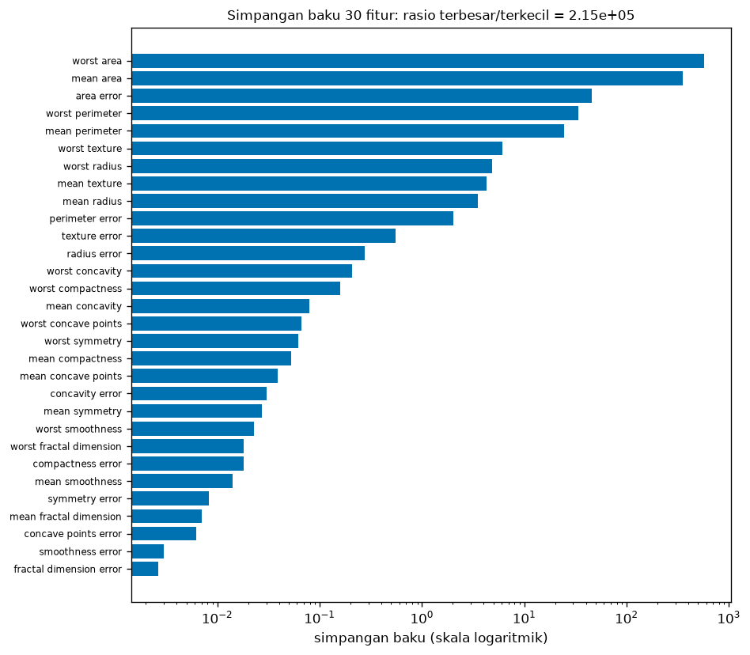
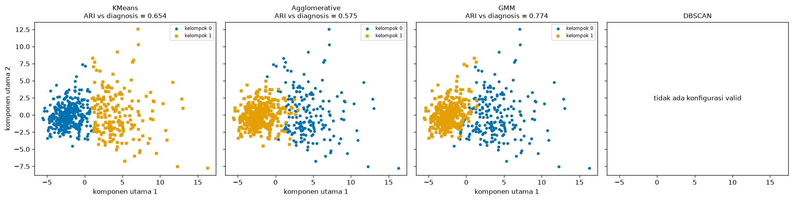
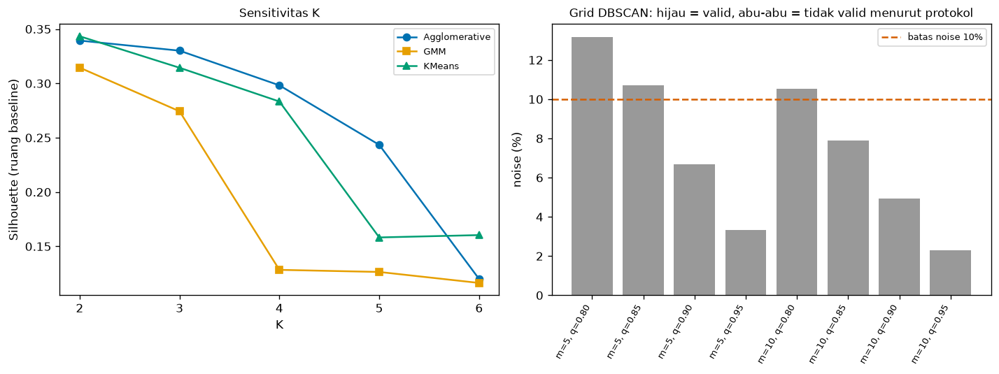

# Bab 6 — Research Implementation with Python

## Learning Objectives

Setelah mempelajari bab ini, kamu mampu:

- [x] Menyiapkan lingkungan proyek penelitian dan memverifikasi bahwa protokol serta data belum berubah sebelum eksperimen.
- [x] Mengimplementasikan eksperimen yang mengikuti protokol terkunci, bukan menurut selera saat mengetik kode.
- [x] Melakukan eksplorasi data (EDA) untuk mendeskripsikan, bukan untuk menyetel keputusan.
- [x] Menjalankan analisis kestabilan, kepekaan praproses, perbandingan algoritma, dan sensitivitas K.
- [x] Menerapkan aturan seleksi hyperparameter tanpa label, termasuk saat hasilnya "tidak ada konfigurasi valid".
- [x] Membuat profil kelompok dan visualisasi yang jujur.
- [x] Menyimpan hasil, manifest, dan klarifikasi implementasi agar bisa diperiksa.
- [x] Mencocokkan jumlah eksekusi yang dijalankan dengan jumlah yang direncanakan.

## Introduction

Protokol sudah dikunci di Bab 5. Sekarang tiba saatnya menjalankannya. Bab ini adalah bab implementasi: ia berisi kode paling banyak di Level 7, tetapi pelajaran utamanya bukan soal kode. Pelajarannya: **kode harus melayani protokol, bukan sebaliknya.**

Banyak penelitian clustering yang gagal diulang bukan karena kodenya salah, tetapi karena kodenya berkembang dari percobaan ke percobaan hingga tak seorang pun ingat pilihan mana yang akhirnya dipakai. Skrip di bab ini dirancang untuk mencegah itu:

1. **Ia memeriksa hash protokol** sebelum berjalan, dan berhenti bila protokol berubah.
2. **Ia memeriksa sidik jari data**, dan berhenti bila data berbeda.
3. **Ia mengambil semua pengaturan dari protokol**, bukan dari angka yang diketik ulang.
4. **Ia menghitung eksekusi** dan mencocokkannya dengan rencana (156).
5. **Ia mencatat apa yang tidak ditetapkan protokol** sebagai klarifikasi.

Satu hal lagi yang sengaja dibiarkan terlihat: **hasil yang tidak nyaman**. Pada eksperimen ini, DBSCAN tidak punya satu pun konfigurasi yang valid menurut aturan protokol. Kita tidak melonggarkan aturan untuk "menyelamatkannya". Kita melaporkannya.

!!! note "Prasyarat"
    - [Bab 2](02-research-problem-formulation.md), [Bab 4](04-dataset-selection-and-research-data-preparation.md), dan [Bab 5](05-research-methodology-and-experimental-protocol.md). **Jalankan skrip ketiganya lebih dulu**, karena skrip bab ini membaca `05_protocol.json`, `05_protocol.sha256`, dan `04_research_dataset.csv`.
    - Algoritma dari [Level 4](../clustering-algorithms/index.md), metrik dari [Level 5](../clustering-evaluation/index.md), dan teknik dari [Level 6](../experimentation-and-interpretation/index.md) (kestabilan, PCA, profil kelompok).

## Fundamental Concepts

| Istilah | Arti |
|---|---|
| **Pipeline** | Urutan langkah dari data mentah sampai hasil: muat, praproses, latih, evaluasi, simpan |
| **Locked protocol** | Protokol yang isinya dijaga hash; kode menolak berjalan bila hash tidak cocok |
| **Run manifest** | Catatan satu eksekusi penuh: hash protokol, sidik jari data, jumlah eksekusi, dan pilihan terpilih |
| **EDA** (*exploratory data analysis*) | Eksplorasi untuk **memahami** data. Pada penelitian, ia mendeskripsikan, tidak mengubah protokol |
| **Clarification** | Keputusan implementasi untuk hal yang **belum ditetapkan** protokol, dicatat, bukan mengubah protokol |
| **Amendment** | Perubahan terhadap isi protokol (Bab 5). Berbeda dari klarifikasi |
| **Cluster profiling** | Meringkas ciri tiap kelompok. Deskriptif, bukan penjelasan sebab |
| **Pairwise ARI** | ARI untuk setiap pasangan pengelompokan. Dari 20 seed ada \( \binom{20}{2} = 190 \) pasangan |
| **Noise point** | Titik yang tidak masuk kelompok mana pun pada DBSCAN (label -1) |

## Detailed Explanation

### Menyiapkan lingkungan proyek

Sebelum menulis kode eksperimen, siapkan lingkungan yang bisa diulang:

1. **Lingkungan virtual** agar versi pustaka terpisah dari proyek lain.
2. **Daftar dependensi** (`requirements-notebooks.txt`) yang sudah ada di repositori. Level 7 tidak menambah dependensi baru, dan grafik memakai Matplotlib saja.
3. **Struktur folder** yang tertata. Pada proyek ini: skrip di `examples/level-7/`, hasil di `examples/level-7/results/`, gambar di `docs/assets/level-7/`. Bab 9 membahas struktur proyek penelitian secara penuh.
4. **Versi pustaka dicatat** (Bab 5: `05_environment.json`).
5. **Seed dasar** yang tetap (42).

### Memuat dan memverifikasi data

Muat **salinan beku** dataset (`04_research_dataset.csv`), bukan memuat ulang dari sumber lain, lalu hitung sidik jarinya dan bandingkan dengan yang tertulis di protokol. Bila berbeda, **berhenti**. Dua baris kode ini mencegah satu kelas kesalahan yang sulit ditemukan: menjalankan analisis pada data yang diam-diam berbeda.

### EDA untuk penelitian

Pada eksperimen kecil, EDA adalah awal untuk "melihat-lihat". Pada penelitian, EDA punya aturan:

- **Boleh:** mendeskripsikan data (ukuran, rentang, sebaran, keseimbangan kelas) dan memeriksa asumsi.
- **Tidak boleh:** mengubah pertanyaan, metrik, atau praproses **karena** pola yang kamu lihat. Perubahan seperti itu harus lewat amendment.

Pada proyek kita, EDA menunjukkan satu fakta yang relevan dengan RQ2: **rentang simpangan baku antar fitur sangat lebar**. Itu bukan alasan mengubah protokol, tetapi menjelaskan mengapa RQ2 (kepekaan terhadap skala) layak ditanyakan.

### Praproses sesuai protokol

Praproses dilakukan persis seperti yang ditulis protokol: baseline `StandardScaler` pada ke-30 fitur, tanpa membuang outlier, tanpa seleksi fitur. Dua perlakuan lain (tanpa skala dan `MinMaxScaler`) disiapkan karena merupakan level faktor RQ2. Perhatikan bahwa pada RQ1 (subsampel), `StandardScaler` **dihitung ulang** pada tiap subsampel. Itu keputusan implementasi yang tidak ditetapkan protokol, dan dicatat sebagai klarifikasi C3.

### Mengimplementasikan model dan konfigurasinya

Keempat algoritma dibuat dari nilai di protokol:

| Algoritma | Pengaturan (dari protokol) |
|---|---|
| K-Means | `n_clusters=2`, `n_init=10`, `random_state` sesuai ulangan |
| Agglomerative | `n_clusters=2`, `linkage="ward"` |
| GMM | `n_components=2`, `covariance_type="full"`, `n_init=5`, `random_state=42` |
| DBSCAN | `min_samples` ∈ {5, 10}; `eps` = kuantil jarak tetangga ke-*k* ∈ {0,80; 0,85; 0,90; 0,95}; seleksi dengan aturan tanpa label |

Pola kodenya: **tidak ada angka hyperparameter yang diketik di kode eksperimen**. Semuanya dibaca dari `protocol[...]`. Bila protokol berubah lewat amendment, kodenya mengikuti.

### Evaluasi

Tiga jenis metrik dari Level 5 dan Level 6:

| Jenis | Metrik | Dihitung di |
|---|---|---|
| Internal | Silhouette, Davies-Bouldin, Calinski-Harabasz | Ruang baseline yang sama |
| Eksternal (validasi) | ARI dan NMI terhadap diagnosis | Label diagnosis |
| Kestabilan dan kepekaan | ARI antar pengelompokan | Pasangan seed, subsampel, perlakuan skala |

### Visualisasi dan profil kelompok

Visualisasi di bab ini bertujuan **melaporkan**, bukan menghias: setiap gambar menjawab satu bagian pertanyaan. PCA dipakai hanya untuk memproyeksikan 30 dimensi ke dua sumbu agar bisa digambar (Level 6 Bab 6). Ia **tidak** dipakai untuk clustering.

**Profil kelompok** meringkas ciri tiap kelompok dengan rata-rata *z-score* fitur (data baseline). Itu deskripsi: "kelompok ini cenderung memiliki nilai fitur X yang lebih tinggi". Ia tidak menjelaskan **mengapa**, dan nomor kelompok bersifat sembarang.

### Menyimpan hasil dan memeriksa jumlah eksekusi

Semua hasil disimpan dalam berkas dengan awalan `06_`: tabel CSV, ringkasan JSON, klarifikasi, dan manifest. Manifest mencatat hash protokol, sidik jari data, dan **jumlah eksekusi dijalankan vs direncanakan**. Bila angkanya tidak sama, ada eksekusi yang terlewat atau berlebih, dan itu harus dijelaskan sebelum hasil dipercaya.

### Klarifikasi vs amendment

Tidak ada protokol yang menutup semua detail. Saat kode ditulis, kita menemukan hal yang belum diputuskan protokol. Perlakuannya:

| | Klarifikasi | Amendment |
|---|---|---|
| Kapan | Hal yang **belum** ditetapkan | Hal yang **sudah** ditetapkan dan ingin diubah |
| Contoh | "Scaler dihitung ulang pada subsampel" | "Seed RQ1 dari 20 menjadi 30" |
| Efek pada hash | Tidak mengubah protokol | Protokol versi baru, hash baru |
| Pencatatan | `06_clarifications.json` | Daftar `amendments` di protokol |

Pada eksekusi ini ada lima klarifikasi (C1 sampai C5), dan **tidak ada amendment**. Setiap klarifikasi memuat keputusan dan alasan, supaya pembaca bisa menilai apakah keputusan itu wajar.

### Ketika hasil tidak sesuai harapan

Hasil DBSCAN adalah contoh nyata. Aturan protokol: minimal dua kelompok dan *noise* paling banyak 10 persen. Hasilnya: **ke-8 konfigurasi menghasilkan tepat satu kelompok**. Godaan yang harus dilawan:

1. **Memperbesar grid** sampai ada yang valid.
2. **Melonggarkan aturan** (misalnya membolehkan *noise* 20 persen).
3. **Menghapus DBSCAN** dari laporan.

Yang benar: laporkan "tidak ada konfigurasi valid menurut aturan yang ditetapkan sebelumnya", sertakan tabel grid, dan **bila ingin menjelajah lebih jauh, label sebagai analisis eksploratori** dan catat sebagai keputusan baru. Hasil nol adalah hasil.

### Kesalahan umum

1. **Mengetik ulang hyperparameter di kode** hingga berbeda dari protokol.
2. **Tidak memeriksa hash protokol dan sidik jari data.**
3. **Menyetel konfigurasi dengan label.**
4. **Melonggarkan aturan setelah hasil tidak nyaman.**
5. **Menghitung metrik internal di ruang yang berbeda.**
6. **Menafsirkan nomor kelompok sebagai makna** (kelompok 0 bukan "lebih baik" dari kelompok 1).
7. **Memakai proyeksi PCA sebagai bukti keterpisahan.**
8. **Tidak mencatat klarifikasi.**
9. **Tidak mencocokkan jumlah eksekusi.**
10. **Menyimpan hanya gambar**, bukan angka di baliknya.

## Mathematical Foundation

Metrik yang dipakai sudah dibahas di Level 5. Berikut ringkasan agar kamu bisa membaca output.

**Silhouette** untuk titik \( i \): dengan \( a(i) \) rata-rata jarak ke titik lain di kelompoknya sendiri, dan \( b(i) \) rata-rata jarak terkecil ke kelompok lain,

$$
s(i) = \frac{b(i) - a(i)}{\max\{a(i),\, b(i)\}}
$$

Nilainya antara -1 dan 1. Silhouette kumpulan data adalah rata-rata \( s(i) \). Makin tinggi makin baik.

**Davies-Bouldin Index** untuk \( K \) kelompok, dengan \( \sigma_i \) rata-rata jarak titik ke pusat kelompok \( i \) dan \( d(c_i, c_j) \) jarak antar pusat:

$$
\mathrm{DB} = \frac{1}{K} \sum_{i=1}^{K} \max_{j \ne i} \frac{\sigma_i + \sigma_j}{d(c_i, c_j)}
$$

Makin **rendah** makin baik.

**Calinski-Harabasz Index** dengan \( \mathrm{tr}(B_K) \) sebaran antar kelompok, \( \mathrm{tr}(W_K) \) sebaran dalam kelompok, \( n \) jumlah titik, dan \( K \) jumlah kelompok:

$$
\mathrm{CH} = \frac{\mathrm{tr}(B_K)/(K-1)}{\mathrm{tr}(W_K)/(n-K)}
$$

Makin **tinggi** makin baik.

**ARI dan NMI** sudah dirangkum di [Bab 1](01-introduction-to-clustering-research.md). Dua ukuran kestabilan \( \mathrm{Stab}_{\text{seed}} \) dan \( \mathrm{Stab}_{\text{sub}} \) didefinisikan di [Bab 5](05-research-methodology-and-experimental-protocol.md).

!!! warning "Metrik internal dan eksternal bisa tidak sepakat"
    Silhouette, Davies-Bouldin, dan Calinski-Harabasz menilai kelompok menurut **geometri data**. ARI dan NMI menilai kesesuaian dengan **label**. Keduanya menjawab pertanyaan berbeda, dan kita akan melihat pada output bahwa peringkat algoritma bisa berbeda antar jenis metrik.

## Python Implementation

Skrip lengkapnya ada di `examples/level-7/06_research_implementation.py`, dan notebook-nya di `notebooks/level-7/06-research-implementation.ipynb`. **Setiap potongan kode diikuti penjelasannya.**

**Konteks masalah:** menjalankan protokol yang sudah dikunci untuk menjawab RQ1, RQ2, dan RQ3, dengan hasil yang tersimpan dan bisa diperiksa.

**Dataset:** Breast Cancer Wisconsin (Diagnostic), UCI, CC BY 4.0, dimuat dari salinan beku Bab 4. Bukan alat diagnosis.

**Pustaka:** NumPy, pandas, Matplotlib, scikit-learn, serta `hashlib`, `json`, dan `itertools` dari pustaka standar.

### Bagian A — Siapkan alat dan periksa protokol terkunci

```python
--8<-- "level-7/06_research_implementation.py:setup"
```

**Penjelasan:**

- Impor mencakup empat algoritma, tiga metrik internal, dua metrik eksternal, dua scaler, PCA, dan `NearestNeighbors`.
- `protocol_hash` sama dengan fungsi di Bab 5: `json.dumps(..., sort_keys=True)` lalu SHA-256.
- Kita membaca protokol dan hash terkunci dari berkas, menghitung ulang hash, lalu **membandingkan**. Bila berbeda, `raise SystemExit(...)` menghentikan skrip dengan pesan. Eksperimen **tidak jalan** pada protokol yang sudah berubah.
- `fits` adalah penghitung eksekusi per kelompok analisis (`RQ1`, `RQ2`, `RQ3`, `K`), dan `clarifications` adalah daftar kosong yang akan diisi keputusan implementasi.

### Bagian B — Memuat dataset penelitian

```python
--8<-- "level-7/06_research_implementation.py:data"
```

**Penjelasan:** `pd.read_csv` memuat salinan beku. `frame.pop("diagnosis")` **mengambil** kolom diagnosis keluar dari tabel dan mengembalikannya sebagai `y`, sehingga `X` sudah tidak memuat label. Itu menjamin diagnosis tidak ikut masuk ke algoritma. Kemudian `rs.dataset_fingerprint(X)` dibandingkan dengan sidik jari di protokol. Bila tidak sama, skrip berhenti.

### Bagian C — Eksplorasi data singkat

```python
--8<-- "level-7/06_research_implementation.py:eda"
```

**Penjelasan:** `X.std()` menghitung simpangan baku tiap fitur, `.sort_values()` mengurutkannya. `std.index[0]` dan `std.iloc[0]` mengambil nama dan nilai yang terkecil, `[-1]` yang terbesar. Rasio terbesar dibanding terkecil menunjukkan seberapa lebar rentang skala. `describe().loc[["min", "mean", "max"]]` mengambil tiga baris ringkasan statistik untuk tiga fitur. EDA ini **mendeskripsikan** dan tidak mengubah protokol.

### Bagian D — Praproses sesuai protokol

```python
--8<-- "level-7/06_research_implementation.py:prep"
```

**Penjelasan:** `X.to_numpy(dtype=float)` mengubah tabel menjadi array NumPy. `StandardScaler().fit_transform(...)` menghasilkan baseline: tiap fitur dikurangi rata-rata dan dibagi simpangan baku. `MinMaxScaler()` menghasilkan alternatif yang mengubah tiap fitur ke rentang 0 sampai 1. Baris cetak memeriksa bahwa baseline berpusat di sekitar 0 dengan simpangan baku sekitar 1 (tanda `-0.0` hanya pembulatan dari bilangan sangat kecil negatif).

### Bagian E — Fungsi metrik

```python
--8<-- "level-7/06_research_implementation.py:metrics"
```

**Penjelasan:**

- `internal_metrics(Xs, labels)` menghitung tiga metrik internal. `mask = labels != -1` memilih titik **bukan noise**. Bila kelompok yang tersisa kurang dari dua, metrik tidak bisa dihitung dan dikembalikan `np.nan` (kosong). Ini klarifikasi **C1**.
- `external_metrics(truth, labels)` menghitung ARI dan NMI terhadap diagnosis. Label noise -1 diperlakukan sebagai satu kelompok tambahan, supaya semua titik ikut dihitung. Itu klarifikasi **C2**.
- Dua baris `clarifications.append({...})` menyimpan keputusan beserta alasannya.

### Bagian F — RQ1: Kestabilan

```python
--8<-- "level-7/06_research_implementation.py:rq1"
```

**Penjelasan:**

- `plan1` mengambil jumlah seed (20), jumlah subsampel (50), dan fraksi (0,8) dari protokol.
- **Antar-seed:** untuk tiap seed 0 sampai 19 kita melatih K-Means dan menyimpan labelnya. `fits["RQ1"] += 1` menghitung eksekusi. `combinations(seed_labels, 2)` menghasilkan semua pasangan pengelompokan (190 pasangan), dan `adjusted_rand_score(a, b)` menghitung ARI tiap pasangan. Rata-rata dan minimum dicatat.
- **Acuan:** `reference` adalah K-Means data penuh dengan seed dasar 42 (juga baseline RQ3).
- **Subsampel:** `np.random.default_rng(SEED)` membuat generator acak yang bisa diulang. `rng.choice(n, size=size, replace=False)` memilih 455 indeks (80 persen dari 569) **tanpa pengembalian**, dan `np.sort` mengurutkannya. Pada subsampel, `StandardScaler` dihitung ulang (klarifikasi **C3**), K-Means dilatih, lalu `adjusted_rand_score(reference[idx], labels_sub)` membandingkan label subsampel dengan label acuan **pada titik yang sama**.
- `rq1` merangkum rata-rata dan minimum.

### Bagian G — RQ2: Kepekaan terhadap skala

```python
--8<-- "level-7/06_research_implementation.py:rq2"
```

**Penjelasan:** `levels` memetakan nama perlakuan ke data. `assert list(levels) == protocol[...]["level"]` memastikan level yang kita jalankan **sama persis** dengan protokol. Tiap level dijalankan dengan 20 seed, dan tiap hasil dibandingkan dengan `reference` memakai ARI. `threshold` diambil dari protokol (0,95). Kolom `proporsi_ari>=0.95` menghitung seberapa sering sebuah perlakuan "praktis sama dengan baseline", memakai ambang yang ditetapkan sebelumnya.

### Bagian H — RQ3: Algoritma dan validasi eksternal

```python
--8<-- "level-7/06_research_implementation.py:rq3"
```

**Penjelasan:**

- Tiga algoritma tanpa penyetelan dibuat dari nilai protokol. K-Means memakai `reference` (dihitung sekali, klarifikasi **C4**).
- **DBSCAN:** untuk tiap `min_samples`, `NearestNeighbors(n_neighbors=k).fit(X_base).kneighbors(X_base)[0][:, -1]` mengambil jarak ke tetangga ke-*k* tiap titik, termasuk titik itu sendiri (klarifikasi **C5**). `np.quantile(kth, q)` menentukan `eps` untuk tiap kuantil. Setiap konfigurasi dijalankan, lalu dicatat jumlah kelompok, persentase *noise*, Silhouette, dan apakah **valid** menurut aturan: minimal dua kelompok dan *noise* paling banyak 10 persen.
- Pemilihan: `valid_grid` hanya berisi konfigurasi valid. Bila ada, yang Silhouette-nya tertinggi dipilih. Bila **tidak ada**, skrip mencetak "tidak ada konfigurasi valid" dan **tidak melonggarkan aturan**. Label diagnosis **tidak** dipakai di bagian seleksi.
- Terakhir, metrik internal dan eksternal dihitung untuk algoritma yang punya hasil. Hasilnya `rq3`.

### Bagian I — Sensitivitas K

```python
--8<-- "level-7/06_research_implementation.py:ksens"
```

**Penjelasan:** untuk tiap K dari 2 sampai 6, tiga algoritma dilatih dan Silhouette dihitung di ruang baseline. `pivot(index="k", columns="algoritma", values="silhouette")` mengubah daftar panjang menjadi tabel dengan K sebagai baris dan algoritma sebagai kolom. `k_table[c].idxmax()` mencari K dengan Silhouette tertinggi tiap algoritma.

### Bagian J — Profil kelompok

```python
--8<-- "level-7/06_research_implementation.py:profile"
```

**Penjelasan:** `z.groupby(cluster).mean().T` menghitung rata-rata *z-score* tiap fitur per kelompok lalu membaliknya (`.T`) agar fitur menjadi baris. `selisih` adalah perbedaan antara dua kelompok, dan `.abs().sort_values(ascending=False).head(6)` memilih enam fitur dengan selisih terbesar. `pd.crosstab(cluster, y)` membuat tabel silang antara kelompok dan diagnosis. Proporsi *malignant* per kelompok dihitung dari tabel itu. Semua ini **deskriptif**.

### Bagian K — Visualisasi

```python
--8<-- "level-7/06_research_implementation.py:plot"
```

**Penjelasan:** empat gambar. (1) Simpangan baku 30 fitur pada skala logaritmik. (2) Dua *boxplot*: kestabilan RQ1 dan kepekaan skala RQ2, dengan garis ambang 0,95. `showmeans=True` menambah penanda rata-rata. (3) Empat panel proyeksi PCA, satu per algoritma. Panel DBSCAN menampilkan teks "tidak ada konfigurasi valid" karena memang tidak ada hasil yang dipilih. Warna dan bentuk penanda berbeda untuk tiap kelompok, sehingga terbaca tanpa bergantung warna saja. (4) Sensitivitas K dan batang persentase *noise* grid DBSCAN dengan garis batas 10 persen. `plt.show()` menyimpan tiap gambar ke berkas lewat pembantu `_savefig`.

### Bagian L — Menyimpan hasil dan memeriksa jumlah eksekusi

```python
--8<-- "level-7/06_research_implementation.py:save"
```

**Penjelasan:** `planned` dihitung dari protokol (seed, subsampel, level × seed, algoritma tak disetel, grid DBSCAN, level K × algoritma). `executed = sum(fits.values())` menjumlahkan eksekusi yang benar-benar dijalankan. Keduanya dibandingkan dan dicetak. Lalu hasil disimpan: tabel CSV, ringkasan RQ1 (JSON), klarifikasi (JSON), dan **manifest** yang memuat hash protokol, sidik jari data, jumlah eksekusi, dan DBSCAN terpilih (`null` bila tidak ada).

## Code Explanation

| Bagian kode | Peran |
|---|---|
| `protocol_hash(protocol) != locked` | Menolak berjalan pada protokol yang berubah |
| `rs.dataset_fingerprint(X)` | Menolak berjalan pada data yang berbeda |
| `frame.pop("diagnosis")` | Memisahkan label dari fitur sejak awal |
| `protocol["algoritma"][...]` | Semua hyperparameter berasal dari protokol |
| `combinations(seed_labels, 2)` | Semua pasangan pengelompokan untuk kestabilan |
| `rng.choice(..., replace=False)` | Subsampel yang bisa diulang |
| `assert list(levels) == ...` | Level yang dijalankan sama dengan protokol |
| `valid_grid` dan aturan seleksi | Seleksi tanpa label, tanpa pelonggaran |
| `fits` dan `planned` | Mencocokkan eksekusi dijalankan vs direncanakan |
| `clarifications` | Mencatat keputusan yang tidak ditetapkan protokol |

## How to Run

Dari folder utama proyek (setelah mengaktifkan lingkungan virtual):

```powershell
pip install -r requirements-notebooks.txt
python examples/level-7/02_research_problem_formulation.py
python examples/level-7/04_dataset_selection_and_preparation.py
python examples/level-7/05_research_methodology_and_protocol.py
python examples/level-7/06_research_implementation.py
```

Skrip mencetak output, menyimpan empat gambar ke `docs/assets/level-7/`, dan berkas hasil berawalan `06_` ke `examples/level-7/results/`. Eksekusi penuh memakan sekitar 23 detik pada mesin yang dipakai untuk menulis bab ini (waktu berbeda antar mesin). Notebook interaktifnya:

```powershell
jupyter notebook notebooks/level-7/06-research-implementation.ipynb
```

Notebook memuat Bagian A sampai L, ditambah tiga bagian **Praktik**: menguji bahwa pemeriksaan hash benar-benar menghentikan eksekusi, mencatat analisis eksploratori secara terpisah dari hasil utama, dan memeriksa keterulangan RQ1.

Output di bawah berasal dari eksekusi nyata dengan Python 3.14.10, NumPy 2.5.2, pandas 3.0.5, scikit-learn 1.9.0, dan Matplotlib 3.11.1. Dijalankan dua kali dengan hasil identik.

## Expected Output

```text
--8<-- "level-7/outputs/06.txt"
```

Gambar yang dihasilkan:








### Pembacaan awal output

Bab 7 membahas interpretasi dan pembahasan secara lengkap. Di sini kita hanya membaca apa yang dikatakan angkanya.

**1. Pemeriksaan awal.** Hash protokol cocok (`c65be407e00ab39b…`) dan sidik jari data cocok. Eksperimen berjalan pada protokol dan data yang dimaksud.

**2. EDA.** Simpangan baku berkisar dari 0,00265 (`fractal dimension error`) sampai 569,36 (`worst area`), rasio sekitar 2,15 × 10⁵. Proporsi *malignant* 0,373. Rentang skala yang lebar inilah konteks RQ2.

**3. RQ1 (kestabilan).**

| Ukuran | Nilai |
|---|---|
| Antar-seed, rata-rata (190 pasangan) | 0,9814 |
| Antar-seed, minimum | 0,9647 |
| Subsampel vs data penuh, rata-rata (455 titik, 50 ulangan) | 0,9638 |
| Subsampel, minimum dan maksimum | 0,8709 dan 1,0 |

**4. RQ2 (kepekaan skala).**

| Perlakuan | ARI rata-rata | Min | Maks | Proporsi ≥ 0,95 |
|---|---|---|---|---|
| StandardScaler (baseline) | 0,982 | 0,965 | 1,000 | 1,0 |
| Tanpa skala | 0,496 | 0,496 | 0,496 | 0,0 |
| MinMaxScaler | 0,896 | 0,896 | 0,896 | 0,0 |

Pada "tanpa skala" dan MinMaxScaler, ARI **identik pada ke-20 seed** (min sama dengan maks). Artinya seed tidak mengubah hasilnya pada dua perlakuan itu.

**5. RQ3 (perbandingan algoritma).** Ringkasan, dengan DBSCAN tanpa konfigurasi valid:

| Algoritma | Silhouette | Davies-Bouldin | Calinski-Harabasz | ARI | NMI |
|---|---|---|---|---|---|
| K-Means | **0,343** | **1,321** | **267,692** | 0,654 | 0,532 |
| Agglomerative | 0,339 | 1,370 | 248,629 | 0,575 | 0,457 |
| GMM | 0,314 | 1,377 | 247,284 | **0,774** | **0,661** |
| DBSCAN | tidak ada konfigurasi valid | | | | |

K-Means unggul pada ketiga metrik internal, sedangkan GMM unggul pada kedua metrik eksternal. **Peringkat berbeda antar jenis metrik.**

**6. DBSCAN.** Semua 8 konfigurasi menghasilkan **satu kelompok** dengan persentase *noise* antara 2,285 dan 13,181. Tidak ada konfigurasi yang memenuhi "minimal dua kelompok", sehingga **tidak ada yang valid** dan DBSCAN tidak masuk perbandingan. Aturan tidak dilonggarkan.

**7. Sensitivitas K.** Untuk ketiga algoritma, Silhouette tertinggi pada K = 2 (Agglomerative 0,339; GMM 0,314; K-Means 0,343). Nilainya turun saat K naik, dan pada GMM turun tajam dari 0,274 (K = 3) menjadi 0,128 (K = 4).

**8. Profil kelompok (K-Means baseline).** Dua kelompok berukuran 375 dan 194. Enam fitur dengan selisih *z-score* terbesar semuanya terkait kontur dan ukuran: `mean concave points` (selisih 1,72), `worst concave points` (1,70), `mean concavity` (1,70), `worst concavity` (1,57), `worst perimeter` (1,56), dan `mean compactness` (1,54). Tabulasi silang dengan diagnosis:

| | benign | malignant |
|---|---|---|
| Kelompok 0 (375) | 339 | 36 |
| Kelompok 1 (194) | 18 | 176 |

Proporsi *malignant*: 0,096 pada kelompok 0 dan 0,907 pada kelompok 1.

**9. Jumlah eksekusi.** Direncanakan 156, dijalankan 156 (RQ1 70, RQ2 60, RQ3 11, K 15). Sesuai protokol. Lima klarifikasi tercatat (C1 sampai C5), dan tidak ada amendment.

!!! warning "Batas kesimpulan"
    Semua angka di atas berlaku untuk **satu dataset, K = 2 sebagai asumsi desain, dan konfigurasi yang ditetapkan protokol**. Angka belum ditafsirkan: bab ini hanya melaporkan. Perlu diingat pula tiga hal yang sudah dinyatakan: (a) protokol tidak sepenuhnya buta terhadap data (Bab 5), (b) K = 2 dipengaruhi jumlah kelas diagnosis, sehingga ARI terhadap diagnosis tidak independen dari pilihan itu, dan (c) hanya DBSCAN yang disetel. Selain itu, profil kelompok adalah deskripsi, bukan penjelasan sebab, dan tidak ada klaim klinis.

## Practical Examples

**Menjalankan ulang penelitian orang lain.** Kombinasi protokol terkunci, manifest, dan klarifikasi memungkinkan peneliti lain menjalankan skripmu dan memeriksa apakah angkanya sama. Bila hash protokol atau sidik jari data berbeda, skrip berhenti, dan itu memberitahu mereka bahwa ada yang berubah.

**Melaporkan hasil nol dengan baik.** Hasil DBSCAN di bab ini adalah contoh cara melaporkan "tidak ada konfigurasi valid": tampilkan aturannya, tabel gridnya, dan penjelasan bahwa aturan tidak dilonggarkan.

**Menambah analisis tanpa merusak penelitian.** Bila kamu penasaran dengan analisis tambahan (misalnya K = 3 profil), jalankan sebagai analisis **eksploratori** yang dicatat terpisah, bukan memasukkannya diam-diam ke hasil utama.

## Hands-on Exercises

Semua angka di jawaban berasal dari eksekusi nyata atau perhitungan dari output.

1. Dari output, berapa pasangan seed yang dibandingkan pada RQ1, dan mengapa jumlahnya 190?
2. Mengapa pada "tanpa skala" dan MinMaxScaler nilai ARI minimum dan maksimumnya sama?
3. Semua konfigurasi DBSCAN menghasilkan satu kelompok. Apa yang **tidak boleh** kamu lakukan, dan apa yang boleh?
4. Jalankan RQ1 hanya dengan seed 0 sampai 9 (`n_init=10`). Berapa rata-rata ARI antar-seed dan berapa pasangannya? Bandingkan dengan 20 seed.
5. Jalankan RQ1 dengan 20 seed tetapi `n_init=1`. Apakah kestabilan antar-seed berubah? Apakah ini analisis konfirmatori atau eksploratori?
6. Dari tabulasi silang, berapa titik yang berada di sel "tidak sejalan" (benign di kelompok 1 dan malignant di kelompok 0), dan berapa persen dari 569?

??? question "Jawaban"
    Nomor 1 dan 6 memakai output. Nomor 4 dan 5 memakai penghitungan nyata.

    1. **190** pasangan, karena \( \binom{20}{2} = \frac{20 \times 19}{2} = 190 \): setiap pasangan dua seed dihitung sekali.
    2. Karena seed **tidak mengubah hasil** pada dua perlakuan itu: K-Means dengan `n_init=10` menghasilkan pengelompokan yang sama pada ke-20 seed, sehingga ARI terhadap acuan identik. Pada StandardScaler hasilnya sedikit bervariasi (0,965 sampai 1,000).
    3. **Tidak boleh**: memperbesar grid sampai ada yang valid, melonggarkan batas *noise*, atau menghapus DBSCAN dari laporan. **Boleh**: melaporkan "tidak ada konfigurasi valid" dengan tabel grid, dan menjalankan penjelajahan tambahan sebagai analisis **eksploratori** yang dicatat sebagai keputusan baru atau amendment dengan alasan.
    4. Seed 0 sampai 9: **45** pasangan, rata-rata ARI **0,9812**, minimum 0,9647. Dengan 20 seed: 190 pasangan, rata-rata 0,9814, minimum 0,9647. Rata-ratanya hampir sama, dan minimum identik, jadi 10 seed pada kasus ini sudah memberi gambaran serupa. Itu tidak berarti protokol boleh diubah setelah melihat hasil.
    5. Dengan `n_init=1` rata-rata ARI antar-seed **0,978** dan minimum **0,9577**, sedikit lebih rendah daripada `n_init=10` (0,9814 dan 0,9647). Karena `n_init=1` tidak ada di protokol, ini analisis **eksploratori** dan harus dilabeli demikian.
    6. 18 benign di kelompok 1 dan 36 malignant di kelompok 0, total **54** titik, yaitu 54 / 569 ≈ **9,5 persen**. Ini deskripsi kecocokan kelompok dengan label, bukan akurasi klasifikasi.

## Troubleshooting

### Masalah teknis

| Masalah | Penyebab | Solusi |
|---|---|---|
| `SystemExit: Protokol berubah sejak dikunci` | `05_protocol.json` berbeda dari hash | Jangan ubah hash. Pulihkan protokol, atau buat amendment resmi di Bab 5 |
| `SystemExit: Sidik jari data berbeda dari protokol` | Salinan beku data berubah | Jalankan ulang skrip Bab 4 dari data asli dan periksa |
| `FileNotFoundError` untuk berkas `05_` atau `04_` | Skrip Bab 4 atau 5 belum dijalankan | Jalankan keduanya lebih dulu |
| Angka berbeda tipis dari output di bab | Versi pustaka berbeda | Samakan versi dan bandingkan dengan `05_environment.json` |
| Gambar tidak muncul | Skrip dijalankan tanpa layar | Gambar tersimpan di `docs/assets/level-7/` |
| Jumlah eksekusi tidak 156 | Ada bagian yang terlewat atau berlebih | Periksa `fits` dan bandingkan dengan protokol |

### Kesalahan umum

1. **Menyalin hasil dari satu eksekusi ke eksekusi lain secara manual.**
2. **Mengubah kode eksperimen tanpa memeriksa protokol.**
3. **Menggunakan label diagnosis di bagian seleksi.**
4. **Melaporkan hanya algoritma yang "berhasil".**
5. **Menyimpan hanya gambar, bukan tabel.**
6. **Tidak mencatat klarifikasi implementasi.**

## Summary

- **Kode melayani protokol.** Skrip memeriksa hash protokol dan sidik jari data, mengambil semua hyperparameter dari protokol, dan mencocokkan jumlah eksekusi (156 direncanakan, 156 dijalankan).
- **EDA mendeskripsikan, tidak mengubah protokol.** Rasio simpangan baku antar fitur sekitar 2,15 × 10⁵.
- **RQ1:** kestabilan antar-seed 0,9814 (minimum 0,9647, 190 pasangan) dan kestabilan subsampel 0,9638 (minimum 0,8709).
- **RQ2:** ARI terhadap baseline 0,982 untuk StandardScaler, 0,496 tanpa skala, dan 0,896 MinMaxScaler.
- **RQ3:** K-Means unggul pada metrik internal, GMM unggul pada ARI (0,774) dan NMI (0,661). **DBSCAN tidak punya konfigurasi valid**, dan aturan tidak dilonggarkan.
- **Sensitivitas K:** Silhouette tertinggi pada K = 2 untuk ketiga algoritma.
- **Profil kelompok** bersifat deskriptif: dua kelompok (375 dan 194) dengan proporsi *malignant* 0,096 dan 0,907.
- **Klarifikasi (C1–C5) berbeda dari amendment**, dan dicatat terpisah. Tidak ada amendment pada eksekusi ini.

**Bab berikutnya:** Bab 7 membahas **penyajian hasil dan pembahasan**: menyusun tabel, membedakan hasil dari tafsiran, membandingkan dengan pustaka, dan menyatakan keterbatasan dengan jujur.

## References

- Rousseeuw, P. J. (1987). Silhouettes: A graphical aid to the interpretation and validation of cluster analysis. *Journal of Computational and Applied Mathematics*, 20, 53–65.
- Davies, D. L., & Bouldin, D. W. (1979). A cluster separation measure. *IEEE Transactions on Pattern Analysis and Machine Intelligence*, PAMI-1(2), 224–227.
- Caliński, T., & Harabasz, J. (1974). A dendrite method for cluster analysis. *Communications in Statistics*, 3(1), 1–27.
- Ben-Hur, A., Elisseeff, A., & Guyon, I. (2002). A stability based method for discovering structure in clustered data. *Pacific Symposium on Biocomputing*, 7, 6–17.
- Vinh, N. X., Epps, J., & Bailey, J. (2010). Information theoretic measures for clusterings comparison. *Journal of Machine Learning Research*, 11, 2837–2854. [jmlr.org/papers/v11/vinh10a.html](https://jmlr.org/papers/v11/vinh10a.html)
- Wolberg, W., Mangasarian, O., Street, N., & Street, W. (1993). *Breast Cancer Wisconsin (Diagnostic)* [Dataset]. UCI Machine Learning Repository. [doi.org/10.24432/C5DW2B](https://doi.org/10.24432/C5DW2B). Lisensi CC BY 4.0 menurut halaman dataset.
- Scikit-learn documentation: [*Clustering*](https://scikit-learn.org/stable/modules/clustering.html) dan [*Clustering performance evaluation*](https://scikit-learn.org/stable/modules/clustering.html#clustering-performance-evaluation).
