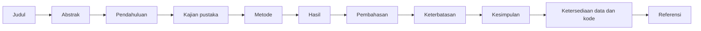

# Bab 8 — Scientific Research Writing

## Learning Objectives

Setelah mempelajari bab ini, kamu mampu:

- [x] Menjelaskan fungsi tiap bagian naskah ilmiah: judul, abstrak, pendahuluan, kajian pustaka, metodologi, hasil, pembahasan, kesimpulan, keterbatasan, dan referensi.
- [x] Menyusun judul dan abstrak terstruktur yang jujur dan bisa dilacak ke hasil.
- [x] Menyajikan algoritma, persamaan, dataset, konfigurasi eksperimen, tabel, dan gambar dengan benar.
- [x] Menulis keterangan tabel dan gambar yang bisa dibaca sendiri.
- [x] Menulis pernyataan ketersediaan data dan kode, serta pernyataan etik.
- [x] Menyusun kerangka naskah dari hasil penelitian tanpa mengarang isi.
- [x] Memakai daftar periksa penulisan, dan membedakan butir yang bisa diperiksa mesin dari yang butuh penilaian manusia.
- [x] Menghindari janji penerimaan jurnal atau klaim kelayakan indeksasi.

## Introduction

Penelitian yang baik bisa gagal dikomunikasikan. Dan sebaliknya, naskah yang indah bisa menyembunyikan penelitian yang lemah. Bab ini mengajarkan penulisan yang **jujur dan bisa diperiksa**: setiap angka bisa ditelusuri, setiap klaim dibatasi bukti, dan setiap keterbatasan dinyatakan.

Di Bab 7 kamu sudah punya buku bukti: kalimat hasil, interpretasi, pembahasan, dan keterbatasan. Naskah ilmiah tidak lain adalah **cara mengatur kalimat-kalimat itu menjadi alur yang bisa dibaca orang yang belum mengenal penelitianmu**. Bab ini membahas susunan itu, serta cara menyajikan unsur teknisnya: algoritma, persamaan, data, konfigurasi, tabel, dan gambar.

Ada satu prinsip yang menjadi benang merah: **penulis, bukan alat, yang bertanggung jawab atas isi**. Skrip di bab ini merakit kerangka naskah dari fakta terverifikasi, tetapi ia **tidak menulis** pendahuluan, kajian pustaka, pembahasan, atau kesimpulan. Bagian itu tetap tugasmu, dan skrip menandainya sebagai `[TODO penulis]`.

Bab ini juga jujur tentang apa yang **tidak** bisa dijanjikan. Tidak ada metode atau struktur naskah yang menjamin naskah diterima oleh jurnal atau memenuhi persyaratan indeks tertentu. Keputusan itu ada pada penelaah, editor, dan pengelola indeks.

!!! note "Prasyarat"
    - [Bab 7](07-results-presentation-and-discussion.md): buku bukti, tabel hasil, dan pemeriksa angka serta kata berlebihan. Jalankan skrip Bab 2 sampai 7 lebih dulu, karena skrip bab ini membaca berkas hasilnya.
    - [Level 6 Bab 10](../experimentation-and-interpretation/10-experimental-reporting-and-interpretation.md): struktur laporan eksperimen. Bab ini memperluasnya ke format makalah.

## Fundamental Concepts

| Istilah | Arti |
|---|---|
| **Manuscript** (naskah) | Tulisan ilmiah yang disiapkan untuk jurnal, prosiding, atau laporan |
| **IMRaD** | Pola umum naskah: *Introduction, Methods, Results, and Discussion* |
| **Structured abstract** | Abstrak berbagian: latar belakang, tujuan, metode, hasil, kesimpulan |
| **Related work** | Telaah penelitian terdahulu yang dikelompokkan menurut tema |
| **Caption** (keterangan) | Teks di bawah tabel atau gambar yang menjelaskan isinya |
| **Self-contained** | Bisa dipahami tanpa membaca teks di sekitarnya |
| **Data availability statement** | Pernyataan tentang di mana data dan kode tersedia dan dengan lisensi apa |
| **Reproducibility statement** | Pernyataan cara orang lain mengulang penelitian |
| **Peer review** | Penilaian naskah oleh ahli sebelum diterbitkan |
| **Desk rejection** | Penolakan oleh editor sebelum naskah dinilai penelaah, sering karena tidak sesuai lingkup atau pedoman |
| **Checklist** | Daftar periksa. Sebagian butir otomatis, sebagian butuh penilaian manusia |

## Detailed Explanation

### Gambaran susunan naskah



Urutan penulisan tidak harus sama dengan urutan baca. Banyak penulis menulis **Metode dan Hasil lebih dulu** (karena sudah ada bukti), lalu Pembahasan, baru Pendahuluan dan Abstrak. Abstrak ditulis terakhir karena merangkum semuanya.

### Judul

Judul yang baik **menyebut objek penelitian, konteks data, dan jenis studi**, dalam panjang yang wajar (sekitar 8 sampai 25 kata dalam contoh kita; penerbit punya batas sendiri). Judul tidak boleh mengklaim lebih dari isi.

| Judul | Masalah |
|---|---|
| "Clustering Terbaik untuk Semua Data Kanker" | Klaim berlebihan ("terbaik", "semua"), tanpa konteks data, terlalu pendek |
| "Analisis Clustering" | Terlalu pendek, tanpa konteks |
| "Kestabilan dan Keselarasan Eksternal Pengelompokan pada Profil Morfologi Inti Sel: Studi Metodologis dengan Protokol Terkunci pada Satu Dataset Publik" | Menyebut objek, data, dan jenis studi, serta membatasi dengan "satu dataset" |

Perhatikan bahwa judul ketiga memuat **batas klaim** ("satu dataset publik"). Judul yang jujur sudah mengurangi risiko salah paham sebelum pembaca membuka isinya.

### Abstrak terstruktur

Abstrak sering menjadi satu-satunya bagian yang dibaca. Ia harus **bisa dipahami sendiri** dan **konsisten dengan isi**. Susunan yang umum:

| Bagian | Isi | Kira-kira |
|---|---|---|
| Latar belakang | Masalah dan mengapa penting | 1 sampai 2 kalimat |
| Tujuan | Apa yang ingin dicapai | 1 kalimat |
| Metode | Data, algoritma, evaluasi, dan protokol | 2 sampai 3 kalimat |
| Hasil | Angka utama, **dengan batasnya** | 3 sampai 4 kalimat |
| Kesimpulan | Jawaban terbatas | 1 sampai 2 kalimat |
| Keterbatasan | Batas yang paling penting | 1 sampai 2 kalimat |

Aturan untuk abstrak yang jujur:

1. **Setiap angka ada di bagian Hasil naskah.** Abstrak tidak memuat angka yang tidak ada di tubuh naskah.
2. **Tidak ada klaim yang tidak ada di tubuh naskah.**
3. **Sebut keterbatasan paling penting.** Pembaca yang hanya membaca abstrak berhak tahu bahwa hasilnya berlaku untuk satu dataset.
4. **Patuhi batas kata penerbit.** Contoh di bab ini memakai 250 kata, tetapi batas sebenarnya ada pada pedoman penerbit tujuanmu.
5. **Hindari kata berlebihan** ("membuktikan", "terbaik", "pasti").

### Pendahuluan

Pendahuluan membawa pembaca dari **konteks luas ke pertanyaanmu** dalam alur corong (seperti di Bab 2):

1. Konteks dan mengapa topik penting.
2. Masalah yang spesifik.
3. Apa yang sudah dilakukan (ringkas, rujukan ke kajian pustaka).
4. **Celah** yang dibatasi (Bab 3). Gunakan rumusan "dari N sumber yang ditelaah", bukan "belum pernah ada penelitian".
5. Tujuan dan pertanyaan penelitian.
6. Kontribusi, **dinyatakan jujur** (pada proyek kita: didaktik dan metodologis).
7. Gambaran susunan naskah (opsional).

### Kajian pustaka (*related work*)

Kajian pustaka yang baik **dikelompokkan menurut tema**, bukan memerinci makalah satu per satu. Contoh tema untuk proyek ini: (a) evaluasi clustering yang bergantung konteks, (b) kestabilan sebagai bukti struktur, (c) perbandingan dua pengelompokan. Matriks pustaka dari Bab 3 membantu karena kamu bisa melihat makalah mana yang mendukung tema mana.

Dua hal yang harus dijaga: **hanya merujuk sumber yang benar-benar kamu telaah**, dan **menyebut tingkat bacaanmu bila terbatas** (misalnya "berdasarkan abstrak"). Pada proyek kita, kelima sumber hanya dibaca abstrak atau ringkasannya, dan pertanyaan RQ2 belum punya pustaka pendukung. Dua hal itu harus dibereskan sebelum naskah dikirim.

### Metodologi

Bagian Metode harus cukup rinci agar **peneliti lain bisa mengulang**. Isinya (semua tersedia di protokol Bab 5):

| Unsur | Cara menyajikannya |
|---|---|
| **Data** | Nama, sumber, DOI, lisensi, ukuran, kriteria inklusi, sidik jari (Bab 4) |
| **Praproses** | Urutan langkah dan alasan |
| **Algoritma** | Deskripsi singkat dan referensinya, lalu tabel pengaturan |
| **Hyperparameter** | Nilai tetap dan aturan penyetelan (tanpa label) |
| **Metrik** | Definisi atau rujukan, arah metrik, dan peran (internal, eksternal, kestabilan) |
| **Prosedur** | Faktor, level, ulangan, aturan keputusan |
| **Protokol dan kunci** | Dinyatakan ditetapkan sebelum eksperimen, dengan hash |
| **Lingkungan** | Versi perangkat lunak (Bab 5: `05_environment.json`) |
| **Pengungkapan** | Hal yang sudah dilihat sebelum protokol ditulis |

### Menyajikan algoritma

Ada dua cara umum:

1. **Deskripsi singkat dan rujukan**, bila algoritmanya baku (K-Means, GMM, DBSCAN). Tulis satu atau dua kalimat tentang cara kerjanya, rujukan sumber aslinya, dan **pengaturan yang kamu pakai**. Jangan menjabarkan ulang buku teks.
2. **Pseudokode**, bila kamu mengusulkan prosedur baru. Pada penelitian ini prosedur yang baru hanyalah protokol evaluasi, yang lebih jelas dijelaskan sebagai langkah bernomor dan tabel konfigurasi.

Hal yang wajib ada pada keduanya: **hyperparameter dan nilai bawaan yang diandalkan**, karena nilai bawaan bisa berubah antar versi pustaka.

### Menyajikan persamaan

Persamaan ditulis agar pembaca bisa memahami **tanpa menebak**:

1. **Beri nomor** persamaan yang dirujuk di teks.
2. **Definisikan setiap simbol** tepat setelah persamaan atau sebelum dipakai.
3. **Gunakan notasi konsisten** di seluruh naskah.
4. **Rujuk sumber** bila persamaannya dari literatur.
5. **Jelaskan maknanya dengan kata** untuk persamaan yang penting.

Contoh penyajian (ARI, dirujuk dari Level 5):

$$
\mathrm{ARI} = \frac{\mathrm{RI} - \mathbb{E}[\mathrm{RI}]}{\max(\mathrm{RI}) - \mathbb{E}[\mathrm{RI}]} \tag{1}
$$

dengan \( \mathrm{RI} \) *Rand Index* dan \( \mathbb{E}[\mathrm{RI}] \) nilai harapannya untuk pengelompokan acak. Nilai 1 berarti dua pengelompokan identik, dan nilai sekitar 0 berarti tidak lebih mirip daripada kebetulan.

Pada proyek ini ada empat persamaan yang dirujuk di Metode: ARI, kestabilan antar-seed, kestabilan subsampel, dan selisih ARI pada bootstrap. Kode bab ini memeriksa bahwa setiap simbol sudah punya definisi.

### Menyajikan dataset dan konfigurasi eksperimen

**Dataset:** satu paragraf (sumber, lisensi, ukuran, kriteria, sidik jari), ditambah tabel ringkas bila perlu. **Konfigurasi eksperimen:** tabel yang memuat algoritma, pengaturan, dan apakah disetel. Tabel konfigurasi adalah salah satu bagian yang paling sering dibaca orang yang ingin mengulang penelitianmu.

Tabel ini dihasilkan dari protokol oleh kode bab ini (bukan diketik), sehingga tidak bisa berbeda dari protokol yang dijalankan.

### Menyajikan tabel dan gambar

**Tabel** cocok untuk angka yang ingin dibandingkan persis. **Gambar** cocok untuk pola, sebaran, dan ketidakpastian. Keduanya harus **mandiri**.

Keterangan yang baik menjawab: *apa yang ditampilkan, pada data dan kondisi apa, dan bagaimana membacanya.*

| Unsur keterangan | Contoh pada proyek |
|---|---|
| Apa | "Perbandingan empat algoritma" |
| Kondisi | "pada K = 2 di ruang baseline terstandarisasi" |
| Cara membaca | "arah metrik ditulis pada kepala kolom" |
| Catatan khusus | "DBSCAN tidak memiliki konfigurasi valid menurut protokol" |

Aturan tambahan:

1. **Setiap tabel dan gambar dirujuk di teks** ("Tabel 1 menunjukkan...").
2. **Hindari bergantung pada warna saja**: pakai bentuk penanda berbeda.
3. **Tampilkan ketidakpastian** bila ada (interval, rentang).
4. **Beri label eksploratori** pada analisis yang tidak ada di protokol.
5. **Jangan memotong sumbu** secara menyesatkan.

### Hasil, pembahasan, kesimpulan, dan keterbatasan

Empat bagian ini mengikuti pemisahan lapisan di Bab 7. Perbedaan penting antar-bagian:

| Bagian | Berisi | Tidak berisi |
|---|---|---|
| **Hasil** | Angka dan pengamatan | Alasan, klaim sebab |
| **Pembahasan** | Interpretasi, hasil tak terduga, hubungan dengan pustaka | Klaim yang melampaui data |
| **Keterbatasan** | Batas data, metode, protokol, bacaan pustaka | Permintaan maaf umum |
| **Kesimpulan** | Jawaban terbatas untuk tiap pertanyaan | Hasil baru, klaim umum |

Keterbatasan sering diletakkan sebagai subbagian Pembahasan atau bagian tersendiri sebelum Kesimpulan. Yang penting, ia **ada dan spesifik**.

### Pernyataan ketersediaan data, kode, dan etik

Banyak penerbit meminta pernyataan ini. Isi minimalnya:

- **Data:** sumber asli, DOI, lisensi, atribusi, dan sidik jari salinan yang dipakai.
- **Kode dan hasil:** tautan repositori dan hash protokol.
- **Etik:** status persetujuan dan de-identifikasi (termasuk bila **tidak diketahui**), serta pernyataan bahwa tidak ada klaim klinis.

!!! warning "Jangan menulis tautan yang belum ada"
    Pada proyek ini tautan repositori belum ditentukan, jadi kerangka naskah menulis `[TAUTAN REPOSITORI: diisi penulis]` dan daftar periksa menandainya **PERINGATAN**. Menulis tautan karangan atau tautan yang belum dibuat adalah pelanggaran integritas.

### Referensi

Aturan inti: **setiap rujukan di teks ada di daftar pustaka dan sebaliknya**, dan setiap entri **diverifikasi** pada sumber (halaman penerbit, DOI, atau repositori resmi). Ikuti format sitasi penerbit tujuan secara konsisten. Jangan menyalin referensi dari ingatan.

### Proses menulis dan menelaah diri

Urutan kerja yang disarankan:

1. Mulai dari **buku bukti** (Bab 7) dan **protokol** (Bab 5), bukan dari kertas kosong.
2. Tulis Metode dan Hasil lebih dulu.
3. Tulis Pembahasan dan Keterbatasan.
4. Tulis Pendahuluan dan Kajian Pustaka.
5. Tulis Abstrak dan Judul terakhir.
6. Jalankan daftar periksa, baca ulang dengan kacamata penelaah.
7. Mintakan orang lain membaca, lalu perbaiki.

Tanyakan pada diri sendiri seperti seorang penelaah: *Apakah pertanyaannya jelas? Apakah metodenya bisa diulang? Apakah klaimnya didukung angka? Apakah keterbatasannya jujur?*

### Tidak ada jaminan penerimaan atau indeksasi

Struktur naskah yang baik meningkatkan kejelasan, tetapi **tidak menjamin** penerimaan. Jurnal menilai kebaruan, kesesuaian lingkup, mutu metode, dan faktor lain yang di luar kendalimu. Begitu pula **indeksasi**: persyaratan ditentukan pengelola indeks dan penerbit, dan tidak ada metode tertentu yang otomatis memenuhinya. Karena itu, hindari klaim seperti "metode ini pasti layak dimuat di jurnal terindeks".

Kontribusi proyek kita sendiri dinyatakan **didaktik dan metodologis**, bukan kebaruan ilmiah. Naskah yang jujur tentang hal itu lebih mudah dinilai daripada naskah yang melebih-lebihkan.

### Kesalahan umum

1. **Menulis abstrak sebelum hasil jelas**, sehingga ia mengklaim lebih dari isi.
2. **Angka di abstrak tidak ada di tubuh naskah.**
3. **Keterangan tabel dan gambar tidak mandiri.**
4. **Tabel atau gambar tidak dirujuk di teks.**
5. **Persamaan tanpa definisi simbol.**
6. **Kajian pustaka berupa daftar makalah**, bukan telaah per tema.
7. **Merujuk sumber yang belum dibaca**, atau tidak menyebut bahwa baru dibaca abstraknya.
8. **Menyembunyikan analisis eksploratori** di antara hasil terencana.
9. **Menulis tautan data atau kode yang belum ada.**
10. **Menjanjikan penerimaan atau indeksasi.**

## Mathematical Foundation

Bab ini tidak memerlukan rumus baru. Persamaan yang dirujuk di naskah berasal dari bab sebelumnya: ARI (Bab 1), kestabilan antar-seed dan subsampel (Bab 5), dan selisih ARI pada bootstrap (Bab 7). Yang baru di bab ini adalah **cara menyajikannya**: diberi nomor, setiap simbol didefinisikan, dan maknanya dijelaskan dengan kata.

Satu-satunya "hitungan" pada kode adalah **jumlah kata** dengan pola `\w+` (rangkaian huruf atau angka), yang dipakai untuk memeriksa batas panjang judul, abstrak, dan keterangan.

## Python Implementation

Skrip lengkapnya ada di `examples/level-7/08_scientific_research_writing.py`. Bab ini bersifat konseptual, sehingga **tidak punya notebook**. **Setiap potongan kode diikuti penjelasannya.**

**Konteks masalah:** menyusun kerangka naskah dari hasil proyek dan memeriksa kelayakannya dengan daftar periksa yang jujur tentang batas otomatisasi.

**Penting:** skrip **tidak menulis prosa** Pendahuluan, Kajian Pustaka, Pembahasan, dan Kesimpulan. Ia hanya merakit fakta yang sudah terverifikasi. Prosa tetap tugas penulis.

**Data:** bukan dataset. Skrip membaca berkas hasil Bab 2 sampai 7. **Jalankan skrip Bab 2 sampai 7 lebih dulu.**

**Pustaka:** pandas, serta `json` dan `re` dari pustaka standar.

### Bagian A — Siapkan alat dan baca hasil proyek

```python
--8<-- "level-7/08_scientific_research_writing.py:setup"
```

**Penjelasan:**

- Skrip membaca rumusan masalah (Bab 2), pernyataan celah (Bab 3), kartu data (Bab 4), protokol dan hash (Bab 5), fakta dan buku bukti (Bab 7), serta matriks pustaka (Bab 3). `set_index("id")` dan `index_col="id"` menjadikan kolom `id` sebagai indeks baris, sehingga kalimat bisa dipanggil dengan `ledger.loc["H1", "kalimat"]`.
- `words(text)` menghitung kata dengan `re.findall(r"\w+", text, flags=re.UNICODE)`. `\w+` berarti satu atau lebih huruf, angka, atau garis bawah.
- `pool` adalah **himpunan semua bentuk tulisan angka yang sah**, dibuat dari berkas fakta Bab 7. `overclaim_words` dan `untraceable_numbers` sama dengan pemeriksa di Bab 7, termasuk pencocokan kata utuh dan negasi sederhana.

### Bagian B — Judul

```python
--8<-- "level-7/08_scientific_research_writing.py:title"
```

**Penjelasan:** `check_title` mengembalikan lima penanda: terlalu pendek (kurang dari 8 kata), terlalu panjang (lebih dari 25 kata), klaim berlebihan, tanpa objek penelitian (tidak menyebut "pengelompokan", "clustering", atau "klaster"), dan tanpa konteks data (tidak memuat kata "pada"). Tanda `f" {low} "` menambahkan spasi di kedua ujung agar kata "pada" dicari sebagai kata utuh. `titles` berisi tiga judul: dua yang sengaja buruk (T1, T2) dan satu yang dipakai (T3). Ini alat bantu berbasis kata kunci, bukan penilai: judul yang lolos belum tentu baik.

### Bagian C — Abstrak terstruktur

```python
--8<-- "level-7/08_scientific_research_writing.py:abstract"
```

**Penjelasan:**

- `pick(*ids)` mengambil kalimat dari buku bukti berdasarkan id lalu menggabungkannya. Tanda `*ids` memungkinkan fungsi menerima sejumlah id.
- `goals` mengubah huruf pertama tiap tujuan menjadi huruf kecil agar bisa disambung menjadi satu kalimat dengan tanda titik koma.
- `abstract_draft` adalah dictionary dengan enam bagian: Latar belakang (dari rumusan masalah), Tujuan, Metode (dirakit dari kartu data dan protokol, bukan diketik), Hasil, Kesimpulan, dan Keterbatasan (dari buku bukti).
- Skrip menghitung kata draf pertama dan membandingkannya dengan **contoh batas 250 kata**. Draf pertama **262 kata, melebihi batas**.
- **Pemangkasan:** kalimat H7 (bootstrap eksploratori) dibuang dari bagian Hasil karena isinya sudah ada pada kalimat kesimpulan I5. `{**abstract_draft, "Hasil": pick("H1", "H3", "H5")}` menyalin draf dan mengganti hanya bagian Hasil. Hasilnya **234 kata**.
- Dua pemeriksaan terakhir menjalankan pemeriksa angka dan kata berlebihan pada abstrak.

### Bagian D — Peta bagian naskah

```python
--8<-- "level-7/08_scientific_research_writing.py:sections"
```

**Penjelasan:** `section_map` adalah tabel: tiap bagian naskah dipetakan ke **berkas proyek yang menjadi sumbernya**, isi utamanya, dan **saran** panjang kata (saran, bukan aturan; pedoman penerbit yang berlaku). Perulangan `for sources in ...` memecah daftar berkas dengan `split(";")`, lalu `all((RESULTS / n).exists() for n in names)` memeriksa bahwa **semua** berkas sumber ada. Kolom `sumber_ada` bernilai `True` bila lengkap.

### Bagian E — Tabel konfigurasi, tabel, gambar, dan persamaan

```python
--8<-- "level-7/08_scientific_research_writing.py:elements"
```

**Penjelasan:**

- **Tabel konfigurasi** dibuat dari `protocol["algoritma"]`: untuk tiap algoritma, pengaturan (selain penanda `disetel` dan aturan seleksi) digabung menjadi satu teks dengan `"; ".join(...)`. Karena berasal dari protokol, tabel tidak bisa berbeda dari yang dijalankan.
- `assets` adalah daftar tabel dan gambar: id, berkas, folder, dan **keterangan** draf. Perulangan menambahkan dua kolom: `ada` (berkasnya ada?) dan `kata_keterangan` (jumlah kata keterangan).
- `equations` memuat empat persamaan, masing-masing dengan kamus `simbol` (simbol menjadi definisi) dan bagian tempat dirujuk. `undefined` mengumpulkan persamaan yang kamus simbolnya kosong atau punya definisi kosong.

### Bagian F — Pernyataan data dan etik

```python
--8<-- "level-7/08_scientific_research_writing.py:statements"
```

**Penjelasan:** pernyataan data dirakit dengan f-string dari kartu data dan protokol: nama dataset, sumber, DOI, lisensi, pembuat, sidik jari, dan 16 karakter pertama hash protokol. `card['sumber_asli'].split(', ')[0]` mengambil nama sumber saja (sebelum koma pertama). Tautan repositori **sengaja ditulis sebagai placeholder** `[TAUTAN REPOSITORI: diisi penulis]`, karena tautan itu belum ditentukan. Pernyataan etik mencatat bahwa persetujuan dan de-identifikasi tidak diketahui.

### Bagian G — Daftar periksa penulisan

```python
--8<-- "level-7/08_scientific_research_writing.py:checklist"
```

**Penjelasan:**

- `check(name, ok, detail, kind, warn_only)` menambahkan satu butir ke daftar. Status: `LULUS` bila `ok`, `PERINGATAN` bila tidak `ok` dan `warn_only`, selain itu `GAGAL`. Butir **wajib** yang tidak terpenuhi menjadi `GAGAL`, sedangkan hal yang perlu dibereskan penulis menjadi `PERINGATAN`.
- Butir otomatis mencakup judul, batas kata abstrak, keterlacakan angka, kata berlebihan, keterbatasan di abstrak, keberadaan sumber dan berkas, keterangan mandiri (minimal 15 kata), definisi simbol, jumlah keterbatasan (minimal tiga), label eksploratori, isi pernyataan data, hash protokol, tingkat bacaan pustaka, dan cakupan pustaka tiap pertanyaan.
- **Lima butir manual** (tata bahasa, format sitasi, kebijakan penerbit, pemeriksaan kemiripan teks, persetujuan semua penulis) memerlukan penilaian manusia. Statusnya diubah menjadi `MANUAL`, supaya jelas bahwa skrip **tidak** menilainya.
- `report["status"].value_counts()` merangkum jumlah per status.

### Bagian H — Menyusun kerangka naskah

```python
--8<-- "level-7/08_scientific_research_writing.py:outline"
```

**Penjelasan:** fungsi `block(title, body)` membuat satu bagian Markdown. Kerangka dirakit dari judul, abstrak, tiap bagian naskah (dengan sumber, isi utama, saran panjang, dan penanda `[TODO penulis]`), tabel konfigurasi, daftar tabel dan gambar, pernyataan data dan etik, serta daftar referensi **beserta tingkat bacaannya**. `outline.count("[TODO penulis")` menghitung bagian yang menunggu prosa penulis. Kerangka disimpan sebagai `08_manuscript_outline.md`, dan hasil daftar periksa sebagai CSV.

## Code Explanation

| Bagian kode | Peran |
|---|---|
| `words(text)` | Hitung kata dengan `\w+` |
| `check_title(title)` | Pemeriksa judul berbasis kata kunci |
| `pick(*ids)` | Mengambil kalimat dari buku bukti untuk abstrak |
| `{**abstract_draft, "Hasil": ...}` | Menyalin draf dan mengganti satu bagian |
| `section_map` | Memetakan bagian naskah ke berkas sumber |
| Tabel konfigurasi dari `protocol` | Tabel tidak bisa berbeda dari protokol |
| `equations[...]["simbol"]` | Memeriksa definisi simbol |
| `check(...)` dan status | Daftar periksa dengan LULUS, PERINGATAN, GAGAL, MANUAL |
| `[TODO penulis]` | Menandai prosa yang tidak ditulis skrip |

## How to Run

Dari folder utama proyek (setelah mengaktifkan lingkungan virtual):

```powershell
pip install -r requirements-notebooks.txt
python examples/level-7/02_research_problem_formulation.py
python examples/level-7/04_dataset_selection_and_preparation.py
python examples/level-7/05_research_methodology_and_protocol.py
python examples/level-7/06_research_implementation.py
python examples/level-7/07_results_presentation_and_discussion.py
python examples/level-7/08_scientific_research_writing.py
```

Skrip mencetak output dan menyimpan tiga berkas berawalan `08_` di `examples/level-7/results/`: kerangka naskah, daftar periksa, dan peta bagian. Eksekusinya beberapa detik karena tidak ada pelatihan model.

Output di bawah berasal dari eksekusi nyata dengan Python 3.14.10 dan pandas 3.0.5.

## Expected Output

```text
--8<-- "level-7/outputs/08.txt"
```

Kerangka naskah yang dirakit skrip (`results/08_manuscript_outline.md`), ditampilkan sebagai teks mentah:

```markdown
--8<-- "level-7/results/08_manuscript_outline.md"
```

### Interpretasi output

**1. Judul.** T1 (6 kata) ditandai tiga hal: terlalu pendek, klaim berlebihan ("terbaik"), dan tanpa konteks data. T2 (2 kata) ditandai terlalu pendek dan tanpa konteks. T3 (19 kata) lolos.

**2. Abstrak.** Draf pertama **262 kata**, melebihi contoh batas 250. Setelah kalimat bootstrap dibuang dari bagian Hasil (isinya sudah ada di Kesimpulan), abstrak menjadi **234 kata**: Latar belakang 18, Tujuan 30, Metode 32, Hasil 60, Kesimpulan 67, Keterbatasan 27. Tidak ada angka tak terlacak dan tidak ada kata berlebihan.

**3. Peta bagian dan elemen.** Kedelapan bagian naskah memiliki berkas sumber yang ada. Kelima tabel dan gambar memiliki berkas dan keterangan 18 sampai 25 kata, dan keempat persamaan memiliki definisi simbol. Tabel konfigurasi menunjukkan tiga algoritma tetap dan DBSCAN yang disetel.

**4. Daftar periksa.** Dari 21 butir: **13 LULUS, 5 MANUAL, 3 PERINGATAN, 0 GAGAL**. Tiga peringatan adalah hal yang nyata dan belum bisa dibereskan skrip:

| Peringatan | Artinya |
|---|---|
| Tautan repositori masih placeholder | Penulis harus menentukan dan mengisi tautan |
| 0 dari 5 sumber dibaca penuh | Kajian pustaka butuh bacaan teks lengkap |
| RQ2 tanpa pustaka | Perlu pencarian tambahan sebelum menulis latar belakang RQ2 |

**5. Kerangka naskah.** Sekitar 786 kata dan 7 bagian yang menunggu prosa penulis (Pendahuluan, Kajian pustaka, Metode, Hasil, Pembahasan, Keterbatasan, Kesimpulan). Skrip merakit fakta, **bukan menulis naskah**.

!!! warning "Catatan dari pembuatan bab ini"
    Pada eksekusi pertama daftar periksa menandai dua kegagalan nyata. (1) Abstrak 256 kata, melebihi batas. (2) Kata **"selalu"** ditandai; asalnya dari kalimat masalah Bab 2 ("Clustering **selalu** menghasilkan kelompok"). Kalimat itu terlalu umum, karena hasil Bab 6 menunjukkan DBSCAN pada data ini tidak menghasilkan kelompok. Kalimat diperbaiki **di sumbernya** (Bab 2) menjadi "Algoritma clustering berbasis partisi menghasilkan kelompok pada data apa pun, ...", dengan catatan revisi di Bab 2. Hash protokol tidak berubah karena protokol tidak memuat kalimat itu. Pelajarannya: pemeriksa yang berjalan di akhir bisa menemukan kelemahan di bab yang lebih awal, dan perbaikannya harus dicatat, bukan disembunyikan.

!!! warning "Batas kesimpulan"
    Daftar periksa yang lolos berarti **kerangka lengkap dan konsisten**, bukan bahwa naskah siap kirim atau akan diterima. Lima butir manual belum dinilai, tiga peringatan belum dibereskan, dan seluruh prosa belum ditulis. Tidak ada klaim kelayakan indeksasi.

## Practical Examples

**Menulis skripsi atau artikel.** Kerangka dengan `[TODO penulis]` memberi urutan kerja yang jelas: kamu tahu bagian mana yang sudah punya sumber dan mana yang menunggu tulisanmu.

**Menjawab permintaan penelaah.** Karena tiap angka bisa ditelusuri ke berkas hasil, kamu bisa memeriksa pertanyaan penelaah ("dari mana angka ini?") dalam beberapa menit.

**Menyiapkan pengiriman.** Sebelum mengirim, jalankan daftar periksa, bereskan peringatan, nilai butir manual, dan baca pedoman penerbit tujuan. Pedoman itu mengalahkan contoh batas di bab ini.

## Hands-on Exercises

Semua angka di jawaban berasal dari eksekusi nyata, kecuali disebut lain.

1. Sebutkan tiga butir berstatus PERINGATAN pada daftar periksa dan jelaskan mengapa skrip tidak bisa membereskannya.
2. Tulis judul baru untuk proyek ini yang lolos `check_title`, lalu jelaskan satu hal yang tidak bisa diperiksa oleh pemeriksa itu.
3. Berapa kata yang harus dipangkas bila batas abstrak diturunkan menjadi 200 kata? Bagian mana yang kamu pangkas dan mengapa?
4. Mengapa angka pada abstrak harus ada di bagian Hasil naskah?
5. Mengapa lima butir diberi status MANUAL, bukan dinilai skrip?
6. Mengapa naskah tidak boleh menyatakan bahwa metodenya "pasti layak dimuat di jurnal terindeks"?

??? question "Jawaban"
    Nomor 1 dan 3 memakai output nyata. Nomor 2 memakai pemeriksaan nyata pada contoh judul.

    1. (a) Tautan repositori masih placeholder: penulis yang menentukan tempat penyimpanan kode, skrip tidak boleh mengarangnya. (b) 0 dari 5 sumber dibaca penuh: membaca makalah adalah kerja manusia. (c) RQ2 tanpa pustaka: perlu pencarian dan verifikasi sumber baru.
    2. Contoh: "Perbandingan Kestabilan Tiga Algoritma Pengelompokan pada Data Morfologi Inti Sel". Judul ini 10 kata dan lolos pemeriksa. Yang tidak bisa diperiksa pemeriksa: apakah judul akurat terhadap isi, apakah sesuai gaya penerbit, dan apakah menarik bagi pembaca.
    3. Abstrak final 234 kata, jadi harus dipangkas minimal **34 kata**. Opsi: persingkat kalimat Kesimpulan (67 kata, terpanjang) atau bagian Metode (32 kata). Kalimat keterbatasan sebaiknya dipertahankan karena melindungi pembaca dari salah paham.
    4. Karena abstrak merangkum isi. Angka yang hanya ada di abstrak tidak bisa diperiksa pembaca di tubuh naskah, dan bisa memberi kesan klaim yang tidak didukung.
    5. Tata bahasa, kebijakan penerbit, pemeriksaan kemiripan teks, dan persetujuan penulis memerlukan penilaian atau tindakan manusia dan sumber di luar berkas proyek. Skrip yang berpura-pura menilainya akan memberi rasa aman palsu.
    6. Penerimaan dan indeksasi ditentukan penelaah, editor, dan pengelola indeks berdasarkan kriteria di luar kendali penulis. Klaim seperti itu tidak bisa dibuktikan dan melanggar prinsip kejujuran yang dipakai di seluruh Level 7.

## Troubleshooting

### Masalah teknis

| Masalah | Penyebab | Solusi |
|---|---|---|
| `FileNotFoundError` untuk berkas `07_` atau `03_` | Skrip bab sebelumnya belum dijalankan | Jalankan skrip Bab 2 sampai 7 |
| `KeyError` pada `ledger.loc["I5", ...]` | Buku bukti Bab 7 berubah susunannya | Periksa id di `07_claim_ledger.csv` |
| Abstrak melebihi batas | Terlalu banyak kalimat terpilih | Pangkas kalimat yang isinya sudah ada di bagian lain |
| Tanda "—" rusak pada output | Konsol Windows tanpa UTF-8 | Skrip sudah memanggil `sys.stdout.reconfigure(encoding="utf-8")` |
| Kata berlebihan ditandai pada kalimat yang kamu anggap wajar | Pencocokan kata kunci, atau memang klaim terlalu umum | Baca ulang kalimatnya; di bab ini satu penanda ternyata menemukan kalimat yang memang terlalu umum |

### Kesalahan umum

1. **Menganggap `LULUS` berarti naskah siap.**
2. **Mengabaikan butir `MANUAL`.**
3. **Menyunting angka di abstrak secara manual** sehingga tidak lagi cocok dengan Hasil.
4. **Menghapus peringatan dengan mengisi placeholder dengan tautan yang belum ada.**
5. **Memperbaiki masalah di naskah tetapi tidak di sumbernya.**

## Summary

- **Naskah** mengatur kalimat buku bukti menjadi alur yang bisa dibaca: judul, abstrak, pendahuluan, kajian pustaka, metode, hasil, pembahasan, keterbatasan, kesimpulan, ketersediaan data, dan referensi.
- **Judul dan abstrak** harus jujur dan terlacak. Pada proyek ini draf abstrak 262 kata melebihi contoh batas 250, lalu dipangkas menjadi 234 kata tanpa angka tak terlacak dan tanpa kata berlebihan.
- **Algoritma, persamaan, dataset, dan konfigurasi** disajikan agar peneliti lain bisa mengulang; tabel konfigurasi dibuat dari protokol, dan setiap simbol persamaan didefinisikan.
- **Tabel dan gambar** harus mandiri (keterangan 18 sampai 25 kata pada contoh) dan dirujuk di teks.
- **Daftar periksa** menghasilkan 13 LULUS, 5 MANUAL, 3 PERINGATAN, dan 0 GAGAL. Tiga peringatan adalah pekerjaan nyata: tautan repositori, bacaan pustaka penuh, dan pustaka untuk RQ2.
- **Skrip merakit fakta, bukan menulis prosa.** Bagian prosa ditandai `[TODO penulis]`.
- **Pemeriksa menemukan kalimat yang terlalu umum di Bab 2**, dan perbaikan dilakukan di sumbernya dengan catatan revisi.
- **Tidak ada jaminan penerimaan atau indeksasi.** Kontribusi proyek tetap didaktik dan metodologis.

**Bab berikutnya:** Bab 9 membahas **reproduksibilitas dan dokumentasi penelitian**: struktur proyek, data dan versinya, dependensi, Git, dan paket reproduksi.

## References

- Gastel, B., & Day, R. A. *How to Write and Publish a Scientific Paper* (edisi ke-9). Cambridge University Press. (Tahun terbit menurut katalog penjual: 2024.)
- Booth, W. C., Colomb, G. G., Williams, J. M., Bizup, J., & FitzGerald, W. T. (2016). *The Craft of Research* (4th ed.). University of Chicago Press.
- Page, M. J., McKenzie, J. E., Bossuyt, P. M., dkk. (2021). The PRISMA 2020 statement: an updated guideline for reporting systematic reviews. *BMJ*, 372, n71. [doi.org/10.1136/bmj.n71](https://doi.org/10.1136/bmj.n71)
- Gebru, T., Morgenstern, J., Vecchione, B., Vaughan, J. W., Wallach, H., Daumé III, H., & Crawford, K. (2021). Datasheets for datasets. *Communications of the ACM*, 64(12), 86–92. [doi.org/10.1145/3458723](https://doi.org/10.1145/3458723)
- Wilkinson, M. D., Dumontier, M., Aalbersberg, I. J., dkk. (2016). The FAIR Guiding Principles for scientific data management and stewardship. *Scientific Data*, 3, 160018. [doi.org/10.1038/sdata.2016.18](https://doi.org/10.1038/sdata.2016.18)
- Kerr, N. L. (1998). HARKing: Hypothesizing after the results are known. *Personality and Social Psychology Review*, 2(3), 196–217. [doi.org/10.1207/s15327957pspr0203_4](https://doi.org/10.1207/s15327957pspr0203_4)
- von Luxburg, U., Williamson, R. C., & Guyon, I. (2012). Clustering: Science or Art? *JMLR Workshop and Conference Proceedings*, 27, 65–79. [proceedings.mlr.press/v27/luxburg12a.html](https://proceedings.mlr.press/v27/luxburg12a.html)
