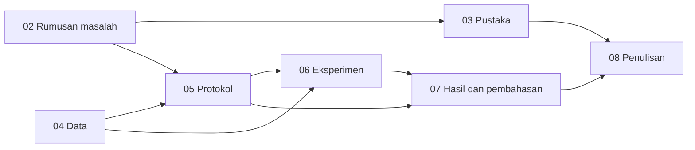

# Bab 9 — Reproducibility and Research Documentation

## Learning Objectives

Setelah mempelajari bab ini, kamu mampu:

- [x] Membedakan *repeatability*, *reproducibility*, dan *replicability*, serta menyebut apa yang diperlukan untuk masing-masing.
- [x] Menata kode, data, hasil, dan dokumen penelitian dalam struktur proyek yang jelas.
- [x] Mengelola versi data dengan sidik jari dan checksum.
- [x] Mencatat dependensi yang **benar-benar dipakai** dan mengunci versinya.
- [x] Memeriksa penggunaan seed dengan alat (AST), bukan dengan mata.
- [x] Mencatat keputusan praproses dan analisis dalam log keputusan.
- [x] Mengatur skrip dan notebook, dan memahami batas masing-masing.
- [x] Memakai Git untuk versi kode, dan memahami apa yang **tidak** dicatatnya.
- [x] Menyusun dan **menguji** paket reproduksi dengan menjalankan ulang seluruh alur.

## Introduction

Penelitian yang tidak bisa diulang hanyalah cerita. Bahkan peneliti sendiri sering gagal mengulang pekerjaannya enam bulan kemudian: versi pustaka berubah, berkas hilang, atau tidak ingat urutan menjalankan skrip.

Level 6 Bab 9 sudah mengajarkan unsur-unsur reproduksibilitas pada **satu eksperimen**: seed, versi pustaka, sidik jari data, dan file konfigurasi. Bab ini naik ke **tingkat proyek penelitian**: bagaimana semua unsur itu ditata, didokumentasikan, dan dikemas supaya orang lain (atau dirimu sendiri nanti) bisa menjalankan ulang dari awal sampai akhir.

Ada satu perbedaan penting antara bab ini dan kebanyakan tutorial reproduksibilitas: kita tidak berhenti pada daftar saran. Skrip bab ini **benar-benar menjalankan ulang** skrip Bab 1 sampai 8, membandingkan keluarannya dengan yang tersimpan, dan membandingkan checksum 67 berkas sebelum dan sesudah. Reproduksibilitas yang tidak diuji hanyalah klaim.

Bab ini juga jujur tentang apa yang **belum** bisa dijamin. Pada proyek ini kode Level 7 belum di-commit ke Git, sehingga paket reproduksi belum bisa menunjuk satu versi kode. Daftar periksa melaporkan itu sebagai peringatan, bukan menyembunyikannya.

!!! note "Prasyarat"
    - [Bab 5](05-research-methodology-and-experimental-protocol.md) (protokol terkunci, hash, lingkungan) dan [Bab 6](06-research-implementation-with-python.md) (klarifikasi dan manifest eksekusi).
    - [Level 6 Bab 9](../experimentation-and-interpretation/09-cluster-stability-and-reproducibility.md): seed, versi pustaka, sidik jari data. Jalankan skrip Bab 2 sampai 8 lebih dulu.

## Fundamental Concepts

| Istilah | Arti |
|---|---|
| **Repeatability** | Orang yang sama, dengan cara dan lingkungan yang sama, mendapat hasil yang sama |
| **Reproducibility** | Orang lain, dengan kode dan data yang sama, mendapat hasil yang sama |
| **Replicability** | Orang lain, dengan data atau pengaturan **berbeda**, menemukan kesimpulan yang konsisten |
| **Seed** | Nilai awal pembangkit bilangan acak yang menentukan urutan "acak" |
| **Checksum / hash** | Sidik jari isi berkas. Isi berubah sedikit pun, hash berubah |
| **Manifest** | Daftar berkas beserta hash-nya |
| **Dependency lock** | Daftar pustaka dengan versi yang tepat |
| **Provenance** | Riwayat sebuah hasil: dari data, kode, dan pengaturan apa ia berasal |
| **Decision log** | Catatan keputusan analisis beserta alasannya |
| **Version control (Git)** | Sistem yang mencatat riwayat perubahan berkas teks |
| **Commit** | Satu titik riwayat yang tercatat di Git |
| **Reproducibility package** | Kumpulan berkas yang memungkinkan penelitian diulang |
| **AST** (*abstract syntax tree*) | Representasi struktur kode yang bisa dibaca program |

## Detailed Explanation

### Tiga tingkat: ulang, reproduksi, replikasi

Tiga istilah ini sering dipertukarkan, padahal kebutuhannya berbeda.

| Tingkat | Siapa dan apa | Yang diperlukan |
|---|---|---|
| **Repeatability** | Kamu sendiri, lingkungan sama | Seed, catatan langkah |
| **Reproducibility** | Orang lain, kode dan data sama | Kode, data (atau cara memperolehnya), dependensi, urutan eksekusi, dokumentasi |
| **Replicability** | Orang lain, data atau pengaturan berbeda | Protokol yang jelas dan cukup rinci untuk diterapkan pada data lain |

Bab ini terutama menargetkan **reproducibility**: orang lain bisa mengulang hasilmu dari paket yang kamu siapkan. Replicability tidak bisa kamu jamin sendiri. Ia hanya bisa kamu mudahkan dengan protokol yang jelas.

### Struktur proyek yang disarankan

Struktur yang konsisten mengurangi kebingungan. Berikut susunan yang umum untuk penelitian clustering berdiri sendiri (satu repositori per proyek):

```text
penelitian-clustering/
├── README.md                 pintu masuk: tujuan, cara menjalankan, status
├── LICENSE                   lisensi kode
├── requirements.txt          dependensi yang diperlukan
├── requirements-lock.txt     versi tepat yang dipakai saat penelitian
├── data/
│   ├── raw/                  data asli, tidak pernah diubah
│   ├── processed/            data beku hasil kriteria inklusi
│   └── DATA_CARD.md          sumber, lisensi, atribusi, keterbatasan
├── protocol/
│   ├── protocol.json         protokol terkunci
│   ├── protocol.sha256       hash protokol
│   └── amendments/           catatan perubahan resmi
├── src/                      modul yang dipakai ulang (fungsi bersama)
├── scripts/                  alur eksekusi berurutan: 01_..., 02_...
├── notebooks/                eksplorasi dan penjelasan
├── results/                  tabel dan ringkasan (CSV, JSON)
├── figures/                  gambar yang dihasilkan skrip
├── logs/                     log keputusan dan log pencarian
├── paper/                    naskah dan bahan penulisan
└── MANIFEST.sha256           hash semua berkas penting
```

| Direktori atau berkas | Fungsi | Alasan |
|---|---|---|
| `README.md` | Pintu masuk | Orang baru harus tahu mulai dari mana |
| `requirements-lock.txt` | Versi tepat | Hasil bisa berbeda antar versi pustaka |
| `data/raw/` | Data asli | Tidak diubah sehingga selalu bisa kembali ke sumbernya |
| `data/processed/` | Data beku | Hasil kriteria inklusi, dengan sidik jari |
| `protocol/` | Protokol dan hash | Bukti rancangan ditetapkan sebelum eksperimen |
| `src/` | Fungsi bersama | Menghindari salinan kode yang menyimpang |
| `scripts/` | Alur berurutan | Urutan eksekusi jelas dan bisa dijalankan otomatis |
| `notebooks/` | Eksplorasi | Penjelasan interaktif, bukan alur utama |
| `results/` | Angka | Hasil yang bisa dibandingkan, bukan hanya gambar |
| `figures/` | Gambar | Dihasilkan skrip, bukan disimpan dari layar |
| `logs/` | Catatan proses | Keputusan dan pencarian pustaka |
| `paper/` | Naskah | Berasal dari hasil, bukan diketik ulang |

**Pada repositori materi ini**, susunannya berbeda karena Level 7 adalah bagian dari situs dokumentasi: skrip dan hasil ada di `examples/level-7/`, gambar di `docs/assets/level-7/`, notebook di `notebooks/level-7/`, dan teks bab di `docs/research-project/`. Kode bab ini memeriksa bahwa setiap fungsi di tabel di atas **ada padanannya** di proyek ini (10 dari 10 ada).

### Mengelola data dan versinya

Prinsip pengelolaan data penelitian:

1. **Jangan ubah data asli.** Simpan di `raw/` dan perlakukan hanya-baca.
2. **Hasil kriteria inklusi disimpan terpisah** (`processed/`) dan diberi sidik jari.
3. **Catat sumber, lisensi, dan atribusi** di kartu data.
4. **Gunakan checksum, bukan nama berkas**, sebagai bukti data yang sama. Dua berkas bernama `data_final.csv` bisa berbeda isinya.
5. **Untuk data besar**, Git kurang cocok menyimpan isinya; alat khusus manajemen versi data ada untuk itu. Pada proyek ini datanya kecil (sekitar 125 KB), jadi checksum cukup.

Pada proyek kita, sidik jari data final `6b202a2072f9` tertulis di kartu data, di protokol, dan diperiksa oleh Bab 6 sebelum eksperimen berjalan.

### Mencatat dependensi

Hasil numerik bisa berubah antar versi pustaka (nilai bawaan berubah, urutan operasi berbeda). Karena itu versi dicatat dengan dua cara:

| Berkas | Isi | Fungsi |
|---|---|---|
| `requirements.txt` | Pustaka yang dibutuhkan, rentang versi | Memudahkan instalasi |
| `requirements-lock.txt` | **Versi tepat** yang dipakai | Menjamin lingkungan yang sama |

Kesalahan umum: menulis daftar dependensi dari ingatan. Cara yang lebih andal: **membaca impor dari kode** (dengan AST), lalu mengambil versi terpasang. Skrip bab ini melakukannya: ia membaca seluruh `import` pada skrip dan modul bantu Level 7, membuang pustaka standar dan modul lokal, lalu memetakan sisanya ke versi terpasang. Hasilnya: matplotlib, numpy, pandas, dan scikit-learn.

!!! note "Kunci versi bukan jaminan lintas mesin"
    Versi yang sama di sistem operasi atau perangkat keras berbeda bisa memberi hasil sedikit berbeda pada bilangan pecahan. Kunci versi mengurangi risiko, bukan menghilangkannya. Itu sebabnya paket juga mencatat nilai yang diharapkan dan membandingkan hasil setelah dijalankan ulang.

### Mengatur seed

Seed menentukan urutan "acak" sehingga hasil bisa diulang. Aturan praktis:

1. **Setiap pemanggilan yang acak harus menyebut seed.** Di scikit-learn, `random_state`. Di NumPy, `np.random.default_rng(seed)`.
2. **Satu seed dasar** di satu tempat (di proyek ini 42), dan seed lain **diturunkan** darinya secara tercatat.
3. **Seed yang bervariasi dipakai sebagai faktor eksperimen** (misalnya 20 seed pada RQ1), bukan dipilih untuk mendapat hasil bagus.
4. **Seed tidak menjamin hasil lintas versi atau mesin.**

Memeriksa seed dengan mata mudah terlewat. Skrip bab ini memakai **AST**: ia membaca struktur kode, mencari pemanggilan `KMeans`, `GaussianMixture`, `PCA`, dan `default_rng`, lalu memeriksa apakah argumen seed ada. Pada Level 7: **16 pemanggilan diperiksa, tidak ada yang tanpa seed**. Alat ini juga diuji pada kode contoh yang sengaja tidak memakai seed, dan ia menandainya.

### Menyimpan konfigurasi dan hasil

Dari bab-bab sebelumnya kita sudah punya pola yang konsisten:

| Yang disimpan | Format | Contoh |
|---|---|---|
| Konfigurasi dan protokol | JSON | `05_protocol.json` |
| Hasil numerik | CSV | `06_rq3_algorithms.csv` |
| Ringkasan | JSON atau Markdown | `06_rq1_summary.json`, `07_results_discussion.md` |
| Manifest eksekusi | JSON | `06_run_manifest.json` |
| Gambar | PNG | `docs/assets/level-7/` |

Aturan: **simpan angka, bukan hanya gambar**, dan **tulis konfigurasi ke berkas, bukan hanya mengingatnya**.

### Mendokumentasikan keputusan praproses dan analisis

Setiap keputusan yang memengaruhi hasil harus tercatat dengan **alasannya**. Skrip bab ini merakit **log keputusan** dari berkas hasil, bukan mengetiknya ulang. Pada proyek ini ada 18 keputusan:

| Jenis | Jumlah | Contoh |
|---|---|---|
| Dikunci | 10 | Kriteria inklusi (Bab 4), praproses baseline, kebijakan hyperparameter (Bab 5) |
| Klarifikasi | 5 | C1 sampai C5 dari implementasi (Bab 6) |
| Pengungkapan | 2 | Protokol ditulis setelah demonstrasi Bab 1, K = 2 dipengaruhi diagnosis |
| Revisi | 1 | Kalimat masalah di Bab 2 diubah karena pemeriksa Bab 8 |

Revisi dicatat **bersama alasannya**, bukan dihapus. Itu yang membedakan dokumentasi dari sekadar hasil akhir yang rapi.

### Menata skrip dan notebook

| | Skrip | Notebook |
|---|---|---|
| Kekuatan | Dijalankan berurutan, mudah diotomatisasi, mudah dibandingkan di Git | Menggabungkan penjelasan, kode, dan keluaran; cocok untuk eksplorasi dan pengajaran |
| Kelemahan | Kurang interaktif | Status tersembunyi, sel bisa dijalankan tak berurutan, diff di Git sulit dibaca |
| Peran dalam proyek | **Alur utama** | Pendamping dan eksplorasi |

Prinsip: **alur yang menghasilkan hasil resmi ada di skrip**, notebook menjelaskannya dan menjadi tempat latihan. Sebelum mengandalkan notebook, jalankan dengan *restart and run all* dan pastikan tidak ada sel yang bergantung pada urutan manual. Pada Level 7, setiap notebook dibuat dari skrip yang sama dan dieksekusi dari awal sampai akhir.

### Urutan eksekusi dari ketergantungan berkas

Orang lain perlu tahu urutan menjalankan skrip. Daripada menuliskannya dari ingatan, skrip bab ini **membacanya dari kode**: ia mencari nama berkas hasil berawalan nomor bab (misalnya `05_protocol.json`) di tiap skrip dan menyimpulkan skrip mana membaca hasil skrip mana.



Pemeriksaan penting: **tidak boleh ada ketergantungan ke depan** (skrip yang membaca hasil skrip bernomor lebih besar), karena itu berarti ada putaran dan urutan numerik tidak valid. Pada Level 7, tidak ada.

### Git: apa yang dicatat dan apa yang tidak

Git mencatat **riwayat perubahan berkas teks**. Pola kerja yang cocok untuk penelitian:

| Saat | Tindakan | Alasan |
|---|---|---|
| Protokol selesai, sebelum eksperimen | Commit dan beri penanda (*tag*), misalnya `protokol-v1` | Bukti bahwa protokol ada sebelum hasil |
| Setelah eksperimen | Commit kode dan hasil | Riwayat hasil terkait versi kode |
| Perubahan sesudah protokol terkunci | Commit amendment dengan alasan di pesan | Riwayat perubahan terbuka |
| Rilis paket | Tag versi, catat hash commit di README | Paket menunjuk satu versi kode |

Contoh perintah (**contoh saja; skrip bab ini tidak menjalankan perintah Git yang menulis**):

```powershell
git add examples/level-7 docs/research-project notebooks/level-7
git commit -m "Tambah Level 7: protokol terkunci dan hasil eksperimen"
git tag protokol-v1
```

Yang **tidak** dicatat Git dengan baik: data besar, berkas biner yang sering berubah, dan lingkungan perangkat lunak. Untuk itu kita memakai checksum dan kunci dependensi. Git juga tidak otomatis menjamin hasil bisa diulang: ia hanya mencatat versi kode.

!!! warning "Status pada proyek ini"
    Kode Level 7 belum di-commit. Skrip membaca status Git **hanya untuk dibaca** (`git rev-parse`, `git status`) dan melaporkannya apa adanya: HEAD saat ini `33a3add`, dan 97 berkas Level 7 belum di-commit, sehingga paket **belum bisa menunjuk satu commit**. Itu ditandai PERINGATAN pada daftar periksa. Angka ini berubah setelah kamu menjalankan commit, dan memang begitu seharusnya.

### Menyusun paket reproduksi

Paket reproduksi adalah kumpulan kecil berkas yang cukup agar orang lain dapat mengulang penelitianmu. Pada proyek ini skrip menulis enam berkas di `examples/level-7/results/09_repro_package/`:

| Berkas | Isi |
|---|---|
| `README.md` | Tujuan, hash protokol, sidik jari data, status versi kode, penunjuk ke berkas lain |
| `requirements-lock.txt` | Versi pustaka yang dipakai |
| `RUN_ORDER.md` | Urutan menjalankan skrip |
| `DECISIONS.md` | Log keputusan |
| `MANIFEST.sha256` | Hash 67 berkas penting |
| `DATA_ATTRIBUTION.md` | Sumber, pembuat, lisensi, dan perubahan yang dibuat pada data |

Pada atribusi data, perhatikan satu hal yang sering terlupa: lisensi CC BY 4.0 mewajibkan **menyatakan perubahan**. Karena salinan beku disimpan ulang sebagai CSV dengan kolom diagnosis ditambahkan, hal itu ditulis eksplisit.

### Menguji keterulangan

Cara paling meyakinkan untuk menunjukkan keterulangan adalah mengulang. Skrip bab ini:

1. Menghitung checksum seluruh berkas hasil, keluaran, dan gambar (67 berkas).
2. Menjalankan ulang skrip Bab 1 sampai 8 satu per satu sebagai proses terpisah.
3. Membandingkan keluaran teks tiap skrip dengan yang tersimpan, baris demi baris.
4. Menghitung ulang checksum dan membandingkannya dengan yang awal.

Hasil yang diharapkan: semua skrip berjalan tanpa error dan **tidak ada berkas yang berubah**. Satu pengecualian yang wajar: keluaran Bab 5 memuat **waktu eksekusi** pada smoke test, sehingga barisnya berbeda tiap eksekusi. Itu bukan ketidakterulangan hasil, hanya pengukuran waktu.

### Kesalahan umum

1. **Mengklaim bisa diulang tanpa pernah mengulang.**
2. **Mengandalkan nama berkas**, bukan checksum.
3. **Menulis dependensi dari ingatan.**
4. **Memakai seed di sebagian tempat saja.**
5. **Menyimpan hanya gambar**, tidak angkanya.
6. **Mengubah data asli.**
7. **Notebook sebagai satu-satunya alur**, dengan sel yang bergantung urutan manual.
8. **Tidak mencatat keputusan** atau mencatat tanpa alasan.
9. **Menyunting paket setelah checksum dibuat** tanpa membuat ulang manifest.
10. **Menganggap Git otomatis menjamin keterulangan.**

## Mathematical Foundation

Bab ini tidak memerlukan rumus. Satu konsep penting adalah **fungsi hash kriptografis** (SHA-256): ia memetakan isi berkas dengan panjang berapa pun menjadi deret 256 bit (64 karakter heksadesimal). Dua sifat yang kita manfaatkan:

1. **Deterministik:** isi yang sama selalu menghasilkan hash yang sama.
2. **Sensitif:** perubahan sekecil apa pun pada isi menghasilkan hash yang sama sekali berbeda.

Sifat kedua tampak pada notebook: menambah satu spasi pada isi `05_protocol.json` mengubah hash dari `9e49a40030786b98389a...` menjadi `f77c1f307ca6323a2256...`. Hash membuktikan **isi tidak berubah**, bukan bahwa **isi itu benar**.

## Python Implementation

Skrip lengkapnya ada di `examples/level-7/09_reproducibility_and_documentation.py`, dan notebook-nya di `notebooks/level-7/09-reproducibility-and-documentation.ipynb`. **Setiap potongan kode diikuti penjelasannya.**

**Konteks masalah:** menyusun dan **menguji** paket reproduksi untuk proyek Level 7.

**Penting:** skrip menjalankan ulang skrip Bab 1 sampai 8 (sekitar dua menit) untuk membuktikan keterulangan. Matikan dengan variabel lingkungan `RERUN=0`. Status Git hanya **dibaca**: skrip tidak pernah melakukan commit, push, atau perubahan Git lain.

**Pustaka:** pandas, serta `ast`, `hashlib`, `json`, `re`, `subprocess`, `time`, dan `importlib.metadata` dari pustaka standar.

### Bagian A — Siapkan alat dan daftar skrip

```python
--8<-- "level-7/09_reproducibility_and_documentation.py:setup"
```

```text title="Output"
--8<-- "level-7/outputs/09/setup.txt"
```

**Penjelasan:** `LEVEL_DIR.glob("[0-9][0-9]_*.py")` mencari semua berkas skrip yang namanya diawali dua angka, `if not p.name.startswith("09_")` mengecualikan skrip bab ini sendiri, dan `sorted` mengurutkannya. `sha256_of(path)` membaca isi berkas sebagai byte dan menghitung SHA-256 dengan `hashlib.sha256(...).hexdigest()`.

### Bagian B — Struktur proyek yang disarankan

```python
--8<-- "level-7/09_reproducibility_and_documentation.py:layout"
```

```text title="Output"
--8<-- "level-7/outputs/09/layout.txt"
```

**Penjelasan:** `layout` adalah tabel yang memetakan setiap direktori atau berkas dari struktur yang disarankan ke padanannya di proyek ini. `layout["ada"] = [Path(p).exists() for p in layout["path"]]` memeriksa apakah tiap path benar-benar ada. Hasilnya 10 dari 10.

### Bagian C — Audit seed dengan AST

```python
--8<-- "level-7/09_reproducibility_and_documentation.py:seeds"
```

```text title="Output"
--8<-- "level-7/outputs/09/seeds.txt"
```

**Penjelasan:**

- `ast.parse(source)` mengubah teks kode menjadi pohon struktur, dan `ast.walk(tree)` menelusuri semua simpulnya.
- `isinstance(node, ast.Call)` memilih simpul **pemanggilan fungsi**. Nama fungsi diambil dari `node.func`: bila berupa nama biasa (`ast.Name`) ambil `.id`, bila berupa atribut seperti `sklearn.KMeans` (`ast.Attribute`) ambil `.attr`.
- Untuk `KMeans`, `GaussianMixture`, dan `PCA`, kita memeriksa bahwa `random_state` ada di argumen kata kunci: `{k.arg for k in node.keywords}` membentuk himpunan nama argumen. Untuk `default_rng`, kita memeriksa bahwa ada argumen apa pun.
- `audit_seeds` mengembalikan jumlah pemanggilan yang diperiksa dan daftar pelanggaran (nama berkas, nomor baris, nama fungsi).
- Perulangan memeriksa semua skrip. `demo_source` adalah kode sengaja tanpa seed untuk membuktikan bahwa audit menandainya (pada baris 2).

### Bagian D — Dependensi yang benar-benar dipakai

```python
--8<-- "level-7/09_reproducibility_and_documentation.py:deps"
```

```text title="Output"
--8<-- "level-7/outputs/09/deps.txt"
```

**Penjelasan:** `sys.stdlib_module_names` adalah himpunan nama pustaka standar Python. Untuk tiap skrip kita menelusuri simpul `ast.Import` dan `ast.ImportFrom`, mengambil nama modul paling depan (`name.split(".")[0]`), dan menggabungkannya ke himpunan `imported`. Lalu kita membuang pustaka standar dan modul lokal (yang berawalan garis bawah, seperti `_research`). `DISTRIBUTION` memetakan nama modul ke nama paket (misalnya `sklearn` ke `scikit-learn`), karena kedua nama bisa berbeda. `metadata.version(...)` mengambil versi terpasang, dan `unknown` mengumpulkan modul yang belum terpetakan.

### Bagian E — Urutan eksekusi dari ketergantungan berkas

```python
--8<-- "level-7/09_reproducibility_and_documentation.py:order"
```

```text title="Output"
--8<-- "level-7/outputs/09/order.txt"
```

**Penjelasan:** `re.compile(r"\b(\d\d)_[A-Za-z0-9_]+\.(?:json|csv|md|sha256|txt)")` mencari nama berkas seperti `05_protocol.json`: dua angka, garis bawah, nama, dan ekstensi. `findall` mengambil dua angka depannya. Untuk tiap skrip, kita membuang angka milik skrip itu sendiri, dan sisanya adalah bab yang hasilnya **dibaca**. `forward` memuat angka yang lebih besar dari nomor skrip (ketergantungan ke depan, yang seharusnya kosong).

### Bagian F — Log keputusan

```python
--8<-- "level-7/09_reproducibility_and_documentation.py:decisions"
```

```text title="Output"
--8<-- "level-7/outputs/09/decisions.txt"
```

**Penjelasan:** skrip membaca rumusan masalah, kartu data, protokol, dan klarifikasi Bab 6. Perulangan menambahkan entri: kriteria data (Bab 4), praproses dan kebijakan hyperparameter (Bab 5, jenis "dikunci"), pengungkapan (Bab 5), klarifikasi C1 sampai C5 (Bab 6), dan satu **revisi** (Bab 8). `decisions.insert(0, "id", [...])` menambahkan kolom id D1, D2, dan seterusnya di posisi paling kiri. Jumlah per jenis dicetak dengan `value_counts()`.

### Bagian G — Checksum berkas

```python
--8<-- "level-7/09_reproducibility_and_documentation.py:checksums"
```

```text title="Output"
--8<-- "level-7/outputs/09/checksums.txt"
```

**Penjelasan:** `tracked` adalah daftar berkas yang dilacak: skrip, modul bantu, berkas hasil (selain yang berawalan `09_`, karena dihasilkan skrip ini), keluaran teks (selain `outputs/09.txt`, karena berkas itu sedang ditulis oleh skrip ini sendiri dan hash-nya pasti usang), dan gambar. Berkas yang mereferensikan dirinya tidak boleh masuk manifest; cacat ini sempat terjadi pada versi awal skrip dan ditemukan saat bab ini disusun. Tiap berkas dicatat dengan jalur relatif, ukuran byte, dan SHA-256. Hasilnya 67 berkas dengan total 837862 byte.

### Bagian H — Uji keterulangan

```python
--8<-- "level-7/09_reproducibility_and_documentation.py:rerun"
```

```text title="Output"
--8<-- "level-7/outputs/09/rerun.txt"
```

**Penjelasan:**

- `RERUN = os.environ.get("RERUN", "1") == "1"` membaca variabel lingkungan; nilai bawaan menjalankan uji.
- `before` menyimpan hash awal tiap berkas. `env` menyalin lingkungan dan menambahkan `MPLBACKEND=Agg` (menggambar tanpa layar) serta `PYTHONIOENCODING=utf-8`.
- `subprocess.run([sys.executable, str(path)], capture_output=True, ...)` menjalankan tiap skrip sebagai **proses terpisah** dan menangkap keluarannya. `sys.executable` memastikan Python yang sama dipakai.
- Keluaran proses (`done.stdout`) dibandingkan baris demi baris dengan berkas `outputs/NN.txt`. `differing` memuat nomor baris yang berbeda.
- Setelah semua selesai, hash tiap berkas dihitung ulang dan dibandingkan dengan `before`. Berkas yang berbeda masuk `changed_files`.

### Bagian I — Status versi kode

```python
--8<-- "level-7/09_reproducibility_and_documentation.py:git"
```

```text title="Output"
--8<-- "level-7/outputs/09/git.txt"
```

**Penjelasan:** `git(*args)` menjalankan perintah Git dan mengembalikan keluarannya, atau `None` bila gagal. `git rev-parse --short HEAD` mengambil hash commit terakhir. `git status --porcelain --untracked-files=all -- ...` mencetak satu baris per berkas yang belum di-commit; `--untracked-files=all` penting karena tanpanya Git meringkas folder baru menjadi satu baris. Hanya perintah **baca** yang dipakai. Paket bisa menunjuk satu commit hanya bila tidak ada berkas yang belum di-commit.

### Bagian J — Menulis paket reproduksi

```python
--8<-- "level-7/09_reproducibility_and_documentation.py:package"
```

```text title="Output"
--8<-- "level-7/outputs/09/package.txt"
```

**Penjelasan:** `PACKAGE.mkdir(parents=True, exist_ok=True)` membuat folder paket. Enam berkas ditulis dari data yang sudah dihitung: kunci versi, urutan eksekusi, log keputusan (dengan `|` diganti `/` agar tabel Markdown tidak rusak), atribusi data (termasuk pernyataan perubahan), manifest, dan README. README mengambil hash protokol dan sidik jari data dari berkas, dan **status versi kode ditulis jujur** (`state`): bila ada berkas belum di-commit, tertulis bahwa belum ada commit yang bisa dirujuk.

### Bagian K — Daftar periksa paket

```python
--8<-- "level-7/09_reproducibility_and_documentation.py:checklist"
```

```text title="Output"
--8<-- "level-7/outputs/09/checklist.txt"
```

**Penjelasan:** `check(name, ok, detail, warn_only)` menambahkan butir dengan status `LULUS`, `PERINGATAN` (bila `warn_only`), atau `GAGAL`. Butirnya: paket lengkap, seed, dependensi, ketergantungan ke depan, hash protokol, klarifikasi, keterulangan skrip dan berkas, dan status commit. Bila `RERUN=0`, butir keterulangan menjadi `PERINGATAN` ("dilewati"), bukan `LULUS`, supaya tidak ada klaim tanpa pengujian.

## Code Explanation

| Bagian kode | Peran |
|---|---|
| `ast.parse` dan `ast.walk` | Membaca struktur kode untuk audit seed dan impor |
| `sys.stdlib_module_names` | Memisahkan pustaka standar dari pustaka pihak ketiga |
| `metadata.version(...)` | Mengambil versi terpasang |
| `pattern.findall(...)` | Menyimpulkan ketergantungan antar skrip dari nama berkas |
| `sha256_of(path)` | Sidik jari isi berkas |
| `subprocess.run(...)` | Menjalankan ulang skrip sebagai proses terpisah |
| `git(...)` (hanya baca) | Status versi kode tanpa mengubah apa pun |
| `PACKAGE / "MANIFEST.sha256"` | Daftar hash berkas penting |
| `check(...)` | Daftar periksa paket |

## How to Run

Dari folder utama proyek (setelah mengaktifkan lingkungan virtual dan menjalankan skrip Bab 2 sampai 8):

```powershell
pip install -r requirements-notebooks.txt
python examples/level-7/09_reproducibility_and_documentation.py
```

Eksekusi penuh memakan sekitar dua menit karena menjalankan ulang delapan skrip (Bab 7 sendiri sekitar satu menit). Untuk melewatkan uji keterulangan:

```powershell
$env:RERUN = "0"; python examples/level-7/09_reproducibility_and_documentation.py
```

Skrip menyimpan enam berkas paket di `examples/level-7/results/09_repro_package/` serta `09_checksums.csv`, `09_decision_log.csv`, dan `09_package_checklist.csv`. Notebook interaktifnya:

```powershell
jupyter notebook notebooks/level-7/09-reproducibility-and-documentation.ipynb
```

Notebook memuat Bagian A sampai K, ditambah tiga bagian **Praktik**: memverifikasi manifest seperti `sha256sum -c`, mengaudit seed pada kodemu sendiri, dan menambah entri log keputusan.

Semua output pada bab ini berasal dari eksekusi nyata dengan Python 3.14.10, NumPy 2.5.2, pandas 3.0.5, scikit-learn 1.9.0, dan Matplotlib 3.11.1. **Kolom waktu, jumlah baris output Bab 5 yang berbeda, hash commit, dan jumlah berkas yang belum di-commit akan berbeda di mesinmu.**

## Expected Output

Output setiap langkah ditampilkan langsung di bawah kodenya pada bagian [Python Implementation](#python-implementation).

### Interpretasi output

**1. Struktur proyek.** Kesepuluh fungsi pada struktur yang disarankan punya padanan di proyek ini (10 dari 10).

**2. Seed.** **16 pemanggilan acak** diperiksa pada skrip Level 7 dan **tidak ada yang tanpa seed**. Kode demo tanpa seed ditandai: `KMeans` pada baris 2.

**3. Dependensi.** Empat pustaka pihak ketiga diimpor dan semuanya terpetakan: matplotlib 3.11.1, numpy 2.5.2, pandas 3.0.5, scikit-learn 1.9.0. SciPy tidak muncul karena tidak diimpor oleh skrip Level 7.

**4. Urutan eksekusi.** Urutan 01 sampai 09 valid, dan **tidak ada ketergantungan ke depan**. Contoh: skrip 05 membaca hasil 02 dan 04, skrip 06 membaca 04 dan 05, skrip 07 membaca 05 dan 06, dan skrip 08 membaca 02 sampai 07.

**5. Log keputusan.** **18 keputusan**: 10 dikunci, 5 klarifikasi, 2 pengungkapan, 1 revisi. **Amendment pada protokol: 0.**

**6. Checksum.** **67 berkas** dengan total 837862 byte.

**7. Uji keterulangan.**

| Skrip | Kode keluar | Baris keluaran berbeda |
|---|---|---|
| 01 sampai 04, 06, 07, 08 | 0 | 0 |
| 05 | 0 | 4 (baris waktu smoke test) |

Kedelapan skrip berjalan tanpa error. **Dari 67 berkas yang dibandingkan, tidak ada yang berubah** setelah skrip dijalankan ulang. Satu-satunya selisih keluaran adalah baris waktu pada Bab 5, yang memang berubah tiap eksekusi.

**8. Status Git.** HEAD `33a3add`, dan **97 berkas Level 7 belum di-commit**, sehingga paket tidak bisa menunjuk satu commit.

**9. Paket dan daftar periksa.** Enam berkas paket lengkap. Hasil: **8 LULUS, 1 PERINGATAN, 0 GAGAL**. Satu peringatan itu adalah status commit.

!!! warning "Batas kesimpulan"
    Keterulangan yang terbukti di sini adalah **pada mesin dan lingkungan yang sama**: kita menjalankan ulang skrip dengan versi pustaka yang sama dan mendapat hasil yang sama. Itu menunjukkan *repeatability* dan sebagian *reproducibility* (kode dan data tersedia, urutan jelas). Ia **tidak** membuktikan hasil sama di mesin lain, sistem operasi lain, atau versi pustaka lain. Paket juga belum menunjuk satu commit karena kode belum di-commit.

## Practical Examples

**Menyerahkan skripsi atau artikel.** Sertakan paket reproduksi: README, kunci dependensi, urutan eksekusi, log keputusan, dan manifest. Penelaah atau penguji bisa memeriksa bahwa angkamu bisa dihasilkan ulang.

**Melanjutkan pekerjaan setelah jeda.** Enam bulan kemudian, kamu membaca README dan RUN_ORDER, menjalankan skrip, dan memeriksa manifest. Tidak perlu menebak apa yang dulu kamu lakukan.

**Kerja tim.** Log keputusan menjelaskan mengapa sebuah praproses dipilih, sehingga anggota baru tidak mengulang perdebatan lama atau mengubahnya diam-diam.

## Hands-on Exercises

Semua angka di jawaban berasal dari eksekusi nyata, kecuali disebut lain.

1. Dari output, berapa banyak berkas yang dibandingkan pada uji keterulangan, dan berapa yang berubah?
2. Mengapa keluaran Bab 5 selalu berbeda pada beberapa baris, padahal hasilnya terulang?
3. Mengapa checksum lebih tepat daripada nama berkas untuk membuktikan data yang sama?
4. Apa yang diperiksa audit seed, dan apa yang **tidak** diperiksanya?
5. Mengapa paket ini belum bisa menunjuk satu commit, dan bagaimana cara memperbaikinya?
6. Mengapa lingkungan yang sama berarti keterulangan yang terbukti hanya terbatas?

??? question "Jawaban"
    Nomor 1, 2, dan 5 memakai output nyata.

    1. **67** berkas dibandingkan dan **0** berubah.
    2. Karena smoke test Bab 5 mencetak **waktu eksekusi** tiap algoritma (kolom `detik`). Nilainya berubah tiap eksekusi, jadi 4 baris berbeda. Hasil analisis (kelompok, protokol, hash) tidak berubah.
    3. Dua berkas bisa bernama sama tetapi isinya berbeda (atau sebaliknya). Checksum bergantung pada isi, dan berubah bila satu byte berubah.
    4. Audit memeriksa bahwa setiap pemanggilan `KMeans`, `GaussianMixture`, `PCA`, dan `default_rng` **menyebut** seed. Ia tidak memeriksa apakah seed dipilih dengan baik, apakah pustaka lain yang acak ikut diperiksa, atau apakah hasilnya sama di lingkungan lain.
    5. Karena 97 berkas Level 7 belum di-commit (HEAD `33a3add` belum memuatnya). Perbaikannya: commit berkas-berkas itu (atas keputusan pemilik repositori), lalu jalankan ulang skrip untuk memperbarui README dan daftar periksa.
    6. Karena kita hanya menguji bahwa menjalankan ulang pada mesin, sistem operasi, dan versi pustaka yang sama memberi hasil sama. Mesin atau versi lain bisa memberi selisih kecil pada bilangan pecahan. Karena itu paket mencatat versi dan hash, dan menyatakan batas ini.

## Troubleshooting

### Masalah teknis

| Masalah | Penyebab | Solusi |
|---|---|---|
| Eksekusi sangat lama | Uji keterulangan menjalankan ulang Bab 7 (bootstrap) | Pakai `RERUN=0` untuk melewatkannya |
| `FileNotFoundError` untuk berkas hasil | Skrip bab sebelumnya belum dijalankan | Jalankan Bab 2 sampai 8 lebih dulu |
| Berkas "berubah" setelah diulang | Versi pustaka berbeda, atau ada stempel waktu di berkas | Bandingkan versi dengan `requirements-lock.txt`, periksa isi berkas yang berubah |
| `git` tidak ditemukan | Git belum terpasang atau tidak ada di PATH | Status Git dilaporkan `None`; paket tetap dibuat |
| Jumlah berkas belum di-commit tidak sama | Git menyingkat folder baru jadi satu baris | Skrip memakai `--untracked-files=all` |
| Modul tidak dikenali pada dependensi | Belum dipetakan di `DISTRIBUTION` | Tambahkan pemetaan nama modul ke nama paket |

### Kesalahan umum

1. **Menjalankan uji keterulangan lalu tidak membaca hasilnya.**
2. **Mengubah berkas lalu lupa membuat ulang manifest.**
3. **Menganggap peringatan commit sepele**, padahal paket tanpa versi kode tidak bisa dirujuk.
4. **Menyimpulkan reproduksibilitas lintas mesin** dari uji pada satu mesin.
5. **Memakai notebook sebagai alur utama.**

## Summary

- **Reproducibility bukan sekadar seed.** Ia menuntut kode, data, dependensi, urutan eksekusi, dan dokumentasi keputusan, dan harus **diuji**.
- **Struktur proyek** yang konsisten memberi tempat jelas bagi data, protokol, kode, hasil, gambar, log, dan naskah. Pada proyek ini 10 dari 10 fungsi struktur ada padanannya.
- **Seed diaudit dengan AST**: 16 pemanggilan diperiksa, tidak ada yang tanpa seed. **Dependensi dibaca dari impor**: matplotlib, numpy, pandas, dan scikit-learn terkunci.
- **Urutan eksekusi disimpulkan dari ketergantungan berkas** dan tidak memiliki ketergantungan ke depan.
- **Log keputusan** mencatat 18 keputusan (10 dikunci, 5 klarifikasi, 2 pengungkapan, 1 revisi) dengan alasannya.
- **Keterulangan terbukti pada mesin yang sama**: 8 skrip diulang tanpa error, 67 berkas dibandingkan dan 0 berubah. Selisih hanya pada baris waktu Bab 5.
- **Git dibaca, tidak diubah.** Kode Level 7 belum di-commit (97 berkas), sehingga paket belum menunjuk satu commit; itu ditandai PERINGATAN.
- **Hash membuktikan isi tidak berubah, bukan bahwa isinya benar**, dan paket mencatat batas lintas mesin.

**Bab berikutnya:** Bab 10 menyatukan semuanya dalam **proyek penelitian clustering akhir**: dari rumusan masalah sampai dokumentasi reproduksibilitas, dengan pembedaan yang jelas antara contoh didaktik dan temuan eksperimen.

## References

- Sandve, G. K., Nekrutenko, A., Taylor, J., & Hovig, E. (2013). Ten simple rules for reproducible computational research. *PLOS Computational Biology*, 9(10), e1003285.
- Wilkinson, M. D., Dumontier, M., Aalbersberg, I. J., dkk. (2016). The FAIR Guiding Principles for scientific data management and stewardship. *Scientific Data*, 3, 160018. [doi.org/10.1038/sdata.2016.18](https://doi.org/10.1038/sdata.2016.18)
- Gebru, T., Morgenstern, J., Vecchione, B., Vaughan, J. W., Wallach, H., Daumé III, H., & Crawford, K. (2021). Datasheets for datasets. *Communications of the ACM*, 64(12), 86–92. [doi.org/10.1145/3458723](https://doi.org/10.1145/3458723)
- Python Software Foundation. Dokumentasi Python: modul [`ast`](https://docs.python.org/3/library/ast.html), [`hashlib`](https://docs.python.org/3/library/hashlib.html), dan [`subprocess`](https://docs.python.org/3/library/subprocess.html).
- Git documentation: [git-scm.com/doc](https://git-scm.com/doc).
