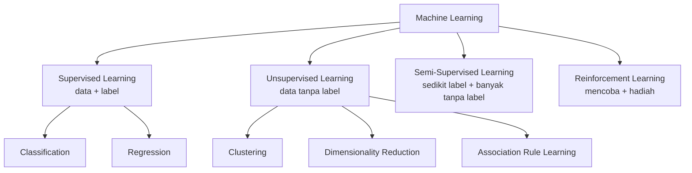

# Pendahuluan: Jenis-Jenis Machine Learning

## Analogi: tiga cara belajar memasak

Bayangkan tiga orang yang sama-sama ingin pandai memasak.

1. **Budi belajar dengan guru.** Setiap kali memasak, gurunya mencicipi lalu berkata "terlalu asin" atau "sudah pas". Budi belajar dari **contoh yang sudah ada jawabannya**.
2. **Sari tidak punya guru.** Ia hanya punya setumpuk resep tanpa keterangan apa pun. Ia membaca semuanya, lalu menyadari sendiri bahwa resep-resep itu bisa dikelompokkan: ada kelompok masakan berkuah, kelompok gorengan, dan kelompok kue. Sari **menemukan pola sendiri**.
3. **Andi belajar dengan mencoba.** Ia memasak, menyajikan ke keluarga, lalu melihat reaksinya. Kalau semua habis, ia merasa berhasil. Kalau sisa banyak, ia mengubah cara memasak. Andi **belajar dari hadiah dan hukuman** atas tindakannya.

Ketiga cara ini mirip dengan tiga jenis utama Machine Learning:

| Orang | Cara belajar | Jenis Machine Learning |
|---|---|---|
| Budi | Dari contoh yang sudah ada jawabannya | **Supervised Learning** |
| Sari | Menemukan pola tanpa jawaban | **Unsupervised Learning** |
| Andi | Mencoba, lalu menerima hadiah atau hukuman | **Reinforcement Learning** |

Ada juga jenis keempat, **Semi-Supervised Learning**, yaitu gabungan: hanya sebagian kecil contoh yang punya jawaban, sisanya tidak. Bayangkan Budi hanya sempat dicicipi gurunya lima kali, lalu harus belajar sendiri dari puluhan masakan lain.

## Mengapa Machine Learning dibagi menjadi beberapa jenis?

Karena **masalah yang berbeda punya data yang berbeda**.

- Kadang kita punya data lengkap dengan jawabannya. Contoh: ribuan email yang sudah ditandai "spam" atau "bukan spam".
- Kadang kita punya banyak data, tetapi **tidak ada jawabannya**. Contoh: data belanja jutaan pelanggan tanpa keterangan tipe pelanggan.
- Kadang kita tidak punya data sama sekali di awal. Mesin harus **mencoba sendiri** dan menerima umpan balik. Contoh: robot yang belajar berjalan.

Setiap situasi membutuhkan strategi belajar yang berbeda. Memilih jenis yang salah sama seperti memakai obeng untuk memukul paku.

## Bagaimana algoritma belajar dari data yang tersedia?

Algoritma selalu belajar dari **apa yang diberikan kepadanya**:

- Jika diberi data **beserta jawabannya**, algoritma belajar menghubungkan data dengan jawaban.
- Jika diberi data **tanpa jawaban**, algoritma hanya bisa mencari kemiripan, kelompok, atau struktur.
- Jika diberi **lingkungan** untuk dicoba dan **skor** atas tindakannya, algoritma belajar memilih tindakan yang menghasilkan skor terbaik.

## Gambaran empat paradigma

Istilah **paradigma** di sini berarti "cara pandang" atau "pendekatan besar" dalam belajar.

## Hubungan data, metode belajar, dan keluaran

| Data yang tersedia | Metode belajar | Contoh keluaran |
|---|---|---|
| Data + label | Supervised | "Email ini spam", "Harga rumah Rp850 juta" |
| Data tanpa label | Unsupervised | "Pelanggan ini masuk kelompok 2" |
| Sedikit label + banyak data tanpa label | Semi-Supervised | Label untuk data yang semula belum berlabel |
| Lingkungan + hadiah | Reinforcement | Urutan tindakan terbaik, misalnya langkah dalam permainan |

!!! note "Posisi kurikulum ini"
    Fokus utama kurikulum ini adalah **Clustering**, yang termasuk Unsupervised Learning. Namun kamu tetap perlu memahami jenis lain agar tahu **kapan** clustering adalah pilihan yang tepat, dan kapan bukan.

!!! info "Pengingat dari Bab 1"
    Semua jenis ini berada di dalam Machine Learning, yang merupakan bagian dari Artificial Intelligence. Lihat diagram di [AI, ML, dan Deep Learning](../introduction-to-machine-learning/03-ai-ml-deep-learning.md).

## Inti sub-bab ini

Jenis Machine Learning ditentukan terutama oleh **data apa yang tersedia** (ada label atau tidak) dan **apa yang ingin dicapai**. Untuk memahami perbedaannya, kita perlu paham dulu apa itu *label*. Itulah isi sub-bab berikutnya.

Lanjut ke [Labeled dan Unlabeled Data](02-labeled-and-unlabeled-data.md).
